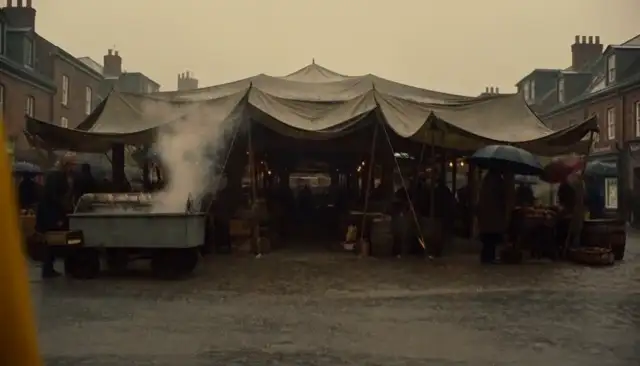
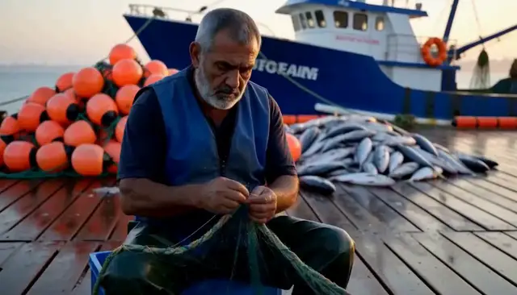
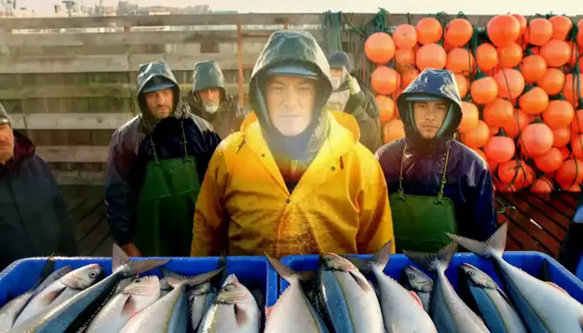

# RSI × MiniMax-H3 — single-clip and five-clip evidence

This repository records two real H3 experiments. [Longform run `101704_1strun`](#2-longform-rsi-five-clips-searched-as-one-project)
searches a harness by generating and scoring complete five-clip projects. [Single-clip run `101214_1strun`](#3-single-clip-rsi-101214_1strun)
is the earlier promoted demo. Their scores use different evaluation units and policies; compare base and candidate within each run.

**Metric notation:** `R_clip` is one clip reward and `S_clip` its search objective; `S_project` and `R_project` score complete projects, sharing `C = mean(R_clip)`. These names follow the implementation documentation. See the [score reference](slides_md/07-data-splits-and-scores.md) for formulas and split usage.

**Contents**

- [0. Design Walkthrough](slides_md/README.md)
- [1. Source case data](#1-source-case-data)
- [2. Longform RSI: five clips searched as one project](#2-longform-rsi-five-clips-searched-as-one-project)
  - [2.1. What one evaluation generates](#21-what-one-evaluation-generates)
  - [2.2. Search and independent results](#22-search-and-independent-results)
  - [2.3. Five-clip visual evidence and its video mapping](#23-five-clip-visual-evidence-and-its-video-mapping)
  - [2.4. Cost, scope and archived evidence](#24-cost-scope-and-archived-evidence)
- [3. Single-clip RSI: 101214_1strun](#3-single-clip-rsi-101214_1strun)
  

## 1. Source case data

The original generation requirements are available in [benchmarks/](benchmarks/README.md):

- [Single-clip tasks](benchmarks/tasks_gepa_v1.jsonl): 16 task prompts, split 4/2/6/4 across Train/Validation/Promotion/Test.
- [Five-clip ProjectSpecs](benchmarks/README.md#five-clip-inputs): 12 YAML projects, each with five segment prompts, continuity rules, and stitch order, split 2/4/4/2.
- [SHA-256 manifest](benchmarks/checksums.json): links the published sources to the recorded run inputs.

## 2. Longform RSI: five clips searched as one project

Run **`101704_1strun`** completed search, promotion and test on real H3 generation. It ran
**2026-10-17 12:57 → 2026-10-18 07:55, Asia/Shanghai**, about 18 h 58 min.
The search winner improved validation **search score** slightly, but **the promotion gate rejected it**.
This is evidence of a complete project-level search and rejection workflow, with mixed quality results.

### 2.1. What one evaluation generates

One case is **one five-segment project × one seed**, generated with one candidate harness throughout.
The first segment uses H3 `t2va`; segments 2–5 use `fl2va`, conditioned on the preceding segment's last frame.
Visually confirmed facts enter a persistent per-project `StoryState` and constrain later segments.
Once the five segments are committed, FFmpeg stitches their video and audio into a `timeline.mp4`.
Each requested 5 s segment contains 124 frames at 24 fps, so the complete timeline is **25.83 s**.

```text
candidate harness + project brief
  → clip 1 (t2va)
  → last frame + confirmed state → clip 2 (fl2va)
  → last frame + confirmed state → clip 3 (fl2va)
  → last frame + confirmed state → clip 4 (fl2va)
  → last frame + confirmed state → clip 5 (fl2va)
  → stitched 25.83 s timeline + project metrics
  → GEPA feedback → next harness candidate
```

GEPA therefore compares complete sequential projects. It does not independently pick five clip winners and
concatenate them afterward. The project score aggregates segment quality, confirmed state, payoff checks and
boundary continuity; it is **not** a single judge watching and grading the entire stitched movie.

H3 and all served production/reflection/judge models stay frozen. This run started from the learned
[`gepa-base.2` snapshot](longform/101704_1strun/base.yaml). GEPA could search `script`, `storyboard`, `director`
and `memory`; the selected [`1d079e4c` candidate](longform/101704_1strun/best.yaml) changes **only `memory`**
relative to that snapshot. All five agent prompt fields remain identical to the base.
The shared memory changes from 12 to 6 entries, including more explicit lighting/material continuity and
background prop persistence. The last entry is literally `Use precise material`; the saved proposal is preserved verbatim.

### 2.2. Search and independent results

The two project scores have different purposes:

- **`S_project = 0.70 C + 0.30 H`** drives train acceptance, validation ranking and winner selection.
- **`R_project = 0.40 C + 0.20 F + 0.20 P + 0.20 H`** is the report/promotion/test score when all metrics are present.

`C` is mean segment quality (`R_clip = 0.60 video + 0.25 story + 0.15 editing`);
`F` is the fraction of declared facts visually confirmed; `P` is the fraction of executed payoff checks that pass;
`H` is mean pixel similarity across adjacent last/first frames. Missing metrics are renormalized by the frozen
[policy](longform/101704_1strun/calibration.json); the loop penalty is disabled.
Project `R_project` and mean segment `R_clip` are distinct metrics. R_project is the underlying reward/report score, not a stage reserved for Promotion/Test. Both project scores can be measured on search cases; S_project drives selection, then independent Promotion measures R_project on separate held-out cases. For short clips, S_clip is derived from the same search case's R_clip, not a future promotion result. See the [score reference](slides_md/07-data-splits-and-scores.md).

| Split | Evaluation cases per harness | Metric | Base | Search winner | Δ |
| --- | --- | --- | --- | --- | --- |
| Validation | 4 projects × seed 0 | `S_project` | 0.750215 | 0.755050 | +0.004835 |
| Validation | same 4 cases | `R_project` | 0.810290 | 0.723665 | −0.086625 |
| Promotion | 4 projects × seeds 0,1 = 8 cases | `R_project` | 0.801887 | 0.806673 | +0.004786 |
| Test, report only | 2 projects × seed 0 | `R_project` | 0.775430 | 0.787240 | +0.011810 |

Sources: frozen [`report.json`](longform/101704_1strun/report.json),
[`search.json`](longform/101704_1strun/search.json) and
[`promotion/decision.json`](longform/101704_1strun/promotion/decision.json).
The gate records `mean_delta = 0.004785` before rounding the displayed split means.
Validation participates in search selection; promotion and test do not supply reflection feedback.
Train uses 2 projects × seeds 0,1, so every parent/child acceptance comparison covers 4 complete project cases.

Search evaluated **44 distinct harness configurations**; base plus 3 child candidates received full validation
scores. The winner is selected by `S_project`, which explains why it can have a lower validation `R_project`.


**Promotion required both** mean `R_project` gain ≥ 0.02 and no individual project×seed regression beyond 0.05,
with no loss of validity. All promotion and test timelines were valid for both harnesses.

Nevertheless, for the case below, `tea-farm`, seed 0 fell **0.82632 → 0.75158 (−0.07474)**, and the overall promotion gain was below 0.02. The recorded reason names the tea-farm regression; both numerical criteria fail. **No new champion was promoted.**
The positive test mean does not override that decision.

<details>
<summary>Every promotion/test case, using R_project</summary>

| Split | Project | Seed | Base | Search winner | Δ |
| --- | --- | --- | --- | --- | --- |
| promotion | desert-caravan | 0 | 0.82720 | 0.79924 | -0.02796 |
| promotion | desert-caravan | 1 | 0.77452 | 0.86662 | +0.09210 |
| promotion | harbor-dawn | 0 | 0.85908 | 0.81656 | -0.04252 |
| promotion | harbor-dawn | 1 | 0.82358 | 0.82174 | -0.00184 |
| promotion | science-fair | 0 | 0.72142 | 0.75070 | +0.02928 |
| promotion | science-fair | 1 | 0.75412 | 0.78752 | +0.03340 |
| promotion | tea-farm | 0 | 0.82632 | 0.75158 | -0.07474 |
| promotion | tea-farm | 1 | 0.82886 | 0.85942 | +0.03056 |
| test | autumn-orchard | 0 | 0.73508 | 0.72388 | -0.01120 |
| test | subway-musician | 0 | 0.81578 | 0.85060 | +0.03482 |

</details>

### 2.3. Five-clip visual evidence and its video mapping

These are **animated WebP previews decoded from the recorded videos**; click a preview to open its source MP4 with sound.
Each timeline preview plays the complete five-segment movie (620 video frames at 24 fps, about 25.83 s) of the same
[**town-fair production pilot**](benchmarks/longform_town_fair_5clip_v1.yaml), across the base and three successive harness rewrites shown on
[Design Walkthrough page 13](slides_md/13-town-fair-videos.md). This is the earlier **`101416` presentation lineage**, separate from the
`101704_1strun` search and promotion results above. The displayed rows ran at different Train seeds: byte identity resolves the
base to seed 1 and the first script rewrite to seed 0 ([proof](slides_md/subdocs_examples/11-town-fair-longform-production.md#81-resolve-the-two-original-production-identities)),
so these are lineage examples, not a controlled same-seed comparison.

Previews are downsampled for the README (640 px wide, 8 fps, audio dropped, no overlaid labels).
Exact parameters, source-video metadata and SHA-256 hashes are in
[`slides_md/previews/provenance.json`](slides_md/previews/provenance.json).
Segments play in stitch order: `umbrella-arrival` → `kite-park` → `fountain-arrival` → `bakery-prep` → `potter-opening`.
The [world setting and five segment requirements](slides_md/17-findings-and-pilot-prompts.md#town-fair-manually-constructed-five-segment-production-pilot)
explain the intended actions. **S_project/R_project below are means over four Validation projects, not scores for these town-fair videos.**

**Base** - `d16c2e95`, mean Validation S_project 0.7293 / R_project 0.7645

<a href="slides_md/assets/media4.mp4"></a>

**1. Script rewrite** - `c863aae2` (round 1), mean Validation S_project 0.7436 / R_project 0.7698

<a href="slides_md/assets/media5.mp4"></a>

**2. Storyboard rewrite** - `3252791a` (round 7), mean Validation S_project 0.7477 / R_project 0.7834

<a href="slides_md/assets/media6.mp4"></a>

**3. Script rewrite again** - `c1912a62` (round 57), mean Validation S_project 0.7516 / R_project 0.7672

<a href="slides_md/assets/media7.mp4"></a>

Each preview maps to one complete five-segment source movie, not to independently selected clips.
The final rewrite increases mean Validation S_project while lowering R_project; the videos let readers inspect the motion and scene realization alongside those metrics.

**The user prompt mentions "a child wearing a green jacket catches a falling paper kite" verbatim, `c1912a62` the 3rd one manages to do this.**


Recorded source identities, following the [presentation's video mapping](slides_md/13-town-fair-videos.md#embedded-videos):

| Stage | Harness hash prefix | Source MP4 extracted from the presentation |
| --- | --- | --- |
| Base | `d16c2e95` | [`media4.mp4`](slides_md/assets/media4.mp4) |
| Script rewrite | `c863aae2` | [`media5.mp4`](slides_md/assets/media5.mp4) |
| Storyboard rewrite | `3252791a` | [`media6.mp4`](slides_md/assets/media6.mp4) |
| Script rewrite again | `c1912a62` | [`media7.mp4`](slides_md/assets/media7.mp4) |

**Which harness is best?** `c1912a62` is the **search winner**, selected by the highest mean Validation S_project (0.7516). Its R_project (0.7672) is **third-highest among these four**, not second; `3252791a` has the highest R_project (0.7834). Selection uses `S_project = 0.70 C + 0.30 H`, while report/gate score `R_project = 0.40 C + 0.20 F + 0.20 P + 0.20 H` also measures confirmed facts and payoff checks. Different weights and metrics can rank candidates differently. "Winner" means best under the search objective; independent promotion determines whether it is eligible to replace the base, and individual clips can still regress.

The extracted MP4s do not establish the original per-video seed or project-directory hash; those identities are not inferred here.
The original `101704` desert-caravan comparison remains in its [archived figure](longform/101704_1strun/figures/101704_1strun_base_vs_best.webp)
and [video index](longform/101704_1strun/videos.json). The comparisons below identify their source runs; the recorded probability checks belong to `101704`.

<details>
<summary>Selected action comparison, recorded checks and mappings</summary>

The first row shows a town-fair action comparison from the presentation: the base has no clearly visible kite in the child's hands,
while `c1912a62` shows the child holding a colorful kite overhead. The previews contain the complete second segment
(frames 124-247 of each source timeline), not selected stills; no judge probability is claimed for this visual comparison.
The following rows retain the archived `101704` checks, whose judge samples were frames 62 and 123 within each segment.
All previews play about 5.17 s at 640 px / 12 fps without audio; base is left and the corresponding search winner is right.
The `101704` winner was rejected by promotion, so that label does not establish better generation across cases.

| Check | Base | Winner |
| --- | --- | --- |
| town-fair (`101416`) - `kite-park`: child holding a kite - visual comparison of base `d16c2e95` and search winner `c1912a62` | <a href="slides_md/assets/media4.mp4#t=5.166667,10.333333"></a> | <a href="slides_md/assets/media7.mp4#t=5.166667,10.333333"></a> |
| desert-caravan, seed 1 · `sandstorm`, payoff `camels`: camels visible · recorded P(yes) 0.00 → 0.99 |  |  |
| harbor-dawn, seed 0 · `sun-up`, evidence `time`: sunrise over the harbor · recorded P(yes) 0.99 → 0.00 |  |  |

**How these questions participate in RSI.** Each `segments[index]` carries fixed case requirements and visual checks; RSI rewrites the harness, while these questions stay fixed. The town-fair row illustrates the action behind `kite-park.evidence.kite` in its [ProjectSpec](benchmarks/longform_town_fair_5clip_v1.yaml); the per-video seeds are established by byte identity in the [worked production example](slides_md/subdocs_examples/11-town-fair-longform-production.md#81-resolve-the-two-original-production-identities) (base seed 1, first script rewrite seed 0). The recorded camel check corresponds to [`sandstorm.payoff.camels`](benchmarks/longform_desert_caravan_5clip_v1.yaml#L46), and the sunrise check uses the separate harbor-dawn case. The probability arrows compare base with the `101704` search winner on the same case and seed, rather than showing successive RSI iterations. The tea and scarf questions below are further schema examples, not probability claims about the town-fair videos.

| Input / stage | High-level role | Effect in this RSI run |
| --- | --- | --- |
| `prompt` + `state_commit` | Specify the requested scene and the new facts it should establish; e.g. `tea: poured`. A declaration is a requirement, not proof. | The scene brief drives generation; proposed facts require visual confirmation before becoming shared state. |
| `evidence.<fact>` | Ask whether the new fact is visible in this segment; L66 asks whether someone is pouring tea from a metal teapot. | The frozen visual judge checks sampled frames. At P(yes) >= 0.5, the declared value enters StoryState; otherwise it is withheld and any older value for that key is removed. Confirmed facts enter later segment briefs. |
| `payoff.<fact>` | Ask whether an earlier confirmed fact remains visible; [L68](benchmarks/longform_desert_caravan_5clip_v1.yaml#L68) checks the green scarf established in `dune-walk`. | Runs only when the key is in the upstream confirmed state. Pass/fail contributes to `payoff_rate`, without changing state. A withheld upstream key is skipped and excluded from the denominator. |
| Project evaluation | Summarize evidence as `F = state_confirmed_rate` and executed payoff checks as `P = payoff_rate`. | Both enter report/promotion/test score `R_project` with weight 0.20 each. Neither directly enters this run's search score `S_project = 0.70 C + 0.30 H`; state changes can still affect later generation and thus S_project indirectly. |
| Train feedback -> GEPA -> next harness | Expose weak checks alongside segment scores and transition diagnostics to explain what the current harness failed to realize. | Train-project feedback guides reflection on `script`, `storyboard`, `director` or `memory`. Validation selects the winner; promotion/test checks are held out from reflection. The questions themselves are not optimized. |

A negative evidence/payoff answer alone does not invalidate or regenerate a segment. These checks control verified state, supply diagnostics, and contribute to project evaluation. They measure sampled visual presence: a passing scarf/camel question does not establish exact character identity or continuous visibility throughout the clip. See the [ProjectSpec field reference](benchmarks/README.md#projectspec-field-reference) for the input schema.

The two numerical probability comparisons above are recorded figure annotations. A check's probability is the maximum over the two sampled-frame probabilities,
not their mean or a whole-video probability. The figure header also mentions a re-query tolerance;
no new judge re-query was performed for this README update.
See the [figure provenance guide](longform/101704_1strun/README.md) for the source project-directory hashes and
known legacy-label issues in the remaining archived figures.

</details>

### 2.4. Cost, scope and archived evidence

The [budget ledger](longform/101704_1strun/budget.json) records **1,050 actual H3 requests**:
search **950/1,000**, promotion **80/120**, test **20/50**. Search stopped when its remaining 50 requests
could not cover the conservative 60-request estimate for another parent/child train comparison plus full validation.
Those request counts include incomplete/failed attempts; dividing by five does not establish the number of valid movies.

The project score has useful but limited signals: story/editing assess generated text plans, boundary pixel similarity
can be high because the next clip is explicitly conditioned on the previous last frame, and payoff checks can be skipped
when an upstream fact was not confirmed. A higher project score therefore needs visual inspection alongside its components.
For example, test mean segment quality actually falls **0.65580 → 0.64275**, despite the higher test project score.

The [run archive](longform/101704_1strun/) includes the frozen base/best harnesses, scoring and service manifest,
reports, GEPA log, 12 project specifications verified against their manifest hashes, all six original WebP figures,
and the recorded video index. It contains no MP4s or implementation code.
Some original figures use older terminology or stale captions; the JSON-derived tables above and the
[figure guide](longform/101704_1strun/README.md) identify the intended metrics and mappings.

---

## 3. Single-clip RSI: 101214_1strun

The intro to `101214_1strun` is essentially recorded in [rfc748](https://github.com/verl-project/verl-omni/issues/748), here we elaborate on it with more details.
See [here](rfc748/readme.md).