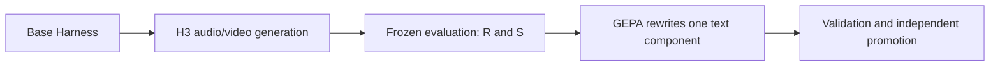

# 03. Harness RSI: Generation, Evaluation, and Promotion

Source: PPTX page 3 of 17.

The main loop starts from a Base Harness with six text fields, generates real audio/video with H3, scores the output under a frozen evaluation policy, and uses GEPA to rewrite one component before validation and promotion.

| Split | Role and feedback boundary |
|---|---|
| Train | Compare parent and child using S; only Train trajectories reach reflection |
| Validation | Return scalar S values, maintain the per-task Pareto frontier, select best by mean S |
| Promotion | Independently reevaluate Base/best using R and quality axes; results do not feed back into this search |
| Test | Report Base/best R and axis scores; results do not influence selection |

For short clips, R is the weighted quality score and `S = R − axis-regression penalty`. The searched components are script, storyboard, director, and memory. Critic/editor remain fixed diagnostic components. See [the split and scoring definitions](07-data-splits-and-scores.md).

---

[Contents](README.md) · [Previous](02-rsi-definition.md) · [Next](04-service-topology.md)
