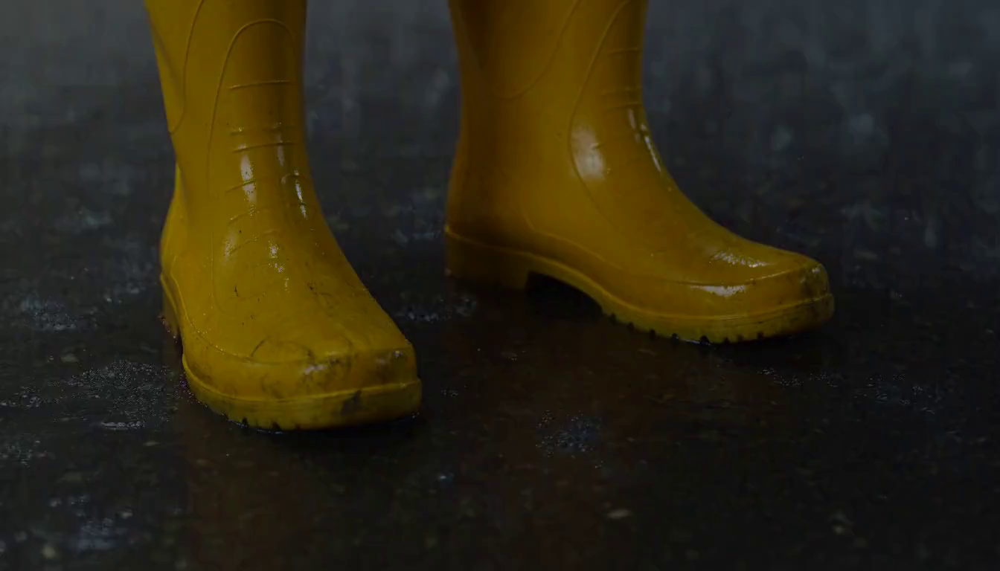
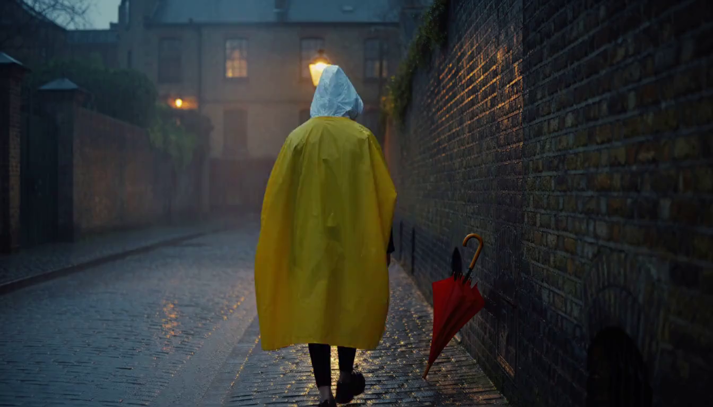

# 09. Short-Clip Videos from Three Harness Versions

Source: PPTX page 9 of 17.

Compare full actions, camera movement, and sound for the same `train-001` task. A static final frame cannot replace the video.

| Version | R_clip | Video axis |
|---|---:|---:|
| Base | 0.6348 | 0.477 |
| Rewrite script | 0.6628 | 0.541 |
| Then rewrite director | 0.6659 | 0.556 |

The [worked script-rewrite example](subdocs_examples/08-script-rewrite-prompt-lifecycle.md#7-h3-request-and-output-video) compares the Base and Script rewrite H3 JSON payloads and output videos shown here.

### Metric definitions

**Video axis (V)** is a visual-quality proxy in `[0, 1]`. UnifiedReward evaluates sampled frames from the generated video against the **original task prompt**. Each valid frame receives three scores from 1 to 5:

- **Alignment:** how well the frame content matches the task prompt.
- **Coherence:** visual consistency within the frame, including the absence of glitches and object distortions.
- **Style:** aesthetic appeal, independent of prompt accuracy.

For each valid frame, the three scores are averaged and normalized with `(mean − 1) / 4`. V is the mean of these normalized scores across valid sampled frames. This is frame-based evaluation; it does not assess audio or establish complete motion/physics correctness. Coherence here refers to visual consistency within a frame, rather than a direct temporal-coherence measurement.

**R_clip** is the underlying weighted clip reward, computed on search cases as well as Promotion/Test:

`R_clip = 0.60 × V + 0.25 × story + 0.15 × editing`

Story is a script-quality/consistency proxy; editing is a storyboard shot-count/timing proxy. V is therefore one component of R_clip, rather than a second name for the same score. See [page 7](07-data-splits-and-scores.md) for how R_clip and S_clip are used across data splits.

Definition checked against `rsi_harness/reward/video_quality.py`, `rsi_harness/reward/builder.py`, and `docs/04_reward_builder_zh.md` in the implementation repository. This section is also added to page 9 of the revised presentation.

Each clip contains 124 frames, lasts about 5.17 seconds, and retains its original audio. The extracted MP4 links below preserve the embedded video; playback depends on the Markdown viewer.

### Source images (idx 0 just for vis)

### Embedded videos

These links reuse the original evaluation videos; duplicate presentation exports were removed after byte comparison. [Original media names and SHA-256 mapping](assets/short-clip-video-mapping.json).

- [Base](../evaluations/edb00ad03c2e77bc2b759d587f1a1f2c0706fcf90405d129cae6ee19daa4771b/video.mp4)
- [Script rewrite](../evaluations/0aa979018910a10da8a371e18edc03464f18690acf534c0948e629736dd44170/video.mp4)
- [Director rewrite](../evaluations/93d21889efd4bd045da797839dc3add5758da0c7d097d3ca06c15a666ff43810/video.mp4)

---

[Contents](README.md) · [Previous](08-short-clip-results.md) · [Next](10-prompt-propagation.md)
