# 12. Long-Form Example: The town-fair Rewrite Lineage

Source: PPTX page 12 of 17.

The same recursive lineage progresses from Base to script rewrite, storyboard rewrite, and a further script rewrite.

| Candidate | Change | Mean Validation S | Mean Validation R |
|---|---|---:|---:|
| `d16c2e95` | Base | 0.7293 | 0.7645 |
| `c863aae2` | Round 1: script | 0.7436 | 0.7698 |
| `3252791a` | Round 7: storyboard | 0.7477 | 0.7834 |
| `c1912a62` | Round 57: script again | 0.7516 | 0.7672 |

S/R are means across **four Validation projects**, rather than town-fair scores. The final edge improves S while reducing R. The displayed `101416` run was interrupted before promotion/Test.

The five intended segment scenes are red-umbrella arrival, park kite, fountain cyclist, bakery preparation, and pottery-stall opening. Each row's images correspond to the videos on [page 13](13-town-fair-videos.md), with one final frame per segment. Each project contains 5 × 124 frames, about 25.83 seconds.

Final frames show endings, rather than complete actions or proof that each intended scene was fulfilled. The source notes also state that Train seeds differ across these rows.

### Source images

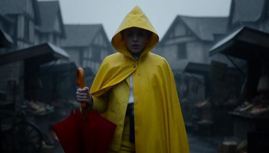

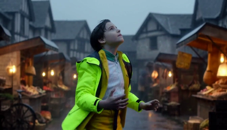

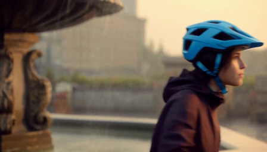

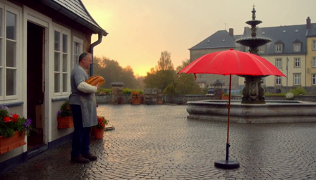

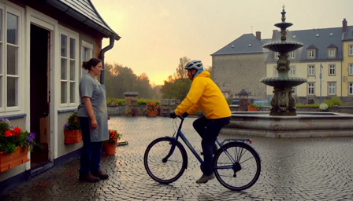

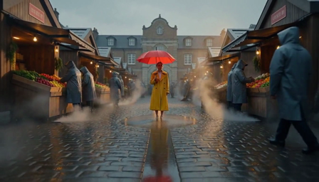

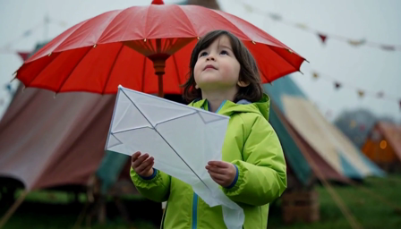

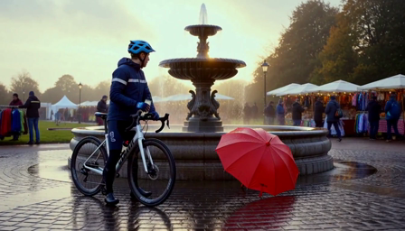

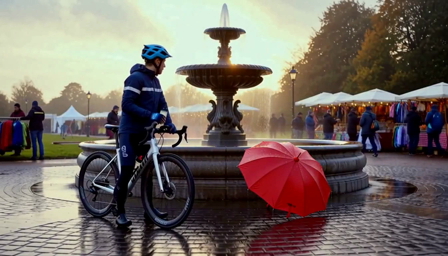

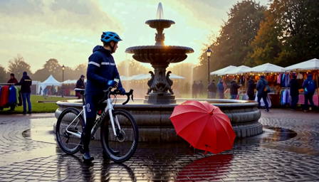

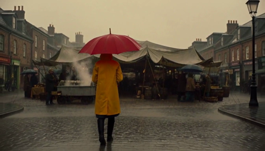

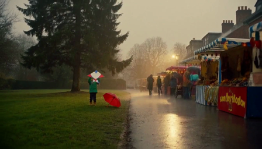

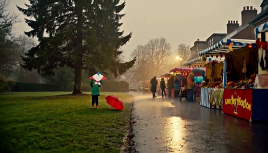

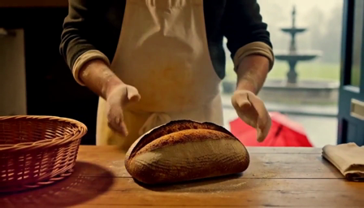

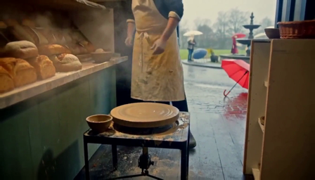

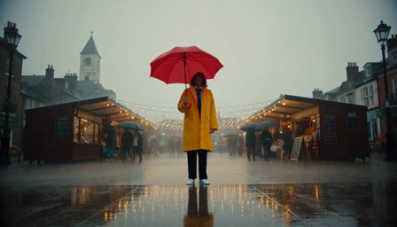

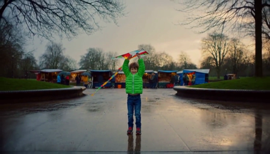

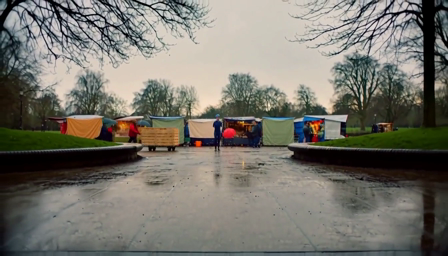

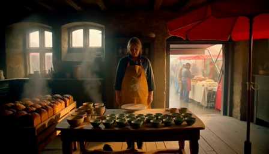

---

[Contents](README.md) · [Previous](11-long-form-production.md) · [Next](13-town-fair-videos.md)
