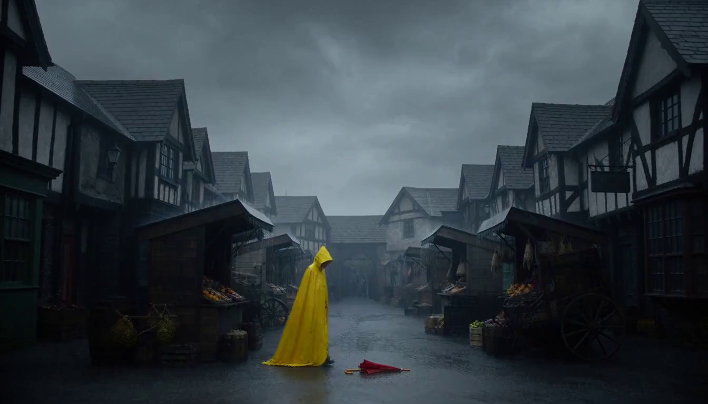
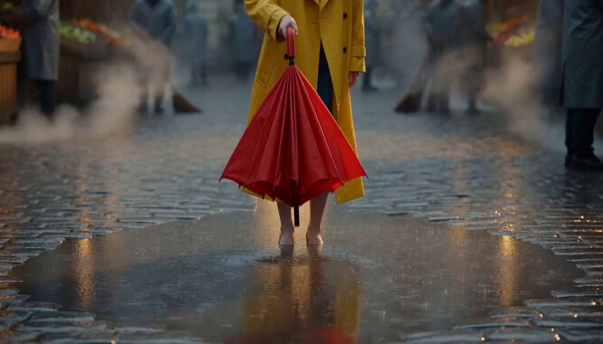
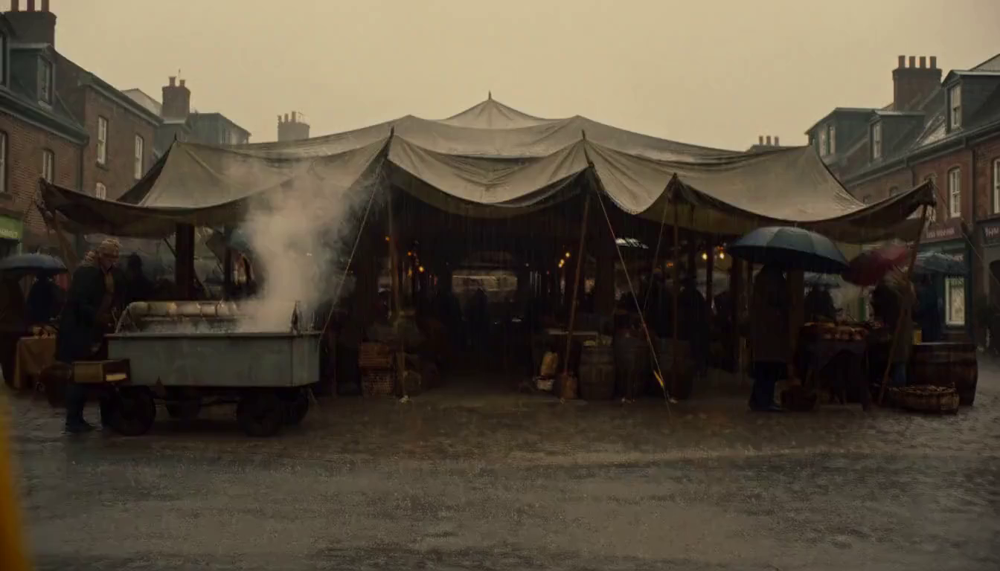
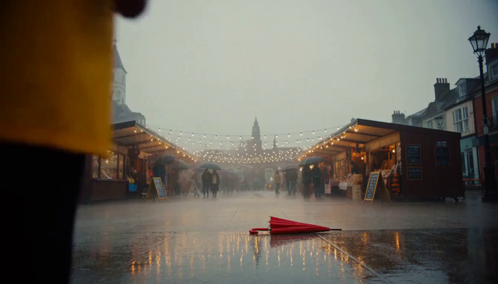

# 13. town-fair Videos Across the Recursive Lineage

Source: PPTX page 13 of 17.

The four embedded videos compare:

1. Base: `d16c2e95`.
2. `c863aae2`: script rewrite.
3. `3252791a`: storyboard rewrite.
4. `c1912a62`: another script rewrite.

Each video is the five-segment town-fair production associated with the corresponding image row on [page 12](12-town-fair-lineage.md). The full translated world setting and segment prompts appear on [page 17](17-findings-and-pilot-prompts.md).

Use the local MP4 links below to inspect motion and sound. The S_project/R_project Validation averages on page 12 should not be read as scores for these particular town-fair videos. R_project is available on Validation too; the later promotion decision would use independent held-out evaluations.

[Detailed production comparison for Base and the first Script rewrite](subdocs_examples/11-town-fair-longform-production.md) follows these two videos through all five segments, with source snapshots and the recovered runtime traces for both arms.

### Source images

### Embedded videos

- [Base — d16c2e95](assets/media4.mp4)
- [Script — c863aae2](assets/media5.mp4)
- [Storyboard — 3252791a](assets/media6.mp4)
- [Script again — c1912a62](assets/media7.mp4)

---

[Contents](README.md) · [Previous](12-town-fair-lineage.md) · [Next](14-long-form-optimization.md)
