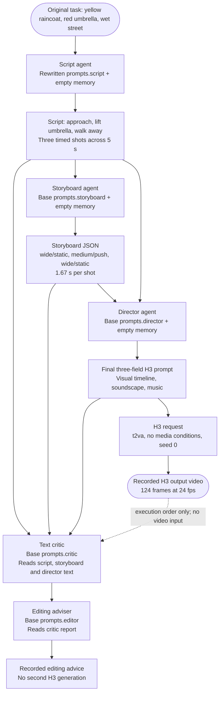
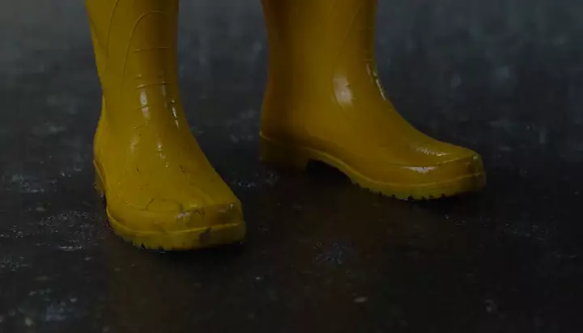
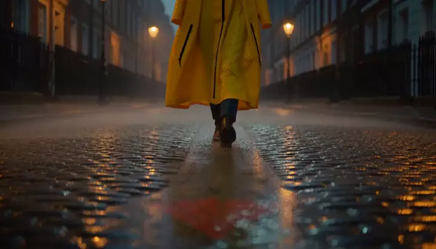

# Worked example: the script rewrite for train-001

This is the **Rewrite script** row on [page 8](../08-short-clip-results.md): R_clip **0.6628**, video axis **0.541**. It instantiates the [prompt lifecycle on page 4](../04-service-topology.md) using a recorded evaluation, rather than invented sample prompts.

This is a **single-clip t2va task**, not a longform segment. The lifecycle starts with the original task prompt directly: there is no ProjectSpec brief composition, confirmed StoryState, prior-frame handoff or reference image in this case. Script, storyboard, director, H3 generation, critic and editor follow the same production pipeline shown in the graph.

## 1. Which evaluation is this?

| Item | Recorded identity |
| --- | --- |
| Run / phase | `101214_1strun` / search |
| Case | `train:train-001:seed0` |
| Candidate | `d58fde464b7f6e72b223770db9e3f50d6d9aa4babb138b75d4c77d27fadda30f` |
| Evaluation/cache key | `0aa979018910a10da8a371e18edc03464f18690acf534c0948e629736dd44170` |
| Production text | `neohorse-1-4B` at `:8000` |
| Video generation | MiniMax-H3 at `:30010`, `t2va`, seed 0 |
| Target | 5 s, short edge 768, 16:9, 24 fps, 10 inference steps |
| Text fields changed from base | `prompts.script` only; `memory` is empty |

Sources: [candidate harness](../../candidates/d58fde464b7f6e72b223770db9e3f50d6d9aa4babb138b75d4c77d27fadda30f/harness.yaml), [base harness](../../base.yaml), [task JSONL](../../benchmarks/tasks_gepa_v1.jsonl), [recorded trajectory](../../evaluations/0aa979018910a10da8a371e18edc03464f18690acf534c0948e629736dd44170/trajectory.json), [outcome](../../evaluations/0aa979018910a10da8a371e18edc03464f18690acf534c0948e629736dd44170/outcome.json) and [run manifest](../../manifest.json). Candidate identity comes from the outcome's `candidate_hash`; the inherited harness version label alone does not identify the rewritten candidate.

**How to read the messages.** Agent output strings below are copied from the trajectory; the storyboard is the saved parsed/normalized JSON, not the raw model completion. System messages are reconstructed from the saved harness (`prompts.<agent>` plus memory). User messages are reconstructed with the implementation's message templates and saved upstream outputs; raw chat requests were not stored, so historical JSON key order and whitespace are not claimed as a byte-for-byte chat capture. The H3 request has stronger provenance: the reconstructed payload and endpoint reproduce its recorded request hash.

## 2. The concrete path



## 3. Original user requirement

The input is the `prompt` from the published `train-001` row. Its `extra.source_id` is `umbrella-01`; that provenance label is not inserted into the agent messages.

```text
A person in a yellow raincoat picks up a red umbrella on a wet street. Keep the same person and umbrella throughout. Include footsteps and dripping water.
```
## 4. Scriptwriter: the only rewritten system prompt

The base asked for a short film script. GEPA's script rewrite adds explicit three-shot timing, repeated subject descriptions, concrete visual details and a setup/action/resolution structure. That changes the system message, while the task requirement remains fixed.

<details>
<summary>Base script system prompt, for comparison</summary>

```text
You are a screenwriter. Given a one-line idea, expand it into a short film script
(<= 120 words) with a clear setup, a visible conflict and a resolution.
Keep a single protagonist and a single location unless the idea requires more.
```

</details>
**System message used by this candidate** (`prompts.script`; empty memory adds nothing):

```text
You are a Text-to-Video Script Specialist. Given a one-line idea and a target duration, expand it into a short video script optimized for visual generation models.

1. **Structure**: Generate exactly 3 shots. Use the format `**SHOT N (Start-Time-End-Time)**`. The sum of shot durations must equal the target duration precisely (e.g., 5.0s).
2. **Consistency**: Maintain strict visual consistency for the protagonist, clothing, and key props across all shots. Describe the subject identically in each shot to ensure alignment.
3. **Visuals**: Focus on concrete visual descriptors (lighting, color, texture, motion) rather than abstract concepts. Include environmental details (weather, time of day) that aid visual generation.
4. **Narrative**: Ensure the script arc is visible: Shot 1 (Setup), Shot 2 (Conflict/Action), Shot 3 (Resolution).
5. **Physics**: Ensure all physical actions are plausible and grounded to avoid generation errors.
6. **Constraints**: Total word count must be <= 120 words. Keep the location single unless the idea requires multiple.
```
**User message** (reconstructed by `ScriptAgent.run`):

```text
Idea: A person in a yellow raincoat picks up a red umbrella on a wet street. Keep the same person and umbrella throughout. Include footsteps and dripping water.
Target duration: 5s across 3 shots.
```
**Recorded output: enhanced version 1, the script** (`trajectory.script`):

```text
**SHOT 1 (0.0s-1.67s)** A person in a bright yellow raincoat with black zippers walks forward on a slick cobblestone street at dusk; rain falls softly, puddles reflect the streetlights, and their boots make rhythmic splashing footsteps on the wet ground.

**SHOT 2 (1.67s-3.33s)** The same person in the yellow raincoat bends at the waist, knuckles white, lifting a bright red umbrella from a shallow puddle; water droplets splatter upward around the red fabric as they straighten, dripping water visibly falling from the umbrella's handle to the cobblestones.

**SHOT 3 (3.33s-5.0s)** The person in the yellow raincoat holds the red umbrella over their head, walking away from the camera down the wet street; rain drips steadily from the umbrella tip, streetlights glow warmly on the wet pavement, and footsteps continue rhythmically in the distance.
```
## 5. Storyboard planner: script becomes a shot list

The storyboard system prompt is unchanged from base. Its user message changes because it receives the new script.

**System message** (`prompts.storyboard`; memory is empty):

```text
You are a storyboard artist. Given a script, output a JSON list of shots. Each shot has
`index`, `seconds`, `shot_size` (wide/medium/close), `camera` (static/push/pan), `action`.
Total duration must match the target. Keep subject appearance consistent across shots.
```
**User message** (reconstructed by `StoryboardAgent.run`):

<details>
<summary>Complete storyboard user message</summary>

```text
Script:
**SHOT 1 (0.0s-1.67s)** A person in a bright yellow raincoat with black zippers walks forward on a slick cobblestone street at dusk; rain falls softly, puddles reflect the streetlights, and their boots make rhythmic splashing footsteps on the wet ground.

**SHOT 2 (1.67s-3.33s)** The same person in the yellow raincoat bends at the waist, knuckles white, lifting a bright red umbrella from a shallow puddle; water droplets splatter upward around the red fabric as they straighten, dripping water visibly falling from the umbrella's handle to the cobblestones.

**SHOT 3 (3.33s-5.0s)** The person in the yellow raincoat holds the red umbrella over their head, walking away from the camera down the wet street; rain drips steadily from the umbrella tip, streetlights glow warmly on the wet pavement, and footsteps continue rhythmically in the distance.

Total duration: 5s
```

</details>
**Recorded output: enhanced version 2, normalized storyboard** (`trajectory.storyboard`):

```json
[
  {
    "action": "A person in a bright yellow raincoat with black zippers walks forward along a slick cobblestone street at dusk. Rain falls softly, puddles reflect streetlights, and their boots make rhythmic splashing footsteps on the wet ground.",
    "camera": "static",
    "index": 1,
    "seconds": 1.67,
    "shot_size": "wide"
  },
  {
    "action": "The same person in the yellow raincoat bends at the waist, knuckles white, lifting a bright red umbrella from a shallow puddle. Water droplets splatter upward around the red fabric as they straighten, with dripping water visibly falling from the umbrella's handle onto the cobblestones.",
    "camera": "push",
    "index": 2,
    "seconds": 1.67,
    "shot_size": "medium"
  },
  {
    "action": "The person in the yellow raincoat holds the red umbrella over their head and walks away from the camera down the wet street. Rain drips steadily from the umbrella tip, streetlights glow warmly on the wet pavement, and rhythmic footsteps continue in the distance.",
    "camera": "static",
    "index": 3,
    "seconds": 1.67,
    "shot_size": "wide"
  }
]
```
The saved storyboard gives every shot 1.67 s, totaling 5.01 s; the script's stated boundaries end at 5.0 s. This rounding discrepancy is preserved from the artifact. The H3 request still specifies a 5.0 s target.

## 6. Director: planning outputs become the H3 prompt

The director system prompt is unchanged from base. Both the generated script and storyboard enter its user message, along with the target settings.

**System message** (`prompts.director`; memory is empty):

```text
You are a film director writing a prompt for MiniMax-H3. Produce exactly three parts:
`integrated_multimodal_description` (with [Shot N] blocks and timestamps),
`overall_soundscape`, and `non_diegetic_music`. Be concrete about lighting, materials,
and motion. Repeat the protagonist's appearance in every shot.
```
**User message** (reconstructed by `DirectorAgent.run`):

<details>
<summary>Complete director user message</summary>

```text
Script:
**SHOT 1 (0.0s-1.67s)** A person in a bright yellow raincoat with black zippers walks forward on a slick cobblestone street at dusk; rain falls softly, puddles reflect the streetlights, and their boots make rhythmic splashing footsteps on the wet ground.

**SHOT 2 (1.67s-3.33s)** The same person in the yellow raincoat bends at the waist, knuckles white, lifting a bright red umbrella from a shallow puddle; water droplets splatter upward around the red fabric as they straighten, dripping water visibly falling from the umbrella's handle to the cobblestones.

**SHOT 3 (3.33s-5.0s)** The person in the yellow raincoat holds the red umbrella over their head, walking away from the camera down the wet street; rain drips steadily from the umbrella tip, streetlights glow warmly on the wet pavement, and footsteps continue rhythmically in the distance.

Storyboard (JSON):
[{"action": "A person in a bright yellow raincoat with black zippers walks forward along a slick cobblestone street at dusk. Rain falls softly, puddles reflect streetlights, and their boots make rhythmic splashing footsteps on the wet ground.", "camera": "static", "index": 1, "seconds": 1.67, "shot_size": "wide"}, {"action": "The same person in the yellow raincoat bends at the waist, knuckles white, lifting a bright red umbrella from a shallow puddle. Water droplets splatter upward around the red fabric as they straighten, with dripping water visibly falling from the umbrella's handle onto the cobblestones.", "camera": "push", "index": 2, "seconds": 1.67, "shot_size": "medium"}, {"action": "The person in the yellow raincoat holds the red umbrella over their head and walks away from the camera down the wet street. Rain drips steadily from the umbrella tip, streetlights glow warmly on the wet pavement, and rhythmic footsteps continue in the distance.", "camera": "static", "index": 3, "seconds": 1.67, "shot_size": "wide"}]

Target: 5s, 16:9, mode=t2va.
```

</details>
**Recorded output: enhanced version 3, the text H3 receives** (`trajectory.director_prompt`):

```text
integrated_multimodal_description:
[Shot 1] 0.00s - 1.67s: EXT. COBBLESTONE STREET - DUSK. A wide, static shot captures a slick, grey cobblestone street glistening under the amber glow of streetlamps. Rain falls softly, creating a fine mist that catches the light. Puddles between the stones act as fragmented mirrors, reflecting the warm yellow hues of the lamps. The protagonist, a figure clad in a vivid bright yellow raincoat with prominent matte-black zippers running vertically down the front and horizontally across the chest, walks steadily toward the camera. Their boots, dark leather with a slight sheen from the rain, make rhythmic, splashing footsteps against the wet pavement. The motion is a steady, determined forward stride; the coat sways gently with each step, the black zippers contrasting sharply against the luminous yellow fabric. As they approach, the raindrops on the camera lens blur the background slightly, emphasizing the figure's isolation and movement.
[Shot 2] 1.67s - 3.33s: EXT. COBBLESTONE STREET - DUSK (CONT'D). MEDIUM SHOT, CAMERA PUSH. The camera slowly pushes in as the protagonist, still in the bright yellow raincoat with black zippers, halts their forward motion and bends at the waist, knees bending deeply. Their knuckles turn white as they grip the handle of a bright red umbrella, lifting it from a shallow, rain-filled puddle. The red fabric of the umbrella is vibrant, almost electric against the gloom, and water droplets splatter upward in a radiant arc around the red material as it breaks the surface tension. As they straighten their back, the motion is fluid yet energetic, the yellow coat flaring outward slightly. Water drips visibly from the umbrella's black handle, tracing a clear path through the air before hitting the dark cobblestones with soft thuds. The rain continues to fall, but the immediate area around the protagonist is disturbed by the splashing water and the rising steam of the warm lights reflecting off the wet coat.
[Shot 3] 3.33s - 5.00s: EXT. COBBLESTONE STREET - DUSK (CONT'D). WIDE SHOT, STATIC. The protagonist, wearing the bright yellow raincoat with black zippers, now stands upright and holds the bright red umbrella high over their head, the canopy fully extended. They turn slightly and begin walking away from the camera, disappearing down the length of the wet street. The rain drips steadily and rhythmically from the tip of the red umbrella, each drop landing with a distinct sound. The streetlights glow warmly on the wet pavement behind them, creating long, shimmering reflections that stretch into the distance. Their footsteps continue rhythmically in the distance, the yellow of the raincoat gradually shrinking until it fades into the misty dark of the street. The black zippers on the coat remain a subtle detail as the figure moves further away, the red umbrella a solitary beacon in the falling rain.

overall_soundscape:
The soundscape is dominated by the heavy, rhythmic patter of rain against the yellow raincoat and the slick cobblestones. In Shot 1, the sound is a soft, continuous drizzle mixed with the distinct, splashing "plip-plip" of the protagonist's boots hitting the puddles, creating a metronomic beat. As Shot 2 begins, this rhythm intensifies; the splash of the boots stops abruptly, replaced by the sudden, sharp *whoosh* and *hiss* of the umbrella breaking the water's surface, followed by a burst of mid-air water droplets splattering against the coat. The white-knuckle grip adds a subtle, tense creak of the umbrella mechanism. In Shot 3, the sound settles into a steady, hypnotic drip from the umbrella tip, layering over the fading, distant rhythm of the footsteps receding into the night. The ambient streetlamps cast a warm, low-frequency hum, and the wet stones absorb most other noise, leaving only the intimacy of rain, footsteps, and dripping fabric.

non_diegetic_music:
A sparse, atmospheric cello melody enters softly, its low notes resonating with the dampness of the environment. The music is minimal, using long, sustaining bow strokes that mimic the dripping water and the swaying of the raincoat. In the first shot, the cello plays a lonely, floating line that matches the protagonist's steady walk. As the second shot occurs, a soft, vibraphone chime taps gently on the beat of the umbrella splash, adding a touch of whimsical brightness that contrasts with the red umbrella. In the final shot, the cello slows down, the tempo tapering off while the vibraphone fades into the background, leaving only a single, sustained harmonic note that hangs in
```
The archived director text ends mid-sentence in the music section. It is reproduced as stored; no missing ending is supplied, and the available artifact does not establish the reason. Script/storyboard are intermediate planning outputs; only this director text becomes the H3 request's `prompt`.

## 7. H3 request and output video

The pipeline replaces the task's original `prompt` with the director output, keeping the requested mode and generation settings. The backend submits `POST /v1/videos`, polls the job, and downloads its content. No agent system messages are sent as separate H3 role prompts.

Both arms evaluate `train:train-001:seed0` with the same H3 endpoint, mode, target, seed and inference-step count. Their H3 request fields differ only in `prompt`: each arm's director produced its own enhanced text after running the upstream agents. The script-rewrite harness changes only `prompts.script`; it does not change the director's reusable system prompt.

| Arm | Candidate hash prefix | R_clip | Video axis | Source artifacts |
| --- | --- | ---: | ---: | --- |
| Base | `d16c2e95` | 0.634818 | 0.477458 | [trajectory](../../evaluations/edb00ad03c2e77bc2b759d587f1a1f2c0706fcf90405d129cae6ee19daa4771b/trajectory.json), [outcome](../../evaluations/edb00ad03c2e77bc2b759d587f1a1f2c0706fcf90405d129cae6ee19daa4771b/outcome.json) |
| Rewrite script | `d58fde46` | 0.662783 | 0.540978 | [trajectory](../../evaluations/0aa979018910a10da8a371e18edc03464f18690acf534c0948e629736dd44170/trajectory.json), [outcome](../../evaluations/0aa979018910a10da8a371e18edc03464f18690acf534c0948e629736dd44170/outcome.json) |

### 7.1. Base harness: H3 payload and video

<details>
<summary>Complete reconstructed base-harness H3 JSON payload</summary>

```json
{
  "task": "t2va",
  "prompt": "integrated_multimodal_description\n[Shot 1] 0:00–0:02 – Close-up. The camera fixes on a pair of worn, scuffed yellow rubber boots, the glossy material reflecting the dim streetlamp. They step heavily onto slick, black wet pavement; puddles ripple and water sloshes around the soles. As the boots lift, the camera tilts up the leg in a smooth, continuous pan, revealing the person’s full torso clad in a bright, neon-yellow raincoat with deep red stitching. Their face is pale, eyes sharp and fixed, staring intently at a tattered red umbrella lying discarded on the wet curb. Lighting is low-key, gray ambient rain with a single warm streetlamp cutting through the gloom.\n[Shot 2] 0:02–0:04 – Medium Over-the-Shoulder (OTS). The frame is anchored by the shoulder of the person in the bright yellow raincoat, whose collar is turned up against the wind. We see their hands: knuckles turned white from gripping the curved, weathered red handle of the umbrella with desperate force. They pull the umbrella upright; the fabric creaks and snaps taut. A thick stream of gray rain immediately lashes against the red canopy, then drips in rhythmic, heavy beads down the curved red edge onto the dark asphalt below. The raincoat's yellow remains the dominant warm color in the periphery, contrasting the gray storm.\n[Shot 3] 0:04–0:05 – Wide shot. The entire figure stands tall in the center of the frame, the person in the bright yellow raincoat now appearing small but commanding against a vast, monochrome backdrop of gray rain and concrete. They hold the red umbrella high, angled like a shield against the downpour. With a determined stride, they turn and walk away from the camera, the yellow coat and red umbrella creating a stark, vivid beacon of color that pops violently against the desaturated, wet street. Motion is a steady, purposeful walk away, leaving the umbrella planted against the gray world.\n\noverall_soundscape\nThe audio begins with the heavy, viscous *thud-squelch* of yellow boots striking wet pavement, accompanied by the low, humid hum of a distant city at night—faint sirens and muffled car horns. This is overlaid with a constant, gentle roar of falling rain. As the person grabs the umbrella, the sound shifts to the sharp *creak-hiss* of the fabric straining, followed by a loud, rhythmic *plip-plip-plip* of water hitting the red canopy and dripping onto the asphalt. In the wide shot, these sounds recede into the distance, leaving only the soft, fading rhythm of footsteps merging into the endless, white noise of the rain.\n\nnon_diegetic_music\nA minimalist, melancholic cello line enters at 0:01, low and resonant, echoing the weight of the boots. It swells slightly as the umbrella is raised, then drops to a single, sustained note that hangs in the air during the wide shot as the figure walks away, creating a sense of isolation and quiet resolve.",
  "conditions": [],
  "target": {
    "short_edge": 768,
    "aspect_ratio": "16:9",
    "duration_seconds": 5.0
  },
  "seed": 0,
  "num_inference_steps": 10
}
```

</details>

The base payload and endpoint `http://localhost:30010` reproduce recorded request hash `61677c714878b782fd485d8b016cf930f0cb36b49c58ceefe9488194a55c202c`. Like the rewrite payload, it has no `num_frames` field and no media conditions.

<a href="../../evaluations/edb00ad03c2e77bc2b759d587f1a1f2c0706fcf90405d129cae6ee19daa4771b/video.mp4"></a>

[Open the base MP4 with sound](../../evaluations/edb00ad03c2e77bc2b759d587f1a1f2c0706fcf90405d129cae6ee19daa4771b/video.mp4). It contains 124 frames at 24 fps (about 5.17 s). The artifact records one H3 request, seed 0, and server video ID `31270b8d-9d53-4e7e-b756-21d819eb4f85`.

### 7.2. Script-rewrite harness: H3 payload and video

<details>
<summary>Complete reconstructed script-rewrite H3 JSON payload</summary>

```json
{
  "task": "t2va",
  "prompt": "integrated_multimodal_description:\n[Shot 1] 0.00s - 1.67s: EXT. COBBLESTONE STREET - DUSK. A wide, static shot captures a slick, grey cobblestone street glistening under the amber glow of streetlamps. Rain falls softly, creating a fine mist that catches the light. Puddles between the stones act as fragmented mirrors, reflecting the warm yellow hues of the lamps. The protagonist, a figure clad in a vivid bright yellow raincoat with prominent matte-black zippers running vertically down the front and horizontally across the chest, walks steadily toward the camera. Their boots, dark leather with a slight sheen from the rain, make rhythmic, splashing footsteps against the wet pavement. The motion is a steady, determined forward stride; the coat sways gently with each step, the black zippers contrasting sharply against the luminous yellow fabric. As they approach, the raindrops on the camera lens blur the background slightly, emphasizing the figure's isolation and movement.\n[Shot 2] 1.67s - 3.33s: EXT. COBBLESTONE STREET - DUSK (CONT'D). MEDIUM SHOT, CAMERA PUSH. The camera slowly pushes in as the protagonist, still in the bright yellow raincoat with black zippers, halts their forward motion and bends at the waist, knees bending deeply. Their knuckles turn white as they grip the handle of a bright red umbrella, lifting it from a shallow, rain-filled puddle. The red fabric of the umbrella is vibrant, almost electric against the gloom, and water droplets splatter upward in a radiant arc around the red material as it breaks the surface tension. As they straighten their back, the motion is fluid yet energetic, the yellow coat flaring outward slightly. Water drips visibly from the umbrella's black handle, tracing a clear path through the air before hitting the dark cobblestones with soft thuds. The rain continues to fall, but the immediate area around the protagonist is disturbed by the splashing water and the rising steam of the warm lights reflecting off the wet coat.\n[Shot 3] 3.33s - 5.00s: EXT. COBBLESTONE STREET - DUSK (CONT'D). WIDE SHOT, STATIC. The protagonist, wearing the bright yellow raincoat with black zippers, now stands upright and holds the bright red umbrella high over their head, the canopy fully extended. They turn slightly and begin walking away from the camera, disappearing down the length of the wet street. The rain drips steadily and rhythmically from the tip of the red umbrella, each drop landing with a distinct sound. The streetlights glow warmly on the wet pavement behind them, creating long, shimmering reflections that stretch into the distance. Their footsteps continue rhythmically in the distance, the yellow of the raincoat gradually shrinking until it fades into the misty dark of the street. The black zippers on the coat remain a subtle detail as the figure moves further away, the red umbrella a solitary beacon in the falling rain.\n\noverall_soundscape:\nThe soundscape is dominated by the heavy, rhythmic patter of rain against the yellow raincoat and the slick cobblestones. In Shot 1, the sound is a soft, continuous drizzle mixed with the distinct, splashing \"plip-plip\" of the protagonist's boots hitting the puddles, creating a metronomic beat. As Shot 2 begins, this rhythm intensifies; the splash of the boots stops abruptly, replaced by the sudden, sharp *whoosh* and *hiss* of the umbrella breaking the water's surface, followed by a burst of mid-air water droplets splattering against the coat. The white-knuckle grip adds a subtle, tense creak of the umbrella mechanism. In Shot 3, the sound settles into a steady, hypnotic drip from the umbrella tip, layering over the fading, distant rhythm of the footsteps receding into the night. The ambient streetlamps cast a warm, low-frequency hum, and the wet stones absorb most other noise, leaving only the intimacy of rain, footsteps, and dripping fabric.\n\nnon_diegetic_music:\nA sparse, atmospheric cello melody enters softly, its low notes resonating with the dampness of the environment. The music is minimal, using long, sustaining bow strokes that mimic the dripping water and the swaying of the raincoat. In the first shot, the cello plays a lonely, floating line that matches the protagonist's steady walk. As the second shot occurs, a soft, vibraphone chime taps gently on the beat of the umbrella splash, adding a touch of whimsical brightness that contrasts with the red umbrella. In the final shot, the cello slows down, the tempo tapering off while the vibraphone fades into the background, leaving only a single, sustained harmonic note that hangs in",
  "conditions": [],
  "target": {
    "short_edge": 768,
    "aspect_ratio": "16:9",
    "duration_seconds": 5.0
  },
  "seed": 0,
  "num_inference_steps": 10
}
```

</details>
The recorded endpoint is `http://localhost:30010`. Hashing the endpoint and payload with the backend's canonical JSON serialization reproduces request hash `de32cf6096ff1b03919a091af088bd8bc5d7172a7f72dd4d02b1e1972a9611bf`. This payload has **no `num_frames` field**; do not confuse the decoded 124-frame output with an explicitly transmitted field. There are no media conditions or references.

<a href="../../evaluations/0aa979018910a10da8a371e18edc03464f18690acf534c0948e629736dd44170/video.mp4"></a>

[Open the actual MP4 with sound](../../evaluations/0aa979018910a10da8a371e18edc03464f18690acf534c0948e629736dd44170/video.mp4). The clip contains 124 frames at 24 fps (about 5.17 s); the requested target is 5.0 s. The artifact records one H3 request, seed 0, and server video ID `60f98197-2be8-4e3a-8b1d-4c42c5ae6148`.

## 8. Text critic: diagnostics after video generation

The critic is invoked after H3 returns, but its user message contains only the script, storyboard and director text. Although its inherited system prompt says "video", the implementation does not insert the MP4 or frames into this text-model call.

**System message** (`prompts.critic`; memory is empty):

```text
You are a film critic. Given a script, storyboard and video, list concrete defects under
these axes: physics, subject consistency, story clarity, pacing, audio. Be specific and
short. Do not praise.
```
**User message** (reconstructed by `CriticAgent.run`):

<details>
<summary>Complete critic user message</summary>

```text
Script:
**SHOT 1 (0.0s-1.67s)** A person in a bright yellow raincoat with black zippers walks forward on a slick cobblestone street at dusk; rain falls softly, puddles reflect the streetlights, and their boots make rhythmic splashing footsteps on the wet ground.

**SHOT 2 (1.67s-3.33s)** The same person in the yellow raincoat bends at the waist, knuckles white, lifting a bright red umbrella from a shallow puddle; water droplets splatter upward around the red fabric as they straighten, dripping water visibly falling from the umbrella's handle to the cobblestones.

**SHOT 3 (3.33s-5.0s)** The person in the yellow raincoat holds the red umbrella over their head, walking away from the camera down the wet street; rain drips steadily from the umbrella tip, streetlights glow warmly on the wet pavement, and footsteps continue rhythmically in the distance.

Storyboard:
[{"action": "A person in a bright yellow raincoat with black zippers walks forward along a slick cobblestone street at dusk. Rain falls softly, puddles reflect streetlights, and their boots make rhythmic splashing footsteps on the wet ground.", "camera": "static", "index": 1, "seconds": 1.67, "shot_size": "wide"}, {"action": "The same person in the yellow raincoat bends at the waist, knuckles white, lifting a bright red umbrella from a shallow puddle. Water droplets splatter upward around the red fabric as they straighten, with dripping water visibly falling from the umbrella's handle onto the cobblestones.", "camera": "push", "index": 2, "seconds": 1.67, "shot_size": "medium"}, {"action": "The person in the yellow raincoat holds the red umbrella over their head and walks away from the camera down the wet street. Rain drips steadily from the umbrella tip, streetlights glow warmly on the wet pavement, and rhythmic footsteps continue in the distance.", "camera": "static", "index": 3, "seconds": 1.67, "shot_size": "wide"}]

Generation description:
integrated_multimodal_description:
[Shot 1] 0.00s - 1.67s: EXT. COBBLESTONE STREET - DUSK. A wide, static shot captures a slick, grey cobblestone street glistening under the amber glow of streetlamps. Rain falls softly, creating a fine mist that catches the light. Puddles between the stones act as fragmented mirrors, reflecting the warm yellow hues of the lamps. The protagonist, a figure clad in a vivid bright yellow raincoat with prominent matte-black zippers running vertically down the front and horizontally across the chest, walks steadily toward the camera. Their boots, dark leather with a slight sheen from the rain, make rhythmic, splashing footsteps against the wet pavement. The motion is a steady, determined forward stride; the coat sways gently with each step, the black zippers contrasting sharply against the luminous yellow fabric. As they approach, the raindrops on the camera lens blur the background slightly, emphasizing the figure's isolation and movement.
[Shot 2] 1.67s - 3.33s: EXT. COBBLESTONE STREET - DUSK (CONT'D). MEDIUM SHOT, CAMERA PUSH. The camera slowly pushes in as the protagonist, still in the bright yellow raincoat with black zippers, halts their forward motion and bends at the waist, knees bending deeply. Their knuckles turn white as they grip the handle of a bright red umbrella, lifting it from a shallow, rain-filled puddle. The red fabric of the umbrella is vibrant, almost electric against the gloom, and water droplets splatter upward in a radiant arc around the red material as it breaks the surface tension. As they straighten their back, the motion is fluid yet energetic, the yellow coat flaring outward slightly. Water drips visibly from the umbrella's black handle, tracing a clear path through the air before hitting the dark cobblestones with soft thuds. The rain continues to fall, but the immediate area around the protagonist is disturbed by the splashing water and the rising steam of the warm lights reflecting off the wet coat.
[Shot 3] 3.33s - 5.00s: EXT. COBBLESTONE STREET - DUSK (CONT'D). WIDE SHOT, STATIC. The protagonist, wearing the bright yellow raincoat with black zippers, now stands upright and holds the bright red umbrella high over their head, the canopy fully extended. They turn slightly and begin walking away from the camera, disappearing down the length of the wet street. The rain drips steadily and rhythmically from the tip of the red umbrella, each drop landing with a distinct sound. The streetlights glow warmly on the wet pavement behind them, creating long, shimmering reflections that stretch into the distance. Their footsteps continue rhythmically in the distance, the yellow of the raincoat gradually shrinking until it fades into the misty dark of the street. The black zippers on the coat remain a subtle detail as the figure moves further away, the red umbrella a solitary beacon in the falling rain.

overall_soundscape:
The soundscape is dominated by the heavy, rhythmic patter of rain against the yellow raincoat and the slick cobblestones. In Shot 1, the sound is a soft, continuous drizzle mixed with the distinct, splashing "plip-plip" of the protagonist's boots hitting the puddles, creating a metronomic beat. As Shot 2 begins, this rhythm intensifies; the splash of the boots stops abruptly, replaced by the sudden, sharp *whoosh* and *hiss* of the umbrella breaking the water's surface, followed by a burst of mid-air water droplets splattering against the coat. The white-knuckle grip adds a subtle, tense creak of the umbrella mechanism. In Shot 3, the sound settles into a steady, hypnotic drip from the umbrella tip, layering over the fading, distant rhythm of the footsteps receding into the night. The ambient streetlamps cast a warm, low-frequency hum, and the wet stones absorb most other noise, leaving only the intimacy of rain, footsteps, and dripping fabric.

non_diegetic_music:
A sparse, atmospheric cello melody enters softly, its low notes resonating with the dampness of the environment. The music is minimal, using long, sustaining bow strokes that mimic the dripping water and the swaying of the raincoat. In the first shot, the cello plays a lonely, floating line that matches the protagonist's steady walk. As the second shot occurs, a soft, vibraphone chime taps gently on the beat of the umbrella splash, adding a touch of whimsical brightness that contrasts with the red umbrella. In the final shot, the cello slows down, the tempo tapering off while the vibraphone fades into the background, leaving only a single, sustained harmonic note that hangs in
```

</details>
**Recorded output** (`trajectory.critic_report`):

<details>
<summary>Complete recorded text-critic report</summary>

```text
**Physics**
*   **Umbrella Lift:** Lifting a full canopy from a puddle requires a significant upward force; the "shallow" puddle cannot support the umbrella's weight without bending the ribs or snapping the handle. The script/boardstory implies a graceful, effortless lift that defies gravity and material stress.
*   **Water Arc:** Water droplets splattering in a "radiant arc" upward around the red fabric as it breaks the surface is physically implausible for a simple lift from a shallow puddle; the trajectory should be low and chaotic, not a deliberate radiant arc.
*   **Steam/Mist:** The description notes "rising steam of the warm lights reflecting off the wet coat" immediately after the splash. Streetlamps emit light, not heat sufficient to boil rainwater into visible steam, especially on cobblestones at dusk.
*   **Drip Path:** Water dripping from the handle "tracing a clear path through the air" before hitting the stones is exaggerated; gravity pulls drops straight down, and a visible trailing arc for a single drip from a handle is unnatural.

**Subject Consistency**
*   **Zipper Visibility:** Shot 1 describes "prominent matte-black zippers running vertically... and horizontally." As the figure walks away in Shot 3 (wide shot), the script claims the zippers become a "subtle detail," contradicting the earlier emphasis on their prominence and shape.
*   **Umbrella Color/Type:** The object is described as a "bright red umbrella" with "red fabric," yet in Shot 3, the drip is specified as coming from the "tip of the red umbrella," implying the canopy is red. However, standard umbrellas have black or dark handles; the audio description mentions a "creak of the umbrella mechanism" which suggests a folding model, but the visual description of the lift from a puddle suggests a rigid, non-folding structure, creating a mechanical inconsistency.

**Story Clarity**
*   **Motivation Gap:** The protagonist lifts the umbrella from a puddle with "white-knuckle" tension, yet the surrounding narrative provides no context for why this specific action (retrieving an umbrella from a puddle) is necessary or dramatic. It feels like an arbitrary stunt without emotional or plot justification.
*   **Contradictory Sensory Cues:** The audio description states the soundscape is dominated by the "heavy, rhythmic patter of rain against the yellow raincoat." A raincoat is a smooth, non-porous fabric that sheds water; it cannot generate a "heavy" patter like a hood or unlined jacket. This contradicts the visual of the wet coat swaying.

**Pacing**
*   **Shot 2 Duration:** The action of bending, lifting a heavy umbrella from a puddle, straightening, and walking away is compressed into 1.67 seconds. This speed makes the motion appear jerky and unnatural, failing to convey the fluidity described ("fluid yet energetic") within the allotted time.
*   **Transition Speed:** The cut from Shot 1 (walking forward) to Shot 2 (bending) is abrupt. The lack of a beat or wind-down before the bend disrupts the rhythmic "plip-plip" footstep motif established in the previous shot.

**Audio**
*   **Footstep Silence:** In Shot 2, the audio description states the "splashing 'plip-plip' of the protagonist's boots hits the puddles, creating a metronomic beat" that then "stops abruptly." If the boots are splashing rhythmically, the sound should continue or transform, rather than vanishing entirely when the character bends their knees, which would create an unnatural silence gap.
*   **Cello vs. Vibraphone:** The transition to the vibraphone in Shot 2 ("whimsical brightness") clashes tonally with the "white-knuckle" tension and the dramatic red umbrella reveal. The whimsical counterpoint undermines the intended mood of isolation and tension described in the visual action.
*   **Drip Sound:** The "distinct sound" of every drop from the umbrella tip in Shot 3 is likely too loud and rhythmic for a realistic umbrella drip in heavy rain; real drips are irregular and dampened by the canopy's surface area.
```

</details>
This is model-generated commentary on the plans, not an independently verified account of the video. Its physical and aesthetic claims are reproduced as observations made by the critic, not endorsed as facts.

The separate Jev service then scores this report. The saved diagnostic gates are:

```json
{
  "physics_ok": false,
  "physics_p": 0.004891815595328808,
  "subject_ok": false,
  "subject_p": 0.5086123943328857
}
```
Both configured thresholds are 0.6. These false diagnostic gates did not regenerate or invalidate this clip: the recorded outcome is valid. They are not the independent promotion gate.

## 9. Editing adviser: report becomes advice

**System message** (`prompts.editor`; memory is empty):

```text
You are an editor. Given candidate videos and their scores, pick the best one and explain
in two sentences which shots to keep and which to shorten.
```
**User message** (reconstructed by `EditorAgent.run`):

<details>
<summary>Complete editor user message</summary>

```text
Critic report:
**Physics**
*   **Umbrella Lift:** Lifting a full canopy from a puddle requires a significant upward force; the "shallow" puddle cannot support the umbrella's weight without bending the ribs or snapping the handle. The script/boardstory implies a graceful, effortless lift that defies gravity and material stress.
*   **Water Arc:** Water droplets splattering in a "radiant arc" upward around the red fabric as it breaks the surface is physically implausible for a simple lift from a shallow puddle; the trajectory should be low and chaotic, not a deliberate radiant arc.
*   **Steam/Mist:** The description notes "rising steam of the warm lights reflecting off the wet coat" immediately after the splash. Streetlamps emit light, not heat sufficient to boil rainwater into visible steam, especially on cobblestones at dusk.
*   **Drip Path:** Water dripping from the handle "tracing a clear path through the air" before hitting the stones is exaggerated; gravity pulls drops straight down, and a visible trailing arc for a single drip from a handle is unnatural.

**Subject Consistency**
*   **Zipper Visibility:** Shot 1 describes "prominent matte-black zippers running vertically... and horizontally." As the figure walks away in Shot 3 (wide shot), the script claims the zippers become a "subtle detail," contradicting the earlier emphasis on their prominence and shape.
*   **Umbrella Color/Type:** The object is described as a "bright red umbrella" with "red fabric," yet in Shot 3, the drip is specified as coming from the "tip of the red umbrella," implying the canopy is red. However, standard umbrellas have black or dark handles; the audio description mentions a "creak of the umbrella mechanism" which suggests a folding model, but the visual description of the lift from a puddle suggests a rigid, non-folding structure, creating a mechanical inconsistency.

**Story Clarity**
*   **Motivation Gap:** The protagonist lifts the umbrella from a puddle with "white-knuckle" tension, yet the surrounding narrative provides no context for why this specific action (retrieving an umbrella from a puddle) is necessary or dramatic. It feels like an arbitrary stunt without emotional or plot justification.
*   **Contradictory Sensory Cues:** The audio description states the soundscape is dominated by the "heavy, rhythmic patter of rain against the yellow raincoat." A raincoat is a smooth, non-porous fabric that sheds water; it cannot generate a "heavy" patter like a hood or unlined jacket. This contradicts the visual of the wet coat swaying.

**Pacing**
*   **Shot 2 Duration:** The action of bending, lifting a heavy umbrella from a puddle, straightening, and walking away is compressed into 1.67 seconds. This speed makes the motion appear jerky and unnatural, failing to convey the fluidity described ("fluid yet energetic") within the allotted time.
*   **Transition Speed:** The cut from Shot 1 (walking forward) to Shot 2 (bending) is abrupt. The lack of a beat or wind-down before the bend disrupts the rhythmic "plip-plip" footstep motif established in the previous shot.

**Audio**
*   **Footstep Silence:** In Shot 2, the audio description states the "splashing 'plip-plip' of the protagonist's boots hits the puddles, creating a metronomic beat" that then "stops abruptly." If the boots are splashing rhythmically, the sound should continue or transform, rather than vanishing entirely when the character bends their knees, which would create an unnatural silence gap.
*   **Cello vs. Vibraphone:** The transition to the vibraphone in Shot 2 ("whimsical brightness") clashes tonally with the "white-knuckle" tension and the dramatic red umbrella reveal. The whimsical counterpoint undermines the intended mood of isolation and tension described in the visual action.
*   **Drip Sound:** The "distinct sound" of every drop from the umbrella tip in Shot 3 is likely too loud and rhythmic for a realistic umbrella drip in heavy rain; real drips are irregular and dampened by the canopy's surface area.

Pick the best candidate and advise on shot lengths.
```

</details>
**Recorded output** (`trajectory.editor_notes`):

```text
The best candidate is **Shot 3**, as it successfully grounds the scene in a wide, atmospheric context that resolves the "motivation gap" and physical implausibilities of the earlier close-ups, even though its description contains contradictions regarding zipper prominence and umbrella mechanics. To fix the pacing and physics issues, you should **keep** the wide establishing shot of the protagonist walking away (Shot 3) to provide necessary narrative context and emotional distance, while **shortening** the jerky, 1.67-second umbrella lift sequence (Shot 2) into a slower, more fluid motion that respects the weight of the canopy and eliminates the unnatural "radiant arc" of the water.
```
The adviser says "best candidate" and recommends shots, but it receives only the critic report. No alternate video is selected, no editing operation is applied, and this advice does not become another H3 prompt. The video's content is unchanged by the critic/editor calls.

## 10. Evaluation and what the example demonstrates

**Metric scope.** Every scored output in this example is one clip: the displayed totals are `R_clip`, including the base/rewrite comparison. `S_clip` is the same case's `R_clip` minus its enabled axis-regression penalty; it is not a later promotion reward. This example does not calculate `S_project` or `R_project` because there is no five-clip project aggregation. Their shared component would be `C = mean(R_clip)` in a longform production, not a renamed value for this single clip.

The independent evaluator compares sampled video frames with the original task requirement and scores the text plans separately. The critic's prose is not the video-axis judge.

| Recorded metric | Value |
| --- | ---: |
| R_clip | 0.662783 |
| Video | 0.540978 |
| Story | 0.752787 |
| Editing | 1.000000 |
| Valid | true |
| H3 requests | 1 |

`R_clip = 0.60 video + 0.25 story + 0.15 editing`; page 8 rounds the total to 0.6628 and video to 0.541. This is a Train-case reward, available during search, not a later Promotion result. See the [clip/project metric definitions](../07-data-splits-and-scores.md). No S_clip value is inferred from R_clip alone; the same-case base-axis reference and enabled penalty are needed.

Only the reusable script system prompt was rewritten. The resulting script changed the downstream user messages, storyboard and director output even though their system prompts stayed at base. This example shows that propagation using actual artifacts; it does not show a longform state transition or a validated Context-IR compiler call.

## Implementation paths

Paths below are relative to the sibling `rsi-1st-impl-design` checkout. They identify the templates used to reconstruct the messages above; this evidence repository does not contain those implementation files.

| Responsibility | Source |
| --- | --- |
| System prompt plus memory | `rsi_harness/agents/base.py`, `AgentContext.system_prompt` |
| Script user message | `rsi_harness/agents/script.py`, `ScriptAgent.run` |
| Storyboard user message and parsed output | `rsi_harness/agents/storyboard.py`, `StoryboardAgent.run` |
| Director user message | `rsi_harness/agents/director.py`, `DirectorAgent.run` |
| H3 submission and diagnostic execution order | `rsi_harness/agents/pipeline.py`, `ProductionPipeline.produce` |
| H3 payload and request hash | `rsi_harness/backends/minimax_h3_http.py`, `_build_payload` and `generate` |
| Critic / editor user messages | `rsi_harness/agents/critic.py`, `CriticAgent.run`; `rsi_harness/agents/editor.py`, `EditorAgent.run` |

[Back to service topology](../04-service-topology.md) | [Back to the short-clip comparison](../08-short-clip-results.md)
