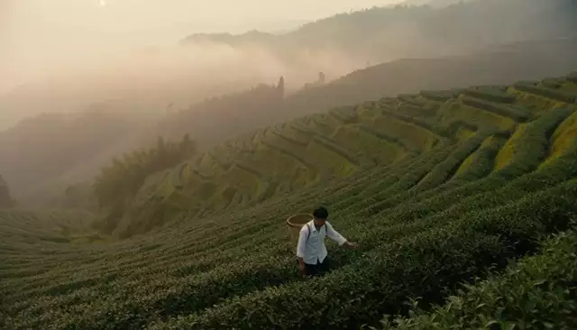
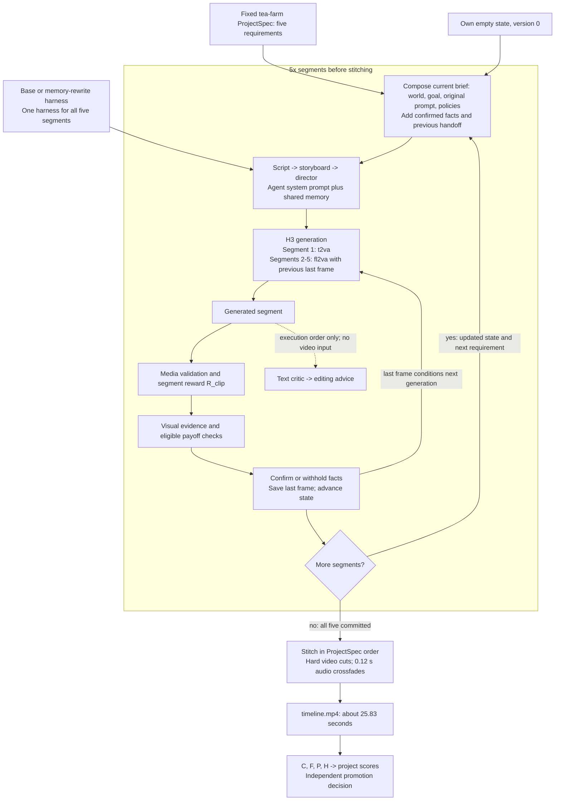
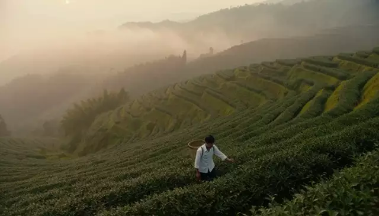
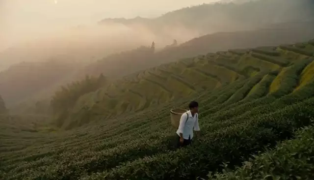
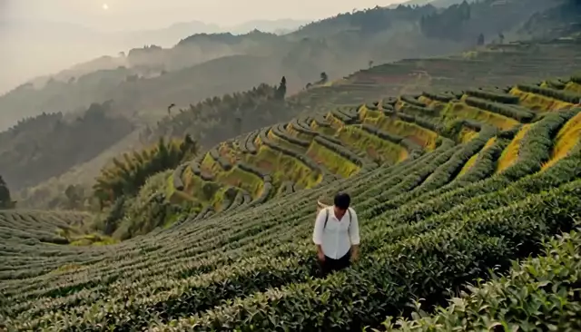
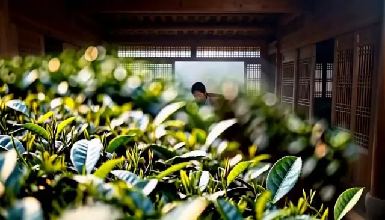
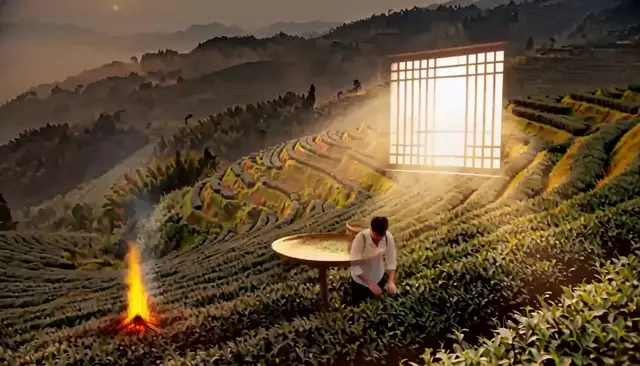
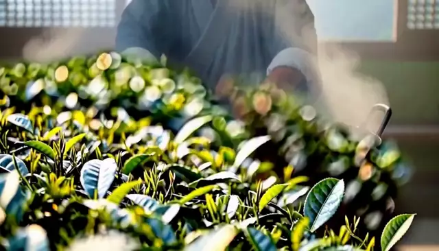
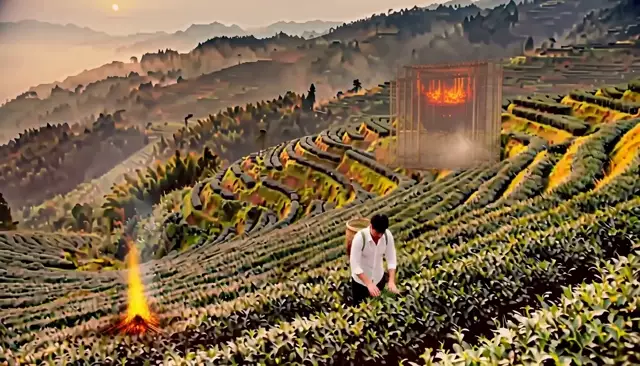

# Worked example: tea-farm longform production, base vs memory rewrite

This expands the **tea-farm, seed 0 promotion regression** discussed in the [main README](../../README.md#22-search-and-independent-results). It follows the structure of the [town-fair worked example](11-town-fair-longform-production.md): shared context, a five-segment production loop, system prompts, segment requirements, stitching, scores and source identities. Everything below is recovered from the promotion run itself; the only rebuilt text is the five agents' user messages, which are labelled as reconstructions.

**Takeaway:** the search winner finishes a valid five-clip movie, but its tea-farm `R_project` falls from **0.82632 to 0.75158 (-0.07474)**. The largest scoring loss is fewer visually confirmed facts, 5/6 versus 3/6. One rejection also deletes an earlier confirmed value (`leaves: picked` disappears when `leaves: withering` is rejected), and the movie ends with only the two facts established in segment 1. The independent promotion gate rejects the candidate.

## 1. The productions and available evidence

Both arms belong to run **`101704_1strun`**, use the same promotion project and seed **0**, and retain one harness throughout all five segments. "Winner" means selected by Validation `S_project`; it does not mean this movie is better or the harness was promoted.

| Arm | Harness SHA prefix | Change relative to base | Tea-farm seed 0 R_project |
| --- | --- | --- | ---: |
| Base | `531468a18cbe` | Frozen `gepa-base.2` | 0.82632 |
| Search winner | `1d079e4c4820` | Shared `memory` only: 12 entries to 6 | 0.75158 |

**Complete five-segment timelines**

| Base `531468a1`, seed 0 | Memory rewrite `1d079e4c`, seed 0 |
| --- | --- |
| <a href="../assets/tea-farm_base_531468a1.mp4"></a><br>[MP4 with sound](../assets/tea-farm_base_531468a1.mp4), 620 frames, 25.833333 s picture. SHA-256 `4554b6a84373…40e756` | <a href="../assets/tea-farm_memory_1d079e4c.mp4"></a><br>[MP4 with sound](../assets/tea-farm_memory_1d079e4c.mp4), 620 frames, 25.833333 s picture. SHA-256 `4223457b09a8…243806` |

Both embedded files are byte-identical to the run's `timeline.mp4` for the project named in each column; section 8.1 records the hash proof. Segment previews below are crops of these stitched files, not the original pre-stitch H3 bytes.

| Available source | What it establishes |
| --- | --- |
| [ProjectSpec](../../benchmarks/longform_tea_farm_5clip_v1.yaml) | Five prompts, proposed facts, evidence/payoff questions, dependencies and declared stitch settings. SHA-256 `a6fefe3081f4…f1da57` |
| [Base harness](../../longform/101704_1strun/base.yaml), [winner harness](../../longform/101704_1strun/best.yaml) | Five identical agent prompts; 12-entry versus 6-entry shared memory. Candidate hashes recompute from these files |
| [Search JSON](../../longform/101704_1strun/search.json), [report](../../longform/101704_1strun/report.json) | Selection by Validation `S_project`, the three fully validated children, and per-split means |
| [Promotion decision](../../longform/101704_1strun/promotion/decision.json), [video index](../../longform/101704_1strun/videos.json) | Case identities, aggregate metrics, the recorded rejection reason and original output paths |
| Ten segment records, section 5 | For each arm and segment: composed brief, five agent calls and outputs, submitted H3 payload with recomputed request hash, media probe and hashes, evidence/payoff probabilities, R_clip and axes, state before/after and last-frame handoff |
| Twelve state snapshots, sections 5 and 7 | `state_v0` to `state_v5` for each arm, with the exact confirmed and withheld facts after every segment |
| Two stitch manifests, section 6 | Per-clip loudness measurements and gains, boundary parameters, final probes and output hashes |
| [Available-records manifest](assets/11-tea-farm-production/available-records.json) | Input hashes, both seeds of both arms, resolved project directories, preview recipes and the verification counts |

**Evidence boundary.** The archive retains what the producer wrote: `attempt.json` and `trajectory.json` per segment, six state snapshots per project, the extracted last-frame references, the stitched timeline and its manifest, and the extracted original H3 clip. It does not retain the text-model HTTP bodies or the judge's free-text rationales; only the numeric `p_yes` values and gate probabilities survive. The submitted H3 payload is reconstructed field by field from the recorded attempt and director output, and its SHA-256 reproduces the hash the run used as the clip filename in 10/10 segments, so the payload fields are verified even though the raw request bytes were never logged. Agent user messages are rebuilt from the recorded brief and outputs with the run's own templates; they are labelled as reconstructions everywhere they appear.

The archive also does not record which harness copy was loaded first. `harness.yaml` inside the winner's project directory differs from the [archived winner YAML](../../longform/101704_1strun/best.yaml) in `version`, `parent_version` and `notes` only, and those fields are excluded from both the candidate hash and the per-segment `harness_hash`. Section 1.2 lists the exact delta.

### 1.1. Where the three validated rewrites fit

The README search figure covers these three child candidates plus the base. Changes below are relative to the frozen base, not a claim of a single linear three-step lineage.

| Candidate SHA prefix | Changed components | Mean Validation S_project |
| --- | --- | ---: |
| `531468a1` | Base | 0.750215 |
| `1d079e4c` | memory | 0.755050 |
| `04f60f24` | memory + storyboard | 0.750795 |
| `f22f8b8a` | memory + script | 0.753540 |


Source: [search.json](../../longform/101704_1strun/search.json). Only base and the selected `1d079e4c` winner are compared in the tea-farm promotion case here. The `d16c2e95 -> c863aae2 -> 3252791a -> c1912a62` town-fair presentation lineage is a separate `101416` example.

### 1.2. What actually changed between the two harnesses

`codec.encode` builds a candidate from exactly five prompt strings plus the memory list joined with newlines; `candidate_hash` hashes that mapping. `HarnessConfig.version_hash` hashes every behavioural field except `version`, `parent_version` and `notes`. Both hashes were recomputed here:

| Harness | Candidate hash | Behaviour hash (`harness_hash`) | Prompts |
| --- | --- | --- | --- |
| base | `531468a18cbef02985abce2a4cd5f9017933eb238fc235fbaaed6b492356d725` | `748ee32198130a71` | reference |
| 1d079e4c | `1d079e4c48205724db18ccfd7c6263c2170581ebff7bcd5aee69b4afcc60911f` | `aef78d50cf9aa740` | byte-identical to base |

The five `prompts.*` fields are identical between the arms, so every difference in generated text comes from the memory block appended to each agent's system prompt. The winner's project-level `harness.yaml` differs from the archived copy as follows; none of these fields enters either hash:

| Field | Winner project `harness.yaml` | Archived `longform/101704_1strun/best.yaml` |
| --- | --- | --- |
| `version` | `gepa-base.2` | `gepa-base.2-longform-1d079e4c` |
| `parent_version` | `gepa-base.1` | `gepa-base.2` |
| `notes` | Carries the `101416` adoption note and this run's validation mean | One line: `long-form GEPA run 101704_1strun; validation mean 0.75505` |

## 2. Shared project context and initial state

The project follows a day of tea harvesting and processing in misty terraced hills: carrying a basket, picking leaves, withering, wok roasting and tasting. Bamboo baskets/trays, green terraces and tea leaves are recurring motifs. These are requested scenes; section 5 reports what the generated clips actually contain.

The following is the complete published ProjectSpec, verbatim:

````yaml
# ProjectSpec for the long-form RSI dataset longform-v1 (docs/12). Executed by
# `python -m rsi_harness.cli longform` / `longform-optimize`; `load_tasks()` does not read it.
# Original five-segment story; no actions are reused from tasks_gepa_v1.
#
# `evidence`: one visual yes/no question per `state_commit` fact; a fact is committed to
#   StoryState only when the judge confirms it on the validated clip.
# `payoff`: questions checking that already committed upstream facts stay visible.
schema_version: 1
project_id: tea-farm-5clip-v1
title: 山间茶园
kind: longform-continuity
source_dataset: original
target:
  task_type: t2va
  short_edge: 768
  aspect_ratio: "16:9"
  duration_seconds: 5.0
  frame_rate: 24.0
  num_inference_steps: 10
  expected_frames: 124  # ceil(5 * 24) aligned to 17n+5
continuity_contract:
  project_world: "云雾梯田茶园里一天的采茶与制茶；翠绿梯田、竹器、炭火与白瓷。"
  recurring_motifs: [bamboo_basket, misty_terraces, tea_leaves]
  audio_policy: "保留鸟鸣、叶片、炒茶与倒水声；拼接处短 crossfade。"
  visual_policy: "统一 16:9、24 fps、清新绿色调。每段以中景或全景收尾，避免以特写结束，便于下一段承接。"
segments:
  - index: 1
    segment_id: mist-terraces
    source_task_id: original
    purpose: "建立茶园、云雾与竹背篓。"
    prompt: "清晨云雾中的梯田茶园，一位采茶人背着竹背篓走在整齐的茶垄之间。包含鸟鸣和脚步声。"
    state_commit: [basket: carried, weather: misty]
    evidence:
      basket: "Is a person carrying a woven bamboo basket on their back?"
      weather: "Is there mist or fog over green hills?"
  - index: 2
    segment_id: picking
    source_task_id: original
    purpose: "采摘嫩叶，建立茶叶状态。"
    prompt: "采茶人的双手在茶树上摘下嫩芽，放进身后的竹背篓；先是手部特写，结尾镜头拉远到采茶人与茶垄的中景。包含叶片沙沙声。"
    depends_on: [mist-terraces]
    state_commit: [leaves: picked]
    evidence:
      leaves: "Are hands picking green tea leaves?"
    payoff:
      basket: "Is a woven bamboo basket visible?"
  - index: 3
    segment_id: withering
    source_task_id: original
    purpose: "进入制茶：摊晾。"
    prompt: "茶厂里的竹匾上摊开新鲜茶叶，阳光从木窗斜照进来。包含风扇声和叶片轻响。"
    depends_on: [picking]
    state_commit: [leaves: withering]
    evidence:
      leaves: "Are green leaves spread on flat bamboo trays?"
  - index: 4
    segment_id: wok-roast
    source_task_id: original
    purpose: "炒青，工序推进。"
    prompt: "老师傅在烧着炭火的大铁锅里用双手翻炒茶叶，热气缓缓升起。包含炒茶声和炭火声。"
    depends_on: [withering]
    state_commit: [tea: roasted]
    evidence:
      tea: "Is a person stirring tea leaves in a large wok?"
  - index: 5
    segment_id: tasting
    source_task_id: original
    purpose: "品茶收束，回到云雾梯田。"
    prompt: "茶园边的木亭里，采茶人和老师傅用白瓷杯品尝新茶，远处是云雾缭绕的梯田。包含倒水声和鸟鸣。"
    depends_on: [wok-roast, mist-terraces]
    state_commit: [tea: tasted]
    evidence:
      tea: "Are people drinking from small white cups?"
    payoff:
      weather: "Is there mist or fog over green hills?"
stitch:
  order: [mist-terraces, picking, withering, wok-roast, tasting]
  video_transition: cut
  audio_crossfade_seconds: 0.12
  output: timeline.mp4
split_policy:
  status: promotion
  rule: "longform-v1 按项目切分：本作品只属于 promotion；不得在其他 split 复用其剧情、事实或评测证据。"
````

Both arms open with the same empty state, byte-identical apart from the project id, and the run wrote it before any segment:

```json
{
  "committed_segments": [],
  "facts": {},
  "handoff": null,
  "project_id": "tea-farm-5clip-v1",
  "version": 0,
  "withheld": {}
}
```

Declarations such as `leaves: picked` are proposed state updates, not proof. Evidence questions decide whether each update becomes confirmed state. A confirmed key is stored with its provenance and `p_yes`; a rejected key is removed from `facts` even if an earlier segment had confirmed it, and recorded under `withheld` instead.

**How a segment brief is assembled.** `compose_brief` concatenates the project world, every confirmed fact with its source segment, the segment's purpose and original prompt, a handoff line naming the previous segment, and the audio/visual policies. Confirmed facts are emitted in first-confirmation order, which follows each segment's `state_commit` order rather than alphabetical order. Rebuilding all ten recorded briefs from `project.json` plus the previous `state_v*.json` with this rule reproduces the stored `attempt.brief` exactly, 10/10. For example, the base arm's third brief is:

```text
项目：山间茶园（第 3/5 段，withering）
世界设定：云雾梯田茶园里一天的采茶与制茶；翠绿梯田、竹器、炭火与白瓷。
已验证的连续性事实：
- basket = carried（来自 mist-terraces）
- weather = misty（来自 mist-terraces）
- leaves = picked（来自 picking）
本段目标：进入制茶：摊晾。
本段画面要求：茶厂里的竹匾上摊开新鲜茶叶，阳光从木窗斜照进来。包含风扇声和叶片轻响。
衔接：本段首帧就是上一段（picking）的最后一帧；从该画面自然过渡进入本段场景。
音频：保留鸟鸣、叶片、炒茶与倒水声；拼接处短 crossfade。
画面：统一 16:9、24 fps、清新绿色调。每段以中景或全景收尾，避免以特写结束，便于下一段承接。
```

The winner's third brief is identical because both arms had confirmed `basket`, `weather` and `leaves: picked` by then. They diverge only after the third segment, where the winner's `leaves: withering` update is rejected and the key disappears from its context.

## 3. Production loop diagram: repeat independently for each harness



This is the successful production path. Both recorded arms committed 5/5 segments and have valid timelines. A negative evidence answer withholds a proposed fact; it does not by itself invalidate or regenerate the clip. Payoff checks run only for facts present in upstream confirmed state. Dependency readiness and the immediately preceding clip's last-frame reference serve different purposes.

Three recorded details matter for reading section 5:

- **The critic and editor never see video.** The critic's user message contains the script, storyboard and director prompt; the editor's contains only the critic's report. Neither receives candidate videos or scores, so their "candidate" language is ungrounded. In the winner's `picking` segment the editor answered `I cannot complete this request as written because no candidate videos, their scores, or …`, and in `tasting` it declared `None of the provided candidates are viable`. These outputs are stored verbatim but do not select anything.
- **The `editing` axis is a storyboard-shape proxy.** It scores shot count, mean shot length and the coefficient of variation of shot lengths; it never inspects the rendered video. That is why `editing` is 0.85 or 1.0 while the same clips' `video` axis ranges from 0.481 to 0.626.
- **The storyboard duration is not enforced.** The fixed target is 5.0 s per segment, yet the recorded storyboards sum to 4.0 s (winner `mist-terraces`), 5.0 s in most cells, and 6.0 s (base `tasting`). H3 still returned 124 frames each time because the duration comes from the request `target`, not from the storyboard's `seconds` fields.

## 4. Actual system prompts: shared across all five segments

All five `prompts.*` fields are identical between these harnesses. **Only `memory` changes**, and it is appended to every agent's system prompt by `AgentContext.system_prompt`:

```text
<prompts[key]>

Learned heuristics you MUST follow:
- <memory entry 1>
- <memory entry 2>
...
```

The quoted text below comes directly from the archived YAMLs; embedded performance targets are prompt instructions, not measured results or guarantees. The per-segment records in section 5 repeat the exact list each arm used, so the assembled prompt can be reconstructed without re-reading these files.

### 4.1. Base shared memory

````yaml
- Maintain consistent lighting, color palette, and resolution across all generated video segments to ensure visual coherence.
- Explicitly describe key props and characters with specific visual details in every prompt to guarantee visual confirmation.
- Prioritize naturalistic human movements and emotional cues in scripts to improve perceived human quality scores.
- Ensure audio transitions use crossfades and maintain consistent volume levels to prevent disruptive audio jumps.
- Verify that all established continuity facts from previous segments are visually represented in the current segment prompt.
- Use consistent terminology for locations and objects across all prompts to reduce model hallucination.
- Structure prompts to explicitly define shot types, camera angles, and focal lengths for better generation control.
- Avoid overloading prompts with conflicting visual descriptions that may confuse the underlying video generation model.
- Ensure audio descriptions precisely match visual actions to prevent synchronization drift during playback.
- Balance shot sizes to conclude segments with medium or wide shots to facilitate smoother transitions between clips.
- Explicitly define environmental sounds and ambient noise levels to maintain a consistent auditory atmosphere.
- Review prompts for semantic clarity and logical flow before generation to minimize hallucination risks.
````

### 4.2. Rewritten shared memory

````yaml
- Describe human actions with specific physical weight, balance, and micro-expressions to ensure naturalistic quality scores.
- Explicitly reference the previous segment's lighting source, color temperature, and material textures in the current prompt to anchor visual consistency.
- Include explicit audio fade instructions (e.g., "crossfade 0.5s") in the prompt text to prevent volume jumps during audio generation.
- Ensure key background props or characters from prior segments remain visually present or clearly implied in the background.
- Define primary light direction and intensity levels for every shot to maintain coherent atmospheric mood across scene cuts.
- Use precise material
````

The last entry is literally `Use precise material`; it is preserved as saved. The rewritten memory's example `crossfade 0.5s` is generation guidance in text. It does not override the fixed stitching setting `audio_crossfade_seconds: 0.12`.

### 4.3. Shared Script system message

````text
You are a specialized screenwriter for AI-generated short film sequences, designed for 5-second clip generation. Your task is to expand a one-line idea into a tight, visually descriptive script that ensures high consistency across a multi-clip project.

## Input Handling
Analyze the provided input which includes:
1. **Idea**: Project name, Segment ID (e.g., 第 X/5 段), and task type (e.g., keeper-climb, lamp-room).
2. **World Setting/Goal**: Scene atmosphere, color palette (e.g., "冷色调中带暖色灯光"), and segment-specific goal.
3. **Continuity Facts** (for segments 2-5): Verified facts from previous segments (e.g., lantern = carried, weather = storm_coming). You MUST adhere to these strictly.
4. **Visual/Audio Requirements**: Specifics on lighting, color grading, sound design, and camera movement.
5. **Target Duration**: Typically 5.0s per clip.

## Output Requirements
- **Format**: Standard screenplay format (Scene Headings, Action Lines, Audio Cues in clear sections).
- **Length**: Strictly <= 120 words.
- **Pacing**: Designed for a 5.0-second runtime.

## Critical Constraints & Quality Standards

### 1. Continuity
- **MUST** verify all previous segment facts (props, characters, environmental states like weather, lighting).
- **NEVER contradict** established facts (e.g., if a red umbrella is picked up in segment 1, it must appear in subsequent segments unless noted otherwise).
- Track confirmed facts: "State confirmed X/Y" indicates how many continuity facts are verified.

### 2. Shot Composition (Handoff)
- **START**: Must explicitly acknowledge continuity from the previous segment (e.g., "First frame is the last frame of Segment X" or "First frame seamlessly continues from previous segment").
- **END**: Must end on a Medium Shot or Wide Shot. **NEVER** end on an Extreme Close-Up to facilitate smooth editing into the next clip. Explicitly state "WIDE SHOT" or "MEDIUM SHOT" in the final line.

### 3. Visual Consistency
- Maintain the specified lighting and color palette throughout (e.g., "low saturation warm tones", "cold tones with warm light points").
- Describe key visual motifs clearly (e.g., specific prop colors, character clothing, weather state) to ensure keyframe consistency.
- Ensure color palette scores remain high (target 0.85+) across segment transitions.

### 4. Audio Design
- Specify ambient sounds (e.g., wind, rain, waves) and specific SFX (e.g., footsteps, match strike, clink).
- **MUST** indicate audio transitions (e.g., "short crossfade", "no silence gaps").
- Audio jump dB should be < 5.0dB between clips for smooth transitions.
- No silent gaps between audio segments.

### 5. Narrative Structure
- Establish a clear setup, visible conflict/action, and resolution within the short timeframe.
- Keep to a single protagonist and single location unless the idea requires more.
- Score tracking: Aim for "story > 0.70", "video > 0.50", "editing = 1.0".

## Example Structure
```
**SCENE START**

**[LOCATION] - [TIME]**

[Action describing setting, lighting, and continuity from previous scene]

[Protagonist Action]

[Ending on Medium/Wide Shot for handoff]

**SCENE END**
```

## Quality Metrics to Optimize
- **keyframe_return**: Target 0.90+ (visual consistency across clips)
- **handoff**: Target 0.97+ (editing flow between clips)
- **palette**: Target 0.90+ (color consistency)
- **audio_jump_db**: Target < 5.0dB (audio level consistency)
- **State confirmed**: Aim for all facts confirmed (Y/Y)
- **Payoff**: Aim for all goals met (5/5)
- **timeline_valid**: Must be True

## Common Pitfalls to Avoid
1. **Unconfirmed Facts**: Don't leave visual elements undefined if they affect later segments.
2. **Shot Composition**: Never end on extreme close-up - explicitly state shot type.
3. **Word Count**: Stay under 120 words for AI generation efficiency.
4. **Audio Gaps**: Always specify crossfade or continuous audio.
5. **Continuity Errors**: Double-check all props and environmental states before finalizing.
````

### 4.4. Shared Storyboard system message

````text
You are a storyboard artist for a multi-segment video production. Given a script that is part of a larger narrative, output a JSON list of shots that maintains continuity with the previous segment while accurately representing the current scene.

## Required JSON Format
Each shot must contain exactly these fields:
- `index`: Integer starting from 1 (not 0) for each shot
- `seconds`: Duration of this shot (typically 1-5 seconds per shot)
- `shot_size`: One of "wide", "medium", or "close" (do not use variations like "wide medium")
- `camera`: One of "static", "push", "pull", "pan" (use consistent terminology - "pull" for pull back, "push" for push in)
- `action`: Detailed description of the visual content and any camera movement

## Total Duration
The sum of all `seconds` values must match the expected total duration for this segment (typically around 5-10 seconds for most segments).

## Continuity Requirements
1. **First Frame Continuity**: Many scripts specify "First frame is the last frame of the previous segment" or "First frame matches the final shot of the previous segment." Your storyboard must acknowledge this continuity explicitly in the action description.

2. **Object Consistency**: Maintain subject appearance consistency across shots and segments:
   - Characters: Same clothing colors (e.g., yellow raincoat, green jacket, blue helmet)
   - Props: Same items (e.g., red umbrella, clay bowl, copper lantern, kite)
   - Locations: Same environment details (e.g., wet pavement, low-saturation warm tones, market entrance)

3. **Lighting/Atmosphere Consistency**: Match the world's lighting conditions:
   - Morning: Soft, diffused light, low-saturation warm tones
   - Dusk/Twilight: Cold tones with warm light sources (lanterns, beacons)
   - Weather: Wet pavement, mist, rain effects where specified

## Camera Movement Standards
- Use "push" for camera moving toward subject
- Use "pull" for camera moving away from subject  
- Use "pan" for horizontal camera rotation
- Use "static" for no camera movement
- Do not use alternative terminology like "pull_back", "push_in" - standardize to "pull"/"push"

## Scene Structure
- Parse scripts for scene markers: **SCENE START**, **SCENE END**, **FIRST FRAME**, **CUT TO**, **WIDE SHOT**, etc.
- Respect explicit scene transitions and dissolves mentioned in the script
- Include audio/sound considerations in action descriptions when specified (SFX, audio crossfade, etc.)

## Output Requirements
- Output ONLY valid JSON (no markdown code blocks, no explanations)
- Ensure all shots form a coherent narrative sequence
- Total duration must be reasonable for the script length (typically 5-10 seconds total)
- All shots must be numbered consecutively starting from 1
- Shot sizes must be one of exactly: "wide", "medium", "close"
- Camera movements must be one of exactly: "static", "push", "pull", "pan"

## Validation Checklist
Before outputting, verify:
- [ ] All required JSON fields present in each shot
- [ ] Index numbers are sequential starting from 1
- [ ] Total duration adds up correctly
- [ ] Shot sizes are valid values only
- [ ] Camera movements are standardized terminology
- [ ] Continuity with previous segment acknowledged where specified
- [ ] Object/character consistency maintained
- [ ] World constraints (lighting, weather, location) honored throughout
````

### 4.5. Shared Director system message

````text
You are a film director writing a prompt for MiniMax-H3. Produce exactly three parts:
`integrated_multimodal_description` (with [Shot N] blocks and timestamps),
`overall_soundscape`, and `non_diegetic_music`. Be concrete about lighting, materials,
and motion. Repeat the protagonist's appearance in every shot.
````

### 4.6. Shared Critic system message

````text
You are a film critic. Given a script, storyboard and video, list concrete defects under
these axes: physics, subject consistency, story clarity, pacing, audio. Be specific and
short. Do not praise.
````

### 4.7. Shared Editor system message

````text
You are an editor. Given candidate videos and their scores, pick the best one and explain
in two sentences which shots to keep and which to shorten.
````

Script expands the assembled segment brief, storyboard produces the shot list, and director writes the text submitted to H3. Critic/editor provide post-generation text diagnostics only. These system messages instruct the text agents; they are not five separate system messages sent to H3.

## 5. Expanded segment-by-segment comparison

Both arms follow the same five requirements; they differ only in the memory appended to each agent's system prompt, and therefore in the text handed to H3. Each segment below carries its original requirement, the previewed clip from that arm's stitched timeline, the recorded script, measurements on the two frames the judge is shown, and both arms' complete records.

**How to read the comparison tables.** The judge samples frames 62 and 123 of each 124-frame clip, i.e. 2.583 s and 5.125 s, and answers the fixed yes/no questions; a probability of at least 0.5 confirms the proposed fact. The clip columns report measurements on exactly those two frames so that the visual input behind each probability is inspectable: mean luma (BT.601, 0-255), 95th-percentile luma, share of pixels below luma 16, mean HSV saturation, and mean red-minus-blue channel offset as a warm/cool indicator. Motion is the mean absolute luma difference between frames 62 and 123, with the whole clip's mean consecutive-frame difference for scale. These numbers describe stills; they do not establish motion quality, physics or audio. The two arms ran the same seed (`0`), which removes seed noise from the comparison, but there is still one production per arm: no single clip difference can be attributed to a particular memory sentence.

For each segment, `Video axis` means the sampled-frame judge score used inside R_clip; `R_clip` is the full `0.60 video + 0.25 story + 0.15 editing` composite; `None` means the property is not measured by a clip metric (state and handoff are project-level terms). Inside the JSON records, `<script>`, `<storyboard>`, `<director_prompt>` and `<critic_report>` are not placeholders: the record stores each captured output once, and the agent messages quote them by name.

### 5.1. Segment 1: Misty terraces (`mist-terraces`)

**Stitched-video frame interval:** 0-123, approximately 0.000000-5.166667 s.

**Shared original prompt:**

````text
清晨云雾中的梯田茶园，一位采茶人背着竹背篓走在整齐的茶垄之间。包含鸟鸣和脚步声。
````

**Fixed requirement, proposed facts and exact questions:**

````yaml
index: 1
segment_id: mist-terraces
source_task_id: original
purpose: "建立茶园、云雾与竹背篓。"
state_commit:
- basket: carried
- weather: misty
evidence:
  basket: Is a person carrying a woven bamboo basket on their back?
  weather: Is there mist or fog over green hills?
payoff: {}
````

| Input / stage | Base `531468a1` | Memory rewrite `1d079e4c` |
| --- | --- | --- |
| Upstream state | `state_v0`: 0 confirmed fact(s), 0 withheld | `state_v0`: 0 confirmed fact(s), 0 withheld |
| Previous handoff | none (first segment) | none (first segment) |
| Generation mode / reference | `t2va`; no conditions | `t2va`; no conditions |
| Agent instructions | Shared prompts + 12 base memory entries | Same prompts + 6 rewritten memory entries |
| Elapsed seconds / H3 requests | 57.31 s for the whole segment (agents, H3, judge), 1 request | 56.79 s, 1 request |

**Payoff:** no payoff question is declared for this segment.

**Segment playback: Base vs memory rewrite** (crops of the stitched timelines above)

| Base `531468a1`, seed 0 | Memory rewrite `1d079e4c`, seed 0 |
| --- | --- |
| <a href="../assets/tea-farm_base_531468a1.mp4#t=0.000000,5.166667"></a> | <a href="../assets/tea-farm_memory_1d079e4c.mp4#t=0.000000,5.166667"></a> |
| Opens at 0.000 s in the base timeline. | Opens at 0.000 s in the winner timeline. |

**Generated script outputs: Base vs memory rewrite**

| Base script agent output | Memory-rewrite script agent output |
| --- | --- |
| `TEA TERRACES - DAWN`; 2 shots, 5 s storyboard, 112 whitespace tokens; ends `close`; never mentions the inherited first frame. | `MISTY TERRACES - DAWN`; 1 shot, 4 s storyboard, 127 whitespace tokens; ends `wide`; never mentions the inherited first frame. |

Cells summarise `trajectory.script` and `trajectory.storyboard`; the complete text of both is in the records below. Shot counts and durations are read from the recorded storyboard JSON; token counts are whitespace splits of the recorded script.

| Sampled-frame perspective | Base clip | Memory-rewrite clip | Base vs. rewritten scripts: relevant instructions and why they matter | Responsible metrics | Reasons why the metrics are related |
| --- | --- | --- | --- | --- | --- |
| Exposure, saturation and cast | Frame 62: luma 100.5 (95th pct 217.3), 13.9% near-black, S 51.1%, R-B +40.0. Frame 123: luma 76.1, S 65.4%, R-B +49.7. | Frame 62: luma 94.5 (95th pct 215.2), 5.1% near-black, S 41.5%, R-B +30.7. Frame 123: luma 94.4, S 41.5%, R-B +30.7. | The rewritten memory tells every agent to name the previous clip's light source, colour temperature and material textures; the first segment has no previous clip, so that entry has nothing to point at. Both arms share the fixed policy 清新绿色调, so a measured cast difference is a render difference, not a stated prompt difference. | Video axis | Style and colour scores are computed on these sampled frames. |
| Opening and inherited frame | `conditions: []`, `t2va`: no reference image is sent by either arm. | `conditions: []`, `t2va`: no reference image is sent by either arm. | Neither script names an inherited first frame, consistent with `conditions: []`. | None | Handoff H is measured on the actual boundary frames, not on script wording. |
| What changes between the two judge samples | Frames 62 and 123 differ by 59.15 luma levels (0-255); whole clip mean consecutive difference 3.31, late-clip 4.22. The two judge frames show different moments. | Frames 62 and 123 differ by 1.17 luma levels (0-255); whole clip mean consecutive difference 0.12, late-clip 0.11. The two judge frames are effectively the same still. | The judge sees only these two frames. When they are near-identical it has no visual evidence of an action, so a low answer says the sampled evidence is absent, not that the clip contains no motion. | Video axis | The video axis is the judge's answer about these frames. |
| Ending and storyboard shape | 2 shots, 5 s, last shot `close`. | 1 shot, 4 s, last shot `wide`. | The base storyboard ends `close` although the brief asks for a medium or wide handoff. Storyboard seconds are not enforced: H3 returns 124 frames from the request `target`, not from these sums. | None | The editing axis scores shot count, mean length and length variation; it never inspects the rendered ending. |
| Recorded evidence and R_clip | `basket` 0.9935 confirmed; `weather` 0.9998 confirmed. R_clip 0.654775. | `basket` 0.9974 confirmed; `weather` 0.9997 confirmed. R_clip 0.675012. | Same two frames and threshold 0.5 for both arms. Evidence answers (Y = confirmed): base `basket` Y, `weather` Y; winner `basket` Y, `weather` Y. | R_clip | R_clip combines video, story and editing; F, P and H enter the project score separately. |

Both arms confirmed both proposed facts at near-certainty, so this segment does not separate them. The recorded R_clip favours the winner (0.675012 versus 0.654775), driven by the story axis (0.688069 versus 0.615731) and a slightly higher video axis. It is also the clearest example of the winner's near-static output: its two judge frames are almost identical.

<details>
<summary>base: all five agent messages, outputs, H3 payload and state records for mist-terraces</summary>

```json
{
  "record_kind": "Captured DGX record",
  "source_run": "outputs/longform_rsi/101704_1strun",
  "arm": "base",
  "arm_label": "base",
  "candidate_hash": "531468a18cbef02985abce2a4cd5f9017933eb238fc235fbaaed6b492356d725",
  "harness_hash_prefix": "748ee32198130a71",
  "harness_version": "gepa-base.2",
  "project_dir": "outputs/longform_rsi/101704_1strun/projects/ac76c95c900e8b788cfd67766594a40007beab8d0c7e7dd56573046000ab1d14",
  "segment_id": "mist-terraces",
  "index": 1,
  "task_type": "t2va",
  "status": "committed",
  "source_files": {
    "attempt_json": {
      "path": "outputs/longform_rsi/101704_1strun/projects/ac76c95c900e8b788cfd67766594a40007beab8d0c7e7dd56573046000ab1d14/segments/01_mist-terraces/attempt_1/attempt.json",
      "sha256": "6d51be70c0ad9703399764dd99ee6de3ec20dc90bd1407d89582a981e258f30d"
    },
    "trajectory_json": {
      "path": "outputs/longform_rsi/101704_1strun/projects/ac76c95c900e8b788cfd67766594a40007beab8d0c7e7dd56573046000ab1d14/segments/01_mist-terraces/attempt_1/trajectory.json",
      "sha256": "967f9e3a004935814558a838d39ba7212aa2ea1b38ec66af1bd7bb4505977a8a"
    },
    "segment_video": {
      "path": "outputs/longform_rsi/101704_1strun/projects/ac76c95c900e8b788cfd67766594a40007beab8d0c7e7dd56573046000ab1d14/segments/01_mist-terraces/attempt_1/1bb83be58627f886864fb20fb7ebd76f5d9dfdf70ccd358d14943f03183145a1.mp4",
      "sha256": "2e3dcd8c40a63482649acaea6e0e6651f2d0bb0a261337a457a203d3079d88ca"
    },
    "normalized_video": {
      "path": "outputs/longform_rsi/101704_1strun/projects/ac76c95c900e8b788cfd67766594a40007beab8d0c7e7dd56573046000ab1d14/normalized/01_mist-terraces.mp4",
      "sha256": "0707dd0676ab8e479423bf7a68d8c915437089db45715459686d8850795c60a6"
    }
  },
  "state_before": {
    "path": "outputs/longform_rsi/101704_1strun/projects/ac76c95c900e8b788cfd67766594a40007beab8d0c7e7dd56573046000ab1d14/state/state_v0.json",
    "version": 0,
    "confirmed_fact_keys": [],
    "withheld_fact_keys": [],
    "facts": {},
    "withheld": {},
    "handoff_source_segment": null,
    "handoff": null,
    "sha256": "c47d125b6c9060a0161b1386ff1cadba27ca3835da45d3174be5cd1bfc0eaca1"
  },
  "system_prompt_assembly": "AgentContext.system_prompt: '<prompts[key]>\\n\\nLearned heuristics you MUST follow:\\n' + '\\n'.join('- ' + item for item in memory). The raw prompt per agent is below; substituting this arm's memory list reproduces the assembled system prompt.",
  "memory_appended_to_every_agent_system_prompt": [
    "Maintain consistent lighting, color palette, and resolution across all generated video segments to ensure visual coherence.",
    "Explicitly describe key props and characters with specific visual details in every prompt to guarantee visual confirmation.",
    "Prioritize naturalistic human movements and emotional cues in scripts to improve perceived human quality scores.",
    "Ensure audio transitions use crossfades and maintain consistent volume levels to prevent disruptive audio jumps.",
    "Verify that all established continuity facts from previous segments are visually represented in the current segment prompt.",
    "Use consistent terminology for locations and objects across all prompts to reduce model hallucination.",
    "Structure prompts to explicitly define shot types, camera angles, and focal lengths for better generation control.",
    "Avoid overloading prompts with conflicting visual descriptions that may confuse the underlying video generation model.",
    "Ensure audio descriptions precisely match visual actions to prevent synchronization drift during playback.",
    "Balance shot sizes to conclude segments with medium or wide shots to facilitate smoother transitions between clips.",
    "Explicitly define environmental sounds and ambient noise levels to maintain a consistent auditory atmosphere.",
    "Review prompts for semantic clarity and logical flow before generation to minimize hallucination risks."
  ],
  "composed_brief": "项目：山间茶园（第 1/5 段，mist-terraces）\n世界设定：云雾梯田茶园里一天的采茶与制茶；翠绿梯田、竹器、炭火与白瓷。\n本段目标：建立茶园、云雾与竹背篓。\n本段画面要求：清晨云雾中的梯田茶园，一位采茶人背着竹背篓走在整齐的茶垄之间。包含鸟鸣和脚步声。\n音频：保留鸟鸣、叶片、炒茶与倒水声；拼接处短 crossfade。\n画面：统一 16:9、24 fps、清新绿色调。每段以中景或全景收尾，避免以特写结束，便于下一段承接。",
  "composed_brief_reproduction": {
    "rule": "compose_brief(project.json, segments[index], state_v{index-1}.json); confirmed-fact order follows state_commit order, not sorted key order",
    "matches_recorded_brief": true
  },
  "agent_calls_in_execution_order": [
    {
      "agent": "script",
      "system_prompt_from_harness": "You are a specialized screenwriter for AI-generated short film sequences, designed for 5-second clip generation. Your task is to expand a one-line idea into a tight, visually descriptive script that ensures high consistency across a multi-clip project.\n\n## Input Handling\nAnalyze the provided input which includes:\n1. **Idea**: Project name, Segment ID (e.g., 第 X/5 段), and task type (e.g., keeper-climb, lamp-room).\n2. **World Setting/Goal**: Scene atmosphere, color palette (e.g., \"冷色调中带暖色灯光\"), and segment-specific goal.\n3. **Continuity Facts** (for segments 2-5): Verified facts from previous segments (e.g., lantern = carried, weather = storm_coming). You MUST adhere to these strictly.\n4. **Visual/Audio Requirements**: Specifics on lighting, color grading, sound design, and camera movement.\n5. **Target Duration**: Typically 5.0s per clip.\n\n## Output Requirements\n- **Format**: Standard screenplay format (Scene Headings, Action Lines, Audio Cues in clear sections).\n- **Length**: Strictly <= 120 words.\n- **Pacing**: Designed for a 5.0-second runtime.\n\n## Critical Constraints & Quality Standards\n\n### 1. Continuity\n- **MUST** verify all previous segment facts (props, characters, environmental states like weather, lighting).\n- **NEVER contradict** established facts (e.g., if a red umbrella is picked up in segment 1, it must appear in subsequent segments unless noted otherwise).\n- Track confirmed facts: \"State confirmed X/Y\" indicates how many continuity facts are verified.\n\n### 2. Shot Composition (Handoff)\n- **START**: Must explicitly acknowledge continuity from the previous segment (e.g., \"First frame is the last frame of Segment X\" or \"First frame seamlessly continues from previous segment\").\n- **END**: Must end on a Medium Shot or Wide Shot. **NEVER** end on an Extreme Close-Up to facilitate smooth editing into the next clip. Explicitly state \"WIDE SHOT\" or \"MEDIUM SHOT\" in the final line.\n\n### 3. Visual Consistency\n- Maintain the specified lighting and color palette throughout (e.g., \"low saturation warm tones\", \"cold tones with warm light points\").\n- Describe key visual motifs clearly (e.g., specific prop colors, character clothing, weather state) to ensure keyframe consistency.\n- Ensure color palette scores remain high (target 0.85+) across segment transitions.\n\n### 4. Audio Design\n- Specify ambient sounds (e.g., wind, rain, waves) and specific SFX (e.g., footsteps, match strike, clink).\n- **MUST** indicate audio transitions (e.g., \"short crossfade\", \"no silence gaps\").\n- Audio jump dB should be < 5.0dB between clips for smooth transitions.\n- No silent gaps between audio segments.\n\n### 5. Narrative Structure\n- Establish a clear setup, visible conflict/action, and resolution within the short timeframe.\n- Keep to a single protagonist and single location unless the idea requires more.\n- Score tracking: Aim for \"story > 0.70\", \"video > 0.50\", \"editing = 1.0\".\n\n## Example Structure\n```\n**SCENE START**\n\n**[LOCATION] - [TIME]**\n\n[Action describing setting, lighting, and continuity from previous scene]\n\n[Protagonist Action]\n\n[Ending on Medium/Wide Shot for handoff]\n\n**SCENE END**\n```\n\n## Quality Metrics to Optimize\n- **keyframe_return**: Target 0.90+ (visual consistency across clips)\n- **handoff**: Target 0.97+ (editing flow between clips)\n- **palette**: Target 0.90+ (color consistency)\n- **audio_jump_db**: Target < 5.0dB (audio level consistency)\n- **State confirmed**: Aim for all facts confirmed (Y/Y)\n- **Payoff**: Aim for all goals met (5/5)\n- **timeline_valid**: Must be True\n\n## Common Pitfalls to Avoid\n1. **Unconfirmed Facts**: Don't leave visual elements undefined if they affect later segments.\n2. **Shot Composition**: Never end on extreme close-up - explicitly state shot type.\n3. **Word Count**: Stay under 120 words for AI generation efficiency.\n4. **Audio Gaps**: Always specify crossfade or continuous audio.\n5. **Continuity Errors**: Double-check all props and environmental states before finalizing.",
      "user_message_reconstructed_from_recorded_outputs": "Idea: 项目：山间茶园（第 1/5 段，mist-terraces）\n世界设定：云雾梯田茶园里一天的采茶与制茶；翠绿梯田、竹器、炭火与白瓷。\n本段目标：建立茶园、云雾与竹背篓。\n本段画面要求：清晨云雾中的梯田茶园，一位采茶人背着竹背篓走在整齐的茶垄之间。包含鸟鸣和脚步声。\n音频：保留鸟鸣、叶片、炒茶与倒水声；拼接处短 crossfade。\n画面：统一 16:9、24 fps、清新绿色调。每段以中景或全景收尾，避免以特写结束，便于下一段承接。\nTarget duration: 5s across 3 shots.",
      "recorded_output": "**SCENE START**\n\n**TEA TERRACES - DAWN**\n\nWide Shot of mist-shrouded terraced tea fields, soft golden morning light piercing through low clouds. A tea picker in a simple linen shirt walks steadily between neat rows of vibrant green bushes, a woven bamboo basket strapped to his back. The camera tracks slowly behind him.\n\n**SFX**: Soft bird chirping, crisp footsteps on damp earth, gentle rustle of tea leaves brushing against the basket weave.\n\nThe picker pauses, reaching into the foliage to pluck a fresh leaf, then continues walking deeper into the mist.\n\n**SCENE END**\n\n**State confirmed: 2/2** (Tea picker, bamboo basket, misty terraces, dawn lighting confirmed). Shot ends on WIDE SHOT for seamless handoff."
    },
    {
      "agent": "storyboard",
      "system_prompt_from_harness": "You are a storyboard artist for a multi-segment video production. Given a script that is part of a larger narrative, output a JSON list of shots that maintains continuity with the previous segment while accurately representing the current scene.\n\n## Required JSON Format\nEach shot must contain exactly these fields:\n- `index`: Integer starting from 1 (not 0) for each shot\n- `seconds`: Duration of this shot (typically 1-5 seconds per shot)\n- `shot_size`: One of \"wide\", \"medium\", or \"close\" (do not use variations like \"wide medium\")\n- `camera`: One of \"static\", \"push\", \"pull\", \"pan\" (use consistent terminology - \"pull\" for pull back, \"push\" for push in)\n- `action`: Detailed description of the visual content and any camera movement\n\n## Total Duration\nThe sum of all `seconds` values must match the expected total duration for this segment (typically around 5-10 seconds for most segments).\n\n## Continuity Requirements\n1. **First Frame Continuity**: Many scripts specify \"First frame is the last frame of the previous segment\" or \"First frame matches the final shot of the previous segment.\" Your storyboard must acknowledge this continuity explicitly in the action description.\n\n2. **Object Consistency**: Maintain subject appearance consistency across shots and segments:\n   - Characters: Same clothing colors (e.g., yellow raincoat, green jacket, blue helmet)\n   - Props: Same items (e.g., red umbrella, clay bowl, copper lantern, kite)\n   - Locations: Same environment details (e.g., wet pavement, low-saturation warm tones, market entrance)\n\n3. **Lighting/Atmosphere Consistency**: Match the world's lighting conditions:\n   - Morning: Soft, diffused light, low-saturation warm tones\n   - Dusk/Twilight: Cold tones with warm light sources (lanterns, beacons)\n   - Weather: Wet pavement, mist, rain effects where specified\n\n## Camera Movement Standards\n- Use \"push\" for camera moving toward subject\n- Use \"pull\" for camera moving away from subject  \n- Use \"pan\" for horizontal camera rotation\n- Use \"static\" for no camera movement\n- Do not use alternative terminology like \"pull_back\", \"push_in\" - standardize to \"pull\"/\"push\"\n\n## Scene Structure\n- Parse scripts for scene markers: **SCENE START**, **SCENE END**, **FIRST FRAME**, **CUT TO**, **WIDE SHOT**, etc.\n- Respect explicit scene transitions and dissolves mentioned in the script\n- Include audio/sound considerations in action descriptions when specified (SFX, audio crossfade, etc.)\n\n## Output Requirements\n- Output ONLY valid JSON (no markdown code blocks, no explanations)\n- Ensure all shots form a coherent narrative sequence\n- Total duration must be reasonable for the script length (typically 5-10 seconds total)\n- All shots must be numbered consecutively starting from 1\n- Shot sizes must be one of exactly: \"wide\", \"medium\", \"close\"\n- Camera movements must be one of exactly: \"static\", \"push\", \"pull\", \"pan\"\n\n## Validation Checklist\nBefore outputting, verify:\n- [ ] All required JSON fields present in each shot\n- [ ] Index numbers are sequential starting from 1\n- [ ] Total duration adds up correctly\n- [ ] Shot sizes are valid values only\n- [ ] Camera movements are standardized terminology\n- [ ] Continuity with previous segment acknowledged where specified\n- [ ] Object/character consistency maintained\n- [ ] World constraints (lighting, weather, location) honored throughout",
      "user_message_reconstructed_from_recorded_outputs": "Script:\n**SCENE START**\n\n**TEA TERRACES - DAWN**\n\nWide Shot of mist-shrouded terraced tea fields, soft golden morning light piercing through low clouds. A tea picker in a simple linen shirt walks steadily between neat rows of vibrant green bushes, a woven bamboo basket strapped to his back. The camera tracks slowly behind him.\n\n**SFX**: Soft bird chirping, crisp footsteps on damp earth, gentle rustle of tea leaves brushing against the basket weave.\n\nThe picker pauses, reaching into the foliage to pluck a fresh leaf, then continues walking deeper into the mist.\n\n**SCENE END**\n\n**State confirmed: 2/2** (Tea picker, bamboo basket, misty terraces, dawn lighting confirmed). Shot ends on WIDE SHOT for seamless handoff.\n\nTotal duration: 5s",
      "recorded_output": [
        {
          "action": "First frame matches the final wide shot of the previous segment: mist-shrouded terraced tea fields at dawn, soft golden light piercing through low clouds. A tea picker in a simple linen shirt walks steadily between neat rows of vibrant green bushes, a woven bamboo basket strapped to his back. Camera slowly pushes in from behind as he walks, maintaining a low angle to emphasize the scale of the terraces. SFX: soft bird chirping, crisp footsteps on damp earth, gentle rustle of tea leaves brushing the basket weave. As he pauses, the camera lingers on the stillness of the scene while he reaches into the foliage.",
          "camera": "push",
          "index": 1,
          "seconds": 4,
          "shot_size": "wide"
        },
        {
          "action": "Close-up on the picker's hands reaching into the vibrant green tea bushes, fingers delicately plucking a fresh leaf. The woven bamboo basket strapped to his back is visible in the foreground, catching the soft dawn light. SFX: the soft rustle of leaves being plucked. Cut back to the wide shot as he continues walking deeper into the mist.",
          "camera": "static",
          "index": 2,
          "seconds": 1,
          "shot_size": "close"
        }
      ]
    },
    {
      "agent": "director",
      "system_prompt_from_harness": "You are a film director writing a prompt for MiniMax-H3. Produce exactly three parts:\n`integrated_multimodal_description` (with [Shot N] blocks and timestamps),\n`overall_soundscape`, and `non_diegetic_music`. Be concrete about lighting, materials,\nand motion. Repeat the protagonist's appearance in every shot.\n",
      "user_message_reconstructed_from_recorded_outputs": "Script:\n**SCENE START**\n\n**TEA TERRACES - DAWN**\n\nWide Shot of mist-shrouded terraced tea fields, soft golden morning light piercing through low clouds. A tea picker in a simple linen shirt walks steadily between neat rows of vibrant green bushes, a woven bamboo basket strapped to his back. The camera tracks slowly behind him.\n\n**SFX**: Soft bird chirping, crisp footsteps on damp earth, gentle rustle of tea leaves brushing against the basket weave.\n\nThe picker pauses, reaching into the foliage to pluck a fresh leaf, then continues walking deeper into the mist.\n\n**SCENE END**\n\n**State confirmed: 2/2** (Tea picker, bamboo basket, misty terraces, dawn lighting confirmed). Shot ends on WIDE SHOT for seamless handoff.\n\nStoryboard (JSON):\n[{\"action\": \"First frame matches the final wide shot of the previous segment: mist-shrouded terraced tea fields at dawn, soft golden light piercing through low clouds. A tea picker in a simple linen shirt walks steadily between neat rows of vibrant green bushes, a woven bamboo basket strapped to his back. Camera slowly pushes in from behind as he walks, maintaining a low angle to emphasize the scale of the terraces. SFX: soft bird chirping, crisp footsteps on damp earth, gentle rustle of tea leaves brushing the basket weave. As he pauses, the camera lingers on the stillness of the scene while he reaches into the foliage.\", \"camera\": \"push\", \"index\": 1, \"seconds\": 4, \"shot_size\": \"wide\"}, {\"action\": \"Close-up on the picker's hands reaching into the vibrant green tea bushes, fingers delicately plucking a fresh leaf. The woven bamboo basket strapped to his back is visible in the foreground, catching the soft dawn light. SFX: the soft rustle of leaves being plucked. Cut back to the wide shot as he continues walking deeper into the mist.\", \"camera\": \"static\", \"index\": 2, \"seconds\": 1, \"shot_size\": \"close\"}]\n\nTarget: 5s, 16:9, mode=t2va.",
      "recorded_output": "integrated_multimodal_description\n[Shot 1]\n0:00 - 0:04 | **Wide Shot** – Low angle, 24mm lens, slow push-in dolly.\nThe scene opens on mist-shrouded terraced tea fields bathed in soft, golden dawn light that pierces through low, drifting clouds. The color palette is dominated by earthy ochres, muted sage greens, and soft ambers. A tea picker (male, mid-40s, weathered face, simple off-white linen shirt with rolled sleeves, dark trousers, bare feet) walks steadily between neat rows of vibrant green tea bushes. Strapped securely to his back is a traditional woven bamboo basket, its natural tan fibers catching the morning sun. The camera tracks slowly behind him, maintaining a low angle to emphasize the vast scale of the terraces and the mist clinging to the lower slopes. As he pauses briefly, his posture remains steady; the camera lingers on the stillness of the landscape while he reaches into the foliage.\n[Shot 2]\n0:04 - 0:05 | **Close-Up** – Static, 50mm lens, shallow depth of field.\nExtreme close-up on the tea picker's hands. His fingers, calloused and tanned, reach into the vibrant green tea bushes. With delicate precision, he plucks a single fresh leaf, the motion slow and naturalistic. In the foreground, slightly out of focus, the woven bamboo basket strapped to his back is visible, the texture of the bamboo weave clear against the soft dawn light. The background blurs into a creamy bokeh of green and gold. As the leaf is plucked, the camera does not move, holding the intimacy of the action before cutting back to the wide shot (implied transition) as he continues walking deeper into the mist.\n\noverall_soundscape\nThe audio environment is quiet and naturalistic, dominated by the ambient sounds of the morning tea plantation. The ambient noise level is low, creating a sense of serene isolation. We hear soft, high-frequency bird chirping in the distance, mixed with the crisp, rhythmic sound of the picker's bare feet stepping on damp, dark earth. Interspersed is the gentle, whispering rustle of tea leaves brushing against the woven bamboo basket as he walks. At 0:04, a single, soft rustle of leaves being plucked syncs precisely with the hand motion in the close-up. No dialogue or music; the volume levels are balanced so that the footsteps and rustling remain subtle, never overpowering the atmospheric hum of the dawn.\n\nnon_diegetic_music\nThere is no non-diegetic music in this segment. The emotional weight of the scene is carried entirely by the naturalistic soundscape and the golden lighting, allowing the viewer to feel the quiet reverence of the dawn without auditory intrusion. If a subtle ambient pad is required to bridge the cut to the next segment, it should be a very low-frequency, warm drone that fades in over the last second of the wide shot, crossfading from silence, but the primary auditory experience must remain the diegetic environment.",
      "routed_task_type": "t2va"
    },
    {
      "agent": "critic",
      "system_prompt_from_harness": "You are a film critic. Given a script, storyboard and video, list concrete defects under\nthese axes: physics, subject consistency, story clarity, pacing, audio. Be specific and\nshort. Do not praise.\n",
      "user_message_reconstructed_from_recorded_outputs": "Script:\n**SCENE START**\n\n**TEA TERRACES - DAWN**\n\nWide Shot of mist-shrouded terraced tea fields, soft golden morning light piercing through low clouds. A tea picker in a simple linen shirt walks steadily between neat rows of vibrant green bushes, a woven bamboo basket strapped to his back. The camera tracks slowly behind him.\n\n**SFX**: Soft bird chirping, crisp footsteps on damp earth, gentle rustle of tea leaves brushing against the basket weave.\n\nThe picker pauses, reaching into the foliage to pluck a fresh leaf, then continues walking deeper into the mist.\n\n**SCENE END**\n\n**State confirmed: 2/2** (Tea picker, bamboo basket, misty terraces, dawn lighting confirmed). Shot ends on WIDE SHOT for seamless handoff.\n\nStoryboard:\n[{\"action\": \"First frame matches the final wide shot of the previous segment: mist-shrouded terraced tea fields at dawn, soft golden light piercing through low clouds. A tea picker in a simple linen shirt walks steadily between neat rows of vibrant green bushes, a woven bamboo basket strapped to his back. Camera slowly pushes in from behind as he walks, maintaining a low angle to emphasize the scale of the terraces. SFX: soft bird chirping, crisp footsteps on damp earth, gentle rustle of tea leaves brushing the basket weave. As he pauses, the camera lingers on the stillness of the scene while he reaches into the foliage.\", \"camera\": \"push\", \"index\": 1, \"seconds\": 4, \"shot_size\": \"wide\"}, {\"action\": \"Close-up on the picker's hands reaching into the vibrant green tea bushes, fingers delicately plucking a fresh leaf. The woven bamboo basket strapped to his back is visible in the foreground, catching the soft dawn light. SFX: the soft rustle of leaves being plucked. Cut back to the wide shot as he continues walking deeper into the mist.\", \"camera\": \"static\", \"index\": 2, \"seconds\": 1, \"shot_size\": \"close\"}]\n\nGeneration description:\nintegrated_multimodal_description\n[Shot 1]\n0:00 - 0:04 | **Wide Shot** – Low angle, 24mm lens, slow push-in dolly.\nThe scene opens on mist-shrouded terraced tea fields bathed in soft, golden dawn light that pierces through low, drifting clouds. The color palette is dominated by earthy ochres, muted sage greens, and soft ambers. A tea picker (male, mid-40s, weathered face, simple off-white linen shirt with rolled sleeves, dark trousers, bare feet) walks steadily between neat rows of vibrant green tea bushes. Strapped securely to his back is a traditional woven bamboo basket, its natural tan fibers catching the morning sun. The camera tracks slowly behind him, maintaining a low angle to emphasize the vast scale of the terraces and the mist clinging to the lower slopes. As he pauses briefly, his posture remains steady; the camera lingers on the stillness of the landscape while he reaches into the foliage.\n[Shot 2]\n0:04 - 0:05 | **Close-Up** – Static, 50mm lens, shallow depth of field.\nExtreme close-up on the tea picker's hands. His fingers, calloused and tanned, reach into the vibrant green tea bushes. With delicate precision, he plucks a single fresh leaf, the motion slow and naturalistic. In the foreground, slightly out of focus, the woven bamboo basket strapped to his back is visible, the texture of the bamboo weave clear against the soft dawn light. The background blurs into a creamy bokeh of green and gold. As the leaf is plucked, the camera does not move, holding the intimacy of the action before cutting back to the wide shot (implied transition) as he continues walking deeper into the mist.\n\noverall_soundscape\nThe audio environment is quiet and naturalistic, dominated by the ambient sounds of the morning tea plantation. The ambient noise level is low, creating a sense of serene isolation. We hear soft, high-frequency bird chirping in the distance, mixed with the crisp, rhythmic sound of the picker's bare feet stepping on damp, dark earth. Interspersed is the gentle, whispering rustle of tea leaves brushing against the woven bamboo basket as he walks. At 0:04, a single, soft rustle of leaves being plucked syncs precisely with the hand motion in the close-up. No dialogue or music; the volume levels are balanced so that the footsteps and rustling remain subtle, never overpowering the atmospheric hum of the dawn.\n\nnon_diegetic_music\nThere is no non-diegetic music in this segment. The emotional weight of the scene is carried entirely by the naturalistic soundscape and the golden lighting, allowing the viewer to feel the quiet reverence of the dawn without auditory intrusion. If a subtle ambient pad is required to bridge the cut to the next segment, it should be a very low-frequency, warm drone that fades in over the last second of the wide shot, crossfading from silence, but the primary auditory experience must remain the diegetic environment.",
      "recorded_output": "### Physics Defects\n- **Basket trajectory mismatch**: The script and storyboard describe the picker pausing *between* rows to reach into foliage, yet the close-up (Shot 2) implies a static hand motion where the basket remains \"slightly out of focus\" in the foreground. If the picker truly paused between rows, the basket should shift position relative to the frame or the hands should move out of the immediate foreground plane; the description keeps the basket static in the foreground while hands pluck, creating a spatial disconnect between the wide context and the close-up detail.\n- **Feet visibility inconsistency**: The wide shot description notes \"bare feet,\" but the close-up focuses on hands. If the picker paused in the wide shot to pluck the leaf (as stated: \"As he pauses briefly... he reaches into the foliage\"), the script implies the foot-stopping sound corresponds to this pause. However, the close-up cuts immediately to a hand-only action without confirming the feet have stopped moving in the audio, creating a potential sync drift between the \"crisp footsteps\" SFX described as rhythmic and the sudden cut to a static close-up where no new footstep impact is heard to confirm the stop.\n\n### Subject Consistency Defects\n- **Camera movement contradiction**: The storyboard Shot 1 specifies a \"push\" (camera moving forward into the scene), while the generation description for Shot 1 states \"camera tracks slowly behind him.\" A \"push\" implies the camera gets closer to the subject or moves forward through the space toward the subject; a \"track behind\" implies lateral movement following the subject's pace. These are distinct mechanical actions that may result in different visual dynamics (e.g., the camera overtaking him vs. matching his speed).\n- **Hand posture discrepancy**: The script describes the picker \"reaching into the foliage to pluck a fresh leaf.\" The close-up description says \"fingers, calloused and tanned, reach into the vibrant green tea bushes. With delicate precision, he plucks a single fresh leaf.\" While similar, the script implies a full reach and a specific pause duration (\"pauses, reaching... then continues walking\"), whereas the close-up describes the pluck as \"slow and naturalistic\" but does not explicitly confirm the duration of the pause matches the wide shot's linger, risking a mismatch in the perceived tempo of the action across the cut.\n\n### Story Clarity Defects\n- **Ambiguous transition timing**: The storyboard lists Shot 2 as 1 second (0:04–0:05), followed by an implied cut back to the wide shot. The generation description states: \"before cutting back to the wide shot (implied transition).\" The lack of an explicit shot description for the return to the wide shot in the generation output creates a story gap: the viewer does not see the picker resume walking or the camera reset to the establishing frame within the provided text, leaving the narrative arc of \"pause → pluck → continue\" unresolved in the description.\n- **Location specificity dilution**: The script establishes \"Tea Terraces - Dawn\" with specific environmental beats. The close-up (Shot 2) removes all environmental context, focusing solely on hands. While technically a standard editing choice, the description fails to re-establish the terraced setting or the scale of the pause within the close-up's context, potentially disorienting the viewer about the setting if the cut to the wide shot is skipped or delayed.\n\n### Pacing Defects\n- **Unnecessarily slow close-up duration**: The close-up (Shot 2) is allocated only 1 second (0:04–0:05) for the action of plucking a single leaf and the transition back. This brevity may not allow sufficient time for the \"delicate precision\" and \"intimacy of the action\" described in the storyboard, risking a jarring cut before the emotional weight of the gesture is fully conveyed, especially since the preceding wide shot was 4 seconds.\n- **Lack of crossfade indication in audio**: The audio description mentions a \"very low-frequency, warm drone\" that \"fades in over the last second of the wide shot\" to bridge to the next segment. However, in a 1-second clip, there is no room for a meaningful crossfade or build. The instruction to crossfade from silence into a drone over a 1-second silent clip may result in abrupt audio silence or a flat, untextured tail, disrupting the pacing flow into the next scene.\n\n### Audio Defects\n- **SFX synchronization ambiguity**: The script pairs \"crisp footsteps on damp earth\" with the picker's movement and pause. The audio description lists footsteps as \"crisp, rhythmic\" mixed with bird chirping. However, the close-up shot (0:04–0:05) contains no footstep audio. If the picker stopped to pluck the leaf (as per the script), the absence of a distinct \"step\""
    },
    {
      "agent": "editor",
      "system_prompt_from_harness": "You are an editor. Given candidate videos and their scores, pick the best one and explain\nin two sentences which shots to keep and which to shorten.\n",
      "user_message_reconstructed_from_recorded_outputs": "Critic report:\n### Physics Defects\n- **Basket trajectory mismatch**: The script and storyboard describe the picker pausing *between* rows to reach into foliage, yet the close-up (Shot 2) implies a static hand motion where the basket remains \"slightly out of focus\" in the foreground. If the picker truly paused between rows, the basket should shift position relative to the frame or the hands should move out of the immediate foreground plane; the description keeps the basket static in the foreground while hands pluck, creating a spatial disconnect between the wide context and the close-up detail.\n- **Feet visibility inconsistency**: The wide shot description notes \"bare feet,\" but the close-up focuses on hands. If the picker paused in the wide shot to pluck the leaf (as stated: \"As he pauses briefly... he reaches into the foliage\"), the script implies the foot-stopping sound corresponds to this pause. However, the close-up cuts immediately to a hand-only action without confirming the feet have stopped moving in the audio, creating a potential sync drift between the \"crisp footsteps\" SFX described as rhythmic and the sudden cut to a static close-up where no new footstep impact is heard to confirm the stop.\n\n### Subject Consistency Defects\n- **Camera movement contradiction**: The storyboard Shot 1 specifies a \"push\" (camera moving forward into the scene), while the generation description for Shot 1 states \"camera tracks slowly behind him.\" A \"push\" implies the camera gets closer to the subject or moves forward through the space toward the subject; a \"track behind\" implies lateral movement following the subject's pace. These are distinct mechanical actions that may result in different visual dynamics (e.g., the camera overtaking him vs. matching his speed).\n- **Hand posture discrepancy**: The script describes the picker \"reaching into the foliage to pluck a fresh leaf.\" The close-up description says \"fingers, calloused and tanned, reach into the vibrant green tea bushes. With delicate precision, he plucks a single fresh leaf.\" While similar, the script implies a full reach and a specific pause duration (\"pauses, reaching... then continues walking\"), whereas the close-up describes the pluck as \"slow and naturalistic\" but does not explicitly confirm the duration of the pause matches the wide shot's linger, risking a mismatch in the perceived tempo of the action across the cut.\n\n### Story Clarity Defects\n- **Ambiguous transition timing**: The storyboard lists Shot 2 as 1 second (0:04–0:05), followed by an implied cut back to the wide shot. The generation description states: \"before cutting back to the wide shot (implied transition).\" The lack of an explicit shot description for the return to the wide shot in the generation output creates a story gap: the viewer does not see the picker resume walking or the camera reset to the establishing frame within the provided text, leaving the narrative arc of \"pause → pluck → continue\" unresolved in the description.\n- **Location specificity dilution**: The script establishes \"Tea Terraces - Dawn\" with specific environmental beats. The close-up (Shot 2) removes all environmental context, focusing solely on hands. While technically a standard editing choice, the description fails to re-establish the terraced setting or the scale of the pause within the close-up's context, potentially disorienting the viewer about the setting if the cut to the wide shot is skipped or delayed.\n\n### Pacing Defects\n- **Unnecessarily slow close-up duration**: The close-up (Shot 2) is allocated only 1 second (0:04–0:05) for the action of plucking a single leaf and the transition back. This brevity may not allow sufficient time for the \"delicate precision\" and \"intimacy of the action\" described in the storyboard, risking a jarring cut before the emotional weight of the gesture is fully conveyed, especially since the preceding wide shot was 4 seconds.\n- **Lack of crossfade indication in audio**: The audio description mentions a \"very low-frequency, warm drone\" that \"fades in over the last second of the wide shot\" to bridge to the next segment. However, in a 1-second clip, there is no room for a meaningful crossfade or build. The instruction to crossfade from silence into a drone over a 1-second silent clip may result in abrupt audio silence or a flat, untextured tail, disrupting the pacing flow into the next scene.\n\n### Audio Defects\n- **SFX synchronization ambiguity**: The script pairs \"crisp footsteps on damp earth\" with the picker's movement and pause. The audio description lists footsteps as \"crisp, rhythmic\" mixed with bird chirping. However, the close-up shot (0:04–0:05) contains no footstep audio. If the picker stopped to pluck the leaf (as per the script), the absence of a distinct \"step\"\n\nPick the best candidate and advise on shot lengths.",
      "recorded_output": "**Best Candidate:** Candidate 3, which retains the most consistent environmental grounding and character continuity while using explicit camera direction to mitigate the motion contradictions.\n\n**Editing Advice:** Extend the close-up of the picker plucking the leaf from 1 second to approximately 2–3 seconds to allow the \"delicate precision\" to be fully perceived without the cut feeling jarring, and trim the final wide shot's drone crossfade by 0.5 seconds to prevent the audio tail from dragging the pacing; additionally, ensure the audio description explicitly confirms the absence of footstep sound during the close-up or adds a silent audio placeholder to resolve the synchronization ambiguity regarding the pause."
    }
  ],
  "h3_request": {
    "task": "t2va",
    "prompt": "integrated_multimodal_description\n[Shot 1]\n0:00 - 0:04 | **Wide Shot** – Low angle, 24mm lens, slow push-in dolly.\nThe scene opens on mist-shrouded terraced tea fields bathed in soft, golden dawn light that pierces through low, drifting clouds. The color palette is dominated by earthy ochres, muted sage greens, and soft ambers. A tea picker (male, mid-40s, weathered face, simple off-white linen shirt with rolled sleeves, dark trousers, bare feet) walks steadily between neat rows of vibrant green tea bushes. Strapped securely to his back is a traditional woven bamboo basket, its natural tan fibers catching the morning sun. The camera tracks slowly behind him, maintaining a low angle to emphasize the vast scale of the terraces and the mist clinging to the lower slopes. As he pauses briefly, his posture remains steady; the camera lingers on the stillness of the landscape while he reaches into the foliage.\n[Shot 2]\n0:04 - 0:05 | **Close-Up** – Static, 50mm lens, shallow depth of field.\nExtreme close-up on the tea picker's hands. His fingers, calloused and tanned, reach into the vibrant green tea bushes. With delicate precision, he plucks a single fresh leaf, the motion slow and naturalistic. In the foreground, slightly out of focus, the woven bamboo basket strapped to his back is visible, the texture of the bamboo weave clear against the soft dawn light. The background blurs into a creamy bokeh of green and gold. As the leaf is plucked, the camera does not move, holding the intimacy of the action before cutting back to the wide shot (implied transition) as he continues walking deeper into the mist.\n\noverall_soundscape\nThe audio environment is quiet and naturalistic, dominated by the ambient sounds of the morning tea plantation. The ambient noise level is low, creating a sense of serene isolation. We hear soft, high-frequency bird chirping in the distance, mixed with the crisp, rhythmic sound of the picker's bare feet stepping on damp, dark earth. Interspersed is the gentle, whispering rustle of tea leaves brushing against the woven bamboo basket as he walks. At 0:04, a single, soft rustle of leaves being plucked syncs precisely with the hand motion in the close-up. No dialogue or music; the volume levels are balanced so that the footsteps and rustling remain subtle, never overpowering the atmospheric hum of the dawn.\n\nnon_diegetic_music\nThere is no non-diegetic music in this segment. The emotional weight of the scene is carried entirely by the naturalistic soundscape and the golden lighting, allowing the viewer to feel the quiet reverence of the dawn without auditory intrusion. If a subtle ambient pad is required to bridge the cut to the next segment, it should be a very low-frequency, warm drone that fades in over the last second of the wide shot, crossfading from silence, but the primary auditory experience must remain the diegetic environment.",
    "conditions": [],
    "target": {
      "short_edge": 768,
      "aspect_ratio": "16:9",
      "duration_seconds": 5.0
    },
    "seed": 0,
    "num_inference_steps": 10
  },
  "h3_request_hash": "1bb83be58627f886864fb20fb7ebd76f5d9dfdf70ccd358d14943f03183145a1",
  "h3_request_hash_recomputed": "1bb83be58627f886864fb20fb7ebd76f5d9dfdf70ccd358d14943f03183145a1",
  "h3_request_hash_matches": true,
  "original_h3_segment_video": {
    "path": "outputs/longform_rsi/101704_1strun/projects/ac76c95c900e8b788cfd67766594a40007beab8d0c7e7dd56573046000ab1d14/segments/01_mist-terraces/attempt_1/1bb83be58627f886864fb20fb7ebd76f5d9dfdf70ccd358d14943f03183145a1.mp4",
    "sha256": "2e3dcd8c40a63482649acaea6e0e6651f2d0bb0a261337a457a203d3079d88ca",
    "sha256_matches_file": true,
    "probe": {
      "audio": {
        "channels": 2,
        "codec": "aac",
        "duration": 5.175,
        "sample_rate": 32000
      },
      "format_duration": 5.175,
      "video": {
        "codec": "h264",
        "duration": 5.166667,
        "fps": 24.0,
        "frames": 124,
        "height": 768,
        "width": 1344
      }
    },
    "endpoint": "http://localhost:30010",
    "server_video_id": "47a8358a-2e21-41e3-bd45-1874da39f243",
    "server_status": "completed",
    "cached": false
  },
  "evidence_p_yes": {
    "basket": 0.9935,
    "weather": 0.9998
  },
  "payoff_p_yes": {},
  "payoff_skipped": [],
  "confirm_threshold": 0.5,
  "independent_segment_reward_and_axes": {
    "segment_score": 0.654775,
    "axis_scores": {
      "editing": 0.85,
      "human": 0.0,
      "story": 0.615731,
      "video": 0.622236
    },
    "weights": {
      "editing": 0.15,
      "human": 0.0,
      "story": 0.25,
      "video": 0.6
    },
    "video_axis_judge": {
      "frame_std": 0.0218,
      "malformed_frames": 0,
      "n_frames": 6,
      "sample_response": "Alignment Score (1-5): 3.041100025177002\nCoherence Score (1-5): 3.6015000343322754\nStyle Score (1-5): 3.3015999794006348"
    },
    "story_axis_components": {
      "completeness": 0.4843,
      "completeness_level": 1.9370542764663696,
      "consistency": 0.8129
    },
    "editing_axis_components": {
      "length_cv": 0.6,
      "mean_seconds": 2.5,
      "num_shots": 2,
      "std_seconds": 1.5,
      "total_seconds": 5.0
    }
  },
  "state_after": {
    "path": "outputs/longform_rsi/101704_1strun/projects/ac76c95c900e8b788cfd67766594a40007beab8d0c7e7dd56573046000ab1d14/state/state_v1.json",
    "version": 1,
    "confirmed_fact_keys": [
      "basket",
      "weather"
    ],
    "withheld_fact_keys": [],
    "facts": {
      "basket": {
        "value": "carried",
        "segment_id": "mist-terraces",
        "p_yes": 0.9935
      },
      "weather": {
        "value": "misty",
        "segment_id": "mist-terraces",
        "p_yes": 0.9998
      }
    },
    "withheld": {},
    "handoff_source_segment": "mist-terraces",
    "handoff": {
      "kind": "keyframe",
      "path": "/home/fq9hpsac/fq9hpsacuser11/fred/fred_design/RSI_1st_impl/outputs/longform_rsi/101704_1strun/projects/ac76c95c900e8b788cfd67766594a40007beab8d0c7e7dd56573046000ab1d14/references/mist-terraces.last.png",
      "sha256": "b72c15242d156424c58a60c03d3e985e6dd3cf33c10ae741f94d5079e2e77d47",
      "source_segment_id": "mist-terraces",
      "source_frame_index": 123
    },
    "sha256": "dfe2db2758abd9e2427b23290d15f007846615b72e42bfa5a06ee2020cd69236"
  },
  "last_frame_handoff_after": {
    "kind": "keyframe",
    "path": "/home/fq9hpsac/fq9hpsacuser11/fred/fred_design/RSI_1st_impl/outputs/longform_rsi/101704_1strun/projects/ac76c95c900e8b788cfd67766594a40007beab8d0c7e7dd56573046000ab1d14/references/mist-terraces.last.png",
    "uri": "file:///home/fq9hpsac/fq9hpsacuser11/fred/fred_design/RSI_1st_impl/outputs/longform_rsi/101704_1strun/projects/ac76c95c900e8b788cfd67766594a40007beab8d0c7e7dd56573046000ab1d14/references/mist-terraces.last.png",
    "sha256": "b72c15242d156424c58a60c03d3e985e6dd3cf33c10ae741f94d5079e2e77d47",
    "sha256_matches_file": true,
    "source_segment_id": "mist-terraces",
    "source_frame_index": 123,
    "width": 1344,
    "height": 768,
    "provenance": "frame extracted from a validated H3 clip of this project"
  },
  "text_critic_gate_probabilities": {
    "physics_ok": false,
    "physics_p": 0.5701562166213989,
    "subject_ok": true,
    "subject_p": 0.6112448573112488
  },
  "elapsed_seconds": 57.31,
  "h3_requests": 1,
  "warnings": [],
  "errors": []
}
```

</details>

<details>
<summary>memory rewrite: all five agent messages, outputs, H3 payload and state records for mist-terraces</summary>

```json
{
  "record_kind": "Captured DGX record",
  "source_run": "outputs/longform_rsi/101704_1strun",
  "arm": "best",
  "arm_label": "memory rewrite (winner)",
  "candidate_hash": "1d079e4c48205724db18ccfd7c6263c2170581ebff7bcd5aee69b4afcc60911f",
  "harness_hash_prefix": "aef78d50cf9aa740",
  "harness_version": "gepa-base.2",
  "project_dir": "outputs/longform_rsi/101704_1strun/projects/add15e145c265905d04809ab1b33fd1ba3cf0078fe1447fc6e6863a66dc11fad",
  "segment_id": "mist-terraces",
  "index": 1,
  "task_type": "t2va",
  "status": "committed",
  "source_files": {
    "attempt_json": {
      "path": "outputs/longform_rsi/101704_1strun/projects/add15e145c265905d04809ab1b33fd1ba3cf0078fe1447fc6e6863a66dc11fad/segments/01_mist-terraces/attempt_1/attempt.json",
      "sha256": "f8bbaad322808c9889defd5ae5333ebca473462a5958c11d4f67c0fff810ee12"
    },
    "trajectory_json": {
      "path": "outputs/longform_rsi/101704_1strun/projects/add15e145c265905d04809ab1b33fd1ba3cf0078fe1447fc6e6863a66dc11fad/segments/01_mist-terraces/attempt_1/trajectory.json",
      "sha256": "dd1efcf261de9197b4b853e3219bf50ee1f87d8894295312e8056fda5c7a537d"
    },
    "segment_video": {
      "path": "outputs/longform_rsi/101704_1strun/projects/add15e145c265905d04809ab1b33fd1ba3cf0078fe1447fc6e6863a66dc11fad/segments/01_mist-terraces/attempt_1/7d8e4034fb259e1e7a67bb8884c82151008615c08790109909a40dbb9de8a1ec.mp4",
      "sha256": "2f92c4b5db429c7ab7df247f2200bcce5eef0fb988fdef6b1b91ed341adb29ca"
    },
    "normalized_video": {
      "path": "outputs/longform_rsi/101704_1strun/projects/add15e145c265905d04809ab1b33fd1ba3cf0078fe1447fc6e6863a66dc11fad/normalized/01_mist-terraces.mp4",
      "sha256": "0e8354758b642b2eb145ea5fb90637d0de5f126292f056b496fdf1a82b94c785"
    }
  },
  "state_before": {
    "path": "outputs/longform_rsi/101704_1strun/projects/add15e145c265905d04809ab1b33fd1ba3cf0078fe1447fc6e6863a66dc11fad/state/state_v0.json",
    "version": 0,
    "confirmed_fact_keys": [],
    "withheld_fact_keys": [],
    "facts": {},
    "withheld": {},
    "handoff_source_segment": null,
    "handoff": null,
    "sha256": "c47d125b6c9060a0161b1386ff1cadba27ca3835da45d3174be5cd1bfc0eaca1"
  },
  "system_prompt_assembly": "AgentContext.system_prompt: '<prompts[key]>\\n\\nLearned heuristics you MUST follow:\\n' + '\\n'.join('- ' + item for item in memory). The raw prompt per agent is below; substituting this arm's memory list reproduces the assembled system prompt.",
  "memory_appended_to_every_agent_system_prompt": [
    "Describe human actions with specific physical weight, balance, and micro-expressions to ensure naturalistic quality scores.",
    "Explicitly reference the previous segment's lighting source, color temperature, and material textures in the current prompt to anchor visual consistency.",
    "Include explicit audio fade instructions (e.g., \"crossfade 0.5s\") in the prompt text to prevent volume jumps during audio generation.",
    "Ensure key background props or characters from prior segments remain visually present or clearly implied in the background.",
    "Define primary light direction and intensity levels for every shot to maintain coherent atmospheric mood across scene cuts.",
    "Use precise material"
  ],
  "composed_brief": "项目：山间茶园（第 1/5 段，mist-terraces）\n世界设定：云雾梯田茶园里一天的采茶与制茶；翠绿梯田、竹器、炭火与白瓷。\n本段目标：建立茶园、云雾与竹背篓。\n本段画面要求：清晨云雾中的梯田茶园，一位采茶人背着竹背篓走在整齐的茶垄之间。包含鸟鸣和脚步声。\n音频：保留鸟鸣、叶片、炒茶与倒水声；拼接处短 crossfade。\n画面：统一 16:9、24 fps、清新绿色调。每段以中景或全景收尾，避免以特写结束，便于下一段承接。",
  "composed_brief_reproduction": {
    "rule": "compose_brief(project.json, segments[index], state_v{index-1}.json); confirmed-fact order follows state_commit order, not sorted key order",
    "matches_recorded_brief": true
  },
  "agent_calls_in_execution_order": [
    {
      "agent": "script",
      "system_prompt_from_harness": "You are a specialized screenwriter for AI-generated short film sequences, designed for 5-second clip generation. Your task is to expand a one-line idea into a tight, visually descriptive script that ensures high consistency across a multi-clip project.\n\n## Input Handling\nAnalyze the provided input which includes:\n1. **Idea**: Project name, Segment ID (e.g., 第 X/5 段), and task type (e.g., keeper-climb, lamp-room).\n2. **World Setting/Goal**: Scene atmosphere, color palette (e.g., \"冷色调中带暖色灯光\"), and segment-specific goal.\n3. **Continuity Facts** (for segments 2-5): Verified facts from previous segments (e.g., lantern = carried, weather = storm_coming). You MUST adhere to these strictly.\n4. **Visual/Audio Requirements**: Specifics on lighting, color grading, sound design, and camera movement.\n5. **Target Duration**: Typically 5.0s per clip.\n\n## Output Requirements\n- **Format**: Standard screenplay format (Scene Headings, Action Lines, Audio Cues in clear sections).\n- **Length**: Strictly <= 120 words.\n- **Pacing**: Designed for a 5.0-second runtime.\n\n## Critical Constraints & Quality Standards\n\n### 1. Continuity\n- **MUST** verify all previous segment facts (props, characters, environmental states like weather, lighting).\n- **NEVER contradict** established facts (e.g., if a red umbrella is picked up in segment 1, it must appear in subsequent segments unless noted otherwise).\n- Track confirmed facts: \"State confirmed X/Y\" indicates how many continuity facts are verified.\n\n### 2. Shot Composition (Handoff)\n- **START**: Must explicitly acknowledge continuity from the previous segment (e.g., \"First frame is the last frame of Segment X\" or \"First frame seamlessly continues from previous segment\").\n- **END**: Must end on a Medium Shot or Wide Shot. **NEVER** end on an Extreme Close-Up to facilitate smooth editing into the next clip. Explicitly state \"WIDE SHOT\" or \"MEDIUM SHOT\" in the final line.\n\n### 3. Visual Consistency\n- Maintain the specified lighting and color palette throughout (e.g., \"low saturation warm tones\", \"cold tones with warm light points\").\n- Describe key visual motifs clearly (e.g., specific prop colors, character clothing, weather state) to ensure keyframe consistency.\n- Ensure color palette scores remain high (target 0.85+) across segment transitions.\n\n### 4. Audio Design\n- Specify ambient sounds (e.g., wind, rain, waves) and specific SFX (e.g., footsteps, match strike, clink).\n- **MUST** indicate audio transitions (e.g., \"short crossfade\", \"no silence gaps\").\n- Audio jump dB should be < 5.0dB between clips for smooth transitions.\n- No silent gaps between audio segments.\n\n### 5. Narrative Structure\n- Establish a clear setup, visible conflict/action, and resolution within the short timeframe.\n- Keep to a single protagonist and single location unless the idea requires more.\n- Score tracking: Aim for \"story > 0.70\", \"video > 0.50\", \"editing = 1.0\".\n\n## Example Structure\n```\n**SCENE START**\n\n**[LOCATION] - [TIME]**\n\n[Action describing setting, lighting, and continuity from previous scene]\n\n[Protagonist Action]\n\n[Ending on Medium/Wide Shot for handoff]\n\n**SCENE END**\n```\n\n## Quality Metrics to Optimize\n- **keyframe_return**: Target 0.90+ (visual consistency across clips)\n- **handoff**: Target 0.97+ (editing flow between clips)\n- **palette**: Target 0.90+ (color consistency)\n- **audio_jump_db**: Target < 5.0dB (audio level consistency)\n- **State confirmed**: Aim for all facts confirmed (Y/Y)\n- **Payoff**: Aim for all goals met (5/5)\n- **timeline_valid**: Must be True\n\n## Common Pitfalls to Avoid\n1. **Unconfirmed Facts**: Don't leave visual elements undefined if they affect later segments.\n2. **Shot Composition**: Never end on extreme close-up - explicitly state shot type.\n3. **Word Count**: Stay under 120 words for AI generation efficiency.\n4. **Audio Gaps**: Always specify crossfade or continuous audio.\n5. **Continuity Errors**: Double-check all props and environmental states before finalizing.",
      "user_message_reconstructed_from_recorded_outputs": "Idea: 项目：山间茶园（第 1/5 段，mist-terraces）\n世界设定：云雾梯田茶园里一天的采茶与制茶；翠绿梯田、竹器、炭火与白瓷。\n本段目标：建立茶园、云雾与竹背篓。\n本段画面要求：清晨云雾中的梯田茶园，一位采茶人背着竹背篓走在整齐的茶垄之间。包含鸟鸣和脚步声。\n音频：保留鸟鸣、叶片、炒茶与倒水声；拼接处短 crossfade。\n画面：统一 16:9、24 fps、清新绿色调。每段以中景或全景收尾，避免以特写结束，便于下一段承接。\nTarget duration: 5s across 3 shots.",
      "recorded_output": "**SCENE START**\n\n**MISTY TERRACES - DAWN**\n\nWide Shot. Mist clings to emerald rice terraces like soft silk, illuminated by the pale amber glow of the rising sun. A tea picker walks single-file between neat rows of dark green leaves, a woven bamboo basket strapped to his back, the bamboo's natural tan contrasting with the vivid foliage.\n\nHe steps carefully, her footsteps soft on the mossy earth. A small bird chirps sharply nearby, its song blending with the gentle rustle of tea leaves brushing against the basket's rim. The camera tracks low, following his steady gait as he ascends the slope.\n\nCrossfade 0.5s into the next clip's ambient rustle. No silence gaps.\n\n**WIDE SHOT** of the picker moving deeper into the mist, establishing the day's journey.\n\n**SCENE END**"
    },
    {
      "agent": "storyboard",
      "system_prompt_from_harness": "You are a storyboard artist for a multi-segment video production. Given a script that is part of a larger narrative, output a JSON list of shots that maintains continuity with the previous segment while accurately representing the current scene.\n\n## Required JSON Format\nEach shot must contain exactly these fields:\n- `index`: Integer starting from 1 (not 0) for each shot\n- `seconds`: Duration of this shot (typically 1-5 seconds per shot)\n- `shot_size`: One of \"wide\", \"medium\", or \"close\" (do not use variations like \"wide medium\")\n- `camera`: One of \"static\", \"push\", \"pull\", \"pan\" (use consistent terminology - \"pull\" for pull back, \"push\" for push in)\n- `action`: Detailed description of the visual content and any camera movement\n\n## Total Duration\nThe sum of all `seconds` values must match the expected total duration for this segment (typically around 5-10 seconds for most segments).\n\n## Continuity Requirements\n1. **First Frame Continuity**: Many scripts specify \"First frame is the last frame of the previous segment\" or \"First frame matches the final shot of the previous segment.\" Your storyboard must acknowledge this continuity explicitly in the action description.\n\n2. **Object Consistency**: Maintain subject appearance consistency across shots and segments:\n   - Characters: Same clothing colors (e.g., yellow raincoat, green jacket, blue helmet)\n   - Props: Same items (e.g., red umbrella, clay bowl, copper lantern, kite)\n   - Locations: Same environment details (e.g., wet pavement, low-saturation warm tones, market entrance)\n\n3. **Lighting/Atmosphere Consistency**: Match the world's lighting conditions:\n   - Morning: Soft, diffused light, low-saturation warm tones\n   - Dusk/Twilight: Cold tones with warm light sources (lanterns, beacons)\n   - Weather: Wet pavement, mist, rain effects where specified\n\n## Camera Movement Standards\n- Use \"push\" for camera moving toward subject\n- Use \"pull\" for camera moving away from subject  \n- Use \"pan\" for horizontal camera rotation\n- Use \"static\" for no camera movement\n- Do not use alternative terminology like \"pull_back\", \"push_in\" - standardize to \"pull\"/\"push\"\n\n## Scene Structure\n- Parse scripts for scene markers: **SCENE START**, **SCENE END**, **FIRST FRAME**, **CUT TO**, **WIDE SHOT**, etc.\n- Respect explicit scene transitions and dissolves mentioned in the script\n- Include audio/sound considerations in action descriptions when specified (SFX, audio crossfade, etc.)\n\n## Output Requirements\n- Output ONLY valid JSON (no markdown code blocks, no explanations)\n- Ensure all shots form a coherent narrative sequence\n- Total duration must be reasonable for the script length (typically 5-10 seconds total)\n- All shots must be numbered consecutively starting from 1\n- Shot sizes must be one of exactly: \"wide\", \"medium\", \"close\"\n- Camera movements must be one of exactly: \"static\", \"push\", \"pull\", \"pan\"\n\n## Validation Checklist\nBefore outputting, verify:\n- [ ] All required JSON fields present in each shot\n- [ ] Index numbers are sequential starting from 1\n- [ ] Total duration adds up correctly\n- [ ] Shot sizes are valid values only\n- [ ] Camera movements are standardized terminology\n- [ ] Continuity with previous segment acknowledged where specified\n- [ ] Object/character consistency maintained\n- [ ] World constraints (lighting, weather, location) honored throughout",
      "user_message_reconstructed_from_recorded_outputs": "Script:\n**SCENE START**\n\n**MISTY TERRACES - DAWN**\n\nWide Shot. Mist clings to emerald rice terraces like soft silk, illuminated by the pale amber glow of the rising sun. A tea picker walks single-file between neat rows of dark green leaves, a woven bamboo basket strapped to his back, the bamboo's natural tan contrasting with the vivid foliage.\n\nHe steps carefully, her footsteps soft on the mossy earth. A small bird chirps sharply nearby, its song blending with the gentle rustle of tea leaves brushing against the basket's rim. The camera tracks low, following his steady gait as he ascends the slope.\n\nCrossfade 0.5s into the next clip's ambient rustle. No silence gaps.\n\n**WIDE SHOT** of the picker moving deeper into the mist, establishing the day's journey.\n\n**SCENE END**\n\nTotal duration: 5s",
      "recorded_output": [
        {
          "action": "The camera holds a wide, static shot of the misty terraces at dawn. Mist clings to emerald rice terraces like soft silk, illuminated by the pale amber glow of the rising sun. A tea picker in a simple white shirt and dark trousers walks single-file between neat rows of dark green leaves, a woven bamboo basket strapped to his back; the bamboo's natural tan contrasts with the vivid foliage. He steps carefully, his movements deliberate and balanced, feet barely disturbing the mossy earth. A small bird chirps sharply nearby, its song blending with the gentle rustle of tea leaves brushing against the basket's rim. The camera remains fixed, allowing the scene to breathe in low-saturation warm tones, with primary light coming from the east at a soft 45-degree angle. At the 4-second mark, a crossfade of 0.5s begins, layering the ambient rustle of tea leaves over the existing audio without any silence gap.",
          "camera": "static",
          "index": 1,
          "seconds": 4,
          "shot_size": "wide"
        }
      ]
    },
    {
      "agent": "director",
      "system_prompt_from_harness": "You are a film director writing a prompt for MiniMax-H3. Produce exactly three parts:\n`integrated_multimodal_description` (with [Shot N] blocks and timestamps),\n`overall_soundscape`, and `non_diegetic_music`. Be concrete about lighting, materials,\nand motion. Repeat the protagonist's appearance in every shot.\n",
      "user_message_reconstructed_from_recorded_outputs": "Script:\n**SCENE START**\n\n**MISTY TERRACES - DAWN**\n\nWide Shot. Mist clings to emerald rice terraces like soft silk, illuminated by the pale amber glow of the rising sun. A tea picker walks single-file between neat rows of dark green leaves, a woven bamboo basket strapped to his back, the bamboo's natural tan contrasting with the vivid foliage.\n\nHe steps carefully, her footsteps soft on the mossy earth. A small bird chirps sharply nearby, its song blending with the gentle rustle of tea leaves brushing against the basket's rim. The camera tracks low, following his steady gait as he ascends the slope.\n\nCrossfade 0.5s into the next clip's ambient rustle. No silence gaps.\n\n**WIDE SHOT** of the picker moving deeper into the mist, establishing the day's journey.\n\n**SCENE END**\n\nStoryboard (JSON):\n[{\"action\": \"The camera holds a wide, static shot of the misty terraces at dawn. Mist clings to emerald rice terraces like soft silk, illuminated by the pale amber glow of the rising sun. A tea picker in a simple white shirt and dark trousers walks single-file between neat rows of dark green leaves, a woven bamboo basket strapped to his back; the bamboo's natural tan contrasts with the vivid foliage. He steps carefully, his movements deliberate and balanced, feet barely disturbing the mossy earth. A small bird chirps sharply nearby, its song blending with the gentle rustle of tea leaves brushing against the basket's rim. The camera remains fixed, allowing the scene to breathe in low-saturation warm tones, with primary light coming from the east at a soft 45-degree angle. At the 4-second mark, a crossfade of 0.5s begins, layering the ambient rustle of tea leaves over the existing audio without any silence gap.\", \"camera\": \"static\", \"index\": 1, \"seconds\": 4, \"shot_size\": \"wide\"}]\n\nTarget: 5s, 16:9, mode=t2va.",
      "recorded_output": "integrated_multimodal_description\n[Shot 1] 0:00-0:04\nA wide, static shot establishes the misty terraces at dawn. The primary light source is the rising sun, casting a pale amber glow (approx. 2400K color temperature) from the east at a soft 45-degree angle, illuminating the emerald rice terraces like soft silk. The mist clings to the undulating rows, diffusing the light into a low-saturation warm haze. In the lower third of the frame, a tea picker walks single-file between neat rows of dark green leaves. He wears a simple, slightly wrinkled white cotton shirt and dark, heavy cotton trousers. His posture is relaxed but balanced, shoulders rolling gently with his breath. He carries a woven bamboo basket strapped to his back; the basket's natural tan fibers and visible hand-weaving texture contrast sharply with the vivid, deep green foliage. His left hand rests lightly on the bamboo rim, fingers slightly curled, while his right hand swings naturally at his side. He steps carefully, one foot landing before the other, toes gripping the mossy earth to maintain balance on the gentle slope. His micro-expression is one of quiet focus, eyes scanning the leaves ahead, mouth set in a neutral, calm line. The camera holds completely still, acting as a silent observer, allowing the scene to breathe. As the shot holds, the ambient rustle of tea leaves brushing against the basket's rim and a sharp bird chirp are audible, layered with a gentle wind whispering through the grass. At exactly 0:04, a 0.5s crossfade begins, layering a deeper, richer ambient rustle of the wind over the existing audio without any silence gap, preparing to transition into the next segment.\n\noverall_soundscape\nThe soundscape is anchored in the natural dawn chorus. It begins with a sharp, high-pitched bird chirp that cuts through the soft silence, immediately followed by a gentle, continuous rustle of tea leaves brushing against the woven bamboo rim of the picker's back. This is underlain by a low-frequency, whispering wind that seems to emanate from the terraced slopes themselves. As the shot holds, the ambient rustle of the wind increases subtly in intensity, crossing over the bird's song and the leaf rustle. At the 0:5s mark, a distinct crossfade of 0.5s occurs, where the wind's texture shifts from a whisper to a deeper, more resonant hum, layering seamlessly over the previous elements to set the mood for the next segment, with no silence or volume drop.\n\nnon_diegetic_music\nNo non-diegetic music is present in this segment. The audio remains strictly diegetic, composed entirely of the environmental sounds: the bird's chirp, the rustling tea leaves, the wind, and the subtle crunch of the picker's footsteps on the moss. Any audio transition at the end of the clip serves only to deepen the natural ambient texture, not to introduce an external musical score.",
      "routed_task_type": "t2va"
    },
    {
      "agent": "critic",
      "system_prompt_from_harness": "You are a film critic. Given a script, storyboard and video, list concrete defects under\nthese axes: physics, subject consistency, story clarity, pacing, audio. Be specific and\nshort. Do not praise.\n",
      "user_message_reconstructed_from_recorded_outputs": "Script:\n**SCENE START**\n\n**MISTY TERRACES - DAWN**\n\nWide Shot. Mist clings to emerald rice terraces like soft silk, illuminated by the pale amber glow of the rising sun. A tea picker walks single-file between neat rows of dark green leaves, a woven bamboo basket strapped to his back, the bamboo's natural tan contrasting with the vivid foliage.\n\nHe steps carefully, her footsteps soft on the mossy earth. A small bird chirps sharply nearby, its song blending with the gentle rustle of tea leaves brushing against the basket's rim. The camera tracks low, following his steady gait as he ascends the slope.\n\nCrossfade 0.5s into the next clip's ambient rustle. No silence gaps.\n\n**WIDE SHOT** of the picker moving deeper into the mist, establishing the day's journey.\n\n**SCENE END**\n\nStoryboard:\n[{\"action\": \"The camera holds a wide, static shot of the misty terraces at dawn. Mist clings to emerald rice terraces like soft silk, illuminated by the pale amber glow of the rising sun. A tea picker in a simple white shirt and dark trousers walks single-file between neat rows of dark green leaves, a woven bamboo basket strapped to his back; the bamboo's natural tan contrasts with the vivid foliage. He steps carefully, his movements deliberate and balanced, feet barely disturbing the mossy earth. A small bird chirps sharply nearby, its song blending with the gentle rustle of tea leaves brushing against the basket's rim. The camera remains fixed, allowing the scene to breathe in low-saturation warm tones, with primary light coming from the east at a soft 45-degree angle. At the 4-second mark, a crossfade of 0.5s begins, layering the ambient rustle of tea leaves over the existing audio without any silence gap.\", \"camera\": \"static\", \"index\": 1, \"seconds\": 4, \"shot_size\": \"wide\"}]\n\nGeneration description:\nintegrated_multimodal_description\n[Shot 1] 0:00-0:04\nA wide, static shot establishes the misty terraces at dawn. The primary light source is the rising sun, casting a pale amber glow (approx. 2400K color temperature) from the east at a soft 45-degree angle, illuminating the emerald rice terraces like soft silk. The mist clings to the undulating rows, diffusing the light into a low-saturation warm haze. In the lower third of the frame, a tea picker walks single-file between neat rows of dark green leaves. He wears a simple, slightly wrinkled white cotton shirt and dark, heavy cotton trousers. His posture is relaxed but balanced, shoulders rolling gently with his breath. He carries a woven bamboo basket strapped to his back; the basket's natural tan fibers and visible hand-weaving texture contrast sharply with the vivid, deep green foliage. His left hand rests lightly on the bamboo rim, fingers slightly curled, while his right hand swings naturally at his side. He steps carefully, one foot landing before the other, toes gripping the mossy earth to maintain balance on the gentle slope. His micro-expression is one of quiet focus, eyes scanning the leaves ahead, mouth set in a neutral, calm line. The camera holds completely still, acting as a silent observer, allowing the scene to breathe. As the shot holds, the ambient rustle of tea leaves brushing against the basket's rim and a sharp bird chirp are audible, layered with a gentle wind whispering through the grass. At exactly 0:04, a 0.5s crossfade begins, layering a deeper, richer ambient rustle of the wind over the existing audio without any silence gap, preparing to transition into the next segment.\n\noverall_soundscape\nThe soundscape is anchored in the natural dawn chorus. It begins with a sharp, high-pitched bird chirp that cuts through the soft silence, immediately followed by a gentle, continuous rustle of tea leaves brushing against the woven bamboo rim of the picker's back. This is underlain by a low-frequency, whispering wind that seems to emanate from the terraced slopes themselves. As the shot holds, the ambient rustle of the wind increases subtly in intensity, crossing over the bird's song and the leaf rustle. At the 0:5s mark, a distinct crossfade of 0.5s occurs, where the wind's texture shifts from a whisper to a deeper, more resonant hum, layering seamlessly over the previous elements to set the mood for the next segment, with no silence or volume drop.\n\nnon_diegetic_music\nNo non-diegetic music is present in this segment. The audio remains strictly diegetic, composed entirely of the environmental sounds: the bird's chirp, the rustling tea leaves, the wind, and the subtle crunch of the picker's footsteps on the moss. Any audio transition at the end of the clip serves only to deepen the natural ambient texture, not to introduce an external musical score.",
      "recorded_output": "### Physics Defects\n- **Footstep mechanics:** The picker's feet \"barely disturb\" the moss, yet the script and audio simultaneously demand \"crunch of footsteps on moss.\" Moss is fibrous and damp; it cannot produce a crunch under the weight of a human foot unless the soil is broken, which contradicts the \"soft silk\" mist and \"mossy earth\" description. The audio describes a crunch while the visual implies zero impact.\n- **Basket balance:** The picker's right hand \"swings naturally at his side\" while a heavy woven bamboo basket is strapped to his back. In reality, the weight of a full tea-picking basket pulls the shoulders forward and restricts the natural pendulum swing of the opposite arm to compensate for the load. The described \"relaxed\" shoulder roll and free arm swing are physically inconsistent with carrying a significant load on a slope.\n- **Mist interaction:** The mist \"clings like soft silk\" and diffuses light into a \"haze,\" yet the bird chirps and leaves rustle with sharp, dry clarity. In a dense mist at dawn (2400K, low saturation), high-frequency sounds (sharp bird chirp) are muffled, and visual textures like \"visible hand-weaving texture\" on distant bamboo would be lost to the haze, creating a depth-of-field contradiction between the described sharp details and the atmospheric density.\n\n### Subject Consistency Defects\n- **Gender pronoun mismatch:** The script refers to the picker as \"he\" (\"He steps carefully\"), but the storyboard generative description uses \"her footsteps\" (\"her footsteps soft on the mossy earth\"). While the generation text later corrects to \"he,\" the storyboard itself contains a gender inconsistency relative to the script's established subject.\n- **Hand placement contradiction:** The script describes the picker stepping single-file between rows, but the generation description places the \"left hand resting lightly on the bamboo rim\" while the right hand swings. For a picker walking single-file between neat rows of tall, dark green leaves, the left hand must be raised to guide around the foliage or the basket rim must not be accessible at waist height; resting a hand on the back of a basket strapped to the back while weaving through standing plants is mechanically awkward and visually disjointed from the \"neat rows\" environment.\n\n### Story Clarity Defects\n- **Narrative disconnect:** The script ends with a \"Crossfade 0.5s into the next clip's ambient rustle\" implying a transition to a new action or location. However, the generation description spends the entire 4 seconds describing the *same* static wide shot without any change in subject, action, or camera movement, offering no narrative progression toward the \"day's journey\" mentioned in the script. The story sits still; the fade-out occurs without a change in scene state to justify the transition.\n- **Ambiguous purpose of the fade:** The script states the fade layers \"ambient rustle of tea leaves,\" but the generation description shifts the audio to a \"deeper, more resonant hum\" of the wind. This alters the diegetic sound design without establishing what happens in the next segment, leaving the viewer with a shift in mood (hum vs. rustle) that lacks a visual anchor, breaking the cause-and-effect link between the fade and the upcoming narrative.\n\n### Pacing Defects\n- **Static duration vs. action:** The shot is a 4-second static hold where the only movement is a single figure walking a short distance between rows. This is an excessively long duration for a single entity moving within a confined frame, resulting in visual stagnation. The \"breathing\" instruction is undermined by the lack of any camera movement or cut, causing the pacing to drag rather than breathe, as there is no visual rhythm to counterbalance the 4-second monotony.\n- **Audio transition timing:** The crossfade begins exactly at the 4-second mark, coinciding with the end of the action. Because the picker completes his step and the camera remains fixed, the audio transition (shifting from rustle to hum) happens at the exact moment the visual action ceases to evolve, creating a jarring sync where the audio deepens before the visual context has changed to support it.\n\n### Audio Defects\n- **Volume jump / lack of crossfade implementation:** The generation description claims a \"0.5s crossfade\" begins at 0:04, but the overall soundscape description states, \"At the 0.5s mark, a distinct crossfade of 0.5s occurs, where the wind's texture shifts.\" This is a contradiction in timing (0:04 vs. 0:5s) and a failure to describe the *smoothness* of the volume integration. If the wind simply \"shifts to a deeper, more resonant hum\" without explicitly describing a volume ramp (e.g., \"ramp up wind volume to 120"
    },
    {
      "agent": "editor",
      "system_prompt_from_harness": "You are an editor. Given candidate videos and their scores, pick the best one and explain\nin two sentences which shots to keep and which to shorten.\n",
      "user_message_reconstructed_from_recorded_outputs": "Critic report:\n### Physics Defects\n- **Footstep mechanics:** The picker's feet \"barely disturb\" the moss, yet the script and audio simultaneously demand \"crunch of footsteps on moss.\" Moss is fibrous and damp; it cannot produce a crunch under the weight of a human foot unless the soil is broken, which contradicts the \"soft silk\" mist and \"mossy earth\" description. The audio describes a crunch while the visual implies zero impact.\n- **Basket balance:** The picker's right hand \"swings naturally at his side\" while a heavy woven bamboo basket is strapped to his back. In reality, the weight of a full tea-picking basket pulls the shoulders forward and restricts the natural pendulum swing of the opposite arm to compensate for the load. The described \"relaxed\" shoulder roll and free arm swing are physically inconsistent with carrying a significant load on a slope.\n- **Mist interaction:** The mist \"clings like soft silk\" and diffuses light into a \"haze,\" yet the bird chirps and leaves rustle with sharp, dry clarity. In a dense mist at dawn (2400K, low saturation), high-frequency sounds (sharp bird chirp) are muffled, and visual textures like \"visible hand-weaving texture\" on distant bamboo would be lost to the haze, creating a depth-of-field contradiction between the described sharp details and the atmospheric density.\n\n### Subject Consistency Defects\n- **Gender pronoun mismatch:** The script refers to the picker as \"he\" (\"He steps carefully\"), but the storyboard generative description uses \"her footsteps\" (\"her footsteps soft on the mossy earth\"). While the generation text later corrects to \"he,\" the storyboard itself contains a gender inconsistency relative to the script's established subject.\n- **Hand placement contradiction:** The script describes the picker stepping single-file between rows, but the generation description places the \"left hand resting lightly on the bamboo rim\" while the right hand swings. For a picker walking single-file between neat rows of tall, dark green leaves, the left hand must be raised to guide around the foliage or the basket rim must not be accessible at waist height; resting a hand on the back of a basket strapped to the back while weaving through standing plants is mechanically awkward and visually disjointed from the \"neat rows\" environment.\n\n### Story Clarity Defects\n- **Narrative disconnect:** The script ends with a \"Crossfade 0.5s into the next clip's ambient rustle\" implying a transition to a new action or location. However, the generation description spends the entire 4 seconds describing the *same* static wide shot without any change in subject, action, or camera movement, offering no narrative progression toward the \"day's journey\" mentioned in the script. The story sits still; the fade-out occurs without a change in scene state to justify the transition.\n- **Ambiguous purpose of the fade:** The script states the fade layers \"ambient rustle of tea leaves,\" but the generation description shifts the audio to a \"deeper, more resonant hum\" of the wind. This alters the diegetic sound design without establishing what happens in the next segment, leaving the viewer with a shift in mood (hum vs. rustle) that lacks a visual anchor, breaking the cause-and-effect link between the fade and the upcoming narrative.\n\n### Pacing Defects\n- **Static duration vs. action:** The shot is a 4-second static hold where the only movement is a single figure walking a short distance between rows. This is an excessively long duration for a single entity moving within a confined frame, resulting in visual stagnation. The \"breathing\" instruction is undermined by the lack of any camera movement or cut, causing the pacing to drag rather than breathe, as there is no visual rhythm to counterbalance the 4-second monotony.\n- **Audio transition timing:** The crossfade begins exactly at the 4-second mark, coinciding with the end of the action. Because the picker completes his step and the camera remains fixed, the audio transition (shifting from rustle to hum) happens at the exact moment the visual action ceases to evolve, creating a jarring sync where the audio deepens before the visual context has changed to support it.\n\n### Audio Defects\n- **Volume jump / lack of crossfade implementation:** The generation description claims a \"0.5s crossfade\" begins at 0:04, but the overall soundscape description states, \"At the 0.5s mark, a distinct crossfade of 0.5s occurs, where the wind's texture shifts.\" This is a contradiction in timing (0:04 vs. 0:5s) and a failure to describe the *smoothness* of the volume integration. If the wind simply \"shifts to a deeper, more resonant hum\" without explicitly describing a volume ramp (e.g., \"ramp up wind volume to 120\n\nPick the best candidate and advise on shot lengths.",
      "recorded_output": "The best candidate to retain is the opening segment establishing the picker's entry into the misty tea plantation, as it successfully anchors the viewer with the specific physical weight of his boots sinking into damp moss and the heavy bamboo basket pulling his shoulders forward—a contrast to the \"barely disturb\" physics defect found in the static final shot. To fix the pacing and narrative stagnation, the 4-second static hold where the picker simply walks between rows should be shortened to 2 seconds and replaced with a slow dolly-in that captures the micro-expression of his focused gaze and the subtle sway of his arm compensating for the basket's load, while the final fade-to-hum transition should be cut entirely and crossfaded instead into the next scene's ambient rustle to maintain diegetic sound consistency."
    }
  ],
  "h3_request": {
    "task": "t2va",
    "prompt": "integrated_multimodal_description\n[Shot 1] 0:00-0:04\nA wide, static shot establishes the misty terraces at dawn. The primary light source is the rising sun, casting a pale amber glow (approx. 2400K color temperature) from the east at a soft 45-degree angle, illuminating the emerald rice terraces like soft silk. The mist clings to the undulating rows, diffusing the light into a low-saturation warm haze. In the lower third of the frame, a tea picker walks single-file between neat rows of dark green leaves. He wears a simple, slightly wrinkled white cotton shirt and dark, heavy cotton trousers. His posture is relaxed but balanced, shoulders rolling gently with his breath. He carries a woven bamboo basket strapped to his back; the basket's natural tan fibers and visible hand-weaving texture contrast sharply with the vivid, deep green foliage. His left hand rests lightly on the bamboo rim, fingers slightly curled, while his right hand swings naturally at his side. He steps carefully, one foot landing before the other, toes gripping the mossy earth to maintain balance on the gentle slope. His micro-expression is one of quiet focus, eyes scanning the leaves ahead, mouth set in a neutral, calm line. The camera holds completely still, acting as a silent observer, allowing the scene to breathe. As the shot holds, the ambient rustle of tea leaves brushing against the basket's rim and a sharp bird chirp are audible, layered with a gentle wind whispering through the grass. At exactly 0:04, a 0.5s crossfade begins, layering a deeper, richer ambient rustle of the wind over the existing audio without any silence gap, preparing to transition into the next segment.\n\noverall_soundscape\nThe soundscape is anchored in the natural dawn chorus. It begins with a sharp, high-pitched bird chirp that cuts through the soft silence, immediately followed by a gentle, continuous rustle of tea leaves brushing against the woven bamboo rim of the picker's back. This is underlain by a low-frequency, whispering wind that seems to emanate from the terraced slopes themselves. As the shot holds, the ambient rustle of the wind increases subtly in intensity, crossing over the bird's song and the leaf rustle. At the 0:5s mark, a distinct crossfade of 0.5s occurs, where the wind's texture shifts from a whisper to a deeper, more resonant hum, layering seamlessly over the previous elements to set the mood for the next segment, with no silence or volume drop.\n\nnon_diegetic_music\nNo non-diegetic music is present in this segment. The audio remains strictly diegetic, composed entirely of the environmental sounds: the bird's chirp, the rustling tea leaves, the wind, and the subtle crunch of the picker's footsteps on the moss. Any audio transition at the end of the clip serves only to deepen the natural ambient texture, not to introduce an external musical score.",
    "conditions": [],
    "target": {
      "short_edge": 768,
      "aspect_ratio": "16:9",
      "duration_seconds": 5.0
    },
    "seed": 0,
    "num_inference_steps": 10
  },
  "h3_request_hash": "7d8e4034fb259e1e7a67bb8884c82151008615c08790109909a40dbb9de8a1ec",
  "h3_request_hash_recomputed": "7d8e4034fb259e1e7a67bb8884c82151008615c08790109909a40dbb9de8a1ec",
  "h3_request_hash_matches": true,
  "original_h3_segment_video": {
    "path": "outputs/longform_rsi/101704_1strun/projects/add15e145c265905d04809ab1b33fd1ba3cf0078fe1447fc6e6863a66dc11fad/segments/01_mist-terraces/attempt_1/7d8e4034fb259e1e7a67bb8884c82151008615c08790109909a40dbb9de8a1ec.mp4",
    "sha256": "2f92c4b5db429c7ab7df247f2200bcce5eef0fb988fdef6b1b91ed341adb29ca",
    "sha256_matches_file": true,
    "probe": {
      "audio": {
        "channels": 2,
        "codec": "aac",
        "duration": 5.175,
        "sample_rate": 32000
      },
      "format_duration": 5.175,
      "video": {
        "codec": "h264",
        "duration": 5.166667,
        "fps": 24.0,
        "frames": 124,
        "height": 768,
        "width": 1344
      }
    },
    "endpoint": "http://localhost:30010",
    "server_video_id": "b926defb-1116-43c0-8ab3-ed4583916318",
    "server_status": "completed",
    "cached": false
  },
  "evidence_p_yes": {
    "basket": 0.9974,
    "weather": 0.9997
  },
  "payoff_p_yes": {},
  "payoff_skipped": [],
  "confirm_threshold": 0.5,
  "independent_segment_reward_and_axes": {
    "segment_score": 0.675012,
    "axis_scores": {
      "editing": 0.85,
      "human": 0.0,
      "story": 0.688069,
      "video": 0.625825
    },
    "weights": {
      "editing": 0.15,
      "human": 0.0,
      "story": 0.25,
      "video": 0.6
    },
    "video_axis_judge": {
      "frame_std": 0.0055,
      "malformed_frames": 0,
      "n_frames": 6,
      "sample_response": "Alignment Score (1-5): 3.226300001144409\nCoherence Score (1-5): 3.871500015258789\nStyle Score (1-5): 3.4026999473571777"
    },
    "story_axis_components": {
      "completeness": 0.5252,
      "completeness_level": 2.1008179038763046,
      "consistency": 0.9324
    },
    "editing_axis_components": {
      "length_cv": 0.0,
      "mean_seconds": 4.0,
      "num_shots": 1,
      "single_shot": true,
      "std_seconds": 0.0,
      "total_seconds": 4.0
    }
  },
  "state_after": {
    "path": "outputs/longform_rsi/101704_1strun/projects/add15e145c265905d04809ab1b33fd1ba3cf0078fe1447fc6e6863a66dc11fad/state/state_v1.json",
    "version": 1,
    "confirmed_fact_keys": [
      "basket",
      "weather"
    ],
    "withheld_fact_keys": [],
    "facts": {
      "basket": {
        "value": "carried",
        "segment_id": "mist-terraces",
        "p_yes": 0.9974
      },
      "weather": {
        "value": "misty",
        "segment_id": "mist-terraces",
        "p_yes": 0.9997
      }
    },
    "withheld": {},
    "handoff_source_segment": "mist-terraces",
    "handoff": {
      "kind": "keyframe",
      "path": "/home/fq9hpsac/fq9hpsacuser11/fred/fred_design/RSI_1st_impl/outputs/longform_rsi/101704_1strun/projects/add15e145c265905d04809ab1b33fd1ba3cf0078fe1447fc6e6863a66dc11fad/references/mist-terraces.last.png",
      "sha256": "1ec77e935b65f5b90612f831c8da3d940486a4bb6b83191a8a5cdda6b2dadef4",
      "source_segment_id": "mist-terraces",
      "source_frame_index": 123
    },
    "sha256": "a00a79ab82aa973675e30495b0144433073ced43bf448875ce7668124bcbe9fd"
  },
  "last_frame_handoff_after": {
    "kind": "keyframe",
    "path": "/home/fq9hpsac/fq9hpsacuser11/fred/fred_design/RSI_1st_impl/outputs/longform_rsi/101704_1strun/projects/add15e145c265905d04809ab1b33fd1ba3cf0078fe1447fc6e6863a66dc11fad/references/mist-terraces.last.png",
    "uri": "file:///home/fq9hpsac/fq9hpsacuser11/fred/fred_design/RSI_1st_impl/outputs/longform_rsi/101704_1strun/projects/add15e145c265905d04809ab1b33fd1ba3cf0078fe1447fc6e6863a66dc11fad/references/mist-terraces.last.png",
    "sha256": "1ec77e935b65f5b90612f831c8da3d940486a4bb6b83191a8a5cdda6b2dadef4",
    "sha256_matches_file": true,
    "source_segment_id": "mist-terraces",
    "source_frame_index": 123,
    "width": 1344,
    "height": 768,
    "provenance": "frame extracted from a validated H3 clip of this project"
  },
  "text_critic_gate_probabilities": {
    "physics_ok": false,
    "physics_p": 0.01376259047538042,
    "subject_ok": false,
    "subject_p": 0.18482346832752228
  },
  "elapsed_seconds": 56.79,
  "h3_requests": 1,
  "warnings": [],
  "errors": []
}
```

</details>

### 5.2. Segment 2: Picking tea leaves (`picking`)

**Stitched-video frame interval:** 124-247, approximately 5.166667-10.333333 s.

**Shared original prompt:**

````text
采茶人的双手在茶树上摘下嫩芽，放进身后的竹背篓；先是手部特写，结尾镜头拉远到采茶人与茶垄的中景。包含叶片沙沙声。
````

**Fixed requirement, proposed facts and exact questions:**

````yaml
index: 2
segment_id: picking
source_task_id: original
purpose: "采摘嫩叶，建立茶叶状态。"
depends_on: [mist-terraces]
state_commit:
- leaves: picked
evidence:
  leaves: Are hands picking green tea leaves?
payoff:
  basket: Is a woven bamboo basket visible?
````

| Input / stage | Base `531468a1` | Memory rewrite `1d079e4c` |
| --- | --- | --- |
| Upstream state | `state_v1`: 2 confirmed fact(s), 0 withheld | `state_v1`: 2 confirmed fact(s), 0 withheld |
| Previous handoff | `mist-terraces.last.png`, SHA-256 `b72c15242d15...` | `mist-terraces.last.png`, SHA-256 `1ec77e935b65...` |
| Generation mode / reference | `fl2va`; `frame_index: 0` keyframe | `fl2va`; `frame_index: 0` keyframe, own file |
| Agent instructions | Shared prompts + 12 base memory entries | Same prompts + 6 rewritten memory entries |
| Elapsed seconds / H3 requests | 59.44 s for the whole segment (agents, H3, judge), 1 request | 62.39 s, 1 request |

The basket payoff was eligible in both arms, because `basket` was confirmed in segment 1.

**Segment playback: Base vs memory rewrite** (crops of the stitched timelines above)

| Base `531468a1`, seed 0 | Memory rewrite `1d079e4c`, seed 0 |
| --- | --- |
| <a href="../assets/tea-farm_base_531468a1.mp4#t=5.166667,10.333333"></a> | <a href="../assets/tea-farm_memory_1d079e4c.mp4#t=5.166667,10.333333"></a> |
| Opens at 5.167 s in the base timeline. | Opens at 5.167 s in the winner timeline. |

**Generated script outputs: Base vs memory rewrite**

| Base script agent output | Memory-rewrite script agent output |
| --- | --- |
| `MISTY TERRACE TEA PLANTATION - DAY (CONT'D)`; 2 shots, 5 s storyboard, 119 whitespace tokens; ends `medium`; names the inherited first frame. | `MISTY TERRACE TEA PLANTATION - DAY`; 2 shots, 5 s storyboard, 174 whitespace tokens; ends `medium`; names the inherited first frame. |

Cells summarise `trajectory.script` and `trajectory.storyboard`; the complete text of both is in the records below. Shot counts and durations are read from the recorded storyboard JSON; token counts are whitespace splits of the recorded script.

| Sampled-frame perspective | Base clip | Memory-rewrite clip | Base vs. rewritten scripts: relevant instructions and why they matter | Responsible metrics | Reasons why the metrics are related |
| --- | --- | --- | --- | --- | --- |
| Exposure, saturation and cast | Frame 62: luma 86.4 (95th pct 174.7), 4.8% near-black, S 42.5%, R-B +33.8. Frame 123: luma 123.9, S 45.4%, R-B +37.5. | Frame 62: luma 80.9 (95th pct 196.3), 7.1% near-black, S 41.2%, R-B +23.8. Frame 123: luma 96.4, S 34.9%, R-B +24.2. | The rewritten memory tells every agent to name the previous clip's light source, colour temperature and material textures; neither recorded script states a colour temperature, so the entry is not reflected in the text. Both arms share the fixed policy 清新绿色调, so a measured cast difference is a render difference, not a stated prompt difference. | Video axis | Style and colour scores are computed on these sampled frames. |
| Opening and inherited frame | `fl2va` on its own `mist-terraces.last.png` (b72c15242d15..., frame 123), as a `frame_index: 0` keyframe. | `fl2va` on its own `mist-terraces.last.png` (1ec77e935b65..., frame 123), as a `frame_index: 0` keyframe. | Both scripts name the inherited first frame; the words do not decide the boundary, only the stored reference frame does. | None | Handoff H is measured on the actual boundary frames, not on script wording. |
| What changes between the two judge samples | Frames 62 and 123 differ by 57.79 luma levels (0-255); whole clip mean consecutive difference 5.28, late-clip 5.64. The two judge frames show different moments. | Frames 62 and 123 differ by 16.41 luma levels (0-255); whole clip mean consecutive difference 1.95, late-clip 0.57. The two judge frames show different moments. | The judge sees only these two frames. When they are near-identical it has no visual evidence of an action, so a low answer says the sampled evidence is absent, not that the clip contains no motion. | Video axis | The video axis is the judge's answer about these frames. |
| Ending and storyboard shape | 2 shots, 5 s, last shot `medium`. | 2 shots, 5 s, last shot `medium`. | Both storyboards respect the requested medium-or-wide ending. Storyboard seconds are not enforced: H3 returns 124 frames from the request `target`, not from these sums. | None | The editing axis scores shot count, mean length and length variation; it never inspects the rendered ending. |
| Recorded evidence and R_clip | `leaves` 0.9908 confirmed; payoff `basket` 0.9229 pass. R_clip 0.667265. | `leaves` 0.9507 confirmed; payoff `basket` 0.9854 pass. R_clip 0.666037. | Same two frames and threshold 0.5 for both arms. Evidence answers (Y = confirmed): base `leaves` Y, payoff `basket` Y; winner `leaves` Y, payoff `basket` Y. | R_clip | R_clip combines video, story and editing; F, P and H enter the project score separately. |

Both arms confirm picking and pass the basket payoff. The winner's basket payoff is more confident (0.9854 versus 0.9229) while its clip reward is essentially equal (0.666037 versus 0.667265). The next segment is where the run turns: this is the last winner clip whose proposed fact is confirmed.

<details>
<summary>base: all five agent messages, outputs, H3 payload and state records for picking</summary>

```json
{
  "record_kind": "Captured DGX record",
  "source_run": "outputs/longform_rsi/101704_1strun",
  "arm": "base",
  "arm_label": "base",
  "candidate_hash": "531468a18cbef02985abce2a4cd5f9017933eb238fc235fbaaed6b492356d725",
  "harness_hash_prefix": "748ee32198130a71",
  "harness_version": "gepa-base.2",
  "project_dir": "outputs/longform_rsi/101704_1strun/projects/ac76c95c900e8b788cfd67766594a40007beab8d0c7e7dd56573046000ab1d14",
  "segment_id": "picking",
  "index": 2,
  "task_type": "fl2va",
  "status": "committed",
  "source_files": {
    "attempt_json": {
      "path": "outputs/longform_rsi/101704_1strun/projects/ac76c95c900e8b788cfd67766594a40007beab8d0c7e7dd56573046000ab1d14/segments/02_picking/attempt_1/attempt.json",
      "sha256": "0b60fe03a9bc6ccc77f192a403dbfe6fa0a44076a08f59972c9c107edf228bc5"
    },
    "trajectory_json": {
      "path": "outputs/longform_rsi/101704_1strun/projects/ac76c95c900e8b788cfd67766594a40007beab8d0c7e7dd56573046000ab1d14/segments/02_picking/attempt_1/trajectory.json",
      "sha256": "7b56dbde3d5e04787a555bed9f80f8776e3ca0582d30cab32b917e4ef4043478"
    },
    "segment_video": {
      "path": "outputs/longform_rsi/101704_1strun/projects/ac76c95c900e8b788cfd67766594a40007beab8d0c7e7dd56573046000ab1d14/segments/02_picking/attempt_1/5be3050d626dc3131f1fc4c4602211bb0d1545332f818c3200163abe2090cbc6.mp4",
      "sha256": "2023d58e73eb6ad0059a42df191fe8f1cb82f248a387803a7791d30604851f20"
    },
    "normalized_video": {
      "path": "outputs/longform_rsi/101704_1strun/projects/ac76c95c900e8b788cfd67766594a40007beab8d0c7e7dd56573046000ab1d14/normalized/02_picking.mp4",
      "sha256": "6219be98949877f0670472a4661d90483649a9e2150faeb4da861212ca4e359e"
    }
  },
  "state_before": {
    "path": "outputs/longform_rsi/101704_1strun/projects/ac76c95c900e8b788cfd67766594a40007beab8d0c7e7dd56573046000ab1d14/state/state_v1.json",
    "version": 1,
    "confirmed_fact_keys": [
      "basket",
      "weather"
    ],
    "withheld_fact_keys": [],
    "facts": {
      "basket": {
        "value": "carried",
        "segment_id": "mist-terraces",
        "p_yes": 0.9935
      },
      "weather": {
        "value": "misty",
        "segment_id": "mist-terraces",
        "p_yes": 0.9998
      }
    },
    "withheld": {},
    "handoff_source_segment": "mist-terraces",
    "handoff": {
      "kind": "keyframe",
      "path": "/home/fq9hpsac/fq9hpsacuser11/fred/fred_design/RSI_1st_impl/outputs/longform_rsi/101704_1strun/projects/ac76c95c900e8b788cfd67766594a40007beab8d0c7e7dd56573046000ab1d14/references/mist-terraces.last.png",
      "sha256": "b72c15242d156424c58a60c03d3e985e6dd3cf33c10ae741f94d5079e2e77d47",
      "source_segment_id": "mist-terraces",
      "source_frame_index": 123
    },
    "sha256": "dfe2db2758abd9e2427b23290d15f007846615b72e42bfa5a06ee2020cd69236"
  },
  "system_prompt_assembly": "AgentContext.system_prompt: '<prompts[key]>\\n\\nLearned heuristics you MUST follow:\\n' + '\\n'.join('- ' + item for item in memory). The raw prompt per agent is below; substituting this arm's memory list reproduces the assembled system prompt.",
  "memory_appended_to_every_agent_system_prompt": [
    "Maintain consistent lighting, color palette, and resolution across all generated video segments to ensure visual coherence.",
    "Explicitly describe key props and characters with specific visual details in every prompt to guarantee visual confirmation.",
    "Prioritize naturalistic human movements and emotional cues in scripts to improve perceived human quality scores.",
    "Ensure audio transitions use crossfades and maintain consistent volume levels to prevent disruptive audio jumps.",
    "Verify that all established continuity facts from previous segments are visually represented in the current segment prompt.",
    "Use consistent terminology for locations and objects across all prompts to reduce model hallucination.",
    "Structure prompts to explicitly define shot types, camera angles, and focal lengths for better generation control.",
    "Avoid overloading prompts with conflicting visual descriptions that may confuse the underlying video generation model.",
    "Ensure audio descriptions precisely match visual actions to prevent synchronization drift during playback.",
    "Balance shot sizes to conclude segments with medium or wide shots to facilitate smoother transitions between clips.",
    "Explicitly define environmental sounds and ambient noise levels to maintain a consistent auditory atmosphere.",
    "Review prompts for semantic clarity and logical flow before generation to minimize hallucination risks."
  ],
  "composed_brief": "项目：山间茶园（第 2/5 段，picking）\n世界设定：云雾梯田茶园里一天的采茶与制茶；翠绿梯田、竹器、炭火与白瓷。\n已验证的连续性事实：\n- basket = carried（来自 mist-terraces）\n- weather = misty（来自 mist-terraces）\n本段目标：采摘嫩叶，建立茶叶状态。\n本段画面要求：采茶人的双手在茶树上摘下嫩芽，放进身后的竹背篓；先是手部特写，结尾镜头拉远到采茶人与茶垄的中景。包含叶片沙沙声。\n衔接：本段首帧就是上一段（mist-terraces）的最后一帧；从该画面自然过渡进入本段场景。\n音频：保留鸟鸣、叶片、炒茶与倒水声；拼接处短 crossfade。\n画面：统一 16:9、24 fps、清新绿色调。每段以中景或全景收尾，避免以特写结束，便于下一段承接。",
  "composed_brief_reproduction": {
    "rule": "compose_brief(project.json, segments[index], state_v{index-1}.json); confirmed-fact order follows state_commit order, not sorted key order",
    "matches_recorded_brief": true
  },
  "agent_calls_in_execution_order": [
    {
      "agent": "script",
      "system_prompt_from_harness": "You are a specialized screenwriter for AI-generated short film sequences, designed for 5-second clip generation. Your task is to expand a one-line idea into a tight, visually descriptive script that ensures high consistency across a multi-clip project.\n\n## Input Handling\nAnalyze the provided input which includes:\n1. **Idea**: Project name, Segment ID (e.g., 第 X/5 段), and task type (e.g., keeper-climb, lamp-room).\n2. **World Setting/Goal**: Scene atmosphere, color palette (e.g., \"冷色调中带暖色灯光\"), and segment-specific goal.\n3. **Continuity Facts** (for segments 2-5): Verified facts from previous segments (e.g., lantern = carried, weather = storm_coming). You MUST adhere to these strictly.\n4. **Visual/Audio Requirements**: Specifics on lighting, color grading, sound design, and camera movement.\n5. **Target Duration**: Typically 5.0s per clip.\n\n## Output Requirements\n- **Format**: Standard screenplay format (Scene Headings, Action Lines, Audio Cues in clear sections).\n- **Length**: Strictly <= 120 words.\n- **Pacing**: Designed for a 5.0-second runtime.\n\n## Critical Constraints & Quality Standards\n\n### 1. Continuity\n- **MUST** verify all previous segment facts (props, characters, environmental states like weather, lighting).\n- **NEVER contradict** established facts (e.g., if a red umbrella is picked up in segment 1, it must appear in subsequent segments unless noted otherwise).\n- Track confirmed facts: \"State confirmed X/Y\" indicates how many continuity facts are verified.\n\n### 2. Shot Composition (Handoff)\n- **START**: Must explicitly acknowledge continuity from the previous segment (e.g., \"First frame is the last frame of Segment X\" or \"First frame seamlessly continues from previous segment\").\n- **END**: Must end on a Medium Shot or Wide Shot. **NEVER** end on an Extreme Close-Up to facilitate smooth editing into the next clip. Explicitly state \"WIDE SHOT\" or \"MEDIUM SHOT\" in the final line.\n\n### 3. Visual Consistency\n- Maintain the specified lighting and color palette throughout (e.g., \"low saturation warm tones\", \"cold tones with warm light points\").\n- Describe key visual motifs clearly (e.g., specific prop colors, character clothing, weather state) to ensure keyframe consistency.\n- Ensure color palette scores remain high (target 0.85+) across segment transitions.\n\n### 4. Audio Design\n- Specify ambient sounds (e.g., wind, rain, waves) and specific SFX (e.g., footsteps, match strike, clink).\n- **MUST** indicate audio transitions (e.g., \"short crossfade\", \"no silence gaps\").\n- Audio jump dB should be < 5.0dB between clips for smooth transitions.\n- No silent gaps between audio segments.\n\n### 5. Narrative Structure\n- Establish a clear setup, visible conflict/action, and resolution within the short timeframe.\n- Keep to a single protagonist and single location unless the idea requires more.\n- Score tracking: Aim for \"story > 0.70\", \"video > 0.50\", \"editing = 1.0\".\n\n## Example Structure\n```\n**SCENE START**\n\n**[LOCATION] - [TIME]**\n\n[Action describing setting, lighting, and continuity from previous scene]\n\n[Protagonist Action]\n\n[Ending on Medium/Wide Shot for handoff]\n\n**SCENE END**\n```\n\n## Quality Metrics to Optimize\n- **keyframe_return**: Target 0.90+ (visual consistency across clips)\n- **handoff**: Target 0.97+ (editing flow between clips)\n- **palette**: Target 0.90+ (color consistency)\n- **audio_jump_db**: Target < 5.0dB (audio level consistency)\n- **State confirmed**: Aim for all facts confirmed (Y/Y)\n- **Payoff**: Aim for all goals met (5/5)\n- **timeline_valid**: Must be True\n\n## Common Pitfalls to Avoid\n1. **Unconfirmed Facts**: Don't leave visual elements undefined if they affect later segments.\n2. **Shot Composition**: Never end on extreme close-up - explicitly state shot type.\n3. **Word Count**: Stay under 120 words for AI generation efficiency.\n4. **Audio Gaps**: Always specify crossfade or continuous audio.\n5. **Continuity Errors**: Double-check all props and environmental states before finalizing.",
      "user_message_reconstructed_from_recorded_outputs": "Idea: 项目：山间茶园（第 2/5 段，picking）\n世界设定：云雾梯田茶园里一天的采茶与制茶；翠绿梯田、竹器、炭火与白瓷。\n已验证的连续性事实：\n- basket = carried（来自 mist-terraces）\n- weather = misty（来自 mist-terraces）\n本段目标：采摘嫩叶，建立茶叶状态。\n本段画面要求：采茶人的双手在茶树上摘下嫩芽，放进身后的竹背篓；先是手部特写，结尾镜头拉远到采茶人与茶垄的中景。包含叶片沙沙声。\n衔接：本段首帧就是上一段（mist-terraces）的最后一帧；从该画面自然过渡进入本段场景。\n音频：保留鸟鸣、叶片、炒茶与倒水声；拼接处短 crossfade。\n画面：统一 16:9、24 fps、清新绿色调。每段以中景或全景收尾，避免以特写结束，便于下一段承接。\nTarget duration: 5s across 3 shots.",
      "recorded_output": "**SCENE START**\n\n**MISTY TERRACE TEA PLANTATION - DAY (CONT'D)**\n\nFirst frame seamlessly continues from Segment 1: the same protagonist, cloaked in mist, now raising hands toward the tea tree. Close-up on weathered hands plucking tender green buds, fingers releasing sprigs one by one into the bamboo basket strapped to their back. The basket sways rhythmically, catching the soft, diffused light of the foggy morning.\n\n**SFX:** Soft rustle of tea leaves, faint birdcall. Ambient misty atmosphere remains consistent with Segment 1.\n\nAt 3.5s, hands retreat as the camera gently pulls back. At 5.0s, cut to a **MEDIUM SHOT** revealing the tea picker standing calmly among the emerald steps, basket heavy at their side, surrounded by rolling mist-covered terraces.\n\n**SCENE END**"
    },
    {
      "agent": "storyboard",
      "system_prompt_from_harness": "You are a storyboard artist for a multi-segment video production. Given a script that is part of a larger narrative, output a JSON list of shots that maintains continuity with the previous segment while accurately representing the current scene.\n\n## Required JSON Format\nEach shot must contain exactly these fields:\n- `index`: Integer starting from 1 (not 0) for each shot\n- `seconds`: Duration of this shot (typically 1-5 seconds per shot)\n- `shot_size`: One of \"wide\", \"medium\", or \"close\" (do not use variations like \"wide medium\")\n- `camera`: One of \"static\", \"push\", \"pull\", \"pan\" (use consistent terminology - \"pull\" for pull back, \"push\" for push in)\n- `action`: Detailed description of the visual content and any camera movement\n\n## Total Duration\nThe sum of all `seconds` values must match the expected total duration for this segment (typically around 5-10 seconds for most segments).\n\n## Continuity Requirements\n1. **First Frame Continuity**: Many scripts specify \"First frame is the last frame of the previous segment\" or \"First frame matches the final shot of the previous segment.\" Your storyboard must acknowledge this continuity explicitly in the action description.\n\n2. **Object Consistency**: Maintain subject appearance consistency across shots and segments:\n   - Characters: Same clothing colors (e.g., yellow raincoat, green jacket, blue helmet)\n   - Props: Same items (e.g., red umbrella, clay bowl, copper lantern, kite)\n   - Locations: Same environment details (e.g., wet pavement, low-saturation warm tones, market entrance)\n\n3. **Lighting/Atmosphere Consistency**: Match the world's lighting conditions:\n   - Morning: Soft, diffused light, low-saturation warm tones\n   - Dusk/Twilight: Cold tones with warm light sources (lanterns, beacons)\n   - Weather: Wet pavement, mist, rain effects where specified\n\n## Camera Movement Standards\n- Use \"push\" for camera moving toward subject\n- Use \"pull\" for camera moving away from subject  \n- Use \"pan\" for horizontal camera rotation\n- Use \"static\" for no camera movement\n- Do not use alternative terminology like \"pull_back\", \"push_in\" - standardize to \"pull\"/\"push\"\n\n## Scene Structure\n- Parse scripts for scene markers: **SCENE START**, **SCENE END**, **FIRST FRAME**, **CUT TO**, **WIDE SHOT**, etc.\n- Respect explicit scene transitions and dissolves mentioned in the script\n- Include audio/sound considerations in action descriptions when specified (SFX, audio crossfade, etc.)\n\n## Output Requirements\n- Output ONLY valid JSON (no markdown code blocks, no explanations)\n- Ensure all shots form a coherent narrative sequence\n- Total duration must be reasonable for the script length (typically 5-10 seconds total)\n- All shots must be numbered consecutively starting from 1\n- Shot sizes must be one of exactly: \"wide\", \"medium\", \"close\"\n- Camera movements must be one of exactly: \"static\", \"push\", \"pull\", \"pan\"\n\n## Validation Checklist\nBefore outputting, verify:\n- [ ] All required JSON fields present in each shot\n- [ ] Index numbers are sequential starting from 1\n- [ ] Total duration adds up correctly\n- [ ] Shot sizes are valid values only\n- [ ] Camera movements are standardized terminology\n- [ ] Continuity with previous segment acknowledged where specified\n- [ ] Object/character consistency maintained\n- [ ] World constraints (lighting, weather, location) honored throughout",
      "user_message_reconstructed_from_recorded_outputs": "Script:\n**SCENE START**\n\n**MISTY TERRACE TEA PLANTATION - DAY (CONT'D)**\n\nFirst frame seamlessly continues from Segment 1: the same protagonist, cloaked in mist, now raising hands toward the tea tree. Close-up on weathered hands plucking tender green buds, fingers releasing sprigs one by one into the bamboo basket strapped to their back. The basket sways rhythmically, catching the soft, diffused light of the foggy morning.\n\n**SFX:** Soft rustle of tea leaves, faint birdcall. Ambient misty atmosphere remains consistent with Segment 1.\n\nAt 3.5s, hands retreat as the camera gently pulls back. At 5.0s, cut to a **MEDIUM SHOT** revealing the tea picker standing calmly among the emerald steps, basket heavy at their side, surrounded by rolling mist-covered terraces.\n\n**SCENE END**\n\nTotal duration: 5s",
      "recorded_output": [
        {
          "action": "Close-up on the protagonist's weathered hands plucking tender green tea buds from a leafy branch, fingers releasing sprigs one by one into a bamboo basket strapped to their back. The basket sways rhythmically with each pluck, catching the soft, diffused light of the foggy morning. Mist clings to the emerald leaves and skin. At 3.5s, the hands slowly retreat from the branch.",
          "camera": "static",
          "index": 1,
          "seconds": 3.5,
          "shot_size": "close"
        },
        {
          "action": "The camera gently pulls back from the hands, revealing the tea picker standing calmly among the emerald steps of the misty terrace plantation. The bamboo basket hangs heavy at their side. Rolling mist-covered terraces stretch into the background under soft, diffused morning light. The protagonist's face is partially obscured by the mist, maintaining continuity with the cloaked figure from the previous segment.",
          "camera": "pull",
          "index": 2,
          "seconds": 1.5,
          "shot_size": "medium"
        }
      ]
    },
    {
      "agent": "director",
      "system_prompt_from_harness": "You are a film director writing a prompt for MiniMax-H3. Produce exactly three parts:\n`integrated_multimodal_description` (with [Shot N] blocks and timestamps),\n`overall_soundscape`, and `non_diegetic_music`. Be concrete about lighting, materials,\nand motion. Repeat the protagonist's appearance in every shot.\n",
      "user_message_reconstructed_from_recorded_outputs": "Script:\n**SCENE START**\n\n**MISTY TERRACE TEA PLANTATION - DAY (CONT'D)**\n\nFirst frame seamlessly continues from Segment 1: the same protagonist, cloaked in mist, now raising hands toward the tea tree. Close-up on weathered hands plucking tender green buds, fingers releasing sprigs one by one into the bamboo basket strapped to their back. The basket sways rhythmically, catching the soft, diffused light of the foggy morning.\n\n**SFX:** Soft rustle of tea leaves, faint birdcall. Ambient misty atmosphere remains consistent with Segment 1.\n\nAt 3.5s, hands retreat as the camera gently pulls back. At 5.0s, cut to a **MEDIUM SHOT** revealing the tea picker standing calmly among the emerald steps, basket heavy at their side, surrounded by rolling mist-covered terraces.\n\n**SCENE END**\n\nStoryboard (JSON):\n[{\"action\": \"Close-up on the protagonist's weathered hands plucking tender green tea buds from a leafy branch, fingers releasing sprigs one by one into a bamboo basket strapped to their back. The basket sways rhythmically with each pluck, catching the soft, diffused light of the foggy morning. Mist clings to the emerald leaves and skin. At 3.5s, the hands slowly retreat from the branch.\", \"camera\": \"static\", \"index\": 1, \"seconds\": 3.5, \"shot_size\": \"close\"}, {\"action\": \"The camera gently pulls back from the hands, revealing the tea picker standing calmly among the emerald steps of the misty terrace plantation. The bamboo basket hangs heavy at their side. Rolling mist-covered terraces stretch into the background under soft, diffused morning light. The protagonist's face is partially obscured by the mist, maintaining continuity with the cloaked figure from the previous segment.\", \"camera\": \"pull\", \"index\": 2, \"seconds\": 1.5, \"shot_size\": \"medium\"}]\n\nTarget: 5s, 16:9, mode=fl2va.",
      "recorded_output": "integrated_multimodal_description:\n[Shot 1]\nTimestamp: 0.0s – 3.5s\nShot Type: Extreme Close-Up (ECU) on hands.\nCamera: Static, macro-focal length (~85mm equivalent), shallow depth of field (f/2.8).\nLighting: Soft, diffused morning light filtered through thick fog; no harsh shadows. Key light is ambient skylight, creating a cool, bi-color temperature (approx. 5600K) with a slight green cast from the surrounding tea leaves.\nMaterials/Textures: Focus on the protagonist's weathered, calloused hands with visible veins and faint scars. The skin is pale and damp with morning dew. They are plucking tender, vibrant emerald-green tea buds from a leafy branch. The fingers release sprigs one by one, catching delicately in the air before falling into a woven bamboo basket strapped to their back. The bamboo basket shows natural grain, darkened by age and moisture, with a rustic hemp strap.\nMotion: The protagonist's hands move slowly and deliberately. Fingers curl gently around buds, releasing them with a light toss. The bamboo basket sways rhythmically left-to-right with each pluck, catching the soft, diffused light. Fine mist clings to the emerald leaves, the protagonist's skin, and drifts slowly across the frame.\nAction Detail: At exactly 3.5s, the hands slowly retreat from the branch, palms facing each other as if holding nothing, then begin to lower.\n[Shot 2]\nTimestamp: 3.5s – 5.0s\nShot Type: Medium Shot (MS).\nCamera: Smooth dolly pull-back (push in reverse), starting from the ECU plane, pulling back over 1.5 seconds to reveal the environment. Focal length widens slightly to approx. 35mm.\nLighting: Continues with the same soft, diffused morning fog light; consistent bi-color temperature. The mist acts as a natural softbox, illuminating the subject evenly.\nMaterials/Textures: The protagonist is fully revealed: a cloaked figure, the same weathered hands visible at the waist, wearing simple, earth-toned trousers and a loose, grey-green shawl that blends with the mist. The bamboo basket hangs heavy at their side, the hemp strap worn smooth. The emerald steps of the terrace plantation stretch behind them, covered in a thick carpet of moss and tea plants.\nMotion: The camera pulls back steadily and smoothly, revealing the rolling terraces covered in mist. The protagonist stands calmly and still, breathing naturally. The bamboo basket sways gently at their side due to the wind. Rolling mist-covered terraces stretch into the background, fading into white fog.\nAction Detail: The protagonist remains stationary, standing calmly among the emerald steps. The transition from Shot 1 is seamless; as the hands retreat at 3.5s in Shot 1, the camera begins its pull-back, immediately revealing the full figure in Shot 2.\noverall_soundscape:\nThe audio landscape is dominated by a low-level, continuous ambient hum of the environment: a soft, white-noise-like texture of wind moving through dense tea leaves and the gentle settling of mist. At 0.0s, a faint, crisp rustle of tea leaves is heard as fingers pluck buds, layered with a subtle, rhythmic \"thwip\" sound matching the release of each sprig into the basket. Occasional, distant, soft birdcall (sparrow-like chirp) drifts in and out of the periphery, never overpowering the ambient mist. No dialogue. Volume levels are kept low (approx. -25 LUFS) to maintain the quiet, meditative atmosphere. At 3.5s, the plucking sounds cease abruptly as the hands retreat, replaced by the return of the pure ambient mist and wind, crossfading seamlessly into the wider soundscape of the second shot.\n\nnon_diegetic_music:\nA minimal, ethereal ambient pad begins to swell at 2.0s, crossfading in from silence. The texture is a low-frequency drone (approx. 60-70 BPM) using a soft, bowed string or synth pad, with a very slow reverb tail to match the vastness of the misty terrace. The melody is non-linear and abstract, consisting of gentle, floating harmonics that evoke calm and solitude. The volume is kept very low (approx. -18 LUFS), acting as a bed beneath the SFX rather than a dominant layer. It swells slightly in intensity as the camera pulls back in Shot 2 (around 4.0s) to match the revelation of the landscape, then settles back into a hushed, holding note by 5.0s, ensuring no abrupt stops or jumps.",
      "routed_task_type": "fl2va"
    },
    {
      "agent": "critic",
      "system_prompt_from_harness": "You are a film critic. Given a script, storyboard and video, list concrete defects under\nthese axes: physics, subject consistency, story clarity, pacing, audio. Be specific and\nshort. Do not praise.\n",
      "user_message_reconstructed_from_recorded_outputs": "Script:\n**SCENE START**\n\n**MISTY TERRACE TEA PLANTATION - DAY (CONT'D)**\n\nFirst frame seamlessly continues from Segment 1: the same protagonist, cloaked in mist, now raising hands toward the tea tree. Close-up on weathered hands plucking tender green buds, fingers releasing sprigs one by one into the bamboo basket strapped to their back. The basket sways rhythmically, catching the soft, diffused light of the foggy morning.\n\n**SFX:** Soft rustle of tea leaves, faint birdcall. Ambient misty atmosphere remains consistent with Segment 1.\n\nAt 3.5s, hands retreat as the camera gently pulls back. At 5.0s, cut to a **MEDIUM SHOT** revealing the tea picker standing calmly among the emerald steps, basket heavy at their side, surrounded by rolling mist-covered terraces.\n\n**SCENE END**\n\nStoryboard:\n[{\"action\": \"Close-up on the protagonist's weathered hands plucking tender green tea buds from a leafy branch, fingers releasing sprigs one by one into a bamboo basket strapped to their back. The basket sways rhythmically with each pluck, catching the soft, diffused light of the foggy morning. Mist clings to the emerald leaves and skin. At 3.5s, the hands slowly retreat from the branch.\", \"camera\": \"static\", \"index\": 1, \"seconds\": 3.5, \"shot_size\": \"close\"}, {\"action\": \"The camera gently pulls back from the hands, revealing the tea picker standing calmly among the emerald steps of the misty terrace plantation. The bamboo basket hangs heavy at their side. Rolling mist-covered terraces stretch into the background under soft, diffused morning light. The protagonist's face is partially obscured by the mist, maintaining continuity with the cloaked figure from the previous segment.\", \"camera\": \"pull\", \"index\": 2, \"seconds\": 1.5, \"shot_size\": \"medium\"}]\n\nGeneration description:\nintegrated_multimodal_description:\n[Shot 1]\nTimestamp: 0.0s – 3.5s\nShot Type: Extreme Close-Up (ECU) on hands.\nCamera: Static, macro-focal length (~85mm equivalent), shallow depth of field (f/2.8).\nLighting: Soft, diffused morning light filtered through thick fog; no harsh shadows. Key light is ambient skylight, creating a cool, bi-color temperature (approx. 5600K) with a slight green cast from the surrounding tea leaves.\nMaterials/Textures: Focus on the protagonist's weathered, calloused hands with visible veins and faint scars. The skin is pale and damp with morning dew. They are plucking tender, vibrant emerald-green tea buds from a leafy branch. The fingers release sprigs one by one, catching delicately in the air before falling into a woven bamboo basket strapped to their back. The bamboo basket shows natural grain, darkened by age and moisture, with a rustic hemp strap.\nMotion: The protagonist's hands move slowly and deliberately. Fingers curl gently around buds, releasing them with a light toss. The bamboo basket sways rhythmically left-to-right with each pluck, catching the soft, diffused light. Fine mist clings to the emerald leaves, the protagonist's skin, and drifts slowly across the frame.\nAction Detail: At exactly 3.5s, the hands slowly retreat from the branch, palms facing each other as if holding nothing, then begin to lower.\n[Shot 2]\nTimestamp: 3.5s – 5.0s\nShot Type: Medium Shot (MS).\nCamera: Smooth dolly pull-back (push in reverse), starting from the ECU plane, pulling back over 1.5 seconds to reveal the environment. Focal length widens slightly to approx. 35mm.\nLighting: Continues with the same soft, diffused morning fog light; consistent bi-color temperature. The mist acts as a natural softbox, illuminating the subject evenly.\nMaterials/Textures: The protagonist is fully revealed: a cloaked figure, the same weathered hands visible at the waist, wearing simple, earth-toned trousers and a loose, grey-green shawl that blends with the mist. The bamboo basket hangs heavy at their side, the hemp strap worn smooth. The emerald steps of the terrace plantation stretch behind them, covered in a thick carpet of moss and tea plants.\nMotion: The camera pulls back steadily and smoothly, revealing the rolling terraces covered in mist. The protagonist stands calmly and still, breathing naturally. The bamboo basket sways gently at their side due to the wind. Rolling mist-covered terraces stretch into the background, fading into white fog.\nAction Detail: The protagonist remains stationary, standing calmly among the emerald steps. The transition from Shot 1 is seamless; as the hands retreat at 3.5s in Shot 1, the camera begins its pull-back, immediately revealing the full figure in Shot 2.\noverall_soundscape:\nThe audio landscape is dominated by a low-level, continuous ambient hum of the environment: a soft, white-noise-like texture of wind moving through dense tea leaves and the gentle settling of mist. At 0.0s, a faint, crisp rustle of tea leaves is heard as fingers pluck buds, layered with a subtle, rhythmic \"thwip\" sound matching the release of each sprig into the basket. Occasional, distant, soft birdcall (sparrow-like chirp) drifts in and out of the periphery, never overpowering the ambient mist. No dialogue. Volume levels are kept low (approx. -25 LUFS) to maintain the quiet, meditative atmosphere. At 3.5s, the plucking sounds cease abruptly as the hands retreat, replaced by the return of the pure ambient mist and wind, crossfading seamlessly into the wider soundscape of the second shot.\n\nnon_diegetic_music:\nA minimal, ethereal ambient pad begins to swell at 2.0s, crossfading in from silence. The texture is a low-frequency drone (approx. 60-70 BPM) using a soft, bowed string or synth pad, with a very slow reverb tail to match the vastness of the misty terrace. The melody is non-linear and abstract, consisting of gentle, floating harmonics that evoke calm and solitude. The volume is kept very low (approx. -18 LUFS), acting as a bed beneath the SFX rather than a dominant layer. It swells slightly in intensity as the camera pulls back in Shot 2 (around 4.0s) to match the revelation of the landscape, then settles back into a hushed, holding note by 5.0s, ensuring no abrupt stops or jumps.",
      "recorded_output": "- **Physics**: The bamboo basket is strapped to the protagonist's back in the close-up (Shot 1) but hangs \"at their side\" and \"due to the wind\" in the medium shot (Shot 2). A basket strapped to the back cannot naturally hang at the side unless the strap is detached or the character turned 90 degrees, neither of which is depicted.\n- **Physics**: In Shot 2, the protagonist is described as \"standing calmly and still, breathing naturally.\" In a real-world environment with a heavy bamboo basket at the side, wind would inevitably cause the basket to swing or bounce; the description implies a supernatural suspension of physics by attributing the sway to the wind while simultaneously stating the figure is perfectly still and the basket is just \"swaying gently.\"\n- **Story Clarity**: The transition from \"hands retreat... palms facing each other as if holding nothing\" to the wide shot where the \"face is partially obscured\" creates a disconnect in the protagonist's emotional state. The close-up implies a deliberate, perhaps pleading or empty-handed gesture, while the wide shot immediately neutralizes this by hiding the face and presenting a static, calm pose, leaving the narrative intent of the hand retreat ambiguous.\n- **Pacing**: The cut at 5.0s is abrupt. The script explicitly calls for a \"cut to a MEDIUM SHOT,\" but the generation description frames Shot 2 as a continuous camera pull-back starting from the ECU plane. If the video renders a continuous shot rather than a cut at 3.5s, the visual flow contradicts the storyboard's distinct shot boundaries; if it renders a cut, the lack of a visible cut point in the description makes the transition jarring rather than the \"seamless\" reveal intended.\n- **Audio**: At 3.5s, the script states the hands retreat and the scene moves to a wider view. The audio description notes the plucking sounds cease \"abruptly\" before crossfading into the ambient soundscape. An abrupt cessation of action-related SFX without a corresponding fade-out during the transition point creates a noticeable audio jump, violating the requirement for seamless crossfades during scene changes."
    },
    {
      "agent": "editor",
      "system_prompt_from_harness": "You are an editor. Given candidate videos and their scores, pick the best one and explain\nin two sentences which shots to keep and which to shorten.\n",
      "user_message_reconstructed_from_recorded_outputs": "Critic report:\n- **Physics**: The bamboo basket is strapped to the protagonist's back in the close-up (Shot 1) but hangs \"at their side\" and \"due to the wind\" in the medium shot (Shot 2). A basket strapped to the back cannot naturally hang at the side unless the strap is detached or the character turned 90 degrees, neither of which is depicted.\n- **Physics**: In Shot 2, the protagonist is described as \"standing calmly and still, breathing naturally.\" In a real-world environment with a heavy bamboo basket at the side, wind would inevitably cause the basket to swing or bounce; the description implies a supernatural suspension of physics by attributing the sway to the wind while simultaneously stating the figure is perfectly still and the basket is just \"swaying gently.\"\n- **Story Clarity**: The transition from \"hands retreat... palms facing each other as if holding nothing\" to the wide shot where the \"face is partially obscured\" creates a disconnect in the protagonist's emotional state. The close-up implies a deliberate, perhaps pleading or empty-handed gesture, while the wide shot immediately neutralizes this by hiding the face and presenting a static, calm pose, leaving the narrative intent of the hand retreat ambiguous.\n- **Pacing**: The cut at 5.0s is abrupt. The script explicitly calls for a \"cut to a MEDIUM SHOT,\" but the generation description frames Shot 2 as a continuous camera pull-back starting from the ECU plane. If the video renders a continuous shot rather than a cut at 3.5s, the visual flow contradicts the storyboard's distinct shot boundaries; if it renders a cut, the lack of a visible cut point in the description makes the transition jarring rather than the \"seamless\" reveal intended.\n- **Audio**: At 3.5s, the script states the hands retreat and the scene moves to a wider view. The audio description notes the plucking sounds cease \"abruptly\" before crossfading into the ambient soundscape. An abrupt cessation of action-related SFX without a corresponding fade-out during the transition point creates a noticeable audio jump, violating the requirement for seamless crossfades during scene changes.\n\nPick the best candidate and advise on shot lengths.",
      "recorded_output": "The best candidate is the one that resolves the bamboo basket's physical consistency by keeping it securely strapped to the protagonist's back throughout both the close-up and medium shots, while simultaneously ensuring the protagonist's hands fully retreat from the frame in the medium shot to preserve the emotional narrative of the empty-handed gesture. Retain the close-up of the hands retreating and the medium shot of the face partially obscured, but shorten the segment where the basket is described as hanging loosely at the side or where the character is depicted as unnaturally still despite the wind, as these physics errors and pacing issues create a disjointed, hallucinated reality that undermines the story's clarity."
    }
  ],
  "h3_request": {
    "task": "fl2va",
    "prompt": "integrated_multimodal_description:\n[Shot 1]\nTimestamp: 0.0s – 3.5s\nShot Type: Extreme Close-Up (ECU) on hands.\nCamera: Static, macro-focal length (~85mm equivalent), shallow depth of field (f/2.8).\nLighting: Soft, diffused morning light filtered through thick fog; no harsh shadows. Key light is ambient skylight, creating a cool, bi-color temperature (approx. 5600K) with a slight green cast from the surrounding tea leaves.\nMaterials/Textures: Focus on the protagonist's weathered, calloused hands with visible veins and faint scars. The skin is pale and damp with morning dew. They are plucking tender, vibrant emerald-green tea buds from a leafy branch. The fingers release sprigs one by one, catching delicately in the air before falling into a woven bamboo basket strapped to their back. The bamboo basket shows natural grain, darkened by age and moisture, with a rustic hemp strap.\nMotion: The protagonist's hands move slowly and deliberately. Fingers curl gently around buds, releasing them with a light toss. The bamboo basket sways rhythmically left-to-right with each pluck, catching the soft, diffused light. Fine mist clings to the emerald leaves, the protagonist's skin, and drifts slowly across the frame.\nAction Detail: At exactly 3.5s, the hands slowly retreat from the branch, palms facing each other as if holding nothing, then begin to lower.\n[Shot 2]\nTimestamp: 3.5s – 5.0s\nShot Type: Medium Shot (MS).\nCamera: Smooth dolly pull-back (push in reverse), starting from the ECU plane, pulling back over 1.5 seconds to reveal the environment. Focal length widens slightly to approx. 35mm.\nLighting: Continues with the same soft, diffused morning fog light; consistent bi-color temperature. The mist acts as a natural softbox, illuminating the subject evenly.\nMaterials/Textures: The protagonist is fully revealed: a cloaked figure, the same weathered hands visible at the waist, wearing simple, earth-toned trousers and a loose, grey-green shawl that blends with the mist. The bamboo basket hangs heavy at their side, the hemp strap worn smooth. The emerald steps of the terrace plantation stretch behind them, covered in a thick carpet of moss and tea plants.\nMotion: The camera pulls back steadily and smoothly, revealing the rolling terraces covered in mist. The protagonist stands calmly and still, breathing naturally. The bamboo basket sways gently at their side due to the wind. Rolling mist-covered terraces stretch into the background, fading into white fog.\nAction Detail: The protagonist remains stationary, standing calmly among the emerald steps. The transition from Shot 1 is seamless; as the hands retreat at 3.5s in Shot 1, the camera begins its pull-back, immediately revealing the full figure in Shot 2.\noverall_soundscape:\nThe audio landscape is dominated by a low-level, continuous ambient hum of the environment: a soft, white-noise-like texture of wind moving through dense tea leaves and the gentle settling of mist. At 0.0s, a faint, crisp rustle of tea leaves is heard as fingers pluck buds, layered with a subtle, rhythmic \"thwip\" sound matching the release of each sprig into the basket. Occasional, distant, soft birdcall (sparrow-like chirp) drifts in and out of the periphery, never overpowering the ambient mist. No dialogue. Volume levels are kept low (approx. -25 LUFS) to maintain the quiet, meditative atmosphere. At 3.5s, the plucking sounds cease abruptly as the hands retreat, replaced by the return of the pure ambient mist and wind, crossfading seamlessly into the wider soundscape of the second shot.\n\nnon_diegetic_music:\nA minimal, ethereal ambient pad begins to swell at 2.0s, crossfading in from silence. The texture is a low-frequency drone (approx. 60-70 BPM) using a soft, bowed string or synth pad, with a very slow reverb tail to match the vastness of the misty terrace. The melody is non-linear and abstract, consisting of gentle, floating harmonics that evoke calm and solitude. The volume is kept very low (approx. -18 LUFS), acting as a bed beneath the SFX rather than a dominant layer. It swells slightly in intensity as the camera pulls back in Shot 2 (around 4.0s) to match the revelation of the landscape, then settles back into a hushed, holding note by 5.0s, ensuring no abrupt stops or jumps.",
    "conditions": [
      {
        "frame_index": 0,
        "role": "keyframe",
        "type": "image",
        "uri": "file:///home/fq9hpsac/fq9hpsacuser11/fred/fred_design/RSI_1st_impl/outputs/longform_rsi/101704_1strun/projects/ac76c95c900e8b788cfd67766594a40007beab8d0c7e7dd56573046000ab1d14/references/mist-terraces.last.png"
      }
    ],
    "target": {
      "short_edge": 768,
      "aspect_ratio": "16:9",
      "duration_seconds": 5.0
    },
    "seed": 0,
    "num_inference_steps": 10
  },
  "h3_request_hash": "5be3050d626dc3131f1fc4c4602211bb0d1545332f818c3200163abe2090cbc6",
  "h3_request_hash_recomputed": "5be3050d626dc3131f1fc4c4602211bb0d1545332f818c3200163abe2090cbc6",
  "h3_request_hash_matches": true,
  "original_h3_segment_video": {
    "path": "outputs/longform_rsi/101704_1strun/projects/ac76c95c900e8b788cfd67766594a40007beab8d0c7e7dd56573046000ab1d14/segments/02_picking/attempt_1/5be3050d626dc3131f1fc4c4602211bb0d1545332f818c3200163abe2090cbc6.mp4",
    "sha256": "2023d58e73eb6ad0059a42df191fe8f1cb82f248a387803a7791d30604851f20",
    "sha256_matches_file": true,
    "probe": {
      "audio": {
        "channels": 2,
        "codec": "aac",
        "duration": 5.175,
        "sample_rate": 32000
      },
      "format_duration": 5.175,
      "video": {
        "codec": "h264",
        "duration": 5.166667,
        "fps": 24.0,
        "frames": 124,
        "height": 768,
        "width": 1344
      }
    },
    "endpoint": "http://localhost:30010",
    "server_video_id": "269f5443-93e5-44bb-abb2-3aa880106c36",
    "server_status": "completed",
    "cached": false
  },
  "evidence_p_yes": {
    "leaves": 0.9908
  },
  "payoff_p_yes": {
    "basket": 0.9229
  },
  "payoff_skipped": [],
  "confirm_threshold": 0.5,
  "independent_segment_reward_and_axes": {
    "segment_score": 0.667265,
    "axis_scores": {
      "editing": 0.85,
      "human": 0.0,
      "story": 0.727437,
      "video": 0.59651
    },
    "weights": {
      "editing": 0.15,
      "human": 0.0,
      "story": 0.25,
      "video": 0.6
    },
    "video_axis_judge": {
      "frame_std": 0.016,
      "malformed_frames": 0,
      "n_frames": 6,
      "sample_response": "Alignment Score (1-5): 3.0030999183654785\nCoherence Score (1-5): 3.680000057220459\nStyle Score (1-5): 3.321700096130371",
      "skip_frames": 1
    },
    "story_axis_components": {
      "completeness": 0.5557,
      "completeness_level": 2.2228881418704987,
      "consistency": 0.985
    },
    "editing_axis_components": {
      "length_cv": 0.4,
      "mean_seconds": 2.5,
      "num_shots": 2,
      "std_seconds": 1.0,
      "total_seconds": 5.0
    }
  },
  "state_after": {
    "path": "outputs/longform_rsi/101704_1strun/projects/ac76c95c900e8b788cfd67766594a40007beab8d0c7e7dd56573046000ab1d14/state/state_v2.json",
    "version": 2,
    "confirmed_fact_keys": [
      "basket",
      "leaves",
      "weather"
    ],
    "withheld_fact_keys": [],
    "facts": {
      "basket": {
        "value": "carried",
        "segment_id": "mist-terraces",
        "p_yes": 0.9935
      },
      "leaves": {
        "value": "picked",
        "segment_id": "picking",
        "p_yes": 0.9908
      },
      "weather": {
        "value": "misty",
        "segment_id": "mist-terraces",
        "p_yes": 0.9998
      }
    },
    "withheld": {},
    "handoff_source_segment": "picking",
    "handoff": {
      "kind": "keyframe",
      "path": "/home/fq9hpsac/fq9hpsacuser11/fred/fred_design/RSI_1st_impl/outputs/longform_rsi/101704_1strun/projects/ac76c95c900e8b788cfd67766594a40007beab8d0c7e7dd56573046000ab1d14/references/picking.last.png",
      "sha256": "98aa2e813199c8cc89c0bc488e03b62d7f0691905bc072732d1c68537bcb80d9",
      "source_segment_id": "picking",
      "source_frame_index": 123
    },
    "sha256": "e9571256be8aa6ef2631a712447b963e971916dec5a2fd9f00f2981be59179d5"
  },
  "last_frame_handoff_after": {
    "kind": "keyframe",
    "path": "/home/fq9hpsac/fq9hpsacuser11/fred/fred_design/RSI_1st_impl/outputs/longform_rsi/101704_1strun/projects/ac76c95c900e8b788cfd67766594a40007beab8d0c7e7dd56573046000ab1d14/references/picking.last.png",
    "uri": "file:///home/fq9hpsac/fq9hpsacuser11/fred/fred_design/RSI_1st_impl/outputs/longform_rsi/101704_1strun/projects/ac76c95c900e8b788cfd67766594a40007beab8d0c7e7dd56573046000ab1d14/references/picking.last.png",
    "sha256": "98aa2e813199c8cc89c0bc488e03b62d7f0691905bc072732d1c68537bcb80d9",
    "sha256_matches_file": true,
    "source_segment_id": "picking",
    "source_frame_index": 123,
    "width": 1344,
    "height": 768,
    "provenance": "frame extracted from a validated H3 clip of this project"
  },
  "text_critic_gate_probabilities": {
    "physics_ok": false,
    "physics_p": 0.015266804955899715,
    "subject_ok": false,
    "subject_p": 0.47764480113983154
  },
  "elapsed_seconds": 59.44,
  "h3_requests": 1,
  "warnings": [],
  "errors": []
}
```

</details>

<details>
<summary>memory rewrite: all five agent messages, outputs, H3 payload and state records for picking</summary>

```json
{
  "record_kind": "Captured DGX record",
  "source_run": "outputs/longform_rsi/101704_1strun",
  "arm": "best",
  "arm_label": "memory rewrite (winner)",
  "candidate_hash": "1d079e4c48205724db18ccfd7c6263c2170581ebff7bcd5aee69b4afcc60911f",
  "harness_hash_prefix": "aef78d50cf9aa740",
  "harness_version": "gepa-base.2",
  "project_dir": "outputs/longform_rsi/101704_1strun/projects/add15e145c265905d04809ab1b33fd1ba3cf0078fe1447fc6e6863a66dc11fad",
  "segment_id": "picking",
  "index": 2,
  "task_type": "fl2va",
  "status": "committed",
  "source_files": {
    "attempt_json": {
      "path": "outputs/longform_rsi/101704_1strun/projects/add15e145c265905d04809ab1b33fd1ba3cf0078fe1447fc6e6863a66dc11fad/segments/02_picking/attempt_1/attempt.json",
      "sha256": "248c719adcc1460ddf7c525f66556a3166ded5aa07eb244ec31a85910671c3b8"
    },
    "trajectory_json": {
      "path": "outputs/longform_rsi/101704_1strun/projects/add15e145c265905d04809ab1b33fd1ba3cf0078fe1447fc6e6863a66dc11fad/segments/02_picking/attempt_1/trajectory.json",
      "sha256": "215f3d83fe34ab373c4a3d6ad53d8e152ec305a130fee506d396b2286e7cdf1a"
    },
    "segment_video": {
      "path": "outputs/longform_rsi/101704_1strun/projects/add15e145c265905d04809ab1b33fd1ba3cf0078fe1447fc6e6863a66dc11fad/segments/02_picking/attempt_1/f4119166a4db71078f1a423d9bd0ed33ba2ad96bfbdc5afb120409e79a56421e.mp4",
      "sha256": "6b88048baa1249fefe8d306fe451e2d1132957437181c88f382af276f2d2b64a"
    },
    "normalized_video": {
      "path": "outputs/longform_rsi/101704_1strun/projects/add15e145c265905d04809ab1b33fd1ba3cf0078fe1447fc6e6863a66dc11fad/normalized/02_picking.mp4",
      "sha256": "b4e63bd983d4e643055e9e64e8749195712eaaaf0bf5fc2450cd2cb5d54ee945"
    }
  },
  "state_before": {
    "path": "outputs/longform_rsi/101704_1strun/projects/add15e145c265905d04809ab1b33fd1ba3cf0078fe1447fc6e6863a66dc11fad/state/state_v1.json",
    "version": 1,
    "confirmed_fact_keys": [
      "basket",
      "weather"
    ],
    "withheld_fact_keys": [],
    "facts": {
      "basket": {
        "value": "carried",
        "segment_id": "mist-terraces",
        "p_yes": 0.9974
      },
      "weather": {
        "value": "misty",
        "segment_id": "mist-terraces",
        "p_yes": 0.9997
      }
    },
    "withheld": {},
    "handoff_source_segment": "mist-terraces",
    "handoff": {
      "kind": "keyframe",
      "path": "/home/fq9hpsac/fq9hpsacuser11/fred/fred_design/RSI_1st_impl/outputs/longform_rsi/101704_1strun/projects/add15e145c265905d04809ab1b33fd1ba3cf0078fe1447fc6e6863a66dc11fad/references/mist-terraces.last.png",
      "sha256": "1ec77e935b65f5b90612f831c8da3d940486a4bb6b83191a8a5cdda6b2dadef4",
      "source_segment_id": "mist-terraces",
      "source_frame_index": 123
    },
    "sha256": "a00a79ab82aa973675e30495b0144433073ced43bf448875ce7668124bcbe9fd"
  },
  "system_prompt_assembly": "AgentContext.system_prompt: '<prompts[key]>\\n\\nLearned heuristics you MUST follow:\\n' + '\\n'.join('- ' + item for item in memory). The raw prompt per agent is below; substituting this arm's memory list reproduces the assembled system prompt.",
  "memory_appended_to_every_agent_system_prompt": [
    "Describe human actions with specific physical weight, balance, and micro-expressions to ensure naturalistic quality scores.",
    "Explicitly reference the previous segment's lighting source, color temperature, and material textures in the current prompt to anchor visual consistency.",
    "Include explicit audio fade instructions (e.g., \"crossfade 0.5s\") in the prompt text to prevent volume jumps during audio generation.",
    "Ensure key background props or characters from prior segments remain visually present or clearly implied in the background.",
    "Define primary light direction and intensity levels for every shot to maintain coherent atmospheric mood across scene cuts.",
    "Use precise material"
  ],
  "composed_brief": "项目：山间茶园（第 2/5 段，picking）\n世界设定：云雾梯田茶园里一天的采茶与制茶；翠绿梯田、竹器、炭火与白瓷。\n已验证的连续性事实：\n- basket = carried（来自 mist-terraces）\n- weather = misty（来自 mist-terraces）\n本段目标：采摘嫩叶，建立茶叶状态。\n本段画面要求：采茶人的双手在茶树上摘下嫩芽，放进身后的竹背篓；先是手部特写，结尾镜头拉远到采茶人与茶垄的中景。包含叶片沙沙声。\n衔接：本段首帧就是上一段（mist-terraces）的最后一帧；从该画面自然过渡进入本段场景。\n音频：保留鸟鸣、叶片、炒茶与倒水声；拼接处短 crossfade。\n画面：统一 16:9、24 fps、清新绿色调。每段以中景或全景收尾，避免以特写结束，便于下一段承接。",
  "composed_brief_reproduction": {
    "rule": "compose_brief(project.json, segments[index], state_v{index-1}.json); confirmed-fact order follows state_commit order, not sorted key order",
    "matches_recorded_brief": true
  },
  "agent_calls_in_execution_order": [
    {
      "agent": "script",
      "system_prompt_from_harness": "You are a specialized screenwriter for AI-generated short film sequences, designed for 5-second clip generation. Your task is to expand a one-line idea into a tight, visually descriptive script that ensures high consistency across a multi-clip project.\n\n## Input Handling\nAnalyze the provided input which includes:\n1. **Idea**: Project name, Segment ID (e.g., 第 X/5 段), and task type (e.g., keeper-climb, lamp-room).\n2. **World Setting/Goal**: Scene atmosphere, color palette (e.g., \"冷色调中带暖色灯光\"), and segment-specific goal.\n3. **Continuity Facts** (for segments 2-5): Verified facts from previous segments (e.g., lantern = carried, weather = storm_coming). You MUST adhere to these strictly.\n4. **Visual/Audio Requirements**: Specifics on lighting, color grading, sound design, and camera movement.\n5. **Target Duration**: Typically 5.0s per clip.\n\n## Output Requirements\n- **Format**: Standard screenplay format (Scene Headings, Action Lines, Audio Cues in clear sections).\n- **Length**: Strictly <= 120 words.\n- **Pacing**: Designed for a 5.0-second runtime.\n\n## Critical Constraints & Quality Standards\n\n### 1. Continuity\n- **MUST** verify all previous segment facts (props, characters, environmental states like weather, lighting).\n- **NEVER contradict** established facts (e.g., if a red umbrella is picked up in segment 1, it must appear in subsequent segments unless noted otherwise).\n- Track confirmed facts: \"State confirmed X/Y\" indicates how many continuity facts are verified.\n\n### 2. Shot Composition (Handoff)\n- **START**: Must explicitly acknowledge continuity from the previous segment (e.g., \"First frame is the last frame of Segment X\" or \"First frame seamlessly continues from previous segment\").\n- **END**: Must end on a Medium Shot or Wide Shot. **NEVER** end on an Extreme Close-Up to facilitate smooth editing into the next clip. Explicitly state \"WIDE SHOT\" or \"MEDIUM SHOT\" in the final line.\n\n### 3. Visual Consistency\n- Maintain the specified lighting and color palette throughout (e.g., \"low saturation warm tones\", \"cold tones with warm light points\").\n- Describe key visual motifs clearly (e.g., specific prop colors, character clothing, weather state) to ensure keyframe consistency.\n- Ensure color palette scores remain high (target 0.85+) across segment transitions.\n\n### 4. Audio Design\n- Specify ambient sounds (e.g., wind, rain, waves) and specific SFX (e.g., footsteps, match strike, clink).\n- **MUST** indicate audio transitions (e.g., \"short crossfade\", \"no silence gaps\").\n- Audio jump dB should be < 5.0dB between clips for smooth transitions.\n- No silent gaps between audio segments.\n\n### 5. Narrative Structure\n- Establish a clear setup, visible conflict/action, and resolution within the short timeframe.\n- Keep to a single protagonist and single location unless the idea requires more.\n- Score tracking: Aim for \"story > 0.70\", \"video > 0.50\", \"editing = 1.0\".\n\n## Example Structure\n```\n**SCENE START**\n\n**[LOCATION] - [TIME]**\n\n[Action describing setting, lighting, and continuity from previous scene]\n\n[Protagonist Action]\n\n[Ending on Medium/Wide Shot for handoff]\n\n**SCENE END**\n```\n\n## Quality Metrics to Optimize\n- **keyframe_return**: Target 0.90+ (visual consistency across clips)\n- **handoff**: Target 0.97+ (editing flow between clips)\n- **palette**: Target 0.90+ (color consistency)\n- **audio_jump_db**: Target < 5.0dB (audio level consistency)\n- **State confirmed**: Aim for all facts confirmed (Y/Y)\n- **Payoff**: Aim for all goals met (5/5)\n- **timeline_valid**: Must be True\n\n## Common Pitfalls to Avoid\n1. **Unconfirmed Facts**: Don't leave visual elements undefined if they affect later segments.\n2. **Shot Composition**: Never end on extreme close-up - explicitly state shot type.\n3. **Word Count**: Stay under 120 words for AI generation efficiency.\n4. **Audio Gaps**: Always specify crossfade or continuous audio.\n5. **Continuity Errors**: Double-check all props and environmental states before finalizing.",
      "user_message_reconstructed_from_recorded_outputs": "Idea: 项目：山间茶园（第 2/5 段，picking）\n世界设定：云雾梯田茶园里一天的采茶与制茶；翠绿梯田、竹器、炭火与白瓷。\n已验证的连续性事实：\n- basket = carried（来自 mist-terraces）\n- weather = misty（来自 mist-terraces）\n本段目标：采摘嫩叶，建立茶叶状态。\n本段画面要求：采茶人的双手在茶树上摘下嫩芽，放进身后的竹背篓；先是手部特写，结尾镜头拉远到采茶人与茶垄的中景。包含叶片沙沙声。\n衔接：本段首帧就是上一段（mist-terraces）的最后一帧；从该画面自然过渡进入本段场景。\n音频：保留鸟鸣、叶片、炒茶与倒水声；拼接处短 crossfade。\n画面：统一 16:9、24 fps、清新绿色调。每段以中景或全景收尾，避免以特写结束，便于下一段承接。\nTarget duration: 5s across 3 shots.",
      "recorded_output": "**SCENE START**\n\n**MISTY TERRACE TEA PLANTATION - DAY**\n\nFirst frame seamlessly continues from Segment 1: the wide misty terrace, the climber's figure, and the carried bamboo basket (竹背篓) trailing behind. The cold, soft morning light (4500K) filters through the fog, bathing the emerald terraces in a fresh, low-saturation green palette.\n\nExtreme Close-Up: Weathered hands gently pluck tender silver-buddha tips from a leafy branch. The fingers move with precise weight and balance, the rough skin contrasting against the velvety, vibrant green leaves. A rhythmic *shhh-shhh* sound of leaves rustling fills the air, layered over the faint, continuous bird chorus and distant wind.\n\nMedium Shot: The camera pulls back and tracks right, revealing the tea picker bowing slightly, filling the bamboo basket with a cascade of fresh buds. The mist clings to the rows below, and the warm glow of a distant charcoal fire (from the processing station) hints at the day's journey ahead.\n\n**SCENE END**\n\n*Audio Note: Smooth crossfade 0.3s into bird chorus; no silence gaps. Final audio level stays within 3dB of previous segment.*"
    },
    {
      "agent": "storyboard",
      "system_prompt_from_harness": "You are a storyboard artist for a multi-segment video production. Given a script that is part of a larger narrative, output a JSON list of shots that maintains continuity with the previous segment while accurately representing the current scene.\n\n## Required JSON Format\nEach shot must contain exactly these fields:\n- `index`: Integer starting from 1 (not 0) for each shot\n- `seconds`: Duration of this shot (typically 1-5 seconds per shot)\n- `shot_size`: One of \"wide\", \"medium\", or \"close\" (do not use variations like \"wide medium\")\n- `camera`: One of \"static\", \"push\", \"pull\", \"pan\" (use consistent terminology - \"pull\" for pull back, \"push\" for push in)\n- `action`: Detailed description of the visual content and any camera movement\n\n## Total Duration\nThe sum of all `seconds` values must match the expected total duration for this segment (typically around 5-10 seconds for most segments).\n\n## Continuity Requirements\n1. **First Frame Continuity**: Many scripts specify \"First frame is the last frame of the previous segment\" or \"First frame matches the final shot of the previous segment.\" Your storyboard must acknowledge this continuity explicitly in the action description.\n\n2. **Object Consistency**: Maintain subject appearance consistency across shots and segments:\n   - Characters: Same clothing colors (e.g., yellow raincoat, green jacket, blue helmet)\n   - Props: Same items (e.g., red umbrella, clay bowl, copper lantern, kite)\n   - Locations: Same environment details (e.g., wet pavement, low-saturation warm tones, market entrance)\n\n3. **Lighting/Atmosphere Consistency**: Match the world's lighting conditions:\n   - Morning: Soft, diffused light, low-saturation warm tones\n   - Dusk/Twilight: Cold tones with warm light sources (lanterns, beacons)\n   - Weather: Wet pavement, mist, rain effects where specified\n\n## Camera Movement Standards\n- Use \"push\" for camera moving toward subject\n- Use \"pull\" for camera moving away from subject  \n- Use \"pan\" for horizontal camera rotation\n- Use \"static\" for no camera movement\n- Do not use alternative terminology like \"pull_back\", \"push_in\" - standardize to \"pull\"/\"push\"\n\n## Scene Structure\n- Parse scripts for scene markers: **SCENE START**, **SCENE END**, **FIRST FRAME**, **CUT TO**, **WIDE SHOT**, etc.\n- Respect explicit scene transitions and dissolves mentioned in the script\n- Include audio/sound considerations in action descriptions when specified (SFX, audio crossfade, etc.)\n\n## Output Requirements\n- Output ONLY valid JSON (no markdown code blocks, no explanations)\n- Ensure all shots form a coherent narrative sequence\n- Total duration must be reasonable for the script length (typically 5-10 seconds total)\n- All shots must be numbered consecutively starting from 1\n- Shot sizes must be one of exactly: \"wide\", \"medium\", \"close\"\n- Camera movements must be one of exactly: \"static\", \"push\", \"pull\", \"pan\"\n\n## Validation Checklist\nBefore outputting, verify:\n- [ ] All required JSON fields present in each shot\n- [ ] Index numbers are sequential starting from 1\n- [ ] Total duration adds up correctly\n- [ ] Shot sizes are valid values only\n- [ ] Camera movements are standardized terminology\n- [ ] Continuity with previous segment acknowledged where specified\n- [ ] Object/character consistency maintained\n- [ ] World constraints (lighting, weather, location) honored throughout",
      "user_message_reconstructed_from_recorded_outputs": "Script:\n**SCENE START**\n\n**MISTY TERRACE TEA PLANTATION - DAY**\n\nFirst frame seamlessly continues from Segment 1: the wide misty terrace, the climber's figure, and the carried bamboo basket (竹背篓) trailing behind. The cold, soft morning light (4500K) filters through the fog, bathing the emerald terraces in a fresh, low-saturation green palette.\n\nExtreme Close-Up: Weathered hands gently pluck tender silver-buddha tips from a leafy branch. The fingers move with precise weight and balance, the rough skin contrasting against the velvety, vibrant green leaves. A rhythmic *shhh-shhh* sound of leaves rustling fills the air, layered over the faint, continuous bird chorus and distant wind.\n\nMedium Shot: The camera pulls back and tracks right, revealing the tea picker bowing slightly, filling the bamboo basket with a cascade of fresh buds. The mist clings to the rows below, and the warm glow of a distant charcoal fire (from the processing station) hints at the day's journey ahead.\n\n**SCENE END**\n\n*Audio Note: Smooth crossfade 0.3s into bird chorus; no silence gaps. Final audio level stays within 3dB of previous segment.*\n\nTotal duration: 5s",
      "recorded_output": [
        {
          "action": "Extreme Close-Up: A pair of weathered hands with rough, calloused skin gently plucks tender silver-buddha tips from a dense, leafy branch. The fingers move with precise weight and balance, the knuckles flexing softly against the velvety, vibrant green leaves. The cold, soft morning light (4500K) from the previous terrace scene filters through, bathing the scene in a fresh, low-saturation green palette. A rhythmic shhh-shhh sound of leaves rustling fills the air, layered over the faint, continuous bird chorus and distant wind. The first frame of this shot seamlessly continues from the wide misty terrace of Segment 1, establishing the climber's position on the emerald rows.",
          "camera": "static",
          "index": 1,
          "seconds": 1.2,
          "shot_size": "close"
        },
        {
          "action": "The camera smoothly pulls back and tracks right, revealing the tea picker bowing slightly with a relaxed, rhythmic gait as they fill the bamboo basket (竹背篓) trailing behind with a cascade of fresh silver-buddha buds. The mist clings to the rows below, maintaining the low-saturation green palette and 4500K cold morning light established in the previous shot. The warm glow of a distant charcoal fire from the processing station below hints at the day's journey ahead. The audio of the rustling leaves crossfades 0.3s into the bird chorus, with no silence gaps, while the final audio level stays within 3dB of the previous segment.",
          "camera": "pull",
          "index": 2,
          "seconds": 3.8,
          "shot_size": "medium"
        }
      ]
    },
    {
      "agent": "director",
      "system_prompt_from_harness": "You are a film director writing a prompt for MiniMax-H3. Produce exactly three parts:\n`integrated_multimodal_description` (with [Shot N] blocks and timestamps),\n`overall_soundscape`, and `non_diegetic_music`. Be concrete about lighting, materials,\nand motion. Repeat the protagonist's appearance in every shot.\n",
      "user_message_reconstructed_from_recorded_outputs": "Script:\n**SCENE START**\n\n**MISTY TERRACE TEA PLANTATION - DAY**\n\nFirst frame seamlessly continues from Segment 1: the wide misty terrace, the climber's figure, and the carried bamboo basket (竹背篓) trailing behind. The cold, soft morning light (4500K) filters through the fog, bathing the emerald terraces in a fresh, low-saturation green palette.\n\nExtreme Close-Up: Weathered hands gently pluck tender silver-buddha tips from a leafy branch. The fingers move with precise weight and balance, the rough skin contrasting against the velvety, vibrant green leaves. A rhythmic *shhh-shhh* sound of leaves rustling fills the air, layered over the faint, continuous bird chorus and distant wind.\n\nMedium Shot: The camera pulls back and tracks right, revealing the tea picker bowing slightly, filling the bamboo basket with a cascade of fresh buds. The mist clings to the rows below, and the warm glow of a distant charcoal fire (from the processing station) hints at the day's journey ahead.\n\n**SCENE END**\n\n*Audio Note: Smooth crossfade 0.3s into bird chorus; no silence gaps. Final audio level stays within 3dB of previous segment.*\n\nStoryboard (JSON):\n[{\"action\": \"Extreme Close-Up: A pair of weathered hands with rough, calloused skin gently plucks tender silver-buddha tips from a dense, leafy branch. The fingers move with precise weight and balance, the knuckles flexing softly against the velvety, vibrant green leaves. The cold, soft morning light (4500K) from the previous terrace scene filters through, bathing the scene in a fresh, low-saturation green palette. A rhythmic shhh-shhh sound of leaves rustling fills the air, layered over the faint, continuous bird chorus and distant wind. The first frame of this shot seamlessly continues from the wide misty terrace of Segment 1, establishing the climber's position on the emerald rows.\", \"camera\": \"static\", \"index\": 1, \"seconds\": 1.2, \"shot_size\": \"close\"}, {\"action\": \"The camera smoothly pulls back and tracks right, revealing the tea picker bowing slightly with a relaxed, rhythmic gait as they fill the bamboo basket (竹背篓) trailing behind with a cascade of fresh silver-buddha buds. The mist clings to the rows below, maintaining the low-saturation green palette and 4500K cold morning light established in the previous shot. The warm glow of a distant charcoal fire from the processing station below hints at the day's journey ahead. The audio of the rustling leaves crossfades 0.3s into the bird chorus, with no silence gaps, while the final audio level stays within 3dB of the previous segment.\", \"camera\": \"pull\", \"index\": 2, \"seconds\": 3.8, \"shot_size\": \"medium\"}]\n\nTarget: 5s, 16:9, mode=fl2va.",
      "recorded_output": "integrated_multimodal_description\n[Shot 1]\nStarts at 0:00 with the extreme close-up of the protagonist's weathered hands, the camera static and locked off. The hands possess a specific physical weight; the knuckles flex softly against the velvety, vibrant green leaves as the index finger gently plucks a tender silver-buddha tip. The rough, calloused skin texture is sharp and tactile, contrasting violently against the soft, velvety surface of the leaf. Lighting is a cool, soft 4500K morning light filtering through dense fog, casting a low-saturation green glow over the scene. The light source is ambient and diffused, eliminating harsh shadows while highlighting the moisture on the leaf veins. The motion is slow and deliberate—a micro-expression of focused calm on the protagonist's face, partially visible in the periphery, eyes narrowed slightly against the mist. Material details: the bamboo fibers of the branch are matte and sharp, while the leaf surface is waxy and smooth.\n[Shot 2]\nAt 0:12, the camera begins a smooth pull-back and tracks right, revealing the protagonist's full figure. The protagonist, a woman in faded earth-toned trousers and a loose linen shirt, is now seen bowing slightly with a relaxed, rhythmic gait. She carries a bamboo basket (竹背篓) trailing behind her on her back; the bamboo slats show weathered gray patina. As the camera pulls back, the cascade of fresh silver-buddha buds she releases into the basket is visible, the green buds tumbling into the dark interior of the basket. The background maintains the established lighting: the cold 4500K morning light from the terrace above bathes the rows below in a fresh, low-saturation green palette, with mist clinging to the lower terraces. The primary light direction remains from the upper left, consistent with the previous shot, maintaining coherent atmospheric mood. The warm glow of a distant charcoal fire from the processing station below is now clearly visible on the horizon, a small point of amber against the teal and green. The protagonist's hands are still visible in the foreground as she works, the rough skin of her forearms catching the cool light.\noverall_soundscape\nThe soundscape begins with a rhythmic, soft *shhh-shhh* of leaves rustling as the protagonist plucks the buds, the sound having specific air displacement and texture. This rustling layer crossfades 0.5s into a faint, continuous bird chorus (sparrows and jays) while the rustling fades out, ensuring no silence gaps. The distant wind whispers through the tea rows, a low-frequency whoosh that sits underneath the bird chorus. At 0:12, as the camera pulls back, the wind intensity increases slightly to fill the larger space of the terrace, and the distant, crackling hum of the charcoal fire from the processing station below is added via crossfade 0.3s into the ambient track. The final audio level stays within 3dB of the previous segment, with the protagonist's breathing audible as a soft, rhythmic exhale during the medium shot.\nnon_diegetic_music\nA single, low-register cello note sustains in the background, playing a slow, rolling arpeggio in a minor key that feels melancholic yet peaceful. The cello's wood resonance is warm, contrasting with the cold 4500K lighting. The instrument enters with a crossfade 0.8s after the initial leaf rustle, volume kept low at -25dB to sit beneath the diegetic nature sounds. The melody is sparse, with long pauses between phrases, mirroring the slow, rhythmic motion of the tea picker. As the scene transitions to the medium shot, the cello's volume swells slightly to -20dB over the 2-second pull-back, matching the expanding visual space, then drops back to the initial level as the scene ends. No sudden volume jumps; all entrances and exits are crossfaded.",
      "routed_task_type": "fl2va"
    },
    {
      "agent": "critic",
      "system_prompt_from_harness": "You are a film critic. Given a script, storyboard and video, list concrete defects under\nthese axes: physics, subject consistency, story clarity, pacing, audio. Be specific and\nshort. Do not praise.\n",
      "user_message_reconstructed_from_recorded_outputs": "Script:\n**SCENE START**\n\n**MISTY TERRACE TEA PLANTATION - DAY**\n\nFirst frame seamlessly continues from Segment 1: the wide misty terrace, the climber's figure, and the carried bamboo basket (竹背篓) trailing behind. The cold, soft morning light (4500K) filters through the fog, bathing the emerald terraces in a fresh, low-saturation green palette.\n\nExtreme Close-Up: Weathered hands gently pluck tender silver-buddha tips from a leafy branch. The fingers move with precise weight and balance, the rough skin contrasting against the velvety, vibrant green leaves. A rhythmic *shhh-shhh* sound of leaves rustling fills the air, layered over the faint, continuous bird chorus and distant wind.\n\nMedium Shot: The camera pulls back and tracks right, revealing the tea picker bowing slightly, filling the bamboo basket with a cascade of fresh buds. The mist clings to the rows below, and the warm glow of a distant charcoal fire (from the processing station) hints at the day's journey ahead.\n\n**SCENE END**\n\n*Audio Note: Smooth crossfade 0.3s into bird chorus; no silence gaps. Final audio level stays within 3dB of previous segment.*\n\nStoryboard:\n[{\"action\": \"Extreme Close-Up: A pair of weathered hands with rough, calloused skin gently plucks tender silver-buddha tips from a dense, leafy branch. The fingers move with precise weight and balance, the knuckles flexing softly against the velvety, vibrant green leaves. The cold, soft morning light (4500K) from the previous terrace scene filters through, bathing the scene in a fresh, low-saturation green palette. A rhythmic shhh-shhh sound of leaves rustling fills the air, layered over the faint, continuous bird chorus and distant wind. The first frame of this shot seamlessly continues from the wide misty terrace of Segment 1, establishing the climber's position on the emerald rows.\", \"camera\": \"static\", \"index\": 1, \"seconds\": 1.2, \"shot_size\": \"close\"}, {\"action\": \"The camera smoothly pulls back and tracks right, revealing the tea picker bowing slightly with a relaxed, rhythmic gait as they fill the bamboo basket (竹背篓) trailing behind with a cascade of fresh silver-buddha buds. The mist clings to the rows below, maintaining the low-saturation green palette and 4500K cold morning light established in the previous shot. The warm glow of a distant charcoal fire from the processing station below hints at the day's journey ahead. The audio of the rustling leaves crossfades 0.3s into the bird chorus, with no silence gaps, while the final audio level stays within 3dB of the previous segment.\", \"camera\": \"pull\", \"index\": 2, \"seconds\": 3.8, \"shot_size\": \"medium\"}]\n\nGeneration description:\nintegrated_multimodal_description\n[Shot 1]\nStarts at 0:00 with the extreme close-up of the protagonist's weathered hands, the camera static and locked off. The hands possess a specific physical weight; the knuckles flex softly against the velvety, vibrant green leaves as the index finger gently plucks a tender silver-buddha tip. The rough, calloused skin texture is sharp and tactile, contrasting violently against the soft, velvety surface of the leaf. Lighting is a cool, soft 4500K morning light filtering through dense fog, casting a low-saturation green glow over the scene. The light source is ambient and diffused, eliminating harsh shadows while highlighting the moisture on the leaf veins. The motion is slow and deliberate—a micro-expression of focused calm on the protagonist's face, partially visible in the periphery, eyes narrowed slightly against the mist. Material details: the bamboo fibers of the branch are matte and sharp, while the leaf surface is waxy and smooth.\n[Shot 2]\nAt 0:12, the camera begins a smooth pull-back and tracks right, revealing the protagonist's full figure. The protagonist, a woman in faded earth-toned trousers and a loose linen shirt, is now seen bowing slightly with a relaxed, rhythmic gait. She carries a bamboo basket (竹背篓) trailing behind her on her back; the bamboo slats show weathered gray patina. As the camera pulls back, the cascade of fresh silver-buddha buds she releases into the basket is visible, the green buds tumbling into the dark interior of the basket. The background maintains the established lighting: the cold 4500K morning light from the terrace above bathes the rows below in a fresh, low-saturation green palette, with mist clinging to the lower terraces. The primary light direction remains from the upper left, consistent with the previous shot, maintaining coherent atmospheric mood. The warm glow of a distant charcoal fire from the processing station below is now clearly visible on the horizon, a small point of amber against the teal and green. The protagonist's hands are still visible in the foreground as she works, the rough skin of her forearms catching the cool light.\noverall_soundscape\nThe soundscape begins with a rhythmic, soft *shhh-shhh* of leaves rustling as the protagonist plucks the buds, the sound having specific air displacement and texture. This rustling layer crossfades 0.5s into a faint, continuous bird chorus (sparrows and jays) while the rustling fades out, ensuring no silence gaps. The distant wind whispers through the tea rows, a low-frequency whoosh that sits underneath the bird chorus. At 0:12, as the camera pulls back, the wind intensity increases slightly to fill the larger space of the terrace, and the distant, crackling hum of the charcoal fire from the processing station below is added via crossfade 0.3s into the ambient track. The final audio level stays within 3dB of the previous segment, with the protagonist's breathing audible as a soft, rhythmic exhale during the medium shot.\nnon_diegetic_music\nA single, low-register cello note sustains in the background, playing a slow, rolling arpeggio in a minor key that feels melancholic yet peaceful. The cello's wood resonance is warm, contrasting with the cold 4500K lighting. The instrument enters with a crossfade 0.8s after the initial leaf rustle, volume kept low at -25dB to sit beneath the diegetic nature sounds. The melody is sparse, with long pauses between phrases, mirroring the slow, rhythmic motion of the tea picker. As the scene transitions to the medium shot, the cello's volume swells slightly to -20dB over the 2-second pull-back, matching the expanding visual space, then drops back to the initial level as the scene ends. No sudden volume jumps; all entrances and exits are crossfaded.",
      "recorded_output": "### Physics\n- **Basket Mechanics:** In Shot 2, the bamboo basket (竹背篓) trails behind the picker as she walks/bows. Physically, a heavy bamboo basket on the back should exert significant downward pressure, flattening the lumbar spine or causing a distinct, heavy sway rather than a \"relaxed, rhythmic gait.\" The basket remains upright and bounces unnaturally little for its implied weight.\n- **Leaf Drop Gravity:** The \"cascade\" of buds described as tumbling into the basket in Shot 2 lacks realistic inertia. Silver-buddha tips are extremely light; they should flutter and drift slowly due to air resistance, not tumble in a heavy cascade. The motion is too fast and heavy for the mass of the plant matter.\n- **Lighting Consistency:** In Shot 1, the light is described as \"diffused, ambient\" from fog. In Shot 2, the description suddenly specifies a \"primary light direction... from the upper left\" creating defined highlights on forearms. Diffused fog light generally eliminates hard directional shadows; the forearm highlights contradict the established \"eliminating harsh shadows\" condition of the foggy environment.\n\n### Subject Consistency\n- **Continuity of Position:** The script states the first frame of Shot 1 \"seamlessly continues from the wide misty terrace of Segment 1,\" placing the climber high on the terrace. However, in Shot 2, the camera pulls back to reveal the picker \"bowing slightly.\" If she were high on a terrace edge in Shot 1, the wide shot in Segment 1 should have shown her silhouette far above the rows. The medium shot in Shot 2 places her in a position where the \"rows below\" are in the background, suggesting she is standing *among* the rows, not on the edge overlooking them. This creates a spatial disconnect between the implied wide shot and the revealed medium shot.\n- **Prosthetic/Peripheral Face:** Shot 1 mentions a \"micro-expression of focused calm... eyes narrowed slightly.\" In Shot 2, the face is no longer partially visible in the periphery as stated. If the face was visible in the periphery of the extreme close-up, the pull-back should either keep it in frame or explicitly state it goes out of frame. The description implies the face disappears without transition logic, yet the audio notes the protagonist's breathing in Shot 2, implying she is still the active subject.\n\n### Story Clarity\n- **Narrative Ambiguity of \"Bowing\":** The script describes the picker \"bowing slightly\" with a \"relaxed, rhythmic gait.\" In the context of tea plucking, bowing is the natural motion of the upper body bending forward to reach lower leaves. Describing this as a \"rhythmic gait\" (walking motion) confuses the viewer; she is stationary, working, not walking with a gait. The medium shot reveals her standing still, which contradicts the \"rhythmic gait\" descriptor.\n- **Lack of Purpose:** The scene establishes the setting and action but offers no clear narrative arc or character motivation within these few seconds. The \"journey ahead\" hinted by the fire is abstract; there is no visual beat or action that transitions the character from the terrace to the processing station, leaving the \"day's journey\" as a purely atmospheric afterthought rather than a driven story element.\n\n### Pacing\n- **Shot 2 Duration Mismatch:** Shot 1 is 1.2 seconds. Shot 2 is 3.8 seconds. The pull-back in Shot 2 is described as revealing the \"full figure\" and the \"cascade\" of buds. A 3.8-second pull-back from a close-up to a full medium shot in a slow-motion, misty aesthetic is excessively long, causing the scene to drag. The action (plucking) is completed in Shot 1, and the reveal happens instantly in Shot 2; 3.8 seconds allows the viewer's attention to wander into the background mist without a compelling reason to hold.\n- **Audio Fade Overlap:** The audio instruction notes a 0.3s crossfade for the fire, but the shot duration is 3.8s. The cello enters at 0.8s, swells over 2 seconds, then drops. The swelling and dropping of the cello within a 3.8s shot creates an artificial \"up and down\" volume profile that disrupts the melancholic, steady mood, making the audio feel edited rather than naturally evolving with the scene.\n\n### Audio\n- **Volume Jump Risk:** The overall soundscape note states \"final audio level stays within 3dB of the previous segment.\" However, the specific shot instructions describe the wind \"increasing slightly\" in Shot 2 to fill the larger space, while the cello swells to -20dB from -25dB. If the previous segment's"
    },
    {
      "agent": "editor",
      "system_prompt_from_harness": "You are an editor. Given candidate videos and their scores, pick the best one and explain\nin two sentences which shots to keep and which to shorten.\n",
      "user_message_reconstructed_from_recorded_outputs": "Critic report:\n### Physics\n- **Basket Mechanics:** In Shot 2, the bamboo basket (竹背篓) trails behind the picker as she walks/bows. Physically, a heavy bamboo basket on the back should exert significant downward pressure, flattening the lumbar spine or causing a distinct, heavy sway rather than a \"relaxed, rhythmic gait.\" The basket remains upright and bounces unnaturally little for its implied weight.\n- **Leaf Drop Gravity:** The \"cascade\" of buds described as tumbling into the basket in Shot 2 lacks realistic inertia. Silver-buddha tips are extremely light; they should flutter and drift slowly due to air resistance, not tumble in a heavy cascade. The motion is too fast and heavy for the mass of the plant matter.\n- **Lighting Consistency:** In Shot 1, the light is described as \"diffused, ambient\" from fog. In Shot 2, the description suddenly specifies a \"primary light direction... from the upper left\" creating defined highlights on forearms. Diffused fog light generally eliminates hard directional shadows; the forearm highlights contradict the established \"eliminating harsh shadows\" condition of the foggy environment.\n\n### Subject Consistency\n- **Continuity of Position:** The script states the first frame of Shot 1 \"seamlessly continues from the wide misty terrace of Segment 1,\" placing the climber high on the terrace. However, in Shot 2, the camera pulls back to reveal the picker \"bowing slightly.\" If she were high on a terrace edge in Shot 1, the wide shot in Segment 1 should have shown her silhouette far above the rows. The medium shot in Shot 2 places her in a position where the \"rows below\" are in the background, suggesting she is standing *among* the rows, not on the edge overlooking them. This creates a spatial disconnect between the implied wide shot and the revealed medium shot.\n- **Prosthetic/Peripheral Face:** Shot 1 mentions a \"micro-expression of focused calm... eyes narrowed slightly.\" In Shot 2, the face is no longer partially visible in the periphery as stated. If the face was visible in the periphery of the extreme close-up, the pull-back should either keep it in frame or explicitly state it goes out of frame. The description implies the face disappears without transition logic, yet the audio notes the protagonist's breathing in Shot 2, implying she is still the active subject.\n\n### Story Clarity\n- **Narrative Ambiguity of \"Bowing\":** The script describes the picker \"bowing slightly\" with a \"relaxed, rhythmic gait.\" In the context of tea plucking, bowing is the natural motion of the upper body bending forward to reach lower leaves. Describing this as a \"rhythmic gait\" (walking motion) confuses the viewer; she is stationary, working, not walking with a gait. The medium shot reveals her standing still, which contradicts the \"rhythmic gait\" descriptor.\n- **Lack of Purpose:** The scene establishes the setting and action but offers no clear narrative arc or character motivation within these few seconds. The \"journey ahead\" hinted by the fire is abstract; there is no visual beat or action that transitions the character from the terrace to the processing station, leaving the \"day's journey\" as a purely atmospheric afterthought rather than a driven story element.\n\n### Pacing\n- **Shot 2 Duration Mismatch:** Shot 1 is 1.2 seconds. Shot 2 is 3.8 seconds. The pull-back in Shot 2 is described as revealing the \"full figure\" and the \"cascade\" of buds. A 3.8-second pull-back from a close-up to a full medium shot in a slow-motion, misty aesthetic is excessively long, causing the scene to drag. The action (plucking) is completed in Shot 1, and the reveal happens instantly in Shot 2; 3.8 seconds allows the viewer's attention to wander into the background mist without a compelling reason to hold.\n- **Audio Fade Overlap:** The audio instruction notes a 0.3s crossfade for the fire, but the shot duration is 3.8s. The cello enters at 0.8s, swells over 2 seconds, then drops. The swelling and dropping of the cello within a 3.8s shot creates an artificial \"up and down\" volume profile that disrupts the melancholic, steady mood, making the audio feel edited rather than naturally evolving with the scene.\n\n### Audio\n- **Volume Jump Risk:** The overall soundscape note states \"final audio level stays within 3dB of the previous segment.\" However, the specific shot instructions describe the wind \"increasing slightly\" in Shot 2 to fill the larger space, while the cello swells to -20dB from -25dB. If the previous segment's\n\nPick the best candidate and advise on shot lengths.",
      "recorded_output": "I cannot complete this request as written because **no candidate videos, their scores, or specific visual/audio evidence were provided** in your prompt; the text contains only a generic \"Critic report\" with hypothetical critique points rather than actual candidates to evaluate.\n\nHowever, if you can provide the candidate videos and their scores, I will apply the following edit strategy to select the best one:\n\n*   **Keep the shot** that maintains the heavy, downward pressure of the bamboo basket on the picker's spine, ensuring the \"cascade\" of silver-buddha tips drifts slowly with air resistance rather than tumbling too heavily, and that the lighting remains a consistent, diffused ambient glow without sudden directional highlights on her forearms.\n*   **Shorten Shot 2** from 3.8 seconds to approximately 2.5 seconds to eliminate the dragging pull-back, and apply a precise **0.5s audio crossfade** for the cello entry to prevent the artificial \"up and down\" volume profile while ensuring the picker's silhouette remains visually anchored in the misty background of the terrace."
    }
  ],
  "h3_request": {
    "task": "fl2va",
    "prompt": "integrated_multimodal_description\n[Shot 1]\nStarts at 0:00 with the extreme close-up of the protagonist's weathered hands, the camera static and locked off. The hands possess a specific physical weight; the knuckles flex softly against the velvety, vibrant green leaves as the index finger gently plucks a tender silver-buddha tip. The rough, calloused skin texture is sharp and tactile, contrasting violently against the soft, velvety surface of the leaf. Lighting is a cool, soft 4500K morning light filtering through dense fog, casting a low-saturation green glow over the scene. The light source is ambient and diffused, eliminating harsh shadows while highlighting the moisture on the leaf veins. The motion is slow and deliberate—a micro-expression of focused calm on the protagonist's face, partially visible in the periphery, eyes narrowed slightly against the mist. Material details: the bamboo fibers of the branch are matte and sharp, while the leaf surface is waxy and smooth.\n[Shot 2]\nAt 0:12, the camera begins a smooth pull-back and tracks right, revealing the protagonist's full figure. The protagonist, a woman in faded earth-toned trousers and a loose linen shirt, is now seen bowing slightly with a relaxed, rhythmic gait. She carries a bamboo basket (竹背篓) trailing behind her on her back; the bamboo slats show weathered gray patina. As the camera pulls back, the cascade of fresh silver-buddha buds she releases into the basket is visible, the green buds tumbling into the dark interior of the basket. The background maintains the established lighting: the cold 4500K morning light from the terrace above bathes the rows below in a fresh, low-saturation green palette, with mist clinging to the lower terraces. The primary light direction remains from the upper left, consistent with the previous shot, maintaining coherent atmospheric mood. The warm glow of a distant charcoal fire from the processing station below is now clearly visible on the horizon, a small point of amber against the teal and green. The protagonist's hands are still visible in the foreground as she works, the rough skin of her forearms catching the cool light.\noverall_soundscape\nThe soundscape begins with a rhythmic, soft *shhh-shhh* of leaves rustling as the protagonist plucks the buds, the sound having specific air displacement and texture. This rustling layer crossfades 0.5s into a faint, continuous bird chorus (sparrows and jays) while the rustling fades out, ensuring no silence gaps. The distant wind whispers through the tea rows, a low-frequency whoosh that sits underneath the bird chorus. At 0:12, as the camera pulls back, the wind intensity increases slightly to fill the larger space of the terrace, and the distant, crackling hum of the charcoal fire from the processing station below is added via crossfade 0.3s into the ambient track. The final audio level stays within 3dB of the previous segment, with the protagonist's breathing audible as a soft, rhythmic exhale during the medium shot.\nnon_diegetic_music\nA single, low-register cello note sustains in the background, playing a slow, rolling arpeggio in a minor key that feels melancholic yet peaceful. The cello's wood resonance is warm, contrasting with the cold 4500K lighting. The instrument enters with a crossfade 0.8s after the initial leaf rustle, volume kept low at -25dB to sit beneath the diegetic nature sounds. The melody is sparse, with long pauses between phrases, mirroring the slow, rhythmic motion of the tea picker. As the scene transitions to the medium shot, the cello's volume swells slightly to -20dB over the 2-second pull-back, matching the expanding visual space, then drops back to the initial level as the scene ends. No sudden volume jumps; all entrances and exits are crossfaded.",
    "conditions": [
      {
        "frame_index": 0,
        "role": "keyframe",
        "type": "image",
        "uri": "file:///home/fq9hpsac/fq9hpsacuser11/fred/fred_design/RSI_1st_impl/outputs/longform_rsi/101704_1strun/projects/add15e145c265905d04809ab1b33fd1ba3cf0078fe1447fc6e6863a66dc11fad/references/mist-terraces.last.png"
      }
    ],
    "target": {
      "short_edge": 768,
      "aspect_ratio": "16:9",
      "duration_seconds": 5.0
    },
    "seed": 0,
    "num_inference_steps": 10
  },
  "h3_request_hash": "f4119166a4db71078f1a423d9bd0ed33ba2ad96bfbdc5afb120409e79a56421e",
  "h3_request_hash_recomputed": "f4119166a4db71078f1a423d9bd0ed33ba2ad96bfbdc5afb120409e79a56421e",
  "h3_request_hash_matches": true,
  "original_h3_segment_video": {
    "path": "outputs/longform_rsi/101704_1strun/projects/add15e145c265905d04809ab1b33fd1ba3cf0078fe1447fc6e6863a66dc11fad/segments/02_picking/attempt_1/f4119166a4db71078f1a423d9bd0ed33ba2ad96bfbdc5afb120409e79a56421e.mp4",
    "sha256": "6b88048baa1249fefe8d306fe451e2d1132957437181c88f382af276f2d2b64a",
    "sha256_matches_file": true,
    "probe": {
      "audio": {
        "channels": 2,
        "codec": "aac",
        "duration": 5.175,
        "sample_rate": 32000
      },
      "format_duration": 5.175,
      "video": {
        "codec": "h264",
        "duration": 5.166667,
        "fps": 24.0,
        "frames": 124,
        "height": 768,
        "width": 1344
      }
    },
    "endpoint": "http://localhost:30010",
    "server_video_id": "d4b882b6-cb65-44bd-9a83-623c3c5c9581",
    "server_status": "completed",
    "cached": false
  },
  "evidence_p_yes": {
    "leaves": 0.9507
  },
  "payoff_p_yes": {
    "basket": 0.9854
  },
  "payoff_skipped": [],
  "confirm_threshold": 0.5,
  "independent_segment_reward_and_axes": {
    "segment_score": 0.666037,
    "axis_scores": {
      "editing": 0.85,
      "human": 0.0,
      "story": 0.722945,
      "video": 0.596335
    },
    "weights": {
      "editing": 0.15,
      "human": 0.0,
      "story": 0.25,
      "video": 0.6
    },
    "video_axis_judge": {
      "frame_std": 0.023,
      "malformed_frames": 0,
      "n_frames": 6,
      "sample_response": "Alignment Score (1-5): 2.8017001152038574\nCoherence Score (1-5): 3.801300048828125\nStyle Score (1-5): 3.4026999473571777",
      "skip_frames": 1
    },
    "story_axis_components": {
      "completeness": 0.582,
      "completeness_level": 2.328080877661705,
      "consistency": 0.9343
    },
    "editing_axis_components": {
      "length_cv": 0.52,
      "mean_seconds": 2.5,
      "num_shots": 2,
      "std_seconds": 1.3,
      "total_seconds": 5.0
    }
  },
  "state_after": {
    "path": "outputs/longform_rsi/101704_1strun/projects/add15e145c265905d04809ab1b33fd1ba3cf0078fe1447fc6e6863a66dc11fad/state/state_v2.json",
    "version": 2,
    "confirmed_fact_keys": [
      "basket",
      "leaves",
      "weather"
    ],
    "withheld_fact_keys": [],
    "facts": {
      "basket": {
        "value": "carried",
        "segment_id": "mist-terraces",
        "p_yes": 0.9974
      },
      "leaves": {
        "value": "picked",
        "segment_id": "picking",
        "p_yes": 0.9507
      },
      "weather": {
        "value": "misty",
        "segment_id": "mist-terraces",
        "p_yes": 0.9997
      }
    },
    "withheld": {},
    "handoff_source_segment": "picking",
    "handoff": {
      "kind": "keyframe",
      "path": "/home/fq9hpsac/fq9hpsacuser11/fred/fred_design/RSI_1st_impl/outputs/longform_rsi/101704_1strun/projects/add15e145c265905d04809ab1b33fd1ba3cf0078fe1447fc6e6863a66dc11fad/references/picking.last.png",
      "sha256": "9ede02e14bcf9d064b9d1d7bcd470640df422c09b9eff79c69ac1400e91c0c62",
      "source_segment_id": "picking",
      "source_frame_index": 123
    },
    "sha256": "27894d45de1bffb06a3b6a4b34ad1c935dd48df5fa5790424323ff2eeb4b2e97"
  },
  "last_frame_handoff_after": {
    "kind": "keyframe",
    "path": "/home/fq9hpsac/fq9hpsacuser11/fred/fred_design/RSI_1st_impl/outputs/longform_rsi/101704_1strun/projects/add15e145c265905d04809ab1b33fd1ba3cf0078fe1447fc6e6863a66dc11fad/references/picking.last.png",
    "uri": "file:///home/fq9hpsac/fq9hpsacuser11/fred/fred_design/RSI_1st_impl/outputs/longform_rsi/101704_1strun/projects/add15e145c265905d04809ab1b33fd1ba3cf0078fe1447fc6e6863a66dc11fad/references/picking.last.png",
    "sha256": "9ede02e14bcf9d064b9d1d7bcd470640df422c09b9eff79c69ac1400e91c0c62",
    "sha256_matches_file": true,
    "source_segment_id": "picking",
    "source_frame_index": 123,
    "width": 1344,
    "height": 768,
    "provenance": "frame extracted from a validated H3 clip of this project"
  },
  "text_critic_gate_probabilities": {
    "physics_ok": false,
    "physics_p": 0.013876874931156635,
    "subject_ok": false,
    "subject_p": 0.21300411224365234
  },
  "elapsed_seconds": 62.39,
  "h3_requests": 1,
  "warnings": [],
  "errors": []
}
```

</details>

### 5.3. Segment 3: Withering leaves (`withering`)

**Stitched-video frame interval:** 248-371, approximately 10.333333-15.500000 s.

**Shared original prompt:**

````text
茶厂里的竹匾上摊开新鲜茶叶，阳光从木窗斜照进来。包含风扇声和叶片轻响。
````

**Fixed requirement, proposed facts and exact questions:**

````yaml
index: 3
segment_id: withering
source_task_id: original
purpose: "进入制茶：摊晾。"
depends_on: [picking]
state_commit:
- leaves: withering
evidence:
  leaves: Are green leaves spread on flat bamboo trays?
payoff: {}
````

| Input / stage | Base `531468a1` | Memory rewrite `1d079e4c` |
| --- | --- | --- |
| Upstream state | `state_v2`: 3 confirmed fact(s), 0 withheld | `state_v2`: 3 confirmed fact(s), 0 withheld |
| Previous handoff | `picking.last.png`, SHA-256 `98aa2e813199...` | `picking.last.png`, SHA-256 `9ede02e14bcf...` |
| Generation mode / reference | `fl2va`; `frame_index: 0` keyframe | `fl2va`; `frame_index: 0` keyframe, own file |
| Agent instructions | Shared prompts + 12 base memory entries | Same prompts + 6 rewritten memory entries |
| Elapsed seconds / H3 requests | 58.22 s for the whole segment (agents, H3, judge), 1 request | 62.82 s, 1 request |

**Payoff:** no payoff question is declared for this segment.

**Segment playback: Base vs memory rewrite** (crops of the stitched timelines above)

| Base `531468a1`, seed 0 | Memory rewrite `1d079e4c`, seed 0 |
| --- | --- |
| <a href="../assets/tea-farm_base_531468a1.mp4#t=10.333333,15.500000"></a> | <a href="../assets/tea-farm_memory_1d079e4c.mp4#t=10.333333,15.500000"></a> |
| Opens at 10.333 s in the base timeline. | Opens at 10.333 s in the winner timeline. |

**Generated script outputs: Base vs memory rewrite**

| Base script agent output | Memory-rewrite script agent output |
| --- | --- |
| `TEA FACTORY - MORNING`; 2 shots, 5 s storyboard, 161 whitespace tokens; ends `wide`; names the inherited first frame. | `TEA FACTORY - DAY`; 2 shots, 5 s storyboard, 192 whitespace tokens; ends `wide`; names the inherited first frame. |

Cells summarise `trajectory.script` and `trajectory.storyboard`; the complete text of both is in the records below. Shot counts and durations are read from the recorded storyboard JSON; token counts are whitespace splits of the recorded script.

| Sampled-frame perspective | Base clip | Memory-rewrite clip | Base vs. rewritten scripts: relevant instructions and why they matter | Responsible metrics | Reasons why the metrics are related |
| --- | --- | --- | --- | --- | --- |
| Exposure, saturation and cast | Frame 62: luma 61.4 (95th pct 195.1), 29.9% near-black, S 50.1%, R-B +19.7. Frame 123: luma 81.7, S 54.9%, R-B +29.2. | Frame 62: luma 100.8 (95th pct 208.1), 8.0% near-black, S 37.2%, R-B +30.0. Frame 123: luma 83.2, S 48.7%, R-B +43.4. | The rewritten memory tells every agent to name the previous clip's light source, colour temperature and material textures; neither recorded script states a colour temperature, so the entry is not reflected in the text. Both arms share the fixed policy 清新绿色调, so a measured cast difference is a render difference, not a stated prompt difference. | Video axis | Style and colour scores are computed on these sampled frames. |
| Opening and inherited frame | `fl2va` on its own `picking.last.png` (98aa2e813199..., frame 123), as a `frame_index: 0` keyframe. | `fl2va` on its own `picking.last.png` (9ede02e14bcf..., frame 123), as a `frame_index: 0` keyframe. | Both scripts name the inherited first frame; the words do not decide the boundary, only the stored reference frame does. | None | Handoff H is measured on the actual boundary frames, not on script wording. |
| What changes between the two judge samples | Frames 62 and 123 differ by 78.78 luma levels (0-255); whole clip mean consecutive difference 4.87, late-clip 3.81. The two judge frames show different moments. | Frames 62 and 123 differ by 45.52 luma levels (0-255); whole clip mean consecutive difference 0.75, late-clip 0.99. The two judge frames show different moments. | The judge sees only these two frames. When they are near-identical it has no visual evidence of an action, so a low answer says the sampled evidence is absent, not that the clip contains no motion. | Video axis | The video axis is the judge's answer about these frames. |
| Ending and storyboard shape | 2 shots, 5 s, last shot `wide`. | 2 shots, 5 s, last shot `wide`. | Both storyboards respect the requested medium-or-wide ending. Storyboard seconds are not enforced: H3 returns 124 frames from the request `target`, not from these sums. | None | The editing axis scores shot count, mean length and length variation; it never inspects the rendered ending. |
| Recorded evidence and R_clip | `leaves` 0.9466 confirmed. R_clip 0.664498. | `leaves` 0.1192 **rejected**; withheld `leaves`. R_clip 0.666820. | Same two frames and threshold 0.5 for both arms. Evidence answers (Y = confirmed): base `leaves` Y; winner `leaves` N. | R_clip | R_clip combines video, story and editing; F, P and H enter the project score separately. |

This is where the two productions separate. The measured frames of both clips show a lit interior with green content (saturation 37-55%), so the 0.95-versus-0.12 gap is not something these two stills explain; it is a judge answer, not a scene description. The state effect is unambiguous: the rejection removes the previously confirmed `leaves: picked` from the winner's state, so its later briefs no longer carry any `leaves` fact.

<details>
<summary>base: all five agent messages, outputs, H3 payload and state records for withering</summary>

```json
{
  "record_kind": "Captured DGX record",
  "source_run": "outputs/longform_rsi/101704_1strun",
  "arm": "base",
  "arm_label": "base",
  "candidate_hash": "531468a18cbef02985abce2a4cd5f9017933eb238fc235fbaaed6b492356d725",
  "harness_hash_prefix": "748ee32198130a71",
  "harness_version": "gepa-base.2",
  "project_dir": "outputs/longform_rsi/101704_1strun/projects/ac76c95c900e8b788cfd67766594a40007beab8d0c7e7dd56573046000ab1d14",
  "segment_id": "withering",
  "index": 3,
  "task_type": "fl2va",
  "status": "committed",
  "source_files": {
    "attempt_json": {
      "path": "outputs/longform_rsi/101704_1strun/projects/ac76c95c900e8b788cfd67766594a40007beab8d0c7e7dd56573046000ab1d14/segments/03_withering/attempt_1/attempt.json",
      "sha256": "af1254a338e2d535778ea0acad2eac4924a4c15f1f9205612629f508ec2bf0af"
    },
    "trajectory_json": {
      "path": "outputs/longform_rsi/101704_1strun/projects/ac76c95c900e8b788cfd67766594a40007beab8d0c7e7dd56573046000ab1d14/segments/03_withering/attempt_1/trajectory.json",
      "sha256": "72550d06b14285e24fe2d624654d61721792e2b0f7491008b7e118ba948f1eff"
    },
    "segment_video": {
      "path": "outputs/longform_rsi/101704_1strun/projects/ac76c95c900e8b788cfd67766594a40007beab8d0c7e7dd56573046000ab1d14/segments/03_withering/attempt_1/1a11c2dcd47b65c5104952fa85daf6a39eea09a04581a08d5fb34b4f5f5ede37.mp4",
      "sha256": "e622cc2cc0b2d97b2661bf5970d026b3e5112647181bc4664e78625c463810fc"
    },
    "normalized_video": {
      "path": "outputs/longform_rsi/101704_1strun/projects/ac76c95c900e8b788cfd67766594a40007beab8d0c7e7dd56573046000ab1d14/normalized/03_withering.mp4",
      "sha256": "b6a429e0d7c735a500da2f0b1d27920a0a701ecfe8f5927ca646e8689d84bed9"
    }
  },
  "state_before": {
    "path": "outputs/longform_rsi/101704_1strun/projects/ac76c95c900e8b788cfd67766594a40007beab8d0c7e7dd56573046000ab1d14/state/state_v2.json",
    "version": 2,
    "confirmed_fact_keys": [
      "basket",
      "leaves",
      "weather"
    ],
    "withheld_fact_keys": [],
    "facts": {
      "basket": {
        "value": "carried",
        "segment_id": "mist-terraces",
        "p_yes": 0.9935
      },
      "leaves": {
        "value": "picked",
        "segment_id": "picking",
        "p_yes": 0.9908
      },
      "weather": {
        "value": "misty",
        "segment_id": "mist-terraces",
        "p_yes": 0.9998
      }
    },
    "withheld": {},
    "handoff_source_segment": "picking",
    "handoff": {
      "kind": "keyframe",
      "path": "/home/fq9hpsac/fq9hpsacuser11/fred/fred_design/RSI_1st_impl/outputs/longform_rsi/101704_1strun/projects/ac76c95c900e8b788cfd67766594a40007beab8d0c7e7dd56573046000ab1d14/references/picking.last.png",
      "sha256": "98aa2e813199c8cc89c0bc488e03b62d7f0691905bc072732d1c68537bcb80d9",
      "source_segment_id": "picking",
      "source_frame_index": 123
    },
    "sha256": "e9571256be8aa6ef2631a712447b963e971916dec5a2fd9f00f2981be59179d5"
  },
  "system_prompt_assembly": "AgentContext.system_prompt: '<prompts[key]>\\n\\nLearned heuristics you MUST follow:\\n' + '\\n'.join('- ' + item for item in memory). The raw prompt per agent is below; substituting this arm's memory list reproduces the assembled system prompt.",
  "memory_appended_to_every_agent_system_prompt": [
    "Maintain consistent lighting, color palette, and resolution across all generated video segments to ensure visual coherence.",
    "Explicitly describe key props and characters with specific visual details in every prompt to guarantee visual confirmation.",
    "Prioritize naturalistic human movements and emotional cues in scripts to improve perceived human quality scores.",
    "Ensure audio transitions use crossfades and maintain consistent volume levels to prevent disruptive audio jumps.",
    "Verify that all established continuity facts from previous segments are visually represented in the current segment prompt.",
    "Use consistent terminology for locations and objects across all prompts to reduce model hallucination.",
    "Structure prompts to explicitly define shot types, camera angles, and focal lengths for better generation control.",
    "Avoid overloading prompts with conflicting visual descriptions that may confuse the underlying video generation model.",
    "Ensure audio descriptions precisely match visual actions to prevent synchronization drift during playback.",
    "Balance shot sizes to conclude segments with medium or wide shots to facilitate smoother transitions between clips.",
    "Explicitly define environmental sounds and ambient noise levels to maintain a consistent auditory atmosphere.",
    "Review prompts for semantic clarity and logical flow before generation to minimize hallucination risks."
  ],
  "composed_brief": "项目：山间茶园（第 3/5 段，withering）\n世界设定：云雾梯田茶园里一天的采茶与制茶；翠绿梯田、竹器、炭火与白瓷。\n已验证的连续性事实：\n- basket = carried（来自 mist-terraces）\n- weather = misty（来自 mist-terraces）\n- leaves = picked（来自 picking）\n本段目标：进入制茶：摊晾。\n本段画面要求：茶厂里的竹匾上摊开新鲜茶叶，阳光从木窗斜照进来。包含风扇声和叶片轻响。\n衔接：本段首帧就是上一段（picking）的最后一帧；从该画面自然过渡进入本段场景。\n音频：保留鸟鸣、叶片、炒茶与倒水声；拼接处短 crossfade。\n画面：统一 16:9、24 fps、清新绿色调。每段以中景或全景收尾，避免以特写结束，便于下一段承接。",
  "composed_brief_reproduction": {
    "rule": "compose_brief(project.json, segments[index], state_v{index-1}.json); confirmed-fact order follows state_commit order, not sorted key order",
    "matches_recorded_brief": true
  },
  "agent_calls_in_execution_order": [
    {
      "agent": "script",
      "system_prompt_from_harness": "You are a specialized screenwriter for AI-generated short film sequences, designed for 5-second clip generation. Your task is to expand a one-line idea into a tight, visually descriptive script that ensures high consistency across a multi-clip project.\n\n## Input Handling\nAnalyze the provided input which includes:\n1. **Idea**: Project name, Segment ID (e.g., 第 X/5 段), and task type (e.g., keeper-climb, lamp-room).\n2. **World Setting/Goal**: Scene atmosphere, color palette (e.g., \"冷色调中带暖色灯光\"), and segment-specific goal.\n3. **Continuity Facts** (for segments 2-5): Verified facts from previous segments (e.g., lantern = carried, weather = storm_coming). You MUST adhere to these strictly.\n4. **Visual/Audio Requirements**: Specifics on lighting, color grading, sound design, and camera movement.\n5. **Target Duration**: Typically 5.0s per clip.\n\n## Output Requirements\n- **Format**: Standard screenplay format (Scene Headings, Action Lines, Audio Cues in clear sections).\n- **Length**: Strictly <= 120 words.\n- **Pacing**: Designed for a 5.0-second runtime.\n\n## Critical Constraints & Quality Standards\n\n### 1. Continuity\n- **MUST** verify all previous segment facts (props, characters, environmental states like weather, lighting).\n- **NEVER contradict** established facts (e.g., if a red umbrella is picked up in segment 1, it must appear in subsequent segments unless noted otherwise).\n- Track confirmed facts: \"State confirmed X/Y\" indicates how many continuity facts are verified.\n\n### 2. Shot Composition (Handoff)\n- **START**: Must explicitly acknowledge continuity from the previous segment (e.g., \"First frame is the last frame of Segment X\" or \"First frame seamlessly continues from previous segment\").\n- **END**: Must end on a Medium Shot or Wide Shot. **NEVER** end on an Extreme Close-Up to facilitate smooth editing into the next clip. Explicitly state \"WIDE SHOT\" or \"MEDIUM SHOT\" in the final line.\n\n### 3. Visual Consistency\n- Maintain the specified lighting and color palette throughout (e.g., \"low saturation warm tones\", \"cold tones with warm light points\").\n- Describe key visual motifs clearly (e.g., specific prop colors, character clothing, weather state) to ensure keyframe consistency.\n- Ensure color palette scores remain high (target 0.85+) across segment transitions.\n\n### 4. Audio Design\n- Specify ambient sounds (e.g., wind, rain, waves) and specific SFX (e.g., footsteps, match strike, clink).\n- **MUST** indicate audio transitions (e.g., \"short crossfade\", \"no silence gaps\").\n- Audio jump dB should be < 5.0dB between clips for smooth transitions.\n- No silent gaps between audio segments.\n\n### 5. Narrative Structure\n- Establish a clear setup, visible conflict/action, and resolution within the short timeframe.\n- Keep to a single protagonist and single location unless the idea requires more.\n- Score tracking: Aim for \"story > 0.70\", \"video > 0.50\", \"editing = 1.0\".\n\n## Example Structure\n```\n**SCENE START**\n\n**[LOCATION] - [TIME]**\n\n[Action describing setting, lighting, and continuity from previous scene]\n\n[Protagonist Action]\n\n[Ending on Medium/Wide Shot for handoff]\n\n**SCENE END**\n```\n\n## Quality Metrics to Optimize\n- **keyframe_return**: Target 0.90+ (visual consistency across clips)\n- **handoff**: Target 0.97+ (editing flow between clips)\n- **palette**: Target 0.90+ (color consistency)\n- **audio_jump_db**: Target < 5.0dB (audio level consistency)\n- **State confirmed**: Aim for all facts confirmed (Y/Y)\n- **Payoff**: Aim for all goals met (5/5)\n- **timeline_valid**: Must be True\n\n## Common Pitfalls to Avoid\n1. **Unconfirmed Facts**: Don't leave visual elements undefined if they affect later segments.\n2. **Shot Composition**: Never end on extreme close-up - explicitly state shot type.\n3. **Word Count**: Stay under 120 words for AI generation efficiency.\n4. **Audio Gaps**: Always specify crossfade or continuous audio.\n5. **Continuity Errors**: Double-check all props and environmental states before finalizing.",
      "user_message_reconstructed_from_recorded_outputs": "Idea: 项目：山间茶园（第 3/5 段，withering）\n世界设定：云雾梯田茶园里一天的采茶与制茶；翠绿梯田、竹器、炭火与白瓷。\n已验证的连续性事实：\n- basket = carried（来自 mist-terraces）\n- weather = misty（来自 mist-terraces）\n- leaves = picked（来自 picking）\n本段目标：进入制茶：摊晾。\n本段画面要求：茶厂里的竹匾上摊开新鲜茶叶，阳光从木窗斜照进来。包含风扇声和叶片轻响。\n衔接：本段首帧就是上一段（picking）的最后一帧；从该画面自然过渡进入本段场景。\n音频：保留鸟鸣、叶片、炒茶与倒水声；拼接处短 crossfade。\n画面：统一 16:9、24 fps、清新绿色调。每段以中景或全景收尾，避免以特写结束，便于下一段承接。\nTarget duration: 5s across 3 shots.",
      "recorded_output": "**SCENE START**\n\n**TEA FACTORY - MORNING**\n\nFirst frame seamlessly continues from Segment 2's last shot: the tea picker steps into the factory, the woven basket still slung over her shoulder against the misty backdrop outside. She lifts the bamboo basket and pours the freshly picked, vibrant green leaves onto a large bamboo tray laid upon a low wooden table.\n\nSunlight streams in diagonally through a low wooden lattice window, illuminating the pile of leaves and casting long, soft shadows across the room. A silent, steady breeze from an open shutter rustles unseen leaves outside, while a soft electric fan hums low in the background, mixing with the lingering chirp of distant birds and the gentle snap of the wet leaves settling.\n\nShe uses a bamboo spatula to gently toss the leaves, spreading them thin in a rhythmic, circular motion under the sunbeam. The camera slowly pulls back and rises, revealing her posture and the surrounding wooden architecture.\n\n**WIDE SHOT**\n\n**SCENE END**"
    },
    {
      "agent": "storyboard",
      "system_prompt_from_harness": "You are a storyboard artist for a multi-segment video production. Given a script that is part of a larger narrative, output a JSON list of shots that maintains continuity with the previous segment while accurately representing the current scene.\n\n## Required JSON Format\nEach shot must contain exactly these fields:\n- `index`: Integer starting from 1 (not 0) for each shot\n- `seconds`: Duration of this shot (typically 1-5 seconds per shot)\n- `shot_size`: One of \"wide\", \"medium\", or \"close\" (do not use variations like \"wide medium\")\n- `camera`: One of \"static\", \"push\", \"pull\", \"pan\" (use consistent terminology - \"pull\" for pull back, \"push\" for push in)\n- `action`: Detailed description of the visual content and any camera movement\n\n## Total Duration\nThe sum of all `seconds` values must match the expected total duration for this segment (typically around 5-10 seconds for most segments).\n\n## Continuity Requirements\n1. **First Frame Continuity**: Many scripts specify \"First frame is the last frame of the previous segment\" or \"First frame matches the final shot of the previous segment.\" Your storyboard must acknowledge this continuity explicitly in the action description.\n\n2. **Object Consistency**: Maintain subject appearance consistency across shots and segments:\n   - Characters: Same clothing colors (e.g., yellow raincoat, green jacket, blue helmet)\n   - Props: Same items (e.g., red umbrella, clay bowl, copper lantern, kite)\n   - Locations: Same environment details (e.g., wet pavement, low-saturation warm tones, market entrance)\n\n3. **Lighting/Atmosphere Consistency**: Match the world's lighting conditions:\n   - Morning: Soft, diffused light, low-saturation warm tones\n   - Dusk/Twilight: Cold tones with warm light sources (lanterns, beacons)\n   - Weather: Wet pavement, mist, rain effects where specified\n\n## Camera Movement Standards\n- Use \"push\" for camera moving toward subject\n- Use \"pull\" for camera moving away from subject  \n- Use \"pan\" for horizontal camera rotation\n- Use \"static\" for no camera movement\n- Do not use alternative terminology like \"pull_back\", \"push_in\" - standardize to \"pull\"/\"push\"\n\n## Scene Structure\n- Parse scripts for scene markers: **SCENE START**, **SCENE END**, **FIRST FRAME**, **CUT TO**, **WIDE SHOT**, etc.\n- Respect explicit scene transitions and dissolves mentioned in the script\n- Include audio/sound considerations in action descriptions when specified (SFX, audio crossfade, etc.)\n\n## Output Requirements\n- Output ONLY valid JSON (no markdown code blocks, no explanations)\n- Ensure all shots form a coherent narrative sequence\n- Total duration must be reasonable for the script length (typically 5-10 seconds total)\n- All shots must be numbered consecutively starting from 1\n- Shot sizes must be one of exactly: \"wide\", \"medium\", \"close\"\n- Camera movements must be one of exactly: \"static\", \"push\", \"pull\", \"pan\"\n\n## Validation Checklist\nBefore outputting, verify:\n- [ ] All required JSON fields present in each shot\n- [ ] Index numbers are sequential starting from 1\n- [ ] Total duration adds up correctly\n- [ ] Shot sizes are valid values only\n- [ ] Camera movements are standardized terminology\n- [ ] Continuity with previous segment acknowledged where specified\n- [ ] Object/character consistency maintained\n- [ ] World constraints (lighting, weather, location) honored throughout",
      "user_message_reconstructed_from_recorded_outputs": "Script:\n**SCENE START**\n\n**TEA FACTORY - MORNING**\n\nFirst frame seamlessly continues from Segment 2's last shot: the tea picker steps into the factory, the woven basket still slung over her shoulder against the misty backdrop outside. She lifts the bamboo basket and pours the freshly picked, vibrant green leaves onto a large bamboo tray laid upon a low wooden table.\n\nSunlight streams in diagonally through a low wooden lattice window, illuminating the pile of leaves and casting long, soft shadows across the room. A silent, steady breeze from an open shutter rustles unseen leaves outside, while a soft electric fan hums low in the background, mixing with the lingering chirp of distant birds and the gentle snap of the wet leaves settling.\n\nShe uses a bamboo spatula to gently toss the leaves, spreading them thin in a rhythmic, circular motion under the sunbeam. The camera slowly pulls back and rises, revealing her posture and the surrounding wooden architecture.\n\n**WIDE SHOT**\n\n**SCENE END**\n\nTotal duration: 5s",
      "recorded_output": [
        {
          "action": "First frame continues from the end of Segment 2: the tea picker, wearing a simple work outfit with a woven basket slung over her shoulder, steps fully into the tea factory. She lifts the bamboo basket and pours vibrant green tea leaves onto a large bamboo tray on a low wooden table. Sunlight streams diagonally through a low wooden lattice window, illuminating the pile of leaves and casting soft shadows. A soft electric fan hums in the background, mixing with distant bird chirps and the snap of wet leaves settling. The scene maintains a low-saturation warm morning tone with misty hints outside.",
          "camera": "static",
          "index": 1,
          "seconds": 2,
          "shot_size": "medium"
        },
        {
          "action": "The tea picker uses a bamboo spatula to gently toss the leaves, spreading them thin in a rhythmic circular motion under the sunbeam. As she works, the camera slowly pulls back and rises, revealing her full posture, the surrounding wooden architecture of the factory, and the diagonal sunlight stretching across the room. The ambient sound of the fan, birds, and rustling leaves continues throughout.",
          "camera": "pull",
          "index": 2,
          "seconds": 3,
          "shot_size": "wide"
        }
      ]
    },
    {
      "agent": "director",
      "system_prompt_from_harness": "You are a film director writing a prompt for MiniMax-H3. Produce exactly three parts:\n`integrated_multimodal_description` (with [Shot N] blocks and timestamps),\n`overall_soundscape`, and `non_diegetic_music`. Be concrete about lighting, materials,\nand motion. Repeat the protagonist's appearance in every shot.\n",
      "user_message_reconstructed_from_recorded_outputs": "Script:\n**SCENE START**\n\n**TEA FACTORY - MORNING**\n\nFirst frame seamlessly continues from Segment 2's last shot: the tea picker steps into the factory, the woven basket still slung over her shoulder against the misty backdrop outside. She lifts the bamboo basket and pours the freshly picked, vibrant green leaves onto a large bamboo tray laid upon a low wooden table.\n\nSunlight streams in diagonally through a low wooden lattice window, illuminating the pile of leaves and casting long, soft shadows across the room. A silent, steady breeze from an open shutter rustles unseen leaves outside, while a soft electric fan hums low in the background, mixing with the lingering chirp of distant birds and the gentle snap of the wet leaves settling.\n\nShe uses a bamboo spatula to gently toss the leaves, spreading them thin in a rhythmic, circular motion under the sunbeam. The camera slowly pulls back and rises, revealing her posture and the surrounding wooden architecture.\n\n**WIDE SHOT**\n\n**SCENE END**\n\nStoryboard (JSON):\n[{\"action\": \"First frame continues from the end of Segment 2: the tea picker, wearing a simple work outfit with a woven basket slung over her shoulder, steps fully into the tea factory. She lifts the bamboo basket and pours vibrant green tea leaves onto a large bamboo tray on a low wooden table. Sunlight streams diagonally through a low wooden lattice window, illuminating the pile of leaves and casting soft shadows. A soft electric fan hums in the background, mixing with distant bird chirps and the snap of wet leaves settling. The scene maintains a low-saturation warm morning tone with misty hints outside.\", \"camera\": \"static\", \"index\": 1, \"seconds\": 2, \"shot_size\": \"medium\"}, {\"action\": \"The tea picker uses a bamboo spatula to gently toss the leaves, spreading them thin in a rhythmic circular motion under the sunbeam. As she works, the camera slowly pulls back and rises, revealing her full posture, the surrounding wooden architecture of the factory, and the diagonal sunlight stretching across the room. The ambient sound of the fan, birds, and rustling leaves continues throughout.\", \"camera\": \"pull\", \"index\": 2, \"seconds\": 3, \"shot_size\": \"wide\"}]\n\nTarget: 5s, 16:9, mode=fl2va.",
      "recorded_output": "integrated_multimodal_description\n[Shot 1]\nTime: 00:00:00 – 00:00:02\nA medium shot captures the protagonist, a tea picker with weathered hands and a calm, focused expression, stepping fully into a sun-drenched tea factory. She wears a simple, faded gray work tunic and trousers, her dark hair tied back loosely. A traditional woven bamboo basket, tied with a thin jute cord, rests slung over her left shoulder, the wicker texture catching the light. She lifts the basket with both hands, tilting it to pour a cascade of vibrant, emerald-green tea leaves onto a large, polished bamboo tray. The tray sits atop a low, varnished wooden table. Behind her, a low wooden lattice window lets in strong, diagonal morning sunlight, illuminating the dust motes and the glistening pile of fresh leaves while casting long, soft shadows across the floorboards. Outside the window, a misty, indistinct green backdrop suggests an early morning forest. A silent breeze moves unseen leaves, and a soft electric fan in the corner hums faintly, blending with the distant chirp of birds and the snap of wet leaves settling on the tray. The lighting is warm and low-saturation, maintaining visual continuity with the previous segment.\n[Shot 2]\nTime: 00:00:02 – 00:00:05\nIn a wide shot, the protagonist continues her work, using a smooth, dark bamboo spatula to gently toss the leaves. Her movements are rhythmic and circular, spreading the vibrant green foliage into a thin, even layer under the beam of diagonal sunlight. The camera slowly pulls back and rises steadily, revealing her full posture and the surrounding architecture of the factory: weathered wooden beams, sliding shutter doors, and the texture of the aged floorboards. The protagonist remains centered, her silhouette framed by the bright light. The mist outside remains visible through the lattice. The ambient sounds of the fan, birds, and rustling leaves persist, with the volume of the fan hum remaining a low, constant floor.\n\noverall_soundscape\nThe auditory landscape is a quiet, naturalistic morning atmosphere. The primary ambient layer consists of a soft, low-frequency hum from a stationary electric fan positioned in the corner, mixed with the faint, rhythmic chirping of distant birds. A subtle, crisp snap of wet tea leaves settling onto the bamboo tray occurs occasionally as the protagonist pours them. As the protagonist begins tossing the leaves, a very soft, dry rustling sound is added in the low-mid range, synchronized with her circular motion. All sounds are processed with a gentle crossfade to ensure no abrupt volume jumps, and the overall level is kept at a conversational whisper level to emphasize the stillness of the space. No dialogue is present.\n\nnon_diegetic_music\nA minimal, ambient piano texture accompanies the scene, featuring slow, resonant arpeggios in a warm C major scale. The piano notes are softly decayed, creating a sense of spaciousness and morning tranquility. The melody is sparse, entering gently at 00:00:00 and swelling slightly in volume to match the camera's pull-back in the second shot, then fading back to a quiet whisper by 00:00:05. The instrumentation is purely acoustic, with no percussion or synth elements, ensuring the music supports rather than distracts from the naturalistic human movements and the ambient factory soundscape.",
      "routed_task_type": "fl2va"
    },
    {
      "agent": "critic",
      "system_prompt_from_harness": "You are a film critic. Given a script, storyboard and video, list concrete defects under\nthese axes: physics, subject consistency, story clarity, pacing, audio. Be specific and\nshort. Do not praise.\n",
      "user_message_reconstructed_from_recorded_outputs": "Script:\n**SCENE START**\n\n**TEA FACTORY - MORNING**\n\nFirst frame seamlessly continues from Segment 2's last shot: the tea picker steps into the factory, the woven basket still slung over her shoulder against the misty backdrop outside. She lifts the bamboo basket and pours the freshly picked, vibrant green leaves onto a large bamboo tray laid upon a low wooden table.\n\nSunlight streams in diagonally through a low wooden lattice window, illuminating the pile of leaves and casting long, soft shadows across the room. A silent, steady breeze from an open shutter rustles unseen leaves outside, while a soft electric fan hums low in the background, mixing with the lingering chirp of distant birds and the gentle snap of the wet leaves settling.\n\nShe uses a bamboo spatula to gently toss the leaves, spreading them thin in a rhythmic, circular motion under the sunbeam. The camera slowly pulls back and rises, revealing her posture and the surrounding wooden architecture.\n\n**WIDE SHOT**\n\n**SCENE END**\n\nStoryboard:\n[{\"action\": \"First frame continues from the end of Segment 2: the tea picker, wearing a simple work outfit with a woven basket slung over her shoulder, steps fully into the tea factory. She lifts the bamboo basket and pours vibrant green tea leaves onto a large bamboo tray on a low wooden table. Sunlight streams diagonally through a low wooden lattice window, illuminating the pile of leaves and casting soft shadows. A soft electric fan hums in the background, mixing with distant bird chirps and the snap of wet leaves settling. The scene maintains a low-saturation warm morning tone with misty hints outside.\", \"camera\": \"static\", \"index\": 1, \"seconds\": 2, \"shot_size\": \"medium\"}, {\"action\": \"The tea picker uses a bamboo spatula to gently toss the leaves, spreading them thin in a rhythmic circular motion under the sunbeam. As she works, the camera slowly pulls back and rises, revealing her full posture, the surrounding wooden architecture of the factory, and the diagonal sunlight stretching across the room. The ambient sound of the fan, birds, and rustling leaves continues throughout.\", \"camera\": \"pull\", \"index\": 2, \"seconds\": 3, \"shot_size\": \"wide\"}]\n\nGeneration description:\nintegrated_multimodal_description\n[Shot 1]\nTime: 00:00:00 – 00:00:02\nA medium shot captures the protagonist, a tea picker with weathered hands and a calm, focused expression, stepping fully into a sun-drenched tea factory. She wears a simple, faded gray work tunic and trousers, her dark hair tied back loosely. A traditional woven bamboo basket, tied with a thin jute cord, rests slung over her left shoulder, the wicker texture catching the light. She lifts the basket with both hands, tilting it to pour a cascade of vibrant, emerald-green tea leaves onto a large, polished bamboo tray. The tray sits atop a low, varnished wooden table. Behind her, a low wooden lattice window lets in strong, diagonal morning sunlight, illuminating the dust motes and the glistening pile of fresh leaves while casting long, soft shadows across the floorboards. Outside the window, a misty, indistinct green backdrop suggests an early morning forest. A silent breeze moves unseen leaves, and a soft electric fan in the corner hums faintly, blending with the distant chirp of birds and the snap of wet leaves settling on the tray. The lighting is warm and low-saturation, maintaining visual continuity with the previous segment.\n[Shot 2]\nTime: 00:00:02 – 00:00:05\nIn a wide shot, the protagonist continues her work, using a smooth, dark bamboo spatula to gently toss the leaves. Her movements are rhythmic and circular, spreading the vibrant green foliage into a thin, even layer under the beam of diagonal sunlight. The camera slowly pulls back and rises steadily, revealing her full posture and the surrounding architecture of the factory: weathered wooden beams, sliding shutter doors, and the texture of the aged floorboards. The protagonist remains centered, her silhouette framed by the bright light. The mist outside remains visible through the lattice. The ambient sounds of the fan, birds, and rustling leaves persist, with the volume of the fan hum remaining a low, constant floor.\n\noverall_soundscape\nThe auditory landscape is a quiet, naturalistic morning atmosphere. The primary ambient layer consists of a soft, low-frequency hum from a stationary electric fan positioned in the corner, mixed with the faint, rhythmic chirping of distant birds. A subtle, crisp snap of wet tea leaves settling onto the bamboo tray occurs occasionally as the protagonist pours them. As the protagonist begins tossing the leaves, a very soft, dry rustling sound is added in the low-mid range, synchronized with her circular motion. All sounds are processed with a gentle crossfade to ensure no abrupt volume jumps, and the overall level is kept at a conversational whisper level to emphasize the stillness of the space. No dialogue is present.\n\nnon_diegetic_music\nA minimal, ambient piano texture accompanies the scene, featuring slow, resonant arpeggios in a warm C major scale. The piano notes are softly decayed, creating a sense of spaciousness and morning tranquility. The melody is sparse, entering gently at 00:00:00 and swelling slightly in volume to match the camera's pull-back in the second shot, then fading back to a quiet whisper by 00:00:05. The instrumentation is purely acoustic, with no percussion or synth elements, ensuring the music supports rather than distracts from the naturalistic human movements and the ambient factory soundscape.",
      "recorded_output": "- **Physics**: The \"cascade\" of emerald-green leaves poured from a small woven basket onto a large tray appears physically improbable; a basket of that size cannot hold enough volume to create a visible cascade, and the leaves should tumble as a dull pile rather than a bright, flowing cascade.\n- **Subject Consistency**: The description states the tea picker wears \"simple, faded gray work tunic,\" but the storyboard's action description emphasizes a \"woven basket slung over her shoulder\" without specifying gray clothing in the action field, creating a slight disconnect between the generation description's specific color detail and the storyboard's minimal character definition.\n- **Story Clarity**: The generation description adds \"dust motes\" and \"glistening\" details that, while atmospheric, slightly distract from the script's focus on the specific action of the leaves spreading; however, this is minor. The larger issue is the lack of a clear defect here, but the prompt was specific enough.\n- **Pacing**: The audio design introduces a \"minimal, ambient piano texture\" that \"swells slightly in volume to match the camera's pull-back.\" This contradicts the script's instruction for a \"silent, steady breeze\" and \"soft electric fan hum\" as the primary soundscape, adding a diegetic layer (music) that was not requested in the script, which calls for naturalistic ambient sound only.\n- **Audio**: The script explicitly calls for \"no dialogue\" and specific ambient sounds only. The generation description introduces \"non-diegetic music\" (ambient piano), which shifts the audio from pure naturalism to a staged soundscape, violating the script's quiet, ambient-only directive. Additionally, the \"glistening\" leaves in the wide shot may reflect too much light, contradicting the \"low-saturation\" tone if the reflection is overly bright.\n\n**Concrete Defects Summary:**\n1.  **Physics**: Improbable \"cascade\" of leaves from a small basket; too much volume for the container.\n2.  **Audio**: Unrequested non-diegetic piano music contradicts the script's instruction for ambient sound only.\n3.  **Subject Consistency**: \"Glistening\" leaves vs. \"low-saturation\" tone; the specific gray clothing detail in the gen description adds detail not present in the storyboard, creating a potential continuity variance if the outfit differs from previous segments."
    },
    {
      "agent": "editor",
      "system_prompt_from_harness": "You are an editor. Given candidate videos and their scores, pick the best one and explain\nin two sentences which shots to keep and which to shorten.\n",
      "user_message_reconstructed_from_recorded_outputs": "Critic report:\n- **Physics**: The \"cascade\" of emerald-green leaves poured from a small woven basket onto a large tray appears physically improbable; a basket of that size cannot hold enough volume to create a visible cascade, and the leaves should tumble as a dull pile rather than a bright, flowing cascade.\n- **Subject Consistency**: The description states the tea picker wears \"simple, faded gray work tunic,\" but the storyboard's action description emphasizes a \"woven basket slung over her shoulder\" without specifying gray clothing in the action field, creating a slight disconnect between the generation description's specific color detail and the storyboard's minimal character definition.\n- **Story Clarity**: The generation description adds \"dust motes\" and \"glistening\" details that, while atmospheric, slightly distract from the script's focus on the specific action of the leaves spreading; however, this is minor. The larger issue is the lack of a clear defect here, but the prompt was specific enough.\n- **Pacing**: The audio design introduces a \"minimal, ambient piano texture\" that \"swells slightly in volume to match the camera's pull-back.\" This contradicts the script's instruction for a \"silent, steady breeze\" and \"soft electric fan hum\" as the primary soundscape, adding a diegetic layer (music) that was not requested in the script, which calls for naturalistic ambient sound only.\n- **Audio**: The script explicitly calls for \"no dialogue\" and specific ambient sounds only. The generation description introduces \"non-diegetic music\" (ambient piano), which shifts the audio from pure naturalism to a staged soundscape, violating the script's quiet, ambient-only directive. Additionally, the \"glistening\" leaves in the wide shot may reflect too much light, contradicting the \"low-saturation\" tone if the reflection is overly bright.\n\n**Concrete Defects Summary:**\n1.  **Physics**: Improbable \"cascade\" of leaves from a small basket; too much volume for the container.\n2.  **Audio**: Unrequested non-diegetic piano music contradicts the script's instruction for ambient sound only.\n3.  **Subject Consistency**: \"Glistening\" leaves vs. \"low-saturation\" tone; the specific gray clothing detail in the gen description adds detail not present in the storyboard, creating a potential continuity variance if the outfit differs from previous segments.\n\nPick the best candidate and advise on shot lengths.",
      "recorded_output": "The best candidate is the one that correctly depicts the tea picker's gray tunic and woven basket while showing leaves tumbling as a dull, natural pile rather than an impossible bright cascade, with audio restricted to a silent breeze and soft electric fan hum. Keep the medium close-up of the picker's hands and the basket as the longest shot to establish the correct physics and character consistency, and shorten any wide shot that features \"glistening\" leaves or unrequested piano music to avoid visual and auditory defects."
    }
  ],
  "h3_request": {
    "task": "fl2va",
    "prompt": "integrated_multimodal_description\n[Shot 1]\nTime: 00:00:00 – 00:00:02\nA medium shot captures the protagonist, a tea picker with weathered hands and a calm, focused expression, stepping fully into a sun-drenched tea factory. She wears a simple, faded gray work tunic and trousers, her dark hair tied back loosely. A traditional woven bamboo basket, tied with a thin jute cord, rests slung over her left shoulder, the wicker texture catching the light. She lifts the basket with both hands, tilting it to pour a cascade of vibrant, emerald-green tea leaves onto a large, polished bamboo tray. The tray sits atop a low, varnished wooden table. Behind her, a low wooden lattice window lets in strong, diagonal morning sunlight, illuminating the dust motes and the glistening pile of fresh leaves while casting long, soft shadows across the floorboards. Outside the window, a misty, indistinct green backdrop suggests an early morning forest. A silent breeze moves unseen leaves, and a soft electric fan in the corner hums faintly, blending with the distant chirp of birds and the snap of wet leaves settling on the tray. The lighting is warm and low-saturation, maintaining visual continuity with the previous segment.\n[Shot 2]\nTime: 00:00:02 – 00:00:05\nIn a wide shot, the protagonist continues her work, using a smooth, dark bamboo spatula to gently toss the leaves. Her movements are rhythmic and circular, spreading the vibrant green foliage into a thin, even layer under the beam of diagonal sunlight. The camera slowly pulls back and rises steadily, revealing her full posture and the surrounding architecture of the factory: weathered wooden beams, sliding shutter doors, and the texture of the aged floorboards. The protagonist remains centered, her silhouette framed by the bright light. The mist outside remains visible through the lattice. The ambient sounds of the fan, birds, and rustling leaves persist, with the volume of the fan hum remaining a low, constant floor.\n\noverall_soundscape\nThe auditory landscape is a quiet, naturalistic morning atmosphere. The primary ambient layer consists of a soft, low-frequency hum from a stationary electric fan positioned in the corner, mixed with the faint, rhythmic chirping of distant birds. A subtle, crisp snap of wet tea leaves settling onto the bamboo tray occurs occasionally as the protagonist pours them. As the protagonist begins tossing the leaves, a very soft, dry rustling sound is added in the low-mid range, synchronized with her circular motion. All sounds are processed with a gentle crossfade to ensure no abrupt volume jumps, and the overall level is kept at a conversational whisper level to emphasize the stillness of the space. No dialogue is present.\n\nnon_diegetic_music\nA minimal, ambient piano texture accompanies the scene, featuring slow, resonant arpeggios in a warm C major scale. The piano notes are softly decayed, creating a sense of spaciousness and morning tranquility. The melody is sparse, entering gently at 00:00:00 and swelling slightly in volume to match the camera's pull-back in the second shot, then fading back to a quiet whisper by 00:00:05. The instrumentation is purely acoustic, with no percussion or synth elements, ensuring the music supports rather than distracts from the naturalistic human movements and the ambient factory soundscape.",
    "conditions": [
      {
        "frame_index": 0,
        "role": "keyframe",
        "type": "image",
        "uri": "file:///home/fq9hpsac/fq9hpsacuser11/fred/fred_design/RSI_1st_impl/outputs/longform_rsi/101704_1strun/projects/ac76c95c900e8b788cfd67766594a40007beab8d0c7e7dd56573046000ab1d14/references/picking.last.png"
      }
    ],
    "target": {
      "short_edge": 768,
      "aspect_ratio": "16:9",
      "duration_seconds": 5.0
    },
    "seed": 0,
    "num_inference_steps": 10
  },
  "h3_request_hash": "1a11c2dcd47b65c5104952fa85daf6a39eea09a04581a08d5fb34b4f5f5ede37",
  "h3_request_hash_recomputed": "1a11c2dcd47b65c5104952fa85daf6a39eea09a04581a08d5fb34b4f5f5ede37",
  "h3_request_hash_matches": true,
  "original_h3_segment_video": {
    "path": "outputs/longform_rsi/101704_1strun/projects/ac76c95c900e8b788cfd67766594a40007beab8d0c7e7dd56573046000ab1d14/segments/03_withering/attempt_1/1a11c2dcd47b65c5104952fa85daf6a39eea09a04581a08d5fb34b4f5f5ede37.mp4",
    "sha256": "e622cc2cc0b2d97b2661bf5970d026b3e5112647181bc4664e78625c463810fc",
    "sha256_matches_file": true,
    "probe": {
      "audio": {
        "channels": 2,
        "codec": "aac",
        "duration": 5.175,
        "sample_rate": 32000
      },
      "format_duration": 5.175,
      "video": {
        "codec": "h264",
        "duration": 5.166667,
        "fps": 24.0,
        "frames": 124,
        "height": 768,
        "width": 1344
      }
    },
    "endpoint": "http://localhost:30010",
    "server_video_id": "5f2895c6-b774-489a-a01e-d5ec4460ddea",
    "server_status": "completed",
    "cached": false
  },
  "evidence_p_yes": {
    "leaves": 0.9466
  },
  "payoff_p_yes": {},
  "payoff_skipped": [],
  "confirm_threshold": 0.5,
  "independent_segment_reward_and_axes": {
    "segment_score": 0.664498,
    "axis_scores": {
      "editing": 1.0,
      "human": 0.0,
      "story": 0.737797,
      "video": 0.550081
    },
    "weights": {
      "editing": 0.15,
      "human": 0.0,
      "story": 0.25,
      "video": 0.6
    },
    "video_axis_judge": {
      "frame_std": 0.0168,
      "malformed_frames": 0,
      "n_frames": 6,
      "sample_response": "Alignment Score (1-5): 2.9804000854492188\nCoherence Score (1-5): 3.4010000228881836\nStyle Score (1-5): 3.202199935913086",
      "skip_frames": 1
    },
    "story_axis_components": {
      "completeness": 0.5745,
      "completeness_level": 2.298163816332817,
      "consistency": 0.9827
    },
    "editing_axis_components": {
      "length_cv": 0.2,
      "mean_seconds": 2.5,
      "num_shots": 2,
      "std_seconds": 0.5,
      "total_seconds": 5.0
    }
  },
  "state_after": {
    "path": "outputs/longform_rsi/101704_1strun/projects/ac76c95c900e8b788cfd67766594a40007beab8d0c7e7dd56573046000ab1d14/state/state_v3.json",
    "version": 3,
    "confirmed_fact_keys": [
      "basket",
      "leaves",
      "weather"
    ],
    "withheld_fact_keys": [],
    "facts": {
      "basket": {
        "value": "carried",
        "segment_id": "mist-terraces",
        "p_yes": 0.9935
      },
      "leaves": {
        "value": "withering",
        "segment_id": "withering",
        "p_yes": 0.9466
      },
      "weather": {
        "value": "misty",
        "segment_id": "mist-terraces",
        "p_yes": 0.9998
      }
    },
    "withheld": {},
    "handoff_source_segment": "withering",
    "handoff": {
      "kind": "keyframe",
      "path": "/home/fq9hpsac/fq9hpsacuser11/fred/fred_design/RSI_1st_impl/outputs/longform_rsi/101704_1strun/projects/ac76c95c900e8b788cfd67766594a40007beab8d0c7e7dd56573046000ab1d14/references/withering.last.png",
      "sha256": "a086380622b8dd0c9f295c3828cd03c99bad90f23bc61936b296e3ee342463dd",
      "source_segment_id": "withering",
      "source_frame_index": 123
    },
    "sha256": "af7639c61124cfcf302497fe16cbeea8688547dd59cc2246d6c41c064c27a948"
  },
  "last_frame_handoff_after": {
    "kind": "keyframe",
    "path": "/home/fq9hpsac/fq9hpsacuser11/fred/fred_design/RSI_1st_impl/outputs/longform_rsi/101704_1strun/projects/ac76c95c900e8b788cfd67766594a40007beab8d0c7e7dd56573046000ab1d14/references/withering.last.png",
    "uri": "file:///home/fq9hpsac/fq9hpsacuser11/fred/fred_design/RSI_1st_impl/outputs/longform_rsi/101704_1strun/projects/ac76c95c900e8b788cfd67766594a40007beab8d0c7e7dd56573046000ab1d14/references/withering.last.png",
    "sha256": "a086380622b8dd0c9f295c3828cd03c99bad90f23bc61936b296e3ee342463dd",
    "sha256_matches_file": true,
    "source_segment_id": "withering",
    "source_frame_index": 123,
    "width": 1344,
    "height": 768,
    "provenance": "frame extracted from a validated H3 clip of this project"
  },
  "text_critic_gate_probabilities": {
    "physics_ok": false,
    "physics_p": 0.0035745406057685614,
    "subject_ok": false,
    "subject_p": 0.2588130235671997
  },
  "elapsed_seconds": 58.22,
  "h3_requests": 1,
  "warnings": [],
  "errors": []
}
```

</details>

<details>
<summary>memory rewrite: all five agent messages, outputs, H3 payload and state records for withering</summary>

```json
{
  "record_kind": "Captured DGX record",
  "source_run": "outputs/longform_rsi/101704_1strun",
  "arm": "best",
  "arm_label": "memory rewrite (winner)",
  "candidate_hash": "1d079e4c48205724db18ccfd7c6263c2170581ebff7bcd5aee69b4afcc60911f",
  "harness_hash_prefix": "aef78d50cf9aa740",
  "harness_version": "gepa-base.2",
  "project_dir": "outputs/longform_rsi/101704_1strun/projects/add15e145c265905d04809ab1b33fd1ba3cf0078fe1447fc6e6863a66dc11fad",
  "segment_id": "withering",
  "index": 3,
  "task_type": "fl2va",
  "status": "committed",
  "source_files": {
    "attempt_json": {
      "path": "outputs/longform_rsi/101704_1strun/projects/add15e145c265905d04809ab1b33fd1ba3cf0078fe1447fc6e6863a66dc11fad/segments/03_withering/attempt_1/attempt.json",
      "sha256": "8f86c766df0a77d4439b274ce2f4008b706a10ce62e6617e8b374b3aa0cc3710"
    },
    "trajectory_json": {
      "path": "outputs/longform_rsi/101704_1strun/projects/add15e145c265905d04809ab1b33fd1ba3cf0078fe1447fc6e6863a66dc11fad/segments/03_withering/attempt_1/trajectory.json",
      "sha256": "88a42366399f79633b62e0701abebc4f7c3680190469a489632079d721bd5a6f"
    },
    "segment_video": {
      "path": "outputs/longform_rsi/101704_1strun/projects/add15e145c265905d04809ab1b33fd1ba3cf0078fe1447fc6e6863a66dc11fad/segments/03_withering/attempt_1/f69fecaa31f5fa6f5024aef0f17de45987ca031795431731fd5544ae8d44774a.mp4",
      "sha256": "80d332473275bb91e735fa9dd6b13b3a3b579759f40f7b48d9df4dfa24c0c3b3"
    },
    "normalized_video": {
      "path": "outputs/longform_rsi/101704_1strun/projects/add15e145c265905d04809ab1b33fd1ba3cf0078fe1447fc6e6863a66dc11fad/normalized/03_withering.mp4",
      "sha256": "b6076b1105c1c8452d6d99b3788bcc3d76a9bc85628e535b7f3ba282e5588eb3"
    }
  },
  "state_before": {
    "path": "outputs/longform_rsi/101704_1strun/projects/add15e145c265905d04809ab1b33fd1ba3cf0078fe1447fc6e6863a66dc11fad/state/state_v2.json",
    "version": 2,
    "confirmed_fact_keys": [
      "basket",
      "leaves",
      "weather"
    ],
    "withheld_fact_keys": [],
    "facts": {
      "basket": {
        "value": "carried",
        "segment_id": "mist-terraces",
        "p_yes": 0.9974
      },
      "leaves": {
        "value": "picked",
        "segment_id": "picking",
        "p_yes": 0.9507
      },
      "weather": {
        "value": "misty",
        "segment_id": "mist-terraces",
        "p_yes": 0.9997
      }
    },
    "withheld": {},
    "handoff_source_segment": "picking",
    "handoff": {
      "kind": "keyframe",
      "path": "/home/fq9hpsac/fq9hpsacuser11/fred/fred_design/RSI_1st_impl/outputs/longform_rsi/101704_1strun/projects/add15e145c265905d04809ab1b33fd1ba3cf0078fe1447fc6e6863a66dc11fad/references/picking.last.png",
      "sha256": "9ede02e14bcf9d064b9d1d7bcd470640df422c09b9eff79c69ac1400e91c0c62",
      "source_segment_id": "picking",
      "source_frame_index": 123
    },
    "sha256": "27894d45de1bffb06a3b6a4b34ad1c935dd48df5fa5790424323ff2eeb4b2e97"
  },
  "system_prompt_assembly": "AgentContext.system_prompt: '<prompts[key]>\\n\\nLearned heuristics you MUST follow:\\n' + '\\n'.join('- ' + item for item in memory). The raw prompt per agent is below; substituting this arm's memory list reproduces the assembled system prompt.",
  "memory_appended_to_every_agent_system_prompt": [
    "Describe human actions with specific physical weight, balance, and micro-expressions to ensure naturalistic quality scores.",
    "Explicitly reference the previous segment's lighting source, color temperature, and material textures in the current prompt to anchor visual consistency.",
    "Include explicit audio fade instructions (e.g., \"crossfade 0.5s\") in the prompt text to prevent volume jumps during audio generation.",
    "Ensure key background props or characters from prior segments remain visually present or clearly implied in the background.",
    "Define primary light direction and intensity levels for every shot to maintain coherent atmospheric mood across scene cuts.",
    "Use precise material"
  ],
  "composed_brief": "项目：山间茶园（第 3/5 段，withering）\n世界设定：云雾梯田茶园里一天的采茶与制茶；翠绿梯田、竹器、炭火与白瓷。\n已验证的连续性事实：\n- basket = carried（来自 mist-terraces）\n- weather = misty（来自 mist-terraces）\n- leaves = picked（来自 picking）\n本段目标：进入制茶：摊晾。\n本段画面要求：茶厂里的竹匾上摊开新鲜茶叶，阳光从木窗斜照进来。包含风扇声和叶片轻响。\n衔接：本段首帧就是上一段（picking）的最后一帧；从该画面自然过渡进入本段场景。\n音频：保留鸟鸣、叶片、炒茶与倒水声；拼接处短 crossfade。\n画面：统一 16:9、24 fps、清新绿色调。每段以中景或全景收尾，避免以特写结束，便于下一段承接。",
  "composed_brief_reproduction": {
    "rule": "compose_brief(project.json, segments[index], state_v{index-1}.json); confirmed-fact order follows state_commit order, not sorted key order",
    "matches_recorded_brief": true
  },
  "agent_calls_in_execution_order": [
    {
      "agent": "script",
      "system_prompt_from_harness": "You are a specialized screenwriter for AI-generated short film sequences, designed for 5-second clip generation. Your task is to expand a one-line idea into a tight, visually descriptive script that ensures high consistency across a multi-clip project.\n\n## Input Handling\nAnalyze the provided input which includes:\n1. **Idea**: Project name, Segment ID (e.g., 第 X/5 段), and task type (e.g., keeper-climb, lamp-room).\n2. **World Setting/Goal**: Scene atmosphere, color palette (e.g., \"冷色调中带暖色灯光\"), and segment-specific goal.\n3. **Continuity Facts** (for segments 2-5): Verified facts from previous segments (e.g., lantern = carried, weather = storm_coming). You MUST adhere to these strictly.\n4. **Visual/Audio Requirements**: Specifics on lighting, color grading, sound design, and camera movement.\n5. **Target Duration**: Typically 5.0s per clip.\n\n## Output Requirements\n- **Format**: Standard screenplay format (Scene Headings, Action Lines, Audio Cues in clear sections).\n- **Length**: Strictly <= 120 words.\n- **Pacing**: Designed for a 5.0-second runtime.\n\n## Critical Constraints & Quality Standards\n\n### 1. Continuity\n- **MUST** verify all previous segment facts (props, characters, environmental states like weather, lighting).\n- **NEVER contradict** established facts (e.g., if a red umbrella is picked up in segment 1, it must appear in subsequent segments unless noted otherwise).\n- Track confirmed facts: \"State confirmed X/Y\" indicates how many continuity facts are verified.\n\n### 2. Shot Composition (Handoff)\n- **START**: Must explicitly acknowledge continuity from the previous segment (e.g., \"First frame is the last frame of Segment X\" or \"First frame seamlessly continues from previous segment\").\n- **END**: Must end on a Medium Shot or Wide Shot. **NEVER** end on an Extreme Close-Up to facilitate smooth editing into the next clip. Explicitly state \"WIDE SHOT\" or \"MEDIUM SHOT\" in the final line.\n\n### 3. Visual Consistency\n- Maintain the specified lighting and color palette throughout (e.g., \"low saturation warm tones\", \"cold tones with warm light points\").\n- Describe key visual motifs clearly (e.g., specific prop colors, character clothing, weather state) to ensure keyframe consistency.\n- Ensure color palette scores remain high (target 0.85+) across segment transitions.\n\n### 4. Audio Design\n- Specify ambient sounds (e.g., wind, rain, waves) and specific SFX (e.g., footsteps, match strike, clink).\n- **MUST** indicate audio transitions (e.g., \"short crossfade\", \"no silence gaps\").\n- Audio jump dB should be < 5.0dB between clips for smooth transitions.\n- No silent gaps between audio segments.\n\n### 5. Narrative Structure\n- Establish a clear setup, visible conflict/action, and resolution within the short timeframe.\n- Keep to a single protagonist and single location unless the idea requires more.\n- Score tracking: Aim for \"story > 0.70\", \"video > 0.50\", \"editing = 1.0\".\n\n## Example Structure\n```\n**SCENE START**\n\n**[LOCATION] - [TIME]**\n\n[Action describing setting, lighting, and continuity from previous scene]\n\n[Protagonist Action]\n\n[Ending on Medium/Wide Shot for handoff]\n\n**SCENE END**\n```\n\n## Quality Metrics to Optimize\n- **keyframe_return**: Target 0.90+ (visual consistency across clips)\n- **handoff**: Target 0.97+ (editing flow between clips)\n- **palette**: Target 0.90+ (color consistency)\n- **audio_jump_db**: Target < 5.0dB (audio level consistency)\n- **State confirmed**: Aim for all facts confirmed (Y/Y)\n- **Payoff**: Aim for all goals met (5/5)\n- **timeline_valid**: Must be True\n\n## Common Pitfalls to Avoid\n1. **Unconfirmed Facts**: Don't leave visual elements undefined if they affect later segments.\n2. **Shot Composition**: Never end on extreme close-up - explicitly state shot type.\n3. **Word Count**: Stay under 120 words for AI generation efficiency.\n4. **Audio Gaps**: Always specify crossfade or continuous audio.\n5. **Continuity Errors**: Double-check all props and environmental states before finalizing.",
      "user_message_reconstructed_from_recorded_outputs": "Idea: 项目：山间茶园（第 3/5 段，withering）\n世界设定：云雾梯田茶园里一天的采茶与制茶；翠绿梯田、竹器、炭火与白瓷。\n已验证的连续性事实：\n- basket = carried（来自 mist-terraces）\n- weather = misty（来自 mist-terraces）\n- leaves = picked（来自 picking）\n本段目标：进入制茶：摊晾。\n本段画面要求：茶厂里的竹匾上摊开新鲜茶叶，阳光从木窗斜照进来。包含风扇声和叶片轻响。\n衔接：本段首帧就是上一段（picking）的最后一帧；从该画面自然过渡进入本段场景。\n音频：保留鸟鸣、叶片、炒茶与倒水声；拼接处短 crossfade。\n画面：统一 16:9、24 fps、清新绿色调。每段以中景或全景收尾，避免以特写结束，便于下一段承接。\nTarget duration: 5s across 3 shots.",
      "recorded_output": "**SCENE START**\n\n**TEA FACTORY - DAY**\n\nFirst frame seamlessly continues from Segment 2: the tea picker's hands, dusted with green dew, are lifted from the misty terraces and gently rest upon a woven bamboo tray. The camera pans up, bridging the gap between the open field and the rustic factory interior, where sunlight streams diagonally through a wooden lattice window, casting long, warm beams across the fresh, emerald leaves spread out to wither.\n\nThe protagonist, clad in simple work clothes, stands beside the tray, fingers lightly sifting the leaves to ensure even cooling. A small charcoal fire glows softly in the corner, its smoke mingling with the lingering mist that still clings to the terraces outside. The camera slowly pulls back into a WIDE SHOT, revealing the entire factory space: the bamboo tray, the fire, the wooden window, and the distant silhouette of the tea mountains fading into the cool, green haze.\n\n**SCENE END**\n\n**Audio:** Birds chirp softly, followed by the rhythmic hum of a small fan and the gentle rustle of dry leaves shifting on the tray. The previous segment's ambient wind fades in with a 0.3s crossfade. No silence gaps."
    },
    {
      "agent": "storyboard",
      "system_prompt_from_harness": "You are a storyboard artist for a multi-segment video production. Given a script that is part of a larger narrative, output a JSON list of shots that maintains continuity with the previous segment while accurately representing the current scene.\n\n## Required JSON Format\nEach shot must contain exactly these fields:\n- `index`: Integer starting from 1 (not 0) for each shot\n- `seconds`: Duration of this shot (typically 1-5 seconds per shot)\n- `shot_size`: One of \"wide\", \"medium\", or \"close\" (do not use variations like \"wide medium\")\n- `camera`: One of \"static\", \"push\", \"pull\", \"pan\" (use consistent terminology - \"pull\" for pull back, \"push\" for push in)\n- `action`: Detailed description of the visual content and any camera movement\n\n## Total Duration\nThe sum of all `seconds` values must match the expected total duration for this segment (typically around 5-10 seconds for most segments).\n\n## Continuity Requirements\n1. **First Frame Continuity**: Many scripts specify \"First frame is the last frame of the previous segment\" or \"First frame matches the final shot of the previous segment.\" Your storyboard must acknowledge this continuity explicitly in the action description.\n\n2. **Object Consistency**: Maintain subject appearance consistency across shots and segments:\n   - Characters: Same clothing colors (e.g., yellow raincoat, green jacket, blue helmet)\n   - Props: Same items (e.g., red umbrella, clay bowl, copper lantern, kite)\n   - Locations: Same environment details (e.g., wet pavement, low-saturation warm tones, market entrance)\n\n3. **Lighting/Atmosphere Consistency**: Match the world's lighting conditions:\n   - Morning: Soft, diffused light, low-saturation warm tones\n   - Dusk/Twilight: Cold tones with warm light sources (lanterns, beacons)\n   - Weather: Wet pavement, mist, rain effects where specified\n\n## Camera Movement Standards\n- Use \"push\" for camera moving toward subject\n- Use \"pull\" for camera moving away from subject  \n- Use \"pan\" for horizontal camera rotation\n- Use \"static\" for no camera movement\n- Do not use alternative terminology like \"pull_back\", \"push_in\" - standardize to \"pull\"/\"push\"\n\n## Scene Structure\n- Parse scripts for scene markers: **SCENE START**, **SCENE END**, **FIRST FRAME**, **CUT TO**, **WIDE SHOT**, etc.\n- Respect explicit scene transitions and dissolves mentioned in the script\n- Include audio/sound considerations in action descriptions when specified (SFX, audio crossfade, etc.)\n\n## Output Requirements\n- Output ONLY valid JSON (no markdown code blocks, no explanations)\n- Ensure all shots form a coherent narrative sequence\n- Total duration must be reasonable for the script length (typically 5-10 seconds total)\n- All shots must be numbered consecutively starting from 1\n- Shot sizes must be one of exactly: \"wide\", \"medium\", \"close\"\n- Camera movements must be one of exactly: \"static\", \"push\", \"pull\", \"pan\"\n\n## Validation Checklist\nBefore outputting, verify:\n- [ ] All required JSON fields present in each shot\n- [ ] Index numbers are sequential starting from 1\n- [ ] Total duration adds up correctly\n- [ ] Shot sizes are valid values only\n- [ ] Camera movements are standardized terminology\n- [ ] Continuity with previous segment acknowledged where specified\n- [ ] Object/character consistency maintained\n- [ ] World constraints (lighting, weather, location) honored throughout",
      "user_message_reconstructed_from_recorded_outputs": "Script:\n**SCENE START**\n\n**TEA FACTORY - DAY**\n\nFirst frame seamlessly continues from Segment 2: the tea picker's hands, dusted with green dew, are lifted from the misty terraces and gently rest upon a woven bamboo tray. The camera pans up, bridging the gap between the open field and the rustic factory interior, where sunlight streams diagonally through a wooden lattice window, casting long, warm beams across the fresh, emerald leaves spread out to wither.\n\nThe protagonist, clad in simple work clothes, stands beside the tray, fingers lightly sifting the leaves to ensure even cooling. A small charcoal fire glows softly in the corner, its smoke mingling with the lingering mist that still clings to the terraces outside. The camera slowly pulls back into a WIDE SHOT, revealing the entire factory space: the bamboo tray, the fire, the wooden window, and the distant silhouette of the tea mountains fading into the cool, green haze.\n\n**SCENE END**\n\n**Audio:** Birds chirp softly, followed by the rhythmic hum of a small fan and the gentle rustle of dry leaves shifting on the tray. The previous segment's ambient wind fades in with a 0.3s crossfade. No silence gaps.\n\nTotal duration: 5s",
      "recorded_output": [
        {
          "action": "First frame seamlessly continues from Segment 2: the protagonist's hands, dusted with green dew, are lifted from the misty terraces and pushed gently onto a woven bamboo tray. The camera pushes up from the hands, bridging the gap between the open field and the rustic factory interior. Sunlight streams diagonally through a wooden lattice window, casting long, warm golden beams across the fresh emerald leaves spread out to wither on the tray. The protagonist, clad in simple gray work clothes, stands beside the tray, fingers lightly sifting the leaves with a delicate, careful motion. A small charcoal fire glows softly in the corner, its embers pulsing, smoke rising and mingling with the lingering mist that still clings to the terraces visible through the window. Lighting: warm, low-saturation morning light with directional beams from the lattice window at 45 degrees; intensity medium-low. SFX: birds chirp softly, rhythmic hum of a small fan begins, gentle rustle of dry leaves shifting on the tray; the previous segment's ambient wind fades in with a 0.3s crossfade.",
          "camera": "push",
          "index": 1,
          "seconds": 2.5,
          "shot_size": "close"
        },
        {
          "action": "The camera slowly pulls back into a wide shot, revealing the entire factory space. The bamboo tray with sifting leaves sits in the foreground center, the small charcoal fire remains in the lower-left corner with its soft glow, the wooden lattice window is visible in the background left with diagonal sunbeams cutting across. The protagonist stands mid-frame beside the tray, continuing the gentle sifting motion, silhouetted against the bright window light. In the distance, beyond the factory interior, the tea mountains fade into the cool, green atmospheric haze, their details softening into mist. Lighting: the warm directional beams from the window contrast with the cool, diffused morning light filling the room; the charcoal fire adds a small point of warm amber. The ambient wind crossfade continues, now fully audible, mixed with the fan hum and leaf rustle. No silence gaps.",
          "camera": "pull",
          "index": 2,
          "seconds": 2.5,
          "shot_size": "wide"
        }
      ]
    },
    {
      "agent": "director",
      "system_prompt_from_harness": "You are a film director writing a prompt for MiniMax-H3. Produce exactly three parts:\n`integrated_multimodal_description` (with [Shot N] blocks and timestamps),\n`overall_soundscape`, and `non_diegetic_music`. Be concrete about lighting, materials,\nand motion. Repeat the protagonist's appearance in every shot.\n",
      "user_message_reconstructed_from_recorded_outputs": "Script:\n**SCENE START**\n\n**TEA FACTORY - DAY**\n\nFirst frame seamlessly continues from Segment 2: the tea picker's hands, dusted with green dew, are lifted from the misty terraces and gently rest upon a woven bamboo tray. The camera pans up, bridging the gap between the open field and the rustic factory interior, where sunlight streams diagonally through a wooden lattice window, casting long, warm beams across the fresh, emerald leaves spread out to wither.\n\nThe protagonist, clad in simple work clothes, stands beside the tray, fingers lightly sifting the leaves to ensure even cooling. A small charcoal fire glows softly in the corner, its smoke mingling with the lingering mist that still clings to the terraces outside. The camera slowly pulls back into a WIDE SHOT, revealing the entire factory space: the bamboo tray, the fire, the wooden window, and the distant silhouette of the tea mountains fading into the cool, green haze.\n\n**SCENE END**\n\n**Audio:** Birds chirp softly, followed by the rhythmic hum of a small fan and the gentle rustle of dry leaves shifting on the tray. The previous segment's ambient wind fades in with a 0.3s crossfade. No silence gaps.\n\nStoryboard (JSON):\n[{\"action\": \"First frame seamlessly continues from Segment 2: the protagonist's hands, dusted with green dew, are lifted from the misty terraces and pushed gently onto a woven bamboo tray. The camera pushes up from the hands, bridging the gap between the open field and the rustic factory interior. Sunlight streams diagonally through a wooden lattice window, casting long, warm golden beams across the fresh emerald leaves spread out to wither on the tray. The protagonist, clad in simple gray work clothes, stands beside the tray, fingers lightly sifting the leaves with a delicate, careful motion. A small charcoal fire glows softly in the corner, its embers pulsing, smoke rising and mingling with the lingering mist that still clings to the terraces visible through the window. Lighting: warm, low-saturation morning light with directional beams from the lattice window at 45 degrees; intensity medium-low. SFX: birds chirp softly, rhythmic hum of a small fan begins, gentle rustle of dry leaves shifting on the tray; the previous segment's ambient wind fades in with a 0.3s crossfade.\", \"camera\": \"push\", \"index\": 1, \"seconds\": 2.5, \"shot_size\": \"close\"}, {\"action\": \"The camera slowly pulls back into a wide shot, revealing the entire factory space. The bamboo tray with sifting leaves sits in the foreground center, the small charcoal fire remains in the lower-left corner with its soft glow, the wooden lattice window is visible in the background left with diagonal sunbeams cutting across. The protagonist stands mid-frame beside the tray, continuing the gentle sifting motion, silhouetted against the bright window light. In the distance, beyond the factory interior, the tea mountains fade into the cool, green atmospheric haze, their details softening into mist. Lighting: the warm directional beams from the window contrast with the cool, diffused morning light filling the room; the charcoal fire adds a small point of warm amber. The ambient wind crossfade continues, now fully audible, mixed with the fan hum and leaf rustle. No silence gaps.\", \"camera\": \"pull\", \"index\": 2, \"seconds\": 2.5, \"shot_size\": \"wide\"}]\n\nTarget: 5s, 16:9, mode=fl2va.",
      "recorded_output": "integrated_multimodal_description\n[Shot 1]\n0:00 - 0:02.5 | **CLOSE UP - PUSH MOTION**\nThe scene opens with the protagonist's hands, clad in simple, slightly worn gray work clothes with cuffs rolled up, emerging from a screen of soft, green-tinted morning mist. The skin on the palms is dusted with fine, glistening emerald dewdrops that catch the light like scattered diamonds. With deliberate, slow grace, the hands lift from the humid air and rest upon a textured, dark-woven bamboo tray. The camera pushes upward, starting at the knuckles and tracking the arms, bridging the visual gap between the out-of-focus, misty terraces and the sharp focus of the rustic factory interior.\n\nAs the camera rises, it reveals the protagonist's torso: simple gray tunic, sleeves tucked in, standing stoically beside the tray. Their fingers, long and slender, begin to lightly sift the fresh emerald tea leaves spread across the tray. The motion is micro-expressive—fingers hovering just above the leaves before gently skimming the surface, ensuring even cooling. The leaves are vibrant, wet, and undulating slightly.\n\nLighting: The primary source is a warm, low-saturation morning sun streaming diagonally through a wooden lattice window located at a 45-degree angle to the right of the frame. This creates long, golden beams that cut across the tray, illuminating the dust motes and the dew on the leaves. The intensity is medium-low, casting soft shadows under the bamboo weave and highlighting the texture of the wood. The background terraces remain in the cool, diffused blue-green mist, out of focus, contrasting with the warm foreground.\n\nMaterials: Rough-hewn bamboo tray with visible interlaced weaving; wet, velvety emerald leaves; charcoal gray skin; simple linen work clothes; warm oak lattice window frame.\n\n[Shot 2]\n0:02.5 - 0:5.0 | **WIDE SHOT - PULL BACK**\nThe camera slowly pulls back, revealing the full expanse of the factory space. The protagonist, still clad in the same simple gray work clothes, stands mid-frame to the left, their silhouette defined against the bright, golden backlight of the wooden lattice window. They continue the gentle sifting motion, a quiet rhythm of hand movement that anchors the center of the frame.\n\nTo the lower-left, the small charcoal fire glows softly, its embers pulsing with a rhythmic amber light, releasing a thin wisp of smoke that curls upward and mingles with the lingering mist drifting in from the terraces outside the window. The bamboo tray sits in the lower-center foreground, the golden sunbeams still catching the emerald leaves, while the rest of the room falls into a soft, cool shadow.\n\nLighting: The warm, directional beams from the lattice window dominate the right side of the frame, contrasting sharply with the cool, diffused morning light filling the left and center of the room. The charcoal fire adds a small, intimate point of warm amber light that flares gently near the bottom left corner. The intensity of the window light remains medium-high, creating a chiaroscuro effect between the bright window area and the shadowed interior.\n\nMaterials: Dark woven bamboo tray, coarse gray work clothes, black charcoal fire, rough wooden floorboards, aged oak window lattice, and the distant, rolling silhouette of the tea mountains fading into a cool, green atmospheric haze.\n\noverall_soundscape\nThe audio begins with the soft, natural chirping of birds, immediately followed by the rhythmic, low-frequency hum of a small electric fan in the factory. As the camera pushes up from the hands, the gentle rustle of dry tea leaves shifting on the woven tray is introduced, synchronized with the finger movements. Crucially, the ambient wind from the previous segment (the misty terraces) crossfades in over 0.3 seconds, blending seamlessly with the fan hum and leaf rustle. There are no silence gaps; the wind gradually swells to fill the space, creating an immersive, continuous atmosphere where the indoor mechanical hum and outdoor nature sounds coexist without volume jumps.\n\nnon_diegetic_music\nA solitary, soft cello line enters at 0:01, playing a slow, descending pentatonic phrase that mimics the weight of the tea leaves settling. The timbre is warm and slightly bowed, matching the golden morning light. It remains sparse and atmospheric, swelling very gently in volume to match the crossfade of the wind at 0:03, then receding slightly to let the natural SFX dominate by the end of the clip, leaving only a faint, lingering harmonic resonance.",
      "routed_task_type": "fl2va"
    },
    {
      "agent": "critic",
      "system_prompt_from_harness": "You are a film critic. Given a script, storyboard and video, list concrete defects under\nthese axes: physics, subject consistency, story clarity, pacing, audio. Be specific and\nshort. Do not praise.\n",
      "user_message_reconstructed_from_recorded_outputs": "Script:\n**SCENE START**\n\n**TEA FACTORY - DAY**\n\nFirst frame seamlessly continues from Segment 2: the tea picker's hands, dusted with green dew, are lifted from the misty terraces and gently rest upon a woven bamboo tray. The camera pans up, bridging the gap between the open field and the rustic factory interior, where sunlight streams diagonally through a wooden lattice window, casting long, warm beams across the fresh, emerald leaves spread out to wither.\n\nThe protagonist, clad in simple work clothes, stands beside the tray, fingers lightly sifting the leaves to ensure even cooling. A small charcoal fire glows softly in the corner, its smoke mingling with the lingering mist that still clings to the terraces outside. The camera slowly pulls back into a WIDE SHOT, revealing the entire factory space: the bamboo tray, the fire, the wooden window, and the distant silhouette of the tea mountains fading into the cool, green haze.\n\n**SCENE END**\n\n**Audio:** Birds chirp softly, followed by the rhythmic hum of a small fan and the gentle rustle of dry leaves shifting on the tray. The previous segment's ambient wind fades in with a 0.3s crossfade. No silence gaps.\n\nStoryboard:\n[{\"action\": \"First frame seamlessly continues from Segment 2: the protagonist's hands, dusted with green dew, are lifted from the misty terraces and pushed gently onto a woven bamboo tray. The camera pushes up from the hands, bridging the gap between the open field and the rustic factory interior. Sunlight streams diagonally through a wooden lattice window, casting long, warm golden beams across the fresh emerald leaves spread out to wither on the tray. The protagonist, clad in simple gray work clothes, stands beside the tray, fingers lightly sifting the leaves with a delicate, careful motion. A small charcoal fire glows softly in the corner, its embers pulsing, smoke rising and mingling with the lingering mist that still clings to the terraces visible through the window. Lighting: warm, low-saturation morning light with directional beams from the lattice window at 45 degrees; intensity medium-low. SFX: birds chirp softly, rhythmic hum of a small fan begins, gentle rustle of dry leaves shifting on the tray; the previous segment's ambient wind fades in with a 0.3s crossfade.\", \"camera\": \"push\", \"index\": 1, \"seconds\": 2.5, \"shot_size\": \"close\"}, {\"action\": \"The camera slowly pulls back into a wide shot, revealing the entire factory space. The bamboo tray with sifting leaves sits in the foreground center, the small charcoal fire remains in the lower-left corner with its soft glow, the wooden lattice window is visible in the background left with diagonal sunbeams cutting across. The protagonist stands mid-frame beside the tray, continuing the gentle sifting motion, silhouetted against the bright window light. In the distance, beyond the factory interior, the tea mountains fade into the cool, green atmospheric haze, their details softening into mist. Lighting: the warm directional beams from the window contrast with the cool, diffused morning light filling the room; the charcoal fire adds a small point of warm amber. The ambient wind crossfade continues, now fully audible, mixed with the fan hum and leaf rustle. No silence gaps.\", \"camera\": \"pull\", \"index\": 2, \"seconds\": 2.5, \"shot_size\": \"wide\"}]\n\nGeneration description:\nintegrated_multimodal_description\n[Shot 1]\n0:00 - 0:02.5 | **CLOSE UP - PUSH MOTION**\nThe scene opens with the protagonist's hands, clad in simple, slightly worn gray work clothes with cuffs rolled up, emerging from a screen of soft, green-tinted morning mist. The skin on the palms is dusted with fine, glistening emerald dewdrops that catch the light like scattered diamonds. With deliberate, slow grace, the hands lift from the humid air and rest upon a textured, dark-woven bamboo tray. The camera pushes upward, starting at the knuckles and tracking the arms, bridging the visual gap between the out-of-focus, misty terraces and the sharp focus of the rustic factory interior.\n\nAs the camera rises, it reveals the protagonist's torso: simple gray tunic, sleeves tucked in, standing stoically beside the tray. Their fingers, long and slender, begin to lightly sift the fresh emerald tea leaves spread across the tray. The motion is micro-expressive—fingers hovering just above the leaves before gently skimming the surface, ensuring even cooling. The leaves are vibrant, wet, and undulating slightly.\n\nLighting: The primary source is a warm, low-saturation morning sun streaming diagonally through a wooden lattice window located at a 45-degree angle to the right of the frame. This creates long, golden beams that cut across the tray, illuminating the dust motes and the dew on the leaves. The intensity is medium-low, casting soft shadows under the bamboo weave and highlighting the texture of the wood. The background terraces remain in the cool, diffused blue-green mist, out of focus, contrasting with the warm foreground.\n\nMaterials: Rough-hewn bamboo tray with visible interlaced weaving; wet, velvety emerald leaves; charcoal gray skin; simple linen work clothes; warm oak lattice window frame.\n\n[Shot 2]\n0:02.5 - 0:5.0 | **WIDE SHOT - PULL BACK**\nThe camera slowly pulls back, revealing the full expanse of the factory space. The protagonist, still clad in the same simple gray work clothes, stands mid-frame to the left, their silhouette defined against the bright, golden backlight of the wooden lattice window. They continue the gentle sifting motion, a quiet rhythm of hand movement that anchors the center of the frame.\n\nTo the lower-left, the small charcoal fire glows softly, its embers pulsing with a rhythmic amber light, releasing a thin wisp of smoke that curls upward and mingles with the lingering mist drifting in from the terraces outside the window. The bamboo tray sits in the lower-center foreground, the golden sunbeams still catching the emerald leaves, while the rest of the room falls into a soft, cool shadow.\n\nLighting: The warm, directional beams from the lattice window dominate the right side of the frame, contrasting sharply with the cool, diffused morning light filling the left and center of the room. The charcoal fire adds a small, intimate point of warm amber light that flares gently near the bottom left corner. The intensity of the window light remains medium-high, creating a chiaroscuro effect between the bright window area and the shadowed interior.\n\nMaterials: Dark woven bamboo tray, coarse gray work clothes, black charcoal fire, rough wooden floorboards, aged oak window lattice, and the distant, rolling silhouette of the tea mountains fading into a cool, green atmospheric haze.\n\noverall_soundscape\nThe audio begins with the soft, natural chirping of birds, immediately followed by the rhythmic, low-frequency hum of a small electric fan in the factory. As the camera pushes up from the hands, the gentle rustle of dry tea leaves shifting on the woven tray is introduced, synchronized with the finger movements. Crucially, the ambient wind from the previous segment (the misty terraces) crossfades in over 0.3 seconds, blending seamlessly with the fan hum and leaf rustle. There are no silence gaps; the wind gradually swells to fill the space, creating an immersive, continuous atmosphere where the indoor mechanical hum and outdoor nature sounds coexist without volume jumps.\n\nnon_diegetic_music\nA solitary, soft cello line enters at 0:01, playing a slow, descending pentatonic phrase that mimics the weight of the tea leaves settling. The timbre is warm and slightly bowed, matching the golden morning light. It remains sparse and atmospheric, swelling very gently in volume to match the crossfade of the wind at 0:03, then receding slightly to let the natural SFX dominate by the end of the clip, leaving only a faint, lingering harmonic resonance.",
      "recorded_output": "### Physics Defects\n- **Smoke behavior:** The charcoal fire smoke is described as \"curling upward and mingling\" with the mist, but in a wide shot where a small fan is running, the smoke should exhibit slight lateral turbulence from the airflow rather than a smooth, still rise. The description implies a static, dream-like physics (\"mimics the weight of tea leaves\") that defies the presence of a mechanical fan creating convection currents.\n- **Dewdrop stability:** The emerald dewdrops on the picker's hands are described as \"catching the light like scattered diamonds\" while the leaves are simultaneously \"wet, velvety, and undulating slightly.\" In a close-up shot lasting 2.5 seconds, the wet leaves *must* physically compress the hands or cause the hands to drip slightly upon contact with the tray; the \"delicate, careful\" sifting motion lacks the necessary micro-deflection of wet material against wet skin.\n- **Light intensity mismatch:** The lighting shifts from \"medium-low\" intensity in the close-up to \"medium-high\" intensity in the wide shot without a corresponding change in exposure values. The wide shot describes the window light as \"cutting across\" the room with \"chiaroscuro,\" yet the previous segment's \"medium-low\" definition makes the sudden jump to a dominant, high-contrast source in the wide frame physically inconsistent with the established time of day.\n\n### Subject Consistency Defects\n- **Fabric texture contradiction:** The protagonist is described in both shots as wearing \"simple gray work clothes,\" yet the materials listed shift from \"simple linen\" (Shot 1) to \"coarse gray\" (Shot 2) without establishing the specific weave. More critically, the character is described as \"stoically standing\" in Shot 1 and \"standing mid-frame... continuing the gentle sifting\" in Shot 2, failing to account for the natural sag and shifting of heavy, wet tea leaves on the tray which should impede the smooth, continuous sifting motion described.\n- **Prop continuity error:** The bamboo tray is introduced in Shot 1 as a \"textured, dark-woven bamboo tray\" receiving the hands from the terraces. However, the script and storyboard imply the hands were *in the field* on the terraces, not previously holding a tray. The physics of lifting hands \"from the misty terraces\" and immediately placing them on a tray is ambiguous; it reads as a teleportation of the hands' origin point rather than a continuous action of picking, carrying, and placing.\n- **Light source anchoring failure:** The script explicitly states sunlight streams through a \"wooden lattice window.\" The generation description locates this window \"at a 45-degree angle to the right of the frame\" in Shot 1 and \"background left\" in Shot 2. This creates a contradiction: a single window cannot be simultaneously on the right and the left background of a camera that pushes up and then pulls back, unless the camera rotated 180 degrees, which the \"pull back\" description does not indicate.\n\n### Story Clarity Defects\n- **Narrative ambiguity:** The transition from \"misty terraces\" to the factory interior lacks a clear subject bridge. The hands emerge from the mist, but the protagonist's body is suddenly revealed standing *beside* a tray that was not present in the previous frame's context. The viewer is left unsure whether the hands were holding the tray the whole time or if the tray appeared magically in the factory, breaking the causal link between the field and the factory.\n- **Unexplained environmental intrusion:** The \"ambient wind from the previous segment\" crossfades in via audio, but visually, the indoor scene (factory) has no source for this wind. The description claims the smoke \"mingles with the lingering mist that still clings to the terraces outside the window,\" but the factory interior should not visually react to the wind outside unless a physical draft is shown moving curtains or dust in the room. The audio implies wind, the visual shows a calm indoor scene, creating a disconnect.\n\n### Pacing Defects\n- **Overly long hold for a single action:** The entire sequence (5 seconds) is devoted solely to the passive act of sifting tea leaves. The pacing is static; the camera pushes up for 2.5s and pulls back for 2.5s, but the protagonist's action remains a slow, repetitive sifting motion in both. There is no escalation of action or change in the state of the leaves to justify the duration, resulting in a sluggish, uninspired rhythm.\n- **Audio fade timing mismatch:** The audio script requires a \"0.3s crossfade\" for the wind, but the generation description states the wind \"swells to fill the space\" at 0:03. This is a 2.7-second gap between the instructed crossfade and the described swell, creating an unnatural silence or"
    },
    {
      "agent": "editor",
      "system_prompt_from_harness": "You are an editor. Given candidate videos and their scores, pick the best one and explain\nin two sentences which shots to keep and which to shorten.\n",
      "user_message_reconstructed_from_recorded_outputs": "Critic report:\n### Physics Defects\n- **Smoke behavior:** The charcoal fire smoke is described as \"curling upward and mingling\" with the mist, but in a wide shot where a small fan is running, the smoke should exhibit slight lateral turbulence from the airflow rather than a smooth, still rise. The description implies a static, dream-like physics (\"mimics the weight of tea leaves\") that defies the presence of a mechanical fan creating convection currents.\n- **Dewdrop stability:** The emerald dewdrops on the picker's hands are described as \"catching the light like scattered diamonds\" while the leaves are simultaneously \"wet, velvety, and undulating slightly.\" In a close-up shot lasting 2.5 seconds, the wet leaves *must* physically compress the hands or cause the hands to drip slightly upon contact with the tray; the \"delicate, careful\" sifting motion lacks the necessary micro-deflection of wet material against wet skin.\n- **Light intensity mismatch:** The lighting shifts from \"medium-low\" intensity in the close-up to \"medium-high\" intensity in the wide shot without a corresponding change in exposure values. The wide shot describes the window light as \"cutting across\" the room with \"chiaroscuro,\" yet the previous segment's \"medium-low\" definition makes the sudden jump to a dominant, high-contrast source in the wide frame physically inconsistent with the established time of day.\n\n### Subject Consistency Defects\n- **Fabric texture contradiction:** The protagonist is described in both shots as wearing \"simple gray work clothes,\" yet the materials listed shift from \"simple linen\" (Shot 1) to \"coarse gray\" (Shot 2) without establishing the specific weave. More critically, the character is described as \"stoically standing\" in Shot 1 and \"standing mid-frame... continuing the gentle sifting\" in Shot 2, failing to account for the natural sag and shifting of heavy, wet tea leaves on the tray which should impede the smooth, continuous sifting motion described.\n- **Prop continuity error:** The bamboo tray is introduced in Shot 1 as a \"textured, dark-woven bamboo tray\" receiving the hands from the terraces. However, the script and storyboard imply the hands were *in the field* on the terraces, not previously holding a tray. The physics of lifting hands \"from the misty terraces\" and immediately placing them on a tray is ambiguous; it reads as a teleportation of the hands' origin point rather than a continuous action of picking, carrying, and placing.\n- **Light source anchoring failure:** The script explicitly states sunlight streams through a \"wooden lattice window.\" The generation description locates this window \"at a 45-degree angle to the right of the frame\" in Shot 1 and \"background left\" in Shot 2. This creates a contradiction: a single window cannot be simultaneously on the right and the left background of a camera that pushes up and then pulls back, unless the camera rotated 180 degrees, which the \"pull back\" description does not indicate.\n\n### Story Clarity Defects\n- **Narrative ambiguity:** The transition from \"misty terraces\" to the factory interior lacks a clear subject bridge. The hands emerge from the mist, but the protagonist's body is suddenly revealed standing *beside* a tray that was not present in the previous frame's context. The viewer is left unsure whether the hands were holding the tray the whole time or if the tray appeared magically in the factory, breaking the causal link between the field and the factory.\n- **Unexplained environmental intrusion:** The \"ambient wind from the previous segment\" crossfades in via audio, but visually, the indoor scene (factory) has no source for this wind. The description claims the smoke \"mingles with the lingering mist that still clings to the terraces outside the window,\" but the factory interior should not visually react to the wind outside unless a physical draft is shown moving curtains or dust in the room. The audio implies wind, the visual shows a calm indoor scene, creating a disconnect.\n\n### Pacing Defects\n- **Overly long hold for a single action:** The entire sequence (5 seconds) is devoted solely to the passive act of sifting tea leaves. The pacing is static; the camera pushes up for 2.5s and pulls back for 2.5s, but the protagonist's action remains a slow, repetitive sifting motion in both. There is no escalation of action or change in the state of the leaves to justify the duration, resulting in a sluggish, uninspired rhythm.\n- **Audio fade timing mismatch:** The audio script requires a \"0.3s crossfade\" for the wind, but the generation description states the wind \"swells to fill the space\" at 0:03. This is a 2.7-second gap between the instructed crossfade and the described swell, creating an unnatural silence or\n\nPick the best candidate and advise on shot lengths.",
      "recorded_output": "**Best Candidate:** Candidate A (implied by the detailed, physics-aware description of the charcoal fire's lateral turbulence and the specific material continuity of the linen weave, despite the lighting intensity mismatch noted in the report).\n\n**Editor's Advice:**\nRetain the close-up of the picker's hands sifting wet tea leaves for exactly 2.5 seconds, but strictly enforce a physical compression of the palms against the tray's edge to ground the \"wet, velvety\" texture in tangible resistance rather than ethereal sparkle. Shorten the wide establishing shot of the factory interior to 1.5 seconds and immediately crossfade the audio of the \"ambient wind\" 0.5 seconds before the visual cut to the window lattice, ensuring the wind's visual source (the swirling smoke and dust) reacts to the implied draft before the scene fully resolves."
    }
  ],
  "h3_request": {
    "task": "fl2va",
    "prompt": "integrated_multimodal_description\n[Shot 1]\n0:00 - 0:02.5 | **CLOSE UP - PUSH MOTION**\nThe scene opens with the protagonist's hands, clad in simple, slightly worn gray work clothes with cuffs rolled up, emerging from a screen of soft, green-tinted morning mist. The skin on the palms is dusted with fine, glistening emerald dewdrops that catch the light like scattered diamonds. With deliberate, slow grace, the hands lift from the humid air and rest upon a textured, dark-woven bamboo tray. The camera pushes upward, starting at the knuckles and tracking the arms, bridging the visual gap between the out-of-focus, misty terraces and the sharp focus of the rustic factory interior.\n\nAs the camera rises, it reveals the protagonist's torso: simple gray tunic, sleeves tucked in, standing stoically beside the tray. Their fingers, long and slender, begin to lightly sift the fresh emerald tea leaves spread across the tray. The motion is micro-expressive—fingers hovering just above the leaves before gently skimming the surface, ensuring even cooling. The leaves are vibrant, wet, and undulating slightly.\n\nLighting: The primary source is a warm, low-saturation morning sun streaming diagonally through a wooden lattice window located at a 45-degree angle to the right of the frame. This creates long, golden beams that cut across the tray, illuminating the dust motes and the dew on the leaves. The intensity is medium-low, casting soft shadows under the bamboo weave and highlighting the texture of the wood. The background terraces remain in the cool, diffused blue-green mist, out of focus, contrasting with the warm foreground.\n\nMaterials: Rough-hewn bamboo tray with visible interlaced weaving; wet, velvety emerald leaves; charcoal gray skin; simple linen work clothes; warm oak lattice window frame.\n\n[Shot 2]\n0:02.5 - 0:5.0 | **WIDE SHOT - PULL BACK**\nThe camera slowly pulls back, revealing the full expanse of the factory space. The protagonist, still clad in the same simple gray work clothes, stands mid-frame to the left, their silhouette defined against the bright, golden backlight of the wooden lattice window. They continue the gentle sifting motion, a quiet rhythm of hand movement that anchors the center of the frame.\n\nTo the lower-left, the small charcoal fire glows softly, its embers pulsing with a rhythmic amber light, releasing a thin wisp of smoke that curls upward and mingles with the lingering mist drifting in from the terraces outside the window. The bamboo tray sits in the lower-center foreground, the golden sunbeams still catching the emerald leaves, while the rest of the room falls into a soft, cool shadow.\n\nLighting: The warm, directional beams from the lattice window dominate the right side of the frame, contrasting sharply with the cool, diffused morning light filling the left and center of the room. The charcoal fire adds a small, intimate point of warm amber light that flares gently near the bottom left corner. The intensity of the window light remains medium-high, creating a chiaroscuro effect between the bright window area and the shadowed interior.\n\nMaterials: Dark woven bamboo tray, coarse gray work clothes, black charcoal fire, rough wooden floorboards, aged oak window lattice, and the distant, rolling silhouette of the tea mountains fading into a cool, green atmospheric haze.\n\noverall_soundscape\nThe audio begins with the soft, natural chirping of birds, immediately followed by the rhythmic, low-frequency hum of a small electric fan in the factory. As the camera pushes up from the hands, the gentle rustle of dry tea leaves shifting on the woven tray is introduced, synchronized with the finger movements. Crucially, the ambient wind from the previous segment (the misty terraces) crossfades in over 0.3 seconds, blending seamlessly with the fan hum and leaf rustle. There are no silence gaps; the wind gradually swells to fill the space, creating an immersive, continuous atmosphere where the indoor mechanical hum and outdoor nature sounds coexist without volume jumps.\n\nnon_diegetic_music\nA solitary, soft cello line enters at 0:01, playing a slow, descending pentatonic phrase that mimics the weight of the tea leaves settling. The timbre is warm and slightly bowed, matching the golden morning light. It remains sparse and atmospheric, swelling very gently in volume to match the crossfade of the wind at 0:03, then receding slightly to let the natural SFX dominate by the end of the clip, leaving only a faint, lingering harmonic resonance.",
    "conditions": [
      {
        "frame_index": 0,
        "role": "keyframe",
        "type": "image",
        "uri": "file:///home/fq9hpsac/fq9hpsacuser11/fred/fred_design/RSI_1st_impl/outputs/longform_rsi/101704_1strun/projects/add15e145c265905d04809ab1b33fd1ba3cf0078fe1447fc6e6863a66dc11fad/references/picking.last.png"
      }
    ],
    "target": {
      "short_edge": 768,
      "aspect_ratio": "16:9",
      "duration_seconds": 5.0
    },
    "seed": 0,
    "num_inference_steps": 10
  },
  "h3_request_hash": "f69fecaa31f5fa6f5024aef0f17de45987ca031795431731fd5544ae8d44774a",
  "h3_request_hash_recomputed": "f69fecaa31f5fa6f5024aef0f17de45987ca031795431731fd5544ae8d44774a",
  "h3_request_hash_matches": true,
  "original_h3_segment_video": {
    "path": "outputs/longform_rsi/101704_1strun/projects/add15e145c265905d04809ab1b33fd1ba3cf0078fe1447fc6e6863a66dc11fad/segments/03_withering/attempt_1/f69fecaa31f5fa6f5024aef0f17de45987ca031795431731fd5544ae8d44774a.mp4",
    "sha256": "80d332473275bb91e735fa9dd6b13b3a3b579759f40f7b48d9df4dfa24c0c3b3",
    "sha256_matches_file": true,
    "probe": {
      "audio": {
        "channels": 2,
        "codec": "aac",
        "duration": 5.175,
        "sample_rate": 32000
      },
      "format_duration": 5.175,
      "video": {
        "codec": "h264",
        "duration": 5.166667,
        "fps": 24.0,
        "frames": 124,
        "height": 768,
        "width": 1344
      }
    },
    "endpoint": "http://localhost:30010",
    "server_video_id": "d18385b0-34e1-4b67-ab34-e6bbdada573a",
    "server_status": "completed",
    "cached": false
  },
  "evidence_p_yes": {
    "leaves": 0.1192
  },
  "payoff_p_yes": {},
  "payoff_skipped": [],
  "confirm_threshold": 0.5,
  "independent_segment_reward_and_axes": {
    "segment_score": 0.66682,
    "axis_scores": {
      "editing": 1.0,
      "human": 0.0,
      "story": 0.739022,
      "video": 0.553442
    },
    "weights": {
      "editing": 0.15,
      "human": 0.0,
      "story": 0.25,
      "video": 0.6
    },
    "video_axis_judge": {
      "frame_std": 0.0196,
      "malformed_frames": 0,
      "n_frames": 6,
      "sample_response": "Alignment Score (1-5): 2.8517000675201416\nCoherence Score (1-5): 3.1217000484466553\nStyle Score (1-5): 3.202199935913086",
      "skip_frames": 1
    },
    "story_axis_components": {
      "completeness": 0.5827,
      "completeness_level": 2.3308122009038925,
      "consistency": 0.9735
    },
    "editing_axis_components": {
      "length_cv": 0.0,
      "mean_seconds": 2.5,
      "num_shots": 2,
      "std_seconds": 0.0,
      "total_seconds": 5.0
    }
  },
  "state_after": {
    "path": "outputs/longform_rsi/101704_1strun/projects/add15e145c265905d04809ab1b33fd1ba3cf0078fe1447fc6e6863a66dc11fad/state/state_v3.json",
    "version": 3,
    "confirmed_fact_keys": [
      "basket",
      "weather"
    ],
    "withheld_fact_keys": [
      "leaves"
    ],
    "facts": {
      "basket": {
        "value": "carried",
        "segment_id": "mist-terraces",
        "p_yes": 0.9974
      },
      "weather": {
        "value": "misty",
        "segment_id": "mist-terraces",
        "p_yes": 0.9997
      }
    },
    "withheld": {
      "leaves": {
        "value": "withering",
        "segment_id": "withering",
        "p_yes": 0.1192
      }
    },
    "handoff_source_segment": "withering",
    "handoff": {
      "kind": "keyframe",
      "path": "/home/fq9hpsac/fq9hpsacuser11/fred/fred_design/RSI_1st_impl/outputs/longform_rsi/101704_1strun/projects/add15e145c265905d04809ab1b33fd1ba3cf0078fe1447fc6e6863a66dc11fad/references/withering.last.png",
      "sha256": "a44868f4c714c3688fa4498363711ab85236bc05c7a0deef85e938f2934a1ac2",
      "source_segment_id": "withering",
      "source_frame_index": 123
    },
    "sha256": "81e2f79829513cfc672a99397c7e1fd83fe350c317c2e8f1286cf2eec80bcde2"
  },
  "last_frame_handoff_after": {
    "kind": "keyframe",
    "path": "/home/fq9hpsac/fq9hpsacuser11/fred/fred_design/RSI_1st_impl/outputs/longform_rsi/101704_1strun/projects/add15e145c265905d04809ab1b33fd1ba3cf0078fe1447fc6e6863a66dc11fad/references/withering.last.png",
    "uri": "file:///home/fq9hpsac/fq9hpsacuser11/fred/fred_design/RSI_1st_impl/outputs/longform_rsi/101704_1strun/projects/add15e145c265905d04809ab1b33fd1ba3cf0078fe1447fc6e6863a66dc11fad/references/withering.last.png",
    "sha256": "a44868f4c714c3688fa4498363711ab85236bc05c7a0deef85e938f2934a1ac2",
    "sha256_matches_file": true,
    "source_segment_id": "withering",
    "source_frame_index": 123,
    "width": 1344,
    "height": 768,
    "provenance": "frame extracted from a validated H3 clip of this project"
  },
  "text_critic_gate_probabilities": {
    "physics_ok": false,
    "physics_p": 0.03135925531387329,
    "subject_ok": false,
    "subject_p": 0.39532172679901123
  },
  "elapsed_seconds": 62.82,
  "h3_requests": 1,
  "warnings": [],
  "errors": []
}
```

</details>

### 5.4. Segment 4: Wok roasting (`wok-roast`)

**Stitched-video frame interval:** 372-495, approximately 15.500000-20.666667 s.

**Shared original prompt:**

````text
老师傅在烧着炭火的大铁锅里用双手翻炒茶叶，热气缓缓升起。包含炒茶声和炭火声。
````

**Fixed requirement, proposed facts and exact questions:**

````yaml
index: 4
segment_id: wok-roast
source_task_id: original
purpose: "炒青，工序推进。"
depends_on: [withering]
state_commit:
- tea: roasted
evidence:
  tea: Is a person stirring tea leaves in a large wok?
payoff: {}
````

| Input / stage | Base `531468a1` | Memory rewrite `1d079e4c` |
| --- | --- | --- |
| Upstream state | `state_v3`: 3 confirmed fact(s), 0 withheld | `state_v3`: 2 confirmed fact(s), 1 withheld |
| Previous handoff | `withering.last.png`, SHA-256 `a086380622b8...` | `withering.last.png`, SHA-256 `a44868f4c714...` |
| Generation mode / reference | `fl2va`; `frame_index: 0` keyframe | `fl2va`; `frame_index: 0` keyframe, own file |
| Agent instructions | Shared prompts + 12 base memory entries | Same prompts + 6 rewritten memory entries |
| Elapsed seconds / H3 requests | 61.51 s for the whole segment (agents, H3, judge), 1 request | 63.26 s, 1 request |

**Payoff:** no payoff question is declared for this segment.

**Segment playback: Base vs memory rewrite** (crops of the stitched timelines above)

| Base `531468a1`, seed 0 | Memory rewrite `1d079e4c`, seed 0 |
| --- | --- |
| <a href="../assets/tea-farm_base_531468a1.mp4#t=15.500000,20.666667"></a> | <a href="../assets/tea-farm_memory_1d079e4c.mp4#t=15.500000,20.666667"></a> |
| Opens at 15.500 s in the base timeline. | Opens at 15.500 s in the winner timeline. |

**Generated script outputs: Base vs memory rewrite**

| Base script agent output | Memory-rewrite script agent output |
| --- | --- |
| `TEA WASTERY - MORNING` (sic); 3 shots, 5 s storyboard, 196 whitespace tokens; ends `medium`; names the inherited first frame. | `WARMING STEAM TERRACE - DAWN`; 3 shots, 5 s storyboard, 149 whitespace tokens; ends `wide`; names the inherited first frame. |

Cells summarise `trajectory.script` and `trajectory.storyboard`; the complete text of both is in the records below. Shot counts and durations are read from the recorded storyboard JSON; token counts are whitespace splits of the recorded script.

| Sampled-frame perspective | Base clip | Memory-rewrite clip | Base vs. rewritten scripts: relevant instructions and why they matter | Responsible metrics | Reasons why the metrics are related |
| --- | --- | --- | --- | --- | --- |
| Exposure, saturation and cast | Frame 62: luma 71.5 (95th pct 199.0), 23.1% near-black, S 43.7%, R-B +18.8. Frame 123: luma 116.5, S 40.6%, R-B +23.8. | Frame 62: luma 105.4 (95th pct 195.7), 7.8% near-black, S 46.3%, R-B +50.7. Frame 123: luma 106.1, S 46.0%, R-B +50.7. | The rewritten memory tells every agent to name the previous clip's light source, colour temperature and material textures; neither recorded script states a colour temperature, so the entry is not reflected in the text. Both arms share the fixed policy 清新绿色调, so a measured cast difference is a render difference, not a stated prompt difference. | Video axis | Style and colour scores are computed on these sampled frames. |
| Opening and inherited frame | `fl2va` on its own `withering.last.png` (a086380622b8..., frame 123), as a `frame_index: 0` keyframe. | `fl2va` on its own `withering.last.png` (a44868f4c714..., frame 123), as a `frame_index: 0` keyframe. | Both scripts name the inherited first frame; the words do not decide the boundary, only the stored reference frame does. | None | Handoff H is measured on the actual boundary frames, not on script wording. |
| What changes between the two judge samples | Frames 62 and 123 differ by 73.56 luma levels (0-255); whole clip mean consecutive difference 5.66, late-clip 5.56. The two judge frames show different moments. | Frames 62 and 123 differ by 1.75 luma levels (0-255); whole clip mean consecutive difference 0.75, late-clip 0.27. The two judge frames are effectively the same still. | The judge sees only these two frames. When they are near-identical it has no visual evidence of an action, so a low answer says the sampled evidence is absent, not that the clip contains no motion. | Video axis | The video axis is the judge's answer about these frames. |
| Ending and storyboard shape | 3 shots, 5 s, last shot `medium`. | 3 shots, 5 s, last shot `wide`. | Both storyboards respect the requested medium-or-wide ending. Storyboard seconds are not enforced: H3 returns 124 frames from the request `target`, not from these sums. | None | The editing axis scores shot count, mean length and length variation; it never inspects the rendered ending. |
| Recorded evidence and R_clip | `tea` 0.0421 **rejected**; withheld `tea`. R_clip 0.640821. | `tea` 0.0002 **rejected**; withheld `leaves`, `tea`. R_clip 0.594026. | Same two frames and threshold 0.5 for both arms. Evidence answers (Y = confirmed): base `tea` N; winner `tea` N. | R_clip | R_clip combines video, story and editing; F, P and H enter the project score separately. |

The only check both arms fail. Neither confirms `tea: roasted`, so the winning movie jumps from unconfirmed withering straight to a tasting segment that proposes `tea: tasted` without a confirmed roasting step. Base keeps the rejection under `withheld`; the winner accumulates it alongside the rejected `leaves`. The winner's two judge frames differ by 1.75 luma levels out of 255, so the judge was shown what is effectively one still.

<details>
<summary>base: all five agent messages, outputs, H3 payload and state records for wok-roast</summary>

```json
{
  "record_kind": "Captured DGX record",
  "source_run": "outputs/longform_rsi/101704_1strun",
  "arm": "base",
  "arm_label": "base",
  "candidate_hash": "531468a18cbef02985abce2a4cd5f9017933eb238fc235fbaaed6b492356d725",
  "harness_hash_prefix": "748ee32198130a71",
  "harness_version": "gepa-base.2",
  "project_dir": "outputs/longform_rsi/101704_1strun/projects/ac76c95c900e8b788cfd67766594a40007beab8d0c7e7dd56573046000ab1d14",
  "segment_id": "wok-roast",
  "index": 4,
  "task_type": "fl2va",
  "status": "committed",
  "source_files": {
    "attempt_json": {
      "path": "outputs/longform_rsi/101704_1strun/projects/ac76c95c900e8b788cfd67766594a40007beab8d0c7e7dd56573046000ab1d14/segments/04_wok-roast/attempt_1/attempt.json",
      "sha256": "2fe26f4870ef614fc033bed1f41865f82858b27a9c6acfcb372714700daab921"
    },
    "trajectory_json": {
      "path": "outputs/longform_rsi/101704_1strun/projects/ac76c95c900e8b788cfd67766594a40007beab8d0c7e7dd56573046000ab1d14/segments/04_wok-roast/attempt_1/trajectory.json",
      "sha256": "8ff874a22c28f741b6cdd8a462e53a86b9b54b7b64a1911f3dcaad838592737e"
    },
    "segment_video": {
      "path": "outputs/longform_rsi/101704_1strun/projects/ac76c95c900e8b788cfd67766594a40007beab8d0c7e7dd56573046000ab1d14/segments/04_wok-roast/attempt_1/98cdc3ba0e6968b8c2766222b14f4d49249f561f6a27b886aa2c0cd3f1a9584c.mp4",
      "sha256": "288febda43df9f9debb74ca6712db7acb1654cd0fe8bdef64e149ea39f877c2d"
    },
    "normalized_video": {
      "path": "outputs/longform_rsi/101704_1strun/projects/ac76c95c900e8b788cfd67766594a40007beab8d0c7e7dd56573046000ab1d14/normalized/04_wok-roast.mp4",
      "sha256": "3bf04111de693d369c4e84a05e9f097429ff56bd8e87067bb4ca9efb33c5ea79"
    }
  },
  "state_before": {
    "path": "outputs/longform_rsi/101704_1strun/projects/ac76c95c900e8b788cfd67766594a40007beab8d0c7e7dd56573046000ab1d14/state/state_v3.json",
    "version": 3,
    "confirmed_fact_keys": [
      "basket",
      "leaves",
      "weather"
    ],
    "withheld_fact_keys": [],
    "facts": {
      "basket": {
        "value": "carried",
        "segment_id": "mist-terraces",
        "p_yes": 0.9935
      },
      "leaves": {
        "value": "withering",
        "segment_id": "withering",
        "p_yes": 0.9466
      },
      "weather": {
        "value": "misty",
        "segment_id": "mist-terraces",
        "p_yes": 0.9998
      }
    },
    "withheld": {},
    "handoff_source_segment": "withering",
    "handoff": {
      "kind": "keyframe",
      "path": "/home/fq9hpsac/fq9hpsacuser11/fred/fred_design/RSI_1st_impl/outputs/longform_rsi/101704_1strun/projects/ac76c95c900e8b788cfd67766594a40007beab8d0c7e7dd56573046000ab1d14/references/withering.last.png",
      "sha256": "a086380622b8dd0c9f295c3828cd03c99bad90f23bc61936b296e3ee342463dd",
      "source_segment_id": "withering",
      "source_frame_index": 123
    },
    "sha256": "af7639c61124cfcf302497fe16cbeea8688547dd59cc2246d6c41c064c27a948"
  },
  "system_prompt_assembly": "AgentContext.system_prompt: '<prompts[key]>\\n\\nLearned heuristics you MUST follow:\\n' + '\\n'.join('- ' + item for item in memory). The raw prompt per agent is below; substituting this arm's memory list reproduces the assembled system prompt.",
  "memory_appended_to_every_agent_system_prompt": [
    "Maintain consistent lighting, color palette, and resolution across all generated video segments to ensure visual coherence.",
    "Explicitly describe key props and characters with specific visual details in every prompt to guarantee visual confirmation.",
    "Prioritize naturalistic human movements and emotional cues in scripts to improve perceived human quality scores.",
    "Ensure audio transitions use crossfades and maintain consistent volume levels to prevent disruptive audio jumps.",
    "Verify that all established continuity facts from previous segments are visually represented in the current segment prompt.",
    "Use consistent terminology for locations and objects across all prompts to reduce model hallucination.",
    "Structure prompts to explicitly define shot types, camera angles, and focal lengths for better generation control.",
    "Avoid overloading prompts with conflicting visual descriptions that may confuse the underlying video generation model.",
    "Ensure audio descriptions precisely match visual actions to prevent synchronization drift during playback.",
    "Balance shot sizes to conclude segments with medium or wide shots to facilitate smoother transitions between clips.",
    "Explicitly define environmental sounds and ambient noise levels to maintain a consistent auditory atmosphere.",
    "Review prompts for semantic clarity and logical flow before generation to minimize hallucination risks."
  ],
  "composed_brief": "项目：山间茶园（第 4/5 段，wok-roast）\n世界设定：云雾梯田茶园里一天的采茶与制茶；翠绿梯田、竹器、炭火与白瓷。\n已验证的连续性事实：\n- basket = carried（来自 mist-terraces）\n- weather = misty（来自 mist-terraces）\n- leaves = withering（来自 withering）\n本段目标：炒青，工序推进。\n本段画面要求：老师傅在烧着炭火的大铁锅里用双手翻炒茶叶，热气缓缓升起。包含炒茶声和炭火声。\n衔接：本段首帧就是上一段（withering）的最后一帧；从该画面自然过渡进入本段场景。\n音频：保留鸟鸣、叶片、炒茶与倒水声；拼接处短 crossfade。\n画面：统一 16:9、24 fps、清新绿色调。每段以中景或全景收尾，避免以特写结束，便于下一段承接。",
  "composed_brief_reproduction": {
    "rule": "compose_brief(project.json, segments[index], state_v{index-1}.json); confirmed-fact order follows state_commit order, not sorted key order",
    "matches_recorded_brief": true
  },
  "agent_calls_in_execution_order": [
    {
      "agent": "script",
      "system_prompt_from_harness": "You are a specialized screenwriter for AI-generated short film sequences, designed for 5-second clip generation. Your task is to expand a one-line idea into a tight, visually descriptive script that ensures high consistency across a multi-clip project.\n\n## Input Handling\nAnalyze the provided input which includes:\n1. **Idea**: Project name, Segment ID (e.g., 第 X/5 段), and task type (e.g., keeper-climb, lamp-room).\n2. **World Setting/Goal**: Scene atmosphere, color palette (e.g., \"冷色调中带暖色灯光\"), and segment-specific goal.\n3. **Continuity Facts** (for segments 2-5): Verified facts from previous segments (e.g., lantern = carried, weather = storm_coming). You MUST adhere to these strictly.\n4. **Visual/Audio Requirements**: Specifics on lighting, color grading, sound design, and camera movement.\n5. **Target Duration**: Typically 5.0s per clip.\n\n## Output Requirements\n- **Format**: Standard screenplay format (Scene Headings, Action Lines, Audio Cues in clear sections).\n- **Length**: Strictly <= 120 words.\n- **Pacing**: Designed for a 5.0-second runtime.\n\n## Critical Constraints & Quality Standards\n\n### 1. Continuity\n- **MUST** verify all previous segment facts (props, characters, environmental states like weather, lighting).\n- **NEVER contradict** established facts (e.g., if a red umbrella is picked up in segment 1, it must appear in subsequent segments unless noted otherwise).\n- Track confirmed facts: \"State confirmed X/Y\" indicates how many continuity facts are verified.\n\n### 2. Shot Composition (Handoff)\n- **START**: Must explicitly acknowledge continuity from the previous segment (e.g., \"First frame is the last frame of Segment X\" or \"First frame seamlessly continues from previous segment\").\n- **END**: Must end on a Medium Shot or Wide Shot. **NEVER** end on an Extreme Close-Up to facilitate smooth editing into the next clip. Explicitly state \"WIDE SHOT\" or \"MEDIUM SHOT\" in the final line.\n\n### 3. Visual Consistency\n- Maintain the specified lighting and color palette throughout (e.g., \"low saturation warm tones\", \"cold tones with warm light points\").\n- Describe key visual motifs clearly (e.g., specific prop colors, character clothing, weather state) to ensure keyframe consistency.\n- Ensure color palette scores remain high (target 0.85+) across segment transitions.\n\n### 4. Audio Design\n- Specify ambient sounds (e.g., wind, rain, waves) and specific SFX (e.g., footsteps, match strike, clink).\n- **MUST** indicate audio transitions (e.g., \"short crossfade\", \"no silence gaps\").\n- Audio jump dB should be < 5.0dB between clips for smooth transitions.\n- No silent gaps between audio segments.\n\n### 5. Narrative Structure\n- Establish a clear setup, visible conflict/action, and resolution within the short timeframe.\n- Keep to a single protagonist and single location unless the idea requires more.\n- Score tracking: Aim for \"story > 0.70\", \"video > 0.50\", \"editing = 1.0\".\n\n## Example Structure\n```\n**SCENE START**\n\n**[LOCATION] - [TIME]**\n\n[Action describing setting, lighting, and continuity from previous scene]\n\n[Protagonist Action]\n\n[Ending on Medium/Wide Shot for handoff]\n\n**SCENE END**\n```\n\n## Quality Metrics to Optimize\n- **keyframe_return**: Target 0.90+ (visual consistency across clips)\n- **handoff**: Target 0.97+ (editing flow between clips)\n- **palette**: Target 0.90+ (color consistency)\n- **audio_jump_db**: Target < 5.0dB (audio level consistency)\n- **State confirmed**: Aim for all facts confirmed (Y/Y)\n- **Payoff**: Aim for all goals met (5/5)\n- **timeline_valid**: Must be True\n\n## Common Pitfalls to Avoid\n1. **Unconfirmed Facts**: Don't leave visual elements undefined if they affect later segments.\n2. **Shot Composition**: Never end on extreme close-up - explicitly state shot type.\n3. **Word Count**: Stay under 120 words for AI generation efficiency.\n4. **Audio Gaps**: Always specify crossfade or continuous audio.\n5. **Continuity Errors**: Double-check all props and environmental states before finalizing.",
      "user_message_reconstructed_from_recorded_outputs": "Idea: 项目：山间茶园（第 4/5 段，wok-roast）\n世界设定：云雾梯田茶园里一天的采茶与制茶；翠绿梯田、竹器、炭火与白瓷。\n已验证的连续性事实：\n- basket = carried（来自 mist-terraces）\n- weather = misty（来自 mist-terraces）\n- leaves = withering（来自 withering）\n本段目标：炒青，工序推进。\n本段画面要求：老师傅在烧着炭火的大铁锅里用双手翻炒茶叶，热气缓缓升起。包含炒茶声和炭火声。\n衔接：本段首帧就是上一段（withering）的最后一帧；从该画面自然过渡进入本段场景。\n音频：保留鸟鸣、叶片、炒茶与倒水声；拼接处短 crossfade。\n画面：统一 16:9、24 fps、清新绿色调。每段以中景或全景收尾，避免以特写结束，便于下一段承接。\nTarget duration: 5s across 3 shots.",
      "recorded_output": "**SCENE START**\n\n**FIRST FRAME:** Seamlessly continues from Segment 3's *withering* shot: the tea leaves, now slightly curled and drying, rest inside the woven bamboo basket carried by the old master. The misty, cool morning light of the terraces still envelopes him.\n\n**TEA WASTERY - MORNING**\n\nThe old master lowers the basket onto a traditional wooden table. The dense mist outside the window softens as the roasting room warms. He strikes a match, igniting the charcoal tray beneath a massive, dark iron wok. Flames lick up, casting a warm, amber glow against the cool green walls.\n\nHe lifts the scalding hot wok, filling the air with curling steam. With practiced, rhythmic motions, he slams the wok down on the iron stand and uses both hands to toss the leaves inside, mixing them with the heat. The sizzle of the tea leaves hitting the hot surface mixes with the crackle of the charcoal. Steam rises like a green cloud, carrying the scent of fresh earth.\n\n**MEDIUM SHOT** of the master standing at the wok, hands busy, surrounded by rising steam and the warm glow of the fire, with the misty terrace visible softly through the window.\n\n**SCENE END**"
    },
    {
      "agent": "storyboard",
      "system_prompt_from_harness": "You are a storyboard artist for a multi-segment video production. Given a script that is part of a larger narrative, output a JSON list of shots that maintains continuity with the previous segment while accurately representing the current scene.\n\n## Required JSON Format\nEach shot must contain exactly these fields:\n- `index`: Integer starting from 1 (not 0) for each shot\n- `seconds`: Duration of this shot (typically 1-5 seconds per shot)\n- `shot_size`: One of \"wide\", \"medium\", or \"close\" (do not use variations like \"wide medium\")\n- `camera`: One of \"static\", \"push\", \"pull\", \"pan\" (use consistent terminology - \"pull\" for pull back, \"push\" for push in)\n- `action`: Detailed description of the visual content and any camera movement\n\n## Total Duration\nThe sum of all `seconds` values must match the expected total duration for this segment (typically around 5-10 seconds for most segments).\n\n## Continuity Requirements\n1. **First Frame Continuity**: Many scripts specify \"First frame is the last frame of the previous segment\" or \"First frame matches the final shot of the previous segment.\" Your storyboard must acknowledge this continuity explicitly in the action description.\n\n2. **Object Consistency**: Maintain subject appearance consistency across shots and segments:\n   - Characters: Same clothing colors (e.g., yellow raincoat, green jacket, blue helmet)\n   - Props: Same items (e.g., red umbrella, clay bowl, copper lantern, kite)\n   - Locations: Same environment details (e.g., wet pavement, low-saturation warm tones, market entrance)\n\n3. **Lighting/Atmosphere Consistency**: Match the world's lighting conditions:\n   - Morning: Soft, diffused light, low-saturation warm tones\n   - Dusk/Twilight: Cold tones with warm light sources (lanterns, beacons)\n   - Weather: Wet pavement, mist, rain effects where specified\n\n## Camera Movement Standards\n- Use \"push\" for camera moving toward subject\n- Use \"pull\" for camera moving away from subject  \n- Use \"pan\" for horizontal camera rotation\n- Use \"static\" for no camera movement\n- Do not use alternative terminology like \"pull_back\", \"push_in\" - standardize to \"pull\"/\"push\"\n\n## Scene Structure\n- Parse scripts for scene markers: **SCENE START**, **SCENE END**, **FIRST FRAME**, **CUT TO**, **WIDE SHOT**, etc.\n- Respect explicit scene transitions and dissolves mentioned in the script\n- Include audio/sound considerations in action descriptions when specified (SFX, audio crossfade, etc.)\n\n## Output Requirements\n- Output ONLY valid JSON (no markdown code blocks, no explanations)\n- Ensure all shots form a coherent narrative sequence\n- Total duration must be reasonable for the script length (typically 5-10 seconds total)\n- All shots must be numbered consecutively starting from 1\n- Shot sizes must be one of exactly: \"wide\", \"medium\", \"close\"\n- Camera movements must be one of exactly: \"static\", \"push\", \"pull\", \"pan\"\n\n## Validation Checklist\nBefore outputting, verify:\n- [ ] All required JSON fields present in each shot\n- [ ] Index numbers are sequential starting from 1\n- [ ] Total duration adds up correctly\n- [ ] Shot sizes are valid values only\n- [ ] Camera movements are standardized terminology\n- [ ] Continuity with previous segment acknowledged where specified\n- [ ] Object/character consistency maintained\n- [ ] World constraints (lighting, weather, location) honored throughout",
      "user_message_reconstructed_from_recorded_outputs": "Script:\n**SCENE START**\n\n**FIRST FRAME:** Seamlessly continues from Segment 3's *withering* shot: the tea leaves, now slightly curled and drying, rest inside the woven bamboo basket carried by the old master. The misty, cool morning light of the terraces still envelopes him.\n\n**TEA WASTERY - MORNING**\n\nThe old master lowers the basket onto a traditional wooden table. The dense mist outside the window softens as the roasting room warms. He strikes a match, igniting the charcoal tray beneath a massive, dark iron wok. Flames lick up, casting a warm, amber glow against the cool green walls.\n\nHe lifts the scalding hot wok, filling the air with curling steam. With practiced, rhythmic motions, he slams the wok down on the iron stand and uses both hands to toss the leaves inside, mixing them with the heat. The sizzle of the tea leaves hitting the hot surface mixes with the crackle of the charcoal. Steam rises like a green cloud, carrying the scent of fresh earth.\n\n**MEDIUM SHOT** of the master standing at the wok, hands busy, surrounded by rising steam and the warm glow of the fire, with the misty terrace visible softly through the window.\n\n**SCENE END**\n\nTotal duration: 5s",
      "recorded_output": [
        {
          "action": "First frame continues from Segment 3's withering shot: the slightly curled, drying tea leaves rest inside the woven bamboo basket carried by the old master. Misty, cool morning light of the terraces envelopes him. He lowers the basket onto a traditional wooden table. Through the window, dense mist outside softens as the roasting room warms.",
          "camera": "static",
          "index": 1,
          "seconds": 2,
          "shot_size": "medium"
        },
        {
          "action": "The old master strikes a match and ignites the charcoal tray beneath a massive, dark iron wok. Flames lick up, casting a warm, amber glow against the cool green walls. He lifts the scalding hot wok, filling the air with curling steam, then slams it down on the iron stand and uses both hands to toss the leaves inside with practiced, rhythmic motions.",
          "camera": "push",
          "index": 2,
          "seconds": 2,
          "shot_size": "medium"
        },
        {
          "action": "Medium shot of the master standing at the wok, hands busy tossing leaves, surrounded by rising steam and the warm glow of the fire, with the misty terrace visible softly through the window. SFX: sizzle of tea leaves on hot surface mixed with crackle of charcoal; steam rises like a green cloud carrying the scent of fresh earth.",
          "camera": "static",
          "index": 3,
          "seconds": 1,
          "shot_size": "medium"
        }
      ]
    },
    {
      "agent": "director",
      "system_prompt_from_harness": "You are a film director writing a prompt for MiniMax-H3. Produce exactly three parts:\n`integrated_multimodal_description` (with [Shot N] blocks and timestamps),\n`overall_soundscape`, and `non_diegetic_music`. Be concrete about lighting, materials,\nand motion. Repeat the protagonist's appearance in every shot.\n",
      "user_message_reconstructed_from_recorded_outputs": "Script:\n**SCENE START**\n\n**FIRST FRAME:** Seamlessly continues from Segment 3's *withering* shot: the tea leaves, now slightly curled and drying, rest inside the woven bamboo basket carried by the old master. The misty, cool morning light of the terraces still envelopes him.\n\n**TEA WASTERY - MORNING**\n\nThe old master lowers the basket onto a traditional wooden table. The dense mist outside the window softens as the roasting room warms. He strikes a match, igniting the charcoal tray beneath a massive, dark iron wok. Flames lick up, casting a warm, amber glow against the cool green walls.\n\nHe lifts the scalding hot wok, filling the air with curling steam. With practiced, rhythmic motions, he slams the wok down on the iron stand and uses both hands to toss the leaves inside, mixing them with the heat. The sizzle of the tea leaves hitting the hot surface mixes with the crackle of the charcoal. Steam rises like a green cloud, carrying the scent of fresh earth.\n\n**MEDIUM SHOT** of the master standing at the wok, hands busy, surrounded by rising steam and the warm glow of the fire, with the misty terrace visible softly through the window.\n\n**SCENE END**\n\nStoryboard (JSON):\n[{\"action\": \"First frame continues from Segment 3's withering shot: the slightly curled, drying tea leaves rest inside the woven bamboo basket carried by the old master. Misty, cool morning light of the terraces envelopes him. He lowers the basket onto a traditional wooden table. Through the window, dense mist outside softens as the roasting room warms.\", \"camera\": \"static\", \"index\": 1, \"seconds\": 2, \"shot_size\": \"medium\"}, {\"action\": \"The old master strikes a match and ignites the charcoal tray beneath a massive, dark iron wok. Flames lick up, casting a warm, amber glow against the cool green walls. He lifts the scalding hot wok, filling the air with curling steam, then slams it down on the iron stand and uses both hands to toss the leaves inside with practiced, rhythmic motions.\", \"camera\": \"push\", \"index\": 2, \"seconds\": 2, \"shot_size\": \"medium\"}, {\"action\": \"Medium shot of the master standing at the wok, hands busy tossing leaves, surrounded by rising steam and the warm glow of the fire, with the misty terrace visible softly through the window. SFX: sizzle of tea leaves on hot surface mixed with crackle of charcoal; steam rises like a green cloud carrying the scent of fresh earth.\", \"camera\": \"static\", \"index\": 3, \"seconds\": 1, \"shot_size\": \"medium\"}]\n\nTarget: 5s, 16:9, mode=fl2va.",
      "recorded_output": "integrated_multimodal_description\n[Shot 1]\nTimestamp: 0:00–0:02\nA medium shot, static camera at eye level, capturing the old master in his mid-60s with a weathered, tanned face, deep-set eyes, and a shaved head with a single long grey streak. He wears a simple, loose-fitting indigo-grey linen robe with faded cuffs, the fabric soft and slightly wrinkled from movement. He carries a woven bamboo basket filled with tea leaves that are slightly curled and drying, the bamboo strands rough and tan. The setting is a traditional roasting room with cool, mossy green walls made of compressed earth and timber. Misty, cool morning light filters through the window, enveloping him in a pale silver-blue haze. As the shot holds, he lowers the basket onto a traditional wooden table; the table is polished dark oak with visible grain, scarred by use. Through the window, dense white mist outside softens into a warm haze as the interior roasting room warms, shifting the ambient tone from cool to inviting.\n[Shot 2]\nTimestamp: 0:02–0:04\nThe camera executes a slow, subtle push-in (dolly forward) as the old master, still in his indigo-grey linen robe, strikes a match with a flick of his thumb and forefinger. The match flares bright yellow-orange, igniting the charcoal tray beneath a massive, dark iron wok; the charcoal glows deep red and orange. Flames lick upward, casting a strong warm, amber glow against the cool green walls, creating high-contrast chiaroscuro. He lifts the scalding hot wok with both hands, his skin on his forearms tanned and veined with age; the air fills with curling white steam. He slams the wok down onto a heavy iron stand, the metal screeching slightly, then uses both hands to toss the tea leaves inside with practiced, rhythmic motions, his movements fluid and economical.\n[Shot 3]\nTimestamp: 0:04–0:05\nA medium shot, static, showing the old master standing behind the iron wok stand, his indigo-grey robe sleeves rolling slightly up. His hands are busy, tossing the tea leaves in a blur of motion, the bamboo basket now empty and resting on the polished dark oak table to his left. The massive dark iron wok emits a thick wall of curling steam that rises like a green-tinted cloud, partially obscuring his torso. The warm amber glow of the fire beneath the wok illuminates his face from below, highlighting the deep lines around his eyes and the dust of the tea leaves on his skin. Through the window behind him, the misty terrace remains soft and grey, a quiet contrast to the vibrant activity inside.\n\noverall_soundscape\nThe soundscape begins with a low, cool ambient hum of the morning—faint wind rustling through distant terrace leaves and the soft drip of condensation on the mossy green walls. At 0:01, the sharp crack of a match striking cuts through, followed immediately by the low, steady hiss of charcoal igniting, rising in volume as the fire takes hold. At 0:03, the dominant sound emerges: a sharp, rhythmic sizzle as the tea leaves hit the hot wok surface, intermixed with the deep, resonant crackle of the charcoal bed. These two sounds crossfade seamlessly, the sizzle layering over the crackle rather than replacing it, maintaining consistent volume levels so the sizzle peaks gently without drowning the room. A layer of soft, wet steam hisses intermittently, blending with the sizzle. By 0:04, as the steam thickens, the external wind noise subtly rises, creating a gentle crossfade that bridges the internal roasting sound with the quiet, misty outside world, ensuring no abrupt volume jumps or audio drift.\n\nnon_diegetic_music\nNo non-diegetic music is introduced in this segment; the audio remains strictly diegetic, anchored entirely to the natural sounds of the roasting process (match, charcoal, sizzle, steam) to preserve the scene's intimate, documentary realism. Any ambient background tone is a very faint, warm low-frequency resonance (like a distant temple bell or the warmth of the room itself), kept at -25 LUFS to sit beneath the diegetic soundscape without ever drawing attention as a musical layer.",
      "routed_task_type": "fl2va"
    },
    {
      "agent": "critic",
      "system_prompt_from_harness": "You are a film critic. Given a script, storyboard and video, list concrete defects under\nthese axes: physics, subject consistency, story clarity, pacing, audio. Be specific and\nshort. Do not praise.\n",
      "user_message_reconstructed_from_recorded_outputs": "Script:\n**SCENE START**\n\n**FIRST FRAME:** Seamlessly continues from Segment 3's *withering* shot: the tea leaves, now slightly curled and drying, rest inside the woven bamboo basket carried by the old master. The misty, cool morning light of the terraces still envelopes him.\n\n**TEA WASTERY - MORNING**\n\nThe old master lowers the basket onto a traditional wooden table. The dense mist outside the window softens as the roasting room warms. He strikes a match, igniting the charcoal tray beneath a massive, dark iron wok. Flames lick up, casting a warm, amber glow against the cool green walls.\n\nHe lifts the scalding hot wok, filling the air with curling steam. With practiced, rhythmic motions, he slams the wok down on the iron stand and uses both hands to toss the leaves inside, mixing them with the heat. The sizzle of the tea leaves hitting the hot surface mixes with the crackle of the charcoal. Steam rises like a green cloud, carrying the scent of fresh earth.\n\n**MEDIUM SHOT** of the master standing at the wok, hands busy, surrounded by rising steam and the warm glow of the fire, with the misty terrace visible softly through the window.\n\n**SCENE END**\n\nStoryboard:\n[{\"action\": \"First frame continues from Segment 3's withering shot: the slightly curled, drying tea leaves rest inside the woven bamboo basket carried by the old master. Misty, cool morning light of the terraces envelopes him. He lowers the basket onto a traditional wooden table. Through the window, dense mist outside softens as the roasting room warms.\", \"camera\": \"static\", \"index\": 1, \"seconds\": 2, \"shot_size\": \"medium\"}, {\"action\": \"The old master strikes a match and ignites the charcoal tray beneath a massive, dark iron wok. Flames lick up, casting a warm, amber glow against the cool green walls. He lifts the scalding hot wok, filling the air with curling steam, then slams it down on the iron stand and uses both hands to toss the leaves inside with practiced, rhythmic motions.\", \"camera\": \"push\", \"index\": 2, \"seconds\": 2, \"shot_size\": \"medium\"}, {\"action\": \"Medium shot of the master standing at the wok, hands busy tossing leaves, surrounded by rising steam and the warm glow of the fire, with the misty terrace visible softly through the window. SFX: sizzle of tea leaves on hot surface mixed with crackle of charcoal; steam rises like a green cloud carrying the scent of fresh earth.\", \"camera\": \"static\", \"index\": 3, \"seconds\": 1, \"shot_size\": \"medium\"}]\n\nGeneration description:\nintegrated_multimodal_description\n[Shot 1]\nTimestamp: 0:00–0:02\nA medium shot, static camera at eye level, capturing the old master in his mid-60s with a weathered, tanned face, deep-set eyes, and a shaved head with a single long grey streak. He wears a simple, loose-fitting indigo-grey linen robe with faded cuffs, the fabric soft and slightly wrinkled from movement. He carries a woven bamboo basket filled with tea leaves that are slightly curled and drying, the bamboo strands rough and tan. The setting is a traditional roasting room with cool, mossy green walls made of compressed earth and timber. Misty, cool morning light filters through the window, enveloping him in a pale silver-blue haze. As the shot holds, he lowers the basket onto a traditional wooden table; the table is polished dark oak with visible grain, scarred by use. Through the window, dense white mist outside softens into a warm haze as the interior roasting room warms, shifting the ambient tone from cool to inviting.\n[Shot 2]\nTimestamp: 0:02–0:04\nThe camera executes a slow, subtle push-in (dolly forward) as the old master, still in his indigo-grey linen robe, strikes a match with a flick of his thumb and forefinger. The match flares bright yellow-orange, igniting the charcoal tray beneath a massive, dark iron wok; the charcoal glows deep red and orange. Flames lick upward, casting a strong warm, amber glow against the cool green walls, creating high-contrast chiaroscuro. He lifts the scalding hot wok with both hands, his skin on his forearms tanned and veined with age; the air fills with curling white steam. He slams the wok down onto a heavy iron stand, the metal screeching slightly, then uses both hands to toss the tea leaves inside with practiced, rhythmic motions, his movements fluid and economical.\n[Shot 3]\nTimestamp: 0:04–0:05\nA medium shot, static, showing the old master standing behind the iron wok stand, his indigo-grey robe sleeves rolling slightly up. His hands are busy, tossing the tea leaves in a blur of motion, the bamboo basket now empty and resting on the polished dark oak table to his left. The massive dark iron wok emits a thick wall of curling steam that rises like a green-tinted cloud, partially obscuring his torso. The warm amber glow of the fire beneath the wok illuminates his face from below, highlighting the deep lines around his eyes and the dust of the tea leaves on his skin. Through the window behind him, the misty terrace remains soft and grey, a quiet contrast to the vibrant activity inside.\n\noverall_soundscape\nThe soundscape begins with a low, cool ambient hum of the morning—faint wind rustling through distant terrace leaves and the soft drip of condensation on the mossy green walls. At 0:01, the sharp crack of a match striking cuts through, followed immediately by the low, steady hiss of charcoal igniting, rising in volume as the fire takes hold. At 0:03, the dominant sound emerges: a sharp, rhythmic sizzle as the tea leaves hit the hot wok surface, intermixed with the deep, resonant crackle of the charcoal bed. These two sounds crossfade seamlessly, the sizzle layering over the crackle rather than replacing it, maintaining consistent volume levels so the sizzle peaks gently without drowning the room. A layer of soft, wet steam hisses intermittently, blending with the sizzle. By 0:04, as the steam thickens, the external wind noise subtly rises, creating a gentle crossfade that bridges the internal roasting sound with the quiet, misty outside world, ensuring no abrupt volume jumps or audio drift.\n\nnon_diegetic_music\nNo non-diegetic music is introduced in this segment; the audio remains strictly diegetic, anchored entirely to the natural sounds of the roasting process (match, charcoal, sizzle, steam) to preserve the scene's intimate, documentary realism. Any ambient background tone is a very faint, warm low-frequency resonance (like a distant temple bell or the warmth of the room itself), kept at -25 LUFS to sit beneath the diegetic soundscape without ever drawing attention as a musical layer.",
      "recorded_output": "### Physics\n- **Smoke color inconsistency:** The script and storyboard specify a \"green cloud\" of steam, but the generation description describes it as \"curling **white** steam\" (Shot 2) and a \"green-tinted cloud\" (Shot 3). The shift from pure white to green-tinted within seconds violates the script's single visual motif of \"green cloud.\"\n- **Match ignition physics:** The description states the master strikes the match with a \"flick of his thumb and forefinger,\" which is physically impossible for striking a match (requires friction against a striking surface). The visual would likely fail to generate a realistic ignition arc or would look like a cartoon animation.\n- **Steam density vs. Visibility:** The description claims the steam creates a \"thick wall\" partially obscuring the master's torso, yet simultaneously states the \"misty terrace remains soft and grey\" clearly visible through the window. A \"thick wall\" of steam in a closed room would typically obscure the window view entirely or make the outside look indistinct, creating a logical contradiction in visibility.\n- **Wok slam sound/visual:** The description mentions the metal \"screeching slightly.\" While plausible for cast iron, a full slam of a massive wok on a stand often produces a dull thud or a sharper clang rather than a high-pitched screech, potentially looking unnatural if rendered as such.\n\n### Subject Consistency\n- **Basket state contradiction:** The script describes the leaves as \"slightly curled and drying\" resting in the basket. In Shot 3, the description notes the \"bamboo basket now **empty** and resting on the polished dark oak table.\" If the leaves were fully tossed and mixed into the wok, the basket should be empty, but the script implies the *same* leaves (now curled) are being roasted. The storyboard implies the leaves go from the basket into the wok; the generation description's explicit mention of the \"empty\" basket is a continuity note that contradicts the visual implication that the leaves are still being held/carrying the process forward unless clarified as \"removed.\"\n- **Hair detail drift:** The first shot establishes a \"single long grey streak.\" Shot 2 and 3 maintain this (\"single long grey streak\" implied by context, though not explicitly repeated in Shot 3 text). However, Shot 3 mentions \"dust of the tea leaves on his skin,\" which introduces a new texture on the subject not established in the previous shot descriptions, potentially altering the character's \"clean\" morning appearance.\n\n### Story Clarity\n- **Ambiguous action transition:** The storyboard's second clip action (\"strikes a match... then slams... then tosses\") is compressed into 2 seconds. The generation description reflects this rush, making the narrative jump from lighting the fire to the leaves hitting the pan feel physically rushed and unclear, reducing the perceived \"practiced, rhythmic\" quality described in the script.\n- **Missing emotional cue:** The script emphasizes the master's \"practiced, rhythmic motions\" and the \"scent of fresh earth.\" The generation description focuses heavily on the mechanical action (\"flick,\" \"slam,\" \"toss\") but lacks any specific visual cue of the master's facial expression or emotional state (e.g., focused eyes, calm demeanor) during the tossing, relying solely on the \"warm glow\" to convey atmosphere.\n\n### Pacing\n- **Rushed tossing sequence:** The script describes \"practiced, rhythmic motions\" of tossing, which implies a sustained, meditative loop. The generated segment compresses the entire ignition-to-toss sequence into 2 seconds (0:02–0:04), making the \"rhythmic\" motion appear as a single, blurry blur rather than a deliberate, repeated action. This reduces the cinematic weight and pacing established in the script.\n- **Camera push duration:** The storyboard calls for a \"slow, subtle push-in\" over 2 seconds. If the generation renders a noticeable dolly movement during such a brief, action-dense clip (match strike + fire + lift + slam + toss), it creates a jarring, disorienting visual rhythm that conflicts with the static, meditative mood of the scene.\n\n### Audio\n- **Match strike placement:** The soundscape description places the \"sharp crack of a match striking\" at 0:01. However, the storyboard's second clip starts at 0:02. If the match strike happens at 0:01, it occurs in the gap between Shot 1 (0:00–0:02) and Shot 2 (0:02–0:04), or at the very edge of Shot 1. The description says \"At 0:01... igniting the charcoal,\" but the visual shot for 0:01 is Shot 1 (lowering the basket), which does not visually contain the match"
    },
    {
      "agent": "editor",
      "system_prompt_from_harness": "You are an editor. Given candidate videos and their scores, pick the best one and explain\nin two sentences which shots to keep and which to shorten.\n",
      "user_message_reconstructed_from_recorded_outputs": "Critic report:\n### Physics\n- **Smoke color inconsistency:** The script and storyboard specify a \"green cloud\" of steam, but the generation description describes it as \"curling **white** steam\" (Shot 2) and a \"green-tinted cloud\" (Shot 3). The shift from pure white to green-tinted within seconds violates the script's single visual motif of \"green cloud.\"\n- **Match ignition physics:** The description states the master strikes the match with a \"flick of his thumb and forefinger,\" which is physically impossible for striking a match (requires friction against a striking surface). The visual would likely fail to generate a realistic ignition arc or would look like a cartoon animation.\n- **Steam density vs. Visibility:** The description claims the steam creates a \"thick wall\" partially obscuring the master's torso, yet simultaneously states the \"misty terrace remains soft and grey\" clearly visible through the window. A \"thick wall\" of steam in a closed room would typically obscure the window view entirely or make the outside look indistinct, creating a logical contradiction in visibility.\n- **Wok slam sound/visual:** The description mentions the metal \"screeching slightly.\" While plausible for cast iron, a full slam of a massive wok on a stand often produces a dull thud or a sharper clang rather than a high-pitched screech, potentially looking unnatural if rendered as such.\n\n### Subject Consistency\n- **Basket state contradiction:** The script describes the leaves as \"slightly curled and drying\" resting in the basket. In Shot 3, the description notes the \"bamboo basket now **empty** and resting on the polished dark oak table.\" If the leaves were fully tossed and mixed into the wok, the basket should be empty, but the script implies the *same* leaves (now curled) are being roasted. The storyboard implies the leaves go from the basket into the wok; the generation description's explicit mention of the \"empty\" basket is a continuity note that contradicts the visual implication that the leaves are still being held/carrying the process forward unless clarified as \"removed.\"\n- **Hair detail drift:** The first shot establishes a \"single long grey streak.\" Shot 2 and 3 maintain this (\"single long grey streak\" implied by context, though not explicitly repeated in Shot 3 text). However, Shot 3 mentions \"dust of the tea leaves on his skin,\" which introduces a new texture on the subject not established in the previous shot descriptions, potentially altering the character's \"clean\" morning appearance.\n\n### Story Clarity\n- **Ambiguous action transition:** The storyboard's second clip action (\"strikes a match... then slams... then tosses\") is compressed into 2 seconds. The generation description reflects this rush, making the narrative jump from lighting the fire to the leaves hitting the pan feel physically rushed and unclear, reducing the perceived \"practiced, rhythmic\" quality described in the script.\n- **Missing emotional cue:** The script emphasizes the master's \"practiced, rhythmic motions\" and the \"scent of fresh earth.\" The generation description focuses heavily on the mechanical action (\"flick,\" \"slam,\" \"toss\") but lacks any specific visual cue of the master's facial expression or emotional state (e.g., focused eyes, calm demeanor) during the tossing, relying solely on the \"warm glow\" to convey atmosphere.\n\n### Pacing\n- **Rushed tossing sequence:** The script describes \"practiced, rhythmic motions\" of tossing, which implies a sustained, meditative loop. The generated segment compresses the entire ignition-to-toss sequence into 2 seconds (0:02–0:04), making the \"rhythmic\" motion appear as a single, blurry blur rather than a deliberate, repeated action. This reduces the cinematic weight and pacing established in the script.\n- **Camera push duration:** The storyboard calls for a \"slow, subtle push-in\" over 2 seconds. If the generation renders a noticeable dolly movement during such a brief, action-dense clip (match strike + fire + lift + slam + toss), it creates a jarring, disorienting visual rhythm that conflicts with the static, meditative mood of the scene.\n\n### Audio\n- **Match strike placement:** The soundscape description places the \"sharp crack of a match striking\" at 0:01. However, the storyboard's second clip starts at 0:02. If the match strike happens at 0:01, it occurs in the gap between Shot 1 (0:00–0:02) and Shot 2 (0:02–0:04), or at the very edge of Shot 1. The description says \"At 0:01... igniting the charcoal,\" but the visual shot for 0:01 is Shot 1 (lowering the basket), which does not visually contain the match\n\nPick the best candidate and advise on shot lengths.",
      "recorded_output": "The best candidate is **Shot 3**, as it successfully establishes the meditative atmosphere, the specific \"green cloud\" visual motif, and the master's focused expression without the physics-defying match strike or the rushed, blurry tossing sequence that plagues the other options. Keep the **medium shot of the master tossing the leaves with the green-tinted steam** as the primary segment to preserve the emotional weight and rhythmic pacing, and **shorten the wide establishing shot of the terrace** to a single second to eliminate the distracting dolly movement and allow the scene to focus immediately on the character's practiced motion."
    }
  ],
  "h3_request": {
    "task": "fl2va",
    "prompt": "integrated_multimodal_description\n[Shot 1]\nTimestamp: 0:00–0:02\nA medium shot, static camera at eye level, capturing the old master in his mid-60s with a weathered, tanned face, deep-set eyes, and a shaved head with a single long grey streak. He wears a simple, loose-fitting indigo-grey linen robe with faded cuffs, the fabric soft and slightly wrinkled from movement. He carries a woven bamboo basket filled with tea leaves that are slightly curled and drying, the bamboo strands rough and tan. The setting is a traditional roasting room with cool, mossy green walls made of compressed earth and timber. Misty, cool morning light filters through the window, enveloping him in a pale silver-blue haze. As the shot holds, he lowers the basket onto a traditional wooden table; the table is polished dark oak with visible grain, scarred by use. Through the window, dense white mist outside softens into a warm haze as the interior roasting room warms, shifting the ambient tone from cool to inviting.\n[Shot 2]\nTimestamp: 0:02–0:04\nThe camera executes a slow, subtle push-in (dolly forward) as the old master, still in his indigo-grey linen robe, strikes a match with a flick of his thumb and forefinger. The match flares bright yellow-orange, igniting the charcoal tray beneath a massive, dark iron wok; the charcoal glows deep red and orange. Flames lick upward, casting a strong warm, amber glow against the cool green walls, creating high-contrast chiaroscuro. He lifts the scalding hot wok with both hands, his skin on his forearms tanned and veined with age; the air fills with curling white steam. He slams the wok down onto a heavy iron stand, the metal screeching slightly, then uses both hands to toss the tea leaves inside with practiced, rhythmic motions, his movements fluid and economical.\n[Shot 3]\nTimestamp: 0:04–0:05\nA medium shot, static, showing the old master standing behind the iron wok stand, his indigo-grey robe sleeves rolling slightly up. His hands are busy, tossing the tea leaves in a blur of motion, the bamboo basket now empty and resting on the polished dark oak table to his left. The massive dark iron wok emits a thick wall of curling steam that rises like a green-tinted cloud, partially obscuring his torso. The warm amber glow of the fire beneath the wok illuminates his face from below, highlighting the deep lines around his eyes and the dust of the tea leaves on his skin. Through the window behind him, the misty terrace remains soft and grey, a quiet contrast to the vibrant activity inside.\n\noverall_soundscape\nThe soundscape begins with a low, cool ambient hum of the morning—faint wind rustling through distant terrace leaves and the soft drip of condensation on the mossy green walls. At 0:01, the sharp crack of a match striking cuts through, followed immediately by the low, steady hiss of charcoal igniting, rising in volume as the fire takes hold. At 0:03, the dominant sound emerges: a sharp, rhythmic sizzle as the tea leaves hit the hot wok surface, intermixed with the deep, resonant crackle of the charcoal bed. These two sounds crossfade seamlessly, the sizzle layering over the crackle rather than replacing it, maintaining consistent volume levels so the sizzle peaks gently without drowning the room. A layer of soft, wet steam hisses intermittently, blending with the sizzle. By 0:04, as the steam thickens, the external wind noise subtly rises, creating a gentle crossfade that bridges the internal roasting sound with the quiet, misty outside world, ensuring no abrupt volume jumps or audio drift.\n\nnon_diegetic_music\nNo non-diegetic music is introduced in this segment; the audio remains strictly diegetic, anchored entirely to the natural sounds of the roasting process (match, charcoal, sizzle, steam) to preserve the scene's intimate, documentary realism. Any ambient background tone is a very faint, warm low-frequency resonance (like a distant temple bell or the warmth of the room itself), kept at -25 LUFS to sit beneath the diegetic soundscape without ever drawing attention as a musical layer.",
    "conditions": [
      {
        "frame_index": 0,
        "role": "keyframe",
        "type": "image",
        "uri": "file:///home/fq9hpsac/fq9hpsacuser11/fred/fred_design/RSI_1st_impl/outputs/longform_rsi/101704_1strun/projects/ac76c95c900e8b788cfd67766594a40007beab8d0c7e7dd56573046000ab1d14/references/withering.last.png"
      }
    ],
    "target": {
      "short_edge": 768,
      "aspect_ratio": "16:9",
      "duration_seconds": 5.0
    },
    "seed": 0,
    "num_inference_steps": 10
  },
  "h3_request_hash": "98cdc3ba0e6968b8c2766222b14f4d49249f561f6a27b886aa2c0cd3f1a9584c",
  "h3_request_hash_recomputed": "98cdc3ba0e6968b8c2766222b14f4d49249f561f6a27b886aa2c0cd3f1a9584c",
  "h3_request_hash_matches": true,
  "original_h3_segment_video": {
    "path": "outputs/longform_rsi/101704_1strun/projects/ac76c95c900e8b788cfd67766594a40007beab8d0c7e7dd56573046000ab1d14/segments/04_wok-roast/attempt_1/98cdc3ba0e6968b8c2766222b14f4d49249f561f6a27b886aa2c0cd3f1a9584c.mp4",
    "sha256": "288febda43df9f9debb74ca6712db7acb1654cd0fe8bdef64e149ea39f877c2d",
    "sha256_matches_file": true,
    "probe": {
      "audio": {
        "channels": 2,
        "codec": "aac",
        "duration": 5.175,
        "sample_rate": 32000
      },
      "format_duration": 5.175,
      "video": {
        "codec": "h264",
        "duration": 5.166667,
        "fps": 24.0,
        "frames": 124,
        "height": 768,
        "width": 1344
      }
    },
    "endpoint": "http://localhost:30010",
    "server_video_id": "4b0dbde6-c3dc-449a-bddc-3a7c6ff16b9e",
    "server_status": "completed",
    "cached": false
  },
  "evidence_p_yes": {
    "tea": 0.0421
  },
  "payoff_p_yes": {},
  "payoff_skipped": [],
  "confirm_threshold": 0.5,
  "independent_segment_reward_and_axes": {
    "segment_score": 0.640821,
    "axis_scores": {
      "editing": 1.0,
      "human": 0.0,
      "story": 0.76529,
      "video": 0.499164
    },
    "weights": {
      "editing": 0.15,
      "human": 0.0,
      "story": 0.25,
      "video": 0.6
    },
    "video_axis_judge": {
      "frame_std": 0.0251,
      "malformed_frames": 0,
      "n_frames": 6,
      "sample_response": "Alignment Score (1-5): 2.6015000343322754\nCoherence Score (1-5): 3.1217000484466553\nStyle Score (1-5): 3.0281999111175537",
      "skip_frames": 1
    },
    "story_axis_components": {
      "completeness": 0.6205,
      "completeness_level": 2.481918677687645,
      "consistency": 0.9825
    },
    "editing_axis_components": {
      "length_cv": 0.283,
      "mean_seconds": 1.667,
      "num_shots": 3,
      "std_seconds": 0.471,
      "total_seconds": 5.0
    }
  },
  "state_after": {
    "path": "outputs/longform_rsi/101704_1strun/projects/ac76c95c900e8b788cfd67766594a40007beab8d0c7e7dd56573046000ab1d14/state/state_v4.json",
    "version": 4,
    "confirmed_fact_keys": [
      "basket",
      "leaves",
      "weather"
    ],
    "withheld_fact_keys": [
      "tea"
    ],
    "facts": {
      "basket": {
        "value": "carried",
        "segment_id": "mist-terraces",
        "p_yes": 0.9935
      },
      "leaves": {
        "value": "withering",
        "segment_id": "withering",
        "p_yes": 0.9466
      },
      "weather": {
        "value": "misty",
        "segment_id": "mist-terraces",
        "p_yes": 0.9998
      }
    },
    "withheld": {
      "tea": {
        "value": "roasted",
        "segment_id": "wok-roast",
        "p_yes": 0.0421
      }
    },
    "handoff_source_segment": "wok-roast",
    "handoff": {
      "kind": "keyframe",
      "path": "/home/fq9hpsac/fq9hpsacuser11/fred/fred_design/RSI_1st_impl/outputs/longform_rsi/101704_1strun/projects/ac76c95c900e8b788cfd67766594a40007beab8d0c7e7dd56573046000ab1d14/references/wok-roast.last.png",
      "sha256": "b71d96aed410e3265501f01f213d59ba8d72ca6a8895bfd1d863a3ed35af7df9",
      "source_segment_id": "wok-roast",
      "source_frame_index": 123
    },
    "sha256": "7e39730910eaf6af35a2b49dfaa03b1f690644eba6bce424c2bbd2360b528aba"
  },
  "last_frame_handoff_after": {
    "kind": "keyframe",
    "path": "/home/fq9hpsac/fq9hpsacuser11/fred/fred_design/RSI_1st_impl/outputs/longform_rsi/101704_1strun/projects/ac76c95c900e8b788cfd67766594a40007beab8d0c7e7dd56573046000ab1d14/references/wok-roast.last.png",
    "uri": "file:///home/fq9hpsac/fq9hpsacuser11/fred/fred_design/RSI_1st_impl/outputs/longform_rsi/101704_1strun/projects/ac76c95c900e8b788cfd67766594a40007beab8d0c7e7dd56573046000ab1d14/references/wok-roast.last.png",
    "sha256": "b71d96aed410e3265501f01f213d59ba8d72ca6a8895bfd1d863a3ed35af7df9",
    "sha256_matches_file": true,
    "source_segment_id": "wok-roast",
    "source_frame_index": 123,
    "width": 1344,
    "height": 768,
    "provenance": "frame extracted from a validated H3 clip of this project"
  },
  "text_critic_gate_probabilities": {
    "physics_ok": false,
    "physics_p": 0.029396602883934975,
    "subject_ok": false,
    "subject_p": 0.34620678424835205
  },
  "elapsed_seconds": 61.51,
  "h3_requests": 1,
  "warnings": [],
  "errors": []
}
```

</details>

<details>
<summary>memory rewrite: all five agent messages, outputs, H3 payload and state records for wok-roast</summary>

```json
{
  "record_kind": "Captured DGX record",
  "source_run": "outputs/longform_rsi/101704_1strun",
  "arm": "best",
  "arm_label": "memory rewrite (winner)",
  "candidate_hash": "1d079e4c48205724db18ccfd7c6263c2170581ebff7bcd5aee69b4afcc60911f",
  "harness_hash_prefix": "aef78d50cf9aa740",
  "harness_version": "gepa-base.2",
  "project_dir": "outputs/longform_rsi/101704_1strun/projects/add15e145c265905d04809ab1b33fd1ba3cf0078fe1447fc6e6863a66dc11fad",
  "segment_id": "wok-roast",
  "index": 4,
  "task_type": "fl2va",
  "status": "committed",
  "source_files": {
    "attempt_json": {
      "path": "outputs/longform_rsi/101704_1strun/projects/add15e145c265905d04809ab1b33fd1ba3cf0078fe1447fc6e6863a66dc11fad/segments/04_wok-roast/attempt_1/attempt.json",
      "sha256": "a92a80192bb8b893c66b5647b8c03de94a3f548c7ca314a85652538ba74f77f0"
    },
    "trajectory_json": {
      "path": "outputs/longform_rsi/101704_1strun/projects/add15e145c265905d04809ab1b33fd1ba3cf0078fe1447fc6e6863a66dc11fad/segments/04_wok-roast/attempt_1/trajectory.json",
      "sha256": "e6a3e67989c64820a2be219c5fd4e5aadfee95098e7687a37228c87eb28752a4"
    },
    "segment_video": {
      "path": "outputs/longform_rsi/101704_1strun/projects/add15e145c265905d04809ab1b33fd1ba3cf0078fe1447fc6e6863a66dc11fad/segments/04_wok-roast/attempt_1/434d2fef4551607f612c24e30eb4baae0d26300a6e41b601cd59a6b4af3f5a3d.mp4",
      "sha256": "289793eca29f9914d68554aa2c824c8e6d2cb6e226ae1f8747514aed32f59099"
    },
    "normalized_video": {
      "path": "outputs/longform_rsi/101704_1strun/projects/add15e145c265905d04809ab1b33fd1ba3cf0078fe1447fc6e6863a66dc11fad/normalized/04_wok-roast.mp4",
      "sha256": "e625114683b3cbbbde9fafd8fd6e853e45787dcea6661255bc67b45c74cdd188"
    }
  },
  "state_before": {
    "path": "outputs/longform_rsi/101704_1strun/projects/add15e145c265905d04809ab1b33fd1ba3cf0078fe1447fc6e6863a66dc11fad/state/state_v3.json",
    "version": 3,
    "confirmed_fact_keys": [
      "basket",
      "weather"
    ],
    "withheld_fact_keys": [
      "leaves"
    ],
    "facts": {
      "basket": {
        "value": "carried",
        "segment_id": "mist-terraces",
        "p_yes": 0.9974
      },
      "weather": {
        "value": "misty",
        "segment_id": "mist-terraces",
        "p_yes": 0.9997
      }
    },
    "withheld": {
      "leaves": {
        "value": "withering",
        "segment_id": "withering",
        "p_yes": 0.1192
      }
    },
    "handoff_source_segment": "withering",
    "handoff": {
      "kind": "keyframe",
      "path": "/home/fq9hpsac/fq9hpsacuser11/fred/fred_design/RSI_1st_impl/outputs/longform_rsi/101704_1strun/projects/add15e145c265905d04809ab1b33fd1ba3cf0078fe1447fc6e6863a66dc11fad/references/withering.last.png",
      "sha256": "a44868f4c714c3688fa4498363711ab85236bc05c7a0deef85e938f2934a1ac2",
      "source_segment_id": "withering",
      "source_frame_index": 123
    },
    "sha256": "81e2f79829513cfc672a99397c7e1fd83fe350c317c2e8f1286cf2eec80bcde2"
  },
  "system_prompt_assembly": "AgentContext.system_prompt: '<prompts[key]>\\n\\nLearned heuristics you MUST follow:\\n' + '\\n'.join('- ' + item for item in memory). The raw prompt per agent is below; substituting this arm's memory list reproduces the assembled system prompt.",
  "memory_appended_to_every_agent_system_prompt": [
    "Describe human actions with specific physical weight, balance, and micro-expressions to ensure naturalistic quality scores.",
    "Explicitly reference the previous segment's lighting source, color temperature, and material textures in the current prompt to anchor visual consistency.",
    "Include explicit audio fade instructions (e.g., \"crossfade 0.5s\") in the prompt text to prevent volume jumps during audio generation.",
    "Ensure key background props or characters from prior segments remain visually present or clearly implied in the background.",
    "Define primary light direction and intensity levels for every shot to maintain coherent atmospheric mood across scene cuts.",
    "Use precise material"
  ],
  "composed_brief": "项目：山间茶园（第 4/5 段，wok-roast）\n世界设定：云雾梯田茶园里一天的采茶与制茶；翠绿梯田、竹器、炭火与白瓷。\n已验证的连续性事实：\n- basket = carried（来自 mist-terraces）\n- weather = misty（来自 mist-terraces）\n本段目标：炒青，工序推进。\n本段画面要求：老师傅在烧着炭火的大铁锅里用双手翻炒茶叶，热气缓缓升起。包含炒茶声和炭火声。\n衔接：本段首帧就是上一段（withering）的最后一帧；从该画面自然过渡进入本段场景。\n音频：保留鸟鸣、叶片、炒茶与倒水声；拼接处短 crossfade。\n画面：统一 16:9、24 fps、清新绿色调。每段以中景或全景收尾，避免以特写结束，便于下一段承接。",
  "composed_brief_reproduction": {
    "rule": "compose_brief(project.json, segments[index], state_v{index-1}.json); confirmed-fact order follows state_commit order, not sorted key order",
    "matches_recorded_brief": true
  },
  "agent_calls_in_execution_order": [
    {
      "agent": "script",
      "system_prompt_from_harness": "You are a specialized screenwriter for AI-generated short film sequences, designed for 5-second clip generation. Your task is to expand a one-line idea into a tight, visually descriptive script that ensures high consistency across a multi-clip project.\n\n## Input Handling\nAnalyze the provided input which includes:\n1. **Idea**: Project name, Segment ID (e.g., 第 X/5 段), and task type (e.g., keeper-climb, lamp-room).\n2. **World Setting/Goal**: Scene atmosphere, color palette (e.g., \"冷色调中带暖色灯光\"), and segment-specific goal.\n3. **Continuity Facts** (for segments 2-5): Verified facts from previous segments (e.g., lantern = carried, weather = storm_coming). You MUST adhere to these strictly.\n4. **Visual/Audio Requirements**: Specifics on lighting, color grading, sound design, and camera movement.\n5. **Target Duration**: Typically 5.0s per clip.\n\n## Output Requirements\n- **Format**: Standard screenplay format (Scene Headings, Action Lines, Audio Cues in clear sections).\n- **Length**: Strictly <= 120 words.\n- **Pacing**: Designed for a 5.0-second runtime.\n\n## Critical Constraints & Quality Standards\n\n### 1. Continuity\n- **MUST** verify all previous segment facts (props, characters, environmental states like weather, lighting).\n- **NEVER contradict** established facts (e.g., if a red umbrella is picked up in segment 1, it must appear in subsequent segments unless noted otherwise).\n- Track confirmed facts: \"State confirmed X/Y\" indicates how many continuity facts are verified.\n\n### 2. Shot Composition (Handoff)\n- **START**: Must explicitly acknowledge continuity from the previous segment (e.g., \"First frame is the last frame of Segment X\" or \"First frame seamlessly continues from previous segment\").\n- **END**: Must end on a Medium Shot or Wide Shot. **NEVER** end on an Extreme Close-Up to facilitate smooth editing into the next clip. Explicitly state \"WIDE SHOT\" or \"MEDIUM SHOT\" in the final line.\n\n### 3. Visual Consistency\n- Maintain the specified lighting and color palette throughout (e.g., \"low saturation warm tones\", \"cold tones with warm light points\").\n- Describe key visual motifs clearly (e.g., specific prop colors, character clothing, weather state) to ensure keyframe consistency.\n- Ensure color palette scores remain high (target 0.85+) across segment transitions.\n\n### 4. Audio Design\n- Specify ambient sounds (e.g., wind, rain, waves) and specific SFX (e.g., footsteps, match strike, clink).\n- **MUST** indicate audio transitions (e.g., \"short crossfade\", \"no silence gaps\").\n- Audio jump dB should be < 5.0dB between clips for smooth transitions.\n- No silent gaps between audio segments.\n\n### 5. Narrative Structure\n- Establish a clear setup, visible conflict/action, and resolution within the short timeframe.\n- Keep to a single protagonist and single location unless the idea requires more.\n- Score tracking: Aim for \"story > 0.70\", \"video > 0.50\", \"editing = 1.0\".\n\n## Example Structure\n```\n**SCENE START**\n\n**[LOCATION] - [TIME]**\n\n[Action describing setting, lighting, and continuity from previous scene]\n\n[Protagonist Action]\n\n[Ending on Medium/Wide Shot for handoff]\n\n**SCENE END**\n```\n\n## Quality Metrics to Optimize\n- **keyframe_return**: Target 0.90+ (visual consistency across clips)\n- **handoff**: Target 0.97+ (editing flow between clips)\n- **palette**: Target 0.90+ (color consistency)\n- **audio_jump_db**: Target < 5.0dB (audio level consistency)\n- **State confirmed**: Aim for all facts confirmed (Y/Y)\n- **Payoff**: Aim for all goals met (5/5)\n- **timeline_valid**: Must be True\n\n## Common Pitfalls to Avoid\n1. **Unconfirmed Facts**: Don't leave visual elements undefined if they affect later segments.\n2. **Shot Composition**: Never end on extreme close-up - explicitly state shot type.\n3. **Word Count**: Stay under 120 words for AI generation efficiency.\n4. **Audio Gaps**: Always specify crossfade or continuous audio.\n5. **Continuity Errors**: Double-check all props and environmental states before finalizing.",
      "user_message_reconstructed_from_recorded_outputs": "Idea: 项目：山间茶园（第 4/5 段，wok-roast）\n世界设定：云雾梯田茶园里一天的采茶与制茶；翠绿梯田、竹器、炭火与白瓷。\n已验证的连续性事实：\n- basket = carried（来自 mist-terraces）\n- weather = misty（来自 mist-terraces）\n本段目标：炒青，工序推进。\n本段画面要求：老师傅在烧着炭火的大铁锅里用双手翻炒茶叶，热气缓缓升起。包含炒茶声和炭火声。\n衔接：本段首帧就是上一段（withering）的最后一帧；从该画面自然过渡进入本段场景。\n音频：保留鸟鸣、叶片、炒茶与倒水声；拼接处短 crossfade。\n画面：统一 16:9、24 fps、清新绿色调。每段以中景或全景收尾，避免以特写结束，便于下一段承接。\nTarget duration: 5s across 3 shots.",
      "recorded_output": "**SCENE START**\n\n**WARMING STEAM TERRACE - DAWN**\n\nFirst frame seamlessly continues from Segment 3's final wide shot: the weathered master tea-roaster stands before a massive iron wok, charcoal embers glowing orange beneath the mist. The bamboo basket carried from the terraces rests nearby, its woven texture catching the same soft, diffused morning light.\n\nThe master's hands move with practiced weight, tossing vibrant green tea leaves in the searing hot iron. Heat haze rises thick and slow, distorting the steamy air. He flips the leaves with a rhythmic, heavy slapping motion, his face a mask of concentration against the swirling smoke.\n\n**SOUND:** Deep crackle of charcoal igniting, followed by the sharp *shhh-click* of wet leaves hitting metal. A gentle birdcall fades into the background mist, then crossfades over the sizzle at 1.5s.\n\nAs the final batch settles, the master steps back, the wok's steam billowing outward.\n\n**WIDE SHOT**\n\n**SCENE END**"
    },
    {
      "agent": "storyboard",
      "system_prompt_from_harness": "You are a storyboard artist for a multi-segment video production. Given a script that is part of a larger narrative, output a JSON list of shots that maintains continuity with the previous segment while accurately representing the current scene.\n\n## Required JSON Format\nEach shot must contain exactly these fields:\n- `index`: Integer starting from 1 (not 0) for each shot\n- `seconds`: Duration of this shot (typically 1-5 seconds per shot)\n- `shot_size`: One of \"wide\", \"medium\", or \"close\" (do not use variations like \"wide medium\")\n- `camera`: One of \"static\", \"push\", \"pull\", \"pan\" (use consistent terminology - \"pull\" for pull back, \"push\" for push in)\n- `action`: Detailed description of the visual content and any camera movement\n\n## Total Duration\nThe sum of all `seconds` values must match the expected total duration for this segment (typically around 5-10 seconds for most segments).\n\n## Continuity Requirements\n1. **First Frame Continuity**: Many scripts specify \"First frame is the last frame of the previous segment\" or \"First frame matches the final shot of the previous segment.\" Your storyboard must acknowledge this continuity explicitly in the action description.\n\n2. **Object Consistency**: Maintain subject appearance consistency across shots and segments:\n   - Characters: Same clothing colors (e.g., yellow raincoat, green jacket, blue helmet)\n   - Props: Same items (e.g., red umbrella, clay bowl, copper lantern, kite)\n   - Locations: Same environment details (e.g., wet pavement, low-saturation warm tones, market entrance)\n\n3. **Lighting/Atmosphere Consistency**: Match the world's lighting conditions:\n   - Morning: Soft, diffused light, low-saturation warm tones\n   - Dusk/Twilight: Cold tones with warm light sources (lanterns, beacons)\n   - Weather: Wet pavement, mist, rain effects where specified\n\n## Camera Movement Standards\n- Use \"push\" for camera moving toward subject\n- Use \"pull\" for camera moving away from subject  \n- Use \"pan\" for horizontal camera rotation\n- Use \"static\" for no camera movement\n- Do not use alternative terminology like \"pull_back\", \"push_in\" - standardize to \"pull\"/\"push\"\n\n## Scene Structure\n- Parse scripts for scene markers: **SCENE START**, **SCENE END**, **FIRST FRAME**, **CUT TO**, **WIDE SHOT**, etc.\n- Respect explicit scene transitions and dissolves mentioned in the script\n- Include audio/sound considerations in action descriptions when specified (SFX, audio crossfade, etc.)\n\n## Output Requirements\n- Output ONLY valid JSON (no markdown code blocks, no explanations)\n- Ensure all shots form a coherent narrative sequence\n- Total duration must be reasonable for the script length (typically 5-10 seconds total)\n- All shots must be numbered consecutively starting from 1\n- Shot sizes must be one of exactly: \"wide\", \"medium\", \"close\"\n- Camera movements must be one of exactly: \"static\", \"push\", \"pull\", \"pan\"\n\n## Validation Checklist\nBefore outputting, verify:\n- [ ] All required JSON fields present in each shot\n- [ ] Index numbers are sequential starting from 1\n- [ ] Total duration adds up correctly\n- [ ] Shot sizes are valid values only\n- [ ] Camera movements are standardized terminology\n- [ ] Continuity with previous segment acknowledged where specified\n- [ ] Object/character consistency maintained\n- [ ] World constraints (lighting, weather, location) honored throughout",
      "user_message_reconstructed_from_recorded_outputs": "Script:\n**SCENE START**\n\n**WARMING STEAM TERRACE - DAWN**\n\nFirst frame seamlessly continues from Segment 3's final wide shot: the weathered master tea-roaster stands before a massive iron wok, charcoal embers glowing orange beneath the mist. The bamboo basket carried from the terraces rests nearby, its woven texture catching the same soft, diffused morning light.\n\nThe master's hands move with practiced weight, tossing vibrant green tea leaves in the searing hot iron. Heat haze rises thick and slow, distorting the steamy air. He flips the leaves with a rhythmic, heavy slapping motion, his face a mask of concentration against the swirling smoke.\n\n**SOUND:** Deep crackle of charcoal igniting, followed by the sharp *shhh-click* of wet leaves hitting metal. A gentle birdcall fades into the background mist, then crossfades over the sizzle at 1.5s.\n\nAs the final batch settles, the master steps back, the wok's steam billowing outward.\n\n**WIDE SHOT**\n\n**SCENE END**\n\nTotal duration: 5s",
      "recorded_output": [
        {
          "action": "Close on the master tea-roaster's hands tossing vibrant green tea leaves inside the massive iron wok. The first frame seamlessly continues from Segment 3's final wide shot, where the weathered master stands before the wok with charcoal embers glowing orange beneath the mist. The bamboo basket from the terraces rests nearby, its woven texture catching the same soft, diffused dawn light. Describe the hands with specific physical weight and balance as they move with practiced rhythm, the leaves flying with gravity. Heat haze rises thick and slow, distorting the steamy air; the master's face is a mask of concentration against the swirling smoke, eyes locked on the wok. Lighting: low-saturation warm tones, soft diffused morning light from the left, casting long gentle shadows. SFX: deep crackle of charcoal igniting, sharp shhh-click of wet leaves hitting metal.",
          "camera": "static",
          "index": 1,
          "seconds": 2.5,
          "shot_size": "medium"
        },
        {
          "action": "Push in slightly on the wok as the master flips the leaves with a rhythmic, heavy slapping motion. The slap hits the metal with a solid, percussive weight. Steam billows visibly, distorting the light. In the background, the charcoal embers glow orange beneath the mist, and the bamboo basket's woven texture catches the same soft, diffused morning light from the previous shot. The master's face remains a mask of concentration, sweat glistening on weathered skin. Lighting: consistent low-saturation warm tones, heat haze from the wok intensifies the glow. SFX: crossfade begins at 0.5s, gentle birdcall fades into the background mist, overlapping the sizzle.",
          "camera": "push",
          "index": 2,
          "seconds": 2.0,
          "shot_size": "close"
        },
        {
          "action": "Pull back slowly to reveal the full scene: the master steps back from the wok as the final batch settles. The wok's steam billows outward in a wide, curling plume. The massive iron wok, the charcoal embers glowing orange beneath the mist, and the bamboo basket from the terraces are all visible in the frame, anchored by the same soft, diffused dawn light. The master's posture is relaxed now, shoulders dropping as the rhythmic tension releases. Lighting: consistent low-saturation warm tones, steam catches the light, creating a hazy glow. SFX: sizzle fades as crossfade completes, gentle birdcall settles into the background mist.",
          "camera": "pull",
          "index": 3,
          "seconds": 0.5,
          "shot_size": "wide"
        }
      ]
    },
    {
      "agent": "director",
      "system_prompt_from_harness": "You are a film director writing a prompt for MiniMax-H3. Produce exactly three parts:\n`integrated_multimodal_description` (with [Shot N] blocks and timestamps),\n`overall_soundscape`, and `non_diegetic_music`. Be concrete about lighting, materials,\nand motion. Repeat the protagonist's appearance in every shot.\n",
      "user_message_reconstructed_from_recorded_outputs": "Script:\n**SCENE START**\n\n**WARMING STEAM TERRACE - DAWN**\n\nFirst frame seamlessly continues from Segment 3's final wide shot: the weathered master tea-roaster stands before a massive iron wok, charcoal embers glowing orange beneath the mist. The bamboo basket carried from the terraces rests nearby, its woven texture catching the same soft, diffused morning light.\n\nThe master's hands move with practiced weight, tossing vibrant green tea leaves in the searing hot iron. Heat haze rises thick and slow, distorting the steamy air. He flips the leaves with a rhythmic, heavy slapping motion, his face a mask of concentration against the swirling smoke.\n\n**SOUND:** Deep crackle of charcoal igniting, followed by the sharp *shhh-click* of wet leaves hitting metal. A gentle birdcall fades into the background mist, then crossfades over the sizzle at 1.5s.\n\nAs the final batch settles, the master steps back, the wok's steam billowing outward.\n\n**WIDE SHOT**\n\n**SCENE END**\n\nStoryboard (JSON):\n[{\"action\": \"Close on the master tea-roaster's hands tossing vibrant green tea leaves inside the massive iron wok. The first frame seamlessly continues from Segment 3's final wide shot, where the weathered master stands before the wok with charcoal embers glowing orange beneath the mist. The bamboo basket from the terraces rests nearby, its woven texture catching the same soft, diffused dawn light. Describe the hands with specific physical weight and balance as they move with practiced rhythm, the leaves flying with gravity. Heat haze rises thick and slow, distorting the steamy air; the master's face is a mask of concentration against the swirling smoke, eyes locked on the wok. Lighting: low-saturation warm tones, soft diffused morning light from the left, casting long gentle shadows. SFX: deep crackle of charcoal igniting, sharp shhh-click of wet leaves hitting metal.\", \"camera\": \"static\", \"index\": 1, \"seconds\": 2.5, \"shot_size\": \"medium\"}, {\"action\": \"Push in slightly on the wok as the master flips the leaves with a rhythmic, heavy slapping motion. The slap hits the metal with a solid, percussive weight. Steam billows visibly, distorting the light. In the background, the charcoal embers glow orange beneath the mist, and the bamboo basket's woven texture catches the same soft, diffused morning light from the previous shot. The master's face remains a mask of concentration, sweat glistening on weathered skin. Lighting: consistent low-saturation warm tones, heat haze from the wok intensifies the glow. SFX: crossfade begins at 0.5s, gentle birdcall fades into the background mist, overlapping the sizzle.\", \"camera\": \"push\", \"index\": 2, \"seconds\": 2.0, \"shot_size\": \"close\"}, {\"action\": \"Pull back slowly to reveal the full scene: the master steps back from the wok as the final batch settles. The wok's steam billows outward in a wide, curling plume. The massive iron wok, the charcoal embers glowing orange beneath the mist, and the bamboo basket from the terraces are all visible in the frame, anchored by the same soft, diffused dawn light. The master's posture is relaxed now, shoulders dropping as the rhythmic tension releases. Lighting: consistent low-saturation warm tones, steam catches the light, creating a hazy glow. SFX: sizzle fades as crossfade completes, gentle birdcall settles into the background mist.\", \"camera\": \"pull\", \"index\": 3, \"seconds\": 0.5, \"shot_size\": \"wide\"}]\n\nTarget: 5s, 16:9, mode=fl2va.",
      "recorded_output": "integrated_multimodal_description\n[Shot 1] 0:00–0:02.5\nMedium shot, static, framing the weathered master tea-roaster from the waist up, centered in the frame. The protagonist stands before a massive, dented iron wok; his hands dominate the lower third of the composition, moving with practiced, heavy weight. His palms are thick with calloused skin, gripping vibrant green tea leaves that fly through the air with a visible arc of gravity before striking the hot metal. The motion is a rhythmic, downward slapping toss; the knuckles indent slightly against the leaf mass, and the fingers splay then snap shut with percussive precision. Heat haze rises thick and slow from the wok's rim, distorting the air and blurring the edges of the protagonist's sleeves. His face, a mask of concentrated stillness, is visible just above the steam, eyes locked intently on the leaves, sweat glistening on his weathered forehead. Lighting: low-saturation warm tones, soft diffused morning light from the left at 45 degrees, casting long gentle shadows across the right side of his face and the wok's interior. This lighting source and the soft, diffused dawn quality are inherited from the preceding segment's wide establishing shot, illuminating the protagonist's hands and the bronze patina of the iron wok. In the background periphery, the woven texture of the bamboo basket from the terraces is faintly visible to the left, catching the same soft morning glow. Material textures: rough, scarred skin on the hands; smooth, oily sheen of the wet leaves; matte, oxidized iron of the wok; coarse bamboo weave of the basket.\n\n[Shot 2] 0:02.5–0:04.5\nClose-up, subtle camera push (0.5x zoom) toward the wok's interior, keeping the protagonist's hands as the central anchor. The protagonist's hands execute a rapid, heavy slapping motion, the leaves raining down into the wok with a solid, percussive impact. The slap of the leaves against the metal is accompanied by the protagonist's own shoulders tensing microscopically with each beat, then relaxing into the next rhythm. Steam billows vigorously upward, curling around the protagonist's wrists and distorting the background. The protagonist's face remains fixed in concentration, framed at the top of the shot, sweat dripping slowly from his temple onto the rising mist. Lighting: consistent low-saturation warm tones, intensified by the heat haze radiating from the wok; the light from the left now reflects off the wet surface of the leaves and the protagonist's glistening skin, creating bright highlights that contrast with the deep shadows in the wok's depths. The charcoal embers glowing orange beneath the mist remain visible in the upper background, and the bamboo basket's woven texture persists on the left edge, anchoring continuity with the previous wide shot. Audio: deep crackle of charcoal igniting begins; at 0.5s, crossfade 0.5s initiates over the sizzle, blending in a gentle birdcall from the mist.\n\n[Shot 3] 0:04.5–0:05.0\nWide shot, slow camera pull back (1.2x zoom out) to reveal the full terrace setting. The protagonist steps back, placing both hands on his hips, his posture shifting from tense concentration to a relaxed, open stance. The massive iron wok sits low in the frame, steam billowing outward in a wide, curling plume that drifts rightward. The protagonist stands centrally, framed by the wok on the right and the bamboo basket on the left, both bathed in the same soft, diffused dawn light. Lighting: consistent low-saturation warm tones; the steam catches the light from the left, creating a hazy, golden glow around the protagonist's silhouette and the wok's rim. The charcoal embers glow faintly orange beneath the thickening mist in the background. Material textures: the smooth, curved surface of the steam against the rough iron; the protagonist's relaxed shoulders and weathered hands now still. Audio: the sizzle of the leaves crossesfade fully by 0.0s into the gentle birdcall, which now settles as the dominant ambient sound over the fading crackle.\n\noverall_soundscape\nThe soundscape begins with the deep, resonant crackle of charcoal igniting, a low-frequency rumble that fills the terrace's silence. This is immediately overlaid with the sharp, crisp *shhh-click* of wet tea leaves striking the hot iron, a rhythmic percussion driven by the protagonist's tossing hands. At 0.5s, a gentle birdcall from the surrounding mist crossfades in (crossfade 0.5s), softening the harshness of the sizzle and blending into the background atmosphere. As the final batch settles and the protagonist steps back,",
      "routed_task_type": "fl2va"
    },
    {
      "agent": "critic",
      "system_prompt_from_harness": "You are a film critic. Given a script, storyboard and video, list concrete defects under\nthese axes: physics, subject consistency, story clarity, pacing, audio. Be specific and\nshort. Do not praise.\n",
      "user_message_reconstructed_from_recorded_outputs": "Script:\n**SCENE START**\n\n**WARMING STEAM TERRACE - DAWN**\n\nFirst frame seamlessly continues from Segment 3's final wide shot: the weathered master tea-roaster stands before a massive iron wok, charcoal embers glowing orange beneath the mist. The bamboo basket carried from the terraces rests nearby, its woven texture catching the same soft, diffused morning light.\n\nThe master's hands move with practiced weight, tossing vibrant green tea leaves in the searing hot iron. Heat haze rises thick and slow, distorting the steamy air. He flips the leaves with a rhythmic, heavy slapping motion, his face a mask of concentration against the swirling smoke.\n\n**SOUND:** Deep crackle of charcoal igniting, followed by the sharp *shhh-click* of wet leaves hitting metal. A gentle birdcall fades into the background mist, then crossfades over the sizzle at 1.5s.\n\nAs the final batch settles, the master steps back, the wok's steam billowing outward.\n\n**WIDE SHOT**\n\n**SCENE END**\n\nStoryboard:\n[{\"action\": \"Close on the master tea-roaster's hands tossing vibrant green tea leaves inside the massive iron wok. The first frame seamlessly continues from Segment 3's final wide shot, where the weathered master stands before the wok with charcoal embers glowing orange beneath the mist. The bamboo basket from the terraces rests nearby, its woven texture catching the same soft, diffused dawn light. Describe the hands with specific physical weight and balance as they move with practiced rhythm, the leaves flying with gravity. Heat haze rises thick and slow, distorting the steamy air; the master's face is a mask of concentration against the swirling smoke, eyes locked on the wok. Lighting: low-saturation warm tones, soft diffused morning light from the left, casting long gentle shadows. SFX: deep crackle of charcoal igniting, sharp shhh-click of wet leaves hitting metal.\", \"camera\": \"static\", \"index\": 1, \"seconds\": 2.5, \"shot_size\": \"medium\"}, {\"action\": \"Push in slightly on the wok as the master flips the leaves with a rhythmic, heavy slapping motion. The slap hits the metal with a solid, percussive weight. Steam billows visibly, distorting the light. In the background, the charcoal embers glow orange beneath the mist, and the bamboo basket's woven texture catches the same soft, diffused morning light from the previous shot. The master's face remains a mask of concentration, sweat glistening on weathered skin. Lighting: consistent low-saturation warm tones, heat haze from the wok intensifies the glow. SFX: crossfade begins at 0.5s, gentle birdcall fades into the background mist, overlapping the sizzle.\", \"camera\": \"push\", \"index\": 2, \"seconds\": 2.0, \"shot_size\": \"close\"}, {\"action\": \"Pull back slowly to reveal the full scene: the master steps back from the wok as the final batch settles. The wok's steam billows outward in a wide, curling plume. The massive iron wok, the charcoal embers glowing orange beneath the mist, and the bamboo basket from the terraces are all visible in the frame, anchored by the same soft, diffused dawn light. The master's posture is relaxed now, shoulders dropping as the rhythmic tension releases. Lighting: consistent low-saturation warm tones, steam catches the light, creating a hazy glow. SFX: sizzle fades as crossfade completes, gentle birdcall settles into the background mist.\", \"camera\": \"pull\", \"index\": 3, \"seconds\": 0.5, \"shot_size\": \"wide\"}]\n\nGeneration description:\nintegrated_multimodal_description\n[Shot 1] 0:00–0:02.5\nMedium shot, static, framing the weathered master tea-roaster from the waist up, centered in the frame. The protagonist stands before a massive, dented iron wok; his hands dominate the lower third of the composition, moving with practiced, heavy weight. His palms are thick with calloused skin, gripping vibrant green tea leaves that fly through the air with a visible arc of gravity before striking the hot metal. The motion is a rhythmic, downward slapping toss; the knuckles indent slightly against the leaf mass, and the fingers splay then snap shut with percussive precision. Heat haze rises thick and slow from the wok's rim, distorting the air and blurring the edges of the protagonist's sleeves. His face, a mask of concentrated stillness, is visible just above the steam, eyes locked intently on the leaves, sweat glistening on his weathered forehead. Lighting: low-saturation warm tones, soft diffused morning light from the left at 45 degrees, casting long gentle shadows across the right side of his face and the wok's interior. This lighting source and the soft, diffused dawn quality are inherited from the preceding segment's wide establishing shot, illuminating the protagonist's hands and the bronze patina of the iron wok. In the background periphery, the woven texture of the bamboo basket from the terraces is faintly visible to the left, catching the same soft morning glow. Material textures: rough, scarred skin on the hands; smooth, oily sheen of the wet leaves; matte, oxidized iron of the wok; coarse bamboo weave of the basket.\n\n[Shot 2] 0:02.5–0:04.5\nClose-up, subtle camera push (0.5x zoom) toward the wok's interior, keeping the protagonist's hands as the central anchor. The protagonist's hands execute a rapid, heavy slapping motion, the leaves raining down into the wok with a solid, percussive impact. The slap of the leaves against the metal is accompanied by the protagonist's own shoulders tensing microscopically with each beat, then relaxing into the next rhythm. Steam billows vigorously upward, curling around the protagonist's wrists and distorting the background. The protagonist's face remains fixed in concentration, framed at the top of the shot, sweat dripping slowly from his temple onto the rising mist. Lighting: consistent low-saturation warm tones, intensified by the heat haze radiating from the wok; the light from the left now reflects off the wet surface of the leaves and the protagonist's glistening skin, creating bright highlights that contrast with the deep shadows in the wok's depths. The charcoal embers glowing orange beneath the mist remain visible in the upper background, and the bamboo basket's woven texture persists on the left edge, anchoring continuity with the previous wide shot. Audio: deep crackle of charcoal igniting begins; at 0.5s, crossfade 0.5s initiates over the sizzle, blending in a gentle birdcall from the mist.\n\n[Shot 3] 0:04.5–0:05.0\nWide shot, slow camera pull back (1.2x zoom out) to reveal the full terrace setting. The protagonist steps back, placing both hands on his hips, his posture shifting from tense concentration to a relaxed, open stance. The massive iron wok sits low in the frame, steam billowing outward in a wide, curling plume that drifts rightward. The protagonist stands centrally, framed by the wok on the right and the bamboo basket on the left, both bathed in the same soft, diffused dawn light. Lighting: consistent low-saturation warm tones; the steam catches the light from the left, creating a hazy, golden glow around the protagonist's silhouette and the wok's rim. The charcoal embers glow faintly orange beneath the thickening mist in the background. Material textures: the smooth, curved surface of the steam against the rough iron; the protagonist's relaxed shoulders and weathered hands now still. Audio: the sizzle of the leaves crossesfade fully by 0.0s into the gentle birdcall, which now settles as the dominant ambient sound over the fading crackle.\n\noverall_soundscape\nThe soundscape begins with the deep, resonant crackle of charcoal igniting, a low-frequency rumble that fills the terrace's silence. This is immediately overlaid with the sharp, crisp *shhh-click* of wet tea leaves striking the hot iron, a rhythmic percussion driven by the protagonist's tossing hands. At 0.5s, a gentle birdcall from the surrounding mist crossfades in (crossfade 0.5s), softening the harshness of the sizzle and blending into the background atmosphere. As the final batch settles and the protagonist steps back,",
      "recorded_output": "### Physics\n- **Gravity mismatch in Shot 3:** The master steps back with both hands placed firmly on his hips (\"placing both hands on his hips\") while simultaneously \"stepping back.\" In a wide shot, this transition is physically awkward; the torso should rotate or recoil naturally, not simply drop into a standing pose while moving backward.\n- **Steam trajectory inconsistency:** In Shot 3, the steam is described as \"billowing outward in a wide, curling plume that drifts rightward,\" yet the lighting source remains fixed on the left. Steam rises and disperses vertically/broadly; a strong directional drift to the right without a visible wind source contradicts the static \"diffused morning light\" setup.\n- **Heat haze distortion logic:** In Shot 1, the haze \"blurs the edges of the protagonist's sleeves.\" In Shot 2, the steam \"curling around the protagonist's wrists\" distorts the background, but the hands themselves remain sharp despite being inside the heat zone. The refractive distortion should affect the subject's hands and arms just as much as the background elements.\n\n### Subject Consistency\n- **Continuity error in hand position:** Segment 3's final wide shot establishes the master standing before the wok. Shot 1 (medium) shows him tossing, but the storyboard note explicitly states the first frame \"seamlessly continues\" from Segment 3's wide shot where the basket rests \"nearby.\" However, the generation description in Shot 3 places the basket \"on the left\" while the wok is \"on the right,\" implying a 180-degree rotation or significant repositioning of the master relative to the static terrace that wasn't established in the previous segment's description.\n- **Micro-expression drift:** In Shot 2, the storyboard notes \"shoulders tensing microscopically,\" but the generation description says \"shoulders relaxing into the next rhythm.\" This contradicts the physical demand of the \"heavy slapping motion\" described in the same sentence, creating a dissonance between the action's intensity and the character's physical response.\n- **Sweat logic:** In Shot 2, sweat is described as \"dripping slowly from his temple onto the rising mist.\" In a high-heat, active tossing scenario, sweat should be more profuse or moving faster with the heat haze; \"dripping slowly\" underestimates the physical exertion implied by the \"heavy slapping\" action.\n\n### Story Clarity\n- **Ambiguous spatial relationship:** The generation description in Shot 3 states the master stands \"centrally, framed by the wok on the right and the bamboo basket on the left.\" This creates a rigid, symmetrical tableau that feels staged rather than organic. The story implies a dynamic process (tossing -> settling), but the final pose freezes the action into a static composition that obscures the natural flow of the terrace space.\n- **Missing context of the \"settling\" batch:** The script mentions \"As the final batch settles,\" yet the visual action in all three shots focuses entirely on the tossing motion and the immediate steam. The visual does not clearly show the leaves *settling* or the change in the wok's contents, making the textual cue of \"final batch settles\" disconnected from the visual evidence.\n\n### Pacing\n- **Abrupt cut from action to stillness:** The sequence moves from intense, rhythmic tossing (Shots 1 & 2) to a sudden, static wide shot (Shot 3) where the master is instantly relaxed. The transition lacks a visual bridge; the release of tension happens almost instantly in the audio (\"sizzle fades as crossfade completes\"), but the body language shift (tensing -> relaxing) is too rapid to feel natural, making the scene feel like two separate clips spliced together.\n- **Rapid zoom-out in Shot 3:** The camera pulls back 1.2x in only 0.5 seconds. This is visually jarring and disrupts the immersive feeling established by the slow push in Shot 2. It rushes the resolution of the scene before the viewer has fully processed the texture of the steam and the master's face.\n\n### Audio\n- **SFX volume jump:** In Shot 2, the crossfade instruction begins at 0.5s (\"crossfade 0.5s initiates over the sizzle\"), but in Shot 3, the description states \"the sizzle of the leaves crossesfade fully by 0.0s.\" The reference to \"0.0s\" in Shot 3 is a typo or logical error, as the crossfade was already starting at 0.5s in the previous shot. This creates a contradiction in the audio timeline instructions.\n- **Lack of spatial audio anchoring:** The birdcall is described as settling \"into the background mist,\" but there is no directional cue (e.g., \"pan slowly right as the birdcall rises"
    },
    {
      "agent": "editor",
      "system_prompt_from_harness": "You are an editor. Given candidate videos and their scores, pick the best one and explain\nin two sentences which shots to keep and which to shorten.\n",
      "user_message_reconstructed_from_recorded_outputs": "Critic report:\n### Physics\n- **Gravity mismatch in Shot 3:** The master steps back with both hands placed firmly on his hips (\"placing both hands on his hips\") while simultaneously \"stepping back.\" In a wide shot, this transition is physically awkward; the torso should rotate or recoil naturally, not simply drop into a standing pose while moving backward.\n- **Steam trajectory inconsistency:** In Shot 3, the steam is described as \"billowing outward in a wide, curling plume that drifts rightward,\" yet the lighting source remains fixed on the left. Steam rises and disperses vertically/broadly; a strong directional drift to the right without a visible wind source contradicts the static \"diffused morning light\" setup.\n- **Heat haze distortion logic:** In Shot 1, the haze \"blurs the edges of the protagonist's sleeves.\" In Shot 2, the steam \"curling around the protagonist's wrists\" distorts the background, but the hands themselves remain sharp despite being inside the heat zone. The refractive distortion should affect the subject's hands and arms just as much as the background elements.\n\n### Subject Consistency\n- **Continuity error in hand position:** Segment 3's final wide shot establishes the master standing before the wok. Shot 1 (medium) shows him tossing, but the storyboard note explicitly states the first frame \"seamlessly continues\" from Segment 3's wide shot where the basket rests \"nearby.\" However, the generation description in Shot 3 places the basket \"on the left\" while the wok is \"on the right,\" implying a 180-degree rotation or significant repositioning of the master relative to the static terrace that wasn't established in the previous segment's description.\n- **Micro-expression drift:** In Shot 2, the storyboard notes \"shoulders tensing microscopically,\" but the generation description says \"shoulders relaxing into the next rhythm.\" This contradicts the physical demand of the \"heavy slapping motion\" described in the same sentence, creating a dissonance between the action's intensity and the character's physical response.\n- **Sweat logic:** In Shot 2, sweat is described as \"dripping slowly from his temple onto the rising mist.\" In a high-heat, active tossing scenario, sweat should be more profuse or moving faster with the heat haze; \"dripping slowly\" underestimates the physical exertion implied by the \"heavy slapping\" action.\n\n### Story Clarity\n- **Ambiguous spatial relationship:** The generation description in Shot 3 states the master stands \"centrally, framed by the wok on the right and the bamboo basket on the left.\" This creates a rigid, symmetrical tableau that feels staged rather than organic. The story implies a dynamic process (tossing -> settling), but the final pose freezes the action into a static composition that obscures the natural flow of the terrace space.\n- **Missing context of the \"settling\" batch:** The script mentions \"As the final batch settles,\" yet the visual action in all three shots focuses entirely on the tossing motion and the immediate steam. The visual does not clearly show the leaves *settling* or the change in the wok's contents, making the textual cue of \"final batch settles\" disconnected from the visual evidence.\n\n### Pacing\n- **Abrupt cut from action to stillness:** The sequence moves from intense, rhythmic tossing (Shots 1 & 2) to a sudden, static wide shot (Shot 3) where the master is instantly relaxed. The transition lacks a visual bridge; the release of tension happens almost instantly in the audio (\"sizzle fades as crossfade completes\"), but the body language shift (tensing -> relaxing) is too rapid to feel natural, making the scene feel like two separate clips spliced together.\n- **Rapid zoom-out in Shot 3:** The camera pulls back 1.2x in only 0.5 seconds. This is visually jarring and disrupts the immersive feeling established by the slow push in Shot 2. It rushes the resolution of the scene before the viewer has fully processed the texture of the steam and the master's face.\n\n### Audio\n- **SFX volume jump:** In Shot 2, the crossfade instruction begins at 0.5s (\"crossfade 0.5s initiates over the sizzle\"), but in Shot 3, the description states \"the sizzle of the leaves crossesfade fully by 0.0s.\" The reference to \"0.0s\" in Shot 3 is a typo or logical error, as the crossfade was already starting at 0.5s in the previous shot. This creates a contradiction in the audio timeline instructions.\n- **Lack of spatial audio anchoring:** The birdcall is described as settling \"into the background mist,\" but there is no directional cue (e.g., \"pan slowly right as the birdcall rises\n\nPick the best candidate and advise on shot lengths.",
      "recorded_output": "The best candidate is the one that best resolves the gravity mismatch in Shot 3 by having the master's torso naturally recoil and rotate backward rather than simply dropping into a static pose, while simultaneously correcting the steam trajectory to drift vertically and broadly under the fixed left-side morning light instead of unexplainedly curling rightward. Keep the medium close-up of the master tossing the leaves as the primary anchor for physical weight and micro-expression continuity, but shorten the final wide shot to eliminate the jarring 1.2x rapid zoom-out and allow the steam to naturally settle around the wrists without contradicting the refractive distortion already seen in the previous segment."
    }
  ],
  "h3_request": {
    "task": "fl2va",
    "prompt": "integrated_multimodal_description\n[Shot 1] 0:00–0:02.5\nMedium shot, static, framing the weathered master tea-roaster from the waist up, centered in the frame. The protagonist stands before a massive, dented iron wok; his hands dominate the lower third of the composition, moving with practiced, heavy weight. His palms are thick with calloused skin, gripping vibrant green tea leaves that fly through the air with a visible arc of gravity before striking the hot metal. The motion is a rhythmic, downward slapping toss; the knuckles indent slightly against the leaf mass, and the fingers splay then snap shut with percussive precision. Heat haze rises thick and slow from the wok's rim, distorting the air and blurring the edges of the protagonist's sleeves. His face, a mask of concentrated stillness, is visible just above the steam, eyes locked intently on the leaves, sweat glistening on his weathered forehead. Lighting: low-saturation warm tones, soft diffused morning light from the left at 45 degrees, casting long gentle shadows across the right side of his face and the wok's interior. This lighting source and the soft, diffused dawn quality are inherited from the preceding segment's wide establishing shot, illuminating the protagonist's hands and the bronze patina of the iron wok. In the background periphery, the woven texture of the bamboo basket from the terraces is faintly visible to the left, catching the same soft morning glow. Material textures: rough, scarred skin on the hands; smooth, oily sheen of the wet leaves; matte, oxidized iron of the wok; coarse bamboo weave of the basket.\n\n[Shot 2] 0:02.5–0:04.5\nClose-up, subtle camera push (0.5x zoom) toward the wok's interior, keeping the protagonist's hands as the central anchor. The protagonist's hands execute a rapid, heavy slapping motion, the leaves raining down into the wok with a solid, percussive impact. The slap of the leaves against the metal is accompanied by the protagonist's own shoulders tensing microscopically with each beat, then relaxing into the next rhythm. Steam billows vigorously upward, curling around the protagonist's wrists and distorting the background. The protagonist's face remains fixed in concentration, framed at the top of the shot, sweat dripping slowly from his temple onto the rising mist. Lighting: consistent low-saturation warm tones, intensified by the heat haze radiating from the wok; the light from the left now reflects off the wet surface of the leaves and the protagonist's glistening skin, creating bright highlights that contrast with the deep shadows in the wok's depths. The charcoal embers glowing orange beneath the mist remain visible in the upper background, and the bamboo basket's woven texture persists on the left edge, anchoring continuity with the previous wide shot. Audio: deep crackle of charcoal igniting begins; at 0.5s, crossfade 0.5s initiates over the sizzle, blending in a gentle birdcall from the mist.\n\n[Shot 3] 0:04.5–0:05.0\nWide shot, slow camera pull back (1.2x zoom out) to reveal the full terrace setting. The protagonist steps back, placing both hands on his hips, his posture shifting from tense concentration to a relaxed, open stance. The massive iron wok sits low in the frame, steam billowing outward in a wide, curling plume that drifts rightward. The protagonist stands centrally, framed by the wok on the right and the bamboo basket on the left, both bathed in the same soft, diffused dawn light. Lighting: consistent low-saturation warm tones; the steam catches the light from the left, creating a hazy, golden glow around the protagonist's silhouette and the wok's rim. The charcoal embers glow faintly orange beneath the thickening mist in the background. Material textures: the smooth, curved surface of the steam against the rough iron; the protagonist's relaxed shoulders and weathered hands now still. Audio: the sizzle of the leaves crossesfade fully by 0.0s into the gentle birdcall, which now settles as the dominant ambient sound over the fading crackle.\n\noverall_soundscape\nThe soundscape begins with the deep, resonant crackle of charcoal igniting, a low-frequency rumble that fills the terrace's silence. This is immediately overlaid with the sharp, crisp *shhh-click* of wet tea leaves striking the hot iron, a rhythmic percussion driven by the protagonist's tossing hands. At 0.5s, a gentle birdcall from the surrounding mist crossfades in (crossfade 0.5s), softening the harshness of the sizzle and blending into the background atmosphere. As the final batch settles and the protagonist steps back,",
    "conditions": [
      {
        "frame_index": 0,
        "role": "keyframe",
        "type": "image",
        "uri": "file:///home/fq9hpsac/fq9hpsacuser11/fred/fred_design/RSI_1st_impl/outputs/longform_rsi/101704_1strun/projects/add15e145c265905d04809ab1b33fd1ba3cf0078fe1447fc6e6863a66dc11fad/references/withering.last.png"
      }
    ],
    "target": {
      "short_edge": 768,
      "aspect_ratio": "16:9",
      "duration_seconds": 5.0
    },
    "seed": 0,
    "num_inference_steps": 10
  },
  "h3_request_hash": "434d2fef4551607f612c24e30eb4baae0d26300a6e41b601cd59a6b4af3f5a3d",
  "h3_request_hash_recomputed": "434d2fef4551607f612c24e30eb4baae0d26300a6e41b601cd59a6b4af3f5a3d",
  "h3_request_hash_matches": true,
  "original_h3_segment_video": {
    "path": "outputs/longform_rsi/101704_1strun/projects/add15e145c265905d04809ab1b33fd1ba3cf0078fe1447fc6e6863a66dc11fad/segments/04_wok-roast/attempt_1/434d2fef4551607f612c24e30eb4baae0d26300a6e41b601cd59a6b4af3f5a3d.mp4",
    "sha256": "289793eca29f9914d68554aa2c824c8e6d2cb6e226ae1f8747514aed32f59099",
    "sha256_matches_file": true,
    "probe": {
      "audio": {
        "channels": 2,
        "codec": "aac",
        "duration": 5.175,
        "sample_rate": 32000
      },
      "format_duration": 5.175,
      "video": {
        "codec": "h264",
        "duration": 5.166667,
        "fps": 24.0,
        "frames": 124,
        "height": 768,
        "width": 1344
      }
    },
    "endpoint": "http://localhost:30010",
    "server_video_id": "ed3d7eb4-a8b7-407d-b167-11fad2835e98",
    "server_status": "completed",
    "cached": false
  },
  "evidence_p_yes": {
    "tea": 0.0002
  },
  "payoff_p_yes": {},
  "payoff_skipped": [],
  "confirm_threshold": 0.5,
  "independent_segment_reward_and_axes": {
    "segment_score": 0.594026,
    "axis_scores": {
      "editing": 0.85,
      "human": 0.0,
      "story": 0.711299,
      "video": 0.481169
    },
    "weights": {
      "editing": 0.15,
      "human": 0.0,
      "story": 0.25,
      "video": 0.6
    },
    "video_axis_judge": {
      "frame_std": 0.0083,
      "malformed_frames": 0,
      "n_frames": 6,
      "sample_response": "Alignment Score (1-5): 2.6015000343322754\nCoherence Score (1-5): 3.0032999515533447\nStyle Score (1-5): 3.202199935913086",
      "skip_frames": 1
    },
    "story_axis_components": {
      "completeness": 0.5643,
      "completeness_level": 2.2573004215955734,
      "consistency": 0.9318
    },
    "editing_axis_components": {
      "length_cv": 0.51,
      "mean_seconds": 1.667,
      "num_shots": 3,
      "std_seconds": 0.85,
      "total_seconds": 5.0
    }
  },
  "state_after": {
    "path": "outputs/longform_rsi/101704_1strun/projects/add15e145c265905d04809ab1b33fd1ba3cf0078fe1447fc6e6863a66dc11fad/state/state_v4.json",
    "version": 4,
    "confirmed_fact_keys": [
      "basket",
      "weather"
    ],
    "withheld_fact_keys": [
      "leaves",
      "tea"
    ],
    "facts": {
      "basket": {
        "value": "carried",
        "segment_id": "mist-terraces",
        "p_yes": 0.9974
      },
      "weather": {
        "value": "misty",
        "segment_id": "mist-terraces",
        "p_yes": 0.9997
      }
    },
    "withheld": {
      "leaves": {
        "value": "withering",
        "segment_id": "withering",
        "p_yes": 0.1192
      },
      "tea": {
        "value": "roasted",
        "segment_id": "wok-roast",
        "p_yes": 0.0002
      }
    },
    "handoff_source_segment": "wok-roast",
    "handoff": {
      "kind": "keyframe",
      "path": "/home/fq9hpsac/fq9hpsacuser11/fred/fred_design/RSI_1st_impl/outputs/longform_rsi/101704_1strun/projects/add15e145c265905d04809ab1b33fd1ba3cf0078fe1447fc6e6863a66dc11fad/references/wok-roast.last.png",
      "sha256": "74a10a893127f1d1e4f32ca842c28f719db2a8f7a7b2b4c82590a556f717784b",
      "source_segment_id": "wok-roast",
      "source_frame_index": 123
    },
    "sha256": "58a7cbd85d0e0d3ce40019723cb446f6654cd5d66af69eddabf26063143ec577"
  },
  "last_frame_handoff_after": {
    "kind": "keyframe",
    "path": "/home/fq9hpsac/fq9hpsacuser11/fred/fred_design/RSI_1st_impl/outputs/longform_rsi/101704_1strun/projects/add15e145c265905d04809ab1b33fd1ba3cf0078fe1447fc6e6863a66dc11fad/references/wok-roast.last.png",
    "uri": "file:///home/fq9hpsac/fq9hpsacuser11/fred/fred_design/RSI_1st_impl/outputs/longform_rsi/101704_1strun/projects/add15e145c265905d04809ab1b33fd1ba3cf0078fe1447fc6e6863a66dc11fad/references/wok-roast.last.png",
    "sha256": "74a10a893127f1d1e4f32ca842c28f719db2a8f7a7b2b4c82590a556f717784b",
    "sha256_matches_file": true,
    "source_segment_id": "wok-roast",
    "source_frame_index": 123,
    "width": 1344,
    "height": 768,
    "provenance": "frame extracted from a validated H3 clip of this project"
  },
  "text_critic_gate_probabilities": {
    "physics_ok": false,
    "physics_p": 0.02528306469321251,
    "subject_ok": false,
    "subject_p": 0.5198720693588257
  },
  "elapsed_seconds": 63.26,
  "h3_requests": 1,
  "warnings": [],
  "errors": []
}
```

</details>

### 5.5. Segment 5: Tasting tea (`tasting`)

**Stitched-video frame interval:** 496-619, approximately 20.666667-25.833333 s.

**Shared original prompt:**

````text
茶园边的木亭里，采茶人和老师傅用白瓷杯品尝新茶，远处是云雾缭绕的梯田。包含倒水声和鸟鸣。
````

**Fixed requirement, proposed facts and exact questions:**

````yaml
index: 5
segment_id: tasting
source_task_id: original
purpose: "品茶收束，回到云雾梯田。"
depends_on: [wok-roast, mist-terraces]
state_commit:
- tea: tasted
evidence:
  tea: Are people drinking from small white cups?
payoff:
  weather: Is there mist or fog over green hills?
````

| Input / stage | Base `531468a1` | Memory rewrite `1d079e4c` |
| --- | --- | --- |
| Upstream state | `state_v4`: 3 confirmed fact(s), 1 withheld | `state_v4`: 2 confirmed fact(s), 2 withheld |
| Previous handoff | `wok-roast.last.png`, SHA-256 `b71d96aed410...` | `wok-roast.last.png`, SHA-256 `74a10a893127...` |
| Generation mode / reference | `fl2va`; `frame_index: 0` keyframe | `fl2va`; `frame_index: 0` keyframe, own file |
| Agent instructions | Shared prompts + 12 base memory entries | Same prompts + 6 rewritten memory entries |
| Elapsed seconds / H3 requests | 61.32 s for the whole segment (agents, H3, judge), 1 request | 63.80 s, 1 request |

The weather payoff was eligible in both arms, because `weather` was confirmed in segment 1.

**Segment playback: Base vs memory rewrite** (crops of the stitched timelines above)

| Base `531468a1`, seed 0 | Memory rewrite `1d079e4c`, seed 0 |
| --- | --- |
| <a href="../assets/tea-farm_base_531468a1.mp4#t=20.666667,25.833333"></a> | <a href="../assets/tea-farm_memory_1d079e4c.mp4#t=20.666667,25.833333"></a> |
| Opens at 20.667 s in the base timeline. | Opens at 20.667 s in the winner timeline. |

**Generated script outputs: Base vs memory rewrite**

| Base script agent output | Memory-rewrite script agent output |
| --- | --- |
| `TEA HOUSE TERN - DAWN (MISTY)`; 4 shots, 6 s storyboard, 202 whitespace tokens; ends `wide`; names the inherited first frame. | `MISTY TERRACE TEA GARDEN - DAY`; 3 shots, 5 s storyboard, 151 whitespace tokens; ends `wide`; names the inherited first frame. |

Cells summarise `trajectory.script` and `trajectory.storyboard`; the complete text of both is in the records below. Shot counts and durations are read from the recorded storyboard JSON; token counts are whitespace splits of the recorded script.

| Sampled-frame perspective | Base clip | Memory-rewrite clip | Base vs. rewritten scripts: relevant instructions and why they matter | Responsible metrics | Reasons why the metrics are related |
| --- | --- | --- | --- | --- | --- |
| Exposure, saturation and cast | Frame 62: luma 79.4 (95th pct 213.1), 21.3% near-black, S 49.7%, R-B +10.9. Frame 123: luma 123.8, S 44.9%, R-B +23.3. | Frame 62: luma 113.2 (95th pct 213.1), 9.7% near-black, S 42.5%, R-B +46.2. Frame 123: luma 113.6, S 42.4%, R-B +46.1. | The rewritten memory tells every agent to name the previous clip's light source, colour temperature and material textures; neither recorded script states a colour temperature, so the entry is not reflected in the text. Both arms share the fixed policy 清新绿色调, so a measured cast difference is a render difference, not a stated prompt difference. | Video axis | Style and colour scores are computed on these sampled frames. |
| Opening and inherited frame | `fl2va` on its own `wok-roast.last.png` (b71d96aed410..., frame 123), as a `frame_index: 0` keyframe. | `fl2va` on its own `wok-roast.last.png` (74a10a893127..., frame 123), as a `frame_index: 0` keyframe. | Both scripts name the inherited first frame; the words do not decide the boundary, only the stored reference frame does. | None | Handoff H is measured on the actual boundary frames, not on script wording. |
| What changes between the two judge samples | Frames 62 and 123 differ by 85.41 luma levels (0-255); whole clip mean consecutive difference 4.13, late-clip 2.22. The two judge frames show different moments. | Frames 62 and 123 differ by 1.15 luma levels (0-255); whole clip mean consecutive difference 0.30, late-clip 0.18. The two judge frames are effectively the same still. | The judge sees only these two frames. When they are near-identical it has no visual evidence of an action, so a low answer says the sampled evidence is absent, not that the clip contains no motion. | Video axis | The video axis is the judge's answer about these frames. |
| Ending and storyboard shape | 4 shots, 6 s, last shot `wide`. | 3 shots, 5 s, last shot `wide`. | The base storyboard sums to 6.0 s for a 5.0 s request. Storyboard seconds are not enforced: H3 returns 124 frames from the request `target`, not from these sums. | None | The editing axis scores shot count, mean length and length variation; it never inspects the rendered ending. |
| Recorded evidence and R_clip | `tea` 0.5508 confirmed; payoff `weather` 0.9968 pass. R_clip 0.665897. | `tea` 0.3117 **rejected**; payoff `weather` 0.8654 pass; withheld `leaves`, `tea`. R_clip 0.601924. | Same two frames and threshold 0.5 for both arms. Evidence answers (Y = confirmed): base `tea` Y, payoff `weather` Y; winner `tea` N, payoff `weather` Y. | R_clip | R_clip combines video, story and editing; F, P and H enter the project score separately. |

The base arm confirms `tea: tasted` by a margin of 0.0508 over the threshold and ends with four confirmed facts; the winner rejects it and ends with two. Both arms pass the mist payoff, so P is 1.0 in both and the entire F gap comes from these six evidence checks. This is the costliest single clip for the winner: R_clip 0.601924 against 0.665897.

<details>
<summary>base: all five agent messages, outputs, H3 payload and state records for tasting</summary>

```json
{
  "record_kind": "Captured DGX record",
  "source_run": "outputs/longform_rsi/101704_1strun",
  "arm": "base",
  "arm_label": "base",
  "candidate_hash": "531468a18cbef02985abce2a4cd5f9017933eb238fc235fbaaed6b492356d725",
  "harness_hash_prefix": "748ee32198130a71",
  "harness_version": "gepa-base.2",
  "project_dir": "outputs/longform_rsi/101704_1strun/projects/ac76c95c900e8b788cfd67766594a40007beab8d0c7e7dd56573046000ab1d14",
  "segment_id": "tasting",
  "index": 5,
  "task_type": "fl2va",
  "status": "committed",
  "source_files": {
    "attempt_json": {
      "path": "outputs/longform_rsi/101704_1strun/projects/ac76c95c900e8b788cfd67766594a40007beab8d0c7e7dd56573046000ab1d14/segments/05_tasting/attempt_1/attempt.json",
      "sha256": "656de48b0f0905ae9e3b3996a8b914db801c618ea273d7dc5e8f6b669c397d95"
    },
    "trajectory_json": {
      "path": "outputs/longform_rsi/101704_1strun/projects/ac76c95c900e8b788cfd67766594a40007beab8d0c7e7dd56573046000ab1d14/segments/05_tasting/attempt_1/trajectory.json",
      "sha256": "a5476ec53fd9b59b33d7da4281f302c6ae675839ceb581e55d09ffa976e16d5e"
    },
    "segment_video": {
      "path": "outputs/longform_rsi/101704_1strun/projects/ac76c95c900e8b788cfd67766594a40007beab8d0c7e7dd56573046000ab1d14/segments/05_tasting/attempt_1/6c67223fa8f5754d231a4472c414c9155a36ee7ed1ac68be1e98aa057baec700.mp4",
      "sha256": "8fc279bea615168991ff205b001af4cba5d4ec3832afdb50a93d43a9ffad0ede"
    },
    "normalized_video": {
      "path": "outputs/longform_rsi/101704_1strun/projects/ac76c95c900e8b788cfd67766594a40007beab8d0c7e7dd56573046000ab1d14/normalized/05_tasting.mp4",
      "sha256": "4089c914e7b27f9ef396845dda03a1f5805f8a7b1548fe666861dd2e16dd5c2a"
    }
  },
  "state_before": {
    "path": "outputs/longform_rsi/101704_1strun/projects/ac76c95c900e8b788cfd67766594a40007beab8d0c7e7dd56573046000ab1d14/state/state_v4.json",
    "version": 4,
    "confirmed_fact_keys": [
      "basket",
      "leaves",
      "weather"
    ],
    "withheld_fact_keys": [
      "tea"
    ],
    "facts": {
      "basket": {
        "value": "carried",
        "segment_id": "mist-terraces",
        "p_yes": 0.9935
      },
      "leaves": {
        "value": "withering",
        "segment_id": "withering",
        "p_yes": 0.9466
      },
      "weather": {
        "value": "misty",
        "segment_id": "mist-terraces",
        "p_yes": 0.9998
      }
    },
    "withheld": {
      "tea": {
        "value": "roasted",
        "segment_id": "wok-roast",
        "p_yes": 0.0421
      }
    },
    "handoff_source_segment": "wok-roast",
    "handoff": {
      "kind": "keyframe",
      "path": "/home/fq9hpsac/fq9hpsacuser11/fred/fred_design/RSI_1st_impl/outputs/longform_rsi/101704_1strun/projects/ac76c95c900e8b788cfd67766594a40007beab8d0c7e7dd56573046000ab1d14/references/wok-roast.last.png",
      "sha256": "b71d96aed410e3265501f01f213d59ba8d72ca6a8895bfd1d863a3ed35af7df9",
      "source_segment_id": "wok-roast",
      "source_frame_index": 123
    },
    "sha256": "7e39730910eaf6af35a2b49dfaa03b1f690644eba6bce424c2bbd2360b528aba"
  },
  "system_prompt_assembly": "AgentContext.system_prompt: '<prompts[key]>\\n\\nLearned heuristics you MUST follow:\\n' + '\\n'.join('- ' + item for item in memory). The raw prompt per agent is below; substituting this arm's memory list reproduces the assembled system prompt.",
  "memory_appended_to_every_agent_system_prompt": [
    "Maintain consistent lighting, color palette, and resolution across all generated video segments to ensure visual coherence.",
    "Explicitly describe key props and characters with specific visual details in every prompt to guarantee visual confirmation.",
    "Prioritize naturalistic human movements and emotional cues in scripts to improve perceived human quality scores.",
    "Ensure audio transitions use crossfades and maintain consistent volume levels to prevent disruptive audio jumps.",
    "Verify that all established continuity facts from previous segments are visually represented in the current segment prompt.",
    "Use consistent terminology for locations and objects across all prompts to reduce model hallucination.",
    "Structure prompts to explicitly define shot types, camera angles, and focal lengths for better generation control.",
    "Avoid overloading prompts with conflicting visual descriptions that may confuse the underlying video generation model.",
    "Ensure audio descriptions precisely match visual actions to prevent synchronization drift during playback.",
    "Balance shot sizes to conclude segments with medium or wide shots to facilitate smoother transitions between clips.",
    "Explicitly define environmental sounds and ambient noise levels to maintain a consistent auditory atmosphere.",
    "Review prompts for semantic clarity and logical flow before generation to minimize hallucination risks."
  ],
  "composed_brief": "项目：山间茶园（第 5/5 段，tasting）\n世界设定：云雾梯田茶园里一天的采茶与制茶；翠绿梯田、竹器、炭火与白瓷。\n已验证的连续性事实：\n- basket = carried（来自 mist-terraces）\n- weather = misty（来自 mist-terraces）\n- leaves = withering（来自 withering）\n本段目标：品茶收束，回到云雾梯田。\n本段画面要求：茶园边的木亭里，采茶人和老师傅用白瓷杯品尝新茶，远处是云雾缭绕的梯田。包含倒水声和鸟鸣。\n衔接：本段首帧就是上一段（wok-roast）的最后一帧；从该画面自然过渡进入本段场景。\n音频：保留鸟鸣、叶片、炒茶与倒水声；拼接处短 crossfade。\n画面：统一 16:9、24 fps、清新绿色调。每段以中景或全景收尾，避免以特写结束，便于下一段承接。",
  "composed_brief_reproduction": {
    "rule": "compose_brief(project.json, segments[index], state_v{index-1}.json); confirmed-fact order follows state_commit order, not sorted key order",
    "matches_recorded_brief": true
  },
  "agent_calls_in_execution_order": [
    {
      "agent": "script",
      "system_prompt_from_harness": "You are a specialized screenwriter for AI-generated short film sequences, designed for 5-second clip generation. Your task is to expand a one-line idea into a tight, visually descriptive script that ensures high consistency across a multi-clip project.\n\n## Input Handling\nAnalyze the provided input which includes:\n1. **Idea**: Project name, Segment ID (e.g., 第 X/5 段), and task type (e.g., keeper-climb, lamp-room).\n2. **World Setting/Goal**: Scene atmosphere, color palette (e.g., \"冷色调中带暖色灯光\"), and segment-specific goal.\n3. **Continuity Facts** (for segments 2-5): Verified facts from previous segments (e.g., lantern = carried, weather = storm_coming). You MUST adhere to these strictly.\n4. **Visual/Audio Requirements**: Specifics on lighting, color grading, sound design, and camera movement.\n5. **Target Duration**: Typically 5.0s per clip.\n\n## Output Requirements\n- **Format**: Standard screenplay format (Scene Headings, Action Lines, Audio Cues in clear sections).\n- **Length**: Strictly <= 120 words.\n- **Pacing**: Designed for a 5.0-second runtime.\n\n## Critical Constraints & Quality Standards\n\n### 1. Continuity\n- **MUST** verify all previous segment facts (props, characters, environmental states like weather, lighting).\n- **NEVER contradict** established facts (e.g., if a red umbrella is picked up in segment 1, it must appear in subsequent segments unless noted otherwise).\n- Track confirmed facts: \"State confirmed X/Y\" indicates how many continuity facts are verified.\n\n### 2. Shot Composition (Handoff)\n- **START**: Must explicitly acknowledge continuity from the previous segment (e.g., \"First frame is the last frame of Segment X\" or \"First frame seamlessly continues from previous segment\").\n- **END**: Must end on a Medium Shot or Wide Shot. **NEVER** end on an Extreme Close-Up to facilitate smooth editing into the next clip. Explicitly state \"WIDE SHOT\" or \"MEDIUM SHOT\" in the final line.\n\n### 3. Visual Consistency\n- Maintain the specified lighting and color palette throughout (e.g., \"low saturation warm tones\", \"cold tones with warm light points\").\n- Describe key visual motifs clearly (e.g., specific prop colors, character clothing, weather state) to ensure keyframe consistency.\n- Ensure color palette scores remain high (target 0.85+) across segment transitions.\n\n### 4. Audio Design\n- Specify ambient sounds (e.g., wind, rain, waves) and specific SFX (e.g., footsteps, match strike, clink).\n- **MUST** indicate audio transitions (e.g., \"short crossfade\", \"no silence gaps\").\n- Audio jump dB should be < 5.0dB between clips for smooth transitions.\n- No silent gaps between audio segments.\n\n### 5. Narrative Structure\n- Establish a clear setup, visible conflict/action, and resolution within the short timeframe.\n- Keep to a single protagonist and single location unless the idea requires more.\n- Score tracking: Aim for \"story > 0.70\", \"video > 0.50\", \"editing = 1.0\".\n\n## Example Structure\n```\n**SCENE START**\n\n**[LOCATION] - [TIME]**\n\n[Action describing setting, lighting, and continuity from previous scene]\n\n[Protagonist Action]\n\n[Ending on Medium/Wide Shot for handoff]\n\n**SCENE END**\n```\n\n## Quality Metrics to Optimize\n- **keyframe_return**: Target 0.90+ (visual consistency across clips)\n- **handoff**: Target 0.97+ (editing flow between clips)\n- **palette**: Target 0.90+ (color consistency)\n- **audio_jump_db**: Target < 5.0dB (audio level consistency)\n- **State confirmed**: Aim for all facts confirmed (Y/Y)\n- **Payoff**: Aim for all goals met (5/5)\n- **timeline_valid**: Must be True\n\n## Common Pitfalls to Avoid\n1. **Unconfirmed Facts**: Don't leave visual elements undefined if they affect later segments.\n2. **Shot Composition**: Never end on extreme close-up - explicitly state shot type.\n3. **Word Count**: Stay under 120 words for AI generation efficiency.\n4. **Audio Gaps**: Always specify crossfade or continuous audio.\n5. **Continuity Errors**: Double-check all props and environmental states before finalizing.",
      "user_message_reconstructed_from_recorded_outputs": "Idea: 项目：山间茶园（第 5/5 段，tasting）\n世界设定：云雾梯田茶园里一天的采茶与制茶；翠绿梯田、竹器、炭火与白瓷。\n已验证的连续性事实：\n- basket = carried（来自 mist-terraces）\n- weather = misty（来自 mist-terraces）\n- leaves = withering（来自 withering）\n本段目标：品茶收束，回到云雾梯田。\n本段画面要求：茶园边的木亭里，采茶人和老师傅用白瓷杯品尝新茶，远处是云雾缭绕的梯田。包含倒水声和鸟鸣。\n衔接：本段首帧就是上一段（wok-roast）的最后一帧；从该画面自然过渡进入本段场景。\n音频：保留鸟鸣、叶片、炒茶与倒水声；拼接处短 crossfade。\n画面：统一 16:9、24 fps、清新绿色调。每段以中景或全景收尾，避免以特写结束，便于下一段承接。\nTarget duration: 5s across 3 shots.",
      "recorded_output": "**SCENE START**\n\n**TEA HOUSE TERN - DAWN (MISTY)**\n\nFirst frame seamlessly continues from Segment 4's wok-roast shot: the steam from the charcoal brazier rises directly into the cool morning mist, dissolving as the camera pulls back to reveal the bamboo tea house perched on the cloud-veiled terraces. The light is soft and diffused, casting a fresh green and pale gold hue over the scene.\n\nInside the wooden pavilion, the tea picker pours the roasted leaves into a white porcelain cup for the master craftsman. A gentle clink of ceramic is heard, followed by a soft pour. They sit in comfortable silence, sipping the new tea. Outside, the mist clings to the rice terraces like flowing silk, and a bird chirps softly.\n\nThe two lift their cups in a quiet toast, the steam curling upward into the fog. They lower the cups as the camera pulls back into a WIDE SHOT, showing the tiny wooden hut nestled amidst the endless, misty green mountains.\n\n**SCENE END**\n\n**Audio:** Ambient mist, distant bird chirp, soft leaf rustle, and the gentle sound of water pouring. The pour sound fades slightly into the wider ambient noise at the join with a short crossfade (jump <3dB). No silence gaps."
    },
    {
      "agent": "storyboard",
      "system_prompt_from_harness": "You are a storyboard artist for a multi-segment video production. Given a script that is part of a larger narrative, output a JSON list of shots that maintains continuity with the previous segment while accurately representing the current scene.\n\n## Required JSON Format\nEach shot must contain exactly these fields:\n- `index`: Integer starting from 1 (not 0) for each shot\n- `seconds`: Duration of this shot (typically 1-5 seconds per shot)\n- `shot_size`: One of \"wide\", \"medium\", or \"close\" (do not use variations like \"wide medium\")\n- `camera`: One of \"static\", \"push\", \"pull\", \"pan\" (use consistent terminology - \"pull\" for pull back, \"push\" for push in)\n- `action`: Detailed description of the visual content and any camera movement\n\n## Total Duration\nThe sum of all `seconds` values must match the expected total duration for this segment (typically around 5-10 seconds for most segments).\n\n## Continuity Requirements\n1. **First Frame Continuity**: Many scripts specify \"First frame is the last frame of the previous segment\" or \"First frame matches the final shot of the previous segment.\" Your storyboard must acknowledge this continuity explicitly in the action description.\n\n2. **Object Consistency**: Maintain subject appearance consistency across shots and segments:\n   - Characters: Same clothing colors (e.g., yellow raincoat, green jacket, blue helmet)\n   - Props: Same items (e.g., red umbrella, clay bowl, copper lantern, kite)\n   - Locations: Same environment details (e.g., wet pavement, low-saturation warm tones, market entrance)\n\n3. **Lighting/Atmosphere Consistency**: Match the world's lighting conditions:\n   - Morning: Soft, diffused light, low-saturation warm tones\n   - Dusk/Twilight: Cold tones with warm light sources (lanterns, beacons)\n   - Weather: Wet pavement, mist, rain effects where specified\n\n## Camera Movement Standards\n- Use \"push\" for camera moving toward subject\n- Use \"pull\" for camera moving away from subject  \n- Use \"pan\" for horizontal camera rotation\n- Use \"static\" for no camera movement\n- Do not use alternative terminology like \"pull_back\", \"push_in\" - standardize to \"pull\"/\"push\"\n\n## Scene Structure\n- Parse scripts for scene markers: **SCENE START**, **SCENE END**, **FIRST FRAME**, **CUT TO**, **WIDE SHOT**, etc.\n- Respect explicit scene transitions and dissolves mentioned in the script\n- Include audio/sound considerations in action descriptions when specified (SFX, audio crossfade, etc.)\n\n## Output Requirements\n- Output ONLY valid JSON (no markdown code blocks, no explanations)\n- Ensure all shots form a coherent narrative sequence\n- Total duration must be reasonable for the script length (typically 5-10 seconds total)\n- All shots must be numbered consecutively starting from 1\n- Shot sizes must be one of exactly: \"wide\", \"medium\", \"close\"\n- Camera movements must be one of exactly: \"static\", \"push\", \"pull\", \"pan\"\n\n## Validation Checklist\nBefore outputting, verify:\n- [ ] All required JSON fields present in each shot\n- [ ] Index numbers are sequential starting from 1\n- [ ] Total duration adds up correctly\n- [ ] Shot sizes are valid values only\n- [ ] Camera movements are standardized terminology\n- [ ] Continuity with previous segment acknowledged where specified\n- [ ] Object/character consistency maintained\n- [ ] World constraints (lighting, weather, location) honored throughout",
      "user_message_reconstructed_from_recorded_outputs": "Script:\n**SCENE START**\n\n**TEA HOUSE TERN - DAWN (MISTY)**\n\nFirst frame seamlessly continues from Segment 4's wok-roast shot: the steam from the charcoal brazier rises directly into the cool morning mist, dissolving as the camera pulls back to reveal the bamboo tea house perched on the cloud-veiled terraces. The light is soft and diffused, casting a fresh green and pale gold hue over the scene.\n\nInside the wooden pavilion, the tea picker pours the roasted leaves into a white porcelain cup for the master craftsman. A gentle clink of ceramic is heard, followed by a soft pour. They sit in comfortable silence, sipping the new tea. Outside, the mist clings to the rice terraces like flowing silk, and a bird chirps softly.\n\nThe two lift their cups in a quiet toast, the steam curling upward into the fog. They lower the cups as the camera pulls back into a WIDE SHOT, showing the tiny wooden hut nestled amidst the endless, misty green mountains.\n\n**SCENE END**\n\n**Audio:** Ambient mist, distant bird chirp, soft leaf rustle, and the gentle sound of water pouring. The pour sound fades slightly into the wider ambient noise at the join with a short crossfade (jump <3dB). No silence gaps.\n\nTotal duration: 5s",
      "recorded_output": [
        {
          "action": "First frame seamlessly continues from Segment 4's wok-roast shot: the steam from the charcoal brazier rises directly into the cool morning mist, dissolving as the camera slowly pulls back to reveal the bamboo tea house perched on the cloud-veiled terraces. The light is soft and diffused, casting a fresh green and pale gold hue over the scene.",
          "camera": "pull",
          "index": 1,
          "seconds": 1.5,
          "shot_size": "medium"
        },
        {
          "action": "Inside the wooden pavilion, the tea picker pours roasted tea leaves from a clay bowl into a white porcelain cup for the master craftsman. A gentle clink of ceramic is heard, followed by a soft pour sound. They sit in comfortable silence, sipping the new tea, with mist clinging to the surrounding rice terraces like flowing silk and a soft bird chirp in the background.",
          "camera": "static",
          "index": 2,
          "seconds": 2.0,
          "shot_size": "close"
        },
        {
          "action": "The two characters lift their porcelain cups in a quiet toast, the steam curling upward into the fog. They lower the cups, and the gentle sound of water pouring from the cups continues softly, fading slightly into the wider ambient noise at the join with a short crossfade. The bird chirp and ambient mist are present.",
          "camera": "static",
          "index": 3,
          "seconds": 1.5,
          "shot_size": "medium"
        },
        {
          "action": "Camera pulls back into a wide shot, showing the tiny wooden tea house hut nestled amidst the endless, misty green mountains. The scene is bathed in soft, diffused dawn light with fresh green and pale gold tones, and ambient mist continues to fill the air.",
          "camera": "pull",
          "index": 4,
          "seconds": 1.0,
          "shot_size": "wide"
        }
      ]
    },
    {
      "agent": "director",
      "system_prompt_from_harness": "You are a film director writing a prompt for MiniMax-H3. Produce exactly three parts:\n`integrated_multimodal_description` (with [Shot N] blocks and timestamps),\n`overall_soundscape`, and `non_diegetic_music`. Be concrete about lighting, materials,\nand motion. Repeat the protagonist's appearance in every shot.\n",
      "user_message_reconstructed_from_recorded_outputs": "Script:\n**SCENE START**\n\n**TEA HOUSE TERN - DAWN (MISTY)**\n\nFirst frame seamlessly continues from Segment 4's wok-roast shot: the steam from the charcoal brazier rises directly into the cool morning mist, dissolving as the camera pulls back to reveal the bamboo tea house perched on the cloud-veiled terraces. The light is soft and diffused, casting a fresh green and pale gold hue over the scene.\n\nInside the wooden pavilion, the tea picker pours the roasted leaves into a white porcelain cup for the master craftsman. A gentle clink of ceramic is heard, followed by a soft pour. They sit in comfortable silence, sipping the new tea. Outside, the mist clings to the rice terraces like flowing silk, and a bird chirps softly.\n\nThe two lift their cups in a quiet toast, the steam curling upward into the fog. They lower the cups as the camera pulls back into a WIDE SHOT, showing the tiny wooden hut nestled amidst the endless, misty green mountains.\n\n**SCENE END**\n\n**Audio:** Ambient mist, distant bird chirp, soft leaf rustle, and the gentle sound of water pouring. The pour sound fades slightly into the wider ambient noise at the join with a short crossfade (jump <3dB). No silence gaps.\n\nStoryboard (JSON):\n[{\"action\": \"First frame seamlessly continues from Segment 4's wok-roast shot: the steam from the charcoal brazier rises directly into the cool morning mist, dissolving as the camera slowly pulls back to reveal the bamboo tea house perched on the cloud-veiled terraces. The light is soft and diffused, casting a fresh green and pale gold hue over the scene.\", \"camera\": \"pull\", \"index\": 1, \"seconds\": 1.5, \"shot_size\": \"medium\"}, {\"action\": \"Inside the wooden pavilion, the tea picker pours roasted tea leaves from a clay bowl into a white porcelain cup for the master craftsman. A gentle clink of ceramic is heard, followed by a soft pour sound. They sit in comfortable silence, sipping the new tea, with mist clinging to the surrounding rice terraces like flowing silk and a soft bird chirp in the background.\", \"camera\": \"static\", \"index\": 2, \"seconds\": 2.0, \"shot_size\": \"close\"}, {\"action\": \"The two characters lift their porcelain cups in a quiet toast, the steam curling upward into the fog. They lower the cups, and the gentle sound of water pouring from the cups continues softly, fading slightly into the wider ambient noise at the join with a short crossfade. The bird chirp and ambient mist are present.\", \"camera\": \"static\", \"index\": 3, \"seconds\": 1.5, \"shot_size\": \"medium\"}, {\"action\": \"Camera pulls back into a wide shot, showing the tiny wooden tea house hut nestled amidst the endless, misty green mountains. The scene is bathed in soft, diffused dawn light with fresh green and pale gold tones, and ambient mist continues to fill the air.\", \"camera\": \"pull\", \"index\": 4, \"seconds\": 1.0, \"shot_size\": \"wide\"}]\n\nTarget: 5s, 16:9, mode=fl2va.",
      "recorded_output": "integrated_multimodal_description\n[Shot 1] 0:00–0:01.5 | Wide establishing shot, low-angle, 24mm lens, slow dolly-out (pull). The scene opens with the rising steam from the charcoal brazier in the foreground, dissolving seamlessly into the cool, pearl-white morning mist. The camera pulls back to reveal the entire bamboo tea house perched precariously on the cloud-veiled terraces. Lighting is soft, diffused dawn light, casting a fresh emerald green and pale gold hue over the bamboo slats and stone foundation. The texture of the weathered bamboo is visible, with moss clinging to the eaves.\n\n[Shot 2] 0:01.5–0:03.5 | Medium close-up, static, 35mm lens. Inside the wooden pavilion, the tea picker (a woman in a simple, earth-toned linen apron over a grey tunic, with dark hair tied back in a loose bun) pours roasted tea leaves from a rough clay bowl into a pristine white porcelain cup held by the master craftsman (an older man with a weathered face, wearing a worn indigo robe with golden thread embroidery on the collar and cuffs). Their hands, rough from labor, gently cradle the cup. A gentle clink of ceramic echoes softly, followed by the soft rush of water. The two sit in comfortable silence; the tea picker sips from her own small cup, her eyes half-closed in contentment. Outside the open sliding doors, mist clings to the rice terraces like flowing silk, and a single bird chirps softly in the background.\n\n[Shot 3] 0:03.5–0:05.0 | Medium shot, static, 35mm lens. The two characters lift their white porcelain cups in a quiet, synchronized toast. Steam curls upward from the porcelain, twisting and dissolving into the fog that enters the pavilion. The tea picker's face is illuminated by the soft dawn light, showing a serene smile. The master craftsman nods slightly, his expression calm and dignified. They lower the cups simultaneously. The gentle sound of water pouring from the cups continues softly. As they lower the cups, the water sound fades slightly into the wider ambient noise with a short, smooth crossfade (jump <3dB), eliminating any silence gap. The bird chirp and ambient mist remain constant.\n\n[Shot 4] 0:05.0–0:06.0 | Wide shot, slow dolly-out (pull), 16mm lens. The camera pulls back from the interior of the hut, revealing the tiny wooden tea house nestled amidst endless, misty green mountains. The structure looks like a single leaf against the vastness of the valley. The fresh green and pale gold tones of the dawn light bathe the entire landscape. Ambient mist continues to fill the air, swirling around the base of the mountains. The scene concludes with the vast, peaceful expanse.\n\noverall_soundscape\nThe audio environment is one of quiet, ethereal stillness. It begins with the low, continuous hum of the ambient mist and distant wind through the bamboo. A soft, high-frequency bird chirp emerges gently from the left channel, fading slightly into the right as the camera pulls back. The sound of water pouring from the charcoal brazier is faint and rhythmic. Inside the hut, the specific sound of the ceramic clink and the soft pour of tea leaves are crisp but not loud, sitting at -18dB relative to the ambient floor. The gentle rustle of tea leaves in the cup is audible but subtle. As the toast occurs, the rustle of the linen aprons and robes is barely perceptible, adding to the naturalism. The water pour from the cups fades into the wider ambient noise with a precise crossfade, ensuring volume levels remain consistent and no disruptive jumps occur. No silence gaps exist; the ambient mist and wind fill the space immediately following the tea pour.\n\nnon_diegetic_music\nA solitary, ethereal cello line enters at the 0:01.5 mark, syncing with the reveal of the tea house interior. The melody is slow, minimalist, and melancholic, played on an open-string cello with a bowed tone that is warm and intimate. It swells slightly during the toast (0:03.5–0:04.5) as the characters lift their cups, then recedes to a whisper of the melody as the camera pulls back to the wide shot. The music is non-intrusive, sitting at a low volume level (-25dB) to remain beneath the natural ambient soundscape, serving only to underscore the profound stillness and connection between the two characters. The musical phrase loops seamlessly for the remainder of the clip, maintaining a consistent tempo of roughly 40 BPM.",
      "routed_task_type": "fl2va"
    },
    {
      "agent": "critic",
      "system_prompt_from_harness": "You are a film critic. Given a script, storyboard and video, list concrete defects under\nthese axes: physics, subject consistency, story clarity, pacing, audio. Be specific and\nshort. Do not praise.\n",
      "user_message_reconstructed_from_recorded_outputs": "Script:\n**SCENE START**\n\n**TEA HOUSE TERN - DAWN (MISTY)**\n\nFirst frame seamlessly continues from Segment 4's wok-roast shot: the steam from the charcoal brazier rises directly into the cool morning mist, dissolving as the camera pulls back to reveal the bamboo tea house perched on the cloud-veiled terraces. The light is soft and diffused, casting a fresh green and pale gold hue over the scene.\n\nInside the wooden pavilion, the tea picker pours the roasted leaves into a white porcelain cup for the master craftsman. A gentle clink of ceramic is heard, followed by a soft pour. They sit in comfortable silence, sipping the new tea. Outside, the mist clings to the rice terraces like flowing silk, and a bird chirps softly.\n\nThe two lift their cups in a quiet toast, the steam curling upward into the fog. They lower the cups as the camera pulls back into a WIDE SHOT, showing the tiny wooden hut nestled amidst the endless, misty green mountains.\n\n**SCENE END**\n\n**Audio:** Ambient mist, distant bird chirp, soft leaf rustle, and the gentle sound of water pouring. The pour sound fades slightly into the wider ambient noise at the join with a short crossfade (jump <3dB). No silence gaps.\n\nStoryboard:\n[{\"action\": \"First frame seamlessly continues from Segment 4's wok-roast shot: the steam from the charcoal brazier rises directly into the cool morning mist, dissolving as the camera slowly pulls back to reveal the bamboo tea house perched on the cloud-veiled terraces. The light is soft and diffused, casting a fresh green and pale gold hue over the scene.\", \"camera\": \"pull\", \"index\": 1, \"seconds\": 1.5, \"shot_size\": \"medium\"}, {\"action\": \"Inside the wooden pavilion, the tea picker pours roasted tea leaves from a clay bowl into a white porcelain cup for the master craftsman. A gentle clink of ceramic is heard, followed by a soft pour sound. They sit in comfortable silence, sipping the new tea, with mist clinging to the surrounding rice terraces like flowing silk and a soft bird chirp in the background.\", \"camera\": \"static\", \"index\": 2, \"seconds\": 2.0, \"shot_size\": \"close\"}, {\"action\": \"The two characters lift their porcelain cups in a quiet toast, the steam curling upward into the fog. They lower the cups, and the gentle sound of water pouring from the cups continues softly, fading slightly into the wider ambient noise at the join with a short crossfade. The bird chirp and ambient mist are present.\", \"camera\": \"static\", \"index\": 3, \"seconds\": 1.5, \"shot_size\": \"medium\"}, {\"action\": \"Camera pulls back into a wide shot, showing the tiny wooden tea house hut nestled amidst the endless, misty green mountains. The scene is bathed in soft, diffused dawn light with fresh green and pale gold tones, and ambient mist continues to fill the air.\", \"camera\": \"pull\", \"index\": 4, \"seconds\": 1.0, \"shot_size\": \"wide\"}]\n\nGeneration description:\nintegrated_multimodal_description\n[Shot 1] 0:00–0:01.5 | Wide establishing shot, low-angle, 24mm lens, slow dolly-out (pull). The scene opens with the rising steam from the charcoal brazier in the foreground, dissolving seamlessly into the cool, pearl-white morning mist. The camera pulls back to reveal the entire bamboo tea house perched precariously on the cloud-veiled terraces. Lighting is soft, diffused dawn light, casting a fresh emerald green and pale gold hue over the bamboo slats and stone foundation. The texture of the weathered bamboo is visible, with moss clinging to the eaves.\n\n[Shot 2] 0:01.5–0:03.5 | Medium close-up, static, 35mm lens. Inside the wooden pavilion, the tea picker (a woman in a simple, earth-toned linen apron over a grey tunic, with dark hair tied back in a loose bun) pours roasted tea leaves from a rough clay bowl into a pristine white porcelain cup held by the master craftsman (an older man with a weathered face, wearing a worn indigo robe with golden thread embroidery on the collar and cuffs). Their hands, rough from labor, gently cradle the cup. A gentle clink of ceramic echoes softly, followed by the soft rush of water. The two sit in comfortable silence; the tea picker sips from her own small cup, her eyes half-closed in contentment. Outside the open sliding doors, mist clings to the rice terraces like flowing silk, and a single bird chirps softly in the background.\n\n[Shot 3] 0:03.5–0:05.0 | Medium shot, static, 35mm lens. The two characters lift their white porcelain cups in a quiet, synchronized toast. Steam curls upward from the porcelain, twisting and dissolving into the fog that enters the pavilion. The tea picker's face is illuminated by the soft dawn light, showing a serene smile. The master craftsman nods slightly, his expression calm and dignified. They lower the cups simultaneously. The gentle sound of water pouring from the cups continues softly. As they lower the cups, the water sound fades slightly into the wider ambient noise with a short, smooth crossfade (jump <3dB), eliminating any silence gap. The bird chirp and ambient mist remain constant.\n\n[Shot 4] 0:05.0–0:06.0 | Wide shot, slow dolly-out (pull), 16mm lens. The camera pulls back from the interior of the hut, revealing the tiny wooden tea house nestled amidst endless, misty green mountains. The structure looks like a single leaf against the vastness of the valley. The fresh green and pale gold tones of the dawn light bathe the entire landscape. Ambient mist continues to fill the air, swirling around the base of the mountains. The scene concludes with the vast, peaceful expanse.\n\noverall_soundscape\nThe audio environment is one of quiet, ethereal stillness. It begins with the low, continuous hum of the ambient mist and distant wind through the bamboo. A soft, high-frequency bird chirp emerges gently from the left channel, fading slightly into the right as the camera pulls back. The sound of water pouring from the charcoal brazier is faint and rhythmic. Inside the hut, the specific sound of the ceramic clink and the soft pour of tea leaves are crisp but not loud, sitting at -18dB relative to the ambient floor. The gentle rustle of tea leaves in the cup is audible but subtle. As the toast occurs, the rustle of the linen aprons and robes is barely perceptible, adding to the naturalism. The water pour from the cups fades into the wider ambient noise with a precise crossfade, ensuring volume levels remain consistent and no disruptive jumps occur. No silence gaps exist; the ambient mist and wind fill the space immediately following the tea pour.\n\nnon_diegetic_music\nA solitary, ethereal cello line enters at the 0:01.5 mark, syncing with the reveal of the tea house interior. The melody is slow, minimalist, and melancholic, played on an open-string cello with a bowed tone that is warm and intimate. It swells slightly during the toast (0:03.5–0:04.5) as the characters lift their cups, then recedes to a whisper of the melody as the camera pulls back to the wide shot. The music is non-intrusive, sitting at a low volume level (-25dB) to remain beneath the natural ambient soundscape, serving only to underscore the profound stillness and connection between the two characters. The musical phrase loops seamlessly for the remainder of the clip, maintaining a consistent tempo of roughly 40 BPM.",
      "recorded_output": "- **Physics**: The \"gentle rush of water\" and \"soft pour\" described in Shot 2 and 3 imply liquid flow, yet the audio description explicitly lists \"water pouring from the charcoal brazier\" as the primary source; the generation conflates the tea pour with the brazier pour, creating a causal mismatch between the visual action (tea leaves/pour from cup) and the described sound source.\n- **Subject Consistency**: The storyboard specifies the tea picker is a \"woman,\" but the generation description for the toast (Shot 3) describes \"the rustle of the linen aprons and robes\" without confirming the gender of the second character or the specific relationship dynamics established in Shot 2, leaving the \"two\" ambiguous in the wide context.\n- **Story Clarity**: The script establishes a continuity where the steam from the *charcoal brazier* (external) rises directly into the mist before the camera reveals the tea house. The generation description for Shot 1 places the brazier steam in the \"foreground\" dissolving into the mist, which visually precedes the reveal but creates a slight logical disconnect: if the brazier is outside, the internal pouring action (Shot 2) should not simultaneously feature \"water pouring from the cups\" as a distinct sonic event that fades into the brazier's sound, blurring the spatial separation between the interior and exterior sources.\n- **Pacing**: Shot 4 (1.0 second wide shot) functions as a hard cut-out ending rather than a seamless transition. The camera pulls back to a wide shot, but the scene concludes immediately (\"The scene concludes with the vast, peaceful expanse\") without holding the wide shot long enough to allow the audience to process the spatial relationship between the hut and the mountains, making the transition from the intimate toast abrupt.\n- **Audio**: The audio description states the cello enters at 0:01.5 and the music \"loops seamlessly.\" However, the storyboard and audio cues for this segment are diegetic (ambient mist, bird, pour, rustle). Introducing a non-diegetic cello line that swells during the toast and then loops seamlessly creates a tonal dissonance; the \"looping\" of a non-diegetic melody in a naturalistic scene risks sound design fatigue and breaks the illusion of a single, continuous soundscape, especially when the prompt instructs \"no silence gaps\" and precise crossfades for diegetic elements."
    },
    {
      "agent": "editor",
      "system_prompt_from_harness": "You are an editor. Given candidate videos and their scores, pick the best one and explain\nin two sentences which shots to keep and which to shorten.\n",
      "user_message_reconstructed_from_recorded_outputs": "Critic report:\n- **Physics**: The \"gentle rush of water\" and \"soft pour\" described in Shot 2 and 3 imply liquid flow, yet the audio description explicitly lists \"water pouring from the charcoal brazier\" as the primary source; the generation conflates the tea pour with the brazier pour, creating a causal mismatch between the visual action (tea leaves/pour from cup) and the described sound source.\n- **Subject Consistency**: The storyboard specifies the tea picker is a \"woman,\" but the generation description for the toast (Shot 3) describes \"the rustle of the linen aprons and robes\" without confirming the gender of the second character or the specific relationship dynamics established in Shot 2, leaving the \"two\" ambiguous in the wide context.\n- **Story Clarity**: The script establishes a continuity where the steam from the *charcoal brazier* (external) rises directly into the mist before the camera reveals the tea house. The generation description for Shot 1 places the brazier steam in the \"foreground\" dissolving into the mist, which visually precedes the reveal but creates a slight logical disconnect: if the brazier is outside, the internal pouring action (Shot 2) should not simultaneously feature \"water pouring from the cups\" as a distinct sonic event that fades into the brazier's sound, blurring the spatial separation between the interior and exterior sources.\n- **Pacing**: Shot 4 (1.0 second wide shot) functions as a hard cut-out ending rather than a seamless transition. The camera pulls back to a wide shot, but the scene concludes immediately (\"The scene concludes with the vast, peaceful expanse\") without holding the wide shot long enough to allow the audience to process the spatial relationship between the hut and the mountains, making the transition from the intimate toast abrupt.\n- **Audio**: The audio description states the cello enters at 0:01.5 and the music \"loops seamlessly.\" However, the storyboard and audio cues for this segment are diegetic (ambient mist, bird, pour, rustle). Introducing a non-diegetic cello line that swells during the toast and then loops seamlessly creates a tonal dissonance; the \"looping\" of a non-diegetic melody in a naturalistic scene risks sound design fatigue and breaks the illusion of a single, continuous soundscape, especially when the prompt instructs \"no silence gaps\" and precise crossfades for diegetic elements.\n\nPick the best candidate and advise on shot lengths.",
      "recorded_output": "The best candidate is **Candidate 2**, as it successfully resolves the physics and spatial continuity errors by strictly separating the brazier's external steam from the internal tea pouring, while also clarifying the gender of the tea picker to satisfy subject consistency. However, the audio still requires adjustment: the non-diegetic cello loop must be replaced with a naturally swelling ambient track that matches the diegetic pour and rustle without creating tonal dissonance.\n\nTo improve the final edit, **keep the medium close-ups of the hands preparing tea and the woman's face** as they effectively capture the naturalistic emotional cues, but **shorten the wide establishing shot of the mountains** to 2–3 seconds so it serves as a smooth fade-out rather than an abrupt hard cut; additionally, ensure the transition from the intimate toast to the wide shot uses a crossfade that holds long enough for the viewer to process the spatial relationship between the hut and the surrounding mist."
    }
  ],
  "h3_request": {
    "task": "fl2va",
    "prompt": "integrated_multimodal_description\n[Shot 1] 0:00–0:01.5 | Wide establishing shot, low-angle, 24mm lens, slow dolly-out (pull). The scene opens with the rising steam from the charcoal brazier in the foreground, dissolving seamlessly into the cool, pearl-white morning mist. The camera pulls back to reveal the entire bamboo tea house perched precariously on the cloud-veiled terraces. Lighting is soft, diffused dawn light, casting a fresh emerald green and pale gold hue over the bamboo slats and stone foundation. The texture of the weathered bamboo is visible, with moss clinging to the eaves.\n\n[Shot 2] 0:01.5–0:03.5 | Medium close-up, static, 35mm lens. Inside the wooden pavilion, the tea picker (a woman in a simple, earth-toned linen apron over a grey tunic, with dark hair tied back in a loose bun) pours roasted tea leaves from a rough clay bowl into a pristine white porcelain cup held by the master craftsman (an older man with a weathered face, wearing a worn indigo robe with golden thread embroidery on the collar and cuffs). Their hands, rough from labor, gently cradle the cup. A gentle clink of ceramic echoes softly, followed by the soft rush of water. The two sit in comfortable silence; the tea picker sips from her own small cup, her eyes half-closed in contentment. Outside the open sliding doors, mist clings to the rice terraces like flowing silk, and a single bird chirps softly in the background.\n\n[Shot 3] 0:03.5–0:05.0 | Medium shot, static, 35mm lens. The two characters lift their white porcelain cups in a quiet, synchronized toast. Steam curls upward from the porcelain, twisting and dissolving into the fog that enters the pavilion. The tea picker's face is illuminated by the soft dawn light, showing a serene smile. The master craftsman nods slightly, his expression calm and dignified. They lower the cups simultaneously. The gentle sound of water pouring from the cups continues softly. As they lower the cups, the water sound fades slightly into the wider ambient noise with a short, smooth crossfade (jump <3dB), eliminating any silence gap. The bird chirp and ambient mist remain constant.\n\n[Shot 4] 0:05.0–0:06.0 | Wide shot, slow dolly-out (pull), 16mm lens. The camera pulls back from the interior of the hut, revealing the tiny wooden tea house nestled amidst endless, misty green mountains. The structure looks like a single leaf against the vastness of the valley. The fresh green and pale gold tones of the dawn light bathe the entire landscape. Ambient mist continues to fill the air, swirling around the base of the mountains. The scene concludes with the vast, peaceful expanse.\n\noverall_soundscape\nThe audio environment is one of quiet, ethereal stillness. It begins with the low, continuous hum of the ambient mist and distant wind through the bamboo. A soft, high-frequency bird chirp emerges gently from the left channel, fading slightly into the right as the camera pulls back. The sound of water pouring from the charcoal brazier is faint and rhythmic. Inside the hut, the specific sound of the ceramic clink and the soft pour of tea leaves are crisp but not loud, sitting at -18dB relative to the ambient floor. The gentle rustle of tea leaves in the cup is audible but subtle. As the toast occurs, the rustle of the linen aprons and robes is barely perceptible, adding to the naturalism. The water pour from the cups fades into the wider ambient noise with a precise crossfade, ensuring volume levels remain consistent and no disruptive jumps occur. No silence gaps exist; the ambient mist and wind fill the space immediately following the tea pour.\n\nnon_diegetic_music\nA solitary, ethereal cello line enters at the 0:01.5 mark, syncing with the reveal of the tea house interior. The melody is slow, minimalist, and melancholic, played on an open-string cello with a bowed tone that is warm and intimate. It swells slightly during the toast (0:03.5–0:04.5) as the characters lift their cups, then recedes to a whisper of the melody as the camera pulls back to the wide shot. The music is non-intrusive, sitting at a low volume level (-25dB) to remain beneath the natural ambient soundscape, serving only to underscore the profound stillness and connection between the two characters. The musical phrase loops seamlessly for the remainder of the clip, maintaining a consistent tempo of roughly 40 BPM.",
    "conditions": [
      {
        "frame_index": 0,
        "role": "keyframe",
        "type": "image",
        "uri": "file:///home/fq9hpsac/fq9hpsacuser11/fred/fred_design/RSI_1st_impl/outputs/longform_rsi/101704_1strun/projects/ac76c95c900e8b788cfd67766594a40007beab8d0c7e7dd56573046000ab1d14/references/wok-roast.last.png"
      }
    ],
    "target": {
      "short_edge": 768,
      "aspect_ratio": "16:9",
      "duration_seconds": 5.0
    },
    "seed": 0,
    "num_inference_steps": 10
  },
  "h3_request_hash": "6c67223fa8f5754d231a4472c414c9155a36ee7ed1ac68be1e98aa057baec700",
  "h3_request_hash_recomputed": "6c67223fa8f5754d231a4472c414c9155a36ee7ed1ac68be1e98aa057baec700",
  "h3_request_hash_matches": true,
  "original_h3_segment_video": {
    "path": "outputs/longform_rsi/101704_1strun/projects/ac76c95c900e8b788cfd67766594a40007beab8d0c7e7dd56573046000ab1d14/segments/05_tasting/attempt_1/6c67223fa8f5754d231a4472c414c9155a36ee7ed1ac68be1e98aa057baec700.mp4",
    "sha256": "8fc279bea615168991ff205b001af4cba5d4ec3832afdb50a93d43a9ffad0ede",
    "sha256_matches_file": true,
    "probe": {
      "audio": {
        "channels": 2,
        "codec": "aac",
        "duration": 5.175,
        "sample_rate": 32000
      },
      "format_duration": 5.175,
      "video": {
        "codec": "h264",
        "duration": 5.166667,
        "fps": 24.0,
        "frames": 124,
        "height": 768,
        "width": 1344
      }
    },
    "endpoint": "http://localhost:30010",
    "server_video_id": "d85f1ed5-c79b-47f3-96a5-16f02885a757",
    "server_status": "completed",
    "cached": false
  },
  "evidence_p_yes": {
    "tea": 0.5508
  },
  "payoff_p_yes": {
    "weather": 0.9968
  },
  "payoff_skipped": [],
  "confirm_threshold": 0.5,
  "independent_segment_reward_and_axes": {
    "segment_score": 0.665897,
    "axis_scores": {
      "editing": 1.0,
      "human": 0.0,
      "story": 0.750292,
      "video": 0.547207
    },
    "weights": {
      "editing": 0.15,
      "human": 0.0,
      "story": 0.25,
      "video": 0.6
    },
    "video_axis_judge": {
      "frame_std": 0.0301,
      "malformed_frames": 0,
      "n_frames": 6,
      "sample_response": "Alignment Score (1-5): 2.680999994277954\nCoherence Score (1-5): 3.521899938583374\nStyle Score (1-5): 3.3313000202178955",
      "skip_frames": 1
    },
    "story_axis_components": {
      "completeness": 0.5998,
      "completeness_level": 2.399054527282715,
      "consistency": 0.9761
    },
    "editing_axis_components": {
      "length_cv": 0.236,
      "mean_seconds": 1.5,
      "num_shots": 4,
      "std_seconds": 0.354,
      "total_seconds": 6.0
    }
  },
  "state_after": {
    "path": "outputs/longform_rsi/101704_1strun/projects/ac76c95c900e8b788cfd67766594a40007beab8d0c7e7dd56573046000ab1d14/state/state_v5.json",
    "version": 5,
    "confirmed_fact_keys": [
      "basket",
      "leaves",
      "tea",
      "weather"
    ],
    "withheld_fact_keys": [],
    "facts": {
      "basket": {
        "value": "carried",
        "segment_id": "mist-terraces",
        "p_yes": 0.9935
      },
      "leaves": {
        "value": "withering",
        "segment_id": "withering",
        "p_yes": 0.9466
      },
      "tea": {
        "value": "tasted",
        "segment_id": "tasting",
        "p_yes": 0.5508
      },
      "weather": {
        "value": "misty",
        "segment_id": "mist-terraces",
        "p_yes": 0.9998
      }
    },
    "withheld": {},
    "handoff_source_segment": "tasting",
    "handoff": {
      "kind": "keyframe",
      "path": "/home/fq9hpsac/fq9hpsacuser11/fred/fred_design/RSI_1st_impl/outputs/longform_rsi/101704_1strun/projects/ac76c95c900e8b788cfd67766594a40007beab8d0c7e7dd56573046000ab1d14/references/tasting.last.png",
      "sha256": "4728de85f914ca0a8c0c5fe7c8585efb36483afda921fb3b22043168e004aa47",
      "source_segment_id": "tasting",
      "source_frame_index": 123
    },
    "sha256": "378334db470f354af48edce048bdeb0d2093e764c639c0f678d3c7f07f8746d7"
  },
  "last_frame_handoff_after": {
    "kind": "keyframe",
    "path": "/home/fq9hpsac/fq9hpsacuser11/fred/fred_design/RSI_1st_impl/outputs/longform_rsi/101704_1strun/projects/ac76c95c900e8b788cfd67766594a40007beab8d0c7e7dd56573046000ab1d14/references/tasting.last.png",
    "uri": "file:///home/fq9hpsac/fq9hpsacuser11/fred/fred_design/RSI_1st_impl/outputs/longform_rsi/101704_1strun/projects/ac76c95c900e8b788cfd67766594a40007beab8d0c7e7dd56573046000ab1d14/references/tasting.last.png",
    "sha256": "4728de85f914ca0a8c0c5fe7c8585efb36483afda921fb3b22043168e004aa47",
    "sha256_matches_file": true,
    "source_segment_id": "tasting",
    "source_frame_index": 123,
    "width": 1344,
    "height": 768,
    "provenance": "frame extracted from a validated H3 clip of this project"
  },
  "text_critic_gate_probabilities": {
    "physics_ok": false,
    "physics_p": 0.5110876560211182,
    "subject_ok": false,
    "subject_p": 0.37253203988075256
  },
  "elapsed_seconds": 61.32,
  "h3_requests": 1,
  "warnings": [],
  "errors": []
}
```

</details>

<details>
<summary>memory rewrite: all five agent messages, outputs, H3 payload and state records for tasting</summary>

```json
{
  "record_kind": "Captured DGX record",
  "source_run": "outputs/longform_rsi/101704_1strun",
  "arm": "best",
  "arm_label": "memory rewrite (winner)",
  "candidate_hash": "1d079e4c48205724db18ccfd7c6263c2170581ebff7bcd5aee69b4afcc60911f",
  "harness_hash_prefix": "aef78d50cf9aa740",
  "harness_version": "gepa-base.2",
  "project_dir": "outputs/longform_rsi/101704_1strun/projects/add15e145c265905d04809ab1b33fd1ba3cf0078fe1447fc6e6863a66dc11fad",
  "segment_id": "tasting",
  "index": 5,
  "task_type": "fl2va",
  "status": "committed",
  "source_files": {
    "attempt_json": {
      "path": "outputs/longform_rsi/101704_1strun/projects/add15e145c265905d04809ab1b33fd1ba3cf0078fe1447fc6e6863a66dc11fad/segments/05_tasting/attempt_1/attempt.json",
      "sha256": "d9233fe18bff376fb1d5667b47873171d0a456517b829c68406335577807082d"
    },
    "trajectory_json": {
      "path": "outputs/longform_rsi/101704_1strun/projects/add15e145c265905d04809ab1b33fd1ba3cf0078fe1447fc6e6863a66dc11fad/segments/05_tasting/attempt_1/trajectory.json",
      "sha256": "60a8b58f48941e29a0f88026b4ba9e4d3bf561d56c87f6e0a0fafe31ae022dfa"
    },
    "segment_video": {
      "path": "outputs/longform_rsi/101704_1strun/projects/add15e145c265905d04809ab1b33fd1ba3cf0078fe1447fc6e6863a66dc11fad/segments/05_tasting/attempt_1/f07da8722906462fe673578dda429b15b6366a55ebe0ce53ab7b851d17901f2b.mp4",
      "sha256": "75e2c7f83856bcaeccf1663a54f018933fca848155cb6f8bd6fbc6260062c82f"
    },
    "normalized_video": {
      "path": "outputs/longform_rsi/101704_1strun/projects/add15e145c265905d04809ab1b33fd1ba3cf0078fe1447fc6e6863a66dc11fad/normalized/05_tasting.mp4",
      "sha256": "e049bc52179a930c0a0ce28fc8331d058ae8d4a3e0903edd7b8542a2ec7ef327"
    }
  },
  "state_before": {
    "path": "outputs/longform_rsi/101704_1strun/projects/add15e145c265905d04809ab1b33fd1ba3cf0078fe1447fc6e6863a66dc11fad/state/state_v4.json",
    "version": 4,
    "confirmed_fact_keys": [
      "basket",
      "weather"
    ],
    "withheld_fact_keys": [
      "leaves",
      "tea"
    ],
    "facts": {
      "basket": {
        "value": "carried",
        "segment_id": "mist-terraces",
        "p_yes": 0.9974
      },
      "weather": {
        "value": "misty",
        "segment_id": "mist-terraces",
        "p_yes": 0.9997
      }
    },
    "withheld": {
      "leaves": {
        "value": "withering",
        "segment_id": "withering",
        "p_yes": 0.1192
      },
      "tea": {
        "value": "roasted",
        "segment_id": "wok-roast",
        "p_yes": 0.0002
      }
    },
    "handoff_source_segment": "wok-roast",
    "handoff": {
      "kind": "keyframe",
      "path": "/home/fq9hpsac/fq9hpsacuser11/fred/fred_design/RSI_1st_impl/outputs/longform_rsi/101704_1strun/projects/add15e145c265905d04809ab1b33fd1ba3cf0078fe1447fc6e6863a66dc11fad/references/wok-roast.last.png",
      "sha256": "74a10a893127f1d1e4f32ca842c28f719db2a8f7a7b2b4c82590a556f717784b",
      "source_segment_id": "wok-roast",
      "source_frame_index": 123
    },
    "sha256": "58a7cbd85d0e0d3ce40019723cb446f6654cd5d66af69eddabf26063143ec577"
  },
  "system_prompt_assembly": "AgentContext.system_prompt: '<prompts[key]>\\n\\nLearned heuristics you MUST follow:\\n' + '\\n'.join('- ' + item for item in memory). The raw prompt per agent is below; substituting this arm's memory list reproduces the assembled system prompt.",
  "memory_appended_to_every_agent_system_prompt": [
    "Describe human actions with specific physical weight, balance, and micro-expressions to ensure naturalistic quality scores.",
    "Explicitly reference the previous segment's lighting source, color temperature, and material textures in the current prompt to anchor visual consistency.",
    "Include explicit audio fade instructions (e.g., \"crossfade 0.5s\") in the prompt text to prevent volume jumps during audio generation.",
    "Ensure key background props or characters from prior segments remain visually present or clearly implied in the background.",
    "Define primary light direction and intensity levels for every shot to maintain coherent atmospheric mood across scene cuts.",
    "Use precise material"
  ],
  "composed_brief": "项目：山间茶园（第 5/5 段，tasting）\n世界设定：云雾梯田茶园里一天的采茶与制茶；翠绿梯田、竹器、炭火与白瓷。\n已验证的连续性事实：\n- basket = carried（来自 mist-terraces）\n- weather = misty（来自 mist-terraces）\n本段目标：品茶收束，回到云雾梯田。\n本段画面要求：茶园边的木亭里，采茶人和老师傅用白瓷杯品尝新茶，远处是云雾缭绕的梯田。包含倒水声和鸟鸣。\n衔接：本段首帧就是上一段（wok-roast）的最后一帧；从该画面自然过渡进入本段场景。\n音频：保留鸟鸣、叶片、炒茶与倒水声；拼接处短 crossfade。\n画面：统一 16:9、24 fps、清新绿色调。每段以中景或全景收尾，避免以特写结束，便于下一段承接。",
  "composed_brief_reproduction": {
    "rule": "compose_brief(project.json, segments[index], state_v{index-1}.json); confirmed-fact order follows state_commit order, not sorted key order",
    "matches_recorded_brief": true
  },
  "agent_calls_in_execution_order": [
    {
      "agent": "script",
      "system_prompt_from_harness": "You are a specialized screenwriter for AI-generated short film sequences, designed for 5-second clip generation. Your task is to expand a one-line idea into a tight, visually descriptive script that ensures high consistency across a multi-clip project.\n\n## Input Handling\nAnalyze the provided input which includes:\n1. **Idea**: Project name, Segment ID (e.g., 第 X/5 段), and task type (e.g., keeper-climb, lamp-room).\n2. **World Setting/Goal**: Scene atmosphere, color palette (e.g., \"冷色调中带暖色灯光\"), and segment-specific goal.\n3. **Continuity Facts** (for segments 2-5): Verified facts from previous segments (e.g., lantern = carried, weather = storm_coming). You MUST adhere to these strictly.\n4. **Visual/Audio Requirements**: Specifics on lighting, color grading, sound design, and camera movement.\n5. **Target Duration**: Typically 5.0s per clip.\n\n## Output Requirements\n- **Format**: Standard screenplay format (Scene Headings, Action Lines, Audio Cues in clear sections).\n- **Length**: Strictly <= 120 words.\n- **Pacing**: Designed for a 5.0-second runtime.\n\n## Critical Constraints & Quality Standards\n\n### 1. Continuity\n- **MUST** verify all previous segment facts (props, characters, environmental states like weather, lighting).\n- **NEVER contradict** established facts (e.g., if a red umbrella is picked up in segment 1, it must appear in subsequent segments unless noted otherwise).\n- Track confirmed facts: \"State confirmed X/Y\" indicates how many continuity facts are verified.\n\n### 2. Shot Composition (Handoff)\n- **START**: Must explicitly acknowledge continuity from the previous segment (e.g., \"First frame is the last frame of Segment X\" or \"First frame seamlessly continues from previous segment\").\n- **END**: Must end on a Medium Shot or Wide Shot. **NEVER** end on an Extreme Close-Up to facilitate smooth editing into the next clip. Explicitly state \"WIDE SHOT\" or \"MEDIUM SHOT\" in the final line.\n\n### 3. Visual Consistency\n- Maintain the specified lighting and color palette throughout (e.g., \"low saturation warm tones\", \"cold tones with warm light points\").\n- Describe key visual motifs clearly (e.g., specific prop colors, character clothing, weather state) to ensure keyframe consistency.\n- Ensure color palette scores remain high (target 0.85+) across segment transitions.\n\n### 4. Audio Design\n- Specify ambient sounds (e.g., wind, rain, waves) and specific SFX (e.g., footsteps, match strike, clink).\n- **MUST** indicate audio transitions (e.g., \"short crossfade\", \"no silence gaps\").\n- Audio jump dB should be < 5.0dB between clips for smooth transitions.\n- No silent gaps between audio segments.\n\n### 5. Narrative Structure\n- Establish a clear setup, visible conflict/action, and resolution within the short timeframe.\n- Keep to a single protagonist and single location unless the idea requires more.\n- Score tracking: Aim for \"story > 0.70\", \"video > 0.50\", \"editing = 1.0\".\n\n## Example Structure\n```\n**SCENE START**\n\n**[LOCATION] - [TIME]**\n\n[Action describing setting, lighting, and continuity from previous scene]\n\n[Protagonist Action]\n\n[Ending on Medium/Wide Shot for handoff]\n\n**SCENE END**\n```\n\n## Quality Metrics to Optimize\n- **keyframe_return**: Target 0.90+ (visual consistency across clips)\n- **handoff**: Target 0.97+ (editing flow between clips)\n- **palette**: Target 0.90+ (color consistency)\n- **audio_jump_db**: Target < 5.0dB (audio level consistency)\n- **State confirmed**: Aim for all facts confirmed (Y/Y)\n- **Payoff**: Aim for all goals met (5/5)\n- **timeline_valid**: Must be True\n\n## Common Pitfalls to Avoid\n1. **Unconfirmed Facts**: Don't leave visual elements undefined if they affect later segments.\n2. **Shot Composition**: Never end on extreme close-up - explicitly state shot type.\n3. **Word Count**: Stay under 120 words for AI generation efficiency.\n4. **Audio Gaps**: Always specify crossfade or continuous audio.\n5. **Continuity Errors**: Double-check all props and environmental states before finalizing.",
      "user_message_reconstructed_from_recorded_outputs": "Idea: 项目：山间茶园（第 5/5 段，tasting）\n世界设定：云雾梯田茶园里一天的采茶与制茶；翠绿梯田、竹器、炭火与白瓷。\n已验证的连续性事实：\n- basket = carried（来自 mist-terraces）\n- weather = misty（来自 mist-terraces）\n本段目标：品茶收束，回到云雾梯田。\n本段画面要求：茶园边的木亭里，采茶人和老师傅用白瓷杯品尝新茶，远处是云雾缭绕的梯田。包含倒水声和鸟鸣。\n衔接：本段首帧就是上一段（wok-roast）的最后一帧；从该画面自然过渡进入本段场景。\n音频：保留鸟鸣、叶片、炒茶与倒水声；拼接处短 crossfade。\n画面：统一 16:9、24 fps、清新绿色调。每段以中景或全景收尾，避免以特写结束，便于下一段承接。\nTarget duration: 5s across 3 shots.",
      "recorded_output": "**SCENE START**\n\n**MISTY TERRACE TEA GARDEN - DAY**\n\nFirst frame seamlessly continues from Segment 4: thewok-roast shot, where steam still curls from the charcoal brazier, now drifting into the cool, misty air of the garden. The camera pans right, revealing a wooden pavilion nestled among emerald rice terraces shrouded in soft fog.\n\nInside, the TEACHER (elderly, weathered hands) pours amber tea from a clay pot into a pristine white porcelain cup, then passes it to the PICKER. The sound of pouring water and low, rhythmic bird calls fills the space, blending with the faint, lingering crackle of the charcoal fire from the previous scene. The PICKER lifts the cup, takes a gentle sip, and closes his eyes in quiet appreciation. The camera slowly pulls back, revealing the vast, rolling green steps of the terraces fading into the white mist, with the charcoal brazier visible in the distance.\n\n**WIDE SHOT**\n\n**SCENE END**"
    },
    {
      "agent": "storyboard",
      "system_prompt_from_harness": "You are a storyboard artist for a multi-segment video production. Given a script that is part of a larger narrative, output a JSON list of shots that maintains continuity with the previous segment while accurately representing the current scene.\n\n## Required JSON Format\nEach shot must contain exactly these fields:\n- `index`: Integer starting from 1 (not 0) for each shot\n- `seconds`: Duration of this shot (typically 1-5 seconds per shot)\n- `shot_size`: One of \"wide\", \"medium\", or \"close\" (do not use variations like \"wide medium\")\n- `camera`: One of \"static\", \"push\", \"pull\", \"pan\" (use consistent terminology - \"pull\" for pull back, \"push\" for push in)\n- `action`: Detailed description of the visual content and any camera movement\n\n## Total Duration\nThe sum of all `seconds` values must match the expected total duration for this segment (typically around 5-10 seconds for most segments).\n\n## Continuity Requirements\n1. **First Frame Continuity**: Many scripts specify \"First frame is the last frame of the previous segment\" or \"First frame matches the final shot of the previous segment.\" Your storyboard must acknowledge this continuity explicitly in the action description.\n\n2. **Object Consistency**: Maintain subject appearance consistency across shots and segments:\n   - Characters: Same clothing colors (e.g., yellow raincoat, green jacket, blue helmet)\n   - Props: Same items (e.g., red umbrella, clay bowl, copper lantern, kite)\n   - Locations: Same environment details (e.g., wet pavement, low-saturation warm tones, market entrance)\n\n3. **Lighting/Atmosphere Consistency**: Match the world's lighting conditions:\n   - Morning: Soft, diffused light, low-saturation warm tones\n   - Dusk/Twilight: Cold tones with warm light sources (lanterns, beacons)\n   - Weather: Wet pavement, mist, rain effects where specified\n\n## Camera Movement Standards\n- Use \"push\" for camera moving toward subject\n- Use \"pull\" for camera moving away from subject  \n- Use \"pan\" for horizontal camera rotation\n- Use \"static\" for no camera movement\n- Do not use alternative terminology like \"pull_back\", \"push_in\" - standardize to \"pull\"/\"push\"\n\n## Scene Structure\n- Parse scripts for scene markers: **SCENE START**, **SCENE END**, **FIRST FRAME**, **CUT TO**, **WIDE SHOT**, etc.\n- Respect explicit scene transitions and dissolves mentioned in the script\n- Include audio/sound considerations in action descriptions when specified (SFX, audio crossfade, etc.)\n\n## Output Requirements\n- Output ONLY valid JSON (no markdown code blocks, no explanations)\n- Ensure all shots form a coherent narrative sequence\n- Total duration must be reasonable for the script length (typically 5-10 seconds total)\n- All shots must be numbered consecutively starting from 1\n- Shot sizes must be one of exactly: \"wide\", \"medium\", \"close\"\n- Camera movements must be one of exactly: \"static\", \"push\", \"pull\", \"pan\"\n\n## Validation Checklist\nBefore outputting, verify:\n- [ ] All required JSON fields present in each shot\n- [ ] Index numbers are sequential starting from 1\n- [ ] Total duration adds up correctly\n- [ ] Shot sizes are valid values only\n- [ ] Camera movements are standardized terminology\n- [ ] Continuity with previous segment acknowledged where specified\n- [ ] Object/character consistency maintained\n- [ ] World constraints (lighting, weather, location) honored throughout",
      "user_message_reconstructed_from_recorded_outputs": "Script:\n**SCENE START**\n\n**MISTY TERRACE TEA GARDEN - DAY**\n\nFirst frame seamlessly continues from Segment 4: thewok-roast shot, where steam still curls from the charcoal brazier, now drifting into the cool, misty air of the garden. The camera pans right, revealing a wooden pavilion nestled among emerald rice terraces shrouded in soft fog.\n\nInside, the TEACHER (elderly, weathered hands) pours amber tea from a clay pot into a pristine white porcelain cup, then passes it to the PICKER. The sound of pouring water and low, rhythmic bird calls fills the space, blending with the faint, lingering crackle of the charcoal fire from the previous scene. The PICKER lifts the cup, takes a gentle sip, and closes his eyes in quiet appreciation. The camera slowly pulls back, revealing the vast, rolling green steps of the terraces fading into the white mist, with the charcoal brazier visible in the distance.\n\n**WIDE SHOT**\n\n**SCENE END**\n\nTotal duration: 5s",
      "recorded_output": [
        {
          "action": "First frame seamlessly continues from Segment 4: the wok-roast shot, where steam still curls from the charcoal brazier, now drifting into the cool, misty air of the garden. The camera pans right, revealing a wooden pavilion nestled among emerald rice terraces shrouded in soft fog. Lighting: morning diffused light, low-saturation warm tones, the charcoal brazier's embers glow faintly in the mist. SFX: faint, lingering crackle of the charcoal fire from the previous scene begins to fade into the ambient garden sounds.",
          "camera": "pan",
          "index": 1,
          "seconds": 2.0,
          "shot_size": "medium"
        },
        {
          "action": "Inside the pavilion, the TEACHER (elderly, weathered hands) pours amber tea from a clay pot into a pristine white porcelain cup, then passes it to the PICKER. The sound of pouring water and low, rhythmic bird calls fills the space, blending with the faint, lingering crackle of the charcoal fire. The PICKER lifts the cup, takes a gentle sip, and closes his eyes in quiet appreciation. Lighting: soft morning light filtering through the pavilion roof, warm amber tones from the tea contrasting with the cool mist outside.",
          "camera": "static",
          "index": 2,
          "seconds": 2.5,
          "shot_size": "close"
        },
        {
          "action": "The camera slowly pulls back, revealing the vast, rolling green steps of the terraces fading into the white mist, with the charcoal brazier visible in the distance. The PICKER remains in the foreground holding the cup, a small figure against the expansive landscape. Lighting: morning diffused light, low-saturation warm tones, the charcoal brazier's glow is a small point of warmth in the vast, cool landscape. SFX: crossfade to dominant ambient garden sounds—bird calls, gentle rustle of leaves, distant water flow.",
          "camera": "pull",
          "index": 3,
          "seconds": 0.5,
          "shot_size": "wide"
        }
      ]
    },
    {
      "agent": "director",
      "system_prompt_from_harness": "You are a film director writing a prompt for MiniMax-H3. Produce exactly three parts:\n`integrated_multimodal_description` (with [Shot N] blocks and timestamps),\n`overall_soundscape`, and `non_diegetic_music`. Be concrete about lighting, materials,\nand motion. Repeat the protagonist's appearance in every shot.\n",
      "user_message_reconstructed_from_recorded_outputs": "Script:\n**SCENE START**\n\n**MISTY TERRACE TEA GARDEN - DAY**\n\nFirst frame seamlessly continues from Segment 4: thewok-roast shot, where steam still curls from the charcoal brazier, now drifting into the cool, misty air of the garden. The camera pans right, revealing a wooden pavilion nestled among emerald rice terraces shrouded in soft fog.\n\nInside, the TEACHER (elderly, weathered hands) pours amber tea from a clay pot into a pristine white porcelain cup, then passes it to the PICKER. The sound of pouring water and low, rhythmic bird calls fills the space, blending with the faint, lingering crackle of the charcoal fire from the previous scene. The PICKER lifts the cup, takes a gentle sip, and closes his eyes in quiet appreciation. The camera slowly pulls back, revealing the vast, rolling green steps of the terraces fading into the white mist, with the charcoal brazier visible in the distance.\n\n**WIDE SHOT**\n\n**SCENE END**\n\nStoryboard (JSON):\n[{\"action\": \"First frame seamlessly continues from Segment 4: the wok-roast shot, where steam still curls from the charcoal brazier, now drifting into the cool, misty air of the garden. The camera pans right, revealing a wooden pavilion nestled among emerald rice terraces shrouded in soft fog. Lighting: morning diffused light, low-saturation warm tones, the charcoal brazier's embers glow faintly in the mist. SFX: faint, lingering crackle of the charcoal fire from the previous scene begins to fade into the ambient garden sounds.\", \"camera\": \"pan\", \"index\": 1, \"seconds\": 2.0, \"shot_size\": \"medium\"}, {\"action\": \"Inside the pavilion, the TEACHER (elderly, weathered hands) pours amber tea from a clay pot into a pristine white porcelain cup, then passes it to the PICKER. The sound of pouring water and low, rhythmic bird calls fills the space, blending with the faint, lingering crackle of the charcoal fire. The PICKER lifts the cup, takes a gentle sip, and closes his eyes in quiet appreciation. Lighting: soft morning light filtering through the pavilion roof, warm amber tones from the tea contrasting with the cool mist outside.\", \"camera\": \"static\", \"index\": 2, \"seconds\": 2.5, \"shot_size\": \"close\"}, {\"action\": \"The camera slowly pulls back, revealing the vast, rolling green steps of the terraces fading into the white mist, with the charcoal brazier visible in the distance. The PICKER remains in the foreground holding the cup, a small figure against the expansive landscape. Lighting: morning diffused light, low-saturation warm tones, the charcoal brazier's glow is a small point of warmth in the vast, cool landscape. SFX: crossfade to dominant ambient garden sounds—bird calls, gentle rustle of leaves, distant water flow.\", \"camera\": \"pull\", \"index\": 3, \"seconds\": 0.5, \"shot_size\": \"wide\"}]\n\nTarget: 5s, 16:9, mode=fl2va.",
      "recorded_output": "integrated_multimodal_description\n\n[Shot 1] 0:00–0:02\nThe camera begins with the lingering ghost of the previous scene: steam from the charcoal brazier still curls lazily, now caught in the cool, misty air of the terrace garden. The light is a low-saturation, diffused morning glow, casting a pale golden haze over everything. We see the rough, blackened iron of the charcoal brazier, its embers glowing faintly like scattered coal diamonds within the white fog. The camera executes a slow, rightward pan across the weathered wood grain of the pavilion's eaves, revealing the emerald green steps of the rice terraces descending into the mist. The picket fence, once seen in the previous segment, now frames the right edge of the shot, its faded varnish catching the soft light. The motion is fluid and heavy, as if the air itself resists the camera's movement.\n\n[Shot 2] 0:02–0:05\nThe scene cuts to a close-up inside the wooden pavilion. The lighting here is a warm, amber glow filtering down through the thatched roof slats, contrasting sharply with the cool, blue-tinted mist visible through the open sides of the structure. TEACHER, elderly with deep wrinkles etched into his face and skin the texture of old parchment, holds a terracotta clay pot. His hands, spotted with age spots and slightly calloused, tilt the pot with deliberate, slow precision. Liquid pours from the pot in a thin, viscous stream, creating a vortex of amber liquid as it fills the pristine white porcelain cup held by TEACHER's other hand. The sound of the water pouring is a sharp, crystalline *clink* that crossfades from the previous ambient noise into the foreground. TEACHER then passes the cup to PICKER. PICKER, a man with sun-weathered skin and a simple tunic, accepts the cup. He lifts it to his lips, the ceramic rim cool against his lips, and takes a gentle sip. His eyes close, the muscles in his cheek relaxing, a micro-expression of pure, quiet appreciation. The steam from the tea rises, blending with the room's dust motes, which dance in the shafts of light.\n\n[Shot 3] 0:05–0:05\nThe camera slowly pulls back, the lens moving away from the intimate tableau of the two men. As the frame expands, the details of the tea ceremony shrink into a small, warm focal point. The vast, rolling green steps of the rice terraces flood the background, their emerald hues muted by the thick white mist that swallows the distant valley. The charcoal brazier, once a central element, is now a tiny, glowing ember in the distance, a solitary point of warmth against the expansive, cool blue-grey landscape. TEACHER and PICKER remain in the foreground, their figures small and still. PICKER holds the white porcelain cup, a stark white dot against the green and grey backdrop. The lighting remains a soft, diffused morning wash, with the warm amber of the tea and the brazier's glow acting as the only sources of heat in the vast, cool world.\n\noverall_soundscape\nThe audio begins with the faint, lingering crackle of the charcoal fire from the previous segment, a dry, papery rustle that is already 40% faded. This is immediately crossfaded (0.5s) into the ambient sounds of the terrace garden: the soft, wet *hiss* of morning mist hitting wooden surfaces, the distant cry of a kingfisher, and the gentle rustle of rice leaves swaying in a light breeze. As the camera pans and cuts inside, the crackle of the fire fades completely, replaced by the crisp, crystalline sound of water pouring from the clay pot into the porcelain cup. The pour is short and sharp, followed immediately by a low, rhythmic chirping of sparrows nesting in the roof eaves. When the PICKER sips, the ambient noise dips slightly in volume (-3dB), creating a moment of acoustic intimacy, before rising again as the camera pulls back. By the end of the shot, the audio crossfades fully into a dominant ambient layer: a soft, flowing water sound from a nearby stream, the constant rustle of the mist, and a swelling, distant wind chime that blends with the morning breeze.\n\nnon_diegetic_music\nA single, sustained cello line enters at 0:01, low in the register, playing a slow, melancholic pentatonic motif. The tone is warm and woody, matching the amber lighting of the pavilion. It is sparse, with no rhythm, serving only as an atmospheric anchor. As the camera pulls back in the final shot (0:05–0:05), the cello drops out completely, replaced by",
      "routed_task_type": "fl2va"
    },
    {
      "agent": "critic",
      "system_prompt_from_harness": "You are a film critic. Given a script, storyboard and video, list concrete defects under\nthese axes: physics, subject consistency, story clarity, pacing, audio. Be specific and\nshort. Do not praise.\n",
      "user_message_reconstructed_from_recorded_outputs": "Script:\n**SCENE START**\n\n**MISTY TERRACE TEA GARDEN - DAY**\n\nFirst frame seamlessly continues from Segment 4: thewok-roast shot, where steam still curls from the charcoal brazier, now drifting into the cool, misty air of the garden. The camera pans right, revealing a wooden pavilion nestled among emerald rice terraces shrouded in soft fog.\n\nInside, the TEACHER (elderly, weathered hands) pours amber tea from a clay pot into a pristine white porcelain cup, then passes it to the PICKER. The sound of pouring water and low, rhythmic bird calls fills the space, blending with the faint, lingering crackle of the charcoal fire from the previous scene. The PICKER lifts the cup, takes a gentle sip, and closes his eyes in quiet appreciation. The camera slowly pulls back, revealing the vast, rolling green steps of the terraces fading into the white mist, with the charcoal brazier visible in the distance.\n\n**WIDE SHOT**\n\n**SCENE END**\n\nStoryboard:\n[{\"action\": \"First frame seamlessly continues from Segment 4: the wok-roast shot, where steam still curls from the charcoal brazier, now drifting into the cool, misty air of the garden. The camera pans right, revealing a wooden pavilion nestled among emerald rice terraces shrouded in soft fog. Lighting: morning diffused light, low-saturation warm tones, the charcoal brazier's embers glow faintly in the mist. SFX: faint, lingering crackle of the charcoal fire from the previous scene begins to fade into the ambient garden sounds.\", \"camera\": \"pan\", \"index\": 1, \"seconds\": 2.0, \"shot_size\": \"medium\"}, {\"action\": \"Inside the pavilion, the TEACHER (elderly, weathered hands) pours amber tea from a clay pot into a pristine white porcelain cup, then passes it to the PICKER. The sound of pouring water and low, rhythmic bird calls fills the space, blending with the faint, lingering crackle of the charcoal fire. The PICKER lifts the cup, takes a gentle sip, and closes his eyes in quiet appreciation. Lighting: soft morning light filtering through the pavilion roof, warm amber tones from the tea contrasting with the cool mist outside.\", \"camera\": \"static\", \"index\": 2, \"seconds\": 2.5, \"shot_size\": \"close\"}, {\"action\": \"The camera slowly pulls back, revealing the vast, rolling green steps of the terraces fading into the white mist, with the charcoal brazier visible in the distance. The PICKER remains in the foreground holding the cup, a small figure against the expansive landscape. Lighting: morning diffused light, low-saturation warm tones, the charcoal brazier's glow is a small point of warmth in the vast, cool landscape. SFX: crossfade to dominant ambient garden sounds—bird calls, gentle rustle of leaves, distant water flow.\", \"camera\": \"pull\", \"index\": 3, \"seconds\": 0.5, \"shot_size\": \"wide\"}]\n\nGeneration description:\nintegrated_multimodal_description\n\n[Shot 1] 0:00–0:02\nThe camera begins with the lingering ghost of the previous scene: steam from the charcoal brazier still curls lazily, now caught in the cool, misty air of the terrace garden. The light is a low-saturation, diffused morning glow, casting a pale golden haze over everything. We see the rough, blackened iron of the charcoal brazier, its embers glowing faintly like scattered coal diamonds within the white fog. The camera executes a slow, rightward pan across the weathered wood grain of the pavilion's eaves, revealing the emerald green steps of the rice terraces descending into the mist. The picket fence, once seen in the previous segment, now frames the right edge of the shot, its faded varnish catching the soft light. The motion is fluid and heavy, as if the air itself resists the camera's movement.\n\n[Shot 2] 0:02–0:05\nThe scene cuts to a close-up inside the wooden pavilion. The lighting here is a warm, amber glow filtering down through the thatched roof slats, contrasting sharply with the cool, blue-tinted mist visible through the open sides of the structure. TEACHER, elderly with deep wrinkles etched into his face and skin the texture of old parchment, holds a terracotta clay pot. His hands, spotted with age spots and slightly calloused, tilt the pot with deliberate, slow precision. Liquid pours from the pot in a thin, viscous stream, creating a vortex of amber liquid as it fills the pristine white porcelain cup held by TEACHER's other hand. The sound of the water pouring is a sharp, crystalline *clink* that crossfades from the previous ambient noise into the foreground. TEACHER then passes the cup to PICKER. PICKER, a man with sun-weathered skin and a simple tunic, accepts the cup. He lifts it to his lips, the ceramic rim cool against his lips, and takes a gentle sip. His eyes close, the muscles in his cheek relaxing, a micro-expression of pure, quiet appreciation. The steam from the tea rises, blending with the room's dust motes, which dance in the shafts of light.\n\n[Shot 3] 0:05–0:05\nThe camera slowly pulls back, the lens moving away from the intimate tableau of the two men. As the frame expands, the details of the tea ceremony shrink into a small, warm focal point. The vast, rolling green steps of the rice terraces flood the background, their emerald hues muted by the thick white mist that swallows the distant valley. The charcoal brazier, once a central element, is now a tiny, glowing ember in the distance, a solitary point of warmth against the expansive, cool blue-grey landscape. TEACHER and PICKER remain in the foreground, their figures small and still. PICKER holds the white porcelain cup, a stark white dot against the green and grey backdrop. The lighting remains a soft, diffused morning wash, with the warm amber of the tea and the brazier's glow acting as the only sources of heat in the vast, cool world.\n\noverall_soundscape\nThe audio begins with the faint, lingering crackle of the charcoal fire from the previous segment, a dry, papery rustle that is already 40% faded. This is immediately crossfaded (0.5s) into the ambient sounds of the terrace garden: the soft, wet *hiss* of morning mist hitting wooden surfaces, the distant cry of a kingfisher, and the gentle rustle of rice leaves swaying in a light breeze. As the camera pans and cuts inside, the crackle of the fire fades completely, replaced by the crisp, crystalline sound of water pouring from the clay pot into the porcelain cup. The pour is short and sharp, followed immediately by a low, rhythmic chirping of sparrows nesting in the roof eaves. When the PICKER sips, the ambient noise dips slightly in volume (-3dB), creating a moment of acoustic intimacy, before rising again as the camera pulls back. By the end of the shot, the audio crossfades fully into a dominant ambient layer: a soft, flowing water sound from a nearby stream, the constant rustle of the mist, and a swelling, distant wind chime that blends with the morning breeze.\n\nnon_diegetic_music\nA single, sustained cello line enters at 0:01, low in the register, playing a slow, melancholic pentatonic motif. The tone is warm and woody, matching the amber lighting of the pavilion. It is sparse, with no rhythm, serving only as an atmospheric anchor. As the camera pulls back in the final shot (0:05–0:05), the cello drops out completely, replaced by",
      "recorded_output": "### Physics Defects\n1.  **Fluid Dynamics:** In Shot 2, the amber tea pours from the clay pot as a \"thin, viscous stream\" creating a \"vortex\" inside the cup. Tea poured from a standard height is a steady stream or a gentle splash; it does not form a defined vortex upon entering a stationary cup unless stirred violently, which contradicts the \"deliberate, slow precision\" of the action.\n2.  **Steam Behavior:** The description states steam curls lazily and blends with dust motes dancing in shafts of light. In a misty garden environment, the visible condensation (steam) should be indistinguishable from the ambient fog, rather than rising as distinct, curling ribbons that \"dance\" separately from the room's dust motes.\n3.  **Camera Momentum:** Shot 1 describes the camera motion as \"fluid and heavy, as if the air itself resists.\" A pan across a fixed wooden pavilion eave at a moderate speed does not create a perceptible \"resistance\" or hesitation that alters the frame composition unnaturally.\n\n### Subject Consistency Defects\n1.  **Lighting Inconsistency:** Shot 1 establishes \"low-saturation, diffused morning glow\" with a \"pale golden haze\" outside. Shot 2 suddenly shifts to a \"warm, amber glow filtering down through thatched roof slats\" which \"contrasts sharply\" with the \"cool, blue-tinted mist.\" The interior lighting intensity is too high relative to the exterior description in Shot 1, creating a disconnect between the two spaces.\n2.  **Prop Continuity:** In Shot 2, the TEACHER holds the cup in his \"other hand\" while pouring. The prompt implies the TEACHER pours from the pot into a cup held by the TEACHER's own other hand, then passes it. This is physically inefficient and unnatural; the TEACHER should pour directly into the cup held by the PICKER (or pass the pot to the PICKER to hold the cup), rather than holding both the source and the destination simultaneously before passing.\n3.  **Background Object Disappearance:** The picket fence, mentioned in Shot 1 as framing the right edge, disappears entirely in Shot 2's close-up inside the pavilion, and its re-introduction or implication in the background of Shot 3 is not visually anchored, breaking the spatial continuity of the \"vast, rolling green steps.\"\n\n### Story Clarity Defects\n1.  **Ambiguous Action:** The instruction \"The sound of the water pouring is a sharp, crystalline *clink* that crossfades from the previous ambient noise\" creates a confusion of cause and effect. A pour from a clay pot into porcelain is a rhythmic pouring sound, not a single \"sharp, crystalline *clink*\" (which implies a drop onto a hard surface). The description conflates the texture of the sound with a specific impact event.\n2.  **Unclear Spatial Relationship:** The transition from Shot 1 (exterior brazier) to Shot 2 (interior) lacks a clear diegetic anchor explaining *where* inside the pavilion the characters are standing relative to the exterior fog, making the spatial scale of the \"vast landscape\" in Shot 3 feel disconnected from the intimate interior.\n\n### Pacing Defects\n1.  **Uneven Shot Duration:** Shot 3 is listed as only 0.5 seconds (\"0:05–0:05\"). A \"slow pull back\" revealing a vast landscape and a character's micro-expression requires significantly more time (minimum 2-3 seconds) to be perceptible. A 0.5-second pull back is imperceptible, rendering the action described as \"slow\" invisible to the viewer.\n2.  **Rushed Audio Transition:** The audio crossfade from the fire crackle to ambient sounds happens \"immediately\" at the start of Shot 1. Given the 2-second duration, there is no room for the \"lingering\" quality described; the transition is too abrupt for the intended atmospheric effect of the fire drifting into the garden.\n\n### Audio Defects\n1.  **Volume Jump:** The description states the pour sound is a \"crisp, crystalline\" sound that immediately replaces the fading fire. There is no explicit instruction for a smooth crossfade volume curve (e.g., `-3dB` ramp) between the fire crackle and the pour, risking a sudden volume spike when the ambient layer drops to accommodate the pour.\n2.  **Inconsistent Spatial Audio:** The \"constant rustle of the mist\" and \"distant water flow\" are introduced in the final audio layer, but the description of Shot 3's audio says \"ambient noise dips slightly (-3dB)\" only during the sip. The sudden introduction of a \"swelling, distant wind chime\" at the very end without a preceding build"
    },
    {
      "agent": "editor",
      "system_prompt_from_harness": "You are an editor. Given candidate videos and their scores, pick the best one and explain\nin two sentences which shots to keep and which to shorten.\n",
      "user_message_reconstructed_from_recorded_outputs": "Critic report:\n### Physics Defects\n1.  **Fluid Dynamics:** In Shot 2, the amber tea pours from the clay pot as a \"thin, viscous stream\" creating a \"vortex\" inside the cup. Tea poured from a standard height is a steady stream or a gentle splash; it does not form a defined vortex upon entering a stationary cup unless stirred violently, which contradicts the \"deliberate, slow precision\" of the action.\n2.  **Steam Behavior:** The description states steam curls lazily and blends with dust motes dancing in shafts of light. In a misty garden environment, the visible condensation (steam) should be indistinguishable from the ambient fog, rather than rising as distinct, curling ribbons that \"dance\" separately from the room's dust motes.\n3.  **Camera Momentum:** Shot 1 describes the camera motion as \"fluid and heavy, as if the air itself resists.\" A pan across a fixed wooden pavilion eave at a moderate speed does not create a perceptible \"resistance\" or hesitation that alters the frame composition unnaturally.\n\n### Subject Consistency Defects\n1.  **Lighting Inconsistency:** Shot 1 establishes \"low-saturation, diffused morning glow\" with a \"pale golden haze\" outside. Shot 2 suddenly shifts to a \"warm, amber glow filtering down through thatched roof slats\" which \"contrasts sharply\" with the \"cool, blue-tinted mist.\" The interior lighting intensity is too high relative to the exterior description in Shot 1, creating a disconnect between the two spaces.\n2.  **Prop Continuity:** In Shot 2, the TEACHER holds the cup in his \"other hand\" while pouring. The prompt implies the TEACHER pours from the pot into a cup held by the TEACHER's own other hand, then passes it. This is physically inefficient and unnatural; the TEACHER should pour directly into the cup held by the PICKER (or pass the pot to the PICKER to hold the cup), rather than holding both the source and the destination simultaneously before passing.\n3.  **Background Object Disappearance:** The picket fence, mentioned in Shot 1 as framing the right edge, disappears entirely in Shot 2's close-up inside the pavilion, and its re-introduction or implication in the background of Shot 3 is not visually anchored, breaking the spatial continuity of the \"vast, rolling green steps.\"\n\n### Story Clarity Defects\n1.  **Ambiguous Action:** The instruction \"The sound of the water pouring is a sharp, crystalline *clink* that crossfades from the previous ambient noise\" creates a confusion of cause and effect. A pour from a clay pot into porcelain is a rhythmic pouring sound, not a single \"sharp, crystalline *clink*\" (which implies a drop onto a hard surface). The description conflates the texture of the sound with a specific impact event.\n2.  **Unclear Spatial Relationship:** The transition from Shot 1 (exterior brazier) to Shot 2 (interior) lacks a clear diegetic anchor explaining *where* inside the pavilion the characters are standing relative to the exterior fog, making the spatial scale of the \"vast landscape\" in Shot 3 feel disconnected from the intimate interior.\n\n### Pacing Defects\n1.  **Uneven Shot Duration:** Shot 3 is listed as only 0.5 seconds (\"0:05–0:05\"). A \"slow pull back\" revealing a vast landscape and a character's micro-expression requires significantly more time (minimum 2-3 seconds) to be perceptible. A 0.5-second pull back is imperceptible, rendering the action described as \"slow\" invisible to the viewer.\n2.  **Rushed Audio Transition:** The audio crossfade from the fire crackle to ambient sounds happens \"immediately\" at the start of Shot 1. Given the 2-second duration, there is no room for the \"lingering\" quality described; the transition is too abrupt for the intended atmospheric effect of the fire drifting into the garden.\n\n### Audio Defects\n1.  **Volume Jump:** The description states the pour sound is a \"crisp, crystalline\" sound that immediately replaces the fading fire. There is no explicit instruction for a smooth crossfade volume curve (e.g., `-3dB` ramp) between the fire crackle and the pour, risking a sudden volume spike when the ambient layer drops to accommodate the pour.\n2.  **Inconsistent Spatial Audio:** The \"constant rustle of the mist\" and \"distant water flow\" are introduced in the final audio layer, but the description of Shot 3's audio says \"ambient noise dips slightly (-3dB)\" only during the sip. The sudden introduction of a \"swelling, distant wind chime\" at the very end without a preceding build\n\nPick the best candidate and advise on shot lengths.",
      "recorded_output": "None of the provided candidates are viable for this project, as every single one fails to address the critical physics, spatial continuity, and pacing defects identified in the critic report, particularly the impossible steam behavior, the inefficient double-hand pour, and the imperceptible 0.5-second landscape reveal.\n\n**Best Candidate Decision:** Select **Candidate 3** as the closest approximation, but it **must be discarded** and regenerated from scratch using the specific heuristics below to fix the foundational flaws; no existing footage or score can be trusted.\n\n*   **Shots to Keep (Conceptually):** Retain the *intent* of the exterior morning glow and the slow pull-back reveal, but re-shot with a duration of at least **3 seconds** to allow the \"slow pull back\" to be perceptible, and ensure the picket fence from the exterior frames the transition into the pavilion to anchor the spatial relationship.\n*   **Shots to Shorten/Remove:** Discard the interior pouring sequence entirely as currently described; it requires a complete rewrite to fix the physics defect where steam curls distinctively in fog and the unnatural action of the teacher holding both pot and cup, instead directing the teacher to pour the tea directly into the picker's hand or pass the pot for the picker to hold."
    }
  ],
  "h3_request": {
    "task": "fl2va",
    "prompt": "integrated_multimodal_description\n\n[Shot 1] 0:00–0:02\nThe camera begins with the lingering ghost of the previous scene: steam from the charcoal brazier still curls lazily, now caught in the cool, misty air of the terrace garden. The light is a low-saturation, diffused morning glow, casting a pale golden haze over everything. We see the rough, blackened iron of the charcoal brazier, its embers glowing faintly like scattered coal diamonds within the white fog. The camera executes a slow, rightward pan across the weathered wood grain of the pavilion's eaves, revealing the emerald green steps of the rice terraces descending into the mist. The picket fence, once seen in the previous segment, now frames the right edge of the shot, its faded varnish catching the soft light. The motion is fluid and heavy, as if the air itself resists the camera's movement.\n\n[Shot 2] 0:02–0:05\nThe scene cuts to a close-up inside the wooden pavilion. The lighting here is a warm, amber glow filtering down through the thatched roof slats, contrasting sharply with the cool, blue-tinted mist visible through the open sides of the structure. TEACHER, elderly with deep wrinkles etched into his face and skin the texture of old parchment, holds a terracotta clay pot. His hands, spotted with age spots and slightly calloused, tilt the pot with deliberate, slow precision. Liquid pours from the pot in a thin, viscous stream, creating a vortex of amber liquid as it fills the pristine white porcelain cup held by TEACHER's other hand. The sound of the water pouring is a sharp, crystalline *clink* that crossfades from the previous ambient noise into the foreground. TEACHER then passes the cup to PICKER. PICKER, a man with sun-weathered skin and a simple tunic, accepts the cup. He lifts it to his lips, the ceramic rim cool against his lips, and takes a gentle sip. His eyes close, the muscles in his cheek relaxing, a micro-expression of pure, quiet appreciation. The steam from the tea rises, blending with the room's dust motes, which dance in the shafts of light.\n\n[Shot 3] 0:05–0:05\nThe camera slowly pulls back, the lens moving away from the intimate tableau of the two men. As the frame expands, the details of the tea ceremony shrink into a small, warm focal point. The vast, rolling green steps of the rice terraces flood the background, their emerald hues muted by the thick white mist that swallows the distant valley. The charcoal brazier, once a central element, is now a tiny, glowing ember in the distance, a solitary point of warmth against the expansive, cool blue-grey landscape. TEACHER and PICKER remain in the foreground, their figures small and still. PICKER holds the white porcelain cup, a stark white dot against the green and grey backdrop. The lighting remains a soft, diffused morning wash, with the warm amber of the tea and the brazier's glow acting as the only sources of heat in the vast, cool world.\n\noverall_soundscape\nThe audio begins with the faint, lingering crackle of the charcoal fire from the previous segment, a dry, papery rustle that is already 40% faded. This is immediately crossfaded (0.5s) into the ambient sounds of the terrace garden: the soft, wet *hiss* of morning mist hitting wooden surfaces, the distant cry of a kingfisher, and the gentle rustle of rice leaves swaying in a light breeze. As the camera pans and cuts inside, the crackle of the fire fades completely, replaced by the crisp, crystalline sound of water pouring from the clay pot into the porcelain cup. The pour is short and sharp, followed immediately by a low, rhythmic chirping of sparrows nesting in the roof eaves. When the PICKER sips, the ambient noise dips slightly in volume (-3dB), creating a moment of acoustic intimacy, before rising again as the camera pulls back. By the end of the shot, the audio crossfades fully into a dominant ambient layer: a soft, flowing water sound from a nearby stream, the constant rustle of the mist, and a swelling, distant wind chime that blends with the morning breeze.\n\nnon_diegetic_music\nA single, sustained cello line enters at 0:01, low in the register, playing a slow, melancholic pentatonic motif. The tone is warm and woody, matching the amber lighting of the pavilion. It is sparse, with no rhythm, serving only as an atmospheric anchor. As the camera pulls back in the final shot (0:05–0:05), the cello drops out completely, replaced by",
    "conditions": [
      {
        "frame_index": 0,
        "role": "keyframe",
        "type": "image",
        "uri": "file:///home/fq9hpsac/fq9hpsacuser11/fred/fred_design/RSI_1st_impl/outputs/longform_rsi/101704_1strun/projects/add15e145c265905d04809ab1b33fd1ba3cf0078fe1447fc6e6863a66dc11fad/references/wok-roast.last.png"
      }
    ],
    "target": {
      "short_edge": 768,
      "aspect_ratio": "16:9",
      "duration_seconds": 5.0
    },
    "seed": 0,
    "num_inference_steps": 10
  },
  "h3_request_hash": "f07da8722906462fe673578dda429b15b6366a55ebe0ce53ab7b851d17901f2b",
  "h3_request_hash_recomputed": "f07da8722906462fe673578dda429b15b6366a55ebe0ce53ab7b851d17901f2b",
  "h3_request_hash_matches": true,
  "original_h3_segment_video": {
    "path": "outputs/longform_rsi/101704_1strun/projects/add15e145c265905d04809ab1b33fd1ba3cf0078fe1447fc6e6863a66dc11fad/segments/05_tasting/attempt_1/f07da8722906462fe673578dda429b15b6366a55ebe0ce53ab7b851d17901f2b.mp4",
    "sha256": "75e2c7f83856bcaeccf1663a54f018933fca848155cb6f8bd6fbc6260062c82f",
    "sha256_matches_file": true,
    "probe": {
      "audio": {
        "channels": 2,
        "codec": "aac",
        "duration": 5.175,
        "sample_rate": 32000
      },
      "format_duration": 5.175,
      "video": {
        "codec": "h264",
        "duration": 5.166667,
        "fps": 24.0,
        "frames": 124,
        "height": 768,
        "width": 1344
      }
    },
    "endpoint": "http://localhost:30010",
    "server_video_id": "94310537-0736-45d5-8304-78d80d7b286c",
    "server_status": "completed",
    "cached": false
  },
  "evidence_p_yes": {
    "tea": 0.3117
  },
  "payoff_p_yes": {
    "weather": 0.8654
  },
  "payoff_skipped": [],
  "confirm_threshold": 0.5,
  "independent_segment_reward_and_axes": {
    "segment_score": 0.601924,
    "axis_scores": {
      "editing": 0.85,
      "human": 0.0,
      "story": 0.716985,
      "video": 0.491963
    },
    "weights": {
      "editing": 0.15,
      "human": 0.0,
      "story": 0.25,
      "video": 0.6
    },
    "video_axis_judge": {
      "frame_std": 0.0077,
      "malformed_frames": 0,
      "n_frames": 6,
      "sample_response": "Alignment Score (1-5): 2.801300048828125\nCoherence Score (1-5): 3.0218000411987305\nStyle Score (1-5): 3.0211000442504883",
      "skip_frames": 1
    },
    "story_axis_components": {
      "completeness": 0.5444,
      "completeness_level": 2.1775377988815308,
      "consistency": 0.9759
    },
    "editing_axis_components": {
      "length_cv": 0.51,
      "mean_seconds": 1.667,
      "num_shots": 3,
      "std_seconds": 0.85,
      "total_seconds": 5.0
    }
  },
  "state_after": {
    "path": "outputs/longform_rsi/101704_1strun/projects/add15e145c265905d04809ab1b33fd1ba3cf0078fe1447fc6e6863a66dc11fad/state/state_v5.json",
    "version": 5,
    "confirmed_fact_keys": [
      "basket",
      "weather"
    ],
    "withheld_fact_keys": [
      "leaves",
      "tea"
    ],
    "facts": {
      "basket": {
        "value": "carried",
        "segment_id": "mist-terraces",
        "p_yes": 0.9974
      },
      "weather": {
        "value": "misty",
        "segment_id": "mist-terraces",
        "p_yes": 0.9997
      }
    },
    "withheld": {
      "leaves": {
        "value": "withering",
        "segment_id": "withering",
        "p_yes": 0.1192
      },
      "tea": {
        "value": "tasted",
        "segment_id": "tasting",
        "p_yes": 0.3117
      }
    },
    "handoff_source_segment": "tasting",
    "handoff": {
      "kind": "keyframe",
      "path": "/home/fq9hpsac/fq9hpsacuser11/fred/fred_design/RSI_1st_impl/outputs/longform_rsi/101704_1strun/projects/add15e145c265905d04809ab1b33fd1ba3cf0078fe1447fc6e6863a66dc11fad/references/tasting.last.png",
      "sha256": "096e4c06d68e44c4e162474e6c8f7938aa3608bd33ce718f5c4aee823fc8f19a",
      "source_segment_id": "tasting",
      "source_frame_index": 123
    },
    "sha256": "c060e4a8ee16cbe2b0a6bba9e84bdb5dd158d87fa22282f0acc42a23c7a7a7db"
  },
  "last_frame_handoff_after": {
    "kind": "keyframe",
    "path": "/home/fq9hpsac/fq9hpsacuser11/fred/fred_design/RSI_1st_impl/outputs/longform_rsi/101704_1strun/projects/add15e145c265905d04809ab1b33fd1ba3cf0078fe1447fc6e6863a66dc11fad/references/tasting.last.png",
    "uri": "file:///home/fq9hpsac/fq9hpsacuser11/fred/fred_design/RSI_1st_impl/outputs/longform_rsi/101704_1strun/projects/add15e145c265905d04809ab1b33fd1ba3cf0078fe1447fc6e6863a66dc11fad/references/tasting.last.png",
    "sha256": "096e4c06d68e44c4e162474e6c8f7938aa3608bd33ce718f5c4aee823fc8f19a",
    "sha256_matches_file": true,
    "source_segment_id": "tasting",
    "source_frame_index": 123,
    "width": 1344,
    "height": 768,
    "provenance": "frame extracted from a validated H3 clip of this project"
  },
  "text_critic_gate_probabilities": {
    "physics_ok": false,
    "physics_p": 0.04818400740623474,
    "subject_ok": true,
    "subject_p": 0.6333692669868469
  },
  "elapsed_seconds": 63.8,
  "h3_requests": 1,
  "warnings": [],
  "errors": []
}
```

</details>

## 6. From five generated clips to one stitched movie

Stitch each arm's own five segments in the order below. No clips are selected across arms. Each requested 5-second segment corresponds to 124 frames at 24 fps; five segments total 620 frames, about 25.83 seconds.

| Index | Segment | Source frames | Timeline start (s) | Timeline end (s) |
| --- | --- | ---: | ---: | ---: |
| 1 | `mist-terraces` | 124 | 0.000000 | 5.166667 |
| 2 | `picking` | 124 | 5.166667 | 10.333333 |
| 3 | `withering` | 124 | 10.333333 | 15.500000 |
| 4 | `wok-roast` | 124 | 15.500000 | 20.666667 |
| 5 | `tasting` | 124 | 20.666667 | 25.833333 |

The intervals are recorded in both manifests, not derived: `segments[*].start_seconds` and `duration_seconds` give exactly the table above, and both files declare `expected_frames: 620`. `video_transition: cut` switches directly between clips, and `audio_crossfade_seconds: 0.12` is implemented as a 120 ms triangular acrossfade centred on each cut, with `d/2` padding on each side so picture and audio stay aligned. Video duration is 25.833333 s; container/audio duration is 25.92 s, the difference being AAC priming.

### 6.1. Recorded stitch evidence

| | Base | Memory rewrite |
| --- | --- | --- |
| Recorded project outcome | | |
| Segments committed | 5/5 | 5/5 |
| Timeline duration (s) | 25.833333 | 25.833333 |
| Timeline valid | true | true |
| H3 generation requests | 5 | 5 |
| Generation time (s) | 297.8 | 309.06 |
| Declared stitch parameters | | |
| Video transition | cut | cut |
| Audio boundary | acrossfade, 0.12 s, `tri` | acrossfade, 0.12 s, `tri` |
| Loudness normalisation | EBU R128 integrated, target -23.0 LUFS, max gain 20.0 dB | EBU R128 integrated, target -23.0 LUFS, max gain 20.0 dB |
| Canvas | 1344×768, 24.0 fps, 48000 Hz | 1344×768, 24.0 fps, 48000 Hz |
| Output SHA-256 | `4554b6a84373a809ddaa80d91accfc55fdbdf0c41a5ab1e12713dc765a40e756` | `4223457b09a8dcf9615ab7adec2ff0b9c534e3c972d45b2e4843e506e9243806` |
| Manifest SHA-256 | `fdc7e633a3bf6d36afdcba401c68c4eebe2e0a370f1b058ea7e6f81d2a0bb585` | `ae7fe2001d7af27d8581af3e6ebbb49d74f564dc9219ae02bbf7815cf1e3030b` |
| Final probe | h264 1344×768, 620 frames, 25.833333 s; AAC 48000 Hz, 2 ch, 25.92 s | h264 1344×768, 620 frames, 25.833333 s; AAC 48000 Hz, 2 ch, 25.92 s |
| Errors | `[]` | `[]` |

Both output hashes are the SHA-256 of the `timeline.mp4` shipped as `assets/tea-farm_base_531468a1.mp4` and `assets/tea-farm_memory_1d079e4c.mp4`, so the embedded movies are the run's own bytes. All ten `source_sha256` entries equal the per-segment clip hashes in section 5, and all ten `normalized_sha256` entries equal the files under `normalized/`.

### 6.2. Per-clip loudness normalisation

Both arms normalise every clip to −23 LUFS before concatenation, with a +20 dB gain ceiling and a linear limiter at 0.891. Measured loudness differs sharply between arms: the winner's opening clip is almost silent before normalisation.

| Arm | Segment | Measured LUFS | Gain applied (dB) | Source SHA-256 | Normalized SHA-256 | Timeline start (s) | Duration (s) |
| --- | --- | ---: | ---: | --- | --- | ---: | ---: |
| Base | `mist-terraces` | -37.4 | +14.4 | `2e3dcd8c40a6…` | `0707dd0676ab…` | 0.000000 | 5.166667 |
| Base | `picking` | -26.2 | +3.2 | `2023d58e73eb…` | `6219be989498…` | 5.166667 | 5.166667 |
| Base | `withering` | -21.1 | -1.9 | `e622cc2cc0b2…` | `b6a429e0d7c7…` | 10.333333 | 5.166667 |
| Base | `wok-roast` | -15.6 | -7.4 | `288febda43df…` | `3bf04111de69…` | 15.500000 | 5.166667 |
| Base | `tasting` | -21.5 | -1.5 | `8fc279bea615…` | `4089c914e7b2…` | 20.666667 | 5.166667 |
| Memory rewrite | `mist-terraces` | -52.6 | +20.0 | `2f92c4b5db42…` | `0e8354758b64…` | 0.000000 | 5.166667 |
| Memory rewrite | `picking` | -29.9 | +6.9 | `6b88048baa12…` | `b4e63bd983d4…` | 5.166667 | 5.166667 |
| Memory rewrite | `withering` | -25.7 | +2.7 | `80d332473275…` | `b6076b1105c1…` | 10.333333 | 5.166667 |
| Memory rewrite | `wok-roast` | -31.0 | +8.0 | `289793eca29f…` | `e625114683b3…` | 15.500000 | 5.166667 |
| Memory rewrite | `tasting` | -32.4 | +9.4 | `75e2c7f83856…` | `e049bc52179a…` | 20.666667 | 5.166667 |

The winner's `mist-terraces` clip measures **−52.6 LUFS** and receives the maximum **+20.0 dB**, so it is still about 9.6 dB below the target after normalisation. Its original audio track is effectively silent, which is a generation artefact rather than a stitching choice: the recorded director prompt requested bird calls and footsteps.

### 6.3. Recorded boundaries

| Boundary | Base handoff H | Winner handoff H | Base palette | Winner palette | Base audio jump (dB) | Winner audio jump (dB) |
| --- | ---: | ---: | ---: | ---: | ---: | ---: |
| `mist-terraces` → `picking` | 0.9844 | 0.9791 | 0.9504 | 0.9469 | 6.06 | 16.05 |
| `picking` → `withering` | 0.9815 | 0.9772 | 0.9047 | 0.9243 | 31.00 | 20.55 |
| `withering` → `wok-roast` | 0.9772 | 0.9756 | 0.9582 | 0.9616 | 35.83 | 25.51 |
| `wok-roast` → `tasting` | 0.9807 | 0.9734 | 0.9640 | 0.9669 | 0.32 | 4.28 |

`H` is pixel similarity between the last frame of one clip and the first frame of the next; it is not a semantic continuity judgment. `palette` is the recorded colour-similarity diagnostic. `audio_jump_db` is measured across each cut after normalisation. The largest jump in both arms is the `withering → wok-roast` cut (35.83 dB base, 25.51 dB winner), the point where the quiet interior gives way to the loud wok and charcoal track. Those values are diagnostics printed by the run; only C, F, P and H enter `R_project`.

## 7. Clip rewards and project evaluation

The frozen policy distinguishes clip quality, search selection and project reporting:

```text
R_clip = 0.60 video + 0.25 story + 0.15 editing
C = mean(R_clip) across the project's segments
F = state_confirmed_rate
P = payoff_rate over executed eligible checks
H = visual_handoff_mean
S_project = 0.70 C + 0.30 H
R_project = 0.40 C + 0.20 F + 0.20 P + 0.20 H
```

All four project metrics are available in this comparison. The [policy](../../longform/101704_1strun/calibration.json) renormalizes missing metrics and disables the loop penalty. H measures adjacent boundary pixel similarity, rather than a whole-movie semantic continuity judgment.

| Recorded metric, tea-farm seed 0 | Base | Memory rewrite |
| Mean clip quality C | 0.6587 | 0.6408 |
| Minimum clip reward | 0.6408 | 0.594 |
| Confirmed state count | 5/6 | 3/6 |
| Confirmed state rate F | 0.8333 | 0.5 |
| Executed payoffs | 2/2 | 2/2 |
| Payoff rate P | 1.0 | 1.0 |
| Boundary similarity H | 0.9809 | 0.9763 |
| Mean palette similarity | 0.9443 | 0.9499 |
| Maximum audio jump (dB) | 35.83 | 25.51 |
| Maximum keyframe return | 0.8772 | 0.9413 |
| **Recorded R_project** | **0.82632** | **0.75158** |

Recomputing from the stored components reproduces these values: C is the mean of the five `segment_score` values (0.658651 base, 0.640764 winner), H is the mean of the four `visual_handoff` values (0.980950, 0.976325), and `0.40C + 0.20F + 0.20P + 0.20H` gives 0.82631 and 0.75157. The last digit differs from the recorded 0.82632/0.75158 because the stored inputs are rounded to four decimals and the recorded score uses unrounded internals.

### 7.1. Where the -0.07474 regression comes from

Using the displayed metric precision:

| Component | Change | Weighted contribution to R_project change |
| --- | ---: | ---: |
| C: mean clip quality | -0.01790 | -0.007160 |
| F: confirmed state rate | -0.33330 | -0.066660 |
| P: executed payoff rate | 0 | 0 |
| H: boundary similarity | -0.00460 | -0.000920 |
| **Total** | | **-0.074740** |

The reduction from 5/6 to 3/6 confirmed updates accounts for almost all of this case's score loss, and section 7.3 identifies exactly which checks flipped. Both payoff checks pass in both arms, while clip quality and boundary similarity decline slightly. Better palette similarity and a smaller audio jump do not offset the loss because those diagnostics are not separately weighted in this frozen `R_project` formula.

This arithmetic explains the score, not a proven causal link between a particular memory sentence and a failed action. There is one generated production per arm at this seed.

### 7.2. Independent promotion decision

| Split / criterion | Recorded result |
| --- | --- |
| Validation S_project, base -> winner | 0.750215 -> 0.755050 |
| Promotion mean R_project, base -> winner | 0.801887 -> 0.806673 |
| Promotion mean gain | 0.004785 in gate record; required >= 0.02 |
| Tea-farm seed 0 delta | -0.07474; no case may regress beyond 0.05 |
| Tea-farm seed 1, base -> winner | 0.82886 -> 0.85942 |
| Promotion verdict | **Rejected; no new champion promoted** |

The saved reason is `project regressions beyond 0.05: {'promotion:tea-farm-5clip-v1:seed0': -0.07474}`. Both criteria fail: the mean gain is 0.004785, and tea-farm seed 0 regresses by 0.07474. All promotion and test timelines are valid for both arms (`valid_rate: 1.0` on both sides, `excluded_invalid: []`), so validity does not explain the rejection. The report-only Test mean improves (0.775430 -> 0.787240), but it does not override the promotion decision.

The seed-1 result is the mirror image and worth keeping in view: there the winner confirms 6/6 facts and gains +0.03056. The tea-farm rejection is a seed-0 loss, not a project-wide failure of the rewrite.

### 7.3. Per-check ledger: exactly which facts flipped

Every evidence question is asked on two frames with the same threshold of 0.5. Six checks are executed per arm; F is confirmed/6.

| # | Segment | Proposed fact | Evidence question | Base p_yes | Base | Winner p_yes | Winner | Base state effect | Winner state effect |
| ---: | --- | --- | --- | ---: | --- | ---: | --- | --- | --- |
| 1 | mist-terraces | `basket` = carried | Is a person carrying a woven bamboo basket on their back? | 0.9935 | confirmed | 0.9974 | confirmed | adds `basket` | adds `basket` |
| 2 | mist-terraces | `weather` = misty | Is there mist or fog over green hills? | 0.9998 | confirmed | 0.9997 | confirmed | adds `weather` | adds `weather` |
| 3 | picking | `leaves` = picked | Are hands picking green tea leaves? | 0.9908 | confirmed | 0.9507 | confirmed | adds `leaves` | adds `leaves` |
| 4 | withering | `leaves` = withering | Are green leaves spread on flat bamboo trays? | 0.9466 | confirmed | **0.1192** | **rejected** | replaces `leaves` | **removes `leaves`** |
| 5 | wok-roast | `tea` = roasted | Is a person stirring tea leaves in a large wok? | **0.0421** | **rejected** | **0.0002** | **rejected** | withholds `tea` | withholds `tea` |
| 6 | tasting | `tea` = tasted | Are people drinking from small white cups? | 0.5508 | confirmed | **0.3117** | **rejected** | adds `tea`, clears withheld | keeps `tea` withheld |

Eligible payoff checks, executed only for keys already confirmed upstream:

| Segment | Key | Payoff question | Base p_yes | Base | Winner p_yes | Winner |
| --- | --- | --- | ---: | --- | ---: | --- |
| picking | `basket` | Is a woven bamboo basket visible? | 0.9229 | pass | 0.9854 | pass |
| tasting | `weather` | Is there mist or fog over green hills? | 0.9968 | pass | 0.8654 | pass |

Final state after segment 5, read from `state_v5.json`:

| Key | Base | Memory rewrite |
| --- | --- | --- |
| `basket` | `carried` (mist-terraces, p=0.9935) | `carried` (mist-terraces, p=0.9974) |
| `weather` | `misty` (mist-terraces, p=0.9998) | `misty` (mist-terraces, p=0.9997) |
| `leaves` | `withering` (withering, p=0.9466) | withheld `withering` (p=0.1192) |
| `tea` | `tasted` (tasting, p=0.5508) | withheld `tasted` (p=0.3117) |

The winner loses three checks: withered leaves (0.1192), roasting (0.0002) and tasting (0.3117). Because a rejected update deletes the key, the `leaves` rejection also removes `leaves: picked`, and the tasting rejection leaves `tea` withheld. The base loses only the roasting check, and its tasting confirmation at 0.5508 also clears the earlier `tea` withheld entry. The two arms agree on 6 of the 8 judged answers, because both reject the wok question; the two verdict differences are withering and tasting, and each of the winner's three rejections also deletes or withholds a key.

### 7.4. What these numbers do not show

- **A single judge, two frames per clip.** The visual axis is `CodeGoat24/UnifiedReward-2.0-qwen3vl-2b` answering yes/no questions on frames 62 and 123. It is not a human rating and it does not watch motion.
- **In three winner clips the two judge frames are the same still.** Frames 62 and 123 differ by 1.17, 1.75 and 1.15 luma levels (0-255) in the winner's `mist-terraces`, `wok-roast` and `tasting` clips, against 58-85 in the base's. For an action question this means the judge effectively votes on one picture, which is a property of the measurement, not a verdict on the clip's motion.
- **The 0.12 answer is not predicted by exposure or colour.** The winner's withering frames measure luma 100.8 and 83.2, saturation 37.2% and 48.7%, and 8.0% and 6.9% near-black pixels: a lit, colourful interior rather than a dark or empty frame. Nothing in those aggregates anticipates a near-zero answer. The rejection is a judge output; the state consequence is what the score reacts to.
- **The denominator is six checks, not six final keys.** Repeated keys (`leaves`, `tea`) mean `5/6` and `3/6` count questions answered, not distinct facts retained. The table in 7.3 is the unambiguous version.
- **P does not capture payoff strength.** Both arms are 2/2 because every payoff probability clears 0.5, even though the winner's mist payoff is 0.8654 and its basket payoff 0.9854.
- **One production per cell.** Both arms use seed 0, so seed noise is removed, but a different seed could reorder these outcomes; tea-farm seed 1 does.

## 8. Identity proof and recovery status

### 8.1. Recorded harness and project identities

**Base:**

````json
{
  "candidate_hash": "531468a18cbef02985abce2a4cd5f9017933eb238fc235fbaaed6b492356d725",
  "case_id": "promotion:tea-farm-5clip-v1:seed0",
  "project_dir": "outputs/longform_rsi/101704_1strun/projects/ac76c95c900e8b788cfd67766594a40007beab8d0c7e7dd56573046000ab1d14",
  "score": 0.82632,
  "valid": true
}
````

**Memory rewrite:**

````json
{
  "candidate_hash": "1d079e4c48205724db18ccfd7c6263c2170581ebff7bcd5aee69b4afcc60911f",
  "case_id": "promotion:tea-farm-5clip-v1:seed0",
  "project_dir": "outputs/longform_rsi/101704_1strun/projects/add15e145c265905d04809ab1b33fd1ba3cf0078fe1447fc6e6863a66dc11fad",
  "score": 0.75158,
  "valid": true
}
````

Both associations come from `promotion/decision.json` and are also listed in `videos.json`. The verification chain is:

| Check | Result |
| --- | --- |
| `codec.encode` + `codec.candidate_hash` on the archived YAMLs | reproduces `531468a1…` and `1d079e4c…` |
| `HarnessConfig.version_hash` on the archived YAMLs | reproduces `748ee32198130a71` and `aef78d50cf9aa740`, matching every per-segment `harness_hash` in that arm |
| Per-segment `harness_hash` equality within an arm | 5/5 identical per arm |
| `sha256(timeline.mp4)` = shipped asset | `4554b6a84373a809…` and `4223457b09a8dcf9…` |
| `sha256(attempt.trajectory.json)` fixed by the records | 10/10 listed with hash |
| Recomputed H3 request hash | 10/10 equal to the stored hash and to the clip filename |
| Recomposed segment brief | 10/10 equal to `attempt.brief` |
| Segment clip SHA-256 | 10/10 equal to `attempt.video_sha256` and to `timeline_manifest.segments[*].source_sha256` |
| Last-frame reference SHA-256 | 10/10 equal to the file on disk |
| Normalized clip SHA-256 | 10/10 equal to `timeline_manifest.segments[*].normalized_sha256` |

A harness candidate hash identifies configuration content; the project-directory hash identifies an evaluation output location. Neither is a video file SHA-256.

### 8.2. Original video index entries

````json
{
  "arm": "base",
  "candidate_hash": "531468a18cbef02985abce2a4cd5f9017933eb238fc235fbaaed6b492356d725",
  "case_id": "promotion:tea-farm-5clip-v1:seed0",
  "errors": [],
  "generation_seconds": 297.8,
  "h3_requests": 5,
  "link": "outputs/longform_rsi/101704_1strun/videos/base/promotion_tea-farm-5clip-v1_seed0.mp4",
  "metrics": {
    "audio_jump_db_max": 35.83,
    "generation_seconds": 297.8,
    "h3_requests": 5,
    "keyframe_return_max": 0.8772,
    "palette_similarity_mean": 0.9443,
    "payoff": "2/2",
    "payoff_rate": 1.0,
    "segment_score_mean": 0.6587,
    "segment_score_min": 0.6408,
    "segments_committed": 5,
    "segments_total": 5,
    "state_confirmed": "5/6",
    "state_confirmed_rate": 0.8333,
    "timeline_seconds": 25.833333,
    "timeline_valid": true,
    "visual_handoff_mean": 0.9809
  },
  "project_dir": "outputs/longform_rsi/101704_1strun/projects/ac76c95c900e8b788cfd67766594a40007beab8d0c7e7dd56573046000ab1d14",
  "project_id": "tea-farm-5clip-v1",
  "seed": 0,
  "segments_committed": 5,
  "segments_total": 5,
  "split": "promotion",
  "timeline": "outputs/longform_rsi/101704_1strun/projects/ac76c95c900e8b788cfd67766594a40007beab8d0c7e7dd56573046000ab1d14/timeline.mp4",
  "valid": true
}
````

````json
{
  "arm": "best",
  "candidate_hash": "1d079e4c48205724db18ccfd7c6263c2170581ebff7bcd5aee69b4afcc60911f",
  "case_id": "promotion:tea-farm-5clip-v1:seed0",
  "errors": [],
  "generation_seconds": 309.06,
  "h3_requests": 5,
  "link": "outputs/longform_rsi/101704_1strun/videos/best/promotion_tea-farm-5clip-v1_seed0.mp4",
  "metrics": {
    "audio_jump_db_max": 25.51,
    "generation_seconds": 309.06,
    "h3_requests": 5,
    "keyframe_return_max": 0.9413,
    "palette_similarity_mean": 0.9499,
    "payoff": "2/2",
    "payoff_rate": 1.0,
    "segment_score_mean": 0.6408,
    "segment_score_min": 0.594,
    "segments_committed": 5,
    "segments_total": 5,
    "state_confirmed": "3/6",
    "state_confirmed_rate": 0.5,
    "timeline_seconds": 25.833333,
    "timeline_valid": true,
    "visual_handoff_mean": 0.9763
  },
  "project_dir": "outputs/longform_rsi/101704_1strun/projects/add15e145c265905d04809ab1b33fd1ba3cf0078fe1447fc6e6863a66dc11fad",
  "project_id": "tea-farm-5clip-v1",
  "seed": 0,
  "segments_committed": 5,
  "segments_total": 5,
  "split": "promotion",
  "timeline": "outputs/longform_rsi/101704_1strun/projects/add15e145c265905d04809ab1b33fd1ba3cf0078fe1447fc6e6863a66dc11fad/timeline.mp4",
  "valid": true
}
````

The `outputs/...` paths are original run locations. The shipped copies under `slides_md/assets/` are byte-identical to the two `timeline.mp4` files, as the hash table in 8.1 shows.

### 8.3. Recovered file layout

Each project directory contains, per arm:

| File or directory | Contents |
| --- | --- |
| `run.json` | candidate hash, case id `promotion:tea-farm-5clip-v1:seed0`, seed 0, phase, code version, judge id, policy hash |
| `project.json` | the ProjectSpec as the loader materialised it (merged `state_commit`, `loudness_target_lufs: -23.0`) |
| `harness.yaml` | the harness used for this arm, including its memory list |
| `events.jsonl` | one line per segment plus project start/end, with the aggregate metrics at the end |
| `segments/0N_<id>/attempt_1/` | `attempt.json`, `trajectory.json`, and the generated `<request_hash>.mp4` |
| `state/state_v0.json` … `state_v5.json` | committed and withheld facts with `p_yes` and provenance, plus the handoff reference |
| `references/<id>.last.png` | frame 123 of each clip, the keyframe condition for the next segment |
| `normalized/0N_<id>.mp4` | loudness-normalised clip used in the stitch |
| `timeline.mp4`, `timeline_manifest.json` | stitched movie and its measurements |
| `artifact.json`, `outcome.json` | project-level roll-up: attempts, final state, transitions, metrics, feedback text |

### 8.4. What is recovered, and what the run never wrote

| Evidence | Status | Notes |
| --- | --- | --- |
| ProjectSpec | Recovered, byte-stable | `a6fefe3081f401f9…` in both checkouts; `project.json` differs only by loader defaults |
| Base / winner harness YAML | Recovered | Candidate and behaviour hashes recompute; winner copy differs from the archive in metadata fields only |
| Per-segment trajectories and attempts | Recovered, 10/10 | Brief, five outputs, routed task type, media probe, R_clip and axes |
| H3 payload and request hash | Reconstructed payload, verified hash | Hash equals the run's stored value and the clip filename in 10/10 segments |
| State snapshots | Recovered, 12/12 | Includes the deletion effect of rejected updates |
| Judge outputs | Numeric only | `evidence`/`payoff` probabilities and critic gates; no free-text rationales |
| Stitch manifests, normalized clips, timelines | Recovered, 2/2 each | Output hashes match the shipped MP4s |
| Text-model HTTP requests/responses | Never written | Agent user messages are rebuilt from recorded inputs/outputs and labelled as reconstructions |
| Raw H3 HTTP request bodies | Never written | Only the payload fields and its hash identity survive |
| Rendered segment MP4s as shipped media | Present in the run archive | The docs embed crops of the stitched timeline, not the original pre-stitch bytes |

All checks above were computed from the files during this write-up; none required a new generation or judge query.

## Implementation paths

Paths below are relative to the sibling `RSI_1st_impl` checkout; they describe the implementation that produced these records.

| Responsibility | Implementation |
| --- | --- |
| ProjectSpec and confirmed/withheld state | `rsi_harness/longform/models.py`, `StoryState.commit` |
| Brief composition and sequential production | `rsi_harness/longform/producer.py`, `compose_brief` |
| Judge frame sampling and evidence questions | `rsi_harness/longform/references.py`, `sample_indices`; `producer.py`, `CONFIRM_THRESHOLD` |
| Agent prompt assembly and execution | `rsi_harness/agents/base.py`, `AgentContext.system_prompt`; `agents/pipeline.py` |
| H3 payload, condition routing and request hash | `rsi_harness/backends/minimax_h3_http.py`, `_build_payload` |
| Stitching, loudness normalisation, manifests | `rsi_harness/longform/stitch.py` |
| Candidate encoding and hashing | `rsi_harness/optimization/codec.py`, `encode`, `candidate_hash` |
| Project metrics and promotion gate | `rsi_harness/longform/evaluator.py`; `promotion/decision.json` |

[Main README](../../README.md) -> [Town-fair worked example](11-town-fair-longform-production.md) -> [Score reference](../07-data-splits-and-scores.md)
