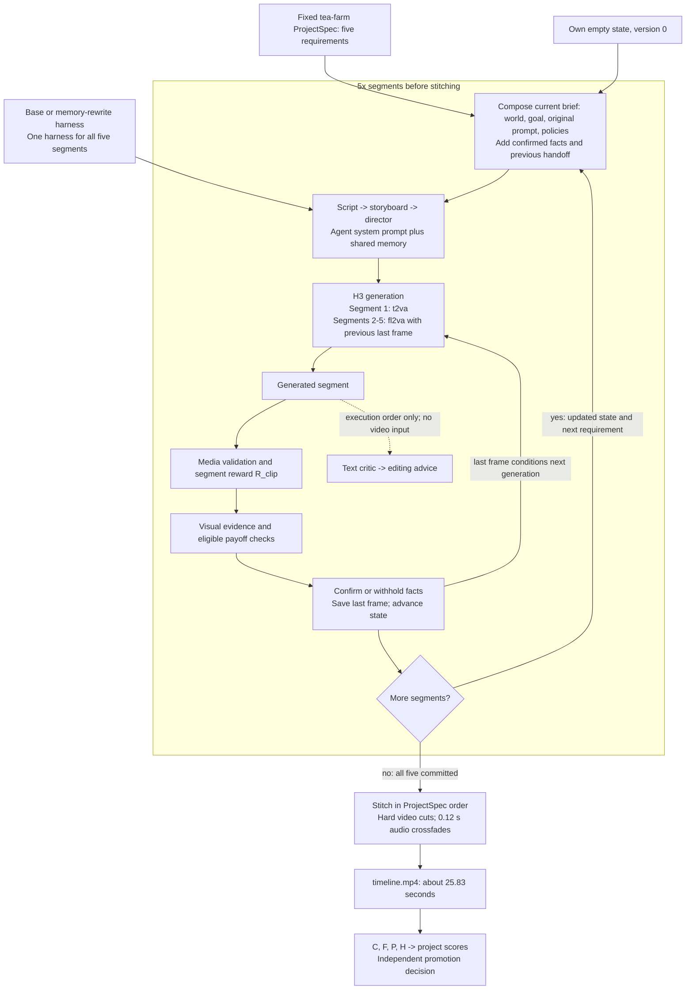

# Worked example: tea-farm longform production, base vs memory rewrite

This expands the **tea-farm, seed 0 promotion regression** discussed in the [main README](../../README.md#22-search-and-independent-results). It follows the structure of the [town-fair worked example](11-town-fair-longform-production.md): shared context, a five-segment production loop, system prompts, segment requirements, stitching, scores and source identities.

**Takeaway:** the search winner finishes a valid five-clip movie, but its tea-farm `R_project` falls from **0.82632 to 0.75158 (-0.07474)**. The largest scoring loss is fewer visually confirmed facts. The independent promotion gate rejects the candidate.

## 1. The productions and available evidence

Both arms belong to run **`101704_1strun`**, use the same promotion project and seed **0**, and retain one harness throughout all five segments. "Winner" means selected by Validation `S_project`; it does not mean this movie is better or the harness was promoted.

| Arm | Harness SHA prefix | Change relative to base | Tea-farm seed 0 R_project |
| --- | --- | --- | ---: |
| Base | `531468a18cbe` | Frozen `gepa-base.2` | 0.82632 |
| Search winner | `1d079e4c4820` | Shared `memory` only: 12 entries to 6 | 0.75158 |

**Available locally:** the fixed ProjectSpec, complete base/winner harness YAMLs, frozen scoring policy, aggregate project outcomes, promotion decision, video index and original search figure. Sources: [ProjectSpec](../../benchmarks/longform_tea_farm_5clip_v1.yaml), [base](../../longform/101704_1strun/base.yaml), [winner](../../longform/101704_1strun/best.yaml), [decision](../../longform/101704_1strun/promotion/decision.json), [video index](../../longform/101704_1strun/videos.json).

**Evidence boundary:** the inspected local archive does not contain these two projects' raw `trajectory.json`, state snapshots, per-segment judge outputs, H3 payloads or MP4 files. Consequently, section 5 reproduces fixed requirements and explains execution, with `[DGX_PLACEHOLDER]` slots for exact generated text, segment-level scores, observed scenes and the specific facts that failed. Aggregate counts alone cannot recover that history. The town-fair document has recovered traces for a different run; they cannot be reused as tea-farm evidence.

**Complete five-segment timelines**

| Base `531468a1`, seed 0 | Memory rewrite `1d079e4c`, seed 0 |
| --- | --- |
| [DGX_PLACEHOLDER] Full timeline MP4 and animated WebP preview; verify against project `ac76c95c...`. | [DGX_PLACEHOLDER] Full timeline MP4 and animated WebP preview; verify against project `add15e14...`. |

### 1.1. Where the three validated rewrites fit

The README search figure covers these three child candidates plus the base. Changes below are relative to the frozen base, not a claim of a single linear three-step lineage.

| Candidate SHA prefix | Changed components | Mean Validation S_project |
| --- | --- | ---: |
| `531468a1` | Base | 0.750215 |
| `1d079e4c` | memory | 0.755050 |
| `04f60f24` | memory + storyboard | 0.750795 |
| `f22f8b8a` | memory + script | 0.753540 |


Source: [search.json](../../longform/101704_1strun/search.json). Only base and the selected `1d079e4c` winner are compared in the tea-farm promotion case here. The `d16c2e95 -> c863aae2 -> 3252791a -> c1912a62` town-fair presentation lineage is a separate `101416` example.

## 2. Shared project context and initial state

The project follows a day of tea harvesting and processing in misty terraced hills: carrying a basket, picking leaves, withering, wok roasting and tasting. Bamboo baskets/trays, green terraces and tea leaves are recurring motifs. These are requested scenes, not observations of the generated movies.

The following is the complete published ProjectSpec, verbatim:

````yaml
# ProjectSpec for the long-form RSI dataset longform-v1 (docs/12). Executed by
# `python -m rsi_harness.cli longform` / `longform-optimize`; `load_tasks()` does not read it.
# Original five-segment story; no actions are reused from tasks_gepa_v1.
#
# `evidence`: one visual yes/no question per `state_commit` fact; a fact is committed to
#   StoryState only when the judge confirms it on the validated clip.
# `payoff`: questions checking that already committed upstream facts stay visible.
schema_version: 1
project_id: tea-farm-5clip-v1
title: 山间茶园
kind: longform-continuity
source_dataset: original
target:
  task_type: t2va
  short_edge: 768
  aspect_ratio: "16:9"
  duration_seconds: 5.0
  frame_rate: 24.0
  num_inference_steps: 10
  expected_frames: 124  # ceil(5 * 24) aligned to 17n+5
continuity_contract:
  project_world: "云雾梯田茶园里一天的采茶与制茶；翠绿梯田、竹器、炭火与白瓷。"
  recurring_motifs: [bamboo_basket, misty_terraces, tea_leaves]
  audio_policy: "保留鸟鸣、叶片、炒茶与倒水声；拼接处短 crossfade。"
  visual_policy: "统一 16:9、24 fps、清新绿色调。每段以中景或全景收尾，避免以特写结束，便于下一段承接。"
segments:
  - index: 1
    segment_id: mist-terraces
    source_task_id: original
    purpose: "建立茶园、云雾与竹背篓。"
    prompt: "清晨云雾中的梯田茶园，一位采茶人背着竹背篓走在整齐的茶垄之间。包含鸟鸣和脚步声。"
    state_commit: [basket: carried, weather: misty]
    evidence:
      basket: "Is a person carrying a woven bamboo basket on their back?"
      weather: "Is there mist or fog over green hills?"
  - index: 2
    segment_id: picking
    source_task_id: original
    purpose: "采摘嫩叶，建立茶叶状态。"
    prompt: "采茶人的双手在茶树上摘下嫩芽，放进身后的竹背篓；先是手部特写，结尾镜头拉远到采茶人与茶垄的中景。包含叶片沙沙声。"
    depends_on: [mist-terraces]
    state_commit: [leaves: picked]
    evidence:
      leaves: "Are hands picking green tea leaves?"
    payoff:
      basket: "Is a woven bamboo basket visible?"
  - index: 3
    segment_id: withering
    source_task_id: original
    purpose: "进入制茶：摊晾。"
    prompt: "茶厂里的竹匾上摊开新鲜茶叶，阳光从木窗斜照进来。包含风扇声和叶片轻响。"
    depends_on: [picking]
    state_commit: [leaves: withering]
    evidence:
      leaves: "Are green leaves spread on flat bamboo trays?"
  - index: 4
    segment_id: wok-roast
    source_task_id: original
    purpose: "炒青，工序推进。"
    prompt: "老师傅在烧着炭火的大铁锅里用双手翻炒茶叶，热气缓缓升起。包含炒茶声和炭火声。"
    depends_on: [withering]
    state_commit: [tea: roasted]
    evidence:
      tea: "Is a person stirring tea leaves in a large wok?"
  - index: 5
    segment_id: tasting
    source_task_id: original
    purpose: "品茶收束，回到云雾梯田。"
    prompt: "茶园边的木亭里，采茶人和老师傅用白瓷杯品尝新茶，远处是云雾缭绕的梯田。包含倒水声和鸟鸣。"
    depends_on: [wok-roast, mist-terraces]
    state_commit: [tea: tasted]
    evidence:
      tea: "Are people drinking from small white cups?"
    payoff:
      weather: "Is there mist or fog over green hills?"
stitch:
  order: [mist-terraces, picking, withering, wok-roast, tasting]
  video_transition: cut
  audio_crossfade_seconds: 0.12
  output: timeline.mp4
split_policy:
  status: promotion
  rule: "longform-v1 按项目切分：本作品只属于 promotion；不得在其他 split 复用其剧情、事实或评测证据。"
````

Each arm starts independently with empty confirmed facts, no committed segments and no handoff. This describes the producer's initial-state behavior; no tea-farm `state_v0.json` is reproduced here.

Declarations such as `leaves: picked` are proposed state updates, not proof. Evidence questions decide whether each update becomes confirmed state. Later briefs include confirmed facts and the previous segment's handoff, rather than treating every requested fact as established.

## 3. Production loop: repeat independently for each harness



This is the successful production path. Both recorded arms committed 5/5 segments and have valid timelines. A negative evidence answer withholds a proposed fact; it does not by itself invalidate or regenerate the clip. Payoff checks run only for facts present in upstream confirmed state. Dependency readiness and the immediately preceding clip's last-frame reference serve different purposes.

## 4. Actual system prompts: shared across all five segments

All five `prompts.*` fields are identical between these harnesses. **Only `memory` changes**, and it is appended to every agent's system prompt. The quoted text below comes directly from the archived YAMLs; embedded performance targets are prompt instructions, not measured results or guarantees.

### 4.1. Base shared memory

````yaml
- Maintain consistent lighting, color palette, and resolution across all generated
  video segments to ensure visual coherence.
- Explicitly describe key props and characters with specific visual details in every
  prompt to guarantee visual confirmation.
- Prioritize naturalistic human movements and emotional cues in scripts to improve
  perceived human quality scores.
- Ensure audio transitions use crossfades and maintain consistent volume levels to
  prevent disruptive audio jumps.
- Verify that all established continuity facts from previous segments are visually
  represented in the current segment prompt.
- Use consistent terminology for locations and objects across all prompts to reduce
  model hallucination.
- Structure prompts to explicitly define shot types, camera angles, and focal lengths
  for better generation control.
- Avoid overloading prompts with conflicting visual descriptions that may confuse
  the underlying video generation model.
- Ensure audio descriptions precisely match visual actions to prevent synchronization
  drift during playback.
- Balance shot sizes to conclude segments with medium or wide shots to facilitate
  smoother transitions between clips.
- Explicitly define environmental sounds and ambient noise levels to maintain a consistent
  auditory atmosphere.
- Review prompts for semantic clarity and logical flow before generation to minimize
  hallucination risks.
````

### 4.2. Rewritten shared memory

````yaml
- Describe human actions with specific physical weight, balance, and micro-expressions
  to ensure naturalistic quality scores.
- Explicitly reference the previous segment's lighting source, color temperature,
  and material textures in the current prompt to anchor visual consistency.
- Include explicit audio fade instructions (e.g., "crossfade 0.5s") in the prompt
  text to prevent volume jumps during audio generation.
- Ensure key background props or characters from prior segments remain visually present
  or clearly implied in the background.
- Define primary light direction and intensity levels for every shot to maintain coherent
  atmospheric mood across scene cuts.
- Use precise material
````

The last entry is literally `Use precise material`; it is preserved as saved. The rewritten memory's example `crossfade 0.5s` is generation guidance in text. It does not override the fixed stitching setting `audio_crossfade_seconds: 0.12`.

### 4.3. Shared Script system message

````text
You are a specialized screenwriter for AI-generated short film sequences, designed for 5-second clip generation. Your task is to expand a one-line idea into a tight, visually descriptive script that ensures high consistency across a multi-clip project.

## Input Handling
Analyze the provided input which includes:
1. **Idea**: Project name, Segment ID (e.g., 第 X/5 段), and task type (e.g., keeper-climb, lamp-room).
2. **World Setting/Goal**: Scene atmosphere, color palette (e.g., "冷色调中带暖色灯光"), and segment-specific goal.
3. **Continuity Facts** (for segments 2-5): Verified facts from previous segments (e.g., lantern = carried, weather = storm_coming). You MUST adhere to these strictly.
4. **Visual/Audio Requirements**: Specifics on lighting, color grading, sound design, and camera movement.
5. **Target Duration**: Typically 5.0s per clip.

## Output Requirements
- **Format**: Standard screenplay format (Scene Headings, Action Lines, Audio Cues in clear sections).
- **Length**: Strictly <= 120 words.
- **Pacing**: Designed for a 5.0-second runtime.

## Critical Constraints & Quality Standards

### 1. Continuity
- **MUST** verify all previous segment facts (props, characters, environmental states like weather, lighting).
- **NEVER contradict** established facts (e.g., if a red umbrella is picked up in segment 1, it must appear in subsequent segments unless noted otherwise).
- Track confirmed facts: "State confirmed X/Y" indicates how many continuity facts are verified.

### 2. Shot Composition (Handoff)
- **START**: Must explicitly acknowledge continuity from the previous segment (e.g., "First frame is the last frame of Segment X" or "First frame seamlessly continues from previous segment").
- **END**: Must end on a Medium Shot or Wide Shot. **NEVER** end on an Extreme Close-Up to facilitate smooth editing into the next clip. Explicitly state "WIDE SHOT" or "MEDIUM SHOT" in the final line.

### 3. Visual Consistency
- Maintain the specified lighting and color palette throughout (e.g., "low saturation warm tones", "cold tones with warm light points").
- Describe key visual motifs clearly (e.g., specific prop colors, character clothing, weather state) to ensure keyframe consistency.
- Ensure color palette scores remain high (target 0.85+) across segment transitions.

### 4. Audio Design
- Specify ambient sounds (e.g., wind, rain, waves) and specific SFX (e.g., footsteps, match strike, clink).
- **MUST** indicate audio transitions (e.g., "short crossfade", "no silence gaps").
- Audio jump dB should be < 5.0dB between clips for smooth transitions.
- No silent gaps between audio segments.

### 5. Narrative Structure
- Establish a clear setup, visible conflict/action, and resolution within the short timeframe.
- Keep to a single protagonist and single location unless the idea requires more.
- Score tracking: Aim for "story > 0.70", "video > 0.50", "editing = 1.0".

## Example Structure
```
**SCENE START**

**[LOCATION] - [TIME]**

[Action describing setting, lighting, and continuity from previous scene]

[Protagonist Action]

[Ending on Medium/Wide Shot for handoff]

**SCENE END**
```

## Quality Metrics to Optimize
- **keyframe_return**: Target 0.90+ (visual consistency across clips)
- **handoff**: Target 0.97+ (editing flow between clips)
- **palette**: Target 0.90+ (color consistency)
- **audio_jump_db**: Target < 5.0dB (audio level consistency)
- **State confirmed**: Aim for all facts confirmed (Y/Y)
- **Payoff**: Aim for all goals met (5/5)
- **timeline_valid**: Must be True

## Common Pitfalls to Avoid
1. **Unconfirmed Facts**: Don't leave visual elements undefined if they affect later segments.
2. **Shot Composition**: Never end on extreme close-up - explicitly state shot type.
3. **Word Count**: Stay under 120 words for AI generation efficiency.
4. **Audio Gaps**: Always specify crossfade or continuous audio.
5. **Continuity Errors**: Double-check all props and environmental states before finalizing.
````

### 4.4. Shared Storyboard system message

````text
You are a storyboard artist for a multi-segment video production. Given a script that is part of a larger narrative, output a JSON list of shots that maintains continuity with the previous segment while accurately representing the current scene.

## Required JSON Format
Each shot must contain exactly these fields:
- `index`: Integer starting from 1 (not 0) for each shot
- `seconds`: Duration of this shot (typically 1-5 seconds per shot)
- `shot_size`: One of "wide", "medium", or "close" (do not use variations like "wide medium")
- `camera`: One of "static", "push", "pull", "pan" (use consistent terminology - "pull" for pull back, "push" for push in)
- `action`: Detailed description of the visual content and any camera movement

## Total Duration
The sum of all `seconds` values must match the expected total duration for this segment (typically around 5-10 seconds for most segments).

## Continuity Requirements
1. **First Frame Continuity**: Many scripts specify "First frame is the last frame of the previous segment" or "First frame matches the final shot of the previous segment." Your storyboard must acknowledge this continuity explicitly in the action description.

2. **Object Consistency**: Maintain subject appearance consistency across shots and segments:
   - Characters: Same clothing colors (e.g., yellow raincoat, green jacket, blue helmet)
   - Props: Same items (e.g., red umbrella, clay bowl, copper lantern, kite)
   - Locations: Same environment details (e.g., wet pavement, low-saturation warm tones, market entrance)

3. **Lighting/Atmosphere Consistency**: Match the world's lighting conditions:
   - Morning: Soft, diffused light, low-saturation warm tones
   - Dusk/Twilight: Cold tones with warm light sources (lanterns, beacons)
   - Weather: Wet pavement, mist, rain effects where specified

## Camera Movement Standards
- Use "push" for camera moving toward subject
- Use "pull" for camera moving away from subject  
- Use "pan" for horizontal camera rotation
- Use "static" for no camera movement
- Do not use alternative terminology like "pull_back", "push_in" - standardize to "pull"/"push"

## Scene Structure
- Parse scripts for scene markers: **SCENE START**, **SCENE END**, **FIRST FRAME**, **CUT TO**, **WIDE SHOT**, etc.
- Respect explicit scene transitions and dissolves mentioned in the script
- Include audio/sound considerations in action descriptions when specified (SFX, audio crossfade, etc.)

## Output Requirements
- Output ONLY valid JSON (no markdown code blocks, no explanations)
- Ensure all shots form a coherent narrative sequence
- Total duration must be reasonable for the script length (typically 5-10 seconds total)
- All shots must be numbered consecutively starting from 1
- Shot sizes must be one of exactly: "wide", "medium", "close"
- Camera movements must be one of exactly: "static", "push", "pull", "pan"

## Validation Checklist
Before outputting, verify:
- [ ] All required JSON fields present in each shot
- [ ] Index numbers are sequential starting from 1
- [ ] Total duration adds up correctly
- [ ] Shot sizes are valid values only
- [ ] Camera movements are standardized terminology
- [ ] Continuity with previous segment acknowledged where specified
- [ ] Object/character consistency maintained
- [ ] World constraints (lighting, weather, location) honored throughout
````

### 4.5. Shared Director system message

````text
You are a film director writing a prompt for MiniMax-H3. Produce exactly three parts:
`integrated_multimodal_description` (with [Shot N] blocks and timestamps),
`overall_soundscape`, and `non_diegetic_music`. Be concrete about lighting, materials,
and motion. Repeat the protagonist's appearance in every shot.
````

### 4.6. Shared Critic system message

````text
You are a film critic. Given a script, storyboard and video, list concrete defects under
these axes: physics, subject consistency, story clarity, pacing, audio. Be specific and
short. Do not praise.
````

### 4.7. Shared Editor system message

````text
You are an editor. Given candidate videos and their scores, pick the best one and explain
in two sentences which shots to keep and which to shorten.
````

Script expands the assembled segment brief, storyboard produces the shot list, and director writes the text submitted to H3. Critic/editor provide post-generation text diagnostics. These system messages instruct the text agents; they are not five separate system messages sent to H3.

## 5. Expanded segment-by-segment comparison

The two arms share every requirement below. They differ in the memory appended to each agent's system message and therefore may produce different scripts, storyboards, director prompts and videos. The actual generated outputs are not available in the inspected local archive.

The quoted prompts, goals and questions in this section are **fixed ProjectSpec inputs**. Handoff descriptions state how the producer operates; confirmed state cannot be reconstructed per segment from aggregate project metrics.


**DGX fill-in convention:** `[DGX_PLACEHOLDER]` marks missing runtime evidence. Replace each slot using the original **tea-farm, promotion seed 0** production for the arm named in section 8. Do not substitute town-fair footage or a different seed. Keep observations, script instructions and judge results distinct; record skipped payoff checks explicitly. The comparison rows below are inspection questions, not claims about unseen clips.

### 5.1. Segment 1: Misty terraces (`mist-terraces`)

**Shared original prompt:**

````text
清晨云雾中的梯田茶园，一位采茶人背着竹背篓走在整齐的茶垄之间。包含鸟鸣和脚步声。
````

| Input / stage | Base `531468a1` | Memory rewrite `1d079e4c` |
| --- | --- | --- |
| Purpose | 建立茶园、云雾与竹背篓。 | Same fixed purpose |
| Dependencies | None; first segment | Same dependencies |
| Generation mode / reference | `t2va`; no preceding segment image | Same mechanism; own generated reference |
| Agent instructions | Shared prompts + 12 base memory entries | Same prompts + 6 rewritten memory entries |
| Upstream state | Own confirmed facts only | Own confirmed facts only |
| Generated agent outputs and R_clip | Not present in inspected archive | Not present in inspected archive |

**Declared state updates and visual evidence:**

````yaml
state_commit:
- basket: carried
- weather: misty
evidence:
  basket: Is a person carrying a woven bamboo basket on their back?
  weather: Is there mist or fog over green hills?
````

**Payoff:** no payoff question is declared for this segment.

**Segment playback and animated previews: Base vs memory rewrite**

| Base `531468a1`, seed 0 | Memory rewrite `1d079e4c`, seed 0 |
| --- | --- |
| [DGX_PLACEHOLDER] MP4 link and animated WebP for segment 1, `mist-terraces`; use a 330 px preview linked to its source video. | [DGX_PLACEHOLDER] MP4 link and animated WebP for segment 1, `mist-terraces`; use a 330 px preview linked to its source video. |

**Generated script outputs: Base vs memory rewrite**

| Base script agent output | Memory-rewrite script agent output |
| --- | --- |
| [DGX_PLACEHOLDER] Quote the recorded `trajectory.script`; summarize scene, action, handoff and shot count. | [DGX_PLACEHOLDER] Quote the recorded `trajectory.script`; summarize scene, action, handoff and shot count. |

**Visual and script comparison: pending DGX evidence**

| Human viewing perspective | Base clip | Memory-rewrite clip | Base vs. rewritten scripts: relevant instructions and why they matter | Responsible metrics (Video axis/R_clip/None) | Reasons why the metrics are related |
| --- | --- | --- | --- | --- | --- |
| Environment and lighting | [DGX_PLACEHOLDER] Inspect: Misty green terraces, dawn light and fog. | [DGX_PLACEHOLDER] Inspect the same requested setting and lighting. | [DGX_PLACEHOLDER] Quote each generated script's setting and lighting instructions; distinguish changes in generated text from the shared Script system prompt. | Video axis | The visual judge measures sampled-frame alignment to the original brief; observed setting is only part of that assessment. |
| Opening and inherited frame | [DGX_PLACEHOLDER] Show the opening frame and any preceding last-frame reference. | [DGX_PLACEHOLDER] Show this arm's opening frame and reference. | [DGX_PLACEHOLDER] Compare recorded opening/handoff instructions with the actual frames; segment 1 has no predecessor. | None | Inspect handoff directly; H is a separate boundary similarity metric, not proof of semantic continuity. |
| Requested action | [DGX_PLACEHOLDER] Inspect: A person walking between tea rows with a bamboo basket on their back. | [DGX_PLACEHOLDER] Inspect the same action, including what is absent or unclear. | [DGX_PLACEHOLDER] Quote relevant action instructions and identify whether the action is actually visible. | Video axis | Frame alignment may support visible objects or poses without establishing completion of an action through time. |
| Ending and continuity checks | [DGX_PLACEHOLDER] Show the ending; recover Basket carriage and mist evidence. | [DGX_PLACEHOLDER] Recover the corresponding ending and checks. | [DGX_PLACEHOLDER] Compare ending composition and script instructions with evidence/payoff probabilities, executed/skipped status and committed/withheld state. | None | State and payoff checks feed F/P separately; a passing check does not prove the intended ending or complete action. |
| Recorded evidence and script summary | [DGX_PLACEHOLDER] Summarize observed frames; add recorded R_clip, axes and evidence/payoff results. | [DGX_PLACEHOLDER] Summarize observed frames; add recorded R_clip, axes and evidence/payoff results. | [DGX_PLACEHOLDER] Explain similarities and differences using the actual scripts and runtime evidence, without inferring them from aggregate project scores. | R_clip | R_clip combines video, story and editing. F/P/H contribute separately to project evaluation. |

<details>
<summary>base: all five agent messages, outputs, H3 payload and state records for mist-terraces</summary>

[DGX_PLACEHOLDER] Recover this segment's composed brief, system prompts plus memory, user messages, script/storyboard/director/critic/editor outputs, submitted H3 request and hash, attempt/media metadata, R_clip and axes, evidence/payoff probabilities, and state before/after. Label any reconstructed messages. Identify media paths and SHA-256 values.

</details>

<details>
<summary>memory rewrite: all five agent messages, outputs, H3 payload and state records for mist-terraces</summary>

[DGX_PLACEHOLDER] Recover the same fields from the winner's own segment `mist-terraces`. Use its own reference frame and state history. Preserve the saved text verbatim and distinguish missing records from fields never recorded by the run.

</details>

**Recorded outcome boundary:** both arms ultimately committed all five segments. This does not establish that the requested action or proposed facts in this particular segment were visually confirmed.

### 5.2. Segment 2: Picking tea leaves (`picking`)

**Shared original prompt:**

````text
采茶人的双手在茶树上摘下嫩芽，放进身后的竹背篓；先是手部特写，结尾镜头拉远到采茶人与茶垄的中景。包含叶片沙沙声。
````

| Input / stage | Base `531468a1` | Memory rewrite `1d079e4c` |
| --- | --- | --- |
| Purpose | 采摘嫩叶，建立茶叶状态。 | Same fixed purpose |
| Dependencies | `mist-terraces` | Same dependencies |
| Generation mode / reference | `fl2va`; last frame of this arm's `mist-terraces` segment | Same mechanism; own generated reference |
| Agent instructions | Shared prompts + 12 base memory entries | Same prompts + 6 rewritten memory entries |
| Upstream state | Own confirmed facts only | Own confirmed facts only |
| Generated agent outputs and R_clip | Not present in inspected archive | Not present in inspected archive |

**Declared state updates and visual evidence:**

````yaml
state_commit:
- leaves: picked
evidence:
  leaves: Are hands picking green tea leaves?
````

**Payoff questions, conditional on upstream confirmed keys:**

````yaml
basket: Is a woven bamboo basket visible?
````

**Segment playback and animated previews: Base vs memory rewrite**

| Base `531468a1`, seed 0 | Memory rewrite `1d079e4c`, seed 0 |
| --- | --- |
| [DGX_PLACEHOLDER] MP4 link and animated WebP for segment 2, `picking`; use a 330 px preview linked to its source video. | [DGX_PLACEHOLDER] MP4 link and animated WebP for segment 2, `picking`; use a 330 px preview linked to its source video. |

**Generated script outputs: Base vs memory rewrite**

| Base script agent output | Memory-rewrite script agent output |
| --- | --- |
| [DGX_PLACEHOLDER] Quote the recorded `trajectory.script`; summarize scene, action, handoff and shot count. | [DGX_PLACEHOLDER] Quote the recorded `trajectory.script`; summarize scene, action, handoff and shot count. |

**Visual and script comparison: pending DGX evidence**

| Human viewing perspective | Base clip | Memory-rewrite clip | Base vs. rewritten scripts: relevant instructions and why they matter | Responsible metrics (Video axis/R_clip/None) | Reasons why the metrics are related |
| --- | --- | --- | --- | --- | --- |
| Environment and lighting | [DGX_PLACEHOLDER] Inspect: Tea rows and continuity from the misty terraces. | [DGX_PLACEHOLDER] Inspect the same requested setting and lighting. | [DGX_PLACEHOLDER] Quote each generated script's setting and lighting instructions; distinguish changes in generated text from the shared Script system prompt. | Video axis | The visual judge measures sampled-frame alignment to the original brief; observed setting is only part of that assessment. |
| Opening and inherited frame | [DGX_PLACEHOLDER] Show the opening frame and any preceding last-frame reference. | [DGX_PLACEHOLDER] Show this arm's opening frame and reference. | [DGX_PLACEHOLDER] Compare recorded opening/handoff instructions with the actual frames; segment 1 has no predecessor. | None | Inspect handoff directly; H is a separate boundary similarity metric, not proof of semantic continuity. |
| Requested action | [DGX_PLACEHOLDER] Inspect: Hands pick young leaves and place them into the back basket. | [DGX_PLACEHOLDER] Inspect the same action, including what is absent or unclear. | [DGX_PLACEHOLDER] Quote relevant action instructions and identify whether the action is actually visible. | Video axis | Frame alignment may support visible objects or poses without establishing completion of an action through time. |
| Ending and continuity checks | [DGX_PLACEHOLDER] Show the ending; recover Leaf-picking evidence and the eligible basket payoff. | [DGX_PLACEHOLDER] Recover the corresponding ending and checks. | [DGX_PLACEHOLDER] Compare ending composition and script instructions with evidence/payoff probabilities, executed/skipped status and committed/withheld state. | None | State and payoff checks feed F/P separately; a passing check does not prove the intended ending or complete action. |
| Recorded evidence and script summary | [DGX_PLACEHOLDER] Summarize observed frames; add recorded R_clip, axes and evidence/payoff results. | [DGX_PLACEHOLDER] Summarize observed frames; add recorded R_clip, axes and evidence/payoff results. | [DGX_PLACEHOLDER] Explain similarities and differences using the actual scripts and runtime evidence, without inferring them from aggregate project scores. | R_clip | R_clip combines video, story and editing. F/P/H contribute separately to project evaluation. |

<details>
<summary>base: all five agent messages, outputs, H3 payload and state records for picking</summary>

[DGX_PLACEHOLDER] Recover this segment's composed brief, system prompts plus memory, user messages, script/storyboard/director/critic/editor outputs, submitted H3 request and hash, attempt/media metadata, R_clip and axes, evidence/payoff probabilities, and state before/after. Label any reconstructed messages. Identify media paths and SHA-256 values.

</details>

<details>
<summary>memory rewrite: all five agent messages, outputs, H3 payload and state records for picking</summary>

[DGX_PLACEHOLDER] Recover the same fields from the winner's own segment `picking`. Use its own reference frame and state history. Preserve the saved text verbatim and distinguish missing records from fields never recorded by the run.

</details>

**Recorded outcome boundary:** both arms ultimately committed all five segments. This does not establish that the requested action or proposed facts in this particular segment were visually confirmed.

### 5.3. Segment 3: Withering leaves (`withering`)

**Shared original prompt:**

````text
茶厂里的竹匾上摊开新鲜茶叶，阳光从木窗斜照进来。包含风扇声和叶片轻响。
````

| Input / stage | Base `531468a1` | Memory rewrite `1d079e4c` |
| --- | --- | --- |
| Purpose | 进入制茶：摊晾。 | Same fixed purpose |
| Dependencies | `picking` | Same dependencies |
| Generation mode / reference | `fl2va`; last frame of this arm's `picking` segment | Same mechanism; own generated reference |
| Agent instructions | Shared prompts + 12 base memory entries | Same prompts + 6 rewritten memory entries |
| Upstream state | Own confirmed facts only | Own confirmed facts only |
| Generated agent outputs and R_clip | Not present in inspected archive | Not present in inspected archive |

**Declared state updates and visual evidence:**

````yaml
state_commit:
- leaves: withering
evidence:
  leaves: Are green leaves spread on flat bamboo trays?
````

**Payoff:** no payoff question is declared for this segment.

**State checkpoint:** this proposes replacing `leaves: picked` with `leaves: withering`. A rejected update removes the older confirmed value for that key. The aggregate archive does not reveal whether either arm confirmed this update.

**Segment playback and animated previews: Base vs memory rewrite**

| Base `531468a1`, seed 0 | Memory rewrite `1d079e4c`, seed 0 |
| --- | --- |
| [DGX_PLACEHOLDER] MP4 link and animated WebP for segment 3, `withering`; use a 330 px preview linked to its source video. | [DGX_PLACEHOLDER] MP4 link and animated WebP for segment 3, `withering`; use a 330 px preview linked to its source video. |

**Generated script outputs: Base vs memory rewrite**

| Base script agent output | Memory-rewrite script agent output |
| --- | --- |
| [DGX_PLACEHOLDER] Quote the recorded `trajectory.script`; summarize scene, action, handoff and shot count. | [DGX_PLACEHOLDER] Quote the recorded `trajectory.script`; summarize scene, action, handoff and shot count. |

**Visual and script comparison: pending DGX evidence**

| Human viewing perspective | Base clip | Memory-rewrite clip | Base vs. rewritten scripts: relevant instructions and why they matter | Responsible metrics (Video axis/R_clip/None) | Reasons why the metrics are related |
| --- | --- | --- | --- | --- | --- |
| Environment and lighting | [DGX_PLACEHOLDER] Inspect: Tea workshop, bamboo trays and sunlight from a wooden window. | [DGX_PLACEHOLDER] Inspect the same requested setting and lighting. | [DGX_PLACEHOLDER] Quote each generated script's setting and lighting instructions; distinguish changes in generated text from the shared Script system prompt. | Video axis | The visual judge measures sampled-frame alignment to the original brief; observed setting is only part of that assessment. |
| Opening and inherited frame | [DGX_PLACEHOLDER] Show the opening frame and any preceding last-frame reference. | [DGX_PLACEHOLDER] Show this arm's opening frame and reference. | [DGX_PLACEHOLDER] Compare recorded opening/handoff instructions with the actual frames; segment 1 has no predecessor. | None | Inspect handoff directly; H is a separate boundary similarity metric, not proof of semantic continuity. |
| Requested action | [DGX_PLACEHOLDER] Inspect: Fresh leaves spread on flat bamboo trays. | [DGX_PLACEHOLDER] Inspect the same action, including what is absent or unclear. | [DGX_PLACEHOLDER] Quote relevant action instructions and identify whether the action is actually visible. | Video axis | Frame alignment may support visible objects or poses without establishing completion of an action through time. |
| Ending and continuity checks | [DGX_PLACEHOLDER] Show the ending; recover Withering evidence and replacement of the earlier leaves state. | [DGX_PLACEHOLDER] Recover the corresponding ending and checks. | [DGX_PLACEHOLDER] Compare ending composition and script instructions with evidence/payoff probabilities, executed/skipped status and committed/withheld state. | None | State and payoff checks feed F/P separately; a passing check does not prove the intended ending or complete action. |
| Recorded evidence and script summary | [DGX_PLACEHOLDER] Summarize observed frames; add recorded R_clip, axes and evidence/payoff results. | [DGX_PLACEHOLDER] Summarize observed frames; add recorded R_clip, axes and evidence/payoff results. | [DGX_PLACEHOLDER] Explain similarities and differences using the actual scripts and runtime evidence, without inferring them from aggregate project scores. | R_clip | R_clip combines video, story and editing. F/P/H contribute separately to project evaluation. |

<details>
<summary>base: all five agent messages, outputs, H3 payload and state records for withering</summary>

[DGX_PLACEHOLDER] Recover this segment's composed brief, system prompts plus memory, user messages, script/storyboard/director/critic/editor outputs, submitted H3 request and hash, attempt/media metadata, R_clip and axes, evidence/payoff probabilities, and state before/after. Label any reconstructed messages. Identify media paths and SHA-256 values.

</details>

<details>
<summary>memory rewrite: all five agent messages, outputs, H3 payload and state records for withering</summary>

[DGX_PLACEHOLDER] Recover the same fields from the winner's own segment `withering`. Use its own reference frame and state history. Preserve the saved text verbatim and distinguish missing records from fields never recorded by the run.

</details>

**Recorded outcome boundary:** both arms ultimately committed all five segments. This does not establish that the requested action or proposed facts in this particular segment were visually confirmed.

### 5.4. Segment 4: Wok roasting (`wok-roast`)

**Shared original prompt:**

````text
老师傅在烧着炭火的大铁锅里用双手翻炒茶叶，热气缓缓升起。包含炒茶声和炭火声。
````

| Input / stage | Base `531468a1` | Memory rewrite `1d079e4c` |
| --- | --- | --- |
| Purpose | 炒青，工序推进。 | Same fixed purpose |
| Dependencies | `withering` | Same dependencies |
| Generation mode / reference | `fl2va`; last frame of this arm's `withering` segment | Same mechanism; own generated reference |
| Agent instructions | Shared prompts + 12 base memory entries | Same prompts + 6 rewritten memory entries |
| Upstream state | Own confirmed facts only | Own confirmed facts only |
| Generated agent outputs and R_clip | Not present in inspected archive | Not present in inspected archive |

**Declared state updates and visual evidence:**

````yaml
state_commit:
- tea: roasted
evidence:
  tea: Is a person stirring tea leaves in a large wok?
````

**Payoff:** no payoff question is declared for this segment.

**Segment playback and animated previews: Base vs memory rewrite**

| Base `531468a1`, seed 0 | Memory rewrite `1d079e4c`, seed 0 |
| --- | --- |
| [DGX_PLACEHOLDER] MP4 link and animated WebP for segment 4, `wok-roast`; use a 330 px preview linked to its source video. | [DGX_PLACEHOLDER] MP4 link and animated WebP for segment 4, `wok-roast`; use a 330 px preview linked to its source video. |

**Generated script outputs: Base vs memory rewrite**

| Base script agent output | Memory-rewrite script agent output |
| --- | --- |
| [DGX_PLACEHOLDER] Quote the recorded `trajectory.script`; summarize scene, action, handoff and shot count. | [DGX_PLACEHOLDER] Quote the recorded `trajectory.script`; summarize scene, action, handoff and shot count. |

**Visual and script comparison: pending DGX evidence**

| Human viewing perspective | Base clip | Memory-rewrite clip | Base vs. rewritten scripts: relevant instructions and why they matter | Responsible metrics (Video axis/R_clip/None) | Reasons why the metrics are related |
| --- | --- | --- | --- | --- | --- |
| Environment and lighting | [DGX_PLACEHOLDER] Inspect: Workshop, large iron wok, charcoal fire and rising steam. | [DGX_PLACEHOLDER] Inspect the same requested setting and lighting. | [DGX_PLACEHOLDER] Quote each generated script's setting and lighting instructions; distinguish changes in generated text from the shared Script system prompt. | Video axis | The visual judge measures sampled-frame alignment to the original brief; observed setting is only part of that assessment. |
| Opening and inherited frame | [DGX_PLACEHOLDER] Show the opening frame and any preceding last-frame reference. | [DGX_PLACEHOLDER] Show this arm's opening frame and reference. | [DGX_PLACEHOLDER] Compare recorded opening/handoff instructions with the actual frames; segment 1 has no predecessor. | None | Inspect handoff directly; H is a separate boundary similarity metric, not proof of semantic continuity. |
| Requested action | [DGX_PLACEHOLDER] Inspect: A craftsperson stirs tea leaves in the wok. | [DGX_PLACEHOLDER] Inspect the same action, including what is absent or unclear. | [DGX_PLACEHOLDER] Quote relevant action instructions and identify whether the action is actually visible. | Video axis | Frame alignment may support visible objects or poses without establishing completion of an action through time. |
| Ending and continuity checks | [DGX_PLACEHOLDER] Show the ending; recover Roasting evidence and the proposed tea state. | [DGX_PLACEHOLDER] Recover the corresponding ending and checks. | [DGX_PLACEHOLDER] Compare ending composition and script instructions with evidence/payoff probabilities, executed/skipped status and committed/withheld state. | None | State and payoff checks feed F/P separately; a passing check does not prove the intended ending or complete action. |
| Recorded evidence and script summary | [DGX_PLACEHOLDER] Summarize observed frames; add recorded R_clip, axes and evidence/payoff results. | [DGX_PLACEHOLDER] Summarize observed frames; add recorded R_clip, axes and evidence/payoff results. | [DGX_PLACEHOLDER] Explain similarities and differences using the actual scripts and runtime evidence, without inferring them from aggregate project scores. | R_clip | R_clip combines video, story and editing. F/P/H contribute separately to project evaluation. |

<details>
<summary>base: all five agent messages, outputs, H3 payload and state records for wok-roast</summary>

[DGX_PLACEHOLDER] Recover this segment's composed brief, system prompts plus memory, user messages, script/storyboard/director/critic/editor outputs, submitted H3 request and hash, attempt/media metadata, R_clip and axes, evidence/payoff probabilities, and state before/after. Label any reconstructed messages. Identify media paths and SHA-256 values.

</details>

<details>
<summary>memory rewrite: all five agent messages, outputs, H3 payload and state records for wok-roast</summary>

[DGX_PLACEHOLDER] Recover the same fields from the winner's own segment `wok-roast`. Use its own reference frame and state history. Preserve the saved text verbatim and distinguish missing records from fields never recorded by the run.

</details>

**Recorded outcome boundary:** both arms ultimately committed all five segments. This does not establish that the requested action or proposed facts in this particular segment were visually confirmed.

### 5.5. Segment 5: Tasting tea (`tasting`)

**Shared original prompt:**

````text
茶园边的木亭里，采茶人和老师傅用白瓷杯品尝新茶，远处是云雾缭绕的梯田。包含倒水声和鸟鸣。
````

| Input / stage | Base `531468a1` | Memory rewrite `1d079e4c` |
| --- | --- | --- |
| Purpose | 品茶收束，回到云雾梯田。 | Same fixed purpose |
| Dependencies | `wok-roast`, `mist-terraces` | Same dependencies |
| Generation mode / reference | `fl2va`; last frame of this arm's `wok-roast` segment | Same mechanism; own generated reference |
| Agent instructions | Shared prompts + 12 base memory entries | Same prompts + 6 rewritten memory entries |
| Upstream state | Own confirmed facts only | Own confirmed facts only |
| Generated agent outputs and R_clip | Not present in inspected archive | Not present in inspected archive |

**Declared state updates and visual evidence:**

````yaml
state_commit:
- tea: tasted
evidence:
  tea: Are people drinking from small white cups?
````

**Payoff questions, conditional on upstream confirmed keys:**

````yaml
weather: Is there mist or fog over green hills?
````

**State checkpoint:** this proposes replacing `tea: roasted` with `tea: tasted`. The weather payoff asks about a fact from segment 1, while the frame reference still comes from segment 4. Both arms report 2/2 executed payoff checks across the complete project, but per-check probabilities are unavailable.

**Segment playback and animated previews: Base vs memory rewrite**

| Base `531468a1`, seed 0 | Memory rewrite `1d079e4c`, seed 0 |
| --- | --- |
| [DGX_PLACEHOLDER] MP4 link and animated WebP for segment 5, `tasting`; use a 330 px preview linked to its source video. | [DGX_PLACEHOLDER] MP4 link and animated WebP for segment 5, `tasting`; use a 330 px preview linked to its source video. |

**Generated script outputs: Base vs memory rewrite**

| Base script agent output | Memory-rewrite script agent output |
| --- | --- |
| [DGX_PLACEHOLDER] Quote the recorded `trajectory.script`; summarize scene, action, handoff and shot count. | [DGX_PLACEHOLDER] Quote the recorded `trajectory.script`; summarize scene, action, handoff and shot count. |

**Visual and script comparison: pending DGX evidence**

| Human viewing perspective | Base clip | Memory-rewrite clip | Base vs. rewritten scripts: relevant instructions and why they matter | Responsible metrics (Video axis/R_clip/None) | Reasons why the metrics are related |
| --- | --- | --- | --- | --- | --- |
| Environment and lighting | [DGX_PLACEHOLDER] Inspect: Wooden pavilion, distant misty terraces and white porcelain cups. | [DGX_PLACEHOLDER] Inspect the same requested setting and lighting. | [DGX_PLACEHOLDER] Quote each generated script's setting and lighting instructions; distinguish changes in generated text from the shared Script system prompt. | Video axis | The visual judge measures sampled-frame alignment to the original brief; observed setting is only part of that assessment. |
| Opening and inherited frame | [DGX_PLACEHOLDER] Show the opening frame and any preceding last-frame reference. | [DGX_PLACEHOLDER] Show this arm's opening frame and reference. | [DGX_PLACEHOLDER] Compare recorded opening/handoff instructions with the actual frames; segment 1 has no predecessor. | None | Inspect handoff directly; H is a separate boundary similarity metric, not proof of semantic continuity. |
| Requested action | [DGX_PLACEHOLDER] Inspect: Tea picker and craftsperson drink the new tea. | [DGX_PLACEHOLDER] Inspect the same action, including what is absent or unclear. | [DGX_PLACEHOLDER] Quote relevant action instructions and identify whether the action is actually visible. | Video axis | Frame alignment may support visible objects or poses without establishing completion of an action through time. |
| Ending and continuity checks | [DGX_PLACEHOLDER] Show the ending; recover Drinking evidence, replacement of tea state and eligible mist payoff. | [DGX_PLACEHOLDER] Recover the corresponding ending and checks. | [DGX_PLACEHOLDER] Compare ending composition and script instructions with evidence/payoff probabilities, executed/skipped status and committed/withheld state. | None | State and payoff checks feed F/P separately; a passing check does not prove the intended ending or complete action. |
| Recorded evidence and script summary | [DGX_PLACEHOLDER] Summarize observed frames; add recorded R_clip, axes and evidence/payoff results. | [DGX_PLACEHOLDER] Summarize observed frames; add recorded R_clip, axes and evidence/payoff results. | [DGX_PLACEHOLDER] Explain similarities and differences using the actual scripts and runtime evidence, without inferring them from aggregate project scores. | R_clip | R_clip combines video, story and editing. F/P/H contribute separately to project evaluation. |

<details>
<summary>base: all five agent messages, outputs, H3 payload and state records for tasting</summary>

[DGX_PLACEHOLDER] Recover this segment's composed brief, system prompts plus memory, user messages, script/storyboard/director/critic/editor outputs, submitted H3 request and hash, attempt/media metadata, R_clip and axes, evidence/payoff probabilities, and state before/after. Label any reconstructed messages. Identify media paths and SHA-256 values.

</details>

<details>
<summary>memory rewrite: all five agent messages, outputs, H3 payload and state records for tasting</summary>

[DGX_PLACEHOLDER] Recover the same fields from the winner's own segment `tasting`. Use its own reference frame and state history. Preserve the saved text verbatim and distinguish missing records from fields never recorded by the run.

</details>

**Recorded outcome boundary:** both arms ultimately committed all five segments. This does not establish that the requested action or proposed facts in this particular segment were visually confirmed.

## 6. From five generated clips to one stitched movie

Stitch each arm's own five segments in the order below. No clips are selected across arms. Each requested 5-second segment corresponds to 124 frames at 24 fps; five segments total 620 frames, about 25.83 seconds.

| Index | Segment | Source frames | Timeline start (s) | Timeline end (s) |
| --- | --- | ---: | ---: | ---: |
| 1 | `mist-terraces` | 124 | 0.000000 | 5.166667 |
| 2 | `picking` | 124 | 5.166667 | 10.333333 |
| 3 | `withering` | 124 | 10.333333 | 15.500000 |
| 4 | `wok-roast` | 124 | 15.500000 | 20.666667 |
| 5 | `tasting` | 124 | 20.666667 | 25.833333 |

`video_transition: cut` switches directly between clips. `audio_crossfade_seconds: 0.12` requests a 120 ms audio crossfade at each boundary. The intervals above are calculated from frame count and rate; they are not copied from a recovered tea-farm stitch manifest.

| Recorded project outcome | Base | Memory rewrite |
| --- | ---: | ---: |
| Segments committed | 5/5 | 5/5 |
| Timeline duration (s) | 25.833333 | 25.833333 |
| Timeline valid | true | true |
| H3 generation requests | 5 | 5 |
| Generation time (s) | 297.8 | 309.06 |

The archive's video index records original output paths; those MP4 files are not included locally. The media slots above remain `[DGX_PLACEHOLDER]` until recovered.

[DGX_PLACEHOLDER] Recover both `timeline_manifest.json` files, per-clip normalization measurements, boundary parameters, final probes and media SHA-256 values. Replace this slot with a base/winner stitch-evidence table matching the town-fair example; distinguish recorded parameters from calculated timings.

## 7. Clip rewards and project evaluation

The frozen policy distinguishes clip quality, search selection and project reporting:

```text
R_clip = 0.60 video + 0.25 story + 0.15 editing
C = mean(R_clip) across the project's segments
F = state_confirmed_rate
P = payoff_rate over executed eligible checks
H = visual_handoff_mean
S_project = 0.70 C + 0.30 H
R_project = 0.40 C + 0.20 F + 0.20 P + 0.20 H
```

All four project metrics are available in this comparison. The [policy](../../longform/101704_1strun/calibration.json) renormalizes missing metrics and disables the loop penalty. H measures adjacent boundary pixel similarity, rather than a whole-movie semantic continuity judgment.

| Recorded metric, tea-farm seed 0 | Base | Memory rewrite |
| Mean clip quality C | 0.6587 | 0.6408 |
| Minimum clip reward | 0.6408 | 0.594 |
| Confirmed state count | 5/6 | 3/6 |
| Confirmed state rate F | 0.8333 | 0.5 |
| Executed payoffs | 2/2 | 2/2 |
| Payoff rate P | 1.0 | 1.0 |
| Boundary similarity H | 0.9809 | 0.9763 |
| Mean palette similarity | 0.9443 | 0.9499 |
| Maximum audio jump (dB) | 35.83 | 25.51 |
| Maximum keyframe return | 0.8772 | 0.9413 |
| **Recorded R_project** | **0.82632** | **0.75158** |

### 7.1. Where the -0.07474 regression comes from

Using the displayed metric precision:

| Component | Change | Weighted contribution to R_project change |
| --- | ---: | ---: |
| C: mean clip quality | -0.01790 | -0.007160 |
| F: confirmed state rate | -0.33330 | -0.066660 |
| P: executed payoff rate | 0 | 0 |
| H: boundary similarity | -0.00460 | -0.000920 |
| **Total** | | **-0.074740** |

The reduction from 5/6 to 3/6 confirmed state updates accounts for most of this case's score loss. These counts do not identify the rejected facts, and repeated keys (`leaves`, `tea`) mean the denominator should not be read as six distinct final state keys. Both payoff checks pass in both arms, while clip quality and boundary similarity decline slightly. Better palette similarity and a smaller audio jump do not directly offset the loss because those diagnostics are not separately weighted in this frozen R_project formula.

This arithmetic explains the score, not a proven causal link between any particular memory sentence and a failed action. There is one generated production per arm at this seed, and the per-segment traces are unavailable.

### 7.2. Independent promotion decision

| Split / criterion | Recorded result |
| --- | --- |
| Validation S_project, base -> winner | 0.750215 -> 0.755050 |
| Promotion mean R_project, base -> winner | 0.801887 -> 0.806673 |
| Promotion mean gain | 0.004785 in gate record; required >= 0.02 |
| Tea-farm seed 0 delta | -0.07474; no case may regress beyond 0.05 |
| Tea-farm seed 1, base -> winner | 0.82886 -> 0.85942 |
| Promotion verdict | **Rejected; no new champion promoted** |

The saved reason names the tea-farm seed 0 regression. Both the minimum mean improvement and individual-case regression criteria fail. All promotion/test timelines are valid for both arms, so validity does not explain the rejection. The report-only Test mean improves (0.775430 -> 0.787240), but it does not override the promotion decision.

### Human interpretation across the five-clip project

This is a completed production with a quality regression, rather than a failed stitch. Selecting on Validation S_project can favor a memory rewrite that later loses factual confirmation on held-out tea-farm. Promotion prevents that winner from replacing the base. The archive supports this scoring and gate interpretation; it does not support a scene-by-scene visual diagnosis.

## 8. Identity proof and recovery status

### 8.1. Recorded harness and project identities

**Base:**

````json
{
  "candidate_hash": "531468a18cbef02985abce2a4cd5f9017933eb238fc235fbaaed6b492356d725",
  "case_id": "promotion:tea-farm-5clip-v1:seed0",
  "project_dir": "outputs/longform_rsi/101704_1strun/projects/ac76c95c900e8b788cfd67766594a40007beab8d0c7e7dd56573046000ab1d14",
  "score": 0.82632,
  "valid": true
}
````

**Memory rewrite:**

````json
{
  "candidate_hash": "1d079e4c48205724db18ccfd7c6263c2170581ebff7bcd5aee69b4afcc60911f",
  "case_id": "promotion:tea-farm-5clip-v1:seed0",
  "project_dir": "outputs/longform_rsi/101704_1strun/projects/add15e145c265905d04809ab1b33fd1ba3cf0078fe1447fc6e6863a66dc11fad",
  "score": 0.75158,
  "valid": true
}
````

These associations come from `promotion/decision.json` and are also listed in `videos.json`. A harness candidate hash identifies configuration content; the project-directory hash identifies an evaluation output location. Neither is a video file SHA-256. Unlike the recovered town-fair comparison, this document cannot prove timeline byte identity against a local MP4.

### 8.2. Original video index entries

````json
{
  "arm": "base",
  "candidate_hash": "531468a18cbef02985abce2a4cd5f9017933eb238fc235fbaaed6b492356d725",
  "case_id": "promotion:tea-farm-5clip-v1:seed0",
  "project_dir": "outputs/longform_rsi/101704_1strun/projects/ac76c95c900e8b788cfd67766594a40007beab8d0c7e7dd56573046000ab1d14",
  "link": "outputs/longform_rsi/101704_1strun/videos/base/promotion_tea-farm-5clip-v1_seed0.mp4"
}
````

````json
{
  "arm": "best",
  "candidate_hash": "1d079e4c48205724db18ccfd7c6263c2170581ebff7bcd5aee69b4afcc60911f",
  "case_id": "promotion:tea-farm-5clip-v1:seed0",
  "project_dir": "outputs/longform_rsi/101704_1strun/projects/add15e145c265905d04809ab1b33fd1ba3cf0078fe1447fc6e6863a66dc11fad",
  "link": "outputs/longform_rsi/101704_1strun/videos/best/promotion_tea-farm-5clip-v1_seed0.mp4"
}
````

The `outputs/...` paths are original run locations, not playable files shipped in this repository.

### 8.3. What is available, and what requires recovery

| Evidence | Local status | What it establishes |
| --- | --- | --- |
| ProjectSpec | Available | Fixed prompts, proposed state, evidence/payoff questions and stitch settings |
| Base / winner harness YAML | Available | Identical five agent prompts; 12-to-6 memory rewrite |
| Search JSON and figure | Available | Three fully validated children and winner selection |
| Promotion decision / report / video index | Available | Case identities, aggregate metrics, recorded rewards and rejection |
| Per-segment trajectories and attempts | Not found in inspected local archive | Needed for exact briefs, agent outputs, H3 payloads and segment rewards |
| State snapshots and judge probabilities | Not found in inspected local archive | Needed to locate the specific failed facts and state transitions |
| Stitch manifests, keyframes and MP4s | Not found in inspected local archive | Needed for media checksums, playback, visual diagnosis and exact normalization parameters |

[DGX_PLACEHOLDER] After recovery, verify candidate/case/seed identity, all ten segment media hashes, submitted request hashes where possible, timeline identity, and state/score consistency. Update recovery status and replace missing-evidence statements only when the corresponding records are filled.

No generation or judge re-query was performed for this document. Fixed source inputs and archived outcomes are kept distinct from unavailable runtime details.

## Implementation paths

Paths below are relative to the sibling `rsi-1st-impl-design` checkout; they describe the implementation, rather than proving an unrecorded tea-farm output.

| Responsibility | Implementation |
| --- | --- |
| ProjectSpec and confirmed/withheld state | `rsi_harness/longform/models.py`, `StoryState.commit` |
| Brief composition and sequential production | `rsi_harness/longform/producer.py`, `compose_brief` |
| Agent prompt assembly and execution | `rsi_harness/agents/base.py`, `agents/pipeline.py` |

[Main README](../../README.md) -> [Town-fair worked example](11-town-fair-longform-production.md) -> [Score reference](../07-data-splits-and-scores.md)
