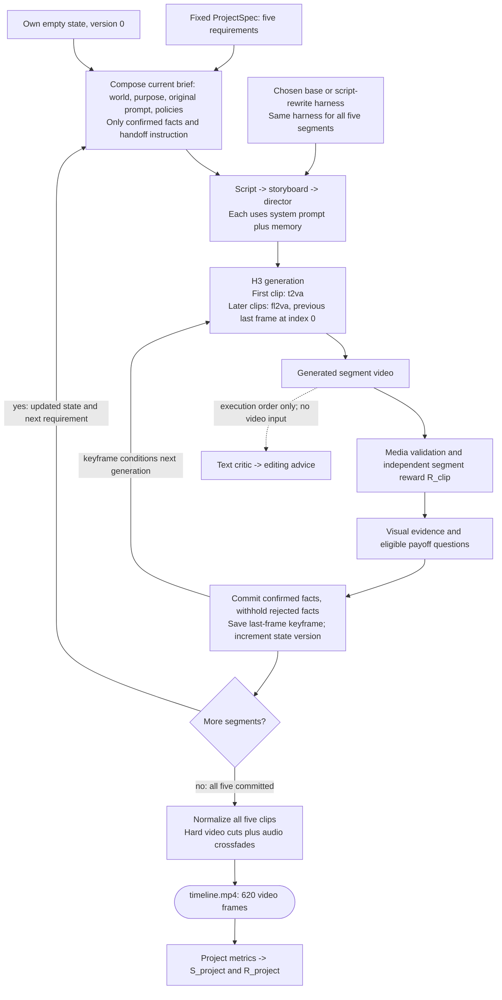

# Worked example: town-fair longform production, base vs script rewrite

This expands the [five-segment production flow on page 11](../11-long-form-production.md) using the first two videos on [page 13](../13-town-fair-videos.md): **base `d16c2e95`** and **script rewrite `c863aae2`**. It follows the [single-clip worked example](08-script-rewrite-prompt-lifecycle.md), repeated over five clips with state verification, first-frame handoff and stitching added.

**DGX fill-in status.** Both harnesses, the ProjectSpec and stitched videos are available. Original per-segment trajectories, state histories, H3 request identities and stitch manifests are not in this checkout. Missing records are marked **`[DGX-PLACEHOLDER]`**, as requested. Blocks containing those markers are fill-in templates, not captured requests or invented model outputs. The final section tells the DGX agent exactly what to collect.

## 1. The productions and available evidence

| Arm | Candidate | Full source video | Matched original seed / project directory |
| --- | --- | --- | --- |
| Base | `d16c2e95` | [media4.mp4](../assets/media4.mp4) | [DGX-PLACEHOLDER] |
| Script rewrite, round 1 | `c863aae2` | [media5.mp4](../assets/media5.mp4) | [DGX-PLACEHOLDER] |

The presentation establishes these candidate labels. The run index contains seed 0 and seed 1 for each candidate; it does not establish which seed corresponds to each embedded MP4. Do not infer a seed from similar-looking frames, candidate rank or Validation means. Each arm has its own independent state and media references.

**Base: complete five-clip timeline**

<a href="../assets/media4.mp4"></a>

**Script rewrite: complete five-clip timeline**

<a href="../assets/media5.mp4"></a>

Click for sound. Each timeline contains 620 video frames at 24 fps: **25.8333 s of picture**, from five 124-frame clips. Container/audio duration is about 25.92 s. Segment previews below are crops of the normalized stitched videos, not copies of the original pre-stitch H3 segment bytes.

| Available source | What it establishes |
| --- | --- |
| [ProjectSpec](assets/11-town-fair-production/town-fair.project.yaml) | Five prompts, proposed facts, questions, dependencies and declared stitch settings |
| [Base harness](assets/11-town-fair-production/base.harness.yaml) | Original system prompts and empty memory |
| [Script-rewrite harness](assets/11-town-fair-production/script-rewrite.harness.yaml) | Rewritten Script prompt; other four prompts remain unchanged |
| [Available-records manifest](assets/11-town-fair-production/available-records.json) | Input/media hashes, four candidate seed records, preview recipes and unresolved DGX mapping slots |

Snapshots are copied byte-for-byte from the available files. Candidate hashes are recomputed with the component codec; ProjectSpec hash comparison against the run manifest is recorded separately. Verify the matched DGX production's own specification before treating it as a captured runtime input.

## 2. Shared project context and initial state

World and audio/visual policies are fixed project requirements, distinct from agent system prompts. The current brief composer does not separately inject `recurring_motifs` metadata.

```yaml
project_id: town-fair-5clip-v1
title: 雨后社区市集开场
target:
  task_type: t2va
  short_edge: 768
  aspect_ratio: '16:9'
  duration_seconds: 5.0
  frame_rate: 24.0
  num_inference_steps: 10
  expected_frames: 124
continuity_contract:
  project_world: 同一座雨后小镇的社区市集开场；清晨到上午，湿润路面、柔和自然光、低饱和暖色调。
  recurring_motifs:
  - wet_street
  - town_fountain
  - red_umbrella
  - community_fair
  audio_policy: 各片段保留动作对应环境声；拼接处采用短音频 crossfade，不能用静音掩盖音轨错误。
  visual_policy: 统一 16:9、24 fps、分辨率、色调和镜头节奏；人物不跨片段复用时不强行宣称身份连续。每段以中景或全景收尾，避免以特写结束，便于下一段承接。
stitch:
  order:
  - umbrella-arrival
  - kite-park
  - fountain-arrival
  - bakery-prep
  - potter-opening
  video_transition: cut
  audio_crossfade_seconds: 0.12
  output: timeline.mp4
split_policy:
  status: train
  rule: longform-v1 按项目切分：本作品只属于 train。其动作取自 tasks_gepa_v1，结果不得回写为 tasks_gepa_v1 的
    train/validation/promotion/test 结论。
```

Both arms start with their own empty state. The following is the implementation's initial-state definition, reconstructed rather than read from an archived production:

```json
{
  "project_id": "town-fair-5clip-v1",
  "version": 0,
  "facts": {},
  "withheld": {},
  "committed_segments": [],
  "handoff": null
}
```

**Recorded initial states:** Base `[DGX-PLACEHOLDER]`; rewrite `[DGX-PLACEHOLDER]`, from each production's `state/state_v0.json`. A state version identifies history, not search score S_project.

## 3. Production loop: repeat independently for each harness



The successful path is shown. `depends_on` controls readiness; the first-frame reference comes from the immediately preceding valid committed segment, even if a dependency names an earlier segment. A negative evidence answer only withholds a fact. Actual media/quality failures and service errors have separate invalid/blocked/abort paths.

## 4. Actual system prompts: shared across all five segments

Each arm uses the same selected harness for the entire production. Shared memory is empty in both snapshots. **Only `prompts.script` differs.** These system messages instruct the shared production-text model; the Director's generated text alone becomes H3's prompt.

### 4.1. Base Script system message

```text
You are a screenwriter. Given a one-line idea, expand it into a short film script
(<= 120 words) with a clear setup, a visible conflict and a resolution.
Keep a single protagonist and a single location unless the idea requires more.
```
### 4.2. Rewritten Script system message

```text
You are a specialized screenwriter for AI-generated short film sequences, designed for 5-second clip generation. Your task is to expand a one-line idea into a tight, visually descriptive script that ensures high consistency across a multi-clip project.

## Input Handling
Analyze the provided input which includes:
1. **Idea**: Project name, Segment ID, World Setting/Goal.
2. **Continuity Facts**: (If present) Verified facts from previous segments (e.g., props, weather, character actions). You MUST adhere to these strictly.
3. **Visual/Audio Requirements**: Specifics on lighting, color grading, sound design, and camera movement.
4. **Target Duration**: Typically 5.0s per clip.

## Output Requirements
- **Format**: Standard screenplay format (Scene Headings, Action Lines, Audio Cues).
- **Length**: Strictly <= 120 words.
- **Pacing**: Designed for a 5.0-second runtime.

## Critical Constraints & Quality Standards
1. **Continuity**: 
   - If "Continuity Facts" are provided, all props, characters, and environmental states (weather, lighting) must match exactly.
   - Do not contradict established facts (e.g., if a red umbrella is picked up in segment 1, it must appear in subsequent segments unless noted otherwise).
2. **Shot Composition (Handoff)**:
   - **Start**: The script must acknowledge the continuity from the previous segment (e.g., "First frame is the last frame of the previous segment").
   - **End**: Must end on a Medium Shot or Wide Shot. **Never** end on an Extreme Close-Up to facilitate smooth editing into the next clip.
3. **Visual Consistency**:
   - Maintain the specified lighting and color palette (e.g., "low saturation warm tones" or "cold tones with warm light points").
   - Describe key visual motifs clearly (e.g., specific prop colors, character clothing) to ensure keyframe consistency.
4. **Audio Design**:
   - Specify ambient sounds and specific SFX (e.g., footsteps, rain, water).
   - Indicate audio transitions (e.g., "crossfade") and ensure no silent gaps to mask errors.
   - Match audio volume levels (audio jump dB) to the environment.
5. **Narrative**:
   - Establish a clear setup, visible conflict, and resolution within the short timeframe.
   - Keep to a single protagonist and single location unless the idea requires more.

## Example Structure
**SCENE START**
**EXT. LOCATION - TIME**

[Action describing setting, lighting, and continuity from previous scene]

[Protagonist Action]

[Ending on Medium/Wide Shot for handoff]

**SCENE END**

## Goal
Generate a script that scores high on video quality, story coherence, editing flow, and human-like naturalness in a video generation pipeline.
```
### 4.3. Shared storyboard system message

```text
You are a storyboard artist. Given a script, output a JSON list of shots. Each shot has
`index`, `seconds`, `shot_size` (wide/medium/close), `camera` (static/push/pan), `action`.
Total duration must match the target. Keep subject appearance consistent across shots.
```
### 4.4. Shared director system message

```text
You are a film director writing a prompt for MiniMax-H3. Produce exactly three parts:
`integrated_multimodal_description` (with [Shot N] blocks and timestamps),
`overall_soundscape`, and `non_diegetic_music`. Be concrete about lighting, materials,
and motion. Repeat the protagonist's appearance in every shot.
```
### 4.5. Shared critic system message

```text
You are a film critic. Given a script, storyboard and video, list concrete defects under
these axes: physics, subject consistency, story clarity, pacing, audio. Be specific and
short. Do not praise.
```
### 4.6. Shared editor system message

```text
You are an editor. Given candidate videos and their scores, pick the best one and explain
in two sentences which shots to keep and which to shorten.
```

The critic prompt mentions video, but the implementation supplies only text plans. The editor receives the critic report. Neither diagnostic call edits the video or triggers another H3 generation.

## 5. Expanded segment-by-segment comparison

Each segment has its original requirement, dependencies and judge questions; two actual video excerpts; and **both arms' complete five-agent message templates**. Those templates include the real system prompt strings, reconstructed user-message structure, and marked slots for every missing output, H3 payload, evidence/payoff result and state transition.

For later segments, the exact composed brief must be read from that arm's `trajectory.meta.brief` or `attempt.json.brief`. Do not assume every declared fact was confirmed or copy a state from the other arm. The original Chinese input strings are retained.

### 5.1. Segment 1: Red-umbrella arrival (`umbrella-arrival`)

**Stitched-video frame interval:** 0-123, approximately 0.000000-5.166667 s.

**Original user requirement:**

```text
雨后小镇市集入口，一名穿黄色雨衣的人在湿街上捡起一把红伞，远处可见准备中的社区市集。保持人物和红伞一致，包含脚步声与水滴声。
```
**Purpose, dependencies, proposed facts and exact questions:**

```yaml
index: 1
segment_id: umbrella-arrival
source_task_id: train-001
purpose: 建立雨后小镇、红伞与市集将开场的空间。
state_commit:
- red_umbrella: picked_up
- weather: rain_ending
- fair: opening
evidence:
  red_umbrella: Is a person holding a red umbrella?
  weather: Is the street or ground wet, as if it has just rained?
  fair: Are market stalls or a street market visible?
```
Both arms begin with no confirmed facts or media reference and use t2va. The following Script user message is reconstructed from the published ProjectSpec and empty initial state, not captured from DGX. Their system prompts differ, but this initial user input is shared.

<details>
<summary>Complete reconstructed first-segment Script user message</summary>

```text
Idea: 项目：雨后社区市集开场（第 1/5 段，umbrella-arrival）
世界设定：同一座雨后小镇的社区市集开场；清晨到上午，湿润路面、柔和自然光、低饱和暖色调。
本段目标：建立雨后小镇、红伞与市集将开场的空间。
本段画面要求：雨后小镇市集入口，一名穿黄色雨衣的人在湿街上捡起一把红伞，远处可见准备中的社区市集。保持人物和红伞一致，包含脚步声与水滴声。
音频：各片段保留动作对应环境声；拼接处采用短音频 crossfade，不能用静音掩盖音轨错误。
画面：统一 16:9、24 fps、分辨率、色调和镜头节奏；人物不跨片段复用时不强行宣称身份连续。每段以中景或全景收尾，避免以特写结束，便于下一段承接。
Target duration: 5s across 3 shots.
```

</details>

| Base | Script rewrite |
| --- | --- |
| <a href="../assets/media4.mp4#t=0.000000,5.166667"></a> | <a href="../assets/media5.mp4#t=0.000000,5.166667"></a> |

<details>
<summary>base: all five agent messages, outputs, H3 payload and state records for umbrella-arrival</summary>

```json
{
  "record_kind": "Fill-in template, not captured DGX records",
  "arm": "base",
  "segment_id": "umbrella-arrival",
  "state_before": "[DGX-PLACEHOLDER] base/umbrella-arrival state/state_v0.json",
  "composed_brief_reconstructed_or_pending": "项目：雨后社区市集开场（第 1/5 段，umbrella-arrival）\n世界设定：同一座雨后小镇的社区市集开场；清晨到上午，湿润路面、柔和自然光、低饱和暖色调。\n本段目标：建立雨后小镇、红伞与市集将开场的空间。\n本段画面要求：雨后小镇市集入口，一名穿黄色雨衣的人在湿街上捡起一把红伞，远处可见准备中的社区市集。保持人物和红伞一致，包含脚步声与水滴声。\n音频：各片段保留动作对应环境声；拼接处采用短音频 crossfade，不能用静音掩盖音轨错误。\n画面：统一 16:9、24 fps、分辨率、色调和镜头节奏；人物不跨片段复用时不强行宣称身份连续。每段以中景或全景收尾，避免以特写结束，便于下一段承接。",
  "agent_calls_in_execution_order": [
    {
      "agent": "script",
      "system_reconstructed_from_harness": "You are a screenwriter. Given a one-line idea, expand it into a short film script\n(<= 120 words) with a clear setup, a visible conflict and a resolution.\nKeep a single protagonist and a single location unless the idea requires more.\n",
      "user_message_template": "Idea: 项目：雨后社区市集开场（第 1/5 段，umbrella-arrival）\n世界设定：同一座雨后小镇的社区市集开场；清晨到上午，湿润路面、柔和自然光、低饱和暖色调。\n本段目标：建立雨后小镇、红伞与市集将开场的空间。\n本段画面要求：雨后小镇市集入口，一名穿黄色雨衣的人在湿街上捡起一把红伞，远处可见准备中的社区市集。保持人物和红伞一致，包含脚步声与水滴声。\n音频：各片段保留动作对应环境声；拼接处采用短音频 crossfade，不能用静音掩盖音轨错误。\n画面：统一 16:9、24 fps、分辨率、色调和镜头节奏；人物不跨片段复用时不强行宣称身份连续。每段以中景或全景收尾，避免以特写结束，便于下一段承接。\nTarget duration: 5s across 3 shots.",
      "recorded_output": "[DGX-PLACEHOLDER] base/umbrella-arrival recorded script"
    },
    {
      "agent": "storyboard",
      "system_reconstructed_from_harness": "You are a storyboard artist. Given a script, output a JSON list of shots. Each shot has\n`index`, `seconds`, `shot_size` (wide/medium/close), `camera` (static/push/pan), `action`.\nTotal duration must match the target. Keep subject appearance consistent across shots.\n",
      "user_message_template": "Script:\n[DGX-PLACEHOLDER] base/umbrella-arrival recorded script\n\nTotal duration: 5s",
      "recorded_output": "[DGX-PLACEHOLDER] base/umbrella-arrival recorded storyboard"
    },
    {
      "agent": "director",
      "system_reconstructed_from_harness": "You are a film director writing a prompt for MiniMax-H3. Produce exactly three parts:\n`integrated_multimodal_description` (with [Shot N] blocks and timestamps),\n`overall_soundscape`, and `non_diegetic_music`. Be concrete about lighting, materials,\nand motion. Repeat the protagonist's appearance in every shot.\n",
      "user_message_template": "Script:\n[DGX-PLACEHOLDER] base/umbrella-arrival recorded script\n\nStoryboard (JSON):\n[DGX-PLACEHOLDER] base/umbrella-arrival recorded storyboard\n\nTarget: 5s, 16:9, mode=t2va.",
      "recorded_output": "[DGX-PLACEHOLDER] base/umbrella-arrival recorded director_prompt"
    },
    {
      "agent": "critic",
      "system_reconstructed_from_harness": "You are a film critic. Given a script, storyboard and video, list concrete defects under\nthese axes: physics, subject consistency, story clarity, pacing, audio. Be specific and\nshort. Do not praise.\n",
      "user_message_template": "Script:\n[DGX-PLACEHOLDER] base/umbrella-arrival recorded script\n\nStoryboard:\n[DGX-PLACEHOLDER] base/umbrella-arrival recorded storyboard\n\nGeneration description:\n[DGX-PLACEHOLDER] base/umbrella-arrival recorded director_prompt",
      "recorded_output": "[DGX-PLACEHOLDER] base/umbrella-arrival recorded critic_report"
    },
    {
      "agent": "editor",
      "system_reconstructed_from_harness": "You are an editor. Given candidate videos and their scores, pick the best one and explain\nin two sentences which shots to keep and which to shorten.\n",
      "user_message_template": "Critic report:\n[DGX-PLACEHOLDER] base/umbrella-arrival recorded critic_report\n\nPick the best candidate and advise on shot lengths.",
      "recorded_output": "[DGX-PLACEHOLDER] base/umbrella-arrival recorded editor_notes"
    }
  ],
  "h3_request_template_submitted_after_director_before_critic": {
    "task": "t2va",
    "prompt": "[DGX-PLACEHOLDER] base/umbrella-arrival recorded director_prompt",
    "conditions": [],
    "target": {
      "short_edge": 768,
      "aspect_ratio": "16:9",
      "duration_seconds": 5.0
    },
    "seed": "[DGX-PLACEHOLDER] base/umbrella-arrival matched project seed",
    "num_inference_steps": 10
  },
  "h3_request_hash": "[DGX-PLACEHOLDER] base/umbrella-arrival recorded request hash; recover all actual optional fields, including num_frames if present, before verifying",
  "original_h3_segment_video": "[DGX-PLACEHOLDER] base/umbrella-arrival generated segment path, SHA-256, probe and server video ID",
  "evidence_p_yes": {
    "red_umbrella": "[DGX-PLACEHOLDER] base/umbrella-arrival recorded probability for red_umbrella",
    "weather": "[DGX-PLACEHOLDER] base/umbrella-arrival recorded probability for weather",
    "fair": "[DGX-PLACEHOLDER] base/umbrella-arrival recorded probability for fair"
  },
  "payoff_probability_or_skip": {},
  "independent_segment_reward_and_axes": "[DGX-PLACEHOLDER] base/umbrella-arrival attempt.segment_score and axis_scores",
  "state_after": "[DGX-PLACEHOLDER] base/umbrella-arrival state/state_v1.json",
  "last_frame_handoff_after": "[DGX-PLACEHOLDER] base/umbrella-arrival recorded reference asset, SHA-256 and source frame index",
  "text_critic_gate_probabilities": "[DGX-PLACEHOLDER] base/umbrella-arrival trajectory.meta.critic_gates"
}
```

</details>

<details>
<summary>script-rewrite: all five agent messages, outputs, H3 payload and state records for umbrella-arrival</summary>

```json
{
  "record_kind": "Fill-in template, not captured DGX records",
  "arm": "script-rewrite",
  "segment_id": "umbrella-arrival",
  "state_before": "[DGX-PLACEHOLDER] script-rewrite/umbrella-arrival state/state_v0.json",
  "composed_brief_reconstructed_or_pending": "项目：雨后社区市集开场（第 1/5 段，umbrella-arrival）\n世界设定：同一座雨后小镇的社区市集开场；清晨到上午，湿润路面、柔和自然光、低饱和暖色调。\n本段目标：建立雨后小镇、红伞与市集将开场的空间。\n本段画面要求：雨后小镇市集入口，一名穿黄色雨衣的人在湿街上捡起一把红伞，远处可见准备中的社区市集。保持人物和红伞一致，包含脚步声与水滴声。\n音频：各片段保留动作对应环境声；拼接处采用短音频 crossfade，不能用静音掩盖音轨错误。\n画面：统一 16:9、24 fps、分辨率、色调和镜头节奏；人物不跨片段复用时不强行宣称身份连续。每段以中景或全景收尾，避免以特写结束，便于下一段承接。",
  "agent_calls_in_execution_order": [
    {
      "agent": "script",
      "system_reconstructed_from_harness": "You are a specialized screenwriter for AI-generated short film sequences, designed for 5-second clip generation. Your task is to expand a one-line idea into a tight, visually descriptive script that ensures high consistency across a multi-clip project.\n\n## Input Handling\nAnalyze the provided input which includes:\n1. **Idea**: Project name, Segment ID, World Setting/Goal.\n2. **Continuity Facts**: (If present) Verified facts from previous segments (e.g., props, weather, character actions). You MUST adhere to these strictly.\n3. **Visual/Audio Requirements**: Specifics on lighting, color grading, sound design, and camera movement.\n4. **Target Duration**: Typically 5.0s per clip.\n\n## Output Requirements\n- **Format**: Standard screenplay format (Scene Headings, Action Lines, Audio Cues).\n- **Length**: Strictly <= 120 words.\n- **Pacing**: Designed for a 5.0-second runtime.\n\n## Critical Constraints & Quality Standards\n1. **Continuity**: \n   - If \"Continuity Facts\" are provided, all props, characters, and environmental states (weather, lighting) must match exactly.\n   - Do not contradict established facts (e.g., if a red umbrella is picked up in segment 1, it must appear in subsequent segments unless noted otherwise).\n2. **Shot Composition (Handoff)**:\n   - **Start**: The script must acknowledge the continuity from the previous segment (e.g., \"First frame is the last frame of the previous segment\").\n   - **End**: Must end on a Medium Shot or Wide Shot. **Never** end on an Extreme Close-Up to facilitate smooth editing into the next clip.\n3. **Visual Consistency**:\n   - Maintain the specified lighting and color palette (e.g., \"low saturation warm tones\" or \"cold tones with warm light points\").\n   - Describe key visual motifs clearly (e.g., specific prop colors, character clothing) to ensure keyframe consistency.\n4. **Audio Design**:\n   - Specify ambient sounds and specific SFX (e.g., footsteps, rain, water).\n   - Indicate audio transitions (e.g., \"crossfade\") and ensure no silent gaps to mask errors.\n   - Match audio volume levels (audio jump dB) to the environment.\n5. **Narrative**:\n   - Establish a clear setup, visible conflict, and resolution within the short timeframe.\n   - Keep to a single protagonist and single location unless the idea requires more.\n\n## Example Structure\n**SCENE START**\n**EXT. LOCATION - TIME**\n\n[Action describing setting, lighting, and continuity from previous scene]\n\n[Protagonist Action]\n\n[Ending on Medium/Wide Shot for handoff]\n\n**SCENE END**\n\n## Goal\nGenerate a script that scores high on video quality, story coherence, editing flow, and human-like naturalness in a video generation pipeline.",
      "user_message_template": "Idea: 项目：雨后社区市集开场（第 1/5 段，umbrella-arrival）\n世界设定：同一座雨后小镇的社区市集开场；清晨到上午，湿润路面、柔和自然光、低饱和暖色调。\n本段目标：建立雨后小镇、红伞与市集将开场的空间。\n本段画面要求：雨后小镇市集入口，一名穿黄色雨衣的人在湿街上捡起一把红伞，远处可见准备中的社区市集。保持人物和红伞一致，包含脚步声与水滴声。\n音频：各片段保留动作对应环境声；拼接处采用短音频 crossfade，不能用静音掩盖音轨错误。\n画面：统一 16:9、24 fps、分辨率、色调和镜头节奏；人物不跨片段复用时不强行宣称身份连续。每段以中景或全景收尾，避免以特写结束，便于下一段承接。\nTarget duration: 5s across 3 shots.",
      "recorded_output": "[DGX-PLACEHOLDER] script-rewrite/umbrella-arrival recorded script"
    },
    {
      "agent": "storyboard",
      "system_reconstructed_from_harness": "You are a storyboard artist. Given a script, output a JSON list of shots. Each shot has\n`index`, `seconds`, `shot_size` (wide/medium/close), `camera` (static/push/pan), `action`.\nTotal duration must match the target. Keep subject appearance consistent across shots.\n",
      "user_message_template": "Script:\n[DGX-PLACEHOLDER] script-rewrite/umbrella-arrival recorded script\n\nTotal duration: 5s",
      "recorded_output": "[DGX-PLACEHOLDER] script-rewrite/umbrella-arrival recorded storyboard"
    },
    {
      "agent": "director",
      "system_reconstructed_from_harness": "You are a film director writing a prompt for MiniMax-H3. Produce exactly three parts:\n`integrated_multimodal_description` (with [Shot N] blocks and timestamps),\n`overall_soundscape`, and `non_diegetic_music`. Be concrete about lighting, materials,\nand motion. Repeat the protagonist's appearance in every shot.\n",
      "user_message_template": "Script:\n[DGX-PLACEHOLDER] script-rewrite/umbrella-arrival recorded script\n\nStoryboard (JSON):\n[DGX-PLACEHOLDER] script-rewrite/umbrella-arrival recorded storyboard\n\nTarget: 5s, 16:9, mode=t2va.",
      "recorded_output": "[DGX-PLACEHOLDER] script-rewrite/umbrella-arrival recorded director_prompt"
    },
    {
      "agent": "critic",
      "system_reconstructed_from_harness": "You are a film critic. Given a script, storyboard and video, list concrete defects under\nthese axes: physics, subject consistency, story clarity, pacing, audio. Be specific and\nshort. Do not praise.\n",
      "user_message_template": "Script:\n[DGX-PLACEHOLDER] script-rewrite/umbrella-arrival recorded script\n\nStoryboard:\n[DGX-PLACEHOLDER] script-rewrite/umbrella-arrival recorded storyboard\n\nGeneration description:\n[DGX-PLACEHOLDER] script-rewrite/umbrella-arrival recorded director_prompt",
      "recorded_output": "[DGX-PLACEHOLDER] script-rewrite/umbrella-arrival recorded critic_report"
    },
    {
      "agent": "editor",
      "system_reconstructed_from_harness": "You are an editor. Given candidate videos and their scores, pick the best one and explain\nin two sentences which shots to keep and which to shorten.\n",
      "user_message_template": "Critic report:\n[DGX-PLACEHOLDER] script-rewrite/umbrella-arrival recorded critic_report\n\nPick the best candidate and advise on shot lengths.",
      "recorded_output": "[DGX-PLACEHOLDER] script-rewrite/umbrella-arrival recorded editor_notes"
    }
  ],
  "h3_request_template_submitted_after_director_before_critic": {
    "task": "t2va",
    "prompt": "[DGX-PLACEHOLDER] script-rewrite/umbrella-arrival recorded director_prompt",
    "conditions": [],
    "target": {
      "short_edge": 768,
      "aspect_ratio": "16:9",
      "duration_seconds": 5.0
    },
    "seed": "[DGX-PLACEHOLDER] script-rewrite/umbrella-arrival matched project seed",
    "num_inference_steps": 10
  },
  "h3_request_hash": "[DGX-PLACEHOLDER] script-rewrite/umbrella-arrival recorded request hash; recover all actual optional fields, including num_frames if present, before verifying",
  "original_h3_segment_video": "[DGX-PLACEHOLDER] script-rewrite/umbrella-arrival generated segment path, SHA-256, probe and server video ID",
  "evidence_p_yes": {
    "red_umbrella": "[DGX-PLACEHOLDER] script-rewrite/umbrella-arrival recorded probability for red_umbrella",
    "weather": "[DGX-PLACEHOLDER] script-rewrite/umbrella-arrival recorded probability for weather",
    "fair": "[DGX-PLACEHOLDER] script-rewrite/umbrella-arrival recorded probability for fair"
  },
  "payoff_probability_or_skip": {},
  "independent_segment_reward_and_axes": "[DGX-PLACEHOLDER] script-rewrite/umbrella-arrival attempt.segment_score and axis_scores",
  "state_after": "[DGX-PLACEHOLDER] script-rewrite/umbrella-arrival state/state_v1.json",
  "last_frame_handoff_after": "[DGX-PLACEHOLDER] script-rewrite/umbrella-arrival recorded reference asset, SHA-256 and source frame index",
  "text_critic_gate_probabilities": "[DGX-PLACEHOLDER] script-rewrite/umbrella-arrival trajectory.meta.critic_gates"
}
```

</details>

**State checkpoint:** Confirming red_umbrella, weather or fair adds that value to the next brief; a declaration alone does not. Save the actual last-frame keyframe when the segment itself passes validation, even if a particular fact was withheld.

### 5.2. Segment 2: Park kite (`kite-park`)

**Stitched-video frame interval:** 124-247, approximately 5.166667-10.333333 s.

**Original user requirement:**

```text
同一雨后小镇市集旁的公园，一个穿绿色夹克的孩子接住落下的纸风筝；背景远处可见红伞和市集摊位。保持风筝和衣服一致，包含风声和远处鸟鸣。
```
**Purpose, dependencies, proposed facts and exact questions:**

```yaml
index: 2
segment_id: kite-park
source_task_id: train-003
purpose: 把市集空间延伸到相邻公园，并保留雨后光线与红伞视觉母题。
depends_on:
- umbrella-arrival
state_commit:
- kite: recovered
- location: fair_park
evidence:
  kite: Is a child in a green jacket holding a kite?
  location: Is this scene in a park with grass or trees?
payoff:
  red_umbrella: Is a red umbrella visible anywhere in the image?
```
Each arm uses fl2va with the last frame of **its own `umbrella-arrival` clip** as first frame (`frame_index=0`; I2VA prompt semantics). Dependencies are `umbrella-arrival`. Read its state version 1 before generating; the successful commit writes version 2. Exact facts, handoff asset and composed brief remain `[DGX-PLACEHOLDER]`.

| Base | Script rewrite |
| --- | --- |
| <a href="../assets/media4.mp4#t=5.166667,10.333333"></a> | <a href="../assets/media5.mp4#t=5.166667,10.333333"></a> |

<details>
<summary>base: all five agent messages, outputs, H3 payload and state records for kite-park</summary>

```json
{
  "record_kind": "Fill-in template, not captured DGX records",
  "arm": "base",
  "segment_id": "kite-park",
  "state_before": "[DGX-PLACEHOLDER] base/kite-park state/state_v1.json",
  "composed_brief_reconstructed_or_pending": "[DGX-PLACEHOLDER] base/kite-park exact composed brief from this arm, including confirmed upstream facts only",
  "agent_calls_in_execution_order": [
    {
      "agent": "script",
      "system_reconstructed_from_harness": "You are a screenwriter. Given a one-line idea, expand it into a short film script\n(<= 120 words) with a clear setup, a visible conflict and a resolution.\nKeep a single protagonist and a single location unless the idea requires more.\n",
      "user_message_template": "Idea: [DGX-PLACEHOLDER] base/kite-park exact composed brief from this arm, including confirmed upstream facts only\nTarget duration: 5s across 3 shots.",
      "recorded_output": "[DGX-PLACEHOLDER] base/kite-park recorded script"
    },
    {
      "agent": "storyboard",
      "system_reconstructed_from_harness": "You are a storyboard artist. Given a script, output a JSON list of shots. Each shot has\n`index`, `seconds`, `shot_size` (wide/medium/close), `camera` (static/push/pan), `action`.\nTotal duration must match the target. Keep subject appearance consistent across shots.\n",
      "user_message_template": "Script:\n[DGX-PLACEHOLDER] base/kite-park recorded script\n\nTotal duration: 5s",
      "recorded_output": "[DGX-PLACEHOLDER] base/kite-park recorded storyboard"
    },
    {
      "agent": "director",
      "system_reconstructed_from_harness": "You are a film director writing a prompt for MiniMax-H3. Produce exactly three parts:\n`integrated_multimodal_description` (with [Shot N] blocks and timestamps),\n`overall_soundscape`, and `non_diegetic_music`. Be concrete about lighting, materials,\nand motion. Repeat the protagonist's appearance in every shot.\n",
      "user_message_template": "Script:\n[DGX-PLACEHOLDER] base/kite-park recorded script\n\nStoryboard (JSON):\n[DGX-PLACEHOLDER] base/kite-park recorded storyboard\n\nTarget: 5s, 16:9, mode=fl2va.",
      "recorded_output": "[DGX-PLACEHOLDER] base/kite-park recorded director_prompt"
    },
    {
      "agent": "critic",
      "system_reconstructed_from_harness": "You are a film critic. Given a script, storyboard and video, list concrete defects under\nthese axes: physics, subject consistency, story clarity, pacing, audio. Be specific and\nshort. Do not praise.\n",
      "user_message_template": "Script:\n[DGX-PLACEHOLDER] base/kite-park recorded script\n\nStoryboard:\n[DGX-PLACEHOLDER] base/kite-park recorded storyboard\n\nGeneration description:\n[DGX-PLACEHOLDER] base/kite-park recorded director_prompt",
      "recorded_output": "[DGX-PLACEHOLDER] base/kite-park recorded critic_report"
    },
    {
      "agent": "editor",
      "system_reconstructed_from_harness": "You are an editor. Given candidate videos and their scores, pick the best one and explain\nin two sentences which shots to keep and which to shorten.\n",
      "user_message_template": "Critic report:\n[DGX-PLACEHOLDER] base/kite-park recorded critic_report\n\nPick the best candidate and advise on shot lengths.",
      "recorded_output": "[DGX-PLACEHOLDER] base/kite-park recorded editor_notes"
    }
  ],
  "h3_request_template_submitted_after_director_before_critic": {
    "task": "fl2va",
    "prompt": "[DGX-PLACEHOLDER] base/kite-park recorded director_prompt",
    "conditions": [
      {
        "type": "image",
        "uri": "[DGX-PLACEHOLDER] base/kite-park URI of this arm previous-segment last-frame keyframe",
        "role": "keyframe",
        "frame_index": 0
      }
    ],
    "target": {
      "short_edge": 768,
      "aspect_ratio": "16:9",
      "duration_seconds": 5.0
    },
    "seed": "[DGX-PLACEHOLDER] base/kite-park matched project seed",
    "num_inference_steps": 10
  },
  "h3_request_hash": "[DGX-PLACEHOLDER] base/kite-park recorded request hash; recover all actual optional fields, including num_frames if present, before verifying",
  "original_h3_segment_video": "[DGX-PLACEHOLDER] base/kite-park generated segment path, SHA-256, probe and server video ID",
  "evidence_p_yes": {
    "kite": "[DGX-PLACEHOLDER] base/kite-park recorded probability for kite",
    "location": "[DGX-PLACEHOLDER] base/kite-park recorded probability for location"
  },
  "payoff_probability_or_skip": {
    "red_umbrella": "[DGX-PLACEHOLDER] base/kite-park recorded probability if confirmed upstream, otherwise actual skip reason"
  },
  "independent_segment_reward_and_axes": "[DGX-PLACEHOLDER] base/kite-park attempt.segment_score and axis_scores",
  "state_after": "[DGX-PLACEHOLDER] base/kite-park state/state_v2.json",
  "last_frame_handoff_after": "[DGX-PLACEHOLDER] base/kite-park recorded reference asset, SHA-256 and source frame index",
  "text_critic_gate_probabilities": "[DGX-PLACEHOLDER] base/kite-park trajectory.meta.critic_gates"
}
```

</details>

<details>
<summary>script-rewrite: all five agent messages, outputs, H3 payload and state records for kite-park</summary>

```json
{
  "record_kind": "Fill-in template, not captured DGX records",
  "arm": "script-rewrite",
  "segment_id": "kite-park",
  "state_before": "[DGX-PLACEHOLDER] script-rewrite/kite-park state/state_v1.json",
  "composed_brief_reconstructed_or_pending": "[DGX-PLACEHOLDER] script-rewrite/kite-park exact composed brief from this arm, including confirmed upstream facts only",
  "agent_calls_in_execution_order": [
    {
      "agent": "script",
      "system_reconstructed_from_harness": "You are a specialized screenwriter for AI-generated short film sequences, designed for 5-second clip generation. Your task is to expand a one-line idea into a tight, visually descriptive script that ensures high consistency across a multi-clip project.\n\n## Input Handling\nAnalyze the provided input which includes:\n1. **Idea**: Project name, Segment ID, World Setting/Goal.\n2. **Continuity Facts**: (If present) Verified facts from previous segments (e.g., props, weather, character actions). You MUST adhere to these strictly.\n3. **Visual/Audio Requirements**: Specifics on lighting, color grading, sound design, and camera movement.\n4. **Target Duration**: Typically 5.0s per clip.\n\n## Output Requirements\n- **Format**: Standard screenplay format (Scene Headings, Action Lines, Audio Cues).\n- **Length**: Strictly <= 120 words.\n- **Pacing**: Designed for a 5.0-second runtime.\n\n## Critical Constraints & Quality Standards\n1. **Continuity**: \n   - If \"Continuity Facts\" are provided, all props, characters, and environmental states (weather, lighting) must match exactly.\n   - Do not contradict established facts (e.g., if a red umbrella is picked up in segment 1, it must appear in subsequent segments unless noted otherwise).\n2. **Shot Composition (Handoff)**:\n   - **Start**: The script must acknowledge the continuity from the previous segment (e.g., \"First frame is the last frame of the previous segment\").\n   - **End**: Must end on a Medium Shot or Wide Shot. **Never** end on an Extreme Close-Up to facilitate smooth editing into the next clip.\n3. **Visual Consistency**:\n   - Maintain the specified lighting and color palette (e.g., \"low saturation warm tones\" or \"cold tones with warm light points\").\n   - Describe key visual motifs clearly (e.g., specific prop colors, character clothing) to ensure keyframe consistency.\n4. **Audio Design**:\n   - Specify ambient sounds and specific SFX (e.g., footsteps, rain, water).\n   - Indicate audio transitions (e.g., \"crossfade\") and ensure no silent gaps to mask errors.\n   - Match audio volume levels (audio jump dB) to the environment.\n5. **Narrative**:\n   - Establish a clear setup, visible conflict, and resolution within the short timeframe.\n   - Keep to a single protagonist and single location unless the idea requires more.\n\n## Example Structure\n**SCENE START**\n**EXT. LOCATION - TIME**\n\n[Action describing setting, lighting, and continuity from previous scene]\n\n[Protagonist Action]\n\n[Ending on Medium/Wide Shot for handoff]\n\n**SCENE END**\n\n## Goal\nGenerate a script that scores high on video quality, story coherence, editing flow, and human-like naturalness in a video generation pipeline.",
      "user_message_template": "Idea: [DGX-PLACEHOLDER] script-rewrite/kite-park exact composed brief from this arm, including confirmed upstream facts only\nTarget duration: 5s across 3 shots.",
      "recorded_output": "[DGX-PLACEHOLDER] script-rewrite/kite-park recorded script"
    },
    {
      "agent": "storyboard",
      "system_reconstructed_from_harness": "You are a storyboard artist. Given a script, output a JSON list of shots. Each shot has\n`index`, `seconds`, `shot_size` (wide/medium/close), `camera` (static/push/pan), `action`.\nTotal duration must match the target. Keep subject appearance consistent across shots.\n",
      "user_message_template": "Script:\n[DGX-PLACEHOLDER] script-rewrite/kite-park recorded script\n\nTotal duration: 5s",
      "recorded_output": "[DGX-PLACEHOLDER] script-rewrite/kite-park recorded storyboard"
    },
    {
      "agent": "director",
      "system_reconstructed_from_harness": "You are a film director writing a prompt for MiniMax-H3. Produce exactly three parts:\n`integrated_multimodal_description` (with [Shot N] blocks and timestamps),\n`overall_soundscape`, and `non_diegetic_music`. Be concrete about lighting, materials,\nand motion. Repeat the protagonist's appearance in every shot.\n",
      "user_message_template": "Script:\n[DGX-PLACEHOLDER] script-rewrite/kite-park recorded script\n\nStoryboard (JSON):\n[DGX-PLACEHOLDER] script-rewrite/kite-park recorded storyboard\n\nTarget: 5s, 16:9, mode=fl2va.",
      "recorded_output": "[DGX-PLACEHOLDER] script-rewrite/kite-park recorded director_prompt"
    },
    {
      "agent": "critic",
      "system_reconstructed_from_harness": "You are a film critic. Given a script, storyboard and video, list concrete defects under\nthese axes: physics, subject consistency, story clarity, pacing, audio. Be specific and\nshort. Do not praise.\n",
      "user_message_template": "Script:\n[DGX-PLACEHOLDER] script-rewrite/kite-park recorded script\n\nStoryboard:\n[DGX-PLACEHOLDER] script-rewrite/kite-park recorded storyboard\n\nGeneration description:\n[DGX-PLACEHOLDER] script-rewrite/kite-park recorded director_prompt",
      "recorded_output": "[DGX-PLACEHOLDER] script-rewrite/kite-park recorded critic_report"
    },
    {
      "agent": "editor",
      "system_reconstructed_from_harness": "You are an editor. Given candidate videos and their scores, pick the best one and explain\nin two sentences which shots to keep and which to shorten.\n",
      "user_message_template": "Critic report:\n[DGX-PLACEHOLDER] script-rewrite/kite-park recorded critic_report\n\nPick the best candidate and advise on shot lengths.",
      "recorded_output": "[DGX-PLACEHOLDER] script-rewrite/kite-park recorded editor_notes"
    }
  ],
  "h3_request_template_submitted_after_director_before_critic": {
    "task": "fl2va",
    "prompt": "[DGX-PLACEHOLDER] script-rewrite/kite-park recorded director_prompt",
    "conditions": [
      {
        "type": "image",
        "uri": "[DGX-PLACEHOLDER] script-rewrite/kite-park URI of this arm previous-segment last-frame keyframe",
        "role": "keyframe",
        "frame_index": 0
      }
    ],
    "target": {
      "short_edge": 768,
      "aspect_ratio": "16:9",
      "duration_seconds": 5.0
    },
    "seed": "[DGX-PLACEHOLDER] script-rewrite/kite-park matched project seed",
    "num_inference_steps": 10
  },
  "h3_request_hash": "[DGX-PLACEHOLDER] script-rewrite/kite-park recorded request hash; recover all actual optional fields, including num_frames if present, before verifying",
  "original_h3_segment_video": "[DGX-PLACEHOLDER] script-rewrite/kite-park generated segment path, SHA-256, probe and server video ID",
  "evidence_p_yes": {
    "kite": "[DGX-PLACEHOLDER] script-rewrite/kite-park recorded probability for kite",
    "location": "[DGX-PLACEHOLDER] script-rewrite/kite-park recorded probability for location"
  },
  "payoff_probability_or_skip": {
    "red_umbrella": "[DGX-PLACEHOLDER] script-rewrite/kite-park recorded probability if confirmed upstream, otherwise actual skip reason"
  },
  "independent_segment_reward_and_axes": "[DGX-PLACEHOLDER] script-rewrite/kite-park attempt.segment_score and axis_scores",
  "state_after": "[DGX-PLACEHOLDER] script-rewrite/kite-park state/state_v2.json",
  "last_frame_handoff_after": "[DGX-PLACEHOLDER] script-rewrite/kite-park recorded reference asset, SHA-256 and source frame index",
  "text_critic_gate_probabilities": "[DGX-PLACEHOLDER] script-rewrite/kite-park trajectory.meta.critic_gates"
}
```

</details>

**State checkpoint:** Kite and location have new evidence questions. The red-umbrella payoff is asked only if its key is already confirmed upstream. Keep unknown probabilities marked; a visible preview is not the archived judge result.

### 5.3. Segment 3: Fountain cyclist (`fountain-arrival`)

**Stitched-video frame interval:** 248-371, approximately 10.333333-15.500000 s.

**Original user requirement:**

```text
同一雨后小镇市集中心的喷泉旁，一名戴蓝色头盔的骑行者停下自行车并从水瓶喝水；喷泉边放着一把红伞。保持自行车和头盔一致，包含流水声与城市环境声。
```
**Purpose, dependencies, proposed facts and exact questions:**

```yaml
index: 3
segment_id: fountain-arrival
source_task_id: train-004
purpose: 建立市集中心地标，验证跨片段的天气、调色和空间连续性。
depends_on:
- umbrella-arrival
state_commit:
- location: town_fountain
- cyclist: arrived
evidence:
  location: Is a fountain visible in the image?
  cyclist: Is a person wearing a blue helmet next to a bicycle?
payoff:
  red_umbrella: Is a red umbrella visible anywhere in the image?
  weather: Is the street or ground wet, as if it has just rained?
```
Each arm uses fl2va with the last frame of **its own `kite-park` clip** as first frame (`frame_index=0`; I2VA prompt semantics). Dependencies are `umbrella-arrival`. Read its state version 2 before generating; the successful commit writes version 3. Exact facts, handoff asset and composed brief remain `[DGX-PLACEHOLDER]`.

| Base | Script rewrite |
| --- | --- |
| <a href="../assets/media4.mp4#t=10.333333,15.500000"></a> | <a href="../assets/media5.mp4#t=10.333333,15.500000"></a> |

<details>
<summary>base: all five agent messages, outputs, H3 payload and state records for fountain-arrival</summary>

```json
{
  "record_kind": "Fill-in template, not captured DGX records",
  "arm": "base",
  "segment_id": "fountain-arrival",
  "state_before": "[DGX-PLACEHOLDER] base/fountain-arrival state/state_v2.json",
  "composed_brief_reconstructed_or_pending": "[DGX-PLACEHOLDER] base/fountain-arrival exact composed brief from this arm, including confirmed upstream facts only",
  "agent_calls_in_execution_order": [
    {
      "agent": "script",
      "system_reconstructed_from_harness": "You are a screenwriter. Given a one-line idea, expand it into a short film script\n(<= 120 words) with a clear setup, a visible conflict and a resolution.\nKeep a single protagonist and a single location unless the idea requires more.\n",
      "user_message_template": "Idea: [DGX-PLACEHOLDER] base/fountain-arrival exact composed brief from this arm, including confirmed upstream facts only\nTarget duration: 5s across 3 shots.",
      "recorded_output": "[DGX-PLACEHOLDER] base/fountain-arrival recorded script"
    },
    {
      "agent": "storyboard",
      "system_reconstructed_from_harness": "You are a storyboard artist. Given a script, output a JSON list of shots. Each shot has\n`index`, `seconds`, `shot_size` (wide/medium/close), `camera` (static/push/pan), `action`.\nTotal duration must match the target. Keep subject appearance consistent across shots.\n",
      "user_message_template": "Script:\n[DGX-PLACEHOLDER] base/fountain-arrival recorded script\n\nTotal duration: 5s",
      "recorded_output": "[DGX-PLACEHOLDER] base/fountain-arrival recorded storyboard"
    },
    {
      "agent": "director",
      "system_reconstructed_from_harness": "You are a film director writing a prompt for MiniMax-H3. Produce exactly three parts:\n`integrated_multimodal_description` (with [Shot N] blocks and timestamps),\n`overall_soundscape`, and `non_diegetic_music`. Be concrete about lighting, materials,\nand motion. Repeat the protagonist's appearance in every shot.\n",
      "user_message_template": "Script:\n[DGX-PLACEHOLDER] base/fountain-arrival recorded script\n\nStoryboard (JSON):\n[DGX-PLACEHOLDER] base/fountain-arrival recorded storyboard\n\nTarget: 5s, 16:9, mode=fl2va.",
      "recorded_output": "[DGX-PLACEHOLDER] base/fountain-arrival recorded director_prompt"
    },
    {
      "agent": "critic",
      "system_reconstructed_from_harness": "You are a film critic. Given a script, storyboard and video, list concrete defects under\nthese axes: physics, subject consistency, story clarity, pacing, audio. Be specific and\nshort. Do not praise.\n",
      "user_message_template": "Script:\n[DGX-PLACEHOLDER] base/fountain-arrival recorded script\n\nStoryboard:\n[DGX-PLACEHOLDER] base/fountain-arrival recorded storyboard\n\nGeneration description:\n[DGX-PLACEHOLDER] base/fountain-arrival recorded director_prompt",
      "recorded_output": "[DGX-PLACEHOLDER] base/fountain-arrival recorded critic_report"
    },
    {
      "agent": "editor",
      "system_reconstructed_from_harness": "You are an editor. Given candidate videos and their scores, pick the best one and explain\nin two sentences which shots to keep and which to shorten.\n",
      "user_message_template": "Critic report:\n[DGX-PLACEHOLDER] base/fountain-arrival recorded critic_report\n\nPick the best candidate and advise on shot lengths.",
      "recorded_output": "[DGX-PLACEHOLDER] base/fountain-arrival recorded editor_notes"
    }
  ],
  "h3_request_template_submitted_after_director_before_critic": {
    "task": "fl2va",
    "prompt": "[DGX-PLACEHOLDER] base/fountain-arrival recorded director_prompt",
    "conditions": [
      {
        "type": "image",
        "uri": "[DGX-PLACEHOLDER] base/fountain-arrival URI of this arm previous-segment last-frame keyframe",
        "role": "keyframe",
        "frame_index": 0
      }
    ],
    "target": {
      "short_edge": 768,
      "aspect_ratio": "16:9",
      "duration_seconds": 5.0
    },
    "seed": "[DGX-PLACEHOLDER] base/fountain-arrival matched project seed",
    "num_inference_steps": 10
  },
  "h3_request_hash": "[DGX-PLACEHOLDER] base/fountain-arrival recorded request hash; recover all actual optional fields, including num_frames if present, before verifying",
  "original_h3_segment_video": "[DGX-PLACEHOLDER] base/fountain-arrival generated segment path, SHA-256, probe and server video ID",
  "evidence_p_yes": {
    "location": "[DGX-PLACEHOLDER] base/fountain-arrival recorded probability for location",
    "cyclist": "[DGX-PLACEHOLDER] base/fountain-arrival recorded probability for cyclist"
  },
  "payoff_probability_or_skip": {
    "red_umbrella": "[DGX-PLACEHOLDER] base/fountain-arrival recorded probability if confirmed upstream, otherwise actual skip reason",
    "weather": "[DGX-PLACEHOLDER] base/fountain-arrival recorded probability if confirmed upstream, otherwise actual skip reason"
  },
  "independent_segment_reward_and_axes": "[DGX-PLACEHOLDER] base/fountain-arrival attempt.segment_score and axis_scores",
  "state_after": "[DGX-PLACEHOLDER] base/fountain-arrival state/state_v3.json",
  "last_frame_handoff_after": "[DGX-PLACEHOLDER] base/fountain-arrival recorded reference asset, SHA-256 and source frame index",
  "text_critic_gate_probabilities": "[DGX-PLACEHOLDER] base/fountain-arrival trajectory.meta.critic_gates"
}
```

</details>

<details>
<summary>script-rewrite: all five agent messages, outputs, H3 payload and state records for fountain-arrival</summary>

```json
{
  "record_kind": "Fill-in template, not captured DGX records",
  "arm": "script-rewrite",
  "segment_id": "fountain-arrival",
  "state_before": "[DGX-PLACEHOLDER] script-rewrite/fountain-arrival state/state_v2.json",
  "composed_brief_reconstructed_or_pending": "[DGX-PLACEHOLDER] script-rewrite/fountain-arrival exact composed brief from this arm, including confirmed upstream facts only",
  "agent_calls_in_execution_order": [
    {
      "agent": "script",
      "system_reconstructed_from_harness": "You are a specialized screenwriter for AI-generated short film sequences, designed for 5-second clip generation. Your task is to expand a one-line idea into a tight, visually descriptive script that ensures high consistency across a multi-clip project.\n\n## Input Handling\nAnalyze the provided input which includes:\n1. **Idea**: Project name, Segment ID, World Setting/Goal.\n2. **Continuity Facts**: (If present) Verified facts from previous segments (e.g., props, weather, character actions). You MUST adhere to these strictly.\n3. **Visual/Audio Requirements**: Specifics on lighting, color grading, sound design, and camera movement.\n4. **Target Duration**: Typically 5.0s per clip.\n\n## Output Requirements\n- **Format**: Standard screenplay format (Scene Headings, Action Lines, Audio Cues).\n- **Length**: Strictly <= 120 words.\n- **Pacing**: Designed for a 5.0-second runtime.\n\n## Critical Constraints & Quality Standards\n1. **Continuity**: \n   - If \"Continuity Facts\" are provided, all props, characters, and environmental states (weather, lighting) must match exactly.\n   - Do not contradict established facts (e.g., if a red umbrella is picked up in segment 1, it must appear in subsequent segments unless noted otherwise).\n2. **Shot Composition (Handoff)**:\n   - **Start**: The script must acknowledge the continuity from the previous segment (e.g., \"First frame is the last frame of the previous segment\").\n   - **End**: Must end on a Medium Shot or Wide Shot. **Never** end on an Extreme Close-Up to facilitate smooth editing into the next clip.\n3. **Visual Consistency**:\n   - Maintain the specified lighting and color palette (e.g., \"low saturation warm tones\" or \"cold tones with warm light points\").\n   - Describe key visual motifs clearly (e.g., specific prop colors, character clothing) to ensure keyframe consistency.\n4. **Audio Design**:\n   - Specify ambient sounds and specific SFX (e.g., footsteps, rain, water).\n   - Indicate audio transitions (e.g., \"crossfade\") and ensure no silent gaps to mask errors.\n   - Match audio volume levels (audio jump dB) to the environment.\n5. **Narrative**:\n   - Establish a clear setup, visible conflict, and resolution within the short timeframe.\n   - Keep to a single protagonist and single location unless the idea requires more.\n\n## Example Structure\n**SCENE START**\n**EXT. LOCATION - TIME**\n\n[Action describing setting, lighting, and continuity from previous scene]\n\n[Protagonist Action]\n\n[Ending on Medium/Wide Shot for handoff]\n\n**SCENE END**\n\n## Goal\nGenerate a script that scores high on video quality, story coherence, editing flow, and human-like naturalness in a video generation pipeline.",
      "user_message_template": "Idea: [DGX-PLACEHOLDER] script-rewrite/fountain-arrival exact composed brief from this arm, including confirmed upstream facts only\nTarget duration: 5s across 3 shots.",
      "recorded_output": "[DGX-PLACEHOLDER] script-rewrite/fountain-arrival recorded script"
    },
    {
      "agent": "storyboard",
      "system_reconstructed_from_harness": "You are a storyboard artist. Given a script, output a JSON list of shots. Each shot has\n`index`, `seconds`, `shot_size` (wide/medium/close), `camera` (static/push/pan), `action`.\nTotal duration must match the target. Keep subject appearance consistent across shots.\n",
      "user_message_template": "Script:\n[DGX-PLACEHOLDER] script-rewrite/fountain-arrival recorded script\n\nTotal duration: 5s",
      "recorded_output": "[DGX-PLACEHOLDER] script-rewrite/fountain-arrival recorded storyboard"
    },
    {
      "agent": "director",
      "system_reconstructed_from_harness": "You are a film director writing a prompt for MiniMax-H3. Produce exactly three parts:\n`integrated_multimodal_description` (with [Shot N] blocks and timestamps),\n`overall_soundscape`, and `non_diegetic_music`. Be concrete about lighting, materials,\nand motion. Repeat the protagonist's appearance in every shot.\n",
      "user_message_template": "Script:\n[DGX-PLACEHOLDER] script-rewrite/fountain-arrival recorded script\n\nStoryboard (JSON):\n[DGX-PLACEHOLDER] script-rewrite/fountain-arrival recorded storyboard\n\nTarget: 5s, 16:9, mode=fl2va.",
      "recorded_output": "[DGX-PLACEHOLDER] script-rewrite/fountain-arrival recorded director_prompt"
    },
    {
      "agent": "critic",
      "system_reconstructed_from_harness": "You are a film critic. Given a script, storyboard and video, list concrete defects under\nthese axes: physics, subject consistency, story clarity, pacing, audio. Be specific and\nshort. Do not praise.\n",
      "user_message_template": "Script:\n[DGX-PLACEHOLDER] script-rewrite/fountain-arrival recorded script\n\nStoryboard:\n[DGX-PLACEHOLDER] script-rewrite/fountain-arrival recorded storyboard\n\nGeneration description:\n[DGX-PLACEHOLDER] script-rewrite/fountain-arrival recorded director_prompt",
      "recorded_output": "[DGX-PLACEHOLDER] script-rewrite/fountain-arrival recorded critic_report"
    },
    {
      "agent": "editor",
      "system_reconstructed_from_harness": "You are an editor. Given candidate videos and their scores, pick the best one and explain\nin two sentences which shots to keep and which to shorten.\n",
      "user_message_template": "Critic report:\n[DGX-PLACEHOLDER] script-rewrite/fountain-arrival recorded critic_report\n\nPick the best candidate and advise on shot lengths.",
      "recorded_output": "[DGX-PLACEHOLDER] script-rewrite/fountain-arrival recorded editor_notes"
    }
  ],
  "h3_request_template_submitted_after_director_before_critic": {
    "task": "fl2va",
    "prompt": "[DGX-PLACEHOLDER] script-rewrite/fountain-arrival recorded director_prompt",
    "conditions": [
      {
        "type": "image",
        "uri": "[DGX-PLACEHOLDER] script-rewrite/fountain-arrival URI of this arm previous-segment last-frame keyframe",
        "role": "keyframe",
        "frame_index": 0
      }
    ],
    "target": {
      "short_edge": 768,
      "aspect_ratio": "16:9",
      "duration_seconds": 5.0
    },
    "seed": "[DGX-PLACEHOLDER] script-rewrite/fountain-arrival matched project seed",
    "num_inference_steps": 10
  },
  "h3_request_hash": "[DGX-PLACEHOLDER] script-rewrite/fountain-arrival recorded request hash; recover all actual optional fields, including num_frames if present, before verifying",
  "original_h3_segment_video": "[DGX-PLACEHOLDER] script-rewrite/fountain-arrival generated segment path, SHA-256, probe and server video ID",
  "evidence_p_yes": {
    "location": "[DGX-PLACEHOLDER] script-rewrite/fountain-arrival recorded probability for location",
    "cyclist": "[DGX-PLACEHOLDER] script-rewrite/fountain-arrival recorded probability for cyclist"
  },
  "payoff_probability_or_skip": {
    "red_umbrella": "[DGX-PLACEHOLDER] script-rewrite/fountain-arrival recorded probability if confirmed upstream, otherwise actual skip reason",
    "weather": "[DGX-PLACEHOLDER] script-rewrite/fountain-arrival recorded probability if confirmed upstream, otherwise actual skip reason"
  },
  "independent_segment_reward_and_axes": "[DGX-PLACEHOLDER] script-rewrite/fountain-arrival attempt.segment_score and axis_scores",
  "state_after": "[DGX-PLACEHOLDER] script-rewrite/fountain-arrival state/state_v3.json",
  "last_frame_handoff_after": "[DGX-PLACEHOLDER] script-rewrite/fountain-arrival recorded reference asset, SHA-256 and source frame index",
  "text_critic_gate_probabilities": "[DGX-PLACEHOLDER] script-rewrite/fountain-arrival trajectory.meta.critic_gates"
}
```

</details>

**State checkpoint:** This segment proposes location = town_fountain. Confirmation replaces the earlier location; withholding the update removes an older confirmed location value. The frame reference still comes from segment 2 although depends_on names segment 1.

### 5.4. Segment 4: Bakery preparation (`bakery-prep`)

**Stitched-video frame interval:** 372-495, approximately 15.500000-20.666667 s.

**Original user requirement:**

```text
同一社区市集旁的小面包房，一位面包师打开小烤箱，取出面包并放在木质柜台上；门口可见收起的红伞。保持厨房和面包师一致，包含烤箱声与厨房环境声。
```
**Purpose, dependencies, proposed facts and exact questions:**

```yaml
index: 4
segment_id: bakery-prep
source_task_id: train-002
purpose: 转入市集摊位准备，保持同一小镇晨光、环境音和道具母题。
depends_on:
- fountain-arrival
state_commit:
- bread: prepared
- location: bakery
evidence:
  bread: Is bread placed on a wooden counter?
  location: Is this the inside of a small bakery or food stall?
payoff:
  red_umbrella: Is a red umbrella visible anywhere in the image?
```
Each arm uses fl2va with the last frame of **its own `fountain-arrival` clip** as first frame (`frame_index=0`; I2VA prompt semantics). Dependencies are `fountain-arrival`. Read its state version 3 before generating; the successful commit writes version 4. Exact facts, handoff asset and composed brief remain `[DGX-PLACEHOLDER]`.

| Base | Script rewrite |
| --- | --- |
| <a href="../assets/media4.mp4#t=15.500000,20.666667"></a> | <a href="../assets/media5.mp4#t=15.500000,20.666667"></a> |

<details>
<summary>base: all five agent messages, outputs, H3 payload and state records for bakery-prep</summary>

```json
{
  "record_kind": "Fill-in template, not captured DGX records",
  "arm": "base",
  "segment_id": "bakery-prep",
  "state_before": "[DGX-PLACEHOLDER] base/bakery-prep state/state_v3.json",
  "composed_brief_reconstructed_or_pending": "[DGX-PLACEHOLDER] base/bakery-prep exact composed brief from this arm, including confirmed upstream facts only",
  "agent_calls_in_execution_order": [
    {
      "agent": "script",
      "system_reconstructed_from_harness": "You are a screenwriter. Given a one-line idea, expand it into a short film script\n(<= 120 words) with a clear setup, a visible conflict and a resolution.\nKeep a single protagonist and a single location unless the idea requires more.\n",
      "user_message_template": "Idea: [DGX-PLACEHOLDER] base/bakery-prep exact composed brief from this arm, including confirmed upstream facts only\nTarget duration: 5s across 3 shots.",
      "recorded_output": "[DGX-PLACEHOLDER] base/bakery-prep recorded script"
    },
    {
      "agent": "storyboard",
      "system_reconstructed_from_harness": "You are a storyboard artist. Given a script, output a JSON list of shots. Each shot has\n`index`, `seconds`, `shot_size` (wide/medium/close), `camera` (static/push/pan), `action`.\nTotal duration must match the target. Keep subject appearance consistent across shots.\n",
      "user_message_template": "Script:\n[DGX-PLACEHOLDER] base/bakery-prep recorded script\n\nTotal duration: 5s",
      "recorded_output": "[DGX-PLACEHOLDER] base/bakery-prep recorded storyboard"
    },
    {
      "agent": "director",
      "system_reconstructed_from_harness": "You are a film director writing a prompt for MiniMax-H3. Produce exactly three parts:\n`integrated_multimodal_description` (with [Shot N] blocks and timestamps),\n`overall_soundscape`, and `non_diegetic_music`. Be concrete about lighting, materials,\nand motion. Repeat the protagonist's appearance in every shot.\n",
      "user_message_template": "Script:\n[DGX-PLACEHOLDER] base/bakery-prep recorded script\n\nStoryboard (JSON):\n[DGX-PLACEHOLDER] base/bakery-prep recorded storyboard\n\nTarget: 5s, 16:9, mode=fl2va.",
      "recorded_output": "[DGX-PLACEHOLDER] base/bakery-prep recorded director_prompt"
    },
    {
      "agent": "critic",
      "system_reconstructed_from_harness": "You are a film critic. Given a script, storyboard and video, list concrete defects under\nthese axes: physics, subject consistency, story clarity, pacing, audio. Be specific and\nshort. Do not praise.\n",
      "user_message_template": "Script:\n[DGX-PLACEHOLDER] base/bakery-prep recorded script\n\nStoryboard:\n[DGX-PLACEHOLDER] base/bakery-prep recorded storyboard\n\nGeneration description:\n[DGX-PLACEHOLDER] base/bakery-prep recorded director_prompt",
      "recorded_output": "[DGX-PLACEHOLDER] base/bakery-prep recorded critic_report"
    },
    {
      "agent": "editor",
      "system_reconstructed_from_harness": "You are an editor. Given candidate videos and their scores, pick the best one and explain\nin two sentences which shots to keep and which to shorten.\n",
      "user_message_template": "Critic report:\n[DGX-PLACEHOLDER] base/bakery-prep recorded critic_report\n\nPick the best candidate and advise on shot lengths.",
      "recorded_output": "[DGX-PLACEHOLDER] base/bakery-prep recorded editor_notes"
    }
  ],
  "h3_request_template_submitted_after_director_before_critic": {
    "task": "fl2va",
    "prompt": "[DGX-PLACEHOLDER] base/bakery-prep recorded director_prompt",
    "conditions": [
      {
        "type": "image",
        "uri": "[DGX-PLACEHOLDER] base/bakery-prep URI of this arm previous-segment last-frame keyframe",
        "role": "keyframe",
        "frame_index": 0
      }
    ],
    "target": {
      "short_edge": 768,
      "aspect_ratio": "16:9",
      "duration_seconds": 5.0
    },
    "seed": "[DGX-PLACEHOLDER] base/bakery-prep matched project seed",
    "num_inference_steps": 10
  },
  "h3_request_hash": "[DGX-PLACEHOLDER] base/bakery-prep recorded request hash; recover all actual optional fields, including num_frames if present, before verifying",
  "original_h3_segment_video": "[DGX-PLACEHOLDER] base/bakery-prep generated segment path, SHA-256, probe and server video ID",
  "evidence_p_yes": {
    "bread": "[DGX-PLACEHOLDER] base/bakery-prep recorded probability for bread",
    "location": "[DGX-PLACEHOLDER] base/bakery-prep recorded probability for location"
  },
  "payoff_probability_or_skip": {
    "red_umbrella": "[DGX-PLACEHOLDER] base/bakery-prep recorded probability if confirmed upstream, otherwise actual skip reason"
  },
  "independent_segment_reward_and_axes": "[DGX-PLACEHOLDER] base/bakery-prep attempt.segment_score and axis_scores",
  "state_after": "[DGX-PLACEHOLDER] base/bakery-prep state/state_v4.json",
  "last_frame_handoff_after": "[DGX-PLACEHOLDER] base/bakery-prep recorded reference asset, SHA-256 and source frame index",
  "text_critic_gate_probabilities": "[DGX-PLACEHOLDER] base/bakery-prep trajectory.meta.critic_gates"
}
```

</details>

<details>
<summary>script-rewrite: all five agent messages, outputs, H3 payload and state records for bakery-prep</summary>

```json
{
  "record_kind": "Fill-in template, not captured DGX records",
  "arm": "script-rewrite",
  "segment_id": "bakery-prep",
  "state_before": "[DGX-PLACEHOLDER] script-rewrite/bakery-prep state/state_v3.json",
  "composed_brief_reconstructed_or_pending": "[DGX-PLACEHOLDER] script-rewrite/bakery-prep exact composed brief from this arm, including confirmed upstream facts only",
  "agent_calls_in_execution_order": [
    {
      "agent": "script",
      "system_reconstructed_from_harness": "You are a specialized screenwriter for AI-generated short film sequences, designed for 5-second clip generation. Your task is to expand a one-line idea into a tight, visually descriptive script that ensures high consistency across a multi-clip project.\n\n## Input Handling\nAnalyze the provided input which includes:\n1. **Idea**: Project name, Segment ID, World Setting/Goal.\n2. **Continuity Facts**: (If present) Verified facts from previous segments (e.g., props, weather, character actions). You MUST adhere to these strictly.\n3. **Visual/Audio Requirements**: Specifics on lighting, color grading, sound design, and camera movement.\n4. **Target Duration**: Typically 5.0s per clip.\n\n## Output Requirements\n- **Format**: Standard screenplay format (Scene Headings, Action Lines, Audio Cues).\n- **Length**: Strictly <= 120 words.\n- **Pacing**: Designed for a 5.0-second runtime.\n\n## Critical Constraints & Quality Standards\n1. **Continuity**: \n   - If \"Continuity Facts\" are provided, all props, characters, and environmental states (weather, lighting) must match exactly.\n   - Do not contradict established facts (e.g., if a red umbrella is picked up in segment 1, it must appear in subsequent segments unless noted otherwise).\n2. **Shot Composition (Handoff)**:\n   - **Start**: The script must acknowledge the continuity from the previous segment (e.g., \"First frame is the last frame of the previous segment\").\n   - **End**: Must end on a Medium Shot or Wide Shot. **Never** end on an Extreme Close-Up to facilitate smooth editing into the next clip.\n3. **Visual Consistency**:\n   - Maintain the specified lighting and color palette (e.g., \"low saturation warm tones\" or \"cold tones with warm light points\").\n   - Describe key visual motifs clearly (e.g., specific prop colors, character clothing) to ensure keyframe consistency.\n4. **Audio Design**:\n   - Specify ambient sounds and specific SFX (e.g., footsteps, rain, water).\n   - Indicate audio transitions (e.g., \"crossfade\") and ensure no silent gaps to mask errors.\n   - Match audio volume levels (audio jump dB) to the environment.\n5. **Narrative**:\n   - Establish a clear setup, visible conflict, and resolution within the short timeframe.\n   - Keep to a single protagonist and single location unless the idea requires more.\n\n## Example Structure\n**SCENE START**\n**EXT. LOCATION - TIME**\n\n[Action describing setting, lighting, and continuity from previous scene]\n\n[Protagonist Action]\n\n[Ending on Medium/Wide Shot for handoff]\n\n**SCENE END**\n\n## Goal\nGenerate a script that scores high on video quality, story coherence, editing flow, and human-like naturalness in a video generation pipeline.",
      "user_message_template": "Idea: [DGX-PLACEHOLDER] script-rewrite/bakery-prep exact composed brief from this arm, including confirmed upstream facts only\nTarget duration: 5s across 3 shots.",
      "recorded_output": "[DGX-PLACEHOLDER] script-rewrite/bakery-prep recorded script"
    },
    {
      "agent": "storyboard",
      "system_reconstructed_from_harness": "You are a storyboard artist. Given a script, output a JSON list of shots. Each shot has\n`index`, `seconds`, `shot_size` (wide/medium/close), `camera` (static/push/pan), `action`.\nTotal duration must match the target. Keep subject appearance consistent across shots.\n",
      "user_message_template": "Script:\n[DGX-PLACEHOLDER] script-rewrite/bakery-prep recorded script\n\nTotal duration: 5s",
      "recorded_output": "[DGX-PLACEHOLDER] script-rewrite/bakery-prep recorded storyboard"
    },
    {
      "agent": "director",
      "system_reconstructed_from_harness": "You are a film director writing a prompt for MiniMax-H3. Produce exactly three parts:\n`integrated_multimodal_description` (with [Shot N] blocks and timestamps),\n`overall_soundscape`, and `non_diegetic_music`. Be concrete about lighting, materials,\nand motion. Repeat the protagonist's appearance in every shot.\n",
      "user_message_template": "Script:\n[DGX-PLACEHOLDER] script-rewrite/bakery-prep recorded script\n\nStoryboard (JSON):\n[DGX-PLACEHOLDER] script-rewrite/bakery-prep recorded storyboard\n\nTarget: 5s, 16:9, mode=fl2va.",
      "recorded_output": "[DGX-PLACEHOLDER] script-rewrite/bakery-prep recorded director_prompt"
    },
    {
      "agent": "critic",
      "system_reconstructed_from_harness": "You are a film critic. Given a script, storyboard and video, list concrete defects under\nthese axes: physics, subject consistency, story clarity, pacing, audio. Be specific and\nshort. Do not praise.\n",
      "user_message_template": "Script:\n[DGX-PLACEHOLDER] script-rewrite/bakery-prep recorded script\n\nStoryboard:\n[DGX-PLACEHOLDER] script-rewrite/bakery-prep recorded storyboard\n\nGeneration description:\n[DGX-PLACEHOLDER] script-rewrite/bakery-prep recorded director_prompt",
      "recorded_output": "[DGX-PLACEHOLDER] script-rewrite/bakery-prep recorded critic_report"
    },
    {
      "agent": "editor",
      "system_reconstructed_from_harness": "You are an editor. Given candidate videos and their scores, pick the best one and explain\nin two sentences which shots to keep and which to shorten.\n",
      "user_message_template": "Critic report:\n[DGX-PLACEHOLDER] script-rewrite/bakery-prep recorded critic_report\n\nPick the best candidate and advise on shot lengths.",
      "recorded_output": "[DGX-PLACEHOLDER] script-rewrite/bakery-prep recorded editor_notes"
    }
  ],
  "h3_request_template_submitted_after_director_before_critic": {
    "task": "fl2va",
    "prompt": "[DGX-PLACEHOLDER] script-rewrite/bakery-prep recorded director_prompt",
    "conditions": [
      {
        "type": "image",
        "uri": "[DGX-PLACEHOLDER] script-rewrite/bakery-prep URI of this arm previous-segment last-frame keyframe",
        "role": "keyframe",
        "frame_index": 0
      }
    ],
    "target": {
      "short_edge": 768,
      "aspect_ratio": "16:9",
      "duration_seconds": 5.0
    },
    "seed": "[DGX-PLACEHOLDER] script-rewrite/bakery-prep matched project seed",
    "num_inference_steps": 10
  },
  "h3_request_hash": "[DGX-PLACEHOLDER] script-rewrite/bakery-prep recorded request hash; recover all actual optional fields, including num_frames if present, before verifying",
  "original_h3_segment_video": "[DGX-PLACEHOLDER] script-rewrite/bakery-prep generated segment path, SHA-256, probe and server video ID",
  "evidence_p_yes": {
    "bread": "[DGX-PLACEHOLDER] script-rewrite/bakery-prep recorded probability for bread",
    "location": "[DGX-PLACEHOLDER] script-rewrite/bakery-prep recorded probability for location"
  },
  "payoff_probability_or_skip": {
    "red_umbrella": "[DGX-PLACEHOLDER] script-rewrite/bakery-prep recorded probability if confirmed upstream, otherwise actual skip reason"
  },
  "independent_segment_reward_and_axes": "[DGX-PLACEHOLDER] script-rewrite/bakery-prep attempt.segment_score and axis_scores",
  "state_after": "[DGX-PLACEHOLDER] script-rewrite/bakery-prep state/state_v4.json",
  "last_frame_handoff_after": "[DGX-PLACEHOLDER] script-rewrite/bakery-prep recorded reference asset, SHA-256 and source frame index",
  "text_critic_gate_probabilities": "[DGX-PLACEHOLDER] script-rewrite/bakery-prep trajectory.meta.critic_gates"
}
```

</details>

**State checkpoint:** Confirming bread = prepared can make the final segment bread payoff eligible. An unconfirmed location = bakery update removes an older confirmed location. The original segment prompt remains the quality-judge caption; the augmented brief is the production input.

### 5.5. Segment 5: Pottery-stall opening (`potter-opening`)

**Stitched-video frame interval:** 496-619, approximately 20.666667-25.833333 s.

**Original user requirement:**

```text
同一社区市集的陶艺摊位，一位陶艺师从转盘上拿起小陶碗并放到货架上；背景可见准备好的面包摊与红伞。保持陶碗形状和工作台一致，包含转盘电机和柔和室内环境声。
```
**Purpose, dependencies, proposed facts and exact questions:**

```yaml
index: 5
segment_id: potter-opening
source_task_id: val-001
purpose: 以摊位开场收束，验证前序市集状态在最终片段的可见兑现。
depends_on:
- umbrella-arrival
- bakery-prep
state_commit:
- clay_bowl: displayed
- fair: opened
evidence:
  clay_bowl: Is a small clay bowl placed on a shelf?
  fair: Are market stalls visible in the background?
payoff:
  bread: Is bread or a bread stall visible in the image?
  red_umbrella: Is a red umbrella visible anywhere in the image?
```
Each arm uses fl2va with the last frame of **its own `bakery-prep` clip** as first frame (`frame_index=0`; I2VA prompt semantics). Dependencies are `umbrella-arrival, bakery-prep`. Read its state version 4 before generating; the successful commit writes version 5. Exact facts, handoff asset and composed brief remain `[DGX-PLACEHOLDER]`.

| Base | Script rewrite |
| --- | --- |
| <a href="../assets/media4.mp4#t=20.666667,25.833333"></a> | <a href="../assets/media5.mp4#t=20.666667,25.833333"></a> |

<details>
<summary>base: all five agent messages, outputs, H3 payload and state records for potter-opening</summary>

```json
{
  "record_kind": "Fill-in template, not captured DGX records",
  "arm": "base",
  "segment_id": "potter-opening",
  "state_before": "[DGX-PLACEHOLDER] base/potter-opening state/state_v4.json",
  "composed_brief_reconstructed_or_pending": "[DGX-PLACEHOLDER] base/potter-opening exact composed brief from this arm, including confirmed upstream facts only",
  "agent_calls_in_execution_order": [
    {
      "agent": "script",
      "system_reconstructed_from_harness": "You are a screenwriter. Given a one-line idea, expand it into a short film script\n(<= 120 words) with a clear setup, a visible conflict and a resolution.\nKeep a single protagonist and a single location unless the idea requires more.\n",
      "user_message_template": "Idea: [DGX-PLACEHOLDER] base/potter-opening exact composed brief from this arm, including confirmed upstream facts only\nTarget duration: 5s across 3 shots.",
      "recorded_output": "[DGX-PLACEHOLDER] base/potter-opening recorded script"
    },
    {
      "agent": "storyboard",
      "system_reconstructed_from_harness": "You are a storyboard artist. Given a script, output a JSON list of shots. Each shot has\n`index`, `seconds`, `shot_size` (wide/medium/close), `camera` (static/push/pan), `action`.\nTotal duration must match the target. Keep subject appearance consistent across shots.\n",
      "user_message_template": "Script:\n[DGX-PLACEHOLDER] base/potter-opening recorded script\n\nTotal duration: 5s",
      "recorded_output": "[DGX-PLACEHOLDER] base/potter-opening recorded storyboard"
    },
    {
      "agent": "director",
      "system_reconstructed_from_harness": "You are a film director writing a prompt for MiniMax-H3. Produce exactly three parts:\n`integrated_multimodal_description` (with [Shot N] blocks and timestamps),\n`overall_soundscape`, and `non_diegetic_music`. Be concrete about lighting, materials,\nand motion. Repeat the protagonist's appearance in every shot.\n",
      "user_message_template": "Script:\n[DGX-PLACEHOLDER] base/potter-opening recorded script\n\nStoryboard (JSON):\n[DGX-PLACEHOLDER] base/potter-opening recorded storyboard\n\nTarget: 5s, 16:9, mode=fl2va.",
      "recorded_output": "[DGX-PLACEHOLDER] base/potter-opening recorded director_prompt"
    },
    {
      "agent": "critic",
      "system_reconstructed_from_harness": "You are a film critic. Given a script, storyboard and video, list concrete defects under\nthese axes: physics, subject consistency, story clarity, pacing, audio. Be specific and\nshort. Do not praise.\n",
      "user_message_template": "Script:\n[DGX-PLACEHOLDER] base/potter-opening recorded script\n\nStoryboard:\n[DGX-PLACEHOLDER] base/potter-opening recorded storyboard\n\nGeneration description:\n[DGX-PLACEHOLDER] base/potter-opening recorded director_prompt",
      "recorded_output": "[DGX-PLACEHOLDER] base/potter-opening recorded critic_report"
    },
    {
      "agent": "editor",
      "system_reconstructed_from_harness": "You are an editor. Given candidate videos and their scores, pick the best one and explain\nin two sentences which shots to keep and which to shorten.\n",
      "user_message_template": "Critic report:\n[DGX-PLACEHOLDER] base/potter-opening recorded critic_report\n\nPick the best candidate and advise on shot lengths.",
      "recorded_output": "[DGX-PLACEHOLDER] base/potter-opening recorded editor_notes"
    }
  ],
  "h3_request_template_submitted_after_director_before_critic": {
    "task": "fl2va",
    "prompt": "[DGX-PLACEHOLDER] base/potter-opening recorded director_prompt",
    "conditions": [
      {
        "type": "image",
        "uri": "[DGX-PLACEHOLDER] base/potter-opening URI of this arm previous-segment last-frame keyframe",
        "role": "keyframe",
        "frame_index": 0
      }
    ],
    "target": {
      "short_edge": 768,
      "aspect_ratio": "16:9",
      "duration_seconds": 5.0
    },
    "seed": "[DGX-PLACEHOLDER] base/potter-opening matched project seed",
    "num_inference_steps": 10
  },
  "h3_request_hash": "[DGX-PLACEHOLDER] base/potter-opening recorded request hash; recover all actual optional fields, including num_frames if present, before verifying",
  "original_h3_segment_video": "[DGX-PLACEHOLDER] base/potter-opening generated segment path, SHA-256, probe and server video ID",
  "evidence_p_yes": {
    "clay_bowl": "[DGX-PLACEHOLDER] base/potter-opening recorded probability for clay_bowl",
    "fair": "[DGX-PLACEHOLDER] base/potter-opening recorded probability for fair"
  },
  "payoff_probability_or_skip": {
    "bread": "[DGX-PLACEHOLDER] base/potter-opening recorded probability if confirmed upstream, otherwise actual skip reason",
    "red_umbrella": "[DGX-PLACEHOLDER] base/potter-opening recorded probability if confirmed upstream, otherwise actual skip reason"
  },
  "independent_segment_reward_and_axes": "[DGX-PLACEHOLDER] base/potter-opening attempt.segment_score and axis_scores",
  "state_after": "[DGX-PLACEHOLDER] base/potter-opening state/state_v5.json",
  "last_frame_handoff_after": "[DGX-PLACEHOLDER] base/potter-opening recorded reference asset, SHA-256 and source frame index",
  "text_critic_gate_probabilities": "[DGX-PLACEHOLDER] base/potter-opening trajectory.meta.critic_gates"
}
```

</details>

<details>
<summary>script-rewrite: all five agent messages, outputs, H3 payload and state records for potter-opening</summary>

```json
{
  "record_kind": "Fill-in template, not captured DGX records",
  "arm": "script-rewrite",
  "segment_id": "potter-opening",
  "state_before": "[DGX-PLACEHOLDER] script-rewrite/potter-opening state/state_v4.json",
  "composed_brief_reconstructed_or_pending": "[DGX-PLACEHOLDER] script-rewrite/potter-opening exact composed brief from this arm, including confirmed upstream facts only",
  "agent_calls_in_execution_order": [
    {
      "agent": "script",
      "system_reconstructed_from_harness": "You are a specialized screenwriter for AI-generated short film sequences, designed for 5-second clip generation. Your task is to expand a one-line idea into a tight, visually descriptive script that ensures high consistency across a multi-clip project.\n\n## Input Handling\nAnalyze the provided input which includes:\n1. **Idea**: Project name, Segment ID, World Setting/Goal.\n2. **Continuity Facts**: (If present) Verified facts from previous segments (e.g., props, weather, character actions). You MUST adhere to these strictly.\n3. **Visual/Audio Requirements**: Specifics on lighting, color grading, sound design, and camera movement.\n4. **Target Duration**: Typically 5.0s per clip.\n\n## Output Requirements\n- **Format**: Standard screenplay format (Scene Headings, Action Lines, Audio Cues).\n- **Length**: Strictly <= 120 words.\n- **Pacing**: Designed for a 5.0-second runtime.\n\n## Critical Constraints & Quality Standards\n1. **Continuity**: \n   - If \"Continuity Facts\" are provided, all props, characters, and environmental states (weather, lighting) must match exactly.\n   - Do not contradict established facts (e.g., if a red umbrella is picked up in segment 1, it must appear in subsequent segments unless noted otherwise).\n2. **Shot Composition (Handoff)**:\n   - **Start**: The script must acknowledge the continuity from the previous segment (e.g., \"First frame is the last frame of the previous segment\").\n   - **End**: Must end on a Medium Shot or Wide Shot. **Never** end on an Extreme Close-Up to facilitate smooth editing into the next clip.\n3. **Visual Consistency**:\n   - Maintain the specified lighting and color palette (e.g., \"low saturation warm tones\" or \"cold tones with warm light points\").\n   - Describe key visual motifs clearly (e.g., specific prop colors, character clothing) to ensure keyframe consistency.\n4. **Audio Design**:\n   - Specify ambient sounds and specific SFX (e.g., footsteps, rain, water).\n   - Indicate audio transitions (e.g., \"crossfade\") and ensure no silent gaps to mask errors.\n   - Match audio volume levels (audio jump dB) to the environment.\n5. **Narrative**:\n   - Establish a clear setup, visible conflict, and resolution within the short timeframe.\n   - Keep to a single protagonist and single location unless the idea requires more.\n\n## Example Structure\n**SCENE START**\n**EXT. LOCATION - TIME**\n\n[Action describing setting, lighting, and continuity from previous scene]\n\n[Protagonist Action]\n\n[Ending on Medium/Wide Shot for handoff]\n\n**SCENE END**\n\n## Goal\nGenerate a script that scores high on video quality, story coherence, editing flow, and human-like naturalness in a video generation pipeline.",
      "user_message_template": "Idea: [DGX-PLACEHOLDER] script-rewrite/potter-opening exact composed brief from this arm, including confirmed upstream facts only\nTarget duration: 5s across 3 shots.",
      "recorded_output": "[DGX-PLACEHOLDER] script-rewrite/potter-opening recorded script"
    },
    {
      "agent": "storyboard",
      "system_reconstructed_from_harness": "You are a storyboard artist. Given a script, output a JSON list of shots. Each shot has\n`index`, `seconds`, `shot_size` (wide/medium/close), `camera` (static/push/pan), `action`.\nTotal duration must match the target. Keep subject appearance consistent across shots.\n",
      "user_message_template": "Script:\n[DGX-PLACEHOLDER] script-rewrite/potter-opening recorded script\n\nTotal duration: 5s",
      "recorded_output": "[DGX-PLACEHOLDER] script-rewrite/potter-opening recorded storyboard"
    },
    {
      "agent": "director",
      "system_reconstructed_from_harness": "You are a film director writing a prompt for MiniMax-H3. Produce exactly three parts:\n`integrated_multimodal_description` (with [Shot N] blocks and timestamps),\n`overall_soundscape`, and `non_diegetic_music`. Be concrete about lighting, materials,\nand motion. Repeat the protagonist's appearance in every shot.\n",
      "user_message_template": "Script:\n[DGX-PLACEHOLDER] script-rewrite/potter-opening recorded script\n\nStoryboard (JSON):\n[DGX-PLACEHOLDER] script-rewrite/potter-opening recorded storyboard\n\nTarget: 5s, 16:9, mode=fl2va.",
      "recorded_output": "[DGX-PLACEHOLDER] script-rewrite/potter-opening recorded director_prompt"
    },
    {
      "agent": "critic",
      "system_reconstructed_from_harness": "You are a film critic. Given a script, storyboard and video, list concrete defects under\nthese axes: physics, subject consistency, story clarity, pacing, audio. Be specific and\nshort. Do not praise.\n",
      "user_message_template": "Script:\n[DGX-PLACEHOLDER] script-rewrite/potter-opening recorded script\n\nStoryboard:\n[DGX-PLACEHOLDER] script-rewrite/potter-opening recorded storyboard\n\nGeneration description:\n[DGX-PLACEHOLDER] script-rewrite/potter-opening recorded director_prompt",
      "recorded_output": "[DGX-PLACEHOLDER] script-rewrite/potter-opening recorded critic_report"
    },
    {
      "agent": "editor",
      "system_reconstructed_from_harness": "You are an editor. Given candidate videos and their scores, pick the best one and explain\nin two sentences which shots to keep and which to shorten.\n",
      "user_message_template": "Critic report:\n[DGX-PLACEHOLDER] script-rewrite/potter-opening recorded critic_report\n\nPick the best candidate and advise on shot lengths.",
      "recorded_output": "[DGX-PLACEHOLDER] script-rewrite/potter-opening recorded editor_notes"
    }
  ],
  "h3_request_template_submitted_after_director_before_critic": {
    "task": "fl2va",
    "prompt": "[DGX-PLACEHOLDER] script-rewrite/potter-opening recorded director_prompt",
    "conditions": [
      {
        "type": "image",
        "uri": "[DGX-PLACEHOLDER] script-rewrite/potter-opening URI of this arm previous-segment last-frame keyframe",
        "role": "keyframe",
        "frame_index": 0
      }
    ],
    "target": {
      "short_edge": 768,
      "aspect_ratio": "16:9",
      "duration_seconds": 5.0
    },
    "seed": "[DGX-PLACEHOLDER] script-rewrite/potter-opening matched project seed",
    "num_inference_steps": 10
  },
  "h3_request_hash": "[DGX-PLACEHOLDER] script-rewrite/potter-opening recorded request hash; recover all actual optional fields, including num_frames if present, before verifying",
  "original_h3_segment_video": "[DGX-PLACEHOLDER] script-rewrite/potter-opening generated segment path, SHA-256, probe and server video ID",
  "evidence_p_yes": {
    "clay_bowl": "[DGX-PLACEHOLDER] script-rewrite/potter-opening recorded probability for clay_bowl",
    "fair": "[DGX-PLACEHOLDER] script-rewrite/potter-opening recorded probability for fair"
  },
  "payoff_probability_or_skip": {
    "bread": "[DGX-PLACEHOLDER] script-rewrite/potter-opening recorded probability if confirmed upstream, otherwise actual skip reason",
    "red_umbrella": "[DGX-PLACEHOLDER] script-rewrite/potter-opening recorded probability if confirmed upstream, otherwise actual skip reason"
  },
  "independent_segment_reward_and_axes": "[DGX-PLACEHOLDER] script-rewrite/potter-opening attempt.segment_score and axis_scores",
  "state_after": "[DGX-PLACEHOLDER] script-rewrite/potter-opening state/state_v5.json",
  "last_frame_handoff_after": "[DGX-PLACEHOLDER] script-rewrite/potter-opening recorded reference asset, SHA-256 and source frame index",
  "text_critic_gate_probabilities": "[DGX-PLACEHOLDER] script-rewrite/potter-opening trajectory.meta.critic_gates"
}
```

</details>

**State checkpoint:** The final segment proposes clay_bowl = displayed and fair = opened. Bread/red-umbrella payoff checks score eligible upstream facts without changing them. Retain state version 5 and all committed segment identities for project evaluation.

## 6. From five generated clips to one stitched movie

Stitch each arm's own five clips in ProjectSpec order. These are two complete sequential productions, not a movie assembled by selecting the better clip from different harnesses.

| Index | Segment | Source frames | Timeline start (s) | Timeline end (s) |
| --- | --- | ---: | ---: | ---: |
| 1 | `umbrella-arrival` | 124 | 0.000000 | 5.166667 |
| 2 | `kite-park` | 124 | 5.166667 | 10.333333 |
| 3 | `fountain-arrival` | 124 | 10.333333 | 15.500000 |
| 4 | `bakery-prep` | 124 | 15.500000 | 20.666667 |
| 5 | `potter-opening` | 124 | 20.666667 | 25.833333 |

Declared stitch settings are video `cut`, audio crossfade 0.12 s and output `timeline.mp4`. The current stitcher normalizes all source clips, concatenates video at hard cuts, and centers padded audio crossfades at boundaries to preserve video duration. Optional loudness normalization is supported; do not assert the historical LUFS/gain settings or exact ffmpeg command until the original manifest is recovered.

| Original stitch evidence | Base | Script rewrite |
| --- | --- | --- |
| Full timeline_manifest.json | [DGX-PLACEHOLDER] | [DGX-PLACEHOLDER] |
| Five raw source paths and hashes | [DGX-PLACEHOLDER] | [DGX-PLACEHOLDER] |
| Five normalized paths and hashes | [DGX-PLACEHOLDER] | [DGX-PLACEHOLDER] |
| Canvas/fps/audio sample rate and probes | [DGX-PLACEHOLDER] | [DGX-PLACEHOLDER] |
| Audio crossfade and loudness parameters | [DGX-PLACEHOLDER] | [DGX-PLACEHOLDER] |
| Original timeline path, hash and valid/errors | [DGX-PLACEHOLDER] | [DGX-PLACEHOLDER] |

The local MP4 hashes and excerpt extraction recipes are already in the [available-records manifest](assets/11-town-fair-production/available-records.json). They identify the media available here; they do not establish its original per-segment requests or state history.

## 7. Clip rewards and project evaluation

`R_clip = 0.60 video + 0.25 story + 0.15 editing` is the underlying clip reward. Each segment is evaluated against its original requirement; the enhanced prompt is the generation input. In the current implementation, later segments skip the inherited first frame when measuring segment video quality. The frozen DGX code/policy must be checked before asserting the exact historical sampling behavior.

**Metric scope.** Each of the ten segments has its own `R_clip` and axis scores. Five segment rewards contribute to one arm's `C = mean(R_clip)`; C and that arm's continuity metrics then produce `S_project` and `R_project`. State versions are not score values.

| Saved field / calculation | Metric represented |
| --- | --- |
| `attempt.segment_score` or the segment trajectory's `breakdown.total` | R_clip for that segment |
| `ProjectOutcome.metrics.segment_score_mean` | C = mean(R_clip) |
| Project policy with `search_weights` | S_project |
| Project policy with report/gate `weights` | R_project |

These source-field names stay unchanged in the JSON templates and original records. DGX agents should fill per-segment placeholders with R_clip and project-result placeholders with S_project/R_project, rather than reusing one value for both units.

| Segment | Base R_clip / video / story / editing | Script-rewrite R_clip / video / story / editing |
| --- | --- | --- |
| `umbrella-arrival` | [DGX-PLACEHOLDER] | [DGX-PLACEHOLDER] |
| `kite-park` | [DGX-PLACEHOLDER] | [DGX-PLACEHOLDER] |
| `fountain-arrival` | [DGX-PLACEHOLDER] | [DGX-PLACEHOLDER] |
| `bakery-prep` | [DGX-PLACEHOLDER] | [DGX-PLACEHOLDER] |
| `potter-opening` | [DGX-PLACEHOLDER] | [DGX-PLACEHOLDER] |

For a valid project, `C = mean(R_clip)` across its segments. The recorded run's weights, with all metrics present and zero loop penalty, give:

```text
S_project = 0.70 C + 0.30 H
R_project = 0.40 C + 0.20 F + 0.20 P + 0.20 H
```

F is the confirmed-fact rate; P is the pass rate over payoff checks actually executed; H is mean adjacent last/first-frame similarity. Missing metrics follow the frozen policy. S_project drives project search; independent Promotion/Test evaluate their own held-out R_project values. The clip search objective S_clip is R_clip minus the short-clip axis-regression penalty; S_project aggregates raw clip reward via C, not mean(S_clip).

**Matched town-fair S_project / R_project:** Base `[DGX-PLACEHOLDER]`; rewrite `[DGX-PLACEHOLDER]`, from each matched `outcome.json`. Page 12's Validation means (base S_project 0.7293 / R_project 0.7645; rewrite S_project 0.7436 / R_project 0.7698) average four Validation projects. They are not scores for these two town-fair Train videos. See [the score reference](../07-data-splits-and-scores.md).

## 8. Instructions for the DGX agent

### 8.1. Resolve the two original production identities

The run index names these possible directories under `outputs/longform_rsi/101416_1strun/projects/`. They are lookup alternatives, not resolved mappings of the embedded videos:

| Harness | Seed in run index | Project directory hash |
| --- | ---: | --- |
| base `d16c2e95` | 0 | `0a3c683fabf62db63411cf0f5da0bcf84110926ff2438e8431bddbf76b681829` |
| base `d16c2e95` | 1 | `e51364b4275d90a511b9599c4827e8ec6a7c09cda5804d81853712d1a561386b` |
| script-rewrite `c863aae2` | 0 | `51e22c0d5bb51b4d9a29ba3d6f01054e4d405a4ceb52c83e7d1ef0abfb49d96d` |
| script-rewrite `c863aae2` | 1 | `37320791cc68c7bdce9e359aebaf7fd56b636a01a884b431fbe340ae702a95b6` |

**Resolved mapping and proof:** Base `[DGX-PLACEHOLDER]`; rewrite `[DGX-PLACEHOLDER]`. Match the original timeline bytes to the presentation-media SHA-256 where possible. If a remux changed file bytes, compare decoded frame sequences and audio and document that transformation. Do not assign a seed from aggregate metrics or one similar frame. Verify full candidate hash, ProjectSpec, code/policy identity and generation settings.

### 8.2. Collect the original records

For each matched project, preserve:

```text
<matched-project-dir>/
  run.json
  project.json
  harness.yaml
  artifact.json
  outcome.json
  state/state_v0.json ... state/state_v5.json
  segments/01_umbrella-arrival/attempt_1/{trajectory.json,attempt.json}
  segments/02_kite-park/attempt_1/{trajectory.json,attempt.json}
  segments/03_fountain-arrival/attempt_1/{trajectory.json,attempt.json}
  segments/04_bakery-prep/attempt_1/{trajectory.json,attempt.json}
  segments/05_potter-opening/attempt_1/{trajectory.json,attempt.json}
  references/                  # Names and identities from the recorded assets
  timeline_manifest.json
  timeline.mp4
```

The current writer uses `state/`, singular. If the historical layout differs, preserve and explain it rather than silently renaming source files.

### 8.3. Fill each arm's five segments

1. Copy the exact composed brief, all five recorded output fields, system-prompt/memory identity and source paths. Preserve awkward or truncated model output; do not rewrite it into a better example.
2. Reconstruct user messages only from verified historical templates and that arm's saved outputs. Label reconstruction separately from captured requests; parsed storyboard JSON may not retain the raw completion or original key order.
3. Fill the actual H3 request, endpoint, seed, references and optional fields such as `num_frames`. Recompute its recorded request hash with the matching backend. Never copy a keyframe URI/hash between arms.
4. Copy evidence probabilities, eligible payoff probabilities and actual skip reasons, plus before/after state. Do not infer confirmed facts from declarations, visual impressions or aggregate counts.
5. Copy generated segment identities, probes, critic gate probabilities, R_clip and its reward axes. Keep the text critic's opinions separate from visual judgments; false critic gates do not themselves trigger another generation.
6. Fill the original stitch manifest, final state, C = mean(R_clip), S_project, R_project and their project components. Verify raw/normalized segment hashes, actual handoff frame identity, all five durations, total video frames, and audio/video alignment.
7. Fill the manifest's matched project directory, seed and mapping evidence; attach source hashes to the recovered records. Replace a placeholder only with recorded evidence, leaving unrecoverable fields marked.

**DGX completion status and notes:** `[DGX-PLACEHOLDER]`

## Implementation paths

These are relative to the sibling `rsi-1st-impl-design` checkout; the evidence repository contains the linked snapshots and media, not implementation code.

| Responsibility | Implementation |
| --- | --- |
| ProjectSpec and confirmed/withheld state | `rsi_harness/longform/models.py`, `StoryState.commit` |
| Brief, per-segment execution and state persistence | `rsi_harness/longform/producer.py`, `compose_brief`, `_produce_segment`, `_save_state`, `_run_reserved` |
| Five agent calls and H3 scheduling | `rsi_harness/agents/{script,storyboard,director,critic,editor}.py`, `agents/pipeline.py` |
| System prompt plus shared memory | `rsi_harness/agents/base.py`, `AgentContext.system_prompt` |
| Last-frame asset / next first-frame condition | `rsi_harness/longform/references.py`, `materialize_keyframe`, `keyframe_condition` |
| Visual questions and project metrics | `rsi_harness/longform/evaluator.py`, `ask`, `evaluate_project` |
| H3 request and hash | `rsi_harness/backends/minimax_h3_http.py`, `_build_payload`, `generate` |
| Normalization and stitch | `rsi_harness/longform/stitch.py`, `stitch` |
| Project score policies | `rsi_harness/optimization/project_adapter.py`, `rsi_harness/longform/optimize.py` |

[Back to longform production](../11-long-form-production.md) | [Back to the two source videos](../13-town-fair-videos.md) | [Short-clip worked example](08-script-rewrite-prompt-lifecycle.md)
