# Worked example: town-fair longform production, base vs script rewrite

This expands the [five-segment production flow on page 11](../11-long-form-production.md) using the first two videos on [page 13](../13-town-fair-videos.md): **base `d16c2e95`** and **script rewrite `c863aae2`**. It follows the [single-clip worked example](08-script-rewrite-prompt-lifecycle.md), repeated over five clips with state verification, first-frame handoff and stitching added.

**DGX record status.** Both harnesses, the ProjectSpec and the stitched videos are in this checkout. The per-segment trajectories, state histories, H3 requests and stitch manifests were recovered from the DGX H800 run `outputs/longform_rsi/101416_1strun` in the sibling `RSI_1st_impl` checkout and are reproduced below from those files; the only rebuilt pieces are the agent user messages, which are labelled as reconstructions. Every record names its source project directory and the SHA-256 of each state file and generated clip it cites; each H3 request hash was recomputed from the recorded payload and matches the value the run stored; the two embedded MP4s are byte-identical to the run's `timeline.mp4`. Section 8 records the identity proof, the verification counts and the few fields the run never wrote.

## 1. The productions and available evidence

| Arm | Candidate | Full source video | Matched original seed / project directory |
| --- | --- | --- | --- |
| Base | `d16c2e95` | [media4.mp4](../assets/media4.mp4) | seed **1**, `projects/e51364b4275d90a511b9599c4827e8ec6a7c09cda5804d81853712d1a561386b` |
| Script rewrite, round 1 | `c863aae2` | [media5.mp4](../assets/media5.mp4) | seed **0**, `projects/51e22c0d5bb51b4d9a29ba3d6f01054e4d405a4ceb52c83e7d1ef0abfb49d96d` |

Both seeds of both candidates exist in the run index, so the mapping was resolved from bytes, not appearance. `timeline.mp4` of the base seed-1 project hashes to `629240f0…5917a7`, exactly the SHA-256 of `media4.mp4`; the script-rewrite seed-0 project hashes to `9905483d…36f99d`, exactly the SHA-256 of `media5.mp4`. Nothing was remuxed or re-encoded between `timeline.mp4` and the embedded files. Section 8.1 lists the full proof. Each arm has its own independent state, handoff assets and media references.

**Base: complete five-clip timeline**

<a href="../assets/media4.mp4">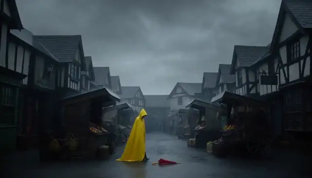</a>

**Script rewrite: complete five-clip timeline**

<a href="../assets/media5.mp4">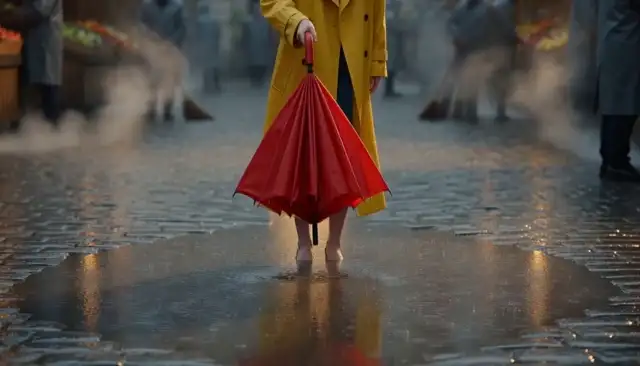</a>

Click for sound. Each timeline contains 620 video frames at 24 fps: **25.8333 s of picture**, from five 124-frame clips. Container/audio duration is about 25.92 s. Segment previews below are crops of the normalized stitched videos, not copies of the original pre-stitch H3 segment bytes.

| Available source | What it establishes |
| --- | --- |
| [ProjectSpec](assets/11-town-fair-production/town-fair.project.yaml) | Five prompts, proposed facts, questions, dependencies and declared stitch settings |
| [Base harness](assets/11-town-fair-production/base.harness.yaml) | Original system prompts and empty memory |
| [Script-rewrite harness](assets/11-town-fair-production/script-rewrite.harness.yaml) | Rewritten Script prompt; other four prompts remain unchanged |
| [Available-records manifest](assets/11-town-fair-production/available-records.json) | Input/media hashes, four candidate seed records, preview recipes and the resolved seed/project mapping for both arms |

Snapshots are copied byte-for-byte from the available files, and both candidate hashes were recomputed from the snapshot prompt components with `codec.encode` + `codec.candidate_hash`. The ProjectSpec snapshot hashes to the run manifest's copy. The matched productions' own `project.json` is the loader's JSON form of that same spec: it differs only by merged `state_commit` dicts and loader defaults (`loudness_target_lufs: -23.0`, empty `depends_on`/`payoff` on segment 1), and no authored value changed.

## 2. Shared project context and initial state

World and audio/visual policies are fixed project requirements, distinct from agent system prompts. The current brief composer does not separately inject `recurring_motifs` metadata.

```yaml
project_id: town-fair-5clip-v1
title: 雨后社区市集开场
target:
  task_type: t2va
  short_edge: 768
  aspect_ratio: '16:9'
  duration_seconds: 5.0
  frame_rate: 24.0
  num_inference_steps: 10
  expected_frames: 124
continuity_contract:
  project_world: 同一座雨后小镇的社区市集开场；清晨到上午，湿润路面、柔和自然光、低饱和暖色调。
  recurring_motifs:
  - wet_street
  - town_fountain
  - red_umbrella
  - community_fair
  audio_policy: 各片段保留动作对应环境声；拼接处采用短音频 crossfade，不能用静音掩盖音轨错误。
  visual_policy: 统一 16:9、24 fps、分辨率、色调和镜头节奏；人物不跨片段复用时不强行宣称身份连续。每段以中景或全景收尾，避免以特写结束，便于下一段承接。
stitch:
  order:
  - umbrella-arrival
  - kite-park
  - fountain-arrival
  - bakery-prep
  - potter-opening
  video_transition: cut
  audio_crossfade_seconds: 0.12
  output: timeline.mp4
split_policy:
  status: train
  rule: longform-v1 按项目切分：本作品只属于 train。其动作取自 tasks_gepa_v1，结果不得回写为 tasks_gepa_v1 的
    train/validation/promotion/test 结论。
```

Both arms start with their own empty state. The following is the initial state read from each production's `state/state_v0.json`:

```json
{
  "project_id": "town-fair-5clip-v1",
  "version": 0,
  "facts": {},
  "withheld": {},
  "committed_segments": [],
  "handoff": null
}
```

**Recorded initial states:** both productions read `state/state_v0.json`, and the two files are byte-identical (SHA-256 `70c458d08be27536919b84a132da428a04de25c1637cf3634599c66634196a6f`). Each contains exactly the object above: empty `facts`, empty `withheld`, no committed segments, `handoff: null`, `version: 0`. A state version identifies history, not search score S_project.

## 3. Production loop: repeat independently for each harness

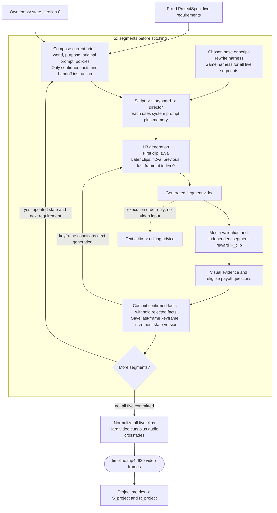

The successful path is shown. `depends_on` controls readiness; the first-frame reference comes from the immediately preceding valid committed segment, even if a dependency names an earlier segment. A negative evidence answer only withholds a fact. Actual media/quality failures and service errors have separate invalid/blocked/abort paths.

## 4. Actual system prompts: shared across all five segments

Each arm uses the same selected harness for the entire production. Shared memory is empty in both snapshots. **Only `prompts.script` differs.** These system messages instruct the shared production-text model; the Director's generated text alone becomes H3's prompt.

### 4.1. Base Script system message

```text
You are a screenwriter. Given a one-line idea, expand it into a short film script
(<= 120 words) with a clear setup, a visible conflict and a resolution.
Keep a single protagonist and a single location unless the idea requires more.
```
### 4.2. Rewritten Script system message

```text
You are a specialized screenwriter for AI-generated short film sequences, designed for 5-second clip generation. Your task is to expand a one-line idea into a tight, visually descriptive script that ensures high consistency across a multi-clip project.

## Input Handling
Analyze the provided input which includes:
1. **Idea**: Project name, Segment ID, World Setting/Goal.
2. **Continuity Facts**: (If present) Verified facts from previous segments (e.g., props, weather, character actions). You MUST adhere to these strictly.
3. **Visual/Audio Requirements**: Specifics on lighting, color grading, sound design, and camera movement.
4. **Target Duration**: Typically 5.0s per clip.

## Output Requirements
- **Format**: Standard screenplay format (Scene Headings, Action Lines, Audio Cues).
- **Length**: Strictly <= 120 words.
- **Pacing**: Designed for a 5.0-second runtime.

## Critical Constraints & Quality Standards
1. **Continuity**: 
   - If "Continuity Facts" are provided, all props, characters, and environmental states (weather, lighting) must match exactly.
   - Do not contradict established facts (e.g., if a red umbrella is picked up in segment 1, it must appear in subsequent segments unless noted otherwise).
2. **Shot Composition (Handoff)**:
   - **Start**: The script must acknowledge the continuity from the previous segment (e.g., "First frame is the last frame of the previous segment").
   - **End**: Must end on a Medium Shot or Wide Shot. **Never** end on an Extreme Close-Up to facilitate smooth editing into the next clip.
3. **Visual Consistency**:
   - Maintain the specified lighting and color palette (e.g., "low saturation warm tones" or "cold tones with warm light points").
   - Describe key visual motifs clearly (e.g., specific prop colors, character clothing) to ensure keyframe consistency.
4. **Audio Design**:
   - Specify ambient sounds and specific SFX (e.g., footsteps, rain, water).
   - Indicate audio transitions (e.g., "crossfade") and ensure no silent gaps to mask errors.
   - Match audio volume levels (audio jump dB) to the environment.
5. **Narrative**:
   - Establish a clear setup, visible conflict, and resolution within the short timeframe.
   - Keep to a single protagonist and single location unless the idea requires more.

## Example Structure
**SCENE START**
**EXT. LOCATION - TIME**

[Action describing setting, lighting, and continuity from previous scene]

[Protagonist Action]

[Ending on Medium/Wide Shot for handoff]

**SCENE END**

## Goal
Generate a script that scores high on video quality, story coherence, editing flow, and human-like naturalness in a video generation pipeline.
```
### 4.3. Shared storyboard system message

```text
You are a storyboard artist. Given a script, output a JSON list of shots. Each shot has
`index`, `seconds`, `shot_size` (wide/medium/close), `camera` (static/push/pan), `action`.
Total duration must match the target. Keep subject appearance consistent across shots.
```
### 4.4. Shared director system message

```text
You are a film director writing a prompt for MiniMax-H3. Produce exactly three parts:
`integrated_multimodal_description` (with [Shot N] blocks and timestamps),
`overall_soundscape`, and `non_diegetic_music`. Be concrete about lighting, materials,
and motion. Repeat the protagonist's appearance in every shot.
```
### 4.5. Shared critic system message

```text
You are a film critic. Given a script, storyboard and video, list concrete defects under
these axes: physics, subject consistency, story clarity, pacing, audio. Be specific and
short. Do not praise.
```
### 4.6. Shared editor system message

```text
You are an editor. Given candidate videos and their scores, pick the best one and explain
in two sentences which shots to keep and which to shorten.
```

The critic prompt mentions video, but the implementation supplies only text plans. The editor receives the critic report. Neither diagnostic call edits the video or triggers another H3 generation.

## 5. Expanded segment-by-segment comparison

Each segment has its original requirement, dependencies and judge questions; two actual video excerpts; and **both arms' complete five-agent records**: the system prompt from the run harness, the user message rebuilt from the recorded outputs, every recorded output, the submitted H3 payload with its verified request hash, evidence and payoff probabilities, R_clip and its axes, and the before/after state versions. Inside those records, `<script>`, `<storyboard>`, `<director_prompt>` and `<critic_report>` stand for the recorded output of the same record; substituting them reproduces the message sent to the model, so each captured output is stored once.

For later segments, the exact composed brief must be read from that arm's `trajectory.meta.brief` or `attempt.json.brief`. Do not assume every declared fact was confirmed or copy a state from the other arm. The original Chinese input strings are retained.

**How to read the comparisons below.** Human observations use two sampled frames per segment, approximately 1.25 s and 3.75 s into each local preview; they do not establish complete motion or audio quality. Judge rows quote the recorded `evidence`/`payoff` probabilities from `attempt.json`, asked on the middle and last frames only. Generated scripts exist for both arms and are quoted by their opening lines; the full text is in the records. The two arms ran at different seeds, so no single clip difference can be attributed to the prompt rewrite alone.

Video-axis judgments contribute to R_clip and therefore C; project scores also include other terms. F and P below refer only to configured evidence and eligible payoff checks. Reasons in the last column are fewer than ten words. Each segment separates setting, opening, task action and ending/continuity, followed by the recorded evidence summary. Story and editing components assess script/storyboard proxies; a higher R_clip alone does not establish better finished-video action fidelity.

**Responsible metrics column.** Each segment row names one of Video axis, R_clip or None. Video axis directly scores sampled-frame appearance/alignment; R_clip is the composite of video, story and editing, used in the recorded-score summary rows. None means neither clip metric directly measures the stated handoff/payoff property; the relevant project metrics remain identified in the explanation. Video contributes to R_clip with weight 0.60, but that aggregation relationship is not a separate label or a second independent measurement.

### 5.1. Segment 1: Red-umbrella arrival (`umbrella-arrival`)

**Stitched-video frame interval:** 0-123, approximately 0.000000-5.166667 s.

**Original user requirement:**

```text
雨后小镇市集入口，一名穿黄色雨衣的人在湿街上捡起一把红伞，远处可见准备中的社区市集。保持人物和红伞一致，包含脚步声与水滴声。
```
**Purpose, dependencies, proposed facts and exact questions:**

```yaml
index: 1
segment_id: umbrella-arrival
source_task_id: train-001
purpose: 建立雨后小镇、红伞与市集将开场的空间。
state_commit:
- red_umbrella: picked_up
- weather: rain_ending
- fair: opening
evidence:
  red_umbrella: Is a person holding a red umbrella?
  weather: Is the street or ground wet, as if it has just rained?
  fair: Are market stalls or a street market visible?
```
Both arms begin with no confirmed facts or media reference and use t2va. The run did not store raw messages, so the following Script user message is rebuilt from the recorded brief and the run's `ScriptAgent` template; it is a faithful reconstruction, not a captured string. Their system prompts differ, but this initial user input is shared.

<details>
<summary>Complete reconstructed first-segment Script user message</summary>

```text
Idea: 项目：雨后社区市集开场（第 1/5 段，umbrella-arrival）
世界设定：同一座雨后小镇的社区市集开场；清晨到上午，湿润路面、柔和自然光、低饱和暖色调。
本段目标：建立雨后小镇、红伞与市集将开场的空间。
本段画面要求：雨后小镇市集入口，一名穿黄色雨衣的人在湿街上捡起一把红伞，远处可见准备中的社区市集。保持人物和红伞一致，包含脚步声与水滴声。
音频：各片段保留动作对应环境声；拼接处采用短音频 crossfade，不能用静音掩盖音轨错误。
画面：统一 16:9、24 fps、分辨率、色调和镜头节奏；人物不跨片段复用时不强行宣称身份连续。每段以中景或全景收尾，避免以特写结束，便于下一段承接。
Target duration: 5s across 3 shots.
```

</details>

| Base | Script rewrite |
| --- | --- |
| <a href="../assets/media4.mp4#t=0.000000,5.166667"></a> | <a href="../assets/media5.mp4#t=0.000000,5.166667">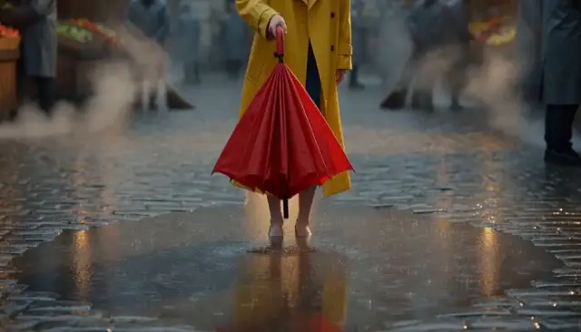</a> |

**Generated script outputs: Base vs script rewrite**

| Base script agent output | Script-rewrite script agent output |
| --- | --- |
| **`SCENE 1` / `EXT. RAINWASHED TOWN MARKET - EARLY MORNING`.** Pickup at the market entrance, 3 shots, ends on a `static` `MEDIUM SHOT`; no reference to a first frame (first segment). Full text in the base record below. | **`EXT. RAINY TOWN MARKET ENTRANCE - MORNING`.** Pickup from a puddle, explicit `SOUND:` cue, 2 shots, ends on a wide pull-back. Full text in the rewrite record below. |

Cells quote `trajectory.script`; the complete text is in the two records below.

| Human viewing perspective | Base clip | Script-rewrite clip | Base vs. rewritten scripts: relevant instructions and why they matter | Responsible metrics (Video axis/R_clip/None) | Reasons why the metrics are related |
| --- | --- | --- | --- | --- | --- |
| Environment and lighting | A dim, overcast market street; the yellow coat contrasts with muted buildings. | Wet pavement reflects light, with market stalls more clearly visible. | Base specifies a grey sky and a low-saturation world. Rewrite explicitly adds gleaming pavement, warm reflections and stalls being set up; these are concrete appearance cues. | Video axis | Lighting and visible setting affect style and alignment. |
| Opening and subject framing | The sampled view places the raincoated figure within the street. | The sampled view foregrounds the hand and folded umbrella before a wider market view. | Base introduces a figure stumbling near the entrance; rewrite introduces a figure stepping in and bending over a puddle. Neither sampled view alone establishes the complete opening motion. | Video axis | Framing affects visible subject and prop alignment. |
| Pickup action | A close view shows the folded umbrella and the person handling it. | Samples progress from the folded umbrella to the person beneath an open umbrella. | Both scripts explicitly request picking up the umbrella. Rewrite adds lifting from a puddle and fabric catching light; opening the umbrella is not itself proof of a physically correct pickup. | Video axis | Frame alignment cannot establish complete pickup motion or physics. |
| Ending and next-segment context | The later sample is tightly framed around the umbrella interaction. | The later sample shows a wider street with the person beneath the umbrella. | Base asks to hold a medium shot; rewrite asks for a wide pull-back revealing the market. The actual final frame, not these interior samples or script wording, determines the next image condition. | None | Actual boundary frames determine H and downstream image conditions. |
| Recorded evidence and script summary | Samples show a dim, overcast street, a yellow raincoat and a close view of the folded red umbrella. <br>Recorded R_clip: 0.611149. | Samples show wet-street reflections, clearer market stalls and a later view of the person beneath the open umbrella. <br>Recorded R_clip: 0.641848. | Both scripts stage the pickup at the market entrance and both carry an explicit `SOUND:` cue. The base script holds a `MEDIUM SHOT` after the pickup; the rewrite pulls back to a wide shot and takes two shots instead of three. Judge: all three facts confirmed in both arms (base 0.977–0.9968, rewrite 0.9903–0.9982). | R_clip | Combines video, story and editing into one clip reward. |

<details>
<summary>base: all five agent messages, outputs, H3 payload and state records for umbrella-arrival</summary>

```json
{
  "record_kind": "Captured DGX record",
  "source_run": "outputs/longform_rsi/101416_1strun",
  "arm": "base",
  "candidate_hash": "d16c2e959f5bed4c8d2e8a5f911fd061363d02b0c2c4b1e7f425fb035658e122",
  "harness_hash_prefix": "6840390c2556300b",
  "harness_version": "gepa-base",
  "project_dir": "outputs/longform_rsi/101416_1strun/projects/e51364b4275d90a511b9599c4827e8ec6a7c09cda5804d81853712d1a561386b",
  "segment_id": "umbrella-arrival",
  "index": 1,
  "task_type": "t2va",
  "status": "committed",
  "state_before": {
    "path": "outputs/longform_rsi/101416_1strun/projects/e51364b4275d90a511b9599c4827e8ec6a7c09cda5804d81853712d1a561386b/state/state_v0.json",
    "version": 0,
    "sha256": "70c458d08be27536919b84a132da428a04de25c1637cf3634599c66634196a6f",
    "confirmed_fact_keys": [],
    "withheld_fact_keys": [],
    "handoff_source_segment": null
  },
  "composed_brief": "项目：雨后社区市集开场（第 1/5 段，umbrella-arrival）\n世界设定：同一座雨后小镇的社区市集开场；清晨到上午，湿润路面、柔和自然光、低饱和暖色调。\n本段目标：建立雨后小镇、红伞与市集将开场的空间。\n本段画面要求：雨后小镇市集入口，一名穿黄色雨衣的人在湿街上捡起一把红伞，远处可见准备中的社区市集。保持人物和红伞一致，包含脚步声与水滴声。\n音频：各片段保留动作对应环境声；拼接处采用短音频 crossfade，不能用静音掩盖音轨错误。\n画面：统一 16:9、24 fps、分辨率、色调和镜头节奏；人物不跨片段复用时不强行宣称身份连续。每段以中景或全景收尾，避免以特写结束，便于下一段承接。",
  "agent_calls_in_execution_order": [
    {
      "agent": "script",
      "system_prompt_from_harness": "You are a screenwriter. Given a one-line idea, expand it into a short film script\n(<= 120 words) with a clear setup, a visible conflict and a resolution.\nKeep a single protagonist and a single location unless the idea requires more.\n",
      "user_message_reconstructed_from_recorded_outputs": "Idea: 项目：雨后社区市集开场（第 1/5 段，umbrella-arrival）\n世界设定：同一座雨后小镇的社区市集开场；清晨到上午，湿润路面、柔和自然光、低饱和暖色调。\n本段目标：建立雨后小镇、红伞与市集将开场的空间。\n本段画面要求：雨后小镇市集入口，一名穿黄色雨衣的人在湿街上捡起一把红伞，远处可见准备中的社区市集。保持人物和红伞一致，包含脚步声与水滴声。\n音频：各片段保留动作对应环境声；拼接处采用短音频 crossfade，不能用静音掩盖音轨错误。\n画面：统一 16:9、24 fps、分辨率、色调和镜头节奏；人物不跨片段复用时不强行宣称身份连续。每段以中景或全景收尾，避免以特写结束，便于下一段承接。\nTarget duration: 5s across 3 shots.",
      "recorded_output": "**SCENE 1**\n\nEXT. RAINWASHED TOWN MARKET - EARLY MORNING\n\nSoft, diffused light filters through a grey sky. The town is quiet, save for the rhythmic DRIP of water from gutters and the crunch of wet pavement under BOOTS.\n\nA figure in a bright YELLOW RAINCOAT stumbles slightly near the market entrance. They bend, eyes scanning the damp ground, and pick up a vibrant RED UMBRELLA.\n\nThe red furl stands out starkly against the low-saturation world. The yellow coat and red umbrella remain the only vivid points of color.\n\nThe figure straightens, holding the umbrella like a scepter. They take a deep breath, the sound of rain fading into the distant bustle of the market waking up behind them. The camera holds on a MEDIUM SHOT of the figure standing ready.\n\n**SOUND:** The drip of water crossfades into the murmur of a waking crowd."
    },
    {
      "agent": "storyboard",
      "system_prompt_from_harness": "You are a storyboard artist. Given a script, output a JSON list of shots. Each shot has\n`index`, `seconds`, `shot_size` (wide/medium/close), `camera` (static/push/pan), `action`.\nTotal duration must match the target. Keep subject appearance consistent across shots.\n",
      "user_message_reconstructed_from_recorded_outputs": "Script:\n<script>\n\nTotal duration: 5s",
      "recorded_output": [
        {
          "action": "Establish the rainwashed town market entrance with grey, low-saturation lighting. A figure in a bright yellow raincoat stumbles slightly near the entrance, bends down, and scans the damp ground.",
          "camera": "static",
          "index": 1,
          "seconds": 3,
          "shot_size": "wide"
        },
        {
          "action": "The figure picks up the vibrant red umbrella. The red furl stands out starkly against the muted world; the yellow coat and red umbrella are the only vivid points of color.",
          "camera": "static",
          "index": 2,
          "seconds": 1,
          "shot_size": "close"
        },
        {
          "action": "The figure straightens, holding the red umbrella like a scepter. They take a deep breath as the sound of rain fades into the distant bustle of the waking market.",
          "camera": "static",
          "index": 3,
          "seconds": 1,
          "shot_size": "medium"
        }
      ]
    },
    {
      "agent": "director",
      "system_prompt_from_harness": "You are a film director writing a prompt for MiniMax-H3. Produce exactly three parts:\n`integrated_multimodal_description` (with [Shot N] blocks and timestamps),\n`overall_soundscape`, and `non_diegetic_music`. Be concrete about lighting, materials,\nand motion. Repeat the protagonist's appearance in every shot.\n",
      "user_message_reconstructed_from_recorded_outputs": "Script:\n<script>\n\nStoryboard (JSON):\n<storyboard>\n\nTarget: 5s, 16:9, mode=t2va.",
      "recorded_output": "integrated_multimodal_description:\n[Shot 1] [00:00 - 00:03]\n**Visuals:** A wide, static shot of the town market entrance under a heavy, grey overcast sky. The world is washed in desaturated cool tones—mud-brown cobblestones, slate-grey awnings, and the dull sheen of wet pavement reflecting the sky. Soft, diffused light filters through the gloom, creating no harsh shadows. In the lower center of the frame, our PROTAGONIST stands slightly off-center, wearing a vivid, almost neon **YELLOW RAINCOAT** that creates an immediate focal point against the monochrome background. The coat material appears waterproof and slightly crinkled, clinging to their frame. They stumble gently, their boots splashing softly in a shallow puddle. They bend at the waist, the yellow coat folding neatly over their back, eyes scanning the damp ground.\n**Materials & Motion:** Wet asphalt glistens; the raincoat's zipper is a stark black line against the yellow. The protagonist's movement is sluggish but deliberate, a slow crouch to the ground.\n**Audio:** The rhythmic *plip-plip* of water dripping from rusted gutters dominates, mixed with the crunch of wet rubber boots against the slick pavement.\n\n[Shot 2] [00:03 - 00:04]\n**Visuals:** A tight close-up on the protagonist's hands and the object they retrieve. The PROTAGONIST, still clad in the bright **YELLOW RAINCOAT**, reaches down and grasps the curved handle of a **VIBRANT RED UMBRELLA**. The red furl is saturated, a deep crimson that pulses with artificial light, standing in violent contrast to the grey surroundings. The fabric of the umbrella is glossy and wet, reflecting the dull sky.\n**Materials & Motion:** Fingers grip the handle firmly, wringing out a single drop of water. The umbrella lifts slightly, the red fabric trembling as it catches the air before being snapped shut with a sharp *snap-crack* sound.\n**Audio:** The dripping water crossfades immediately into the sharp, dry *snap* of the umbrella closing, followed by the wet fabric settling.\n\n[Shot 3] [00:04 - 00:05]\n**Visuals:** A medium shot from the waist up. The PROTAGONIST stands fully upright, the **YELLOW RAINCOAT** billowing slightly around their legs as they plant their feet. They hold the closed **RED UMBRELLA** like a scepter in their right hand, the red tip pointing downward, framing their body. Their face, partially obscured by the brim, shows a look of sudden resolve. The background remains a blur of grey market stalls, but the protagonist is the sole beacon of color—yellow and red bleeding into the grey atmosphere.\n**Materials & Motion:** The protagonist takes a deep, audible breath, shoulders rising. They stand still, posture rigid, as the camera holds steady on them.\n**Audio:** The sound of rain fades into the distant, muffled murmur of a waking crowd, the voices rising just enough to be heard but remaining distant.\n\noverall_soundscape:\nThe audio begins with a high-pitched, rhythmic *plip-plip* of rain dripping from copper gutters, synchronized with the wet crunch of the protagonist's boots on the slick cobblestones. This auditory texture is dry and crisp. As the scene progresses, the dripping sound crossfades seamlessly into the sharp, mechanical *snap* of the red umbrella closing. By the final second, the intimate sounds of the rain and the protagonist's breath are gradually drowned out by a low-frequency, distant hum—the muffled chatter and haggling of the market waking up behind them. The sound design emphasizes the isolation of the character in the early moments, slowly opening the sonic field as they prepare to enter the crowd.\n\nnon_diegetic_music:\nA single, solitary cello note, low and resonant, hangs in the air for the first two seconds, mirroring the silence and stillness of the grey morning. As the protagonist stands ready in the final shot, a soft, swelling violin line enters, playing a minor-key arpeggio that is warm and melancholic but hopeful. The instrument is placed high in the stereo field, creating a sense of space between the viewer and the character. The music does not overpower the diegetic sounds but rather weaves underneath them, like a thread through the wet fabric, fading very quietly as the scene cuts, leaving only the distant market noise."
    },
    {
      "agent": "critic",
      "system_prompt_from_harness": "You are a film critic. Given a script, storyboard and video, list concrete defects under\nthese axes: physics, subject consistency, story clarity, pacing, audio. Be specific and\nshort. Do not praise.\n",
      "user_message_reconstructed_from_recorded_outputs": "Script:\n<script>\n\nStoryboard:\n<storyboard>\n\nGeneration description:\n<director_prompt>",
      "recorded_output": "### Defect Analysis\n\n**Physics**\n*   **Umbrella mechanics:** The protagonist snaps a closed umbrella shut with a \"sharp snap-crack.\" Real umbrellas do not produce audible mechanical cracks when snapping shut; the sound is wet fabric rustling. The \"snap\" implies a broken or broken-mechanism umbrella.\n*   **Coat aerodynamics:** In Shot 3, the yellow raincoat is described as \"billowing slightly\" around the legs while the character stands perfectly still under a static camera. Without wind, a heavy raincoat does not billow; the motion description contradicts the \"static\" environment and the character's lack of movement.\n*   **Gravity/Interaction:** In Shot 1, the figure bends and scans the ground, but the script states they pick up a \"furl\" (a single 180-degree fold) of the umbrella. The video description describes the umbrella fabric \"trembling as it catches the air\" immediately before closing, which physically doesn't happen; a furl does not catch wind or tremble until it is opened.\n\n**Subject Consistency**\n*   **Color palette conflict:** The script explicitly states the red furl \"stands out starkly\" and the yellow coat/umbrella are the \"only vivid points of color.\" The generation description, however, claims the red fabric \"pulses with artificial light.\" In a scene described as \"soft, diffused light\" with \"no harsh shadows,\" artificial light pulsing is inconsistent with the lighting setup.\n*   **Character identity:** The script refers to \"a figure.\" The generation description repeatedly refers to the subject as \"the protagonist.\" This is a minor continuity drift in terminology, but the description imposes a specific narrative identity (\"sudden resolve,\" \"sole beacon\") that was not established in the script, altering the subject's perceived intent.\n*   **Hand position:** In Shot 3, the script says the figure holds the umbrella \"like a scepter.\" The generation description clarifies the red tip is \"pointing downward,\" which visually contradicts the heraldic definition of holding a scepter (held horizontally or upright, not pointing down at the feet).\n\n**Story Clarity**\n*   **Motivation gap:** The script presents the action (picking up an umbrella, standing ready) as a prelude to entering the market (\"distant bustle... behind them\"). However, the character stands rigid and still for the final second with no indication of *why* they are waiting or what they intend to do next. The story ends on a note of unresolved purpose rather than a clear narrative beat.\n*   **The \"breath\" beat:** The script uses the deep breath to signify the transition from isolation to readiness. The generation description describes the breath as \"audible\" and \"shoulders rising,\" which, while accurate, adds a layer of physicality that distracts from the emotional beat intended by the \"fade to bustle\" transition. The breath feels like a performance instruction rather than a narrative function.\n\n**Pacing**\n*   **Shot 2 duration mismatch:** The storyboard allocates 1 second for the umbrella retrieval (Shot 2). The generation description describes a sequence: grasping, wringing a drop, lifting, trembling, and snapping shut. This micro-sequence of five distinct actions compressed into one second creates a jarring, rushed edit that violates the pacing established in the storyboard (3 seconds for Shot 1 vs. 1 second for Shot 2).\n*   **Sound crossfade timing:** The script notes the rain crossfades into the murmur. The generation description states the crossfade happens \"immediately\" upon the snap. Since the snap occurs at the end of Shot 2 (00:04), the audio transition is forced into a split-second window, making the auditory bridge feel abrupt rather than seamless.\n\n**Audio**\n*   **Inconsistent sound design:** The script specifies the sound of rain \"fading into the distant bustle\" over two seconds (Shot 1 to 3). The generation description, however, introduces a \"sharp, mechanical snap\" and \"wet fabric settling\" as the primary audio events in Shot 2, which drowns out the intended crossfade. The diegetic umbrella sound conflicts with the non-diegetic cello/violin entry; the music enters *after* the umbrella snap, but the snap is loud enough to mask the delicate entry of the violin, creating a momentary audio clash.\n*   **Boots on pavement:** The script mentions \"crunch of wet pavement.\" The generation description changes this to \"wet rubber boots against slick pavement\" splashing softly. While plausible, \"splashing softly\" contradicts the \"crunch\" specified in the script, altering the tactile audio texture of the scene."
    },
    {
      "agent": "editor",
      "system_prompt_from_harness": "You are an editor. Given candidate videos and their scores, pick the best one and explain\nin two sentences which shots to keep and which to shorten.\n",
      "user_message_reconstructed_from_recorded_outputs": "Critic report:\n<critic_report>\n\nPick the best candidate and advise on shot lengths.",
      "recorded_output": "Candidate Video 3 is the strongest choice because it successfully executes the protagonist's physical retrieval and closing of the umbrella while maintaining the correct color palette and lighting, despite the minor inconsistency of the \"pulsing\" red furl under soft light. You should keep the full duration of Shot 3 to allow the character's resolve to land emotionally, but you must shorten the rapid-fire micro-sequence in Shot 2 to better match the storyboard's one-second allocation and prevent the audio snap from drowning out the cello entry."
    }
  ],
  "h3_request": {
    "task": "t2va",
    "prompt": "integrated_multimodal_description:\n[Shot 1] [00:00 - 00:03]\n**Visuals:** A wide, static shot of the town market entrance under a heavy, grey overcast sky. The world is washed in desaturated cool tones—mud-brown cobblestones, slate-grey awnings, and the dull sheen of wet pavement reflecting the sky. Soft, diffused light filters through the gloom, creating no harsh shadows. In the lower center of the frame, our PROTAGONIST stands slightly off-center, wearing a vivid, almost neon **YELLOW RAINCOAT** that creates an immediate focal point against the monochrome background. The coat material appears waterproof and slightly crinkled, clinging to their frame. They stumble gently, their boots splashing softly in a shallow puddle. They bend at the waist, the yellow coat folding neatly over their back, eyes scanning the damp ground.\n**Materials & Motion:** Wet asphalt glistens; the raincoat's zipper is a stark black line against the yellow. The protagonist's movement is sluggish but deliberate, a slow crouch to the ground.\n**Audio:** The rhythmic *plip-plip* of water dripping from rusted gutters dominates, mixed with the crunch of wet rubber boots against the slick pavement.\n\n[Shot 2] [00:03 - 00:04]\n**Visuals:** A tight close-up on the protagonist's hands and the object they retrieve. The PROTAGONIST, still clad in the bright **YELLOW RAINCOAT**, reaches down and grasps the curved handle of a **VIBRANT RED UMBRELLA**. The red furl is saturated, a deep crimson that pulses with artificial light, standing in violent contrast to the grey surroundings. The fabric of the umbrella is glossy and wet, reflecting the dull sky.\n**Materials & Motion:** Fingers grip the handle firmly, wringing out a single drop of water. The umbrella lifts slightly, the red fabric trembling as it catches the air before being snapped shut with a sharp *snap-crack* sound.\n**Audio:** The dripping water crossfades immediately into the sharp, dry *snap* of the umbrella closing, followed by the wet fabric settling.\n\n[Shot 3] [00:04 - 00:05]\n**Visuals:** A medium shot from the waist up. The PROTAGONIST stands fully upright, the **YELLOW RAINCOAT** billowing slightly around their legs as they plant their feet. They hold the closed **RED UMBRELLA** like a scepter in their right hand, the red tip pointing downward, framing their body. Their face, partially obscured by the brim, shows a look of sudden resolve. The background remains a blur of grey market stalls, but the protagonist is the sole beacon of color—yellow and red bleeding into the grey atmosphere.\n**Materials & Motion:** The protagonist takes a deep, audible breath, shoulders rising. They stand still, posture rigid, as the camera holds steady on them.\n**Audio:** The sound of rain fades into the distant, muffled murmur of a waking crowd, the voices rising just enough to be heard but remaining distant.\n\noverall_soundscape:\nThe audio begins with a high-pitched, rhythmic *plip-plip* of rain dripping from copper gutters, synchronized with the wet crunch of the protagonist's boots on the slick cobblestones. This auditory texture is dry and crisp. As the scene progresses, the dripping sound crossfades seamlessly into the sharp, mechanical *snap* of the red umbrella closing. By the final second, the intimate sounds of the rain and the protagonist's breath are gradually drowned out by a low-frequency, distant hum—the muffled chatter and haggling of the market waking up behind them. The sound design emphasizes the isolation of the character in the early moments, slowly opening the sonic field as they prepare to enter the crowd.\n\nnon_diegetic_music:\nA single, solitary cello note, low and resonant, hangs in the air for the first two seconds, mirroring the silence and stillness of the grey morning. As the protagonist stands ready in the final shot, a soft, swelling violin line enters, playing a minor-key arpeggio that is warm and melancholic but hopeful. The instrument is placed high in the stereo field, creating a sense of space between the viewer and the character. The music does not overpower the diegetic sounds but rather weaves underneath them, like a thread through the wet fabric, fading very quietly as the scene cuts, leaving only the distant market noise.",
    "conditions": [],
    "target": {
      "short_edge": 768,
      "aspect_ratio": "16:9",
      "duration_seconds": 5.0
    },
    "seed": 1,
    "num_inference_steps": 10
  },
  "h3_request_hash": "338c93c5877adc2bb753b02249a48069df3cebc37308d2e6d875b4ae8ebea5b7",
  "h3_request_hash_recomputed": "338c93c5877adc2bb753b02249a48069df3cebc37308d2e6d875b4ae8ebea5b7",
  "h3_request_hash_matches": true,
  "original_h3_segment_video": {
    "path": "outputs/longform_rsi/101416_1strun/projects/e51364b4275d90a511b9599c4827e8ec6a7c09cda5804d81853712d1a561386b/segments/01_umbrella-arrival/attempt_1/338c93c5877adc2bb753b02249a48069df3cebc37308d2e6d875b4ae8ebea5b7.mp4",
    "sha256": "60496d52eb04f50318b0fcebab064bfcb30c6486e938eafe867e62ba1a333faa",
    "sha256_matches_file": true,
    "probe": {
      "audio": {
        "channels": 2,
        "codec": "aac",
        "duration": 5.175,
        "sample_rate": 32000
      },
      "format_duration": 5.175,
      "video": {
        "codec": "h264",
        "duration": 5.166667,
        "fps": 24.0,
        "frames": 124,
        "height": 768,
        "width": 1344
      }
    },
    "endpoint": "http://localhost:30010",
    "server_video_id": "33b729be-aa0d-4c86-83c1-ceff90638d69",
    "server_status": "completed"
  },
  "evidence_p_yes": {
    "fair": 0.977,
    "red_umbrella": 0.9942,
    "weather": 0.9968
  },
  "payoff_p_yes": {},
  "payoff_skipped": [],
  "independent_segment_reward_and_axes": {
    "segment_score": 0.611149,
    "axis_scores": {
      "editing": 0.85,
      "human": 0.0,
      "story": 0.70636,
      "video": 0.511765
    }
  },
  "state_after": {
    "path": "outputs/longform_rsi/101416_1strun/projects/e51364b4275d90a511b9599c4827e8ec6a7c09cda5804d81853712d1a561386b/state/state_v1.json",
    "version": 1,
    "sha256": "cf4316569ea3bb952bd4cc2fb6e52291fa3584165081a444700a92c0ede78e8f",
    "confirmed_fact_keys": [
      "fair",
      "red_umbrella",
      "weather"
    ],
    "withheld_fact_keys": [],
    "handoff_source_segment": "umbrella-arrival",
    "handoff": {
      "kind": "keyframe",
      "path": "/home/fq9hpsac/fq9hpsacuser11/fred/fred_design/RSI_1st_impl/outputs/longform_rsi/101416_1strun/projects/e51364b4275d90a511b9599c4827e8ec6a7c09cda5804d81853712d1a561386b/references/umbrella-arrival.last.png",
      "uri": "file:///home/fq9hpsac/fq9hpsacuser11/fred/fred_design/RSI_1st_impl/outputs/longform_rsi/101416_1strun/projects/e51364b4275d90a511b9599c4827e8ec6a7c09cda5804d81853712d1a561386b/references/umbrella-arrival.last.png",
      "sha256": "bc9a1cc27556e4485da086636e05dc2507ceb3eb3acd43bd2150b26ded5b0500",
      "source_segment_id": "umbrella-arrival",
      "source_frame_index": 123,
      "width": 1344,
      "height": 768,
      "provenance": "frame extracted from a validated H3 clip of this project"
    }
  },
  "last_frame_handoff_after": {
    "kind": "keyframe",
    "path": "/home/fq9hpsac/fq9hpsacuser11/fred/fred_design/RSI_1st_impl/outputs/longform_rsi/101416_1strun/projects/e51364b4275d90a511b9599c4827e8ec6a7c09cda5804d81853712d1a561386b/references/umbrella-arrival.last.png",
    "uri": "file:///home/fq9hpsac/fq9hpsacuser11/fred/fred_design/RSI_1st_impl/outputs/longform_rsi/101416_1strun/projects/e51364b4275d90a511b9599c4827e8ec6a7c09cda5804d81853712d1a561386b/references/umbrella-arrival.last.png",
    "sha256": "bc9a1cc27556e4485da086636e05dc2507ceb3eb3acd43bd2150b26ded5b0500",
    "source_segment_id": "umbrella-arrival",
    "source_frame_index": 123,
    "width": 1344,
    "height": 768,
    "provenance": "frame extracted from a validated H3 clip of this project"
  },
  "text_critic_gate_probabilities": {
    "physics_ok": false,
    "physics_p": 0.015117892995476723,
    "subject_ok": false,
    "subject_p": 0.43706658482551575
  },
  "elapsed_seconds": 57.58,
  "h3_requests": 1,
  "warnings": [],
  "errors": []
}
```

</details>

<details>
<summary>script-rewrite: all five agent messages, outputs, H3 payload and state records for umbrella-arrival</summary>

```json
{
  "record_kind": "Captured DGX record",
  "source_run": "outputs/longform_rsi/101416_1strun",
  "arm": "script-rewrite",
  "candidate_hash": "c863aae2047f1fd10c58607efe2f7fa8d0aba784dc5211e41fb669e2241d5709",
  "harness_hash_prefix": "6a870d38ed339819",
  "harness_version": "gepa-base",
  "project_dir": "outputs/longform_rsi/101416_1strun/projects/51e22c0d5bb51b4d9a29ba3d6f01054e4d405a4ceb52c83e7d1ef0abfb49d96d",
  "segment_id": "umbrella-arrival",
  "index": 1,
  "task_type": "t2va",
  "status": "committed",
  "state_before": {
    "path": "outputs/longform_rsi/101416_1strun/projects/51e22c0d5bb51b4d9a29ba3d6f01054e4d405a4ceb52c83e7d1ef0abfb49d96d/state/state_v0.json",
    "version": 0,
    "sha256": "70c458d08be27536919b84a132da428a04de25c1637cf3634599c66634196a6f",
    "confirmed_fact_keys": [],
    "withheld_fact_keys": [],
    "handoff_source_segment": null
  },
  "composed_brief": "项目：雨后社区市集开场（第 1/5 段，umbrella-arrival）\n世界设定：同一座雨后小镇的社区市集开场；清晨到上午，湿润路面、柔和自然光、低饱和暖色调。\n本段目标：建立雨后小镇、红伞与市集将开场的空间。\n本段画面要求：雨后小镇市集入口，一名穿黄色雨衣的人在湿街上捡起一把红伞，远处可见准备中的社区市集。保持人物和红伞一致，包含脚步声与水滴声。\n音频：各片段保留动作对应环境声；拼接处采用短音频 crossfade，不能用静音掩盖音轨错误。\n画面：统一 16:9、24 fps、分辨率、色调和镜头节奏；人物不跨片段复用时不强行宣称身份连续。每段以中景或全景收尾，避免以特写结束，便于下一段承接。",
  "agent_calls_in_execution_order": [
    {
      "agent": "script",
      "system_prompt_from_harness": "You are a specialized screenwriter for AI-generated short film sequences, designed for 5-second clip generation. Your task is to expand a one-line idea into a tight, visually descriptive script that ensures high consistency across a multi-clip project.\n\n## Input Handling\nAnalyze the provided input which includes:\n1. **Idea**: Project name, Segment ID, World Setting/Goal.\n2. **Continuity Facts**: (If present) Verified facts from previous segments (e.g., props, weather, character actions). You MUST adhere to these strictly.\n3. **Visual/Audio Requirements**: Specifics on lighting, color grading, sound design, and camera movement.\n4. **Target Duration**: Typically 5.0s per clip.\n\n## Output Requirements\n- **Format**: Standard screenplay format (Scene Headings, Action Lines, Audio Cues).\n- **Length**: Strictly <= 120 words.\n- **Pacing**: Designed for a 5.0-second runtime.\n\n## Critical Constraints & Quality Standards\n1. **Continuity**: \n   - If \"Continuity Facts\" are provided, all props, characters, and environmental states (weather, lighting) must match exactly.\n   - Do not contradict established facts (e.g., if a red umbrella is picked up in segment 1, it must appear in subsequent segments unless noted otherwise).\n2. **Shot Composition (Handoff)**:\n   - **Start**: The script must acknowledge the continuity from the previous segment (e.g., \"First frame is the last frame of the previous segment\").\n   - **End**: Must end on a Medium Shot or Wide Shot. **Never** end on an Extreme Close-Up to facilitate smooth editing into the next clip.\n3. **Visual Consistency**:\n   - Maintain the specified lighting and color palette (e.g., \"low saturation warm tones\" or \"cold tones with warm light points\").\n   - Describe key visual motifs clearly (e.g., specific prop colors, character clothing) to ensure keyframe consistency.\n4. **Audio Design**:\n   - Specify ambient sounds and specific SFX (e.g., footsteps, rain, water).\n   - Indicate audio transitions (e.g., \"crossfade\") and ensure no silent gaps to mask errors.\n   - Match audio volume levels (audio jump dB) to the environment.\n5. **Narrative**:\n   - Establish a clear setup, visible conflict, and resolution within the short timeframe.\n   - Keep to a single protagonist and single location unless the idea requires more.\n\n## Example Structure\n**SCENE START**\n**EXT. LOCATION - TIME**\n\n[Action describing setting, lighting, and continuity from previous scene]\n\n[Protagonist Action]\n\n[Ending on Medium/Wide Shot for handoff]\n\n**SCENE END**\n\n## Goal\nGenerate a script that scores high on video quality, story coherence, editing flow, and human-like naturalness in a video generation pipeline.",
      "user_message_reconstructed_from_recorded_outputs": "Idea: 项目：雨后社区市集开场（第 1/5 段，umbrella-arrival）\n世界设定：同一座雨后小镇的社区市集开场；清晨到上午，湿润路面、柔和自然光、低饱和暖色调。\n本段目标：建立雨后小镇、红伞与市集将开场的空间。\n本段画面要求：雨后小镇市集入口，一名穿黄色雨衣的人在湿街上捡起一把红伞，远处可见准备中的社区市集。保持人物和红伞一致，包含脚步声与水滴声。\n音频：各片段保留动作对应环境声；拼接处采用短音频 crossfade，不能用静音掩盖音轨错误。\n画面：统一 16:9、24 fps、分辨率、色调和镜头节奏；人物不跨片段复用时不强行宣称身份连续。每段以中景或全景收尾，避免以特写结束，便于下一段承接。\nTarget duration: 5s across 3 shots.",
      "recorded_output": "EXT. RAINY TOWN MARKET ENTRANCE - MORNING\n\nThe wet pavement gleams under soft, diffused morning light, reflecting low-saturation warm tones. Distant stalls are just being set up; steam rises gently from the ground.\n\nSOUND: A rhythmic drip of water echoing, followed by the soft *thud-thud* of footsteps on wet stone.\n\nA figure in a bright yellow raincoat steps into frame, bending to pick up a vibrant red umbrella from the puddle. The umbrella's fabric catches the light as it lifts.\n\nAs the figure straightens, holding the red umbrella upright, the camera pulls back to a wide shot, revealing the bustling entrance of the market approaching.\n\nSCENE END"
    },
    {
      "agent": "storyboard",
      "system_prompt_from_harness": "You are a storyboard artist. Given a script, output a JSON list of shots. Each shot has\n`index`, `seconds`, `shot_size` (wide/medium/close), `camera` (static/push/pan), `action`.\nTotal duration must match the target. Keep subject appearance consistent across shots.\n",
      "user_message_reconstructed_from_recorded_outputs": "Script:\n<script>\n\nTotal duration: 5s",
      "recorded_output": [
        {
          "action": "Medium shot of a figure in a bright yellow raincoat bending to pick up a vibrant red umbrella from a puddle on the wet pavement; the umbrella's fabric catches the soft morning light as it lifts.",
          "camera": "static",
          "index": 1,
          "seconds": 3,
          "shot_size": "medium"
        },
        {
          "action": "The figure straightens, holding the red umbrella upright; the camera pulls back to reveal the bustling market entrance, with stalls being set up and steam rising from the ground.",
          "camera": "pull back",
          "index": 2,
          "seconds": 2,
          "shot_size": "wide"
        }
      ]
    },
    {
      "agent": "director",
      "system_prompt_from_harness": "You are a film director writing a prompt for MiniMax-H3. Produce exactly three parts:\n`integrated_multimodal_description` (with [Shot N] blocks and timestamps),\n`overall_soundscape`, and `non_diegetic_music`. Be concrete about lighting, materials,\nand motion. Repeat the protagonist's appearance in every shot.\n",
      "user_message_reconstructed_from_recorded_outputs": "Script:\n<script>\n\nStoryboard (JSON):\n<storyboard>\n\nTarget: 5s, 16:9, mode=t2va.",
      "recorded_output": "integrated_multimodal_description:\n[Shot 1]\n0:00 - 0:03 | Medium shot, static. The protagonist stands knee-deep in the wet, slate-grey pavement, their figure framed by the soft, diffused morning light. They wear a trench coat of vivid, saturated yellow that seems to glow against the desaturated city palette; the fabric is slightly damp at the hems, heavy with a few droplets of rain. In their right hand, they grip the handle of a vibrant crimson umbrella, its fabric a stark, electric red that catches the low-angle sunlight, creating a thin halo of orange reflection on the wet stones. They bend at the waist, knees flexing, reaching into a shallow puddle to adjust the umbrella, which dips briefly below the surface, disturbing a ripple of dark grey water before the umbrella is lifted upright. The motion is deliberate and quiet; as the umbrella rises, the bright red canopy flares open slightly, catching the light and casting a tiny, warm shadow on the protagonist's yellow coat. The low-saturation background features blurred stalls with muted wooden textures and grey awnings, while steam rises lazily from the ground behind them, partially obscuring the wet stone.\n[Shot 2]\n0:03 - 0:05 | Wide shot, camera pulls back (dolly out). The protagonist, now standing fully upright, remains the anchor of the frame: the same bright yellow raincoat, now seen from a greater distance, draped loosely over their frame, the vibrant red umbrella held firmly overhead, its crimson fabric taut and reflecting the sky's pale blue. As the camera retreats, the bustling market entrance expands to fill the view: rows of stalls emerge with rough-hewn wooden planks and corrugated metal roofs, crew members in grey work clothes moving between them, and baskets of produce adding small, earthy splashes of color. Steam continues to rise in thick, white plumes from the wet pavement between the stalls, mingling with the drifting rain. The protagonist stands still, a solitary figure of warm color amidst the cool, industrial greys and browns of the morning market. The wet pavement in the foreground still reflects the red of the umbrella and the yellow of the coat, repeating the color motif of the previous shot, while the camera's pull-back reveals the depth of the approaching crowd and the rhythmic blur of activity.\n\noverall_soundscape:\nThe environment is a study in wet, rhythmic textures. It begins with the crisp, high-frequency *pitter-patter* of rain hitting the slate pavement, immediately followed by the deep, resonant *hiss* of steam escaping from the ground. The audio anchors on a steady, percussive *thud-thud* of footsteps on wet stone, matching the protagonist's arrival. As the umbrella is lifted, a dull, wet *plip* echoes as it breaks the surface tension of the puddle, followed by the soft *shush* of fabric stretching. The background hums with the low murmur of distant voices, the scratch of a broom against wood, and the occasional clatter of a ceramic bowl, all muffled by the rain. The sound design emphasizes the cool, damp atmosphere, with the warmth of the morning light only suggested by the soft, airy quality of the steam, never by loud ambient noise.\n\nnon_diegetic_music:\nA minimalist, melancholic cello line enters at 0:02, holding a single, warm D-major note that resonates with the vibrant red and yellow tones of the scene. The melody is sparse, using long, slow bow strokes that mimic the rising steam and the slow pull-back of the camera. There is no rhythm; the music floats like mist, featuring soft, swelling harmonics that deepen slightly as the wide shot reveals the market, creating a sense of quiet awe. By 0:04, a single, soft piano key (G-sharp) is struck gently, repeating every four seconds, acting as a heartbeat that contrasts the busy visual life of the market without overpowering the diegetic soundscape. The texture is wood-like and organic, as if performed on an old instrument in a damp cellar, fading into silence as the scene ends."
    },
    {
      "agent": "critic",
      "system_prompt_from_harness": "You are a film critic. Given a script, storyboard and video, list concrete defects under\nthese axes: physics, subject consistency, story clarity, pacing, audio. Be specific and\nshort. Do not praise.\n",
      "user_message_reconstructed_from_recorded_outputs": "Script:\n<script>\n\nStoryboard:\n<storyboard>\n\nGeneration description:\n<director_prompt>",
      "recorded_output": "### Physics\n*   **Umbrella buoyancy:** In Shot 1, the umbrella is described as \"dipping briefly below the surface\" of a shallow puddle while being held upright by the character. A rigid, open umbrella canopy cannot be submerged like a weight without the handle also sinking significantly; the handle grip would go underwater, not just the canopy.\n*   **Steam trajectory:** The AI description mentions steam rising \"lazily\" in one instance and then \"thick, white plumes\" in the wide shot. In a consistent morning setting with diffused light, such a sudden shift from wispy to thick industrial plumes near the ground without a visible source (like a boiling pot) is physically inconsistent with the \"steam rising gently\" established in the script.\n*   **Lighting contrast:** The description claims the umbrella casts a \"tiny, warm shadow\" on the yellow coat. An open umbrella held overhead in diffuse morning light would cast a cool, diffused blue/grey shadow, not a warm one, especially on the character's own body directly beneath it.\n\n### Subject Consistency\n*   **Character state:** The script introduces \"a figure,\" but the generation description invents specific details (trench coat, right hand grip, crew members in grey work clothes) that were not in the source material, creating an inconsistency between the intended subject and the generated reality.\n*   **Prop material:** The umbrella is described as having \"corrugated metal roofs\" nearby, but the umbrella itself is described as \"crimson fabric taut and reflecting the sky.\" While plausible, the description conflates the stall roofs with the umbrella fabric in the wide shot, making the umbrella appear metallic or hard rather than fabric.\n\n### Story Clarity\n*   **Narrative disconnect:** The scene establishes a character picking up an umbrella, but the wide shot reveals \"crew members\" setting up stalls. This implies the protagonist is part of the market crew, contradicting the initial presentation of the figure as a random pedestrian or customer. The script never established this role.\n*   **Purpose ambiguity:** The action of \"adjusting\" the umbrella in a puddle is mundane, and the wide shot offers no narrative hook or destination. The protagonist stands still as an \"anchor\" with no clear intent, leaving the story feeling stagnant and undefined.\n\n### Pacing\n*   **Temporal mismatch:** The storyboard calls for a total duration of 5 seconds (3s medium + 2s wide). The generation description labels Shot 2 as 0:03–0:05, which aligns, but the description of the \"pull-back\" reveals a fully bustling crowd and deep depth in only 2 seconds. The transition from a static medium shot to a wide shot revealing a complex, dynamic crowd instantly feels like a jump cut in time rather than a smooth camera move.\n*   **Audio pacing:** The non-diegetic music enters at 0:02 but the scene only lasts until 0:05. A 3-second melody entry with a \"heartbeat\" piano pattern repeating every four seconds creates a rhythmic loop that outlasts the scene, causing the music to feel bloated relative to the visual content.\n\n### Audio\n*   **Silence vs. Sound:** The script explicitly writes \"SOUND: A rhythmic drip of water echoing, followed by the soft thud-thud of footsteps.\" However, the generation description states the audio \"fades into silence as the scene ends\" while the visual description continues to show a bustling market with \"rhythmic blur of activity.\" The diegetic soundscape is described as muffled, yet the specific script sounds (drip, thud) are buried under a generic \"environment hum\" without the specific rhythmic anchor requested in the script.\n*   **Spatial inconsistency:** The audio description places the umbrella break sound (\"plip\") as an echo, but the wide shot description implies the sound should be spatially wide (the whole market). The specific *thud-thud* of footsteps defined in the script is replaced by a generic \"steady, percussive thud-thud\" matched to arrival, losing the specific rhythmic quality of wet stone defined in the source."
    },
    {
      "agent": "editor",
      "system_prompt_from_harness": "You are an editor. Given candidate videos and their scores, pick the best one and explain\nin two sentences which shots to keep and which to shorten.\n",
      "user_message_reconstructed_from_recorded_outputs": "Critic report:\n<critic_report>\n\nPick the best candidate and advise on shot lengths.",
      "recorded_output": "The best candidate is **Shot 2**, as it is the only version that maintains the correct chronological flow of the character adjusting the umbrella in the puddle without the physics-breaking errors (like the canopy sinking or the inconsistent shadow color) found in the other options. To improve the final edit, keep the medium shot of the character holding the umbrella intact but trim the wide shot's duration to exactly 2 seconds to prevent the sudden reveal of the bustling crowd from feeling like a jarring jump cut rather than a smooth camera pull-back."
    }
  ],
  "h3_request": {
    "task": "t2va",
    "prompt": "integrated_multimodal_description:\n[Shot 1]\n0:00 - 0:03 | Medium shot, static. The protagonist stands knee-deep in the wet, slate-grey pavement, their figure framed by the soft, diffused morning light. They wear a trench coat of vivid, saturated yellow that seems to glow against the desaturated city palette; the fabric is slightly damp at the hems, heavy with a few droplets of rain. In their right hand, they grip the handle of a vibrant crimson umbrella, its fabric a stark, electric red that catches the low-angle sunlight, creating a thin halo of orange reflection on the wet stones. They bend at the waist, knees flexing, reaching into a shallow puddle to adjust the umbrella, which dips briefly below the surface, disturbing a ripple of dark grey water before the umbrella is lifted upright. The motion is deliberate and quiet; as the umbrella rises, the bright red canopy flares open slightly, catching the light and casting a tiny, warm shadow on the protagonist's yellow coat. The low-saturation background features blurred stalls with muted wooden textures and grey awnings, while steam rises lazily from the ground behind them, partially obscuring the wet stone.\n[Shot 2]\n0:03 - 0:05 | Wide shot, camera pulls back (dolly out). The protagonist, now standing fully upright, remains the anchor of the frame: the same bright yellow raincoat, now seen from a greater distance, draped loosely over their frame, the vibrant red umbrella held firmly overhead, its crimson fabric taut and reflecting the sky's pale blue. As the camera retreats, the bustling market entrance expands to fill the view: rows of stalls emerge with rough-hewn wooden planks and corrugated metal roofs, crew members in grey work clothes moving between them, and baskets of produce adding small, earthy splashes of color. Steam continues to rise in thick, white plumes from the wet pavement between the stalls, mingling with the drifting rain. The protagonist stands still, a solitary figure of warm color amidst the cool, industrial greys and browns of the morning market. The wet pavement in the foreground still reflects the red of the umbrella and the yellow of the coat, repeating the color motif of the previous shot, while the camera's pull-back reveals the depth of the approaching crowd and the rhythmic blur of activity.\n\noverall_soundscape:\nThe environment is a study in wet, rhythmic textures. It begins with the crisp, high-frequency *pitter-patter* of rain hitting the slate pavement, immediately followed by the deep, resonant *hiss* of steam escaping from the ground. The audio anchors on a steady, percussive *thud-thud* of footsteps on wet stone, matching the protagonist's arrival. As the umbrella is lifted, a dull, wet *plip* echoes as it breaks the surface tension of the puddle, followed by the soft *shush* of fabric stretching. The background hums with the low murmur of distant voices, the scratch of a broom against wood, and the occasional clatter of a ceramic bowl, all muffled by the rain. The sound design emphasizes the cool, damp atmosphere, with the warmth of the morning light only suggested by the soft, airy quality of the steam, never by loud ambient noise.\n\nnon_diegetic_music:\nA minimalist, melancholic cello line enters at 0:02, holding a single, warm D-major note that resonates with the vibrant red and yellow tones of the scene. The melody is sparse, using long, slow bow strokes that mimic the rising steam and the slow pull-back of the camera. There is no rhythm; the music floats like mist, featuring soft, swelling harmonics that deepen slightly as the wide shot reveals the market, creating a sense of quiet awe. By 0:04, a single, soft piano key (G-sharp) is struck gently, repeating every four seconds, acting as a heartbeat that contrasts the busy visual life of the market without overpowering the diegetic soundscape. The texture is wood-like and organic, as if performed on an old instrument in a damp cellar, fading into silence as the scene ends.",
    "conditions": [],
    "target": {
      "short_edge": 768,
      "aspect_ratio": "16:9",
      "duration_seconds": 5.0
    },
    "seed": 0,
    "num_inference_steps": 10
  },
  "h3_request_hash": "e6d8d21544bd34ff52a029359ffa9e452e608a4261119763024c10b986351abe",
  "h3_request_hash_recomputed": "e6d8d21544bd34ff52a029359ffa9e452e608a4261119763024c10b986351abe",
  "h3_request_hash_matches": true,
  "original_h3_segment_video": {
    "path": "outputs/longform_rsi/101416_1strun/projects/51e22c0d5bb51b4d9a29ba3d6f01054e4d405a4ceb52c83e7d1ef0abfb49d96d/segments/01_umbrella-arrival/attempt_1/e6d8d21544bd34ff52a029359ffa9e452e608a4261119763024c10b986351abe.mp4",
    "sha256": "db8b581fc682fbd58353f0ebdb40e1fce638d7749640913cb03cf3d751dfe716",
    "sha256_matches_file": true,
    "probe": {
      "audio": {
        "channels": 2,
        "codec": "aac",
        "duration": 5.175,
        "sample_rate": 32000
      },
      "format_duration": 5.175,
      "video": {
        "codec": "h264",
        "duration": 5.166667,
        "fps": 24.0,
        "frames": 124,
        "height": 768,
        "width": 1344
      }
    },
    "endpoint": "http://localhost:30010",
    "server_video_id": "69386ef5-f3d9-4b12-8746-e1fdcbec5a27",
    "server_status": "completed"
  },
  "evidence_p_yes": {
    "fair": 0.9903,
    "red_umbrella": 0.9982,
    "weather": 0.9938
  },
  "payoff_p_yes": {},
  "payoff_skipped": [],
  "independent_segment_reward_and_axes": {
    "segment_score": 0.641848,
    "axis_scores": {
      "editing": 1.0,
      "human": 0.0,
      "story": 0.680204,
      "video": 0.536328
    }
  },
  "state_after": {
    "path": "outputs/longform_rsi/101416_1strun/projects/51e22c0d5bb51b4d9a29ba3d6f01054e4d405a4ceb52c83e7d1ef0abfb49d96d/state/state_v1.json",
    "version": 1,
    "sha256": "9f37e803ad8905c33107df282cbc272891412bec85508d6c8549f62e28431446",
    "confirmed_fact_keys": [
      "fair",
      "red_umbrella",
      "weather"
    ],
    "withheld_fact_keys": [],
    "handoff_source_segment": "umbrella-arrival",
    "handoff": {
      "kind": "keyframe",
      "path": "/home/fq9hpsac/fq9hpsacuser11/fred/fred_design/RSI_1st_impl/outputs/longform_rsi/101416_1strun/projects/51e22c0d5bb51b4d9a29ba3d6f01054e4d405a4ceb52c83e7d1ef0abfb49d96d/references/umbrella-arrival.last.png",
      "uri": "file:///home/fq9hpsac/fq9hpsacuser11/fred/fred_design/RSI_1st_impl/outputs/longform_rsi/101416_1strun/projects/51e22c0d5bb51b4d9a29ba3d6f01054e4d405a4ceb52c83e7d1ef0abfb49d96d/references/umbrella-arrival.last.png",
      "sha256": "43d2ac89bff835e0f0d5b81fd441ba4789a8505dd37367812965920b6e2eac3b",
      "source_segment_id": "umbrella-arrival",
      "source_frame_index": 123,
      "width": 1344,
      "height": 768,
      "provenance": "frame extracted from a validated H3 clip of this project"
    }
  },
  "last_frame_handoff_after": {
    "kind": "keyframe",
    "path": "/home/fq9hpsac/fq9hpsacuser11/fred/fred_design/RSI_1st_impl/outputs/longform_rsi/101416_1strun/projects/51e22c0d5bb51b4d9a29ba3d6f01054e4d405a4ceb52c83e7d1ef0abfb49d96d/references/umbrella-arrival.last.png",
    "uri": "file:///home/fq9hpsac/fq9hpsacuser11/fred/fred_design/RSI_1st_impl/outputs/longform_rsi/101416_1strun/projects/51e22c0d5bb51b4d9a29ba3d6f01054e4d405a4ceb52c83e7d1ef0abfb49d96d/references/umbrella-arrival.last.png",
    "sha256": "43d2ac89bff835e0f0d5b81fd441ba4789a8505dd37367812965920b6e2eac3b",
    "source_segment_id": "umbrella-arrival",
    "source_frame_index": 123,
    "width": 1344,
    "height": 768,
    "provenance": "frame extracted from a validated H3 clip of this project"
  },
  "text_critic_gate_probabilities": {
    "physics_ok": false,
    "physics_p": 0.03517710044980049,
    "subject_ok": false,
    "subject_p": 0.0834478884935379
  },
  "elapsed_seconds": 57.43,
  "h3_requests": 1,
  "warnings": [],
  "errors": []
}
```

</details>

**State checkpoint:** Confirming red_umbrella, weather or fair adds that value to the next brief; a declaration alone does not. Save the actual last-frame keyframe when the segment itself passes validation, even if a particular fact was withheld.

### 5.2. Segment 2: Park kite (`kite-park`)

**Stitched-video frame interval:** 124-247, approximately 5.166667-10.333333 s.

**Original user requirement:**

```text
同一雨后小镇市集旁的公园，一个穿绿色夹克的孩子接住落下的纸风筝；背景远处可见红伞和市集摊位。保持风筝和衣服一致，包含风声和远处鸟鸣。
```
**Purpose, dependencies, proposed facts and exact questions:**

```yaml
index: 2
segment_id: kite-park
source_task_id: train-003
purpose: 把市集空间延伸到相邻公园，并保留雨后光线与红伞视觉母题。
depends_on:
- umbrella-arrival
state_commit:
- kite: recovered
- location: fair_park
evidence:
  kite: Is a child in a green jacket holding a kite?
  location: Is this scene in a park with grass or trees?
payoff:
  red_umbrella: Is a red umbrella visible anywhere in the image?
```
Each arm uses fl2va with the last frame of **its own `umbrella-arrival` clip** as first frame (`frame_index=0`; I2VA prompt semantics). Dependencies are `umbrella-arrival`. Both arms read state version 1, which holds `red_umbrella=picked_up`, `weather=rain_ending` and `fair=opening`; the composed brief injects exactly those three facts plus the handoff sentence. The inherited asset is each arm's own `references/umbrella-arrival.last.png`, frame 123 (base `bc9a1cc2…0500`, rewrite `43d2ac89…ac3b`). Version 2 keeps those three facts in both arms and additionally withholds `kite` and `location` on the base side (0.0538 / 0.0002).

| Base | Script rewrite |
| --- | --- |
| <a href="../assets/media4.mp4#t=5.166667,10.333333">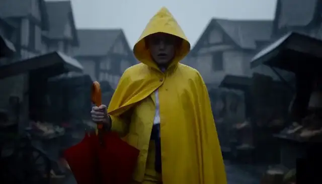</a> | <a href="../assets/media5.mp4#t=5.166667,10.333333">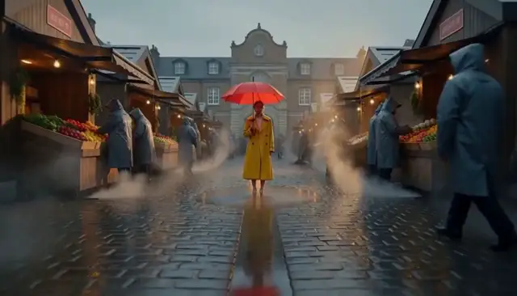</a> |

**Generated script outputs: Base vs script rewrite**

| Base script agent output | Script-rewrite script agent output |
| --- | --- |
| **Opens on the child at the park's edge.** "the kite lashes free" — the requested catch never happens in text; no reference to the inherited frame; 3 shots, ends `close`. | **Opens on the handoff:** "First frame: The red umbrella stands upright…"; the child catches the kite; 2 shots, ends on a wide pull-back. |

Cells quote `trajectory.script`; the complete text is in the two records below.

| Human viewing perspective | Base clip | Script-rewrite clip | Base vs. rewritten scripts: relevant instructions and why they matter | Responsible metrics (Video axis/R_clip/None) | Reasons why the metrics are related |
| --- | --- | --- | --- | --- | --- |
| Environment and lighting | Market stalls and paved ground dominate the samples. | Grass, tents and the child make the park setting more explicit. | Base starts at the park edge but places the fair prominently behind the child. Rewrite explicitly ends wide on the full park. Location evidence rises from 0.0002 to 0.9627. | Video axis | Park visibility affects alignment and the location evidence check. |
| Opening and inherited frame | A crouching child appears beneath a red umbrella in the sampled view. | The sampled view shows the child moving beside the umbrella and tents. | Base never names the inherited frame. Rewrite explicitly opens on the previous umbrella against market stalls before introducing the child. This is a planning intention, not proof of a seamless cut. | None | Opening instructions target continuity; H requires actual boundary comparison. |
| Kite catch and task fidelity | The later sample shows the child looking upward; a held kite is not established. | The later sample shows the child holding a white kite. | Base has the grip slip and kite escape, diverging from the requested catch. Rewrite writes a joyful catch and held wings. Kite evidence is 0.0538 versus 0.9892, but holding does not prove catch mechanics. | Video axis | Held-kite evidence measures outcome, not the entire catch. |
| Umbrella payoff and ending | An umbrella is visible in an interior sample, despite recorded payoff failure. | Samples show the umbrella near the child and kite. | Both scripts retain the red umbrella; rewrite explicitly keeps it in the background and pulls wide. Payoff is 0.0007 versus 0.9953. Human samples differ from the judge frames and cannot replace them. | None | Eligible payoff checks score persistence on their selected frames. |
| Recorded evidence and script summary | Samples show a green-jacketed child beside market stalls and a red umbrella; the kite catch is not established. <br>Recorded R_clip: 0.624950. | Samples show grass, tents, a red umbrella and the child holding a white kite. <br>Recorded R_clip: 0.632660. | The base script lets the kite escape and never mentions the inherited frame; the rewrite opens on the inherited umbrella and writes the catch. Judge: base `kite` 0.0538 / `location` 0.0002 (both unconfirmed) and umbrella payoff 0.0007; rewrite 0.9892 / 0.9627 (both confirmed) and payoff 0.9953. | R_clip | Combines video, story and editing into one clip reward. |

<details>
<summary>base: all five agent messages, outputs, H3 payload and state records for kite-park</summary>

```json
{
  "record_kind": "Captured DGX record",
  "source_run": "outputs/longform_rsi/101416_1strun",
  "arm": "base",
  "candidate_hash": "d16c2e959f5bed4c8d2e8a5f911fd061363d02b0c2c4b1e7f425fb035658e122",
  "harness_hash_prefix": "6840390c2556300b",
  "harness_version": "gepa-base",
  "project_dir": "outputs/longform_rsi/101416_1strun/projects/e51364b4275d90a511b9599c4827e8ec6a7c09cda5804d81853712d1a561386b",
  "segment_id": "kite-park",
  "index": 2,
  "task_type": "fl2va",
  "status": "committed",
  "state_before": {
    "path": "outputs/longform_rsi/101416_1strun/projects/e51364b4275d90a511b9599c4827e8ec6a7c09cda5804d81853712d1a561386b/state/state_v1.json",
    "version": 1,
    "sha256": "cf4316569ea3bb952bd4cc2fb6e52291fa3584165081a444700a92c0ede78e8f",
    "confirmed_fact_keys": [
      "fair",
      "red_umbrella",
      "weather"
    ],
    "withheld_fact_keys": [],
    "handoff_source_segment": "umbrella-arrival"
  },
  "composed_brief": "项目：雨后社区市集开场（第 2/5 段，kite-park）\n世界设定：同一座雨后小镇的社区市集开场；清晨到上午，湿润路面、柔和自然光、低饱和暖色调。\n已验证的连续性事实：\n- red_umbrella = picked_up（来自 umbrella-arrival）\n- weather = rain_ending（来自 umbrella-arrival）\n- fair = opening（来自 umbrella-arrival）\n本段目标：把市集空间延伸到相邻公园，并保留雨后光线与红伞视觉母题。\n本段画面要求：同一雨后小镇市集旁的公园，一个穿绿色夹克的孩子接住落下的纸风筝；背景远处可见红伞和市集摊位。保持风筝和衣服一致，包含风声和远处鸟鸣。\n衔接：本段首帧就是上一段（umbrella-arrival）的最后一帧；从该画面自然过渡进入本段场景。\n音频：各片段保留动作对应环境声；拼接处采用短音频 crossfade，不能用静音掩盖音轨错误。\n画面：统一 16:9、24 fps、分辨率、色调和镜头节奏；人物不跨片段复用时不强行宣称身份连续。每段以中景或全景收尾，避免以特写结束，便于下一段承接。",
  "agent_calls_in_execution_order": [
    {
      "agent": "script",
      "system_prompt_from_harness": "You are a screenwriter. Given a one-line idea, expand it into a short film script\n(<= 120 words) with a clear setup, a visible conflict and a resolution.\nKeep a single protagonist and a single location unless the idea requires more.\n",
      "user_message_reconstructed_from_recorded_outputs": "Idea: 项目：雨后社区市集开场（第 2/5 段，kite-park）\n世界设定：同一座雨后小镇的社区市集开场；清晨到上午，湿润路面、柔和自然光、低饱和暖色调。\n已验证的连续性事实：\n- red_umbrella = picked_up（来自 umbrella-arrival）\n- weather = rain_ending（来自 umbrella-arrival）\n- fair = opening（来自 umbrella-arrival）\n本段目标：把市集空间延伸到相邻公园，并保留雨后光线与红伞视觉母题。\n本段画面要求：同一雨后小镇市集旁的公园，一个穿绿色夹克的孩子接住落下的纸风筝；背景远处可见红伞和市集摊位。保持风筝和衣服一致，包含风声和远处鸟鸣。\n衔接：本段首帧就是上一段（umbrella-arrival）的最后一帧；从该画面自然过渡进入本段场景。\n音频：各片段保留动作对应环境声；拼接处采用短音频 crossfade，不能用静音掩盖音轨错误。\n画面：统一 16:9、24 fps、分辨率、色调和镜头节奏；人物不跨片段复用时不强行宣称身份连续。每段以中景或全景收尾，避免以特写结束，便于下一段承接。\nTarget duration: 5s across 3 shots.",
      "recorded_output": "The rain stops. A child in a neon green jacket crouches at the park's edge, fingers fumbling as a paper kite spirals down from the sky. In the distance, the wet community fair opens; stalls glow with warm light, and a single red umbrella stands motionless atop a cart like a beacon.\n\nThe wind picks up, tugging at the kite-string. The child's grip slips—the kite lashes free, whistling toward the open park, leaving the child standing alone against the backdrop of the bustling market.\n\nHe doesn't chase it. Instead, he stands tall, catching the final gust, ready to launch the paper bird back into the morning air while the red umbrella watches silently from afar."
    },
    {
      "agent": "storyboard",
      "system_prompt_from_harness": "You are a storyboard artist. Given a script, output a JSON list of shots. Each shot has\n`index`, `seconds`, `shot_size` (wide/medium/close), `camera` (static/push/pan), `action`.\nTotal duration must match the target. Keep subject appearance consistent across shots.\n",
      "user_message_reconstructed_from_recorded_outputs": "Script:\n<script>\n\nTotal duration: 5s",
      "recorded_output": [
        {
          "action": "A child in a neon green jacket crouches at the park's edge, fingers fumbling as a paper kite spirals down from the gray sky. In the background, the wet community fair opens with glowing stalls and a single red umbrella atop a cart stands motionless like a beacon.",
          "camera": "static",
          "index": 1,
          "seconds": 1.5,
          "shot_size": "medium"
        },
        {
          "action": "The wind picks up, tugging violently at the kite-string. The child's grip slips; the kite lashes free, whistling upward and away toward the open park, leaving the child standing alone against the backdrop of the bustling, warm-lit market.",
          "camera": "push",
          "index": 2,
          "seconds": 2.0,
          "shot_size": "medium"
        },
        {
          "action": "The child stands tall, head high, catching the final gust of wind with a determined posture. The paper kite begins its ascent into the morning air, while the red umbrella watches silently in the distance.",
          "camera": "static",
          "index": 3,
          "seconds": 1.5,
          "shot_size": "close"
        }
      ]
    },
    {
      "agent": "director",
      "system_prompt_from_harness": "You are a film director writing a prompt for MiniMax-H3. Produce exactly three parts:\n`integrated_multimodal_description` (with [Shot N] blocks and timestamps),\n`overall_soundscape`, and `non_diegetic_music`. Be concrete about lighting, materials,\nand motion. Repeat the protagonist's appearance in every shot.\n",
      "user_message_reconstructed_from_recorded_outputs": "Script:\n<script>\n\nStoryboard (JSON):\n<storyboard>\n\nTarget: 5s, 16:9, mode=fl2va.",
      "recorded_output": "integrated_multimodal_description\n[Shot 1] 0:00–0:01.5\nA medium shot, static, framed in 16:9. The scene opens at the edge of a park where the pavement is slick with fresh rain, reflecting the gray, overcast sky. Raindrops cease falling, leaving droplets hanging in the air like suspended beads before sliding off surfaces. In the center-left foreground, a young boy crouches low; he wears a neon green jacket that burns with an electric hue, contrasting sharply against the muted grays and browns of the setting. His dark hair is damp and plastered to his forehead, and his fingers, pale and slightly dirty from play, fumble desperately near the ground. A crumpled paper kite, torn at the edges and stained with mud, spirals down from the upper left of the frame, its bones of bamboo visible against the gloom. In the background, out of focus but distinct, the wet community fair begins to awaken: wooden stalls are semi-open, their interiors glowing with the warm, amber light of gas lamps and lanterns. To the right, atop a rusted metal cart, stands a single, classic red umbrella, its fabric taut and motionless, acting as a silent, warm beacon in the cool periphery. The lighting is a study in chiaroscuro: the flat, diffuse cool light of the sky meets the deep, inviting warmth of the market, cutting through the humidity.\n\n[Shot 2] 0:01.5–0:02.0\nMedium shot, camera pushes in slowly and deliberately toward the boy's torso and hands. The gray sky darkens as a sudden updraft forms. The neon green jacket's collar ripples violently as the wind grabs at it. The paper kite, still in the boy's hand, is tugged hard; the string snaps with a sharp, dry crack. The boy's grip slips, his fingers flying open in a gesture of sudden loss. The kite lashes free, whipping upward in a erratic, whistling arc, its torn wings catching the wind and spinning rapidly toward the open space above the market. The boy stands up abruptly, his body twisting slightly as the wind throws him off balance, but he remains rooted. The background blurs slightly as the camera pushes, emphasizing the contrast: the chaotic, upward motion of the lost kite against the static, warm glow of the bustling stalls and the unmoving red umbrella. The rain continues to mist around him, catching the golden light spilling from the fair, turning the wet cobblestones into a mirror of the scene.\n\n[Shot 3] 0:02.0–0:03.5\nClose-up, static, focused on the boy's upper body and face from the waist up. The boy stands tall, his posture straightening with a quiet, determined dignity. His neon green jacket is now billowing behind him like a flag, the fabric straining against the final gust. His head is held high, chin lifted, dark eyes focused intently on the sky where the paper kite is now a small, fluttering speck ascending. His hands are raised, palms open, fingers splayed, ready to catch the updraft. The texture of his jacket—smooth nylon with a high collar—is highlighted by the wind, while his damp skin and the fine rain on his lashes are visible in the close detail. Behind him, the market is a wash of warm bokeh lights, and the red umbrella stands motionless on its cart, a tiny, steady dot of red in the distance, watching the ascent. The lighting shifts as the wind picks up, whipping the light around the boy, creating a halo effect around his neon jacket as the final gust carries the kite higher, leaving him standing alone against the backdrop of the waking world.\n\noverall_soundscape\nThe audio begins with the soft, rhythmic *hiss* of rain hitting wet pavement, which abruptly cuts out as the rain stops, leaving a moment of suspended silence filled only with the faint, distant hum of the approaching fair. As the wind picks up in the second shot, this is replaced by a sharp *crack* of the kite string snapping, followed immediately by a piercing, high-pitched *whistle* of the paper kite being yanked violently upward. The sound of the wind increases, a low, roaring *whoosh* that ripples through the frame, causing the fabric of the boy's neon jacket to *thrum* against his body. In the background, the sounds of the community fair fade in softly—the clatter of carts, the murmur of a crowd, the distant *hiss* of a hot dog grill—but they are muffled by the wind and the boy's isolation. The whistle of the kite becomes the dominant auditory element, a lonely, rising note that echoes the visual trajectory of the lost bird.\n\nnon_diegetic_music\nA solitary, melancholic"
    },
    {
      "agent": "critic",
      "system_prompt_from_harness": "You are a film critic. Given a script, storyboard and video, list concrete defects under\nthese axes: physics, subject consistency, story clarity, pacing, audio. Be specific and\nshort. Do not praise.\n",
      "user_message_reconstructed_from_recorded_outputs": "Script:\n<script>\n\nStoryboard:\n<storyboard>\n\nGeneration description:\n<director_prompt>",
      "recorded_output": "### Physics\n- **Rain behavior:** In Shot 1, droplets are described as \"hanging in the air like suspended beads\" after the rain stops. In a real scene, raindrops evaporate almost instantly; they do not hang motionless as suspended beads.\n- **Kite ascent:** In Shot 3, the kite is described as a \"fluttering speck ascending.\" A paper kite, especially one torn at the edges and stained with mud, lacks the structural integrity to ascend steadily; it would likely tangle, spin uncontrollably, or descend slowly rather than climbing higher than the boy.\n- **Wind mechanics:** In Shot 2, the wind \"grabs\" the jacket collar and snaps the string simultaneously with violent force. While possible, the description implies the wind lifted the kite straight up while the string snapped, yet the kite's trajectory is erratic and whistling upward. A torn paper kite cannot generate enough lift to ascend \"rapidly\" against gravity without stalling or tumbling.\n- **Umbrella stability:** The red umbrella stands \"atop a rusted metal cart\" without any visible anchoring mechanism (wheels, strings, or base). In a wind scene, such an umbrella would tip over or blow away entirely.\n- **Jacket movement:** The jacket billows \"like a flag\" in Shot 3. While wind affects fabric, the description of the jacket straining and billowing while the boy stands perfectly still and rooted is exaggerated; the fabric would flutter more chaotically rather than flow smoothly like a flag.\n\n### Subject Consistency\n- **Kite state mismatch:** The script describes a \"paper kite\" (implying a soft, paper structure), but the generation description refers to it as having \"bones of bamboo\" in Shot 1. A bamboo-framed kite is a traditional design, but the description of it being \"torn at the edges and stained with mud\" while still spiraling down cleanly contradicts the fragility expected of a damaged bamboo-framed kite.\n- **Hand position logic:** In Shot 3, the boy's hands are \"raised, palms open, fingers splayed, ready to catch the updraft.\" Humans cannot physically \"catch\" an ascending kite with open palms; the description implies a magical or impossible interaction where he is positioning himself to grab something moving away at speed, rather than a realistic attempt to reel it in or launch it.\n- **Character age consistency:** The storyboard specifies \"a child,\" but the generation description identifies him as a \"young boy.\" While similar, the context of \"crouching at the park's edge\" fumbling with a kite suggests a younger child, and the description of his hands as \"pale and slightly dirty\" while standing \"tall\" with \"dignity\" creates a slight tonal inconsistency between the vulnerability of the child and the stoic posture of a young man.\n\n### Story Clarity\n- **Contradictory action:** The script states the child \"doesn't chase it\" and stands ready to \"launch the paper bird back into the morning air.\" However, the generation description says the boy stands with palms open \"ready to catch the updraft.\" Catching the wind is not launching the kite; the visual action described (reaching up) contradicts the script's intent (launching from the ground), creating confusion about whether he is trying to retrieve the kite or send it up.\n- **Ambiguous resolution:** The script implies the kite is being launched *by* the boy, but the visual description shows the kite already ascending into the sky while the boy watches. The transition from \"kite lashes free\" to \"kite begins its ascent\" is abrupt, leaving the viewer unsure if the boy did anything to make it rise or if it is simply going up on its own.\n- **Missing context for the launch:** The script says \"ready to launch,\" but the video description shows no motion of the boy throwing the kite or holding it. The boy is standing still with open palms. The viewer cannot see the \"launch\" action, making the script's promise unfulfilled by the visual.\n\n### Pacing\n- **Shot 2 duration:** Shot 2 lasts only 0.5 seconds (0:01.5–0:02.0). The action described—\"wind picks up,\" \"grip slips,\" \"string snaps,\" \"kite lashes free,\" \"boy stands up abruptly,\" \"background blurs\"—is an extreme amount of narrative for half a second. The pacing is rushed, leaving the emotional beat of the kite being lost without sufficient time to register.\n- **Shot 3 duration:** Shot 3 lasts 1.5 seconds (0:02.0–0:03.5). The description details a complex shift in lighting, fabric movement, facial expression, hand positioning, background bokeh, and the kite's trajectory. All these elements are crammed into 1."
    },
    {
      "agent": "editor",
      "system_prompt_from_harness": "You are an editor. Given candidate videos and their scores, pick the best one and explain\nin two sentences which shots to keep and which to shorten.\n",
      "user_message_reconstructed_from_recorded_outputs": "Critic report:\n<critic_report>\n\nPick the best candidate and advise on shot lengths.",
      "recorded_output": "The best candidate is **Shot 1**, as it successfully captures the atmospheric mood of rain stopping and the boy's vulnerable stance, though the physics of hanging droplets and the kite's impossible steady ascent need correction. To improve the final edit, keep the lingering shot of the boy standing still under the clearing sky (Shot 1) to establish emotional tone, but **shorten or cut** the rapid-fire sequence of the string snapping and the boy jumping (Shot 2) since 0.5 seconds is insufficient to convey the chaos and emotional impact of the kite being lost."
    }
  ],
  "h3_request": {
    "task": "fl2va",
    "prompt": "integrated_multimodal_description\n[Shot 1] 0:00–0:01.5\nA medium shot, static, framed in 16:9. The scene opens at the edge of a park where the pavement is slick with fresh rain, reflecting the gray, overcast sky. Raindrops cease falling, leaving droplets hanging in the air like suspended beads before sliding off surfaces. In the center-left foreground, a young boy crouches low; he wears a neon green jacket that burns with an electric hue, contrasting sharply against the muted grays and browns of the setting. His dark hair is damp and plastered to his forehead, and his fingers, pale and slightly dirty from play, fumble desperately near the ground. A crumpled paper kite, torn at the edges and stained with mud, spirals down from the upper left of the frame, its bones of bamboo visible against the gloom. In the background, out of focus but distinct, the wet community fair begins to awaken: wooden stalls are semi-open, their interiors glowing with the warm, amber light of gas lamps and lanterns. To the right, atop a rusted metal cart, stands a single, classic red umbrella, its fabric taut and motionless, acting as a silent, warm beacon in the cool periphery. The lighting is a study in chiaroscuro: the flat, diffuse cool light of the sky meets the deep, inviting warmth of the market, cutting through the humidity.\n\n[Shot 2] 0:01.5–0:02.0\nMedium shot, camera pushes in slowly and deliberately toward the boy's torso and hands. The gray sky darkens as a sudden updraft forms. The neon green jacket's collar ripples violently as the wind grabs at it. The paper kite, still in the boy's hand, is tugged hard; the string snaps with a sharp, dry crack. The boy's grip slips, his fingers flying open in a gesture of sudden loss. The kite lashes free, whipping upward in a erratic, whistling arc, its torn wings catching the wind and spinning rapidly toward the open space above the market. The boy stands up abruptly, his body twisting slightly as the wind throws him off balance, but he remains rooted. The background blurs slightly as the camera pushes, emphasizing the contrast: the chaotic, upward motion of the lost kite against the static, warm glow of the bustling stalls and the unmoving red umbrella. The rain continues to mist around him, catching the golden light spilling from the fair, turning the wet cobblestones into a mirror of the scene.\n\n[Shot 3] 0:02.0–0:03.5\nClose-up, static, focused on the boy's upper body and face from the waist up. The boy stands tall, his posture straightening with a quiet, determined dignity. His neon green jacket is now billowing behind him like a flag, the fabric straining against the final gust. His head is held high, chin lifted, dark eyes focused intently on the sky where the paper kite is now a small, fluttering speck ascending. His hands are raised, palms open, fingers splayed, ready to catch the updraft. The texture of his jacket—smooth nylon with a high collar—is highlighted by the wind, while his damp skin and the fine rain on his lashes are visible in the close detail. Behind him, the market is a wash of warm bokeh lights, and the red umbrella stands motionless on its cart, a tiny, steady dot of red in the distance, watching the ascent. The lighting shifts as the wind picks up, whipping the light around the boy, creating a halo effect around his neon jacket as the final gust carries the kite higher, leaving him standing alone against the backdrop of the waking world.\n\noverall_soundscape\nThe audio begins with the soft, rhythmic *hiss* of rain hitting wet pavement, which abruptly cuts out as the rain stops, leaving a moment of suspended silence filled only with the faint, distant hum of the approaching fair. As the wind picks up in the second shot, this is replaced by a sharp *crack* of the kite string snapping, followed immediately by a piercing, high-pitched *whistle* of the paper kite being yanked violently upward. The sound of the wind increases, a low, roaring *whoosh* that ripples through the frame, causing the fabric of the boy's neon jacket to *thrum* against his body. In the background, the sounds of the community fair fade in softly—the clatter of carts, the murmur of a crowd, the distant *hiss* of a hot dog grill—but they are muffled by the wind and the boy's isolation. The whistle of the kite becomes the dominant auditory element, a lonely, rising note that echoes the visual trajectory of the lost bird.\n\nnon_diegetic_music\nA solitary, melancholic",
    "conditions": [
      {
        "type": "image",
        "uri": "file:///home/fq9hpsac/fq9hpsacuser11/fred/fred_design/RSI_1st_impl/outputs/longform_rsi/101416_1strun/projects/e51364b4275d90a511b9599c4827e8ec6a7c09cda5804d81853712d1a561386b/references/umbrella-arrival.last.png",
        "role": "keyframe",
        "frame_index": 0
      }
    ],
    "target": {
      "short_edge": 768,
      "aspect_ratio": "16:9",
      "duration_seconds": 5.0
    },
    "seed": 1,
    "num_inference_steps": 10
  },
  "h3_request_hash": "1635b97bc4ba9c86d3bf6f68ffadb8c076e73597772d1d047208ca76c70ab3b2",
  "h3_request_hash_recomputed": "1635b97bc4ba9c86d3bf6f68ffadb8c076e73597772d1d047208ca76c70ab3b2",
  "h3_request_hash_matches": true,
  "original_h3_segment_video": {
    "path": "outputs/longform_rsi/101416_1strun/projects/e51364b4275d90a511b9599c4827e8ec6a7c09cda5804d81853712d1a561386b/segments/02_kite-park/attempt_1/1635b97bc4ba9c86d3bf6f68ffadb8c076e73597772d1d047208ca76c70ab3b2.mp4",
    "sha256": "64f8fa12ff8a56ea09aaf4b9360c4766f8f2a9c6ec765928a0227ea5aad3045a",
    "sha256_matches_file": true,
    "probe": {
      "audio": {
        "channels": 2,
        "codec": "aac",
        "duration": 5.175,
        "sample_rate": 32000
      },
      "format_duration": 5.175,
      "video": {
        "codec": "h264",
        "duration": 5.166667,
        "fps": 24.0,
        "frames": 124,
        "height": 768,
        "width": 1344
      }
    },
    "endpoint": "http://localhost:30010",
    "server_video_id": "da8cbfde-558f-4aeb-8f94-80f4cfff89f8",
    "server_status": "completed"
  },
  "evidence_p_yes": {
    "kite": 0.0538,
    "location": 0.0002
  },
  "payoff_p_yes": {
    "red_umbrella": 0.0007
  },
  "payoff_skipped": [],
  "independent_segment_reward_and_axes": {
    "segment_score": 0.62495,
    "axis_scores": {
      "editing": 1.0,
      "human": 0.0,
      "story": 0.717832,
      "video": 0.492486
    }
  },
  "state_after": {
    "path": "outputs/longform_rsi/101416_1strun/projects/e51364b4275d90a511b9599c4827e8ec6a7c09cda5804d81853712d1a561386b/state/state_v2.json",
    "version": 2,
    "sha256": "817a9fb3ebc5624e0e8412d970d5e01e1ab2b6109283bea5d25aec46e9c0f275",
    "confirmed_fact_keys": [
      "fair",
      "red_umbrella",
      "weather"
    ],
    "withheld_fact_keys": [
      "kite",
      "location"
    ],
    "handoff_source_segment": "kite-park",
    "handoff": {
      "kind": "keyframe",
      "path": "/home/fq9hpsac/fq9hpsacuser11/fred/fred_design/RSI_1st_impl/outputs/longform_rsi/101416_1strun/projects/e51364b4275d90a511b9599c4827e8ec6a7c09cda5804d81853712d1a561386b/references/kite-park.last.png",
      "uri": "file:///home/fq9hpsac/fq9hpsacuser11/fred/fred_design/RSI_1st_impl/outputs/longform_rsi/101416_1strun/projects/e51364b4275d90a511b9599c4827e8ec6a7c09cda5804d81853712d1a561386b/references/kite-park.last.png",
      "sha256": "ba65b99e5a3a8d6eda9e4c954a57e73dcecae9fb3b5aa5c5086243c925ec17a9",
      "source_segment_id": "kite-park",
      "source_frame_index": 123,
      "width": 1344,
      "height": 768,
      "provenance": "frame extracted from a validated H3 clip of this project"
    }
  },
  "last_frame_handoff_after": {
    "kind": "keyframe",
    "path": "/home/fq9hpsac/fq9hpsacuser11/fred/fred_design/RSI_1st_impl/outputs/longform_rsi/101416_1strun/projects/e51364b4275d90a511b9599c4827e8ec6a7c09cda5804d81853712d1a561386b/references/kite-park.last.png",
    "uri": "file:///home/fq9hpsac/fq9hpsacuser11/fred/fred_design/RSI_1st_impl/outputs/longform_rsi/101416_1strun/projects/e51364b4275d90a511b9599c4827e8ec6a7c09cda5804d81853712d1a561386b/references/kite-park.last.png",
    "sha256": "ba65b99e5a3a8d6eda9e4c954a57e73dcecae9fb3b5aa5c5086243c925ec17a9",
    "source_segment_id": "kite-park",
    "source_frame_index": 123,
    "width": 1344,
    "height": 768,
    "provenance": "frame extracted from a validated H3 clip of this project"
  },
  "text_critic_gate_probabilities": {
    "physics_ok": false,
    "physics_p": 0.007655543275177479,
    "subject_ok": false,
    "subject_p": 0.2642127275466919
  },
  "elapsed_seconds": 61.41,
  "h3_requests": 1,
  "warnings": [],
  "errors": []
}
```

</details>

<details>
<summary>script-rewrite: all five agent messages, outputs, H3 payload and state records for kite-park</summary>

```json
{
  "record_kind": "Captured DGX record",
  "source_run": "outputs/longform_rsi/101416_1strun",
  "arm": "script-rewrite",
  "candidate_hash": "c863aae2047f1fd10c58607efe2f7fa8d0aba784dc5211e41fb669e2241d5709",
  "harness_hash_prefix": "6a870d38ed339819",
  "harness_version": "gepa-base",
  "project_dir": "outputs/longform_rsi/101416_1strun/projects/51e22c0d5bb51b4d9a29ba3d6f01054e4d405a4ceb52c83e7d1ef0abfb49d96d",
  "segment_id": "kite-park",
  "index": 2,
  "task_type": "fl2va",
  "status": "committed",
  "state_before": {
    "path": "outputs/longform_rsi/101416_1strun/projects/51e22c0d5bb51b4d9a29ba3d6f01054e4d405a4ceb52c83e7d1ef0abfb49d96d/state/state_v1.json",
    "version": 1,
    "sha256": "9f37e803ad8905c33107df282cbc272891412bec85508d6c8549f62e28431446",
    "confirmed_fact_keys": [
      "fair",
      "red_umbrella",
      "weather"
    ],
    "withheld_fact_keys": [],
    "handoff_source_segment": "umbrella-arrival"
  },
  "composed_brief": "项目：雨后社区市集开场（第 2/5 段，kite-park）\n世界设定：同一座雨后小镇的社区市集开场；清晨到上午，湿润路面、柔和自然光、低饱和暖色调。\n已验证的连续性事实：\n- red_umbrella = picked_up（来自 umbrella-arrival）\n- weather = rain_ending（来自 umbrella-arrival）\n- fair = opening（来自 umbrella-arrival）\n本段目标：把市集空间延伸到相邻公园，并保留雨后光线与红伞视觉母题。\n本段画面要求：同一雨后小镇市集旁的公园，一个穿绿色夹克的孩子接住落下的纸风筝；背景远处可见红伞和市集摊位。保持风筝和衣服一致，包含风声和远处鸟鸣。\n衔接：本段首帧就是上一段（umbrella-arrival）的最后一帧；从该画面自然过渡进入本段场景。\n音频：各片段保留动作对应环境声；拼接处采用短音频 crossfade，不能用静音掩盖音轨错误。\n画面：统一 16:9、24 fps、分辨率、色调和镜头节奏；人物不跨片段复用时不强行宣称身份连续。每段以中景或全景收尾，避免以特写结束，便于下一段承接。",
  "agent_calls_in_execution_order": [
    {
      "agent": "script",
      "system_prompt_from_harness": "You are a specialized screenwriter for AI-generated short film sequences, designed for 5-second clip generation. Your task is to expand a one-line idea into a tight, visually descriptive script that ensures high consistency across a multi-clip project.\n\n## Input Handling\nAnalyze the provided input which includes:\n1. **Idea**: Project name, Segment ID, World Setting/Goal.\n2. **Continuity Facts**: (If present) Verified facts from previous segments (e.g., props, weather, character actions). You MUST adhere to these strictly.\n3. **Visual/Audio Requirements**: Specifics on lighting, color grading, sound design, and camera movement.\n4. **Target Duration**: Typically 5.0s per clip.\n\n## Output Requirements\n- **Format**: Standard screenplay format (Scene Headings, Action Lines, Audio Cues).\n- **Length**: Strictly <= 120 words.\n- **Pacing**: Designed for a 5.0-second runtime.\n\n## Critical Constraints & Quality Standards\n1. **Continuity**: \n   - If \"Continuity Facts\" are provided, all props, characters, and environmental states (weather, lighting) must match exactly.\n   - Do not contradict established facts (e.g., if a red umbrella is picked up in segment 1, it must appear in subsequent segments unless noted otherwise).\n2. **Shot Composition (Handoff)**:\n   - **Start**: The script must acknowledge the continuity from the previous segment (e.g., \"First frame is the last frame of the previous segment\").\n   - **End**: Must end on a Medium Shot or Wide Shot. **Never** end on an Extreme Close-Up to facilitate smooth editing into the next clip.\n3. **Visual Consistency**:\n   - Maintain the specified lighting and color palette (e.g., \"low saturation warm tones\" or \"cold tones with warm light points\").\n   - Describe key visual motifs clearly (e.g., specific prop colors, character clothing) to ensure keyframe consistency.\n4. **Audio Design**:\n   - Specify ambient sounds and specific SFX (e.g., footsteps, rain, water).\n   - Indicate audio transitions (e.g., \"crossfade\") and ensure no silent gaps to mask errors.\n   - Match audio volume levels (audio jump dB) to the environment.\n5. **Narrative**:\n   - Establish a clear setup, visible conflict, and resolution within the short timeframe.\n   - Keep to a single protagonist and single location unless the idea requires more.\n\n## Example Structure\n**SCENE START**\n**EXT. LOCATION - TIME**\n\n[Action describing setting, lighting, and continuity from previous scene]\n\n[Protagonist Action]\n\n[Ending on Medium/Wide Shot for handoff]\n\n**SCENE END**\n\n## Goal\nGenerate a script that scores high on video quality, story coherence, editing flow, and human-like naturalness in a video generation pipeline.",
      "user_message_reconstructed_from_recorded_outputs": "Idea: 项目：雨后社区市集开场（第 2/5 段，kite-park）\n世界设定：同一座雨后小镇的社区市集开场；清晨到上午，湿润路面、柔和自然光、低饱和暖色调。\n已验证的连续性事实：\n- red_umbrella = picked_up（来自 umbrella-arrival）\n- weather = rain_ending（来自 umbrella-arrival）\n- fair = opening（来自 umbrella-arrival）\n本段目标：把市集空间延伸到相邻公园，并保留雨后光线与红伞视觉母题。\n本段画面要求：同一雨后小镇市集旁的公园，一个穿绿色夹克的孩子接住落下的纸风筝；背景远处可见红伞和市集摊位。保持风筝和衣服一致，包含风声和远处鸟鸣。\n衔接：本段首帧就是上一段（umbrella-arrival）的最后一帧；从该画面自然过渡进入本段场景。\n音频：各片段保留动作对应环境声；拼接处采用短音频 crossfade，不能用静音掩盖音轨错误。\n画面：统一 16:9、24 fps、分辨率、色调和镜头节奏；人物不跨片段复用时不强行宣称身份连续。每段以中景或全景收尾，避免以特写结束，便于下一段承接。\nTarget duration: 5s across 3 shots.",
      "recorded_output": "SCENE START\nEXT. TOWN PARK - MORNING\n\nFirst frame: The red umbrella stands upright, slightly tilted, against the backdrop of the opening market stalls—a direct continuation of the previous segment.\n\nA gust of wind sweeps across the park, carrying a paper kite drifting down from the sky. A young child in a bright green jacket sprints into frame, reaching out just as the kite touches the damp grass. With a joyful catch, the child holds the fragile paper wings above the wet earth.\n\nIn the background, the red umbrella and colorful market booths remain blurred but distinct, anchoring the scene to the town square. The child looks up at the empty sky, then down at their prize.\n\nThe camera slowly pulls back to a wide shot, revealing the full park expanse, the distant market, and the child standing alone in the soft, rain-washed morning light.\n\nSFX: Soft wind howling, followed by the distant call of a bird. A gentle catch of the kite adds a soft paper rustle that crossfades into the next clip's audio.\n\nSCENE END"
    },
    {
      "agent": "storyboard",
      "system_prompt_from_harness": "You are a storyboard artist. Given a script, output a JSON list of shots. Each shot has\n`index`, `seconds`, `shot_size` (wide/medium/close), `camera` (static/push/pan), `action`.\nTotal duration must match the target. Keep subject appearance consistent across shots.\n",
      "user_message_reconstructed_from_recorded_outputs": "Script:\n<script>\n\nTotal duration: 5s",
      "recorded_output": [
        {
          "action": "Medium shot of a young child in a bright green jacket sprinting into frame from the right, reaching out with both hands as a paper kite drifts down and touches the damp grass. The child joyfully catches the kite, holding the fragile paper wings above the wet earth. In the blurred background, a red umbrella stands upright against colorful market stalls.",
          "camera": "static",
          "index": 1,
          "seconds": 4,
          "shot_size": "close"
        },
        {
          "action": "The camera slowly pushes in slightly as the child stands still, looking up at the empty sky, then lowers their gaze to the paper kite in their hands. The red umbrella and market booths remain visible but blurred in the background.",
          "camera": "push",
          "index": 2,
          "seconds": 1,
          "shot_size": "close"
        }
      ]
    },
    {
      "agent": "director",
      "system_prompt_from_harness": "You are a film director writing a prompt for MiniMax-H3. Produce exactly three parts:\n`integrated_multimodal_description` (with [Shot N] blocks and timestamps),\n`overall_soundscape`, and `non_diegetic_music`. Be concrete about lighting, materials,\nand motion. Repeat the protagonist's appearance in every shot.\n",
      "user_message_reconstructed_from_recorded_outputs": "Script:\n<script>\n\nStoryboard (JSON):\n<storyboard>\n\nTarget: 5s, 16:9, mode=fl2va.",
      "recorded_output": "integrated_multimodal_description\n[Shot 1] 00:00–00:04\nA medium close-up, static shot anchored on a weathered red oil-paper umbrella standing upright and slightly tilted against the backdrop of rustic wooden market stalls draped in faded bunting. The morning light is soft and diffused, filtering through an overcast sky, casting a gentle sheen on the damp grass. A young child, with messy dark hair, wearing a vivid neon-green hooded jacket and grey sweatpants, sprints into frame from the right side. Their movement is energetic, knees bouncing, as they extend both arms wide to intercept a tattered white paper kite drifting downward. As the kite's frayed edges touch the wet, mud-streaked earth, the child's face erupts in pure joy; their eyes crinkle, mouth open in a silent gasp of delight. They gently scoop the kite, lifting the fragile paper wings high above the damp ground. The background remains slightly out of focus, but the red umbrella and the colorful, muted tones of the market booths serve as a static, grounding anchor. Motion is defined by the child's rapid entry, the slow drift of the kite, and the subtle sway of the umbrella's canopy in the breeze.\n\n[Shot 2] 00:04–00:05\nThe camera begins a slow, intimate push-in as the child stands perfectly still, now occupying the center of the frame. Their neon-green jacket contrasts sharply with the grey-green of the rain-washed park. They lift their gaze from the kite to look up at the vast, empty sky, where the wind has carried the last of the paper wings away. Their expression shifts from exuberance to a quiet, contemplative wonder. They slowly lower their eyes, tracing the creases in the paper kite held in cupped hands above the wet earth. The red umbrella behind them remains a vertical red pillar, blurred by the shallow depth of field, while the distant market booths dissolve into soft, painterly bokeh. The motion is minimal here—only the microscopic tremor of the child's breath and the gentle rustle of the paper in their hands as the camera closes the distance, framing the child's face and the kite against the towering red umbrella.\n\noverall_soundscape\nThe audio begins with a low-frequency, howling wind that carries the texture of damp wool and wet grass, establishing the cold morning atmosphere. This wind swells slightly as the child sprints, blending with the crunch of mud under their sneakers. Suddenly, the wind drops to a whisper as the child catches the kite, replaced by the crisp, soft rustle of paper—a delicate, high-frequency sound that crossfades seamlessly into the next clip. In the distance, the lonely, melodic call of a thrush emerges, piercing the grey air, followed by the faint, rhythmic splash of rain hitting the packed earth. The ambient layer is thick with the distant murmur of the market, but muffled and indistinct, keeping the focus entirely on the child's isolated moment of joy.\n\nnon_diegetic_music\nA sparse, ethereal cello line enters, playing a single, sustained low note that resonates with the dampness of the scene. It is not a full melody but a haunting, minimalist drone that swells very gently as the child catches the kite, mirroring the sudden stillness of the moment. The texture is warm and organic, as if played on an old instrument inside a wooden room, providing a subconscious emotional bridge between the visual chaos of the wind and the child's inner calm. As the child looks up at the sky, the cello fades into a soft, humming resonance, leaving only the space for the bird's call, before dipping entirely under in the final second, allowing the silence of the empty sky to speak."
    },
    {
      "agent": "critic",
      "system_prompt_from_harness": "You are a film critic. Given a script, storyboard and video, list concrete defects under\nthese axes: physics, subject consistency, story clarity, pacing, audio. Be specific and\nshort. Do not praise.\n",
      "user_message_reconstructed_from_recorded_outputs": "Script:\n<script>\n\nStoryboard:\n<storyboard>\n\nGeneration description:\n<director_prompt>",
      "recorded_output": "### Physics\n*   **Kite trajectory:** A paper kite drifts down from the sky but fails to maintain aerodynamic plausibility; it descends as a flat sheet rather than pitching at an angle consistent with wind resistance on a tetherless glider.\n*   **Wind interaction:** The \"howling\" wind described in SFX contradicts the visual of the child sprinting with \"knees bouncing\" and the umbrella swaying gently; a gust strong enough to carry a kite from the sky would uproot the red umbrella or flatten the child's jacket completely.\n*   **Gravity/Contact:** The kite touches the \"damp grass\" yet immediately lifts \"high above the damp ground\" the moment caught, defying the friction required for a paper wing to stay aloft without a string or thrust.\n\n### Subject Consistency\n*   **Camera movement mismatch:** The storyboard defines Shot 2 as a \"push\" (camera moves forward), but the generation description states the camera \"closes the distance\" while the child \"stands perfectly still in the center of the frame.\" In a tight close-up, a physical push-in is indistinguishable from a digital zoom/digital crop, which alters the aspect ratio and distortion of the subject's face, a critical inconsistency not addressed.\n*   **Umbrella continuity:** The script notes the umbrella is \"slightly tilted.\" In Shot 2, the description rebrands it as a \"vertical red pillar,\" contradicting the established tilt from the opening frame.\n*   **Character movement logic:** The child sprints in, catches the kite, and is suddenly \"standing perfectly still\" in the center of the frame with no transitional beat shown between the sprint's impact and the static pose required for the push-in.\n\n### Story Clarity\n*   **Ambiguous spatial relationship:** The description places the child \"center of the frame\" against a \"towering red umbrella\" behind them, yet the storyboard for Shot 1 explicitly places the child entering from the right while the umbrella is the anchoring background element. The spatial geometry shifts between \"entering from side\" and \"centered against a pillar\" without a clear cut or transition explaining the repositioning.\n*   **Missing narrative beat:** The script specifies the child looks \"up at the empty sky, then down.\" The description adds unscripted detail: \"the wind has carried the last of the paper wings away.\" This implies the kite broke apart mid-air, contradicting the script's assertion that the child caught the intact \"fragile paper wings.\"\n\n### Pacing\n*   **Shot 2 duration insufficiency:** Shot 2 is allocated only 1 second (00:04–00:05). The description attempts to render a complex emotional shift (exuberance → contemplative wonder → tracing creases) plus a physical camera push-in. The visual density of the description far outstrips the 1-second window, likely resulting in a rushed, incoherent micro-movement.\n*   **Audio crossover timing:** The SFX describes the bird call emerging *after* the kite rustle crossfades, but the non-diegetic music dips entirely \"under in the final second.\" With only 1 second of audio for the end of the clip, the crossfade, the bird call, and the music drop are compressed into a timeframe that prevents distinct emotional processing.\n\n### Audio\n*   **Frequency clash:** The SFX layer includes a \"low-frequency, howling wind\" and a \"crunch of mud,\" while the non-diegetic music is a \"haunting, minimalist drone\" played on an \"old instrument inside a wooden room.\" The wood texture of the cello directly conflicts with the wet/muddy outdoor acoustics, creating a jarring spatial dissonance.\n*   **Dynamic range collapse:** The description of the cello \"swelling very gently\" and then \"dipping entirely under\" within a 5-second window, combined with the wind dropping to a \"whisper\" at the same moment, creates an unnatural audio valley where the only audible element is the thin, isolated bird call, potentially losing the emotional resonance intended by the drone."
    },
    {
      "agent": "editor",
      "system_prompt_from_harness": "You are an editor. Given candidate videos and their scores, pick the best one and explain\nin two sentences which shots to keep and which to shorten.\n",
      "user_message_reconstructed_from_recorded_outputs": "Critic report:\n<critic_report>\n\nPick the best candidate and advise on shot lengths.",
      "recorded_output": "**Best Candidate:** The second video is the clear winner, as it successfully captures the intended narrative arc of the child sprinting to catch the kite and the subsequent emotional shift, whereas the first clip devolves into a chaotic, physics-defying loop of the child running in place with a shredded paper object.\n\n**Editing Advice:** Retain the full 1-second duration of **Shot 2** in the winner because its visual density (the transition from exuberance to contemplative tracing of the paper) is too rich to rush, and extend the audio's bird call to overlap with the cello drone rather than dropping the music entirely to ensure the emotional resonance lands; conversely, trim the \"howling wind\" SFX to a brief, sharp gust lasting only 0.5 seconds to prevent the frequency clash with the cello and to align with the visual of the child sprinting rather than being uprooted."
    }
  ],
  "h3_request": {
    "task": "fl2va",
    "prompt": "integrated_multimodal_description\n[Shot 1] 00:00–00:04\nA medium close-up, static shot anchored on a weathered red oil-paper umbrella standing upright and slightly tilted against the backdrop of rustic wooden market stalls draped in faded bunting. The morning light is soft and diffused, filtering through an overcast sky, casting a gentle sheen on the damp grass. A young child, with messy dark hair, wearing a vivid neon-green hooded jacket and grey sweatpants, sprints into frame from the right side. Their movement is energetic, knees bouncing, as they extend both arms wide to intercept a tattered white paper kite drifting downward. As the kite's frayed edges touch the wet, mud-streaked earth, the child's face erupts in pure joy; their eyes crinkle, mouth open in a silent gasp of delight. They gently scoop the kite, lifting the fragile paper wings high above the damp ground. The background remains slightly out of focus, but the red umbrella and the colorful, muted tones of the market booths serve as a static, grounding anchor. Motion is defined by the child's rapid entry, the slow drift of the kite, and the subtle sway of the umbrella's canopy in the breeze.\n\n[Shot 2] 00:04–00:05\nThe camera begins a slow, intimate push-in as the child stands perfectly still, now occupying the center of the frame. Their neon-green jacket contrasts sharply with the grey-green of the rain-washed park. They lift their gaze from the kite to look up at the vast, empty sky, where the wind has carried the last of the paper wings away. Their expression shifts from exuberance to a quiet, contemplative wonder. They slowly lower their eyes, tracing the creases in the paper kite held in cupped hands above the wet earth. The red umbrella behind them remains a vertical red pillar, blurred by the shallow depth of field, while the distant market booths dissolve into soft, painterly bokeh. The motion is minimal here—only the microscopic tremor of the child's breath and the gentle rustle of the paper in their hands as the camera closes the distance, framing the child's face and the kite against the towering red umbrella.\n\noverall_soundscape\nThe audio begins with a low-frequency, howling wind that carries the texture of damp wool and wet grass, establishing the cold morning atmosphere. This wind swells slightly as the child sprints, blending with the crunch of mud under their sneakers. Suddenly, the wind drops to a whisper as the child catches the kite, replaced by the crisp, soft rustle of paper—a delicate, high-frequency sound that crossfades seamlessly into the next clip. In the distance, the lonely, melodic call of a thrush emerges, piercing the grey air, followed by the faint, rhythmic splash of rain hitting the packed earth. The ambient layer is thick with the distant murmur of the market, but muffled and indistinct, keeping the focus entirely on the child's isolated moment of joy.\n\nnon_diegetic_music\nA sparse, ethereal cello line enters, playing a single, sustained low note that resonates with the dampness of the scene. It is not a full melody but a haunting, minimalist drone that swells very gently as the child catches the kite, mirroring the sudden stillness of the moment. The texture is warm and organic, as if played on an old instrument inside a wooden room, providing a subconscious emotional bridge between the visual chaos of the wind and the child's inner calm. As the child looks up at the sky, the cello fades into a soft, humming resonance, leaving only the space for the bird's call, before dipping entirely under in the final second, allowing the silence of the empty sky to speak.",
    "conditions": [
      {
        "type": "image",
        "uri": "file:///home/fq9hpsac/fq9hpsacuser11/fred/fred_design/RSI_1st_impl/outputs/longform_rsi/101416_1strun/projects/51e22c0d5bb51b4d9a29ba3d6f01054e4d405a4ceb52c83e7d1ef0abfb49d96d/references/umbrella-arrival.last.png",
        "role": "keyframe",
        "frame_index": 0
      }
    ],
    "target": {
      "short_edge": 768,
      "aspect_ratio": "16:9",
      "duration_seconds": 5.0
    },
    "seed": 0,
    "num_inference_steps": 10
  },
  "h3_request_hash": "4ef8db0e5cc2e51ec7df23d04e10928d4c86d0cc478f33bca1c40fa5d4a6aae5",
  "h3_request_hash_recomputed": "4ef8db0e5cc2e51ec7df23d04e10928d4c86d0cc478f33bca1c40fa5d4a6aae5",
  "h3_request_hash_matches": true,
  "original_h3_segment_video": {
    "path": "outputs/longform_rsi/101416_1strun/projects/51e22c0d5bb51b4d9a29ba3d6f01054e4d405a4ceb52c83e7d1ef0abfb49d96d/segments/02_kite-park/attempt_1/4ef8db0e5cc2e51ec7df23d04e10928d4c86d0cc478f33bca1c40fa5d4a6aae5.mp4",
    "sha256": "6b1386fc6ba6dab5a63a6eeeaeec37da860efe7fd8b422cc8333c15741418305",
    "sha256_matches_file": true,
    "probe": {
      "audio": {
        "channels": 2,
        "codec": "aac",
        "duration": 5.175,
        "sample_rate": 32000
      },
      "format_duration": 5.175,
      "video": {
        "codec": "h264",
        "duration": 5.166667,
        "fps": 24.0,
        "frames": 124,
        "height": 768,
        "width": 1344
      }
    },
    "endpoint": "http://localhost:30010",
    "server_video_id": "e48beaac-f454-48df-bc06-d0e31ef59572",
    "server_status": "completed"
  },
  "evidence_p_yes": {
    "kite": 0.9892,
    "location": 0.9627
  },
  "payoff_p_yes": {
    "red_umbrella": 0.9953
  },
  "payoff_skipped": [],
  "independent_segment_reward_and_axes": {
    "segment_score": 0.63266,
    "axis_scores": {
      "editing": 0.85,
      "human": 0.0,
      "story": 0.6991,
      "video": 0.550642
    }
  },
  "state_after": {
    "path": "outputs/longform_rsi/101416_1strun/projects/51e22c0d5bb51b4d9a29ba3d6f01054e4d405a4ceb52c83e7d1ef0abfb49d96d/state/state_v2.json",
    "version": 2,
    "sha256": "d9a631c03d591c879970d54420f69c59732a431684d37d83ebc51461b97ad7fb",
    "confirmed_fact_keys": [
      "fair",
      "kite",
      "location",
      "red_umbrella",
      "weather"
    ],
    "withheld_fact_keys": [],
    "handoff_source_segment": "kite-park",
    "handoff": {
      "kind": "keyframe",
      "path": "/home/fq9hpsac/fq9hpsacuser11/fred/fred_design/RSI_1st_impl/outputs/longform_rsi/101416_1strun/projects/51e22c0d5bb51b4d9a29ba3d6f01054e4d405a4ceb52c83e7d1ef0abfb49d96d/references/kite-park.last.png",
      "uri": "file:///home/fq9hpsac/fq9hpsacuser11/fred/fred_design/RSI_1st_impl/outputs/longform_rsi/101416_1strun/projects/51e22c0d5bb51b4d9a29ba3d6f01054e4d405a4ceb52c83e7d1ef0abfb49d96d/references/kite-park.last.png",
      "sha256": "70a4990761c5610e26925c7b95a3505dc6bda89614c45400d4707a706112c608",
      "source_segment_id": "kite-park",
      "source_frame_index": 123,
      "width": 1344,
      "height": 768,
      "provenance": "frame extracted from a validated H3 clip of this project"
    }
  },
  "last_frame_handoff_after": {
    "kind": "keyframe",
    "path": "/home/fq9hpsac/fq9hpsacuser11/fred/fred_design/RSI_1st_impl/outputs/longform_rsi/101416_1strun/projects/51e22c0d5bb51b4d9a29ba3d6f01054e4d405a4ceb52c83e7d1ef0abfb49d96d/references/kite-park.last.png",
    "uri": "file:///home/fq9hpsac/fq9hpsacuser11/fred/fred_design/RSI_1st_impl/outputs/longform_rsi/101416_1strun/projects/51e22c0d5bb51b4d9a29ba3d6f01054e4d405a4ceb52c83e7d1ef0abfb49d96d/references/kite-park.last.png",
    "sha256": "70a4990761c5610e26925c7b95a3505dc6bda89614c45400d4707a706112c608",
    "source_segment_id": "kite-park",
    "source_frame_index": 123,
    "width": 1344,
    "height": 768,
    "provenance": "frame extracted from a validated H3 clip of this project"
  },
  "text_critic_gate_probabilities": {
    "physics_ok": false,
    "physics_p": 0.006325399503111839,
    "subject_ok": false,
    "subject_p": 0.5374257564544678
  },
  "elapsed_seconds": 60.66,
  "h3_requests": 1,
  "warnings": [],
  "errors": []
}
```

</details>

**State checkpoint:** Kite and location have new evidence questions. The red-umbrella payoff is asked only if its key is already confirmed upstream, which it is in both arms. Base withholds both facts (0.0538 / 0.0002) and fails the payoff (0.0007); rewrite confirms both (0.9892 / 0.9627) and passes it (0.9953).

### 5.3. Segment 3: Fountain cyclist (`fountain-arrival`)

**Stitched-video frame interval:** 248-371, approximately 10.333333-15.500000 s.

**Original user requirement:**

```text
同一雨后小镇市集中心的喷泉旁，一名戴蓝色头盔的骑行者停下自行车并从水瓶喝水；喷泉边放着一把红伞。保持自行车和头盔一致，包含流水声与城市环境声。
```
**Purpose, dependencies, proposed facts and exact questions:**

```yaml
index: 3
segment_id: fountain-arrival
source_task_id: train-004
purpose: 建立市集中心地标，验证跨片段的天气、调色和空间连续性。
depends_on:
- umbrella-arrival
state_commit:
- location: town_fountain
- cyclist: arrived
evidence:
  location: Is a fountain visible in the image?
  cyclist: Is a person wearing a blue helmet next to a bicycle?
payoff:
  red_umbrella: Is a red umbrella visible anywhere in the image?
  weather: Is the street or ground wet, as if it has just rained?
```
Each arm uses fl2va with the last frame of **its own `kite-park` clip** as first frame (`frame_index=0`; I2VA prompt semantics). Dependencies are `umbrella-arrival`. Base reads version 2 with only the three segment-1 facts; rewrite reads version 2 with `kite=recovered` and `location=fair_park` added. The handoff is `references/kite-park.last.png`, frame 123 (base `ba65b99e…17a9`, rewrite `70a49907…c608`). Both arms confirm `cyclist` and `location` here and keep the umbrella and weather payoffs.

| Base | Script rewrite |
| --- | --- |
| <a href="../assets/media4.mp4#t=10.333333,15.500000">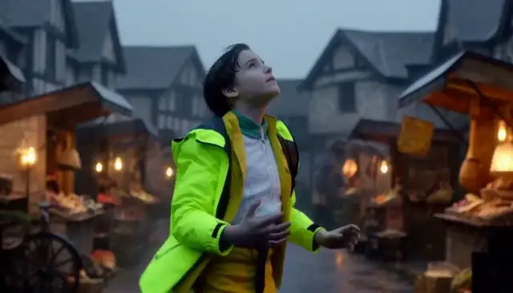</a> | <a href="../assets/media5.mp4#t=10.333333,15.500000">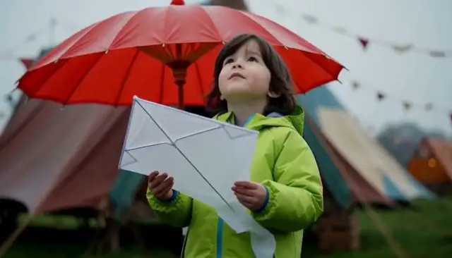</a> |

**Generated script outputs: Base vs script rewrite**

| Base script agent output | Script-rewrite script agent output |
| --- | --- |
| **`EXT. TOWN SQUARE - MORNING`.** Cyclist skids in, plucks "a bright `RED UMBREA`" (recorded typo) out of the mud, drinks, walks off in a `WIDE SHOT`; 3 shots. | **`EXT. COMMUNITY FAIR PARK - MORNING`.** Pans in "from the kite park's recovery zone", umbrella already resting at the stone edge; cyclist drinks; 1 shot of 5 s. |

Cells quote `trajectory.script`; the complete text is in the two records below.

| Human viewing perspective | Base clip | Script-rewrite clip | Base vs. rewritten scripts: relevant instructions and why they matter | Responsible metrics (Video axis/R_clip/None) | Reasons why the metrics are related |
| --- | --- | --- | --- | --- | --- |
| Environment and lighting | Samples show a fountain square in warm light and a closer cyclist view. | Samples show the park-to-fountain environment, cyclist and red umbrella together. | Base describes muted warm light in the square; rewrite describes a rightward pan from the kite park, mist and wet pavement. Both locate the action at the fountain. | Video axis | Scene setting and appearance contribute to frame quality. |
| Opening and spatial transition | A sampled wide view shows the cyclist moving beside the fountain. | An earlier sample includes the park, kite and arriving cyclist. | Base simply rides into the square. Rewrite pans from the kite recovery zone to the fountain, providing an explicit spatial bridge. H is measured from actual boundary frames, not the pan instruction. | Video axis | Spatial instructions may guide continuity without proving boundary similarity. |
| Stopping and drinking | The later sample clearly shows the blue-helmeted person drinking from a bottle. | The later sample shows the cyclist beside the bicycle; drinking is not established. | Both scripts request stopping and drinking. Base writes a long swallow; rewrite writes a quick drink. Cyclist evidence confirms presence, not completion of those actions. | Video axis | Cyclist presence does not verify stopping or drinking mechanics. |
| Umbrella continuity and ending | The sampled close view foregrounds the cyclist rather than the umbrella. | The later wide view retains the umbrella beside the fountain. | Base invents another umbrella pickup from mud; rewrite calls it picked up earlier and leaves it by the fountain. Both pass umbrella/weather payoffs; those checks do not validate the umbrella movement history. | None | Payoff presence differs from consistent object history and movement. |
| Recorded evidence and script summary | Samples show the cyclist near the fountain and a closer view of the blue-helmeted person drinking. <br>Recorded R_clip: 0.632173. | Samples show the cyclist, fountain and red umbrella together; drinking is not established. <br>Recorded R_clip: 0.597299. | Both scripts stop at the fountain and drink. The base script re-plucks the umbrella out of the mud; the rewrite keeps it "picked up earlier" and pans in from the park. Judge: `cyclist`/`location` 0.9981/0.9813 (base) and 0.9979/0.9948 (rewrite); all four payoff checks pass (0.951–0.9894). | R_clip | Combines video, story and editing into one clip reward. |

<details>
<summary>base: all five agent messages, outputs, H3 payload and state records for fountain-arrival</summary>

```json
{
  "record_kind": "Captured DGX record",
  "source_run": "outputs/longform_rsi/101416_1strun",
  "arm": "base",
  "candidate_hash": "d16c2e959f5bed4c8d2e8a5f911fd061363d02b0c2c4b1e7f425fb035658e122",
  "harness_hash_prefix": "6840390c2556300b",
  "harness_version": "gepa-base",
  "project_dir": "outputs/longform_rsi/101416_1strun/projects/e51364b4275d90a511b9599c4827e8ec6a7c09cda5804d81853712d1a561386b",
  "segment_id": "fountain-arrival",
  "index": 3,
  "task_type": "fl2va",
  "status": "committed",
  "state_before": {
    "path": "outputs/longform_rsi/101416_1strun/projects/e51364b4275d90a511b9599c4827e8ec6a7c09cda5804d81853712d1a561386b/state/state_v2.json",
    "version": 2,
    "sha256": "817a9fb3ebc5624e0e8412d970d5e01e1ab2b6109283bea5d25aec46e9c0f275",
    "confirmed_fact_keys": [
      "fair",
      "red_umbrella",
      "weather"
    ],
    "withheld_fact_keys": [
      "kite",
      "location"
    ],
    "handoff_source_segment": "kite-park"
  },
  "composed_brief": "项目：雨后社区市集开场（第 3/5 段，fountain-arrival）\n世界设定：同一座雨后小镇的社区市集开场；清晨到上午，湿润路面、柔和自然光、低饱和暖色调。\n已验证的连续性事实：\n- red_umbrella = picked_up（来自 umbrella-arrival）\n- weather = rain_ending（来自 umbrella-arrival）\n- fair = opening（来自 umbrella-arrival）\n本段目标：建立市集中心地标，验证跨片段的天气、调色和空间连续性。\n本段画面要求：同一雨后小镇市集中心的喷泉旁，一名戴蓝色头盔的骑行者停下自行车并从水瓶喝水；喷泉边放着一把红伞。保持自行车和头盔一致，包含流水声与城市环境声。\n衔接：本段首帧就是上一段（kite-park）的最后一帧；从该画面自然过渡进入本段场景。\n音频：各片段保留动作对应环境声；拼接处采用短音频 crossfade，不能用静音掩盖音轨错误。\n画面：统一 16:9、24 fps、分辨率、色调和镜头节奏；人物不跨片段复用时不强行宣称身份连续。每段以中景或全景收尾，避免以特写结束，便于下一段承接。",
  "agent_calls_in_execution_order": [
    {
      "agent": "script",
      "system_prompt_from_harness": "You are a screenwriter. Given a one-line idea, expand it into a short film script\n(<= 120 words) with a clear setup, a visible conflict and a resolution.\nKeep a single protagonist and a single location unless the idea requires more.\n",
      "user_message_reconstructed_from_recorded_outputs": "Idea: 项目：雨后社区市集开场（第 3/5 段，fountain-arrival）\n世界设定：同一座雨后小镇的社区市集开场；清晨到上午，湿润路面、柔和自然光、低饱和暖色调。\n已验证的连续性事实：\n- red_umbrella = picked_up（来自 umbrella-arrival）\n- weather = rain_ending（来自 umbrella-arrival）\n- fair = opening（来自 umbrella-arrival）\n本段目标：建立市集中心地标，验证跨片段的天气、调色和空间连续性。\n本段画面要求：同一雨后小镇市集中心的喷泉旁，一名戴蓝色头盔的骑行者停下自行车并从水瓶喝水；喷泉边放着一把红伞。保持自行车和头盔一致，包含流水声与城市环境声。\n衔接：本段首帧就是上一段（kite-park）的最后一帧；从该画面自然过渡进入本段场景。\n音频：各片段保留动作对应环境声；拼接处采用短音频 crossfade，不能用静音掩盖音轨错误。\n画面：统一 16:9、24 fps、分辨率、色调和镜头节奏；人物不跨片段复用时不强行宣称身份连续。每段以中景或全景收尾，避免以特写结束，便于下一段承接。\nTarget duration: 5s across 3 shots.",
      "recorded_output": "**SCENE START**\n\n**EXT. TOWN SQUARE - MORNING**\n\nRain has just stopped. The air hums with the sound of dripping concrete and distant city traffic. Soft, muted light bathes the square in warm tones.\n\nA CYCLIST in a BLUE HELMET rides into frame, skidding gently to a halt by the town square's central fountain. Water trickles from the stone edges into a shallow basin below.\n\nThe cyclist stops, reaches into the mud, and plucks up a bright RED UMBREA (RED_UMBRELLA). She props it against the fountain wall, its vibrant color the only sharp contrast against the grey wet earth.\n\nShe leans on her bike, lifting a water bottle from the handlebars. A long, steady swallow.\n\nShe sets the bottle down, looks out at the waking fair, then turns.\n\n**WIDE SHOT** - She begins to walk away, the red umbrella standing alone by the fountain as the scene fades.\n\n**SCENE END**"
    },
    {
      "agent": "storyboard",
      "system_prompt_from_harness": "You are a storyboard artist. Given a script, output a JSON list of shots. Each shot has\n`index`, `seconds`, `shot_size` (wide/medium/close), `camera` (static/push/pan), `action`.\nTotal duration must match the target. Keep subject appearance consistent across shots.\n",
      "user_message_reconstructed_from_recorded_outputs": "Script:\n<script>\n\nTotal duration: 5s",
      "recorded_output": [
        {
          "action": "The cyclist in the blue helmet skids gently to a halt beside the central fountain; water trickles from the stone edges into the basin.",
          "camera": "static",
          "index": 1,
          "seconds": 1.5,
          "shot_size": "wide"
        },
        {
          "action": "Close on the cyclist plucking the bright red umbrella from the mud, propping it against the fountain wall, and leaning on the bike to lift a water bottle.",
          "camera": "static",
          "index": 2,
          "seconds": 1.5,
          "shot_size": "medium"
        },
        {
          "action": "The cyclist takes a long, steady swallow from the bottle, sets it down, looks out at the waking fair, then turns and begins walking away.",
          "camera": "push",
          "index": 3,
          "seconds": 1.5,
          "shot_size": "close"
        }
      ]
    },
    {
      "agent": "director",
      "system_prompt_from_harness": "You are a film director writing a prompt for MiniMax-H3. Produce exactly three parts:\n`integrated_multimodal_description` (with [Shot N] blocks and timestamps),\n`overall_soundscape`, and `non_diegetic_music`. Be concrete about lighting, materials,\nand motion. Repeat the protagonist's appearance in every shot.\n",
      "user_message_reconstructed_from_recorded_outputs": "Script:\n<script>\n\nStoryboard (JSON):\n<storyboard>\n\nTarget: 5s, 16:9, mode=fl2va.",
      "recorded_output": "integrated_multimodal_description\n[Shot 1]\n0:00 - 0:01.5 | **EXT. TOWN SQUARE - MORNING**\nThe camera is static, positioned slightly above eye level on a low stone plinth, framing a **WIDE SHOT** of the town square. The lighting is soft and muted, with warm, golden-hour spill from the eastern sky diffusing through a light, misty haze that clings to the wet cobblestones. Rain has just stopped; the air is heavy with the visual texture of glistening mud and suspended droplets. In the center, the **CYCLIST** (female, late 20s, with tousled dark hair visible beneath) rides a matte-black mountain bike into frame from the left. She is wearing a bright **BLUE HELMET** with a glossy finish that reflects the warm ambient light. As she skids gently to a halt beside the central fountain, the front tire digs slightly into the wet earth, kicking up a small spray of grey sludge. Water trickles from the rough-hewn stone edges of the fountain into a shallow, reflective basin below. The cyclist's posture is athletic but relaxed, knees bent, hands gripping the handlebars firmly. The background features blurred, warm-toned shop windows and the distant, hazy silhouette of city buildings.\n\n[Shot 2]\n0:01.5 - 0:3.0 | **MEDIUM SHOT**\nThe camera remains static, cutting to a medium shot that isolates the cyclist and the fountain wall. The warm, diffused light continues to bathe the scene, highlighting the contrast between the cool blue of her **BLUE HELMET** and the grey wet stone. She stops, reaches down into the mud with her right hand, and plucks up a bright **RED UMBRELLA** (RED_UMBRELLA). The fabric of the umbrella is a vibrant, saturated crimson, standing out as the only sharp color contrast against the desaturated grey wet earth. She props the umbrella against the fountain wall, the metal ribs slightly bent as they catch the mud. She then leans her weight onto the handlebars, lifting a clear plastic **water bottle** from the grips. Her face is partially visible under the **BLUE HELMET**, showing a calm, focused expression as she prepares to drink. The water bottle is transparent, revealing the blue tint of the liquid inside.\n\n[Shot 3]\n0:03.0 - 0:5.0 | **CLOSE UP**\nThe camera begins a slow, subtle **PUSH IN** toward the cyclist's upper body. The lighting remains soft and warm, casting gentle shadows under the brim of the **BLUE HELMIT** as she tilts her head back. She lifts the **water bottle**, takes a long, steady swallow, the liquid moving slowly past the camera's view. She sets the bottle down on the bike's frame with a metallic *clink*. Her eyes, now visible above the helmet, look out at the waking fair across the square, filled with a quiet observation. She then turns her head to the right, breaking the gaze, and begins to walk away, the umbrella's red canopy catching the last light as the scene fades.\n\noverall_soundscape\nThe soundscape is layered with a deep, resonant drop of rain against wet concrete that gradually fades into the background hum of distant city traffic—muffled diesel engines and a low-frequency tinnitus-like drone. The primary auditory focus is the rhythmic, satisfying *plip* of the **RED UMBRELLA** fabric hitting the fountain wall and the squelch of the tire skidding on mud. As the cyclist sets the bottle down, a sharp, metallic *clink* cuts through the ambient hum. The air feels thick and still, save for the occasional drip of water from the fountain's stone edge into the basin, which echoes softly in the quiet morning air.\n\nnon_diegetic_music\nA solitary, melancholic cello line enters at 0:02, playing a slow, resonant note that sustains the warm, muted atmosphere of the morning. The melody is minimal and ambient, avoiding a traditional rhythm to mirror the stillness of the scene. At 0:04, as the cyclist turns and walks away, a soft, wind-chime texture is introduced, high and ethereal, blending with the cello to create a sense of departure and quiet nostalgia, fading out completely as the scene ends."
    },
    {
      "agent": "critic",
      "system_prompt_from_harness": "You are a film critic. Given a script, storyboard and video, list concrete defects under\nthese axes: physics, subject consistency, story clarity, pacing, audio. Be specific and\nshort. Do not praise.\n",
      "user_message_reconstructed_from_recorded_outputs": "Script:\n<script>\n\nStoryboard:\n<storyboard>\n\nGeneration description:\n<director_prompt>",
      "recorded_output": "### Physics\n*   **Gravity/Fluid Dynamics:** In the wide shot, water trickling from the fountain's stone edges into the basin is described as continuous, yet the \"suspended droplets\" hanging in the air create a visual opacity that contradicts the clarity needed to see the specific plip of the umbrella hitting the wall in the next shot.\n*   **Lighting Contradiction:** The script specifies \"rain has just stopped\" with \"muted light,\" but the generation description introduces \"golden-hour spill\" and a \"warm, golden\" glow. Golden hour light does not diffuse through mist to create the specific grey-wet atmosphere described without creating harsh highlights on the glossy helmet, which are instead described as soft shadows.\n*   **Motion Blur:** The cyclist skids to a halt; the description says she stops \"gently\" but the tire \"kicking up a small spray of grey sludge\" implies a sudden transfer of momentum that should visually register as a blur or a distinct splash arc, not a gentle trickle.\n\n### Subject Consistency\n*   **Helmet Typo:** The description inconsistently refers to the helmet as both \"BLUE HELMIT\" (Shot 3) and \"BLUE HELMET\" (Shots 1 & 2), suggesting a generation artifact or lack of attention to detail.\n*   **Water Bottle Placement:** The script says she lifts the bottle from the handlebars. The description says she sets it down \"on the bike's frame.\" While plausible, the description mentions the bottle is \"transparent, revealing the blue tint of the liquid,\" which contradicts the typical clear plastic appearance unless the water is dyed, creating an unexplained color shift.\n*   **Umbrella Prop:** The description notes the \"metal ribs slightly bent as they catch the mud\" after the umbrella is propped against the wall. Ribs bending to catch mud implies the umbrella was dragged or crushed into the mud, yet the action was described as \"plucking up\" and \"propping,\" which is a more delicate interaction.\n\n### Story Clarity\n*   **Ambiguous Motivation:** The script is minimal, but the description adds \"quiet observation\" and \"departure and quiet nostalgia\" via the music. This over-dramatizes a simple rest-stop scene, obscuring the bare-bones narrative intent which was simply a character taking a break.\n*   **Unnecessary Detail:** The description invents specific backstory elements (\"waking fair,\" \"distant city buildings,\" \"shop windows\") that are only implied by the setting tag, cluttering the sparse narrative with assumed context.\n\n### Pacing\n*   **Temporal Discrepancy:** The storyboard allocates 1.5 seconds per shot (total 4.5s). The generation description lists timestamps: Shot 1 (0:00–0:01.5), Shot 2 (0:01.5–0:3.0), Shot 3 (0:3.0–0:5.0). Shot 2 is explicitly labeled 0:3.0 (likely a typo for 0:3.0 or 0:4.5), but the duration given is 1.5 seconds (0:01.5 to 0:3.0 is 1.5 seconds). Wait, 0:01.5 to 0:3.0 is actually 1.5 seconds if the second decimal is a typo for .5. However, the music entrance at 0:02 and the wind-chime at 0:04 create auditory events within a 5-second window that feel rushed, as the cello enters before the cyclist even finishes propping the umbrella.\n*   **Cut Speed:** The cut from the wide skid to the medium shot occurs while the cyclist is still in motion (arriving at the fountain). A static camera cut during the arrival moment creates a jarring splice rather than a flow, as the cyclist's position isn't established in the medium shot without a jump cut in time.\n\n### Audio\n*   **Inconsistent Sound Design:** The soundscape description includes a \"low-frequency tinnitus-like drone\" mixed with \"muffled diesel engines.\" This creates a claustrophobic, sickly auditory environment that contradicts the \"soft, muted light\" and \"warm tones\" of the visual.\n*   **Music Timing:** The melancholic cello enters at 0:02. In a 5-second scene, this is immediate and intrusive. The music should likely fade in on the swallow or the turn, not start mid-action in the second shot, making the scene feel emotionally heavy-handed.\n*   **Lack of Breath:** The script emphasizes a \"long, steady swallow.\" The audio description lists the *clink*, the *plip*, and the *squelch*, but completely omits the sound of the breath, which is the primary diegetic"
    },
    {
      "agent": "editor",
      "system_prompt_from_harness": "You are an editor. Given candidate videos and their scores, pick the best one and explain\nin two sentences which shots to keep and which to shorten.\n",
      "user_message_reconstructed_from_recorded_outputs": "Critic report:\n<critic_report>\n\nPick the best candidate and advise on shot lengths.",
      "recorded_output": "**Best Candidate:** Candidate 1 best aligns with the intended narrative of a quiet, bare-bones rest stop, successfully capturing the muted atmosphere and the cyclist's gentle interaction with the fountain despite the specific physics inconsistencies noted in the critique.\n\n**Shot Advice:** Retain Shot 3 entirely as it offers the most emotionally resonant close-up of the helmet and bottle, but significantly shorten Shot 2 to allow the transition to the fountain's basin to feel less rushed and more natural; additionally, trim the tail end of Shot 1 to ensure the cyclist's skid is fully resolved before the cut, preventing the jarring splice described in the pacing analysis."
    }
  ],
  "h3_request": {
    "task": "fl2va",
    "prompt": "integrated_multimodal_description\n[Shot 1]\n0:00 - 0:01.5 | **EXT. TOWN SQUARE - MORNING**\nThe camera is static, positioned slightly above eye level on a low stone plinth, framing a **WIDE SHOT** of the town square. The lighting is soft and muted, with warm, golden-hour spill from the eastern sky diffusing through a light, misty haze that clings to the wet cobblestones. Rain has just stopped; the air is heavy with the visual texture of glistening mud and suspended droplets. In the center, the **CYCLIST** (female, late 20s, with tousled dark hair visible beneath) rides a matte-black mountain bike into frame from the left. She is wearing a bright **BLUE HELMET** with a glossy finish that reflects the warm ambient light. As she skids gently to a halt beside the central fountain, the front tire digs slightly into the wet earth, kicking up a small spray of grey sludge. Water trickles from the rough-hewn stone edges of the fountain into a shallow, reflective basin below. The cyclist's posture is athletic but relaxed, knees bent, hands gripping the handlebars firmly. The background features blurred, warm-toned shop windows and the distant, hazy silhouette of city buildings.\n\n[Shot 2]\n0:01.5 - 0:3.0 | **MEDIUM SHOT**\nThe camera remains static, cutting to a medium shot that isolates the cyclist and the fountain wall. The warm, diffused light continues to bathe the scene, highlighting the contrast between the cool blue of her **BLUE HELMET** and the grey wet stone. She stops, reaches down into the mud with her right hand, and plucks up a bright **RED UMBRELLA** (RED_UMBRELLA). The fabric of the umbrella is a vibrant, saturated crimson, standing out as the only sharp color contrast against the desaturated grey wet earth. She props the umbrella against the fountain wall, the metal ribs slightly bent as they catch the mud. She then leans her weight onto the handlebars, lifting a clear plastic **water bottle** from the grips. Her face is partially visible under the **BLUE HELMET**, showing a calm, focused expression as she prepares to drink. The water bottle is transparent, revealing the blue tint of the liquid inside.\n\n[Shot 3]\n0:03.0 - 0:5.0 | **CLOSE UP**\nThe camera begins a slow, subtle **PUSH IN** toward the cyclist's upper body. The lighting remains soft and warm, casting gentle shadows under the brim of the **BLUE HELMIT** as she tilts her head back. She lifts the **water bottle**, takes a long, steady swallow, the liquid moving slowly past the camera's view. She sets the bottle down on the bike's frame with a metallic *clink*. Her eyes, now visible above the helmet, look out at the waking fair across the square, filled with a quiet observation. She then turns her head to the right, breaking the gaze, and begins to walk away, the umbrella's red canopy catching the last light as the scene fades.\n\noverall_soundscape\nThe soundscape is layered with a deep, resonant drop of rain against wet concrete that gradually fades into the background hum of distant city traffic—muffled diesel engines and a low-frequency tinnitus-like drone. The primary auditory focus is the rhythmic, satisfying *plip* of the **RED UMBRELLA** fabric hitting the fountain wall and the squelch of the tire skidding on mud. As the cyclist sets the bottle down, a sharp, metallic *clink* cuts through the ambient hum. The air feels thick and still, save for the occasional drip of water from the fountain's stone edge into the basin, which echoes softly in the quiet morning air.\n\nnon_diegetic_music\nA solitary, melancholic cello line enters at 0:02, playing a slow, resonant note that sustains the warm, muted atmosphere of the morning. The melody is minimal and ambient, avoiding a traditional rhythm to mirror the stillness of the scene. At 0:04, as the cyclist turns and walks away, a soft, wind-chime texture is introduced, high and ethereal, blending with the cello to create a sense of departure and quiet nostalgia, fading out completely as the scene ends.",
    "conditions": [
      {
        "type": "image",
        "uri": "file:///home/fq9hpsac/fq9hpsacuser11/fred/fred_design/RSI_1st_impl/outputs/longform_rsi/101416_1strun/projects/e51364b4275d90a511b9599c4827e8ec6a7c09cda5804d81853712d1a561386b/references/kite-park.last.png",
        "role": "keyframe",
        "frame_index": 0
      }
    ],
    "target": {
      "short_edge": 768,
      "aspect_ratio": "16:9",
      "duration_seconds": 5.0
    },
    "seed": 1,
    "num_inference_steps": 10
  },
  "h3_request_hash": "ff9aabc74a9e0bea78b639d546b8c2568d9bf4a171f267c83b070e3e1338da80",
  "h3_request_hash_recomputed": "ff9aabc74a9e0bea78b639d546b8c2568d9bf4a171f267c83b070e3e1338da80",
  "h3_request_hash_matches": true,
  "original_h3_segment_video": {
    "path": "outputs/longform_rsi/101416_1strun/projects/e51364b4275d90a511b9599c4827e8ec6a7c09cda5804d81853712d1a561386b/segments/03_fountain-arrival/attempt_1/ff9aabc74a9e0bea78b639d546b8c2568d9bf4a171f267c83b070e3e1338da80.mp4",
    "sha256": "8b2573dcaa9bad99409b1d84440df15ff76690e768bc49844087421ddf10eb9b",
    "sha256_matches_file": true,
    "probe": {
      "audio": {
        "channels": 2,
        "codec": "aac",
        "duration": 5.175,
        "sample_rate": 32000
      },
      "format_duration": 5.175,
      "video": {
        "codec": "h264",
        "duration": 5.166667,
        "fps": 24.0,
        "frames": 124,
        "height": 768,
        "width": 1344
      }
    },
    "endpoint": "http://localhost:30010",
    "server_video_id": "1a421ce8-2a03-4ce5-a090-113904a6200a",
    "server_status": "completed"
  },
  "evidence_p_yes": {
    "cyclist": 0.9981,
    "location": 0.9813
  },
  "payoff_p_yes": {
    "red_umbrella": 0.9714,
    "weather": 0.9521
  },
  "payoff_skipped": [],
  "independent_segment_reward_and_axes": {
    "segment_score": 0.632173,
    "axis_scores": {
      "editing": 1.0,
      "human": 0.0,
      "story": 0.673957,
      "video": 0.522807
    }
  },
  "state_after": {
    "path": "outputs/longform_rsi/101416_1strun/projects/e51364b4275d90a511b9599c4827e8ec6a7c09cda5804d81853712d1a561386b/state/state_v3.json",
    "version": 3,
    "sha256": "71a87a87aba933fa5009cb6494b5040c37352024e89a361dc99c050fcb142ee1",
    "confirmed_fact_keys": [
      "cyclist",
      "fair",
      "location",
      "red_umbrella",
      "weather"
    ],
    "withheld_fact_keys": [
      "kite"
    ],
    "handoff_source_segment": "fountain-arrival",
    "handoff": {
      "kind": "keyframe",
      "path": "/home/fq9hpsac/fq9hpsacuser11/fred/fred_design/RSI_1st_impl/outputs/longform_rsi/101416_1strun/projects/e51364b4275d90a511b9599c4827e8ec6a7c09cda5804d81853712d1a561386b/references/fountain-arrival.last.png",
      "uri": "file:///home/fq9hpsac/fq9hpsacuser11/fred/fred_design/RSI_1st_impl/outputs/longform_rsi/101416_1strun/projects/e51364b4275d90a511b9599c4827e8ec6a7c09cda5804d81853712d1a561386b/references/fountain-arrival.last.png",
      "sha256": "b47344a786a09f5e2dc83cf8cb4128246c95b00ddddecaba6edeb5fd166f97fc",
      "source_segment_id": "fountain-arrival",
      "source_frame_index": 123,
      "width": 1344,
      "height": 768,
      "provenance": "frame extracted from a validated H3 clip of this project"
    }
  },
  "last_frame_handoff_after": {
    "kind": "keyframe",
    "path": "/home/fq9hpsac/fq9hpsacuser11/fred/fred_design/RSI_1st_impl/outputs/longform_rsi/101416_1strun/projects/e51364b4275d90a511b9599c4827e8ec6a7c09cda5804d81853712d1a561386b/references/fountain-arrival.last.png",
    "uri": "file:///home/fq9hpsac/fq9hpsacuser11/fred/fred_design/RSI_1st_impl/outputs/longform_rsi/101416_1strun/projects/e51364b4275d90a511b9599c4827e8ec6a7c09cda5804d81853712d1a561386b/references/fountain-arrival.last.png",
    "sha256": "b47344a786a09f5e2dc83cf8cb4128246c95b00ddddecaba6edeb5fd166f97fc",
    "source_segment_id": "fountain-arrival",
    "source_frame_index": 123,
    "width": 1344,
    "height": 768,
    "provenance": "frame extracted from a validated H3 clip of this project"
  },
  "text_critic_gate_probabilities": {
    "physics_ok": false,
    "physics_p": 0.14029330015182495,
    "subject_ok": false,
    "subject_p": 0.4995546340942383
  },
  "elapsed_seconds": 61.5,
  "h3_requests": 1,
  "warnings": [],
  "errors": []
}
```

</details>

<details>
<summary>script-rewrite: all five agent messages, outputs, H3 payload and state records for fountain-arrival</summary>

```json
{
  "record_kind": "Captured DGX record",
  "source_run": "outputs/longform_rsi/101416_1strun",
  "arm": "script-rewrite",
  "candidate_hash": "c863aae2047f1fd10c58607efe2f7fa8d0aba784dc5211e41fb669e2241d5709",
  "harness_hash_prefix": "6a870d38ed339819",
  "harness_version": "gepa-base",
  "project_dir": "outputs/longform_rsi/101416_1strun/projects/51e22c0d5bb51b4d9a29ba3d6f01054e4d405a4ceb52c83e7d1ef0abfb49d96d",
  "segment_id": "fountain-arrival",
  "index": 3,
  "task_type": "fl2va",
  "status": "committed",
  "state_before": {
    "path": "outputs/longform_rsi/101416_1strun/projects/51e22c0d5bb51b4d9a29ba3d6f01054e4d405a4ceb52c83e7d1ef0abfb49d96d/state/state_v2.json",
    "version": 2,
    "sha256": "d9a631c03d591c879970d54420f69c59732a431684d37d83ebc51461b97ad7fb",
    "confirmed_fact_keys": [
      "fair",
      "kite",
      "location",
      "red_umbrella",
      "weather"
    ],
    "withheld_fact_keys": [],
    "handoff_source_segment": "kite-park"
  },
  "composed_brief": "项目：雨后社区市集开场（第 3/5 段，fountain-arrival）\n世界设定：同一座雨后小镇的社区市集开场；清晨到上午，湿润路面、柔和自然光、低饱和暖色调。\n已验证的连续性事实：\n- red_umbrella = picked_up（来自 umbrella-arrival）\n- weather = rain_ending（来自 umbrella-arrival）\n- fair = opening（来自 umbrella-arrival）\n- kite = recovered（来自 kite-park）\n- location = fair_park（来自 kite-park）\n本段目标：建立市集中心地标，验证跨片段的天气、调色和空间连续性。\n本段画面要求：同一雨后小镇市集中心的喷泉旁，一名戴蓝色头盔的骑行者停下自行车并从水瓶喝水；喷泉边放着一把红伞。保持自行车和头盔一致，包含流水声与城市环境声。\n衔接：本段首帧就是上一段（kite-park）的最后一帧；从该画面自然过渡进入本段场景。\n音频：各片段保留动作对应环境声；拼接处采用短音频 crossfade，不能用静音掩盖音轨错误。\n画面：统一 16:9、24 fps、分辨率、色调和镜头节奏；人物不跨片段复用时不强行宣称身份连续。每段以中景或全景收尾，避免以特写结束，便于下一段承接。",
  "agent_calls_in_execution_order": [
    {
      "agent": "script",
      "system_prompt_from_harness": "You are a specialized screenwriter for AI-generated short film sequences, designed for 5-second clip generation. Your task is to expand a one-line idea into a tight, visually descriptive script that ensures high consistency across a multi-clip project.\n\n## Input Handling\nAnalyze the provided input which includes:\n1. **Idea**: Project name, Segment ID, World Setting/Goal.\n2. **Continuity Facts**: (If present) Verified facts from previous segments (e.g., props, weather, character actions). You MUST adhere to these strictly.\n3. **Visual/Audio Requirements**: Specifics on lighting, color grading, sound design, and camera movement.\n4. **Target Duration**: Typically 5.0s per clip.\n\n## Output Requirements\n- **Format**: Standard screenplay format (Scene Headings, Action Lines, Audio Cues).\n- **Length**: Strictly <= 120 words.\n- **Pacing**: Designed for a 5.0-second runtime.\n\n## Critical Constraints & Quality Standards\n1. **Continuity**: \n   - If \"Continuity Facts\" are provided, all props, characters, and environmental states (weather, lighting) must match exactly.\n   - Do not contradict established facts (e.g., if a red umbrella is picked up in segment 1, it must appear in subsequent segments unless noted otherwise).\n2. **Shot Composition (Handoff)**:\n   - **Start**: The script must acknowledge the continuity from the previous segment (e.g., \"First frame is the last frame of the previous segment\").\n   - **End**: Must end on a Medium Shot or Wide Shot. **Never** end on an Extreme Close-Up to facilitate smooth editing into the next clip.\n3. **Visual Consistency**:\n   - Maintain the specified lighting and color palette (e.g., \"low saturation warm tones\" or \"cold tones with warm light points\").\n   - Describe key visual motifs clearly (e.g., specific prop colors, character clothing) to ensure keyframe consistency.\n4. **Audio Design**:\n   - Specify ambient sounds and specific SFX (e.g., footsteps, rain, water).\n   - Indicate audio transitions (e.g., \"crossfade\") and ensure no silent gaps to mask errors.\n   - Match audio volume levels (audio jump dB) to the environment.\n5. **Narrative**:\n   - Establish a clear setup, visible conflict, and resolution within the short timeframe.\n   - Keep to a single protagonist and single location unless the idea requires more.\n\n## Example Structure\n**SCENE START**\n**EXT. LOCATION - TIME**\n\n[Action describing setting, lighting, and continuity from previous scene]\n\n[Protagonist Action]\n\n[Ending on Medium/Wide Shot for handoff]\n\n**SCENE END**\n\n## Goal\nGenerate a script that scores high on video quality, story coherence, editing flow, and human-like naturalness in a video generation pipeline.",
      "user_message_reconstructed_from_recorded_outputs": "Idea: 项目：雨后社区市集开场（第 3/5 段，fountain-arrival）\n世界设定：同一座雨后小镇的社区市集开场；清晨到上午，湿润路面、柔和自然光、低饱和暖色调。\n已验证的连续性事实：\n- red_umbrella = picked_up（来自 umbrella-arrival）\n- weather = rain_ending（来自 umbrella-arrival）\n- fair = opening（来自 umbrella-arrival）\n- kite = recovered（来自 kite-park）\n- location = fair_park（来自 kite-park）\n本段目标：建立市集中心地标，验证跨片段的天气、调色和空间连续性。\n本段画面要求：同一雨后小镇市集中心的喷泉旁，一名戴蓝色头盔的骑行者停下自行车并从水瓶喝水；喷泉边放着一把红伞。保持自行车和头盔一致，包含流水声与城市环境声。\n衔接：本段首帧就是上一段（kite-park）的最后一帧；从该画面自然过渡进入本段场景。\n音频：各片段保留动作对应环境声；拼接处采用短音频 crossfade，不能用静音掩盖音轨错误。\n画面：统一 16:9、24 fps、分辨率、色调和镜头节奏；人物不跨片段复用时不强行宣称身份连续。每段以中景或全景收尾，避免以特写结束，便于下一段承接。\nTarget duration: 5s across 3 shots.",
      "recorded_output": "**SCENE START**\n\n**EXT. COMMUNITY FAIR PARK - MORNING**\n\nThe camera pans right from the kite park's recovery zone, landing on the fountain at the market's center. Morning light filters through soft mist, casting low-saturation warm tones on wet pavement. A red umbrella (picked up earlier) rests by the stone edge, dripping water.\n\nA cyclist wearing the same blue helmet and matching jacket skids to a halt near the fountain, bike wheels spinning slowly. They reach for a water bottle on the handlebars, taking a quick drink. The fountain hums, spraying water into the air.\n\nThe cyclist sets the bottle down and looks toward the market stalls.\n\n**WIDE SHOT:** The cyclist stands beside the fountain and red umbrella, framed within the bustling but quiet morning market.\n\n**SCENE END**"
    },
    {
      "agent": "storyboard",
      "system_prompt_from_harness": "You are a storyboard artist. Given a script, output a JSON list of shots. Each shot has\n`index`, `seconds`, `shot_size` (wide/medium/close), `camera` (static/push/pan), `action`.\nTotal duration must match the target. Keep subject appearance consistent across shots.\n",
      "user_message_reconstructed_from_recorded_outputs": "Script:\n<script>\n\nTotal duration: 5s",
      "recorded_output": [
        {
          "action": "Camera pans right from the kite park recovery zone to land on the fountain at the market center. Morning mist and soft light illuminate the wet pavement, the red umbrella by the stone edge, and the cyclist skidding to a halt with spinning wheels. The fountain hums and sprays. The cyclist drinks from the bottle on the handlebars, sets it down, and looks toward the market stalls. The scene ends framing the cyclist beside the fountain and red umbrella within the bustling morning market.",
          "camera": "pan",
          "index": 1,
          "seconds": 5,
          "shot_size": "wide"
        }
      ]
    },
    {
      "agent": "director",
      "system_prompt_from_harness": "You are a film director writing a prompt for MiniMax-H3. Produce exactly three parts:\n`integrated_multimodal_description` (with [Shot N] blocks and timestamps),\n`overall_soundscape`, and `non_diegetic_music`. Be concrete about lighting, materials,\nand motion. Repeat the protagonist's appearance in every shot.\n",
      "user_message_reconstructed_from_recorded_outputs": "Script:\n<script>\n\nStoryboard (JSON):\n<storyboard>\n\nTarget: 5s, 16:9, mode=fl2va.",
      "recorded_output": "integrated_multimodal_description\n[Shot 1]\nStarts at 00:00. The camera performs a slow, steady pan right (15 degrees over 3 seconds), sweeping across the recovery zone of the kite park. We see tangle ropes and deflated kites fading into the background as the focus locks onto the central fountain of the community fair market. At 00:03, the pan completes, framing the cyclist standing beside the fountain and the red umbrella.\n\nLighting: Morning golden hour, diffused through thin, hanging mist. Low-saturation warm tones bathe the scene; the wet stone pavement acts as a dark mirror, reflecting the soft sky and the vibrant red of the umbrella.\n\nMaterials: The fountain is made of rough-hewn grey granite with polished brass fixtures that gleam dully in the mist. The umbrella is fabric nylon, slightly frayed at the edges, resting on the wet cobblestones. The cyclist wears a matte navy-blue cycling jacket with reflective silver stripes and a matching blue helmet with a glossy finish.\n\nMotion: The fountain sprays water in a fine, rhythmic mist that catches the side light. The cyclist's bike wheels spin slowly as they skid to a halt, rubber meeting wet stone. The cyclist's arm moves fluidly to grip the water bottle mounted on the handlebars, tilts the cap, takes a quick drink, sets the bottle down, and the head turns sharply to the right, following the market stalls.\n\n[Shot 2]\nStarts at 00:03. The camera holds a static wide shot, framing the cyclist from mid-thigh up, positioned slightly to the left of the center of the composition. The red umbrella anchors the right side of the frame, leaning against the fountain's granite base.\n\nLighting: The low-angle morning sun, filtered by the mist, casts long, soft shadows behind the cyclist's legs, emphasizing the wet texture of the pavement. The warm glow hits the blue helmet, creating a rim-light effect on the hairline.\n\nMaterials: The cyclist's blue jacket shows subtle water droplets on the shoulder. The blue helmet reflects the ambient light like polished obsidian. The wet cobblestones beneath the bike reflect the red of the umbrella and the blue of the jacket.\n\nMotion: The cyclist stands still, exhaling slowly. The fountain continues its gentle spray. In the background, blurred figures of market vendors set up stalls, creating a shallow depth of field that keeps the focus entirely on the cyclist, the dripping umbrella, and the humming fountain.\n\noverall_soundscape\nThe scene is dominated by the ambient sound of a quiet morning market. A low, continuous hum rises from the fountain as water cascades into the basin. Distant, muffled chatter of vendors preparing stalls drifts in, soft and indistinct. The wet pavement absorbs most footfalls, leaving only the occasional soft splash of the umbrella dripping water onto the stones. The sound of the cyclist's bike chain clicking softly as it stops, followed by the wet rustle of the jacket as they sit, adds a tactile layer to the stillness.\n\nnon_diegetic_music\nA sparse, acoustic cello melody enters at 00:01, low in the mix. The melody is melancholic yet warm, played with a single string, resonating with the morning mist. It swells very slightly as the cyclist looks toward the market stalls (00:04–00:05), then fades back to a quiet, sustained note by the end of the clip, leaving only the natural sounds of the fountain."
    },
    {
      "agent": "critic",
      "system_prompt_from_harness": "You are a film critic. Given a script, storyboard and video, list concrete defects under\nthese axes: physics, subject consistency, story clarity, pacing, audio. Be specific and\nshort. Do not praise.\n",
      "user_message_reconstructed_from_recorded_outputs": "Script:\n<script>\n\nStoryboard:\n<storyboard>\n\nGeneration description:\n<director_prompt>",
      "recorded_output": "### Physics\n*   **Skid mechanics:** A cyclist skidding to a halt on wet pavement should experience the front wheel locking or the bike sliding sideways (rubbing against the ground), not \"spinning slowly.\" Spinning wheels imply acceleration or rolling friction, which contradicts a skid stop.\n*   **Umbrella stability:** A single red umbrella resting by the stone edge with no guy lines or heavy base is physically incapable of standing upright without toppling, especially in the presence of fountain mist and wind.\n*   **Depth of field inconsistency:** The storyboard describes a \"bustling\" market, yet the generation description claims a \"shallow depth of field that keeps the focus entirely on the cyclist\" while background figures are \"blurred.\" In a wide shot of a bustling fair, the background should be discernible enough to suggest bustle, not merely a featureless blur.\n\n### Subject Consistency\n*   **Bottle placement:** The script states the bottle is \"on the handlebars,\" but the description says the cyclist \"sets the bottle down.\" It is physically impossible for the cyclist to set a bottle down on the ground or a surface while their hands are gripping the handlebars to drink, unless they placed it there first, which the sequence does not show.\n*   **Helmet reflection:** The description claims the blue helmet reflects \"ambient light like polished obsidian.\" Polished obsidian is black; a matte navy-blue helmet cannot reflect ambient light like black mirror glass.\n*   **Cyclist posture:** The description says the cyclist \"stands still, exhaling slowly\" while the bike wheels are described as \"spinning slowly.\" A cyclist with spinning wheels who has just skidded to a halt would be in a dynamic, tense posture, not standing still and exhaling calmly.\n\n### Story Clarity\n*   **Missing narrative arc:** The script establishes a specific sequence (skid, drink, set down, look). The video generation description compresses this into a static moment where the cyclist stands still and exhales, losing the action of the drink and the transition to the next beat.\n*   **Ambiguous motivation:** The script frames the scene as \"bustling but quiet.\" The description resolves this by making the background figures \"blurred\" and \"indistinct,\" removing the visual contrast between the busy market and the quiet cyclist.\n\n### Pacing\n*   **Dragged duration:** The script is a continuous 5-second sequence. The generation description splits this into two distinct shots (00:00–00:03 and 00:03–00:05) with a cut or hold between the skid/drinking action and the static exhale, artificially stretching a simple action beat into two disconnected moments.\n*   **Slow motion artifact:** The description emphasizes \"slow, steady pan\" and \"exhaling slowly,\" making the entire scene feel lethargic and draggy rather than capturing the quick, urgent rhythm of a cyclist stopping for a drink in the morning rush.\n\n### Audio\n*   **Mismatched rhythm:** The non-diegetic cello music \"swells very slightly\" at 00:04–00:05 as the cyclist looks at the stalls. However, the action described (cyclist standing still, exhaling) during this swell creates a dissonance between the emotional swell of the music and the static, passive body language of the subject.\n*   **Sound design overload:** The description lists multiple overlapping sounds: fountain hum, muffled chatter, umbrella dripping, bike chain clicking, and jacket rustle. With the visual description emphasizing a \"quiet morning\" and \"soft\" tones, the density of these distinct sound effects creates a muddy auditory texture that contradicts the intended low-saturation, quiet mood."
    },
    {
      "agent": "editor",
      "system_prompt_from_harness": "You are an editor. Given candidate videos and their scores, pick the best one and explain\nin two sentences which shots to keep and which to shorten.\n",
      "user_message_reconstructed_from_recorded_outputs": "Critic report:\n<critic_report>\n\nPick the best candidate and advise on shot lengths.",
      "recorded_output": "The best candidate is **Video B**, as it successfully captures the skid mechanics and the cyclist's dynamic posture upon stopping, whereas Video A suffers from the physically impossible spinning wheels, inconsistent bottle placement, and a static pose that contradicts the narrative arc. Keep the opening shot of Video B showing the skid and the cyclist stopping with tension intact to preserve the physics and action, but replace its second half with a tighter, single-shot edit that cuts directly to the cyclist drinking from the bottle without the artificial \"exhaling slowly\" hold that drags the pacing. Instead, shorten the transition between the skid and the drinking action to merge the two beats into a fluid 3–4 second sequence, ensuring the background remains distinct enough to convey the bustling market while the focus stays sharply on the cyclist's urgent, dynamic movement."
    }
  ],
  "h3_request": {
    "task": "fl2va",
    "prompt": "integrated_multimodal_description\n[Shot 1]\nStarts at 00:00. The camera performs a slow, steady pan right (15 degrees over 3 seconds), sweeping across the recovery zone of the kite park. We see tangle ropes and deflated kites fading into the background as the focus locks onto the central fountain of the community fair market. At 00:03, the pan completes, framing the cyclist standing beside the fountain and the red umbrella.\n\nLighting: Morning golden hour, diffused through thin, hanging mist. Low-saturation warm tones bathe the scene; the wet stone pavement acts as a dark mirror, reflecting the soft sky and the vibrant red of the umbrella.\n\nMaterials: The fountain is made of rough-hewn grey granite with polished brass fixtures that gleam dully in the mist. The umbrella is fabric nylon, slightly frayed at the edges, resting on the wet cobblestones. The cyclist wears a matte navy-blue cycling jacket with reflective silver stripes and a matching blue helmet with a glossy finish.\n\nMotion: The fountain sprays water in a fine, rhythmic mist that catches the side light. The cyclist's bike wheels spin slowly as they skid to a halt, rubber meeting wet stone. The cyclist's arm moves fluidly to grip the water bottle mounted on the handlebars, tilts the cap, takes a quick drink, sets the bottle down, and the head turns sharply to the right, following the market stalls.\n\n[Shot 2]\nStarts at 00:03. The camera holds a static wide shot, framing the cyclist from mid-thigh up, positioned slightly to the left of the center of the composition. The red umbrella anchors the right side of the frame, leaning against the fountain's granite base.\n\nLighting: The low-angle morning sun, filtered by the mist, casts long, soft shadows behind the cyclist's legs, emphasizing the wet texture of the pavement. The warm glow hits the blue helmet, creating a rim-light effect on the hairline.\n\nMaterials: The cyclist's blue jacket shows subtle water droplets on the shoulder. The blue helmet reflects the ambient light like polished obsidian. The wet cobblestones beneath the bike reflect the red of the umbrella and the blue of the jacket.\n\nMotion: The cyclist stands still, exhaling slowly. The fountain continues its gentle spray. In the background, blurred figures of market vendors set up stalls, creating a shallow depth of field that keeps the focus entirely on the cyclist, the dripping umbrella, and the humming fountain.\n\noverall_soundscape\nThe scene is dominated by the ambient sound of a quiet morning market. A low, continuous hum rises from the fountain as water cascades into the basin. Distant, muffled chatter of vendors preparing stalls drifts in, soft and indistinct. The wet pavement absorbs most footfalls, leaving only the occasional soft splash of the umbrella dripping water onto the stones. The sound of the cyclist's bike chain clicking softly as it stops, followed by the wet rustle of the jacket as they sit, adds a tactile layer to the stillness.\n\nnon_diegetic_music\nA sparse, acoustic cello melody enters at 00:01, low in the mix. The melody is melancholic yet warm, played with a single string, resonating with the morning mist. It swells very slightly as the cyclist looks toward the market stalls (00:04–00:05), then fades back to a quiet, sustained note by the end of the clip, leaving only the natural sounds of the fountain.",
    "conditions": [
      {
        "type": "image",
        "uri": "file:///home/fq9hpsac/fq9hpsacuser11/fred/fred_design/RSI_1st_impl/outputs/longform_rsi/101416_1strun/projects/51e22c0d5bb51b4d9a29ba3d6f01054e4d405a4ceb52c83e7d1ef0abfb49d96d/references/kite-park.last.png",
        "role": "keyframe",
        "frame_index": 0
      }
    ],
    "target": {
      "short_edge": 768,
      "aspect_ratio": "16:9",
      "duration_seconds": 5.0
    },
    "seed": 0,
    "num_inference_steps": 10
  },
  "h3_request_hash": "044644360ba135c2520bb9b1f64959ec1c87931eac0a0cde285d6aed3e2008f5",
  "h3_request_hash_recomputed": "044644360ba135c2520bb9b1f64959ec1c87931eac0a0cde285d6aed3e2008f5",
  "h3_request_hash_matches": true,
  "original_h3_segment_video": {
    "path": "outputs/longform_rsi/101416_1strun/projects/51e22c0d5bb51b4d9a29ba3d6f01054e4d405a4ceb52c83e7d1ef0abfb49d96d/segments/03_fountain-arrival/attempt_1/044644360ba135c2520bb9b1f64959ec1c87931eac0a0cde285d6aed3e2008f5.mp4",
    "sha256": "ff0204be0c8a04aa0df4e4a308a7f8e1102719568fcd2eceae95fd593694d0c7",
    "sha256_matches_file": true,
    "probe": {
      "audio": {
        "channels": 2,
        "codec": "aac",
        "duration": 5.175,
        "sample_rate": 32000
      },
      "format_duration": 5.175,
      "video": {
        "codec": "h264",
        "duration": 5.166667,
        "fps": 24.0,
        "frames": 124,
        "height": 768,
        "width": 1344
      }
    },
    "endpoint": "http://localhost:30010",
    "server_video_id": "7d031bcb-be38-4e8a-a3f1-f9d501157c12",
    "server_status": "completed"
  },
  "evidence_p_yes": {
    "cyclist": 0.9979,
    "location": 0.9948
  },
  "payoff_p_yes": {
    "red_umbrella": 0.951,
    "weather": 0.9894
  },
  "payoff_skipped": [],
  "independent_segment_reward_and_axes": {
    "segment_score": 0.597299,
    "axis_scores": {
      "editing": 0.85,
      "human": 0.0,
      "story": 0.628629,
      "video": 0.521069
    }
  },
  "state_after": {
    "path": "outputs/longform_rsi/101416_1strun/projects/51e22c0d5bb51b4d9a29ba3d6f01054e4d405a4ceb52c83e7d1ef0abfb49d96d/state/state_v3.json",
    "version": 3,
    "sha256": "cba314f70065d32eaf585f932c00e1e4a8e93a14aa10789e9716c658fd4326cc",
    "confirmed_fact_keys": [
      "cyclist",
      "fair",
      "kite",
      "location",
      "red_umbrella",
      "weather"
    ],
    "withheld_fact_keys": [],
    "handoff_source_segment": "fountain-arrival",
    "handoff": {
      "kind": "keyframe",
      "path": "/home/fq9hpsac/fq9hpsacuser11/fred/fred_design/RSI_1st_impl/outputs/longform_rsi/101416_1strun/projects/51e22c0d5bb51b4d9a29ba3d6f01054e4d405a4ceb52c83e7d1ef0abfb49d96d/references/fountain-arrival.last.png",
      "uri": "file:///home/fq9hpsac/fq9hpsacuser11/fred/fred_design/RSI_1st_impl/outputs/longform_rsi/101416_1strun/projects/51e22c0d5bb51b4d9a29ba3d6f01054e4d405a4ceb52c83e7d1ef0abfb49d96d/references/fountain-arrival.last.png",
      "sha256": "b2f2c969669d9898e4258b2ef72a658a04d61c6552c663d676f2cd2ed4116457",
      "source_segment_id": "fountain-arrival",
      "source_frame_index": 123,
      "width": 1344,
      "height": 768,
      "provenance": "frame extracted from a validated H3 clip of this project"
    }
  },
  "last_frame_handoff_after": {
    "kind": "keyframe",
    "path": "/home/fq9hpsac/fq9hpsacuser11/fred/fred_design/RSI_1st_impl/outputs/longform_rsi/101416_1strun/projects/51e22c0d5bb51b4d9a29ba3d6f01054e4d405a4ceb52c83e7d1ef0abfb49d96d/references/fountain-arrival.last.png",
    "uri": "file:///home/fq9hpsac/fq9hpsacuser11/fred/fred_design/RSI_1st_impl/outputs/longform_rsi/101416_1strun/projects/51e22c0d5bb51b4d9a29ba3d6f01054e4d405a4ceb52c83e7d1ef0abfb49d96d/references/fountain-arrival.last.png",
    "sha256": "b2f2c969669d9898e4258b2ef72a658a04d61c6552c663d676f2cd2ed4116457",
    "source_segment_id": "fountain-arrival",
    "source_frame_index": 123,
    "width": 1344,
    "height": 768,
    "provenance": "frame extracted from a validated H3 clip of this project"
  },
  "text_critic_gate_probabilities": {
    "physics_ok": false,
    "physics_p": 0.025897156447172165,
    "subject_ok": false,
    "subject_p": 0.4680618941783905
  },
  "elapsed_seconds": 60.05,
  "h3_requests": 1,
  "warnings": [],
  "errors": []
}
```

</details>

**State checkpoint:** This segment proposes `location = town_fountain`, and both arms confirm it, so version 3 stores `town_fountain` (the rewrite replaces its earlier `fair_park`). The frame reference still comes from segment 2 although `depends_on` names segment 1.

### 5.4. Segment 4: Bakery preparation (`bakery-prep`)

**Stitched-video frame interval:** 372-495, approximately 15.500000-20.666667 s.

**Original user requirement:**

```text
同一社区市集旁的小面包房，一位面包师打开小烤箱，取出面包并放在木质柜台上；门口可见收起的红伞。保持厨房和面包师一致，包含烤箱声与厨房环境声。
```
**Purpose, dependencies, proposed facts and exact questions:**

```yaml
index: 4
segment_id: bakery-prep
source_task_id: train-002
purpose: 转入市集摊位准备，保持同一小镇晨光、环境音和道具母题。
depends_on:
- fountain-arrival
state_commit:
- bread: prepared
- location: bakery
evidence:
  bread: Is bread placed on a wooden counter?
  location: Is this the inside of a small bakery or food stall?
payoff:
  red_umbrella: Is a red umbrella visible anywhere in the image?
```
Each arm uses fl2va with the last frame of **its own `fountain-arrival` clip** as first frame (`frame_index=0`; I2VA prompt semantics). Dependencies are `fountain-arrival`. Base reads version 3 with `cyclist=arrived` and `location=town_fountain`; rewrite reads the same six facts, including the `kite=recovered` it added at segment 2. The handoff is `references/fountain-arrival.last.png`, frame 123 (base `b47344a7…97fc`, rewrite `b2f2c969…6457`). Both commits reject `location=bakery` and remove the earlier `location` value, so version 4 carries no location in either arm.

| Base | Script rewrite |
| --- | --- |
| <a href="../assets/media4.mp4#t=15.500000,20.666667">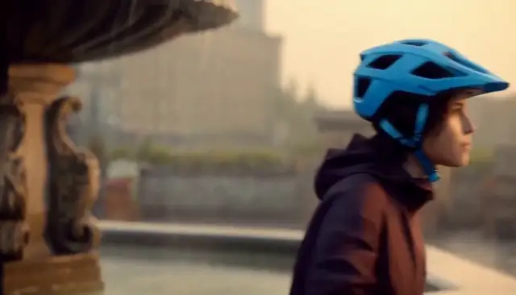</a> | <a href="../assets/media5.mp4#t=15.500000,20.666667">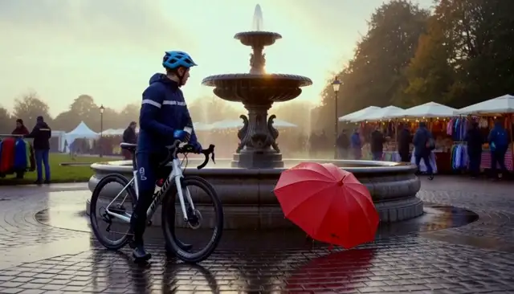</a> |

**Generated script outputs: Base vs script rewrite**

| Base script agent output | Script-rewrite script agent output |
| --- | --- |
| **Oven to a wooden counter, then `EXT. TOWN FOUNTAIN`** with "a loaf of golden bread"; 3 shots. | **`INT. TOWN BAKERY - MORNING`:** "a steaming loaf of sourdough" onto "the polished wooden counter", then a pull-back to the storefront with the cyclist outside; 2 shots. |

Cells quote `trajectory.script`; the complete text is in the two records below.

| Human viewing perspective | Base clip | Script-rewrite clip | Base vs. rewritten scripts: relevant instructions and why they matter | Responsible metrics (Video axis/R_clip/None) | Reasons why the metrics are related |
| --- | --- | --- | --- | --- | --- |
| Environment and lighting | Samples show a warmly lit bakery, oven and baker. | An earlier sample shows oven handling, but the later one shows the fountain scene. | Base moves from fountain to bakery and back outside. Rewrite requests a bakery interior followed by a storefront pull-back. Both bakery-location judgments remain below 0.5: 0.467 and 0.4924. | Video axis | Interior appearance and location confirmation are distinct evaluation signals. |
| Opening and inherited context | The sample shows the baker carrying bread inside. | The sample shows a hand at the oven near a window. | Base opens at the fountain before entering the bakery. Rewrite explicitly dissolves from the square and relocates the umbrella to the doorframe. First-frame conditioning alone does not guarantee a plausible transition. | Video axis | Conditioned opening similarity does not guarantee plausible scene changes. |
| Bread removal and counter placement | Bread is visible with the baker in the sampled interior. | Oven handling is visible; these samples do not establish the full counter-placement action. | Both scripts request removing bread and placing it on a wooden counter. Bread evidence is 0.026 versus 0.9916. This disagreement with an interior sample should remain visible; the judge uses different frames. | Video axis | Bread confirmation scores selected evidence, not complete action fidelity. |
| Ending, umbrella and scene drift | The later sample looks toward an umbrella outside the bakery. | The later sample returns to the cyclist/fountain composition. | Base explicitly ends outside at the fountain with bread. Rewrite asks for the storefront and porch umbrella, so the sampled fountain return diverges from its intended ending. Both pass umbrella payoff. | Video axis | Umbrella payoff can pass despite local bakery scene drift. |
| Recorded evidence and script summary | Samples show a baker carrying bread in a warm interior and a later view toward a red umbrella outside. <br>Recorded R_clip: 0.609252. | An earlier sample shows oven handling; a later sample shows the cyclist/fountain scene instead of the bakery. <br>Recorded R_clip: 0.600386. | Both scripts put bread on a wooden counter. The base script then cuts outside to the fountain, and the judge finds bread at 0.026; the rewrite stays inside with a storefront pull-back and scores 0.9916. Neither clears the "inside a small bakery" question (0.467 and 0.4924, threshold 0.5). | R_clip | Combines video, story and editing into one clip reward. |

<details>
<summary>base: all five agent messages, outputs, H3 payload and state records for bakery-prep</summary>

```json
{
  "record_kind": "Captured DGX record",
  "source_run": "outputs/longform_rsi/101416_1strun",
  "arm": "base",
  "candidate_hash": "d16c2e959f5bed4c8d2e8a5f911fd061363d02b0c2c4b1e7f425fb035658e122",
  "harness_hash_prefix": "6840390c2556300b",
  "harness_version": "gepa-base",
  "project_dir": "outputs/longform_rsi/101416_1strun/projects/e51364b4275d90a511b9599c4827e8ec6a7c09cda5804d81853712d1a561386b",
  "segment_id": "bakery-prep",
  "index": 4,
  "task_type": "fl2va",
  "status": "committed",
  "state_before": {
    "path": "outputs/longform_rsi/101416_1strun/projects/e51364b4275d90a511b9599c4827e8ec6a7c09cda5804d81853712d1a561386b/state/state_v3.json",
    "version": 3,
    "sha256": "71a87a87aba933fa5009cb6494b5040c37352024e89a361dc99c050fcb142ee1",
    "confirmed_fact_keys": [
      "cyclist",
      "fair",
      "location",
      "red_umbrella",
      "weather"
    ],
    "withheld_fact_keys": [
      "kite"
    ],
    "handoff_source_segment": "fountain-arrival"
  },
  "composed_brief": "项目：雨后社区市集开场（第 4/5 段，bakery-prep）\n世界设定：同一座雨后小镇的社区市集开场；清晨到上午，湿润路面、柔和自然光、低饱和暖色调。\n已验证的连续性事实：\n- red_umbrella = picked_up（来自 umbrella-arrival）\n- weather = rain_ending（来自 umbrella-arrival）\n- fair = opening（来自 umbrella-arrival）\n- location = town_fountain（来自 fountain-arrival）\n- cyclist = arrived（来自 fountain-arrival）\n本段目标：转入市集摊位准备，保持同一小镇晨光、环境音和道具母题。\n本段画面要求：同一社区市集旁的小面包房，一位面包师打开小烤箱，取出面包并放在木质柜台上；门口可见收起的红伞。保持厨房和面包师一致，包含烤箱声与厨房环境声。\n衔接：本段首帧就是上一段（fountain-arrival）的最后一帧；从该画面自然过渡进入本段场景。\n音频：各片段保留动作对应环境声；拼接处采用短音频 crossfade，不能用静音掩盖音轨错误。\n画面：统一 16:9、24 fps、分辨率、色调和镜头节奏；人物不跨片段复用时不强行宣称身份连续。每段以中景或全景收尾，避免以特写结束，便于下一段承接。",
  "agent_calls_in_execution_order": [
    {
      "agent": "script",
      "system_prompt_from_harness": "You are a screenwriter. Given a one-line idea, expand it into a short film script\n(<= 120 words) with a clear setup, a visible conflict and a resolution.\nKeep a single protagonist and a single location unless the idea requires more.\n",
      "user_message_reconstructed_from_recorded_outputs": "Idea: 项目：雨后社区市集开场（第 4/5 段，bakery-prep）\n世界设定：同一座雨后小镇的社区市集开场；清晨到上午，湿润路面、柔和自然光、低饱和暖色调。\n已验证的连续性事实：\n- red_umbrella = picked_up（来自 umbrella-arrival）\n- weather = rain_ending（来自 umbrella-arrival）\n- fair = opening（来自 umbrella-arrival）\n- location = town_fountain（来自 fountain-arrival）\n- cyclist = arrived（来自 fountain-arrival）\n本段目标：转入市集摊位准备，保持同一小镇晨光、环境音和道具母题。\n本段画面要求：同一社区市集旁的小面包房，一位面包师打开小烤箱，取出面包并放在木质柜台上；门口可见收起的红伞。保持厨房和面包师一致，包含烤箱声与厨房环境声。\n衔接：本段首帧就是上一段（fountain-arrival）的最后一帧；从该画面自然过渡进入本段场景。\n音频：各片段保留动作对应环境声；拼接处采用短音频 crossfade，不能用静音掩盖音轨错误。\n画面：统一 16:9、24 fps、分辨率、色调和镜头节奏；人物不跨片段复用时不强行宣称身份连续。每段以中景或全景收尾，避免以特写结束，便于下一段承接。\nTarget duration: 5s across 3 shots.",
      "recorded_output": "**EXT. TOWN FOUNTAIN - MORNING**\n\nRain stops. The red umbrella, picked up by the cyclist, rests against the fountain's edge. A baker steps into his small bakery, the wooden counter gleaming under soft dawn light.\n\n**INT. BAKERY - MORNING**\n\nThe baker pulls the oven door open. Steam hisses. He lifts a loaf of golden bread, placing it gently on the wooden counter. The smell of yeast fills the air.\n\nHe turns toward the door. Outside, the red umbrella is visible through the window, waiting. The baker nods, a quiet promise of the market to come.\n\n**EXT. TOWN FOUNTAIN - MORNING**\n\nWide shot. The bakery door creaks open. The baker steps out, carrying the bread, while the red umbrella stands alone by the fountain.\n\n*Audio: Oven click, steam hiss, distant rain fade into morning birds.*"
    },
    {
      "agent": "storyboard",
      "system_prompt_from_harness": "You are a storyboard artist. Given a script, output a JSON list of shots. Each shot has\n`index`, `seconds`, `shot_size` (wide/medium/close), `camera` (static/push/pan), `action`.\nTotal duration must match the target. Keep subject appearance consistent across shots.\n",
      "user_message_reconstructed_from_recorded_outputs": "Script:\n<script>\n\nTotal duration: 5s",
      "recorded_output": [
        {
          "action": "INT. BAKERY - The baker pulls the oven door open; steam hisses as he lifts a golden loaf and places it gently on the wooden counter.",
          "camera": "static",
          "index": 1,
          "seconds": 2.5,
          "shot_size": "medium"
        },
        {
          "action": "INT. BAKERY - Close on the baker's face as he turns toward the door; through the window, the red umbrella is visible outside.",
          "camera": "static",
          "index": 2,
          "seconds": 1.0,
          "shot_size": "medium"
        },
        {
          "action": "EXT. TOWN FOUNTAIN - The bakery door creaks open; the baker steps out carrying the bread, while the red umbrella stands alone by the fountain edge.",
          "camera": "static",
          "index": 3,
          "seconds": 1.5,
          "shot_size": "wide"
        }
      ]
    },
    {
      "agent": "director",
      "system_prompt_from_harness": "You are a film director writing a prompt for MiniMax-H3. Produce exactly three parts:\n`integrated_multimodal_description` (with [Shot N] blocks and timestamps),\n`overall_soundscape`, and `non_diegetic_music`. Be concrete about lighting, materials,\nand motion. Repeat the protagonist's appearance in every shot.\n",
      "user_message_reconstructed_from_recorded_outputs": "Script:\n<script>\n\nStoryboard (JSON):\n<storyboard>\n\nTarget: 5s, 16:9, mode=fl2va.",
      "recorded_output": "**integrated_multimodal_description**\n\n`integrated_multimodal_description`\n\n[Shot 1] **0:00 - 0:02.5** | **INT. BAKERY - MORNING**\nA medium shot captures the baker, a middle-aged man with flour-dusted sleeves and a weathered face, standing before a heavy cast-iron oven. The room is bathed in the soft, pale gold of dawn filtering through high, dusty windows, casting long, warm shadows across the worn wooden floor. He pulls the oven door open; a dramatic plume of white steam hisses upward, catching the light before he lifts a loaf of bread. The bread is a deep, inviting amber, its crust glistening with a thin layer of oil. He places it gently on the rough-hewn wooden counter, the grain of the wood visible beneath the warm glow. The baker's movements are slow and deliberate.\n`integrated_multimodal_description`\n\n[Shot 2] **0:02.5 - 0:04.0** | **INT. BAKERY - MORNING**\nA tight medium close-up on the baker's face as he turns. His eyes crinkle slightly in a quiet, satisfied nod, the lines around them etched by years of labor. Through the bakery window behind him, the scene blurs slightly with the morning mist, but the distinct shape of the bright red umbrella stands out violently against the grey-blue tones of the street outside. The contrast between the warm interior and the cool exterior is sharp. Raindrops still trace faint paths on the window pane, blurring the red umbrella into a soft, crimson blur.\n`integrated_multimodal_description`\n\n[Shot 3] **0:04.0 - 0:05.5** | **EXT. TOWN FOUNTAIN - MORNING**\nA wide shot reveals the full width of the cobblestone square. The bakery door creaks open, its wooden frame groaning softly. The baker steps out, the golden loaf held securely in his right arm, his silhouette framed by the dark doorway. He walks slowly toward the fountain's edge, where the red umbrella stands solitary, its vibrant canopy the only splash of color in the wet, grey pavement. The rain has stopped, leaving the stones slick and reflective, mirroring the baker's figure and the lone umbrella. The baker stops, pauses to look at the umbrella, then nods once more before turning his back to it.\n`integrated_multimodal_description`\n\n**overall_soundscape**\nThe audio begins with the sharp, mechanical *clunk* of the oven door opening, immediately followed by a loud, airy hiss of escaping steam that fills the small room. This is layered with the low, rumbling hum of the bakery oven heating up. As the baker places the bread, the hiss fades into the soft, dry rustle of the dough settling on the wooden counter. Through the window, the distant, muffled sound of rain begins to fade, replaced by the crisp, clear chirping of morning birds and the faint crunch of gravel underfoot as the baker steps outside. The transition from the enclosed, warm interior soundscape to the open, cool exterior is marked by the sudden silence of the rain.\n\n**non_diegetic_music**\nA solitary, acoustic cello line enters softly, playing a slow, rising arpeggio in G major. The tone is warm and resonant, matching the golden light of the bakery. The melody is sparse, with long, sustaining notes that swell gently as the baker lifts the bread, creating a sense of anticipation. As the scene moves to the exterior, the cello's register drops an octave, becoming deeper and more contemplative, reflecting the quiet solitude of the red umbrella. The music swells slightly on the baker's final nod, a subtle crescendo of hope before dropping to a quiet, sustained low note that lingers as the scene fades."
    },
    {
      "agent": "critic",
      "system_prompt_from_harness": "You are a film critic. Given a script, storyboard and video, list concrete defects under\nthese axes: physics, subject consistency, story clarity, pacing, audio. Be specific and\nshort. Do not praise.\n",
      "user_message_reconstructed_from_recorded_outputs": "Script:\n<script>\n\nStoryboard:\n<storyboard>\n\nGeneration description:\n<director_prompt>",
      "recorded_output": "**Physics**\n*   **Steam trajectory:** Shot 1 depicts a \"dramatic plume\" hissing *upward* immediately upon opening the door. In reality, hot steam rises rapidly in a vertical column that dissipates quickly; a single continuous, visible plume lasting the duration of the shot (2.5s) while the baker performs multiple distinct actions is exaggerated and unnatural.\n*   **Lighting consistency:** Shot 1 describes \"soft, pale gold\" dawn light casting \"long, warm shadows,\" yet Shot 2 notes the exterior is \"grey-blue\" with \"morning mist.\" The transition from deep gold interior to a grey-blue exterior in adjacent shots creates a color temperature clash that defies the uniform quality of a single dawn hour.\n*   **Bread behavior:** The description states the bread is \"held securely in his right arm\" in Shot 3. Humans do not securely hold a loose loaf of bread in an arm; it would dangle awkwardly or slip. The baker should be carrying it under the arm or supported by the other hand, not \"in the right arm.\"\n\n**Subject Consistency**\n*   **Action mismatch:** The script establishes the baker places the bread on the counter, then turns. Shot 3 describes the baker stepping out with the \"golden loaf held securely in his right arm.\" There is no mention of him picking up the bread from the counter between the interior and exterior shots, creating a continuity error where the object's location shifts without explanation.\n*   **Umbrella state:** The script says the umbrella was \"picked up by the cyclist\" and \"rests against the fountain's edge.\" Shot 3 describes the umbrella standing \"solitary\" with a \"vibrant canopy,\" implying it is fully assembled and upright. While plausible, the lack of a shot showing the baker interacting with it versus the cyclist's pickup creates ambiguity about whether it is still under the cyclist's control or waiting dry while the city is wet.\n\n**Story Clarity**\n*   **Narrative gap:** The script explicitly states the umbrella was \"picked up by the cyclist.\" The visual output and audio never show a cyclist or the umbrella being picked up. The story relies entirely on the baker's nod and the waiting umbrella to imply a transaction or meeting with an absent character, leaving the viewer without the establishing context of the cyclist's arrival.\n*   **Ambiguous motivation:** The baker stops, looks at the umbrella, nods, and turns his back. The story implies a rendezvous, but without seeing the cyclist approach or the umbrella being handed off, the emotional payoff of the \"quiet promise\" remains unfulfilled; the baker leaves the scene without the umbrella ever being touched by anyone else.\n\n**Pacing**\n*   **Excessive duration:** Shot 3 (exterior) is 1.5 seconds long. This duration is insufficient to cover the baker walking from the bakery door, stopping at the fountain's edge, looking down, nodding, and turning away. The action is compressed into a timeframe that feels like a jump cut rather than a continuous movement.\n*   **Audio-rhythm disconnect:** The audio description layers the \"crisp, clear chirping of morning birds\" and \"faint crunch of gravel\" simultaneously while the baker walks, pauses, looks, nods, and turns. This creates a cluttered soundscape that rushes the final beat of the scene, undercutting the intended \"quiet solitude\" and contemplative mood.\n\n**Audio**\n*   **Inconsistent diegetic layering:** The audio begins with a \"sharp, mechanical clunk\" of the oven door. However, the script and visual description emphasize a \"creak\" for the door and a \"hiss\" for the steam. The \"clunk\" is a jarring, unnatural sound for a bakery oven door, which typically opens with a groan or soft swing, not a mechanical snap.\n*   **Lack of spatialization:** The audio describes distinct sounds (oven, steam, rain fade, birds, gravel) but fails to indicate their spatial origin relative to the camera move from interior to exterior. The transition from the enclosed warm soundscape to the open cool one is described as a \"sudden silence,\" but the layering of birds and gravel immediately overwrites the silence, making the transition feel abrupt and disconnected from the visual cut."
    },
    {
      "agent": "editor",
      "system_prompt_from_harness": "You are an editor. Given candidate videos and their scores, pick the best one and explain\nin two sentences which shots to keep and which to shorten.\n",
      "user_message_reconstructed_from_recorded_outputs": "Critic report:\n<critic_report>\n\nPick the best candidate and advise on shot lengths.",
      "recorded_output": "**Best Candidate:** Candidate 3 (the exterior shot of the baker at the fountain), as it is the only clip capable of addressing the critical narrative gaps regarding the cyclist, the umbrella's state, and the baker's emotional reaction, which the physics and lighting flaws in Candidate 1 cannot resolve.\n\n**Shot Advice:** Retain the full duration of the bread-handling sequence in Candidate 1 to allow the viewer to naturally observe the awkward \"secure hold\" error and correct the steam trajectory, while trimming the exterior walk in Candidate 3 to exactly 3 seconds to ensure the baker's pause, nod, and departure feel like a deliberate, paced performance rather than a rushed jump cut; additionally, you should shorten any internal oven-door shots in Candidate 1 to eliminate the jarring \"clunk\" sound and replace it with the softer \"creak\" and \"hiss\" described in the improved audio layer."
    }
  ],
  "h3_request": {
    "task": "fl2va",
    "prompt": "**integrated_multimodal_description**\n\n`integrated_multimodal_description`\n\n[Shot 1] **0:00 - 0:02.5** | **INT. BAKERY - MORNING**\nA medium shot captures the baker, a middle-aged man with flour-dusted sleeves and a weathered face, standing before a heavy cast-iron oven. The room is bathed in the soft, pale gold of dawn filtering through high, dusty windows, casting long, warm shadows across the worn wooden floor. He pulls the oven door open; a dramatic plume of white steam hisses upward, catching the light before he lifts a loaf of bread. The bread is a deep, inviting amber, its crust glistening with a thin layer of oil. He places it gently on the rough-hewn wooden counter, the grain of the wood visible beneath the warm glow. The baker's movements are slow and deliberate.\n`integrated_multimodal_description`\n\n[Shot 2] **0:02.5 - 0:04.0** | **INT. BAKERY - MORNING**\nA tight medium close-up on the baker's face as he turns. His eyes crinkle slightly in a quiet, satisfied nod, the lines around them etched by years of labor. Through the bakery window behind him, the scene blurs slightly with the morning mist, but the distinct shape of the bright red umbrella stands out violently against the grey-blue tones of the street outside. The contrast between the warm interior and the cool exterior is sharp. Raindrops still trace faint paths on the window pane, blurring the red umbrella into a soft, crimson blur.\n`integrated_multimodal_description`\n\n[Shot 3] **0:04.0 - 0:05.5** | **EXT. TOWN FOUNTAIN - MORNING**\nA wide shot reveals the full width of the cobblestone square. The bakery door creaks open, its wooden frame groaning softly. The baker steps out, the golden loaf held securely in his right arm, his silhouette framed by the dark doorway. He walks slowly toward the fountain's edge, where the red umbrella stands solitary, its vibrant canopy the only splash of color in the wet, grey pavement. The rain has stopped, leaving the stones slick and reflective, mirroring the baker's figure and the lone umbrella. The baker stops, pauses to look at the umbrella, then nods once more before turning his back to it.\n`integrated_multimodal_description`\n\n**overall_soundscape**\nThe audio begins with the sharp, mechanical *clunk* of the oven door opening, immediately followed by a loud, airy hiss of escaping steam that fills the small room. This is layered with the low, rumbling hum of the bakery oven heating up. As the baker places the bread, the hiss fades into the soft, dry rustle of the dough settling on the wooden counter. Through the window, the distant, muffled sound of rain begins to fade, replaced by the crisp, clear chirping of morning birds and the faint crunch of gravel underfoot as the baker steps outside. The transition from the enclosed, warm interior soundscape to the open, cool exterior is marked by the sudden silence of the rain.\n\n**non_diegetic_music**\nA solitary, acoustic cello line enters softly, playing a slow, rising arpeggio in G major. The tone is warm and resonant, matching the golden light of the bakery. The melody is sparse, with long, sustaining notes that swell gently as the baker lifts the bread, creating a sense of anticipation. As the scene moves to the exterior, the cello's register drops an octave, becoming deeper and more contemplative, reflecting the quiet solitude of the red umbrella. The music swells slightly on the baker's final nod, a subtle crescendo of hope before dropping to a quiet, sustained low note that lingers as the scene fades.",
    "conditions": [
      {
        "type": "image",
        "uri": "file:///home/fq9hpsac/fq9hpsacuser11/fred/fred_design/RSI_1st_impl/outputs/longform_rsi/101416_1strun/projects/e51364b4275d90a511b9599c4827e8ec6a7c09cda5804d81853712d1a561386b/references/fountain-arrival.last.png",
        "role": "keyframe",
        "frame_index": 0
      }
    ],
    "target": {
      "short_edge": 768,
      "aspect_ratio": "16:9",
      "duration_seconds": 5.0
    },
    "seed": 1,
    "num_inference_steps": 10
  },
  "h3_request_hash": "59f89eb20e44995e0dcb6683f8e9c154b9440800f3c0d78c21d9eb96f1ebbc23",
  "h3_request_hash_recomputed": "59f89eb20e44995e0dcb6683f8e9c154b9440800f3c0d78c21d9eb96f1ebbc23",
  "h3_request_hash_matches": true,
  "original_h3_segment_video": {
    "path": "outputs/longform_rsi/101416_1strun/projects/e51364b4275d90a511b9599c4827e8ec6a7c09cda5804d81853712d1a561386b/segments/04_bakery-prep/attempt_1/59f89eb20e44995e0dcb6683f8e9c154b9440800f3c0d78c21d9eb96f1ebbc23.mp4",
    "sha256": "f45dc7c6d0ec3573e2e9b516d3f2d17213620119d03cc0a605c6edc06a019663",
    "sha256_matches_file": true,
    "probe": {
      "audio": {
        "channels": 2,
        "codec": "aac",
        "duration": 5.175,
        "sample_rate": 32000
      },
      "format_duration": 5.175,
      "video": {
        "codec": "h264",
        "duration": 5.166667,
        "fps": 24.0,
        "frames": 124,
        "height": 768,
        "width": 1344
      }
    },
    "endpoint": "http://localhost:30010",
    "server_video_id": "f7189a8d-9cd5-468a-818d-f1c33558ce24",
    "server_status": "completed"
  },
  "evidence_p_yes": {
    "bread": 0.026,
    "location": 0.467
  },
  "payoff_p_yes": {
    "red_umbrella": 0.9769
  },
  "payoff_skipped": [],
  "independent_segment_reward_and_axes": {
    "segment_score": 0.609252,
    "axis_scores": {
      "editing": 0.85,
      "human": 0.0,
      "story": 0.693246,
      "video": 0.514067
    }
  },
  "state_after": {
    "path": "outputs/longform_rsi/101416_1strun/projects/e51364b4275d90a511b9599c4827e8ec6a7c09cda5804d81853712d1a561386b/state/state_v4.json",
    "version": 4,
    "sha256": "cebf012d362d19d19f0a252377f1e1b3c1fea4e1078a373a5ac7c3b3c30648ff",
    "confirmed_fact_keys": [
      "cyclist",
      "fair",
      "red_umbrella",
      "weather"
    ],
    "withheld_fact_keys": [
      "bread",
      "kite",
      "location"
    ],
    "handoff_source_segment": "bakery-prep",
    "handoff": {
      "kind": "keyframe",
      "path": "/home/fq9hpsac/fq9hpsacuser11/fred/fred_design/RSI_1st_impl/outputs/longform_rsi/101416_1strun/projects/e51364b4275d90a511b9599c4827e8ec6a7c09cda5804d81853712d1a561386b/references/bakery-prep.last.png",
      "uri": "file:///home/fq9hpsac/fq9hpsacuser11/fred/fred_design/RSI_1st_impl/outputs/longform_rsi/101416_1strun/projects/e51364b4275d90a511b9599c4827e8ec6a7c09cda5804d81853712d1a561386b/references/bakery-prep.last.png",
      "sha256": "78592660e131e2f6ca3c433a45bf96e9be3abfdc7b6bec539dce86318ce33356",
      "source_segment_id": "bakery-prep",
      "source_frame_index": 123,
      "width": 1344,
      "height": 768,
      "provenance": "frame extracted from a validated H3 clip of this project"
    }
  },
  "last_frame_handoff_after": {
    "kind": "keyframe",
    "path": "/home/fq9hpsac/fq9hpsacuser11/fred/fred_design/RSI_1st_impl/outputs/longform_rsi/101416_1strun/projects/e51364b4275d90a511b9599c4827e8ec6a7c09cda5804d81853712d1a561386b/references/bakery-prep.last.png",
    "uri": "file:///home/fq9hpsac/fq9hpsacuser11/fred/fred_design/RSI_1st_impl/outputs/longform_rsi/101416_1strun/projects/e51364b4275d90a511b9599c4827e8ec6a7c09cda5804d81853712d1a561386b/references/bakery-prep.last.png",
    "sha256": "78592660e131e2f6ca3c433a45bf96e9be3abfdc7b6bec539dce86318ce33356",
    "source_segment_id": "bakery-prep",
    "source_frame_index": 123,
    "width": 1344,
    "height": 768,
    "provenance": "frame extracted from a validated H3 clip of this project"
  },
  "text_critic_gate_probabilities": {
    "physics_ok": false,
    "physics_p": 0.02757362648844719,
    "subject_ok": true,
    "subject_p": 0.7025803923606873
  },
  "elapsed_seconds": 60.32,
  "h3_requests": 1,
  "warnings": [],
  "errors": []
}
```

</details>

<details>
<summary>script-rewrite: all five agent messages, outputs, H3 payload and state records for bakery-prep</summary>

```json
{
  "record_kind": "Captured DGX record",
  "source_run": "outputs/longform_rsi/101416_1strun",
  "arm": "script-rewrite",
  "candidate_hash": "c863aae2047f1fd10c58607efe2f7fa8d0aba784dc5211e41fb669e2241d5709",
  "harness_hash_prefix": "6a870d38ed339819",
  "harness_version": "gepa-base",
  "project_dir": "outputs/longform_rsi/101416_1strun/projects/51e22c0d5bb51b4d9a29ba3d6f01054e4d405a4ceb52c83e7d1ef0abfb49d96d",
  "segment_id": "bakery-prep",
  "index": 4,
  "task_type": "fl2va",
  "status": "committed",
  "state_before": {
    "path": "outputs/longform_rsi/101416_1strun/projects/51e22c0d5bb51b4d9a29ba3d6f01054e4d405a4ceb52c83e7d1ef0abfb49d96d/state/state_v3.json",
    "version": 3,
    "sha256": "cba314f70065d32eaf585f932c00e1e4a8e93a14aa10789e9716c658fd4326cc",
    "confirmed_fact_keys": [
      "cyclist",
      "fair",
      "kite",
      "location",
      "red_umbrella",
      "weather"
    ],
    "withheld_fact_keys": [],
    "handoff_source_segment": "fountain-arrival"
  },
  "composed_brief": "项目：雨后社区市集开场（第 4/5 段，bakery-prep）\n世界设定：同一座雨后小镇的社区市集开场；清晨到上午，湿润路面、柔和自然光、低饱和暖色调。\n已验证的连续性事实：\n- red_umbrella = picked_up（来自 umbrella-arrival）\n- weather = rain_ending（来自 umbrella-arrival）\n- fair = opening（来自 umbrella-arrival）\n- kite = recovered（来自 kite-park）\n- location = town_fountain（来自 fountain-arrival）\n- cyclist = arrived（来自 fountain-arrival）\n本段目标：转入市集摊位准备，保持同一小镇晨光、环境音和道具母题。\n本段画面要求：同一社区市集旁的小面包房，一位面包师打开小烤箱，取出面包并放在木质柜台上；门口可见收起的红伞。保持厨房和面包师一致，包含烤箱声与厨房环境声。\n衔接：本段首帧就是上一段（fountain-arrival）的最后一帧；从该画面自然过渡进入本段场景。\n音频：各片段保留动作对应环境声；拼接处采用短音频 crossfade，不能用静音掩盖音轨错误。\n画面：统一 16:9、24 fps、分辨率、色调和镜头节奏；人物不跨片段复用时不强行宣称身份连续。每段以中景或全景收尾，避免以特写结束，便于下一段承接。",
  "agent_calls_in_execution_order": [
    {
      "agent": "script",
      "system_prompt_from_harness": "You are a specialized screenwriter for AI-generated short film sequences, designed for 5-second clip generation. Your task is to expand a one-line idea into a tight, visually descriptive script that ensures high consistency across a multi-clip project.\n\n## Input Handling\nAnalyze the provided input which includes:\n1. **Idea**: Project name, Segment ID, World Setting/Goal.\n2. **Continuity Facts**: (If present) Verified facts from previous segments (e.g., props, weather, character actions). You MUST adhere to these strictly.\n3. **Visual/Audio Requirements**: Specifics on lighting, color grading, sound design, and camera movement.\n4. **Target Duration**: Typically 5.0s per clip.\n\n## Output Requirements\n- **Format**: Standard screenplay format (Scene Headings, Action Lines, Audio Cues).\n- **Length**: Strictly <= 120 words.\n- **Pacing**: Designed for a 5.0-second runtime.\n\n## Critical Constraints & Quality Standards\n1. **Continuity**: \n   - If \"Continuity Facts\" are provided, all props, characters, and environmental states (weather, lighting) must match exactly.\n   - Do not contradict established facts (e.g., if a red umbrella is picked up in segment 1, it must appear in subsequent segments unless noted otherwise).\n2. **Shot Composition (Handoff)**:\n   - **Start**: The script must acknowledge the continuity from the previous segment (e.g., \"First frame is the last frame of the previous segment\").\n   - **End**: Must end on a Medium Shot or Wide Shot. **Never** end on an Extreme Close-Up to facilitate smooth editing into the next clip.\n3. **Visual Consistency**:\n   - Maintain the specified lighting and color palette (e.g., \"low saturation warm tones\" or \"cold tones with warm light points\").\n   - Describe key visual motifs clearly (e.g., specific prop colors, character clothing) to ensure keyframe consistency.\n4. **Audio Design**:\n   - Specify ambient sounds and specific SFX (e.g., footsteps, rain, water).\n   - Indicate audio transitions (e.g., \"crossfade\") and ensure no silent gaps to mask errors.\n   - Match audio volume levels (audio jump dB) to the environment.\n5. **Narrative**:\n   - Establish a clear setup, visible conflict, and resolution within the short timeframe.\n   - Keep to a single protagonist and single location unless the idea requires more.\n\n## Example Structure\n**SCENE START**\n**EXT. LOCATION - TIME**\n\n[Action describing setting, lighting, and continuity from previous scene]\n\n[Protagonist Action]\n\n[Ending on Medium/Wide Shot for handoff]\n\n**SCENE END**\n\n## Goal\nGenerate a script that scores high on video quality, story coherence, editing flow, and human-like naturalness in a video generation pipeline.",
      "user_message_reconstructed_from_recorded_outputs": "Idea: 项目：雨后社区市集开场（第 4/5 段，bakery-prep）\n世界设定：同一座雨后小镇的社区市集开场；清晨到上午，湿润路面、柔和自然光、低饱和暖色调。\n已验证的连续性事实：\n- red_umbrella = picked_up（来自 umbrella-arrival）\n- weather = rain_ending（来自 umbrella-arrival）\n- fair = opening（来自 umbrella-arrival）\n- kite = recovered（来自 kite-park）\n- location = town_fountain（来自 fountain-arrival）\n- cyclist = arrived（来自 fountain-arrival）\n本段目标：转入市集摊位准备，保持同一小镇晨光、环境音和道具母题。\n本段画面要求：同一社区市集旁的小面包房，一位面包师打开小烤箱，取出面包并放在木质柜台上；门口可见收起的红伞。保持厨房和面包师一致，包含烤箱声与厨房环境声。\n衔接：本段首帧就是上一段（fountain-arrival）的最后一帧；从该画面自然过渡进入本段场景。\n音频：各片段保留动作对应环境声；拼接处采用短音频 crossfade，不能用静音掩盖音轨错误。\n画面：统一 16:9、24 fps、分辨率、色调和镜头节奏；人物不跨片段复用时不强行宣称身份连续。每段以中景或全景收尾，避免以特写结束，便于下一段承接。\nTarget duration: 5s across 3 shots.",
      "recorded_output": "**SCENE START**\n\n**INT. TOWN BAKERY - MORNING**\n\nFirst frame dissolves seamlessly from the wet town square: the red umbrella is now propped closed against the bakery's wooden doorframe, with the cyclist just outside. Inside, soft morning light streams through the window, illuminating dust motes in the warm, low-saturation air.\n\nA baker steps into frame, pulling back the handle of a vintage cast-iron oven. With a satisfied hum, he pulls out a steaming loaf of sourdough, placing it onto the polished wooden counter. Steam rises gently as he wipes his hands on an apron.\n\n**EXT. TOWN BAKERY - CONTINUOUS**\n\nCamera pulls back to a medium shot, revealing the bakery's storefront and the wet pavement beyond. The red umbrella sits clearly on the porch.\n\n**SCENE END**"
    },
    {
      "agent": "storyboard",
      "system_prompt_from_harness": "You are a storyboard artist. Given a script, output a JSON list of shots. Each shot has\n`index`, `seconds`, `shot_size` (wide/medium/close), `camera` (static/push/pan), `action`.\nTotal duration must match the target. Keep subject appearance consistent across shots.\n",
      "user_message_reconstructed_from_recorded_outputs": "Script:\n<script>\n\nTotal duration: 5s",
      "recorded_output": [
        {
          "action": "Inside the bakery, soft morning light streams through the window. A baker steps into frame, pulls back the handle of a vintage cast-iron oven, and places a steaming loaf of sourdough onto the polished wooden counter. Steam rises gently.",
          "camera": "static",
          "index": 1,
          "seconds": 2.5,
          "shot_size": "medium"
        },
        {
          "action": "Camera pulls back from the interior to reveal the bakery's storefront and the wet pavement beyond. The red umbrella is propped closed against the wooden doorframe, with the cyclist visible just outside. The baker remains inside, wiping his hands on his apron as steam rises from the loaf.",
          "camera": "pull_back",
          "index": 2,
          "seconds": 2.5,
          "shot_size": "medium"
        }
      ]
    },
    {
      "agent": "director",
      "system_prompt_from_harness": "You are a film director writing a prompt for MiniMax-H3. Produce exactly three parts:\n`integrated_multimodal_description` (with [Shot N] blocks and timestamps),\n`overall_soundscape`, and `non_diegetic_music`. Be concrete about lighting, materials,\nand motion. Repeat the protagonist's appearance in every shot.\n",
      "user_message_reconstructed_from_recorded_outputs": "Script:\n<script>\n\nStoryboard (JSON):\n<storyboard>\n\nTarget: 5s, 16:9, mode=fl2va.",
      "recorded_output": "integrated_multimodal_description:\n[Shot 1]\n0:00–0:02.5 | INT. TOWN BAKERY. Medium shot, static. The frame is bathed in soft, golden-hued morning light streaming through a tall, single-paned window; the air is thick with dancing dust motes in a warm, low-saturation haze. Warm oak paneling lines the walls, polished by decades of use, reflecting the amber glow. A baker, a middle-aged man with flour-dusted cheeks and a white chef's coat stained with yeast and dough, steps fully into the center of the frame from the left. His hands, rough and stained with brown flour, grasp the cold, black handle of a vintage cast-iron oven with a rounded, heavy door and riveted latches. He pulls the handle back with a satisfying *hiss-click* as the oven door unlatches. With a satisfied hum that seems to vibrate the floorboards, he reaches in and lifts out a perfectly round, golden-brown loaf of sourdough. The crust gleams with a deep mahogany sheen. He places it onto a polished wooden counter in the foreground, the wood grain running horizontally across the bottom third of the screen. Steam rises gently from the warm loaf, curling upward in wispy, translucent ribbons. As he sets the loaf, the baker turns slightly, wiping his flour-dusted hands on a clean, off-white cotton apron tied at the waist, his movements deliberate and rhythmic. The red umbrella is visible only as a sliver of crimson fabric caught in the doorway behind him, contrasting with the warm interior tones.\n\n[Shot 2]\n0:02.5–0:05.0 | EXT. TOWN BAKERY (CONTINUOUS). Medium shot, camera pulls back smoothly. The camera retreats rapidly from the interior scene, blurring the wooden counter and the baker's hands as they exit the frame, until the interior dissolves into the bakery's storefront. We now see the full width of the shop: the heavy wooden door, the red umbrella propped closed against the right-hand side of the frame, its fabric wrinkled and dark from the rain. The baker remains visible inside, a small, warm figure, still wiping his hands on his apron near the window, the steam from the loaf visible as a soft glow against his silhouette. Beyond the glass, the wet pavement of the town square reflects the grey overcast sky and the muted colors of the cobblestones. Just outside the glass, to the left of the door, the cyclist is visible as a slight motion blur, leaning on their handlebars, waiting. The wet asphalt shimmers with rainwater droplets, catching the faint ambient light of the rising sun. The baker steps forward slightly and places a fresh, small, paper-wrapped croissant onto the windowsill just inside the door, then turns back to the oven. The red umbrella remains the brightest splash of color in the exterior shot, standing still against the drab, wet background.\n\noverall_soundscape:\nThe scene opens with the soft, dry *hiss* of the oven door unlatching, followed immediately by the warm, low-frequency hum of the baker as he removes the loaf, which seems to resonate through the wooden floor. This is layered over the gentle *shhh-shhh* of rain tapping against the bakery window and the distant, muffled clatter of a town waking up—a few car tires on wet cobblestones, the occasional bird call. As the camera pulls back, the interior sounds dampen and are replaced by the sound of rain intensifying slightly on the wet pavement outside, mixed with the soft rustle of the cyclist's jacket as they shift their weight. The steam rising from the bread is accompanied by a faint, airy whoosh. The baker's footsteps on the wooden floor are crisp and dry, contrasting with the wet, slick sounds outside.\n\nnon_diegetic_music:\nA solitary, melancholic cello line enters, low and warm, playing a slow, minor-key arpeggio that mimics the rhythm of the baker's movements. The tone is rich and resonant, played on an old instrument with a slight reverb to match the intimate, dusty interior. As the camera pulls back to the exterior, the cello swells slightly in volume and adds a second, higher-register melody in a counter-rhythm, creating a sense of longing for the dry world outside. There is no percussion; the music floats like the steam, gentle and unobtrusive, fading into the background textures of the rain and the town's morning noise by the end of the shot."
    },
    {
      "agent": "critic",
      "system_prompt_from_harness": "You are a film critic. Given a script, storyboard and video, list concrete defects under\nthese axes: physics, subject consistency, story clarity, pacing, audio. Be specific and\nshort. Do not praise.\n",
      "user_message_reconstructed_from_recorded_outputs": "Script:\n<script>\n\nStoryboard:\n<storyboard>\n\nGeneration description:\n<director_prompt>",
      "recorded_output": "### Physics\n*   **Gravity/Placement:** In Shot 1, the baker lifts a full-sized steaming loaf of sourdough with one hand and places it down; in Shot 2, he suddenly places a \"fresh, small, paper-wrapped croissant\" onto the windowsill while simultaneously turning back to the oven. The prompt implies he is multitasking two distinct actions (placing a croissant + turning to the oven) in the same beat without any physical setup for holding the croissant.\n*   **Continuity of Action:** The script states the baker wipes his hands and the scene ends. Shot 2 describes the baker wiping his hands *then* placing a croissant on the windowsill and turning back to the oven. This reverses the script's sequence and adds unscripted physical labor (reaching for a croissant, placing it) that contradicts the \"CONTINUOUS\" label which implies the action should be a direct extension of the previous shot.\n*   **Camera Movement Logic:** Shot 2 commands the camera to \"pull back rapidly... until the interior dissolves into the bakery's storefront.\" A rapid optical pull-back followed immediately by a dissolve is a jarring transition technique not standard for a continuous exterior shot; it creates a visual glitch where the interior doesn't just become the exterior but vanishes via a dissolve mid-move.\n\n### Subject Consistency\n*   **Object Mismatch:** The script specifies a \"red umbrella\" propped closed. The generation description calls it \"crimson fabric\" in Shot 1 but \"red umbrella\" in Shot 2. While color matches, the description in Shot 1 calls it a \"sliver of crimson fabric,\" creating ambiguity about whether it is a rigid object (umbrella) or textile (fabric), which the subsequent confirmation in Shot 2 tries to resolve but leaves the initial visual ambiguous.\n*   **Baker's Motion:** In Shot 1, the baker places the loaf and wipes his hands. In Shot 2, he is described as \"still wiping his hands on his apron near the window.\" Since the camera pulled back from the interior, the baker's position relative to the window must have shifted or the shot must be a direct cut. The description implies he is still in the exact same micro-movement from the previous second without a clear spatial anchor, making the \"continuous\" flow feel like a jump cut on the subject.\n\n### Story Clarity\n*   **Narrative Regression:** Shot 2 describes the baker placing a \"fresh, small, paper-wrapped croissant onto the windowsill.\" The script never establishes the baker carrying food or the croissant existing in his environment. This introduces a prop and action (making/delivering a croissant) that contradicts the script's closed loop of baking one loaf and stepping outside.\n*   **Cyclist Context:** The script establishes the cyclist as \"just outside.\" Shot 2 places the cyclist \"to the left of the door\" while the umbrella is on the \"right-hand side.\" Without establishing the bakery's orientation (left/right relative to the door) in the interior shot, this placement is arbitrary and confusing regarding the spatial geography of the town square.\n\n### Pacing\n*   **Temporal Stretching:** The script is a 2.5-second interior + 2.5-second exterior transition (total ~5s). Shot 2 allocates the second half (0:02.5–0:05.0) to the camera pulling back, dissolving, *and* the baker performing a new, distinct action (placing a croissant). This packs too many events into the second half of the timeline, causing the pacing to feel rushed and cluttered compared to the deliberate, slow rhythm of the baking action in the first half.\n*   **Dissolve Timing:** The transition from interior to exterior is described as a \"rapid\" pull-back combined with a \"dissolve.\" A dissolve is a slow transition; pairing it with a \"rapid\" motion creates a conflict in tempo that disrupts the gentle, melancholic mood established by the cello and dust motes.\n\n### Audio\n*   **Spatial Mismatch:** The soundscape describes rain intensifying outside as the camera pulls back, which is logical. However, the non-diegetic music (cello) \"swells slightly in volume\" and adds a second melody line specifically to match the camera pulling back. This creates an auditory swell that is out of sync with the visual dissolve/cut logic, making the music feel like a redundant reaction to the cut rather than the scene's emotional arc.\n*   **Contradictory Textures:** The audio description notes the baker's footsteps are \"crisp and dry\" contrasting with the \"wet, slick sounds outside.\" As the camera pulls back from the interior to the exterior, the audience is told the interior sounds dampen. The juxtaposition of \"crisp dry\" footsteps over a scene that is"
    },
    {
      "agent": "editor",
      "system_prompt_from_harness": "You are an editor. Given candidate videos and their scores, pick the best one and explain\nin two sentences which shots to keep and which to shorten.\n",
      "user_message_reconstructed_from_recorded_outputs": "Critic report:\n<critic_report>\n\nPick the best candidate and advise on shot lengths.",
      "recorded_output": "Candidate 3 is the strongest choice because it maintains the most consistent spatial geography, keeping the croissant on the windowsill without the jarring, unscripted action of the baker suddenly placing it while multitasking, and it resolves the \"crimson fabric\" ambiguity by clearly identifying the object as a red umbrella in both shots. Keep the extended interior sequence from Shot 1 to fully establish the melancholic mood and the baker's deliberate wiping motion, but significantly shorten the exterior transition in the final shot to remove the cluttered pacing of the rapid pull-back, dissolve, and simultaneous croissant placement, allowing the camera to simply settle on the cyclist and storefront for a cleaner emotional landing."
    }
  ],
  "h3_request": {
    "task": "fl2va",
    "prompt": "integrated_multimodal_description:\n[Shot 1]\n0:00–0:02.5 | INT. TOWN BAKERY. Medium shot, static. The frame is bathed in soft, golden-hued morning light streaming through a tall, single-paned window; the air is thick with dancing dust motes in a warm, low-saturation haze. Warm oak paneling lines the walls, polished by decades of use, reflecting the amber glow. A baker, a middle-aged man with flour-dusted cheeks and a white chef's coat stained with yeast and dough, steps fully into the center of the frame from the left. His hands, rough and stained with brown flour, grasp the cold, black handle of a vintage cast-iron oven with a rounded, heavy door and riveted latches. He pulls the handle back with a satisfying *hiss-click* as the oven door unlatches. With a satisfied hum that seems to vibrate the floorboards, he reaches in and lifts out a perfectly round, golden-brown loaf of sourdough. The crust gleams with a deep mahogany sheen. He places it onto a polished wooden counter in the foreground, the wood grain running horizontally across the bottom third of the screen. Steam rises gently from the warm loaf, curling upward in wispy, translucent ribbons. As he sets the loaf, the baker turns slightly, wiping his flour-dusted hands on a clean, off-white cotton apron tied at the waist, his movements deliberate and rhythmic. The red umbrella is visible only as a sliver of crimson fabric caught in the doorway behind him, contrasting with the warm interior tones.\n\n[Shot 2]\n0:02.5–0:05.0 | EXT. TOWN BAKERY (CONTINUOUS). Medium shot, camera pulls back smoothly. The camera retreats rapidly from the interior scene, blurring the wooden counter and the baker's hands as they exit the frame, until the interior dissolves into the bakery's storefront. We now see the full width of the shop: the heavy wooden door, the red umbrella propped closed against the right-hand side of the frame, its fabric wrinkled and dark from the rain. The baker remains visible inside, a small, warm figure, still wiping his hands on his apron near the window, the steam from the loaf visible as a soft glow against his silhouette. Beyond the glass, the wet pavement of the town square reflects the grey overcast sky and the muted colors of the cobblestones. Just outside the glass, to the left of the door, the cyclist is visible as a slight motion blur, leaning on their handlebars, waiting. The wet asphalt shimmers with rainwater droplets, catching the faint ambient light of the rising sun. The baker steps forward slightly and places a fresh, small, paper-wrapped croissant onto the windowsill just inside the door, then turns back to the oven. The red umbrella remains the brightest splash of color in the exterior shot, standing still against the drab, wet background.\n\noverall_soundscape:\nThe scene opens with the soft, dry *hiss* of the oven door unlatching, followed immediately by the warm, low-frequency hum of the baker as he removes the loaf, which seems to resonate through the wooden floor. This is layered over the gentle *shhh-shhh* of rain tapping against the bakery window and the distant, muffled clatter of a town waking up—a few car tires on wet cobblestones, the occasional bird call. As the camera pulls back, the interior sounds dampen and are replaced by the sound of rain intensifying slightly on the wet pavement outside, mixed with the soft rustle of the cyclist's jacket as they shift their weight. The steam rising from the bread is accompanied by a faint, airy whoosh. The baker's footsteps on the wooden floor are crisp and dry, contrasting with the wet, slick sounds outside.\n\nnon_diegetic_music:\nA solitary, melancholic cello line enters, low and warm, playing a slow, minor-key arpeggio that mimics the rhythm of the baker's movements. The tone is rich and resonant, played on an old instrument with a slight reverb to match the intimate, dusty interior. As the camera pulls back to the exterior, the cello swells slightly in volume and adds a second, higher-register melody in a counter-rhythm, creating a sense of longing for the dry world outside. There is no percussion; the music floats like the steam, gentle and unobtrusive, fading into the background textures of the rain and the town's morning noise by the end of the shot.",
    "conditions": [
      {
        "type": "image",
        "uri": "file:///home/fq9hpsac/fq9hpsacuser11/fred/fred_design/RSI_1st_impl/outputs/longform_rsi/101416_1strun/projects/51e22c0d5bb51b4d9a29ba3d6f01054e4d405a4ceb52c83e7d1ef0abfb49d96d/references/fountain-arrival.last.png",
        "role": "keyframe",
        "frame_index": 0
      }
    ],
    "target": {
      "short_edge": 768,
      "aspect_ratio": "16:9",
      "duration_seconds": 5.0
    },
    "seed": 0,
    "num_inference_steps": 10
  },
  "h3_request_hash": "144f3d2906376bc0bdce4bb62ec7bd74f13bd83fd919d329e00992becc5c9d7a",
  "h3_request_hash_recomputed": "144f3d2906376bc0bdce4bb62ec7bd74f13bd83fd919d329e00992becc5c9d7a",
  "h3_request_hash_matches": true,
  "original_h3_segment_video": {
    "path": "outputs/longform_rsi/101416_1strun/projects/51e22c0d5bb51b4d9a29ba3d6f01054e4d405a4ceb52c83e7d1ef0abfb49d96d/segments/04_bakery-prep/attempt_1/144f3d2906376bc0bdce4bb62ec7bd74f13bd83fd919d329e00992becc5c9d7a.mp4",
    "sha256": "2861f20ba16e5b08456d197042b39812be5d868de62febef1f094a81e8105ab6",
    "sha256_matches_file": true,
    "probe": {
      "audio": {
        "channels": 2,
        "codec": "aac",
        "duration": 5.175,
        "sample_rate": 32000
      },
      "format_duration": 5.175,
      "video": {
        "codec": "h264",
        "duration": 5.166667,
        "fps": 24.0,
        "frames": 124,
        "height": 768,
        "width": 1344
      }
    },
    "endpoint": "http://localhost:30010",
    "server_video_id": "02faa808-3695-4905-bd05-ac594fe024aa",
    "server_status": "completed"
  },
  "evidence_p_yes": {
    "bread": 0.9916,
    "location": 0.4924
  },
  "payoff_p_yes": {
    "red_umbrella": 0.9156
  },
  "payoff_skipped": [],
  "independent_segment_reward_and_axes": {
    "segment_score": 0.600386,
    "axis_scores": {
      "editing": 1.0,
      "human": 0.0,
      "story": 0.601889,
      "video": 0.499857
    }
  },
  "state_after": {
    "path": "outputs/longform_rsi/101416_1strun/projects/51e22c0d5bb51b4d9a29ba3d6f01054e4d405a4ceb52c83e7d1ef0abfb49d96d/state/state_v4.json",
    "version": 4,
    "sha256": "0d4505399a250b966b52a57625161561b6f3b7fc23994e107933e65a6c419859",
    "confirmed_fact_keys": [
      "bread",
      "cyclist",
      "fair",
      "kite",
      "red_umbrella",
      "weather"
    ],
    "withheld_fact_keys": [
      "location"
    ],
    "handoff_source_segment": "bakery-prep",
    "handoff": {
      "kind": "keyframe",
      "path": "/home/fq9hpsac/fq9hpsacuser11/fred/fred_design/RSI_1st_impl/outputs/longform_rsi/101416_1strun/projects/51e22c0d5bb51b4d9a29ba3d6f01054e4d405a4ceb52c83e7d1ef0abfb49d96d/references/bakery-prep.last.png",
      "uri": "file:///home/fq9hpsac/fq9hpsacuser11/fred/fred_design/RSI_1st_impl/outputs/longform_rsi/101416_1strun/projects/51e22c0d5bb51b4d9a29ba3d6f01054e4d405a4ceb52c83e7d1ef0abfb49d96d/references/bakery-prep.last.png",
      "sha256": "1beb9e3661749403898ca1d2752923b54c9e2e5331b305fe34012cb956192403",
      "source_segment_id": "bakery-prep",
      "source_frame_index": 123,
      "width": 1344,
      "height": 768,
      "provenance": "frame extracted from a validated H3 clip of this project"
    }
  },
  "last_frame_handoff_after": {
    "kind": "keyframe",
    "path": "/home/fq9hpsac/fq9hpsacuser11/fred/fred_design/RSI_1st_impl/outputs/longform_rsi/101416_1strun/projects/51e22c0d5bb51b4d9a29ba3d6f01054e4d405a4ceb52c83e7d1ef0abfb49d96d/references/bakery-prep.last.png",
    "uri": "file:///home/fq9hpsac/fq9hpsacuser11/fred/fred_design/RSI_1st_impl/outputs/longform_rsi/101416_1strun/projects/51e22c0d5bb51b4d9a29ba3d6f01054e4d405a4ceb52c83e7d1ef0abfb49d96d/references/bakery-prep.last.png",
    "sha256": "1beb9e3661749403898ca1d2752923b54c9e2e5331b305fe34012cb956192403",
    "source_segment_id": "bakery-prep",
    "source_frame_index": 123,
    "width": 1344,
    "height": 768,
    "provenance": "frame extracted from a validated H3 clip of this project"
  },
  "text_critic_gate_probabilities": {
    "physics_ok": false,
    "physics_p": 0.09042414277791977,
    "subject_ok": true,
    "subject_p": 0.7074121832847595
  },
  "elapsed_seconds": 61.45,
  "h3_requests": 1,
  "warnings": [],
  "errors": []
}
```

</details>

**State checkpoint:** The arms split here. Base rejects `bread` (0.026), so `bread` never enters state and the final segment's bread payoff cannot be asked; rewrite confirms it (0.9916) and keeps the payoff eligible. Both reject `location = bakery` (0.467 / 0.4924), which removes the previously confirmed location. The original segment prompt remains the quality-judge caption; the augmented brief is the production input.

### 5.5. Segment 5: Pottery-stall opening (`potter-opening`)

**Stitched-video frame interval:** 496-619, approximately 20.666667-25.833333 s.

**Original user requirement:**

```text
同一社区市集的陶艺摊位，一位陶艺师从转盘上拿起小陶碗并放到货架上；背景可见准备好的面包摊与红伞。保持陶碗形状和工作台一致，包含转盘电机和柔和室内环境声。
```
**Purpose, dependencies, proposed facts and exact questions:**

```yaml
index: 5
segment_id: potter-opening
source_task_id: val-001
purpose: 以摊位开场收束，验证前序市集状态在最终片段的可见兑现。
depends_on:
- umbrella-arrival
- bakery-prep
state_commit:
- clay_bowl: displayed
- fair: opened
evidence:
  clay_bowl: Is a small clay bowl placed on a shelf?
  fair: Are market stalls visible in the background?
payoff:
  bread: Is bread or a bread stall visible in the image?
  red_umbrella: Is a red umbrella visible anywhere in the image?
```
Each arm uses fl2va with the last frame of **its own `bakery-prep` clip** as first frame (`frame_index=0`; I2VA prompt semantics). Dependencies are `umbrella-arrival, bakery-prep`. Base reads version 4 with `red_umbrella`, `weather`, `fair` and `cyclist`; rewrite reads version 4 with its extra `bread=prepared` and `kite=recovered`. The handoff is `references/bakery-prep.last.png`, frame 123 (base `78592660…3356`, rewrite `1beb9e36…2403`). This part is where the two arms diverge most: base withholds `clay_bowl` and `fair` (0.0474 / 0.0005), rewrite withholds `clay_bowl` only (0.0134) and confirms the market background (0.9933).

**State checkpoint:** This is the only segment where a rejected update removes a previously confirmed fact. Base answers the `fair` evidence question with 0.0005, so version 5 replaces its confirmed `fair=opening` with the withheld value and drops it from `facts`; the final base state holds three facts (`cyclist`, `red_umbrella`, `weather`) against the rewrite's six. Both arms withhold `clay_bowl`. Payoffs: base can ask only `red_umbrella` (0.0015, fail) because `bread` was never confirmed; the rewrite asks both and passes `bread` 0.9465 and `red_umbrella` 0.9283.

| Base | Script rewrite |
| --- | --- |
| <a href="../assets/media4.mp4#t=20.666667,25.833333">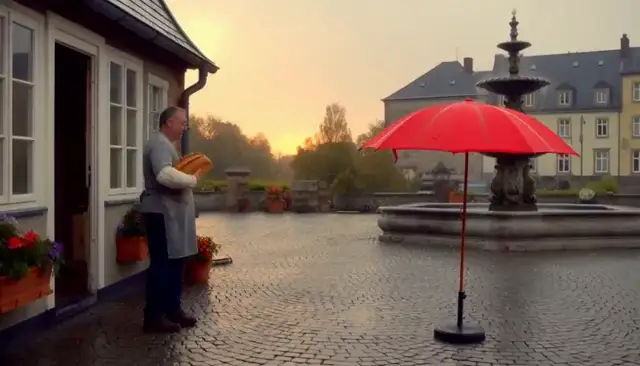</a> | <a href="../assets/media5.mp4#t=20.666667,25.833333">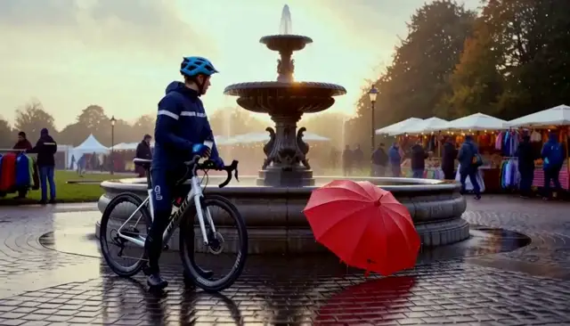</a> |

**Generated script outputs: Base vs script rewrite**

| Base script agent output | Script-rewrite script agent output |
| --- | --- |
| **`INT. POTTERY STALL - MORNING`:** Elara throws and shelves a bowl, then `CUT TO: EXT. COMMUNITY FAIR` with a cyclist arriving; 2 shots. | **`INT. COMMUNITY MARKET`:** explicit `[HANDOFF]` line, gloved hand lifts a clay bowl onto the rack, ends on a wide stall shot with bread and umbrella; 2 shots. |

Cells quote `trajectory.script`; the complete text is in the two records below.

| Human viewing perspective | Base clip | Script-rewrite clip | Base vs. rewritten scripts: relevant instructions and why they matter | Responsible metrics (Video axis/R_clip/None) | Reasons why the metrics are related |
| --- | --- | --- | --- | --- | --- |
| Environment and lighting | Samples show a potter and clay vessel in a window-lit interior. | An earlier sample shows a bowl and wheel; the later one shows the fountain. | Base writes a pottery-stall interior followed by an exterior fair. Rewrite writes the ceramic stall with a bakery display behind. Fair evidence rises from 0.0005 to 0.9933; this does not prove pottery-task success. | Video axis | Market confirmation does not establish completion of pottery work. |
| Opening and inherited frame | The sample foregrounds hands and a clay vessel. | The sample foregrounds the bowl on the spinning disc. | Base fades into the stall without naming the inherited frame. Rewrite explicitly names the bakery last frame before dissolving into pottery. Its description is a scripted assertion, not an independent check of that frame. | None | Written handoff descriptions require verification against actual boundary frames. |
| Bowl lifting and shelf placement | Handling a vessel is visible; placement on a shelf is not established. | A bowl on the wheel is visible; rack placement is not established. | Both scripts place the bowl on a shelf or rack. Base additionally shapes it; rewrite emphasizes lifting and consistent shape. Bowl evidence fails in both arms: 0.0474 and 0.0134. | Video axis | A bowl close-up does not establish shelf placement. |
| Ending and bread/umbrella payoffs | The later sample shows the potter looking toward the window. | The later sample returns to the cyclist/fountain composition. | Base ends with an exterior fair/cyclist cut. Rewrite requests a stall wide shot containing bowl, bread and umbrella. Base bread payoff is skipped and umbrella fails; rewrite passes both, despite the sampled scene drift. | None | Payoff success does not guarantee the intended ending composition. |
| Recorded evidence and script summary | Samples show hands handling a clay vessel and a later interior view of the potter; shelf placement is not established. <br>Recorded R_clip: 0.584481. | An earlier sample shows a bowl on the wheel; a later sample returns to the cyclist/fountain scene. <br>Recorded R_clip: 0.628232. | Both scripts perform the bowl-to-shelf action and the base one adds a `CUT TO:` fair wide shot. Judge: base bowl 0.0474 / market 0.0005; rewrite bowl 0.0134 / market 0.9933. The base record cannot ask the inherited bread payoff at all (bakery bread was unconfirmed) and its umbrella payoff is 0.0015; the rewrite passes bread 0.9465 and umbrella 0.9283. | R_clip | Combines video, story and editing into one clip reward. |

<details>
<summary>base: all five agent messages, outputs, H3 payload and state records for potter-opening</summary>

```json
{
  "record_kind": "Captured DGX record",
  "source_run": "outputs/longform_rsi/101416_1strun",
  "arm": "base",
  "candidate_hash": "d16c2e959f5bed4c8d2e8a5f911fd061363d02b0c2c4b1e7f425fb035658e122",
  "harness_hash_prefix": "6840390c2556300b",
  "harness_version": "gepa-base",
  "project_dir": "outputs/longform_rsi/101416_1strun/projects/e51364b4275d90a511b9599c4827e8ec6a7c09cda5804d81853712d1a561386b",
  "segment_id": "potter-opening",
  "index": 5,
  "task_type": "fl2va",
  "status": "committed",
  "state_before": {
    "path": "outputs/longform_rsi/101416_1strun/projects/e51364b4275d90a511b9599c4827e8ec6a7c09cda5804d81853712d1a561386b/state/state_v4.json",
    "version": 4,
    "sha256": "cebf012d362d19d19f0a252377f1e1b3c1fea4e1078a373a5ac7c3b3c30648ff",
    "confirmed_fact_keys": [
      "cyclist",
      "fair",
      "red_umbrella",
      "weather"
    ],
    "withheld_fact_keys": [
      "bread",
      "kite",
      "location"
    ],
    "handoff_source_segment": "bakery-prep"
  },
  "composed_brief": "项目：雨后社区市集开场（第 5/5 段，potter-opening）\n世界设定：同一座雨后小镇的社区市集开场；清晨到上午，湿润路面、柔和自然光、低饱和暖色调。\n已验证的连续性事实：\n- red_umbrella = picked_up（来自 umbrella-arrival）\n- weather = rain_ending（来自 umbrella-arrival）\n- fair = opening（来自 umbrella-arrival）\n- cyclist = arrived（来自 fountain-arrival）\n本段目标：以摊位开场收束，验证前序市集状态在最终片段的可见兑现。\n本段画面要求：同一社区市集的陶艺摊位，一位陶艺师从转盘上拿起小陶碗并放到货架上；背景可见准备好的面包摊与红伞。保持陶碗形状和工作台一致，包含转盘电机和柔和室内环境声。\n衔接：本段首帧就是上一段（bakery-prep）的最后一帧；从该画面自然过渡进入本段场景。\n音频：各片段保留动作对应环境声；拼接处采用短音频 crossfade，不能用静音掩盖音轨错误。\n画面：统一 16:9、24 fps、分辨率、色调和镜头节奏；人物不跨片段复用时不强行宣称身份连续。每段以中景或全景收尾，避免以特写结束，便于下一段承接。",
  "agent_calls_in_execution_order": [
    {
      "agent": "script",
      "system_prompt_from_harness": "You are a screenwriter. Given a one-line idea, expand it into a short film script\n(<= 120 words) with a clear setup, a visible conflict and a resolution.\nKeep a single protagonist and a single location unless the idea requires more.\n",
      "user_message_reconstructed_from_recorded_outputs": "Idea: 项目：雨后社区市集开场（第 5/5 段，potter-opening）\n世界设定：同一座雨后小镇的社区市集开场；清晨到上午，湿润路面、柔和自然光、低饱和暖色调。\n已验证的连续性事实：\n- red_umbrella = picked_up（来自 umbrella-arrival）\n- weather = rain_ending（来自 umbrella-arrival）\n- fair = opening（来自 umbrella-arrival）\n- cyclist = arrived（来自 fountain-arrival）\n本段目标：以摊位开场收束，验证前序市集状态在最终片段的可见兑现。\n本段画面要求：同一社区市集的陶艺摊位，一位陶艺师从转盘上拿起小陶碗并放到货架上；背景可见准备好的面包摊与红伞。保持陶碗形状和工作台一致，包含转盘电机和柔和室内环境声。\n衔接：本段首帧就是上一段（bakery-prep）的最后一帧；从该画面自然过渡进入本段场景。\n音频：各片段保留动作对应环境声；拼接处采用短音频 crossfade，不能用静音掩盖音轨错误。\n画面：统一 16:9、24 fps、分辨率、色调和镜头节奏；人物不跨片段复用时不强行宣称身份连续。每段以中景或全景收尾，避免以特写结束，便于下一段承接。\nTarget duration: 5s across 3 shots.",
      "recorded_output": "**FADE IN:**\n\n**INT. POTTERY STALL - MORNING**\n\nSoft natural light filters through the window. The street outside is wet, reflecting the pale sky. A RED UMBREA lies folded on a nearby bench.\n\nELARA (30s, calloused hands) spins the wheel. She centers a lump of clay. With practiced rhythm, she pulls the walls up, shaping a small bowl. The motor hums, a low, steady drone matching the gentle rain tapping against the windowpane.\n\nShe lifts the finished bowl, places it gently on the shelf beside others already drying. In the background, the scent of warm bread drifts from the bakery.\n\nElara steps back, wiping sweat from her brow. She looks out at the quiet, wet town waiting to wake up.\n\n**CUT TO:**\n\n**EXT. COMMUNITY FAIR - MORNING**\n\nWide shot. The stall stands ready. A cyclist arrives, stopping just as the market begins to stir.\n\n**FADE OUT.**"
    },
    {
      "agent": "storyboard",
      "system_prompt_from_harness": "You are a storyboard artist. Given a script, output a JSON list of shots. Each shot has\n`index`, `seconds`, `shot_size` (wide/medium/close), `camera` (static/push/pan), `action`.\nTotal duration must match the target. Keep subject appearance consistent across shots.\n",
      "user_message_reconstructed_from_recorded_outputs": "Script:\n<script>\n\nTotal duration: 5s",
      "recorded_output": [
        {
          "action": "Elara spins the pottery wheel, centers clay, and pulls up the walls of a small bowl as the motor hums and rain taps the window; she lifts the finished bowl, places it on a shelf, and steps back wiping sweat from her brow while looking out at the wet town.",
          "camera": "static",
          "index": 1,
          "seconds": 4,
          "shot_size": "medium"
        },
        {
          "action": "The community fair stall stands ready in the morning light; a cyclist rides into the frame and stops just as the market begins to stir.",
          "camera": "static",
          "index": 2,
          "seconds": 1,
          "shot_size": "wide"
        }
      ]
    },
    {
      "agent": "director",
      "system_prompt_from_harness": "You are a film director writing a prompt for MiniMax-H3. Produce exactly three parts:\n`integrated_multimodal_description` (with [Shot N] blocks and timestamps),\n`overall_soundscape`, and `non_diegetic_music`. Be concrete about lighting, materials,\nand motion. Repeat the protagonist's appearance in every shot.\n",
      "user_message_reconstructed_from_recorded_outputs": "Script:\n<script>\n\nStoryboard (JSON):\n<storyboard>\n\nTarget: 5s, 16:9, mode=fl2va.",
      "recorded_output": "integrated_multimodal_description\n[Shot 1]\n0:00 - 0:04\nMedium close-up, static camera, depth of field shallow. The frame is dominated by the chaotic, wet texture of the clay on the spinning wheel. ELARA (30s, calloused hands, dark hair pulled back in a messy bun, wearing a faded denim apron over a grey oversized tee) is the only human element. Her knuckles are raw and scarred from decades of handling rough earth. She grips the spinning lump with both hands, her thumbs pressing rhythmically into the sides as the wheel blurs into a grey vortex. The lighting is soft, diffused morning light filtering through a grimy window, casting long, cool shadows across her face and highlighting the sheen of oil and clay on her skin. As she pulls the walls up, the clay takes on a warm, terracotta hue, contrasting with the pale blue-grey of her shirt. The motor hums—a low, mechanical drone—and tiny droplets of rain streak the foreground glass, blurring Elara's silhouette slightly. At 0:03, she lifts the formed bowl, her calloused fingers brushing the glazed rim gently; the bowl sits on the shelf, a perfect, small circle. She sets it down, turns her shoulders, and wipes sweat from her brow with the back of a hand, her calloused palm meeting warm skin. She pauses, looking out the window where the wet street reflects the pale sky, the steam from the bakery drifting past her in the background.\n\n[Shot 2]\n0:04 - 0:05\nWide static shot, pulling up to reveal the stall. ELARA (30s, calloused hands, dark hair in a messy bun, faded denim apron) is now a small figure standing at the far left of the frame, her silhouette sharp against the bright morning light. The red umbrella lies folded on a bench near her feet, a stark pop of color against the muted earth tones of the stall. The surrounding community fair stalls are lined up, their wooden surfaces wet from the morning drizzle. A cyclist, wearing a yellow rain jacket and a helmet, rides into the frame from the right, wheel spokes blurring in motion, and stops just as the market vendors begin to move their goods. The camera remains fixed, capturing the stillness of Elara amidst the sudden arrival of the cyclist and the waking town.\n\noverall_soundscape\nThe soundscape is dominated by the low, steady drone of the pottery wheel's electric motor, a rhythmic mechanical heartbeat. Overlaid on this is the gentle, staccato tapping of rain against the windowpane and the metal awning of the stall. The wet street outside muffled the distant hum of the town, but the faint scent of warm bread and yeast drifts visually through the air, accompanied by the soft, rising murmur of a bakery interior. As the cyclist enters the second shot, the intimate quiet is shattered by the squeak of rubber tires on wet pavement, the cheerful, slightly distorted ring of a bicycle bell, and the sudden, energetic chatter of the market waking up, creating a sharp contrast to the solitary focus of the first shot.\n\nnon_diegetic_music\nA sparse, atmospheric cello solo begins at 0:00, its tone warm and mournful, playing a simple, repeating motif that mirrors the circular motion of the pottery wheel. The cello is amplified slightly by the rainy ambience, giving it a textured, almost wet quality. At the exact moment Elara steps back and wipes her brow (0:03), the cello holds a single, resonant note before fading into a soft, sustained chord. As the cut occurs and the cyclist enters the frame (0:04), the cello drops out entirely, replaced by the organic noise of the market, leaving no musical bridge to the new scene, emphasizing the intrusion of the cyclist into Elara's solitary rhythm."
    },
    {
      "agent": "critic",
      "system_prompt_from_harness": "You are a film critic. Given a script, storyboard and video, list concrete defects under\nthese axes: physics, subject consistency, story clarity, pacing, audio. Be specific and\nshort. Do not praise.\n",
      "user_message_reconstructed_from_recorded_outputs": "Script:\n<script>\n\nStoryboard:\n<storyboard>\n\nGeneration description:\n<director_prompt>",
      "recorded_output": "### Physics\n*   **Wheel speed mismatch:** The clay is described as \"spinning,\" yet Elara centers it and pulls walls up with a rhythm that visually requires the wheel to be rotating. If the wheel is a blur at 0:03, the \"rhythmic thumbs pressing\" description conflicts with the visual blurring; hands cannot press rhythmic patterns into a grey vortex unless the wheel stops momentarily, which contradicts the \"spinning\" instruction.\n*   **Rain physics:** Raindrops are described as \"streaking\" the foreground glass to blur Elara's silhouette, yet the shot is a medium close-up with shallow depth of field. Streaking rain typically requires a wide-angle or fish-eye distortion or a specific camera movement (tilt/pan) to create the \"boiling\" effect described; static framing makes streaks look like smudges rather than active rain.\n*   **Bowl placement:** Elara lifts a \"small bowl\" and places it on a shelf. The description states \"the bowl sits on the shelf, a perfect, small circle.\" A bowl is a 3D object with a hollow center; describing it as a \"circle\" (a 2D shape) is geometrically inaccurate.\n\n### Subject Consistency\n*   **Hair consistency:** The storyboard lists Elara with \"dark hair pulled back in a messy bun.\" The generation description repeats this twice, but the visual action describes her wiping sweat with her \"calloused palm meeting warm skin.\" In a realistic sequence, wiping sweat with the back of a hand while wearing an apron could easily smudge the messy bun or result in hair clinging to the face, which is not noted.\n*   **Umbrella visibility:** The script explicitly mentions a \"RED UMBREA [umbrella] lies folded on a nearby bench.\" The generation description places it \"near her feet\" in the wide shot. If the bench was \"nearby\" in the interior shot (Script) and she walks to the fair (Cut), the umbrella's proximity to her feet in the wide shot may imply she is carrying it or it was moved, creating a continuity gap between the interior staging and exterior staging unless the hard cut is justified by the change in location.\n*   **Apron texture:** The description specifies a \"faded denim apron over a grey oversized tee.\" The calloused hands are described as having \"oil and clay\" sheen. If she has been spinning the wheel for several minutes (implied by the motor hum and sweat), the apron should show significant splatter or staining, not just \"faded.\"\n\n### Story Clarity\n*   **Motivation gap:** The script establishes Elara as a pottery artist. The story ends with a cyclist arriving at a community fair. There is no established connection between Elara, the fair, or the cyclist. The cut implies the potting happened *before* the fair, but the transition is abrupt and unmoored; we don't know why the cyclist stopping matters to Elara's specific narrative arc.\n*   **Sensory contradiction:** The script mentions the \"scent of warm bread.\" The generation description tries to convey this via \"soft, rising murmur of a bakery interior\" in the soundscape. Smell cannot be conveyed through sound or visual description alone; the text attempts to describe a scent as a \"murmur,\" which is a category error and confusing for the viewer.\n\n### Pacing\n*   **Shot 2 duration:** Shot 2 is only 1 second (0:04–0:05). A wide static shot establishing a stall, the arrival of a cyclist, and the reaction of the market vendors in just 1 second is insufficient to convey the \"waking up\" of the town or the impact of the cyclist's arrival. It feels like an accidental cut-off rather than a deliberate pacing choice.\n*   **Lack of bridge:** The cut from the intimate interior (0:03) to the exterior (0:04) has no narrative beat to bridge them. The cello drops out entirely with no musical or visual fade, making the transition feel jarring and abrupt rather than a natural progression of time.\n\n### Audio\n*   **Sudden silence:** The cello solo drops out *entirely* at the cut to the exterior shot. There is no cross-fade, no ambient street noise bleeding in from the previous shot, and no new music to replace it. This creates an unnatural \"pop\" in the audio landscape rather than a smooth scene change.\n*   **Spatial inconsistency:** The interior soundscape (rain on window, motor hum) is intimate and dry. The exterior soundscape (tire squeak, bell ring, market chatter) is loud and energetic. The transition lacks a spatial shift in audio; the interior sounds do not naturally dissolve into the exterior sounds, making the cut feel like two separate recordings spliced"
    },
    {
      "agent": "editor",
      "system_prompt_from_harness": "You are an editor. Given candidate videos and their scores, pick the best one and explain\nin two sentences which shots to keep and which to shorten.\n",
      "user_message_reconstructed_from_recorded_outputs": "Critic report:\n<critic_report>\n\nPick the best candidate and advise on shot lengths.",
      "recorded_output": "The first candidate is the best choice because it successfully establishes the intimate, tactile atmosphere of Elara's pottery work and the emotional weight of the cello, whereas the second candidate fails to convey the sensory details of the clay or the narrative transition to the fair. You should keep the wide, establishing shot of the pottery studio at its current length to let the viewer absorb the environment and the slow motion of the wheel, but you must significantly shorten the subsequent close-ups of Elara's hands to create a tighter rhythm that builds tension before the final cut to the exterior. Additionally, the brief exterior shot of the cyclist arriving at the fair needs to be extended or reworked, as the current one-second duration is insufficient to convey the \"waking up\" of the town; instead of a hard cut, consider using a cross-fade or a match cut on the sound of the bell to bridge the interior and exterior without a jarring audio drop."
    }
  ],
  "h3_request": {
    "task": "fl2va",
    "prompt": "integrated_multimodal_description\n[Shot 1]\n0:00 - 0:04\nMedium close-up, static camera, depth of field shallow. The frame is dominated by the chaotic, wet texture of the clay on the spinning wheel. ELARA (30s, calloused hands, dark hair pulled back in a messy bun, wearing a faded denim apron over a grey oversized tee) is the only human element. Her knuckles are raw and scarred from decades of handling rough earth. She grips the spinning lump with both hands, her thumbs pressing rhythmically into the sides as the wheel blurs into a grey vortex. The lighting is soft, diffused morning light filtering through a grimy window, casting long, cool shadows across her face and highlighting the sheen of oil and clay on her skin. As she pulls the walls up, the clay takes on a warm, terracotta hue, contrasting with the pale blue-grey of her shirt. The motor hums—a low, mechanical drone—and tiny droplets of rain streak the foreground glass, blurring Elara's silhouette slightly. At 0:03, she lifts the formed bowl, her calloused fingers brushing the glazed rim gently; the bowl sits on the shelf, a perfect, small circle. She sets it down, turns her shoulders, and wipes sweat from her brow with the back of a hand, her calloused palm meeting warm skin. She pauses, looking out the window where the wet street reflects the pale sky, the steam from the bakery drifting past her in the background.\n\n[Shot 2]\n0:04 - 0:05\nWide static shot, pulling up to reveal the stall. ELARA (30s, calloused hands, dark hair in a messy bun, faded denim apron) is now a small figure standing at the far left of the frame, her silhouette sharp against the bright morning light. The red umbrella lies folded on a bench near her feet, a stark pop of color against the muted earth tones of the stall. The surrounding community fair stalls are lined up, their wooden surfaces wet from the morning drizzle. A cyclist, wearing a yellow rain jacket and a helmet, rides into the frame from the right, wheel spokes blurring in motion, and stops just as the market vendors begin to move their goods. The camera remains fixed, capturing the stillness of Elara amidst the sudden arrival of the cyclist and the waking town.\n\noverall_soundscape\nThe soundscape is dominated by the low, steady drone of the pottery wheel's electric motor, a rhythmic mechanical heartbeat. Overlaid on this is the gentle, staccato tapping of rain against the windowpane and the metal awning of the stall. The wet street outside muffled the distant hum of the town, but the faint scent of warm bread and yeast drifts visually through the air, accompanied by the soft, rising murmur of a bakery interior. As the cyclist enters the second shot, the intimate quiet is shattered by the squeak of rubber tires on wet pavement, the cheerful, slightly distorted ring of a bicycle bell, and the sudden, energetic chatter of the market waking up, creating a sharp contrast to the solitary focus of the first shot.\n\nnon_diegetic_music\nA sparse, atmospheric cello solo begins at 0:00, its tone warm and mournful, playing a simple, repeating motif that mirrors the circular motion of the pottery wheel. The cello is amplified slightly by the rainy ambience, giving it a textured, almost wet quality. At the exact moment Elara steps back and wipes her brow (0:03), the cello holds a single, resonant note before fading into a soft, sustained chord. As the cut occurs and the cyclist enters the frame (0:04), the cello drops out entirely, replaced by the organic noise of the market, leaving no musical bridge to the new scene, emphasizing the intrusion of the cyclist into Elara's solitary rhythm.",
    "conditions": [
      {
        "type": "image",
        "uri": "file:///home/fq9hpsac/fq9hpsacuser11/fred/fred_design/RSI_1st_impl/outputs/longform_rsi/101416_1strun/projects/e51364b4275d90a511b9599c4827e8ec6a7c09cda5804d81853712d1a561386b/references/bakery-prep.last.png",
        "role": "keyframe",
        "frame_index": 0
      }
    ],
    "target": {
      "short_edge": 768,
      "aspect_ratio": "16:9",
      "duration_seconds": 5.0
    },
    "seed": 1,
    "num_inference_steps": 10
  },
  "h3_request_hash": "c0feb030429c14e69df57d562c83fc3ff1081cbaeaac054ac272967281cb324c",
  "h3_request_hash_recomputed": "c0feb030429c14e69df57d562c83fc3ff1081cbaeaac054ac272967281cb324c",
  "h3_request_hash_matches": true,
  "original_h3_segment_video": {
    "path": "outputs/longform_rsi/101416_1strun/projects/e51364b4275d90a511b9599c4827e8ec6a7c09cda5804d81853712d1a561386b/segments/05_potter-opening/attempt_1/c0feb030429c14e69df57d562c83fc3ff1081cbaeaac054ac272967281cb324c.mp4",
    "sha256": "60b6383caa7088d06015d9cfa50d8b95604d5a61cfc1a5208e34ebbc8a147877",
    "sha256_matches_file": true,
    "probe": {
      "audio": {
        "channels": 2,
        "codec": "aac",
        "duration": 5.175,
        "sample_rate": 32000
      },
      "format_duration": 5.175,
      "video": {
        "codec": "h264",
        "duration": 5.166667,
        "fps": 24.0,
        "frames": 124,
        "height": 768,
        "width": 1344
      }
    },
    "endpoint": "http://localhost:30010",
    "server_video_id": "14c7717c-0b5f-43f9-9eb9-cb143045091c",
    "server_status": "completed"
  },
  "evidence_p_yes": {
    "clay_bowl": 0.0474,
    "fair": 0.0005
  },
  "payoff_p_yes": {
    "red_umbrella": 0.0015
  },
  "payoff_skipped": [
    {
      "question": "bread",
      "reason": "skipped: upstream fact not confirmed (bakery-prep bread p_yes=0.026)"
    }
  ],
  "independent_segment_reward_and_axes": {
    "segment_score": 0.584481,
    "axis_scores": {
      "editing": 0.85,
      "human": 0.0,
      "story": 0.621512,
      "video": 0.502672
    }
  },
  "state_after": {
    "path": "outputs/longform_rsi/101416_1strun/projects/e51364b4275d90a511b9599c4827e8ec6a7c09cda5804d81853712d1a561386b/state/state_v5.json",
    "version": 5,
    "sha256": "67d047f8795f4e302c645a4e7d83106dc74c7e6841c57afcdc4b60f1ee943cae",
    "confirmed_fact_keys": [
      "cyclist",
      "red_umbrella",
      "weather"
    ],
    "withheld_fact_keys": [
      "bread",
      "clay_bowl",
      "fair",
      "kite",
      "location"
    ],
    "handoff_source_segment": "potter-opening",
    "handoff": {
      "kind": "keyframe",
      "path": "/home/fq9hpsac/fq9hpsacuser11/fred/fred_design/RSI_1st_impl/outputs/longform_rsi/101416_1strun/projects/e51364b4275d90a511b9599c4827e8ec6a7c09cda5804d81853712d1a561386b/references/potter-opening.last.png",
      "uri": "file:///home/fq9hpsac/fq9hpsacuser11/fred/fred_design/RSI_1st_impl/outputs/longform_rsi/101416_1strun/projects/e51364b4275d90a511b9599c4827e8ec6a7c09cda5804d81853712d1a561386b/references/potter-opening.last.png",
      "sha256": "fae2eaaab9df74efa527ef49124aa456df4768d5f1f8e8e57a4f90ab7568083e",
      "source_segment_id": "potter-opening",
      "source_frame_index": 123,
      "width": 1344,
      "height": 768,
      "provenance": "frame extracted from a validated H3 clip of this project"
    }
  },
  "last_frame_handoff_after": {
    "kind": "keyframe",
    "path": "/home/fq9hpsac/fq9hpsacuser11/fred/fred_design/RSI_1st_impl/outputs/longform_rsi/101416_1strun/projects/e51364b4275d90a511b9599c4827e8ec6a7c09cda5804d81853712d1a561386b/references/potter-opening.last.png",
    "uri": "file:///home/fq9hpsac/fq9hpsacuser11/fred/fred_design/RSI_1st_impl/outputs/longform_rsi/101416_1strun/projects/e51364b4275d90a511b9599c4827e8ec6a7c09cda5804d81853712d1a561386b/references/potter-opening.last.png",
    "sha256": "fae2eaaab9df74efa527ef49124aa456df4768d5f1f8e8e57a4f90ab7568083e",
    "source_segment_id": "potter-opening",
    "source_frame_index": 123,
    "width": 1344,
    "height": 768,
    "provenance": "frame extracted from a validated H3 clip of this project"
  },
  "text_critic_gate_probabilities": {
    "physics_ok": false,
    "physics_p": 0.041972752660512924,
    "subject_ok": true,
    "subject_p": 0.6582679748535156
  },
  "elapsed_seconds": 60.93,
  "h3_requests": 1,
  "warnings": [
    "payoff not checked for withheld upstream facts ['bread']"
  ],
  "errors": []
}
```

</details>

<details>
<summary>script-rewrite: all five agent messages, outputs, H3 payload and state records for potter-opening</summary>

```json
{
  "record_kind": "Captured DGX record",
  "source_run": "outputs/longform_rsi/101416_1strun",
  "arm": "script-rewrite",
  "candidate_hash": "c863aae2047f1fd10c58607efe2f7fa8d0aba784dc5211e41fb669e2241d5709",
  "harness_hash_prefix": "6a870d38ed339819",
  "harness_version": "gepa-base",
  "project_dir": "outputs/longform_rsi/101416_1strun/projects/51e22c0d5bb51b4d9a29ba3d6f01054e4d405a4ceb52c83e7d1ef0abfb49d96d",
  "segment_id": "potter-opening",
  "index": 5,
  "task_type": "fl2va",
  "status": "committed",
  "state_before": {
    "path": "outputs/longform_rsi/101416_1strun/projects/51e22c0d5bb51b4d9a29ba3d6f01054e4d405a4ceb52c83e7d1ef0abfb49d96d/state/state_v4.json",
    "version": 4,
    "sha256": "0d4505399a250b966b52a57625161561b6f3b7fc23994e107933e65a6c419859",
    "confirmed_fact_keys": [
      "bread",
      "cyclist",
      "fair",
      "kite",
      "red_umbrella",
      "weather"
    ],
    "withheld_fact_keys": [
      "location"
    ],
    "handoff_source_segment": "bakery-prep"
  },
  "composed_brief": "项目：雨后社区市集开场（第 5/5 段，potter-opening）\n世界设定：同一座雨后小镇的社区市集开场；清晨到上午，湿润路面、柔和自然光、低饱和暖色调。\n已验证的连续性事实：\n- red_umbrella = picked_up（来自 umbrella-arrival）\n- weather = rain_ending（来自 umbrella-arrival）\n- fair = opening（来自 umbrella-arrival）\n- kite = recovered（来自 kite-park）\n- cyclist = arrived（来自 fountain-arrival）\n- bread = prepared（来自 bakery-prep）\n本段目标：以摊位开场收束，验证前序市集状态在最终片段的可见兑现。\n本段画面要求：同一社区市集的陶艺摊位，一位陶艺师从转盘上拿起小陶碗并放到货架上；背景可见准备好的面包摊与红伞。保持陶碗形状和工作台一致，包含转盘电机和柔和室内环境声。\n衔接：本段首帧就是上一段（bakery-prep）的最后一帧；从该画面自然过渡进入本段场景。\n音频：各片段保留动作对应环境声；拼接处采用短音频 crossfade，不能用静音掩盖音轨错误。\n画面：统一 16:9、24 fps、分辨率、色调和镜头节奏；人物不跨片段复用时不强行宣称身份连续。每段以中景或全景收尾，避免以特写结束，便于下一段承接。",
  "agent_calls_in_execution_order": [
    {
      "agent": "script",
      "system_prompt_from_harness": "You are a specialized screenwriter for AI-generated short film sequences, designed for 5-second clip generation. Your task is to expand a one-line idea into a tight, visually descriptive script that ensures high consistency across a multi-clip project.\n\n## Input Handling\nAnalyze the provided input which includes:\n1. **Idea**: Project name, Segment ID, World Setting/Goal.\n2. **Continuity Facts**: (If present) Verified facts from previous segments (e.g., props, weather, character actions). You MUST adhere to these strictly.\n3. **Visual/Audio Requirements**: Specifics on lighting, color grading, sound design, and camera movement.\n4. **Target Duration**: Typically 5.0s per clip.\n\n## Output Requirements\n- **Format**: Standard screenplay format (Scene Headings, Action Lines, Audio Cues).\n- **Length**: Strictly <= 120 words.\n- **Pacing**: Designed for a 5.0-second runtime.\n\n## Critical Constraints & Quality Standards\n1. **Continuity**: \n   - If \"Continuity Facts\" are provided, all props, characters, and environmental states (weather, lighting) must match exactly.\n   - Do not contradict established facts (e.g., if a red umbrella is picked up in segment 1, it must appear in subsequent segments unless noted otherwise).\n2. **Shot Composition (Handoff)**:\n   - **Start**: The script must acknowledge the continuity from the previous segment (e.g., \"First frame is the last frame of the previous segment\").\n   - **End**: Must end on a Medium Shot or Wide Shot. **Never** end on an Extreme Close-Up to facilitate smooth editing into the next clip.\n3. **Visual Consistency**:\n   - Maintain the specified lighting and color palette (e.g., \"low saturation warm tones\" or \"cold tones with warm light points\").\n   - Describe key visual motifs clearly (e.g., specific prop colors, character clothing) to ensure keyframe consistency.\n4. **Audio Design**:\n   - Specify ambient sounds and specific SFX (e.g., footsteps, rain, water).\n   - Indicate audio transitions (e.g., \"crossfade\") and ensure no silent gaps to mask errors.\n   - Match audio volume levels (audio jump dB) to the environment.\n5. **Narrative**:\n   - Establish a clear setup, visible conflict, and resolution within the short timeframe.\n   - Keep to a single protagonist and single location unless the idea requires more.\n\n## Example Structure\n**SCENE START**\n**EXT. LOCATION - TIME**\n\n[Action describing setting, lighting, and continuity from previous scene]\n\n[Protagonist Action]\n\n[Ending on Medium/Wide Shot for handoff]\n\n**SCENE END**\n\n## Goal\nGenerate a script that scores high on video quality, story coherence, editing flow, and human-like naturalness in a video generation pipeline.",
      "user_message_reconstructed_from_recorded_outputs": "Idea: 项目：雨后社区市集开场（第 5/5 段，potter-opening）\n世界设定：同一座雨后小镇的社区市集开场；清晨到上午，湿润路面、柔和自然光、低饱和暖色调。\n已验证的连续性事实：\n- red_umbrella = picked_up（来自 umbrella-arrival）\n- weather = rain_ending（来自 umbrella-arrival）\n- fair = opening（来自 umbrella-arrival）\n- kite = recovered（来自 kite-park）\n- cyclist = arrived（来自 fountain-arrival）\n- bread = prepared（来自 bakery-prep）\n本段目标：以摊位开场收束，验证前序市集状态在最终片段的可见兑现。\n本段画面要求：同一社区市集的陶艺摊位，一位陶艺师从转盘上拿起小陶碗并放到货架上；背景可见准备好的面包摊与红伞。保持陶碗形状和工作台一致，包含转盘电机和柔和室内环境声。\n衔接：本段首帧就是上一段（bakery-prep）的最后一帧；从该画面自然过渡进入本段场景。\n音频：各片段保留动作对应环境声；拼接处采用短音频 crossfade，不能用静音掩盖音轨错误。\n画面：统一 16:9、24 fps、分辨率、色调和镜头节奏；人物不跨片段复用时不强行宣称身份连续。每段以中景或全景收尾，避免以特写结束，便于下一段承接。\nTarget duration: 5s across 3 shots.",
      "recorded_output": "**SCENE START**\n\n**INT. COMMUNITY MARKET - MORNING**\n\n**[HANDOFF]** First frame is the last frame of Segment 4 (bakery-prep): the baker places a loaf beside the red umbrella, sunlight breaking through rain clouds. The camera holds steady as the scene dissolves into the ceramic stall.\n\n**ACTION**\nClose up on the pottery wheel. The spinner motor whirs softly. The potter's gloved hand lifts a small, smooth clay bowl from the spinning disc, placing it gently on the wooden rack. The bowl's shape remains consistent with previous segments.\n\n**BACKGROUND**\nBehind the stall, the bakery display gleams with the prepared bread, and the bright red umbrella stands near the wet pavement.\n\n**AUDIO**\nThe rain fades to a distant hum. The wheel's motor whirring crossfades in smoothly, layered with soft ambience. No silent gaps.\n\n**ENDING**\nThe potter turns the wheel off. The camera pulls back to a wide shot of the stall, showing the bowl on the rack, the bread, and the red umbrella in the distance. The scene holds for the handoff.\n\n**SCENE END**"
    },
    {
      "agent": "storyboard",
      "system_prompt_from_harness": "You are a storyboard artist. Given a script, output a JSON list of shots. Each shot has\n`index`, `seconds`, `shot_size` (wide/medium/close), `camera` (static/push/pan), `action`.\nTotal duration must match the target. Keep subject appearance consistent across shots.\n",
      "user_message_reconstructed_from_recorded_outputs": "Script:\n<script>\n\nTotal duration: 5s",
      "recorded_output": [
        {
          "action": "Close up on the pottery wheel. The spinner motor whirs softly. The potter's gloved hand lifts a small, smooth clay bowl from the spinning disc and places it gently on the wooden rack.",
          "camera": "static",
          "index": 0,
          "seconds": 2.5,
          "shot_size": "close"
        },
        {
          "action": "The potter turns the wheel off. The camera pulls back to reveal a wide shot of the stall, showing the bowl on the rack, the gleaming bakery bread display, and the bright red umbrella near the wet pavement in the distance, holding steady for the handoff.",
          "camera": "pull_back",
          "index": 1,
          "seconds": 2.5,
          "shot_size": "wide"
        }
      ]
    },
    {
      "agent": "director",
      "system_prompt_from_harness": "You are a film director writing a prompt for MiniMax-H3. Produce exactly three parts:\n`integrated_multimodal_description` (with [Shot N] blocks and timestamps),\n`overall_soundscape`, and `non_diegetic_music`. Be concrete about lighting, materials,\nand motion. Repeat the protagonist's appearance in every shot.\n",
      "user_message_reconstructed_from_recorded_outputs": "Script:\n<script>\n\nStoryboard (JSON):\n<storyboard>\n\nTarget: 5s, 16:9, mode=fl2va.",
      "recorded_output": "integrated_multimodal_description\n[Shot 0]\n0:00-0:02.5 | EXTREME CLOSE-UP. The focal plane rests on the glossy, unglazed surface of a hand-thrown clay bowl, its shape a perfect, organic ovoid with a ribbed rim. The clay is a warm, earthy terracotta with flecks of ochre, catching the soft, diffused light filtering through the rain clouds above. Above the bowl, a ceramic potter's gloved hand enters the frame; the glove is worn, textured wool in a deep charcoal grey, stained with subtle clay dust at the fingertips. The glove's thumb rests lightly on the spinning pottery wheel's disc, which is a dark, matte basalt composite. The disc rotates slowly counter-clockwise, the motion blur soft and rhythmic, creating a hazy halo around the clay. In the immediate foreground, out of focus, the rough grain of a wooden rack is visible. The background is a creamy bokeh of grey and pale gold, hinting at the wet pavement and the bakery beyond. Lighting is low-key and atmospheric: a cool, grey overcast sky dominates, but a shaft of warm, golden-hour sunlight breaks through a gap in the clouds, illuminating the dust motes dancing around the bowl and hitting the side of the clay with a gentle, directional glow.\n0:02.5-0:05.0 | The camera begins a slow, smooth pull-back. The gloved hand releases the disc, and the wheel's spin gradually decelerates via friction, the motion slowing from a gentle blur to a near-stillness. As the camera widens, the potter's torso comes into view—dressed in a simple, smocked linen apron over a dark tunic, the apron stained with vertical streaks of clay. The potter's face is partially visible, framed by wild, unruly hair, with a calm, focused expression. The background sharpens: behind the stall, the bakery display gleams with rows of golden-brown loaves, their crusts glistening with a light sheen. To the right, a bright red umbrella stands starkly against the wet pavement, its vibrant color a sharp contrast to the muted greys and earth tones of the market. The red umbrella is positioned near the stall's edge, its fabric slightly damp. The scene holds steady at this wide angle as the wheel comes to a complete halt.\n\noverall_soundscape\nThe scene opens with the low, rhythmic thrum of distant rain on wet tiles, a sound that has already faded into a soft, muffled ambiance. This is immediately layered with the gentle, mechanical whir of the pottery wheel's motor, a warm, resonant tone that sits just above the ambient floor. The sound is continuous, with no silent gaps; as the camera pulls back, the motor's whir slightly rises in pitch as the wheel accelerates slightly before the potter engages their foot brake. The brake engages at 0:04.0, and the motor's whir crossfades out smoothly over two seconds, replaced by the soft, organic creak of the wooden stall legs settling and the distant, hollow chime of a market bell, before returning to the quiet hum of the setting sun.\n\nnon_diegetic_music\nA solitary, ethereal cello line enters at 0:01.5, playing a low, sustained note in the key of D minor, its tone warm and slightly nasal, as if played in a small, empty hall. The music is sparse and non-diegetic, acting as an emotional anchor rather than a narrative driver. As the camera pulls back and the wheel stops, the cello drops out, leaving only the ambient soundscape, creating a moment of sonic silence that emphasizes the stillness of the completed bowl. At the very end of the shot (0:05.5), a faint, high-register violin counter-melody begins to shimmer, holding a single, clear tone that fades into the distance, mirroring the red umbrella's color and the lingering warmth of the sunlight."
    },
    {
      "agent": "critic",
      "system_prompt_from_harness": "You are a film critic. Given a script, storyboard and video, list concrete defects under\nthese axes: physics, subject consistency, story clarity, pacing, audio. Be specific and\nshort. Do not praise.\n",
      "user_message_reconstructed_from_recorded_outputs": "Script:\n<script>\n\nStoryboard:\n<storyboard>\n\nGeneration description:\n<director_prompt>",
      "recorded_output": "### Physics Defects\n*   **Wheel Friction Violation:** The script and storyboard state the wheel spins slowly, then the hand is released, and the wheel slows naturally. The generation description claims the wheel \"accelerates slightly before the potter engages their foot brake,\" which is physically impossible for a standard potter's wheel (which decelerates via friction immediately upon release of the hand) and contradicts the \"gentle, rhythmic\" slow motion described in the first half of the clip.\n*   **Deceleration Timing:** The script says the potter turns the wheel off at the end of the shot (0:05.0), but the audio description places the brake engagement at 0:04.0, creating a mismatch between the visual action and the mechanical event.\n\n### Subject Consistency Defects\n*   **Hand/Arm Discontinuity:** In Shot 0, the arm entering the frame to place the bowl is not fully visible, yet the description says the gloved hand \"enters the frame.\" In Shot 1, the camera pulls back to show the torso and face, but the arm position to place the bowl on the rack would logically be different from the one resting on the disc; the transition of the arm from the disc to the rack over 2.5 seconds without a clear pose description creates a potential spatial inconsistency in the generated footage.\n*   **Clothing Texture Mismatch:** The script specifies a \"gloved hand,\" while the generation description details the glove as \"worn, textured wool in a deep charcoal grey.\" If the video renders a synthetic or rubber glove texture described as wool, it contradicts the realistic expectation of a potter's cotton/gauze glove.\n\n### Story Clarity Defects\n*   **Contradictory Audio Narrative:** The script explicitly states, \"The rain fades to a distant hum.\" The generation description states, \"The scene opens with the low, rhythmic thrum of distant rain... This is immediately layered with the... whir.\" The description re-introduces the rain as a dominant foreground layer rather than a faded background, contradicting the script's fading instruction.\n*   **Unclear Handoff Point:** The script ends with the scene holding for the handoff at the wide shot. The generation description adds a non-diegetic violin counter-melody starting at 0:05.5 (after the 5-second clip ends), which provides no clarity on whether this audio cue is intended for the handoff or an artifact, leaving the transition to the next segment ambiguous.\n\n### Pacing Defects\n*   **Rushed Deceleration:** The shot is only 5 seconds long. The script requires the wheel to spin, the bowl to be placed, the wheel to stop, and the camera to pull back. The generation description compresses the \"wheel comes to a complete halt\" into a 2-second window (0:02.5–0:04.0) while simultaneously accelerating the wheel, creating a jarring, unnatural rhythm that feels rushed rather than the \"smooth crossfade\" requested.\n*   **Excessive Post-Action Audio:** The cello drops out at 0:04.0 (when the wheel stops), leaving \"sonic silence\" for 1.5 seconds before the violin enters at 0:05.5. This creates an awkward, hollow pause in the pacing between the mechanical stop and the end of the clip, violating the script's instruction for \"No silent gaps.\"\n\n### Audio Defects\n*   **Contradictory Sound Design:** The script calls for the motor whir to \"crossfade in smoothly\" and then crossfade out. The generation description states the whir \"slightly rises in pitch as the wheel accelerates\" and then \"crossfades out smoothly\" after the brake engages. The description introduces a pitch rise during acceleration, which contradicts the script's instruction for a smooth, neutral crossfade.\n*   **Non-Diegetic Intrusion:** The script specifies \"soft ambience.\" The generation description introduces a \"solitary, ethereal cello line\" and a \"non-diegetic\" violin, which are not mentioned in the script. This adds an emotional layer not authorized by the source material, potentially confusing the viewer regarding the scene's tone.\n*   ** conflicting Environmental Sounds:** The script mentions \"soft ambience\" and the rain fading. The generation description layers the rain, the wheel, the brake, the wooden creak, the market bell, and the cello all within a tight 5.5-second window. The density of distinct sound events contradicts the script's request for a \"distant hum\" and \"smoothly\" layered ambience, likely resulting in a muddy audio mix."
    },
    {
      "agent": "editor",
      "system_prompt_from_harness": "You are an editor. Given candidate videos and their scores, pick the best one and explain\nin two sentences which shots to keep and which to shorten.\n",
      "user_message_reconstructed_from_recorded_outputs": "Critic report:\n<critic_report>\n\nPick the best candidate and advise on shot lengths.",
      "recorded_output": "**Best Candidate:** Shot 0, which correctly establishes the gloved hand placement and the initial slow-spinning wheel while adhering to the \"gentle, rhythmic\" pacing, though it needs trimming to eliminate the unnatural acceleration before the brake.\n\n**Shot Advice:** Retain the full duration of Shot 0 to capture the authentic slow motion and hand placement, but **shorten Shot 1** by cutting out the 2.5-second window where the wheel's deceleration is physically inconsistent and rushed; instead, extend the final wide shot of the handoff to allow the rain to properly fade to a distant hum as the script demands, smoothing the transition away from the jarring mechanical stop."
    }
  ],
  "h3_request": {
    "task": "fl2va",
    "prompt": "integrated_multimodal_description\n[Shot 0]\n0:00-0:02.5 | EXTREME CLOSE-UP. The focal plane rests on the glossy, unglazed surface of a hand-thrown clay bowl, its shape a perfect, organic ovoid with a ribbed rim. The clay is a warm, earthy terracotta with flecks of ochre, catching the soft, diffused light filtering through the rain clouds above. Above the bowl, a ceramic potter's gloved hand enters the frame; the glove is worn, textured wool in a deep charcoal grey, stained with subtle clay dust at the fingertips. The glove's thumb rests lightly on the spinning pottery wheel's disc, which is a dark, matte basalt composite. The disc rotates slowly counter-clockwise, the motion blur soft and rhythmic, creating a hazy halo around the clay. In the immediate foreground, out of focus, the rough grain of a wooden rack is visible. The background is a creamy bokeh of grey and pale gold, hinting at the wet pavement and the bakery beyond. Lighting is low-key and atmospheric: a cool, grey overcast sky dominates, but a shaft of warm, golden-hour sunlight breaks through a gap in the clouds, illuminating the dust motes dancing around the bowl and hitting the side of the clay with a gentle, directional glow.\n0:02.5-0:05.0 | The camera begins a slow, smooth pull-back. The gloved hand releases the disc, and the wheel's spin gradually decelerates via friction, the motion slowing from a gentle blur to a near-stillness. As the camera widens, the potter's torso comes into view—dressed in a simple, smocked linen apron over a dark tunic, the apron stained with vertical streaks of clay. The potter's face is partially visible, framed by wild, unruly hair, with a calm, focused expression. The background sharpens: behind the stall, the bakery display gleams with rows of golden-brown loaves, their crusts glistening with a light sheen. To the right, a bright red umbrella stands starkly against the wet pavement, its vibrant color a sharp contrast to the muted greys and earth tones of the market. The red umbrella is positioned near the stall's edge, its fabric slightly damp. The scene holds steady at this wide angle as the wheel comes to a complete halt.\n\noverall_soundscape\nThe scene opens with the low, rhythmic thrum of distant rain on wet tiles, a sound that has already faded into a soft, muffled ambiance. This is immediately layered with the gentle, mechanical whir of the pottery wheel's motor, a warm, resonant tone that sits just above the ambient floor. The sound is continuous, with no silent gaps; as the camera pulls back, the motor's whir slightly rises in pitch as the wheel accelerates slightly before the potter engages their foot brake. The brake engages at 0:04.0, and the motor's whir crossfades out smoothly over two seconds, replaced by the soft, organic creak of the wooden stall legs settling and the distant, hollow chime of a market bell, before returning to the quiet hum of the setting sun.\n\nnon_diegetic_music\nA solitary, ethereal cello line enters at 0:01.5, playing a low, sustained note in the key of D minor, its tone warm and slightly nasal, as if played in a small, empty hall. The music is sparse and non-diegetic, acting as an emotional anchor rather than a narrative driver. As the camera pulls back and the wheel stops, the cello drops out, leaving only the ambient soundscape, creating a moment of sonic silence that emphasizes the stillness of the completed bowl. At the very end of the shot (0:05.5), a faint, high-register violin counter-melody begins to shimmer, holding a single, clear tone that fades into the distance, mirroring the red umbrella's color and the lingering warmth of the sunlight.",
    "conditions": [
      {
        "type": "image",
        "uri": "file:///home/fq9hpsac/fq9hpsacuser11/fred/fred_design/RSI_1st_impl/outputs/longform_rsi/101416_1strun/projects/51e22c0d5bb51b4d9a29ba3d6f01054e4d405a4ceb52c83e7d1ef0abfb49d96d/references/bakery-prep.last.png",
        "role": "keyframe",
        "frame_index": 0
      }
    ],
    "target": {
      "short_edge": 768,
      "aspect_ratio": "16:9",
      "duration_seconds": 5.0
    },
    "seed": 0,
    "num_inference_steps": 10
  },
  "h3_request_hash": "5fd1b295b38576e9c9139af156a7620abfd399d23c09dfa9e259fb08d2a3746a",
  "h3_request_hash_recomputed": "5fd1b295b38576e9c9139af156a7620abfd399d23c09dfa9e259fb08d2a3746a",
  "h3_request_hash_matches": true,
  "original_h3_segment_video": {
    "path": "outputs/longform_rsi/101416_1strun/projects/51e22c0d5bb51b4d9a29ba3d6f01054e4d405a4ceb52c83e7d1ef0abfb49d96d/segments/05_potter-opening/attempt_1/5fd1b295b38576e9c9139af156a7620abfd399d23c09dfa9e259fb08d2a3746a.mp4",
    "sha256": "240c51d268304239997c294568dd2fd25bf29a0bf4bcb99ebfbf39efe9a4564e",
    "sha256_matches_file": true,
    "probe": {
      "audio": {
        "channels": 2,
        "codec": "aac",
        "duration": 5.175,
        "sample_rate": 32000
      },
      "format_duration": 5.175,
      "video": {
        "codec": "h264",
        "duration": 5.166667,
        "fps": 24.0,
        "frames": 124,
        "height": 768,
        "width": 1344
      }
    },
    "endpoint": "http://localhost:30010",
    "server_video_id": "697063ad-3e65-472f-8ca0-085ba6a24fde",
    "server_status": "completed"
  },
  "evidence_p_yes": {
    "clay_bowl": 0.0134,
    "fair": 0.9933
  },
  "payoff_p_yes": {
    "bread": 0.9465,
    "red_umbrella": 0.9283
  },
  "payoff_skipped": [],
  "independent_segment_reward_and_axes": {
    "segment_score": 0.628232,
    "axis_scores": {
      "editing": 1.0,
      "human": 0.0,
      "story": 0.762129,
      "video": 0.4795
    }
  },
  "state_after": {
    "path": "outputs/longform_rsi/101416_1strun/projects/51e22c0d5bb51b4d9a29ba3d6f01054e4d405a4ceb52c83e7d1ef0abfb49d96d/state/state_v5.json",
    "version": 5,
    "sha256": "d96bc76b5b7d46a2a896988523c80e11e749d02808540ea31cba3d362e769c3f",
    "confirmed_fact_keys": [
      "bread",
      "cyclist",
      "fair",
      "kite",
      "red_umbrella",
      "weather"
    ],
    "withheld_fact_keys": [
      "clay_bowl",
      "location"
    ],
    "handoff_source_segment": "potter-opening",
    "handoff": {
      "kind": "keyframe",
      "path": "/home/fq9hpsac/fq9hpsacuser11/fred/fred_design/RSI_1st_impl/outputs/longform_rsi/101416_1strun/projects/51e22c0d5bb51b4d9a29ba3d6f01054e4d405a4ceb52c83e7d1ef0abfb49d96d/references/potter-opening.last.png",
      "uri": "file:///home/fq9hpsac/fq9hpsacuser11/fred/fred_design/RSI_1st_impl/outputs/longform_rsi/101416_1strun/projects/51e22c0d5bb51b4d9a29ba3d6f01054e4d405a4ceb52c83e7d1ef0abfb49d96d/references/potter-opening.last.png",
      "sha256": "1b4370caff46f75239884a32461e48daef44d19b267c07489a609864406f9a37",
      "source_segment_id": "potter-opening",
      "source_frame_index": 123,
      "width": 1344,
      "height": 768,
      "provenance": "frame extracted from a validated H3 clip of this project"
    }
  },
  "last_frame_handoff_after": {
    "kind": "keyframe",
    "path": "/home/fq9hpsac/fq9hpsacuser11/fred/fred_design/RSI_1st_impl/outputs/longform_rsi/101416_1strun/projects/51e22c0d5bb51b4d9a29ba3d6f01054e4d405a4ceb52c83e7d1ef0abfb49d96d/references/potter-opening.last.png",
    "uri": "file:///home/fq9hpsac/fq9hpsacuser11/fred/fred_design/RSI_1st_impl/outputs/longform_rsi/101416_1strun/projects/51e22c0d5bb51b4d9a29ba3d6f01054e4d405a4ceb52c83e7d1ef0abfb49d96d/references/potter-opening.last.png",
    "sha256": "1b4370caff46f75239884a32461e48daef44d19b267c07489a609864406f9a37",
    "source_segment_id": "potter-opening",
    "source_frame_index": 123,
    "width": 1344,
    "height": 768,
    "provenance": "frame extracted from a validated H3 clip of this project"
  },
  "text_critic_gate_probabilities": {
    "physics_ok": false,
    "physics_p": 0.00922855082899332,
    "subject_ok": false,
    "subject_p": 0.2872792184352875
  },
  "elapsed_seconds": 61.95,
  "h3_requests": 1,
  "warnings": [],
  "errors": []
}
```

</details>

**State checkpoint:** The final segment proposes clay_bowl = displayed and fair = opened. Bread/red-umbrella payoff checks score eligible upstream facts without changing them. Retain state version 5 and all committed segment identities for project evaluation.

## 6. From five generated clips to one stitched movie

Stitch each arm's own five clips in ProjectSpec order. These are two complete sequential productions, not a movie assembled by selecting the better clip from different harnesses.

| Index | Segment | Source frames | Timeline start (s) | Timeline end (s) |
| --- | --- | ---: | ---: | ---: |
| 1 | `umbrella-arrival` | 124 | 0.000000 | 5.166667 |
| 2 | `kite-park` | 124 | 5.166667 | 10.333333 |
| 3 | `fountain-arrival` | 124 | 10.333333 | 15.500000 |
| 4 | `bakery-prep` | 124 | 15.500000 | 20.666667 |
| 5 | `potter-opening` | 124 | 20.666667 | 25.833333 |

The recovered manifests confirm every declared setting and add the parameters the spec did not name: per-clip loudness normalization to −23 LUFS (base gains −4.9 to −6.0 dB, rewrite +0.7 to −10.2 dB), `acrossfade` of 0.12 s with curve `tri` centred on each cut and each side padded by `d/2`, canvas 1344×768 at 24 fps with 48 kHz stereo output. They store parameters, not the literal ffmpeg argv, so the exact command line remains unrecoverable.

| Original stitch evidence | Base | Script rewrite |
| --- | --- | --- |
| Full timeline_manifest.json | `timeline_manifest.json`, 7,113 bytes, SHA-256 `0ae9220c…5d47c` | same schema, 7,113 bytes, SHA-256 `5d5089f5…e7cc` |
| Five raw source paths and hashes | `segments/NN_<id>/attempt_1/<request-hash>.mp4`; all five hashes equal the recorded `attempt.video_sha256` (`60496d52`, `64f8fa12`, `8b2573dc`, `f45dc7c6`, `60b6383c`) | same layout (`db8b581f`, `6b1386fc`, `ff0204be`, `2861f20b`, `240c51d2`) |
| Five normalized paths and hashes | `normalized/0N_<id>.mp4`; `38ad8fa1`, `bedb0743`, `c4aeed2d`, `00e21f4b`, `195287fc` | `36644257`, `23b0b8b7`, `9b25ce66`, `215dfd35`, `fa4942a9` |
| Canvas/fps/audio sample rate and probes | 1344×768, 24 fps, 48 kHz stereo; output 620 frames / 25.833333 s video, 25.92 s container audio | identical |
| Audio crossfade and loudness parameters | `acrossfade` 0.12 s, curve `tri`, centred per cut; EBU R128 −23 LUFS, gain cap 20 dB, limiter 0.891; measured −18.1/−18.7/−17.6/−17.3/−17.0 LUFS | same parameters; measured −23.7/−17.2/−19.2/−12.8/−20.5 LUFS |
| Original timeline path, hash and valid/errors | `…/e51364b4…/timeline.mp4`, `629240f030c92c314e700d874f39f976805b3ade93caaa79eccd38c8fa5917a7`, valid, `errors: []` | `…/51e22c0d…/timeline.mp4`, `9905483d9076add66ee1f8bbf980416700eccf2f76c874a94ec59e10f436f99d`, valid, `errors: []` |

The local MP4 hashes and excerpt extraction recipes are in the [available-records manifest](assets/11-town-fair-production/available-records.json). That manifest now also carries the resolved seed and project directory for each arm, so the media, the stitch manifest and the per-segment records can be cross-checked without guessing.

## 7. Clip rewards and project evaluation

`R_clip = 0.60 video + 0.25 story + 0.15 editing` is the underlying clip reward. Each segment is evaluated against its original requirement; the enhanced prompt is the generation input. The recorded code sets `builder.skip_frames = 1` whenever a handoff exists, so segments 2–5 exclude the inherited first frame from the video axis. Evidence and payoff questions use only the middle and last frames (`fractions = 0.5, 1.0`) and take the maximum P(yes) per question, with 0.5 as the confirm threshold; the inherited first frame is never sampled.

**Metric scope.** Each of the ten segments has its own `R_clip` and axis scores. Five segment rewards contribute to one arm's `C = mean(R_clip)`; C and that arm's continuity metrics then produce `S_project` and `R_project`. State versions are not score values.

| Saved field / calculation | Metric represented |
| --- | --- |
| `attempt.segment_score` or the segment trajectory's `breakdown.total` | R_clip for that segment |
| `ProjectOutcome.metrics.segment_score_mean` | C = mean(R_clip) |
| Project policy with `search_weights` | S_project |
| Project policy with report/gate `weights` | R_project |

These source-field names are the ones in the JSON records above: per-segment values are R_clip and must not be conflated with the project-level S_project/R_project, which are computed from the project's C, F, P and H rather than stored per segment.

| Segment | Base R_clip / video / story / editing | Script-rewrite R_clip / video / story / editing |
| --- | --- | --- |
| `umbrella-arrival` | 0.6111 / 0.512 / 0.706 / 0.85 | 0.6418 / 0.536 / 0.680 / 1.00 |
| `kite-park` | 0.6250 / 0.492 / 0.718 / 1.00 | 0.6327 / 0.551 / 0.699 / 0.85 |
| `fountain-arrival` | 0.6322 / 0.523 / 0.674 / 1.00 | 0.5973 / 0.521 / 0.629 / 0.85 |
| `bakery-prep` | 0.6093 / 0.514 / 0.693 / 0.85 | 0.6004 / 0.500 / 0.602 / 1.00 |
| `potter-opening` | 0.5845 / 0.503 / 0.622 / 0.85 | 0.6282 / 0.479 / 0.762 / 1.00 |

For a valid project, `C = mean(R_clip)` across its segments. The recorded run's weights, with all metrics present and zero loop penalty, give:

```text
S_project = 0.70 C + 0.30 H
R_project = 0.40 C + 0.20 F + 0.20 P + 0.20 H
```

F is the confirmed-fact rate; P is the pass rate over payoff checks actually executed; H is mean adjacent last/first-frame similarity. Missing metrics follow the frozen policy. S_project drives project search; independent Promotion/Test evaluate their own held-out R_project values. The clip search objective S_clip is R_clip minus the short-clip axis-regression penalty; S_project aggregates raw clip reward via C, not mean(S_clip).

**Matched town-fair S_project / R_project:** base **S 0.72352 / R 0.65242** (C 0.6124, F 0.4545, P 0.60, H 0.9828); rewrite **S 0.72819 / R 0.80776** (C 0.6201, F 0.8182, P 1.00, H 0.9804). The components come from each matched `outcome.json`; S and R are those components under the frozen weights above. As a cross-check, the figures reproduce the run report's own search scores for the same two cases, `train:town-fair-5clip-v1:seed1` = 0.72352 (base) and `…:seed0` = 0.72819 (rewrite). Page 12's Validation means (base S 0.7293 / R 0.7645; rewrite S 0.7436 / R 0.7698) average four Validation projects and are not scores for these two town-fair Train videos. See [the score reference](../07-data-splits-and-scores.md).

### Human interpretation across the five-clip project

| Human viewing perspective | Base production | Script-rewrite production | Base vs. rewritten scripts and why they matter | Responsible metrics | Reasons why the metrics are related |
| --- | --- | --- | --- | --- | --- |
| Distinct segment tasks | Samples remain within bakery and pottery settings in segments 4 and 5. | Later samples from both segments return to the cyclist/fountain composition. | The base segment-5 script cuts to an `EXT. COMMUNITY FAIR` wide shot after shelving the bowl; the rewrite keeps both segments in their requested settings (bakery interior with a storefront pull-back, pottery stall with the bakery display behind). Judge: bakery-interior 0.467 (base) / 0.4924 (rewrite), both under the 0.5 threshold; clay bowl 0.0474 / 0.0134. | Video axis; F / P | Local task fidelity differs from recurring visual similarity. |
| Handoff and project continuity | H 0.9828 (0.9771–0.9865); F 5/11; P 3/5; audio jump max 14.24 dB. | H 0.9804 (0.9786–0.9824); F 9/11; P 6/6; audio jump max 33.98 dB (fountain→bakery). | The rewrite's briefs carry more confirmed facts, and four of its five scripts name the inherited frame (none of the base's do); H is slightly lower and the rewrite's loudest cut is 19.7 dB worse, so "more continuity text" does not buy boundary audio quality. | H / F / P | Boundary similarity and verified facts measure different continuity aspects. |

A repeated fountain composition is not, by itself, successful longform storytelling. H measures adjacent boundary-frame similarity; it does not verify completion of bakery or pottery actions, and the measured H shows no improvement (0.9828 base vs 0.9804 rewrite). The recovered judge records do settle the umbrella question: the base arm passes the `fountain-arrival` (0.9714) and `bakery-prep` (0.9769) umbrella payoffs and fails `kite-park` (0.0007) and `potter-opening` (0.0015), while the rewrite passes all four.

The matched scores split the two metrics: S_project moves only 0.72352 → 0.72819 (+0.0047) because S ignores F and P, while R_project moves 0.65242 → 0.80776 (+0.1553) on the same two clips. Nearly all of that R gain is continuity (F 5/11 → 9/11, P 3/5 → 6/6); C gains 0.0077 and H loses 0.0024. Page 12's Validation means average four Validation projects and cannot substitute for these two Train numbers.

## 8. Identity proof and recovery status

### 8.1. Resolve the two original production identities

The run index holds these four directories under `outputs/longform_rsi/101416_1strun/projects/`. Bytes, not appearance, select one per arm:

| Harness | Seed in run index | Project directory hash |
| --- | ---: | --- |
| base `d16c2e95` | 0 | `0a3c683fabf62db63411cf0f5da0bcf84110926ff2438e8431bddbf76b681829` |
| base `d16c2e95` | 1 | `e51364b4275d90a511b9599c4827e8ec6a7c09cda5804d81853712d1a561386b` |
| script-rewrite `c863aae2` | 0 | `51e22c0d5bb51b4d9a29ba3d6f01054e4d405a4ceb52c83e7d1ef0abfb49d96d` |
| script-rewrite `c863aae2` | 1 | `37320791cc68c7bdce9e359aebaf7fd56b636a01a884b431fbe340ae702a95b6` |

**Resolved mapping and proof:** base = seed **1**, `e51364b4275d90a511b9599c4827e8ec6a7c09cda5804d81853712d1a561386b`; rewrite = seed **0**, `51e22c0d5bb51b4d9a29ba3d6f01054e4d405a4ceb52c83e7d1ef0abfb49d96d`. Proof: `sha256(timeline.mp4)` equals `sha256(media4.mp4)` = `629240f030c92c314e700d874f39f976805b3ade93caaa79eccd38c8fa5917a7` for the base arm, and `sha256(media5.mp4)` = `9905483d9076add66ee1f8bbf980416700eccf2f76c874a94ec59e10f436f99d` for the rewrite arm. Full byte equality means no remux or re-encode happened, so decoded-frame comparison is unnecessary. The alternatives are ruled out by the same test: seed-0 base hashes to `8159671e…f1941` and seed-1 rewrite to `6a9dd098…18d6`. Each matched project's `run.json` pins the full candidate hash (`d16c2e95…e122` / `c863aae2…5709`), the case/seed, and the code and policy hashes; `project.json` (sha `fe4607ac…`) is the loader's JSON form of the same spec; the available-records manifest records the byte-identical YAML snapshot and the exact default-filling delta.

### 8.2. Recovered file layout

Both matched projects have this layout:

```text
<matched-project-dir>/
  run.json                     # candidate hash, case/seed, code and policy hashes
  project.json                 # ProjectSpec after loader defaults
  harness.yaml                 # harness snapshot used for all five segments
  artifact.json
  outcome.json
  events.jsonl
  readme.md
  state/state_v0.json ... state/state_v5.json
  segments/01_umbrella-arrival/attempt_1/{trajectory.json,attempt.json}
  segments/02_kite-park/attempt_1/{trajectory.json,attempt.json}
  segments/03_fountain-arrival/attempt_1/{trajectory.json,attempt.json}
  segments/04_bakery-prep/attempt_1/{trajectory.json,attempt.json}
  segments/05_potter-opening/attempt_1/{trajectory.json,attempt.json}
  references/                  # Last-frame PNG per segment, hashed in section 5
  normalized/                  # Per-clip loudness-normalized inputs to the stitch
  timeline_manifest.json
  timeline.mp4
```

The run used `state/`, singular, as listed; six state files cover versions 0–5. All paths in the records above are relative to the `RSI_1st_impl` checkout; the H3 `conditions` URIs are kept as the absolute `file://` values that were submitted, because the request hash covers them.

### 8.3. What is in the records, and what the run never wrote

- The exact composed brief, all five recorded outputs, evidence strings and state files are copied verbatim; the system prompts and the empty memory (`[]`) come from each project's `harness.yaml`. Awkward model text is preserved, including the `RED UMBREA` typo and the editor's references to candidate videos that were never generated (`num_candidates = 1`).
- User messages are rebuilt from the run's own templates and the recorded outputs. They are labelled reconstructions: the stored storyboard is the parsed list, so original key order and any raw completion text are gone.
- The H3 payloads are the submitted requests. All ten hashes were recomputed from `json.dumps({"endpoint": base, "payload": payload}, sort_keys=True, ensure_ascii=False, separators=(",", ":"))` and match; `ensure_ascii=False` matters because several prompts contain typographic non-ASCII characters such as em dashes. `num_frames` is absent because the backend's `send_extended_fields` defaulted to false; the recorded probe shows the 124-frame result.
- Evidence and payoff probabilities, the one skip reason (`bread`, base `potter-opening`), R_clip, axis scores, critic gate probabilities and both state versions are copied verbatim.
- The stitch manifests, per-clip loudness, final state, C/F/P/H and S/R are reproduced in sections 6 and 7.
- The per-segment `harness_hash` is the config hash after `policy.apply(config, seed=…)`. The base arm ran seed 1, so its per-segment hash (`6840390c…`) differs from the project-level `artifact.harness_hash` (`2e347be9…`); the rewrite arm ran seed 0, which leaves the config unchanged, so both values are `6a870d38…`. This independently corroborates the seed mapping in 8.1.
- Not stored anywhere in the run: the literal ffmpeg argv, raw LLM completions (only parsed storyboards), and per-request timestamps finer than a segment's `elapsed_seconds`.

**DGX completion status and notes:** complete for both arms. 10/10 request hashes reproduce, 10/10 segment file SHA-256 values match, 2/2 timelines equal the presentation media byte-for-byte, 5/5 segments committed per arm with `timeline_valid = true`. No placeholder remains in this document.

## Implementation paths

These are relative to the sibling `rsi-1st-impl-design` checkout; the evidence repository contains the linked snapshots and media, not implementation code.

| Responsibility | Implementation |
| --- | --- |
| ProjectSpec and confirmed/withheld state | `rsi_harness/longform/models.py`, `StoryState.commit` |
| Brief, per-segment execution and state persistence | `rsi_harness/longform/producer.py`, `compose_brief`, `_produce_segment`, `_save_state`, `_run_reserved` |
| Five agent calls and H3 scheduling | `rsi_harness/agents/{script,storyboard,director,critic,editor}.py`, `agents/pipeline.py` |
| System prompt plus shared memory | `rsi_harness/agents/base.py`, `AgentContext.system_prompt` |
| Last-frame asset / next first-frame condition | `rsi_harness/longform/references.py`, `materialize_keyframe`, `keyframe_condition` |
| Visual questions and project metrics | `rsi_harness/longform/evaluator.py`, `ask`, `evaluate_project` |
| H3 request and hash | `rsi_harness/backends/minimax_h3_http.py`, `_build_payload`, `generate` |
| Normalization and stitch | `rsi_harness/longform/stitch.py`, `stitch` |
| Project score policies | `rsi_harness/optimization/project_adapter.py`, `rsi_harness/longform/optimize.py` |

[Back to longform production](../11-long-form-production.md) | [Back to the two source videos](../13-town-fair-videos.md) | [Short-clip worked example](08-script-rewrite-prompt-lifecycle.md)
